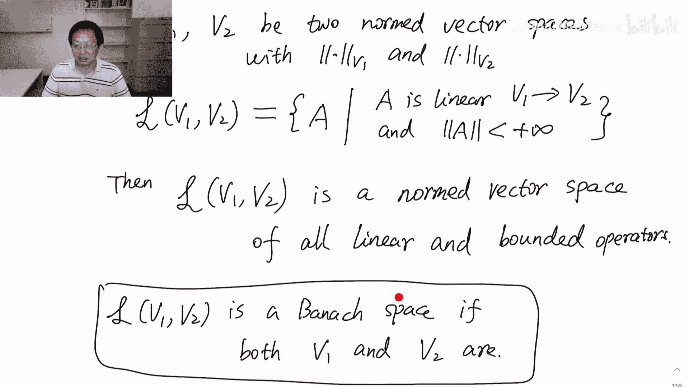

数据分析的数学方法：15-04-02：有界线性算子与巴拿赫空间 🧮

在本节课中，我们将要学习有界线性算子的定义，并探讨当涉及的向量空间是完备的（即巴拿赫空间）时，由这些算子构成的空间所具有的重要性质。

---

上一节我们介绍了线性算子集合上的线性结构和范数定义。本节中，我们来看看**有界线性算子**。

设 \( V_1 \) 和 \( V_2 \) 是两个赋范向量空间，其范数分别为 \( \|\cdot\|_{V_1} \) 和 \( \|\cdot\|_{V_2} \)。

我们定义集合 \( L(V_1, V_2) \) 为所有满足以下条件的线性算子 \( A: V_1 \to V_2 \)：
\[
\|A\|_{\text{op}} = \sup_{\|x\|_{V_1} \neq 0} \frac{\|A(x)\|_{V_2}}{\|x\|_{V_1}} < \infty
\]
其中，\( \|A\|_{\text{op}} \) 称为算子 \( A \) 的**算子范数**。

由于我们定义了加法和标量乘法，可以验证这个集合在加法和标量乘法下是封闭的。以下是具体说明：

如果 \( A \) 和 \( B \) 是这个集合中的两个元素，那么它们的线性组合仍然在这个集合中。

因此，\( L(V_1, V_2) \) 本身构成一个向量空间。此外，因为我们在其上定义了一个范数（算子范数），所以它也是一个**赋范向量空间**。

由于集合中所有算子的范数都是有限的，我们称它们为**有界算子**。

---

有界线性算子空间有一个非常好的性质：

如果 \( V_1 \) 和 \( V_2 \) 都是**巴拿赫空间**（即完备的赋范向量空间），那么 \( L(V_1, V_2) \) 也是一个巴拿赫空间。

回顾一下，巴拿赫空间意味着完备的赋范向量空间。因此，我们不仅得到了一个赋范向量空间 \( L(V_1, V_2) \)，而且在 \( V_1 \) 和 \( V_2 \) 都完备的条件下，它也是一个完备的赋范向量空间。

这个性质非常有用，因为它保证了空间中的柯西序列必定收敛，且极限点仍在同一空间内。因此，我们无需担心序列的极限、收敛性等问题在这个空间 \( L(V_1, V_2) \) 中会出现任何异常行为。

---

本节课中我们一起学习了有界线性算子的正式定义及其构成的空间。关键点在于，当定义域和值域都是巴拿赫空间时，有界线性算子空间本身也是巴拿赫空间。这为后续分析算子序列的收敛性提供了坚实的数学基础。