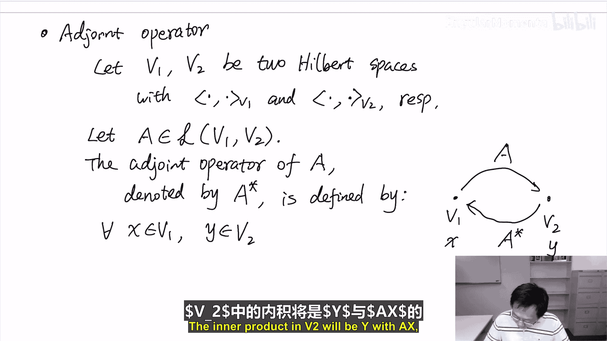
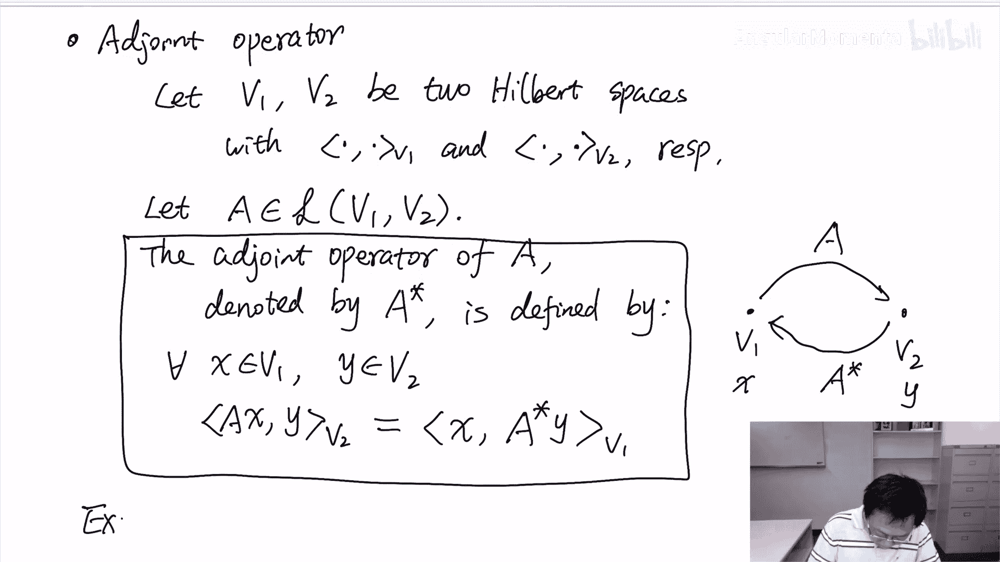
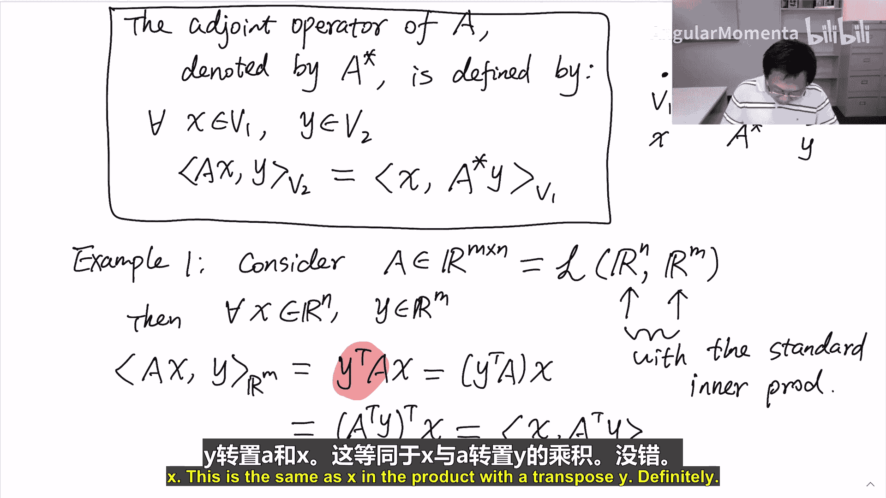
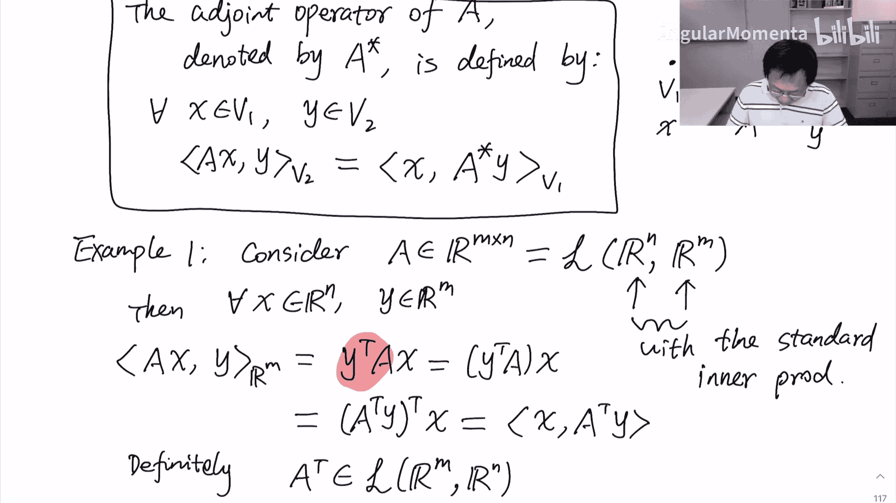
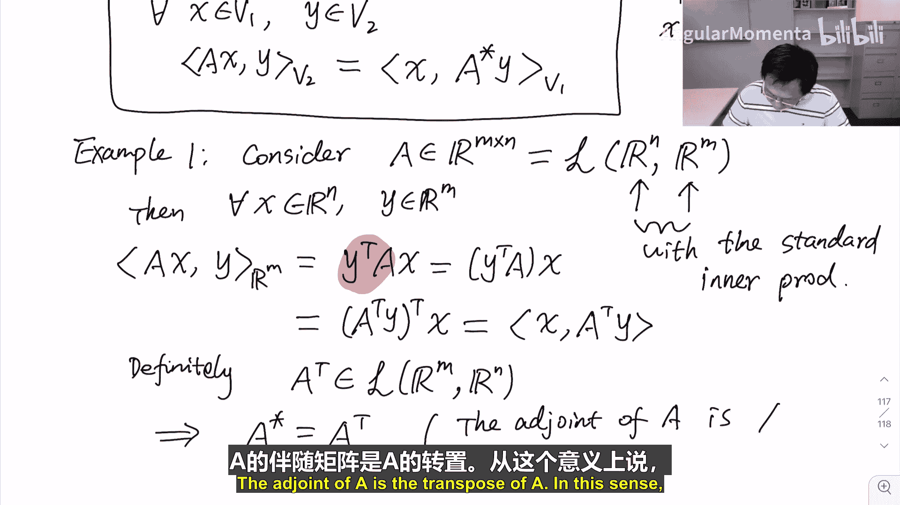
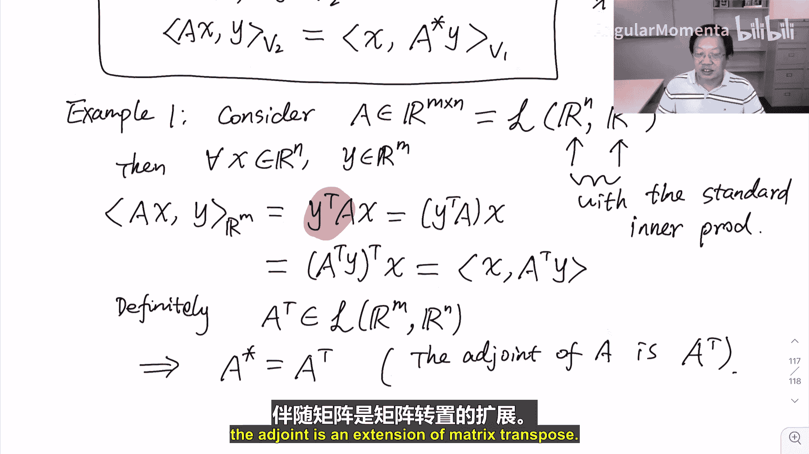
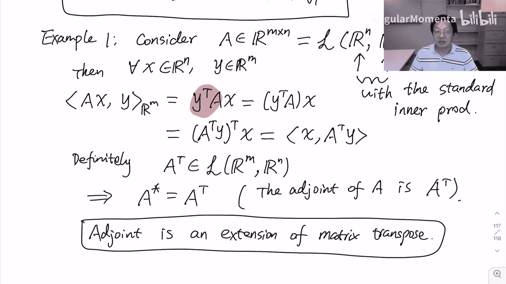
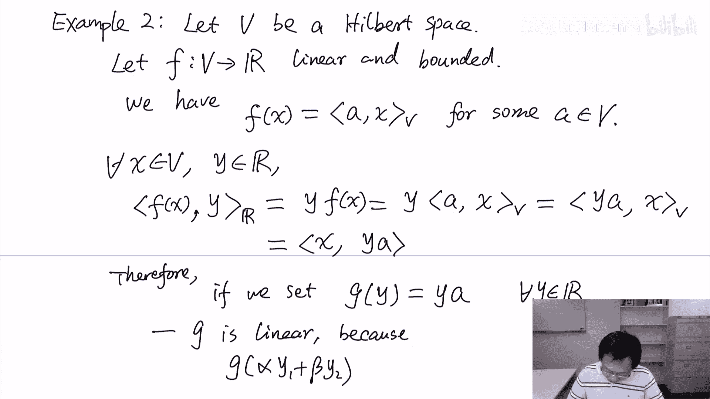
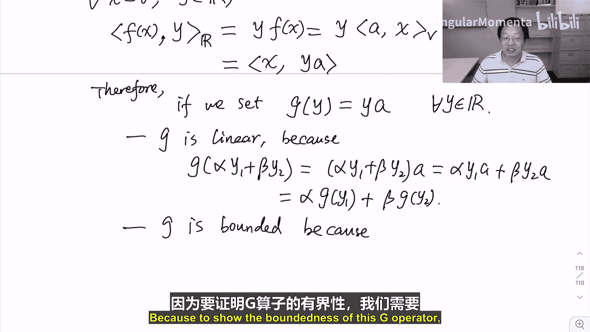
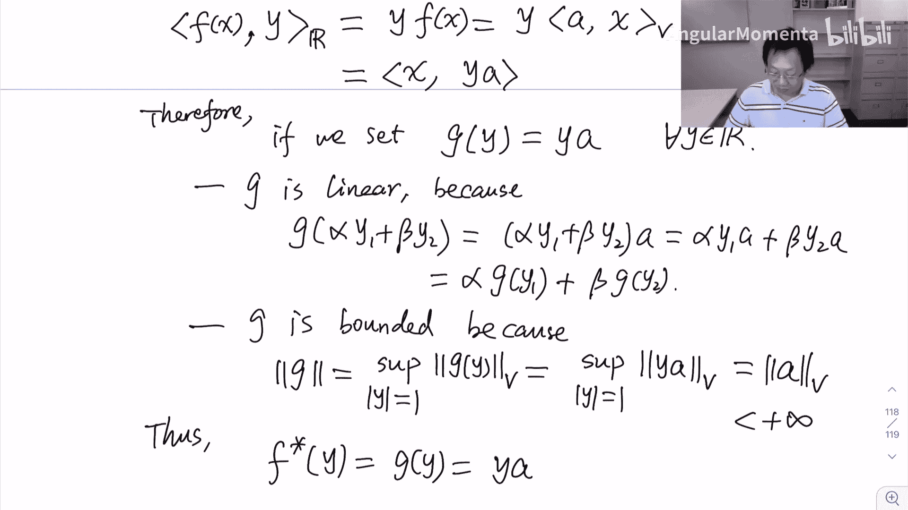

# 091：希尔伯特空间上的伴随算子

在本节课中，我们将要学习希尔伯特空间上的有界线性算子，并重点介绍一个核心概念：伴随算子。伴随算子是矩阵转置概念在更一般的希尔伯特空间上的推广。

上一节我们介绍了巴拿赫空间上的线性有界算子，本节中我们来看看希尔伯特空间上的情况。

## 伴随算子的定义

我们有两个希尔伯特空间 **V₁** 和 **V₂**，分别定义了内积 **<·, ·>₁** 和 **<·, ·>₂**。设 **A** 是一个从 **V₁** 到 **V₂** 的有界线性算子。

我们定义 **A** 的伴随算子，记作 **A***。**A*** 将一个 **V₂** 中的向量映射到 **V₁** 中，因此可以看作是 **A** 的一种“逆”。

**A*** 的定义基于以下等式：对于任意 **x ∈ V₁** 和 **y ∈ V₂**，我们希望满足：
**<A x, y>₂ = <x, A* y>₁**

这个等式必须对所有 **x** 和 **y** 都成立。伴随算子的存在性和唯一性由里斯表示定理保证。

## 伴随算子的例子

以下是两个具体的例子，帮助我们理解伴随算子的计算和性质。

### 例一：矩阵的伴随（标准内积）

我们考虑一个 **m × n** 的矩阵 **A**，它被视为从 **ℝⁿ** 到 **ℝᵐ** 的线性变换。这里，**ℝⁿ** 和 **ℝᵐ** 都采用标准内积（即点积）。

对于任意 **x ∈ ℝⁿ** 和 **y ∈ ℝᵐ**，我们有：
**<A x, y> = yᵀ (A x) = (Aᵀ y)ᵀ x = <x, Aᵀ y>**

将此式与伴随算子的定义式 **<A x, y> = <x, A* y>** 对比，我们得到：
**A* = Aᵀ**

因此，在标准内积下，矩阵的伴随算子就是它的转置。

> 从这个例子可以看出，伴随算子是矩阵转置概念的推广。同时需要注意，伴随算子的具体形式依赖于所采用的内积。如果我们改变内积的定义（例如使用加权内积），那么伴随算子将不再是简单的转置。

### 例二：线性泛函的伴随

我们考虑一个希尔伯特空间 **V** 上的有界线性泛函 **f**，它将 **V** 中的向量映射到实数 **ℝ**。根据里斯表示定理，存在唯一的向量 **a ∈ V**，使得对于任意 **x ∈ V**，有：
**f(x) = <a, x>**

现在，**f** 可以看作是从希尔伯特空间 **V** 到希尔伯特空间 **ℝ** 的线性算子（**ℝ** 的内积就是普通乘法）。我们来求它的伴随算子 **f***。

对于任意 **x ∈ V** 和 **y ∈ ℝ**，我们有：
**<f(x), y> = <f(x) · y> = y · f(x) = y · <a, x> = <y·a, x>**

将此式与伴随算子的定义式 **<f(x), y> = <x, f*(y)>** 对比，我们得到：
**f*(y) = y · a**

因此，伴随算子 **f*** 的作用是将一个实数 **y** 映射为向量 **a** 的 **y** 倍。可以验证，这个 **f*** 也是线性有界的。

## 总结

本节课中我们一起学习了希尔伯特空间上伴随算子的核心概念。我们首先给出了伴随算子的定义，它通过内积等式 **<A x, y>₂ = <x, A* y>₁** 将算子 **A** 与其伴随 **A*** 联系起来。然后，我们通过两个例子加深理解：在标准内积下，矩阵的伴随就是其转置；而对于由里斯表示定理给出的线性泛函，其伴随算子是将实数缩放对应表示向量的算子。伴随算子的具体形式依赖于空间所采用的内积。