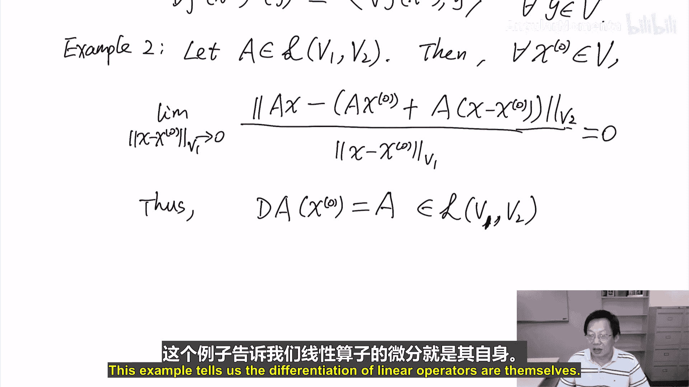

**数据分析的数学方法：第16章：映射的微分**

在本节课中，我们将学习如何对非线性映射进行线性近似，从而定义映射的微分。我们将从熟悉的函数微分概念出发，将其推广到更一般的向量空间之间的映射上。

---

### **概述：从函数到映射的微分**

我们感兴趣的许多变换或映射都是非线性的。为了研究它们，我们再次引入线性近似的思想。这将引导我们定义映射的微分。

---

### **微分定义**

设 \( V_1 \) 和 \( V_2 \) 是两个希尔伯特空间。\( V_1 \) 上的范数记为 \( \|\cdot\|_{V_1} \)，\( V_2 \) 上的范数记为 \( \|\cdot\|_{V_2} \)。令 \( F: V_1 \to V_2 \) 为一个映射，此映射不一定是线性的。

我们在 \( V_1 \) 中考虑一个特定的向量 \( x_0 \)。我们希望在 \( x_0 \) 附近找到一个仿射近似。更精确地说，我们需要一个通过点 \( (x_0, F(x_0)) \) 的仿射变换，使其在 \( x_0 \) 处的值与 \( F \) 相同。

这个仿射近似的形式为：
\[
F(x_0) + L(x - x_0)
\]
其中，\( L \) 是一个从 \( V_1 \) 到 \( V_2 \) 的线性有界算子。因为 \( F(x_0) \) 是常向量，所以这是一个平移后的线性变换，因此它是一个仿射变换。当 \( x = x_0 \) 时，其值等于 \( F(x_0) \)。

如果这个近似的误差非常小，具体来说，如果误差是 \( \|x - x_0\|_{V_1} \) 的高阶无穷小，即：
\[
\lim_{\|x - x_0\|_{V_1} \to 0} \frac{\| F(x) - [F(x_0) + L(x - x_0)] \|_{V_2}}{\|x - x_0\|_{V_1}} = 0
\]
那么，我们就称 \( L \) 为 \( F \) 在 \( x_0 \) 处的**微分**。

---

### **微分定义（正式版）**

更正式地，我们说映射 \( F: V_1 \to V_2 \) 在 \( x_0 \) 处**可微**，当且仅当存在一个线性有界算子 \( L \in \mathcal{L}(V_1, V_2) \)，使得：
\[
\lim_{\|h\|_{V_1} \to 0} \frac{\| F(x_0 + h) - F(x_0) - L(h) \|_{V_2}}{\|h\|_{V_1}} = 0
\]
其中 \( h = x - x_0 \)。在这种情况下，我们记 \( L \) 为 \( DF(x_0) \)，称为 \( F \) 在 \( x_0 \) 处的微分。

---

### **示例讲解**

上一节我们定义了映射的微分，本节中我们通过几个具体例子来加深理解。

以下是两个关键示例：

1.  **示例一：从希尔伯特空间到实数的函数**
    考虑 \( F: V \to \mathbb{R} \)，其中 \( V \) 是希尔伯特空间。那么，\( F \) 在 \( x_0 \) 处的微分 \( DF(x_0) \) 是一个从 \( V \) 到 \( \mathbb{R} \) 的线性有界算子。我们知道，这样的线性泛函可以通过内积表示。具体地，存在一个向量 \( \nabla F(x_0) \in V \)（称为梯度），使得对于任意 \( y \in V \)：
    \[
    DF(x_0)(y) = \langle \nabla F(x_0), y \rangle
    \]
    因此，微分算子 \( DF(x_0) \) 的作用就是将输入向量 \( y \) 映射为梯度向量 \( \nabla F(x_0) \) 与 \( y \) 的内积。

2.  **示例二：线性算子自身的微分**
    考虑一个线性有界算子 \( A: V_1 \to V_2 \)。对于任意 \( x_0 \in V_1 \)，我们想用仿射函数 \( A(x_0) + L(x - x_0) \) 来近似 \( A(x) \)。如果我们选择 \( L = A \)，那么近似误差为：
    \[
    A(x) - [A(x_0) + A(x - x_0)] = A(x) - A(x_0) - A(x) + A(x_0) = 0
    \]
    误差恒为零。因此，根据定义，线性算子 \( A \) 在任意点 \( x_0 \) 处的微分就是它自身：
    \[
    DA(x_0) = A
    \]
    这个结果很直观，因为 \( A \) 本身已经是线性的，用它自身来近似自然是最佳（精确）选择。

---

### **总结**

本节课中，我们一起学习了映射微分的核心思想。我们首先将函数微分的概念推广到一般向量空间的映射上，定义了通过仿射变换进行线性近似的准则。然后，我们通过两个重要例子进行了具体分析：一是希尔伯特空间上实值函数的微分对应于梯度向量的内积运算；二是线性算子在其定义域内任意点的微分就是该算子本身。理解这些基础概念是后续学习更复杂分析（如链式法则、隐函数定理）的关键。