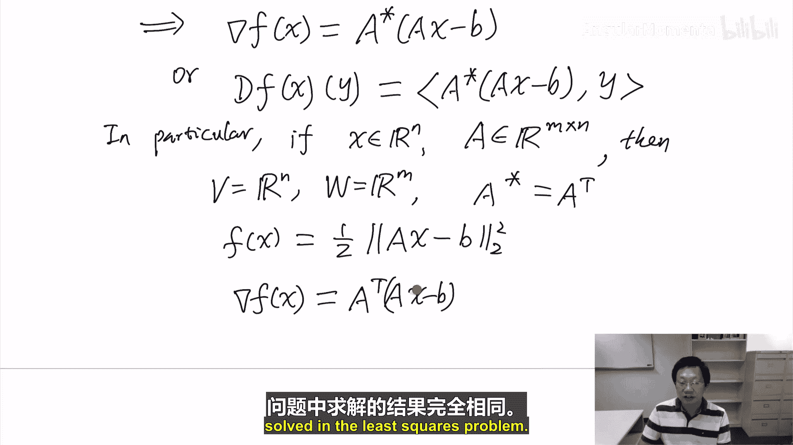

数据分析的数学方法：16-02-02：线性算子与梯度计算示例 🔍

在本节课中，我们将学习如何计算一个由线性算子定义的函数的梯度。我们将通过一个具体的例子，详细展示从函数定义到梯度推导的完整过程，并最终将其与经典的线性最小二乘问题联系起来。

---

### 概述

本节我们将分析一个定义在两个希尔伯特空间之间的函数。该函数涉及一个线性有界算子，我们的目标是计算其梯度。理解这个推导过程，有助于我们掌握在更一般的向量空间中处理优化问题的方法。

上一节我们介绍了梯度和微分的概念，本节中我们来看看如何将这些概念应用到一个具体的函数上。

---

### 问题定义

设 **A** 是一个线性有界算子，作用在两个希尔伯特空间 **V** 和 **W** 之间。
定义函数 **F**: **V** → **R** 为：

**F(x) = (1/2) * ||A x - b||_W^2**

其中，**b** 是 **W** 空间中的一个固定向量。

这个函数的含义是：先将 **V** 中的向量 **x** 通过线性变换 **A** 映射到 **W** 空间，然后计算其与目标向量 **b** 的差的范数的平方的一半。

我们的目标是计算这个函数 **F(x)** 的梯度 **∇F(x)**。

---

### 梯度推导

为了找到梯度 **∇F(x)**，我们使用梯度的定义和微分符号。我们需要找到微分 **DF(x)**，它作用于向量 **y** 的结果等于 **∇F(x)** 与 **y** 的内积。

我们考虑函数在点 **y** 处的值 **F(y)**，并围绕点 **x** 进行仿射近似。

**F(y) = (1/2) * ||A y - b||_W^2**

我们需要将其与 **F(x) = (1/2) * ||A x - b||_W^2** 联系起来。将 **A y** 拆分为 **A x + A(y - x)**，并利用希尔伯特空间中范数平方的展开公式：

**||u + v||^2 = ||u||^2 + ||v||^2 + 2⟨u, v⟩**

进行展开：

**F(y) = (1/2) * ||A x - b||_W^2 + ⟨A x - b, A(y - x)⟩_W + (1/2) * ||A(y - x)||_W^2**

上式可写为：

**F(y) = F(x) + ⟨A x - b, A(y - x)⟩_W + (1/2) * ||A(y - x)||_W^2**

为了将其写成标准梯度形式 **F(x) + ⟨∇F(x), y - x⟩ + o(||y - x||)**，我们需要处理内积项 **⟨A x - b, A(y - x)⟩_W**。

这里我们引入伴随算子 **A***。伴随算子的定义是，对于所有 **x ∈ V**, **y ∈ W**，满足：

**⟨A x, y⟩_W = ⟨x, A* y⟩_V**

利用这个性质，我们可以将算子 **A** 从内积的第二项移动到第一项：

**⟨A x - b, A(y - x)⟩_W = ⟨A*(A x - b), y - x⟩_V**

于是，**F(y)** 的表达式变为：

**F(y) = F(x) + ⟨A*(A x - b), y - x⟩_V + (1/2) * ||A(y - x)||_W^2**

现在，上式已经具备了 **F(x) + ⟨∇F(x), y - x⟩ + 误差项** 的形式。其中：
*   **⟨A*(A x - b), y - x⟩_V** 是线性主项。
*   **(1/2) * ||A(y - x)||_W^2** 是误差项。

---

### 误差项分析

接下来，我们需要证明误差项 **(1/2) * ||A(y - x)||_W^2** 是 **||y - x||_V** 的高阶无穷小。

我们考察当 **y → x** 时，误差项与 **||y - x||_V** 的比值的极限：

**lim_{y→x} [ (1/2) * ||A(y - x)||_W^2 / ||y - x||_V ]**

利用算子范数的性质（性质4）：对于任何线性算子 **A** 和向量 **z**，有 **||A z||_W ≤ ||A|| * ||z||_V**，其中 **||A||** 是算子范数。

将其应用于误差项的分子：

**||A(y - x)||_W^2 ≤ (||A|| * ||y - x||_V)^2 = ||A||^2 * ||y - x||_V^2**

因此，原极限满足：

**lim_{y→x} [ (1/2) * ||A(y - x)||_W^2 / ||y - x||_V ] ≤ lim_{y→x} [ (1/2) * ||A||^2 * ||y - x||_V^2 / ||y - x||_V ] = (1/2) * ||A||^2 * lim_{y→x} ||y - x||_V = 0**

由于算子范数 **||A||** 是常数，不随 **y** 变化，可以提到极限外面。最终极限为0，这证明了误差项确实是 **o(||y - x||_V)**。

---

### 梯度结论

因此，我们成功地得到了函数 **F(x)** 的梯度。在希尔伯特空间中，梯度向量 **∇F(x)** 就是使得微分 **DF(x)(y) = ⟨∇F(x), y⟩** 成立的那个向量。

从我们的推导可得：

**∇F(x) = A*(A x - b)**

或者等价地，其微分作用为：

**DF(x)(y) = ⟨A*(A x - b), y⟩_V**

---

### 与最小二乘问题的联系

这个例子有一个非常重要且常见的特例。当 **V = R^n**, **W = R^m**，且线性算子 **A** 是一个 **m × n** 的矩阵时，我们的问题就退化到欧几里得空间。

此时：
*   伴随算子 **A*** 就是矩阵 **A** 的转置 **A^T**。
*   函数 **F(x)** 变为：**F(x) = (1/2) * ||A x - b||_2^2**
*   我们求得的梯度公式则变为：**∇F(x) = A^T (A x - b)**

这正是我们在求解线性最小二乘问题 **min_x ||A x - b||_2^2** 时，令梯度为零所得到的正规方程 **A^T A x = A^T b** 中的梯度部分。这验证了我们推导的一般性公式在经典场景下的正确性。

---

### 总结

本节课中我们一起学习了如何为一个由线性算子定义的范数平方函数计算梯度。我们首先定义了问题，然后通过仿射近似和伴随算子的技巧进行了推导，并严格分析了误差项，最终得到了梯度公式 **∇F(x) = A*(A x - b)**。最后，我们通过将其特例化到矩阵空间，与经典的线性最小二乘问题建立了联系，巩固了对这一重要结论的理解。