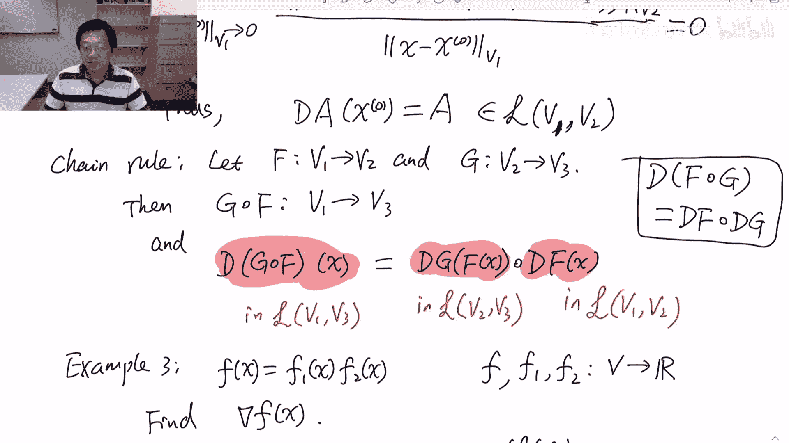

数据分析的数学方法：16-03-02：链式法则与乘积法则推导 🧮

在本节课中，我们将学习链式法则在巴拿赫空间映射微分中的应用，并利用它来推导两个函数乘积的梯度公式。

---

### 链式法则

上一节我们介绍了映射的微分定义。本节中，我们来看看映射复合的微分规则，即链式法则。

设有两个映射 **F** 和 **G**。**F** 从空间 **V₁** 映射到 **V₂**，**G** 从空间 **V₂** 映射到 **V₃**。它们的复合映射 **G ∘ F** 定义为先应用 **F**，再应用 **G**，即从 **V₁** 映射到 **V₃**。

对于复合映射 **G ∘ F** 在点 **x** 的微分，有如下链式法则：

**公式：**
\[
D(G \circ F)(x) = DG(F(x)) \circ DF(x)
\]

其中：
*   \( DF(x) \) 是一个从 **V₁** 到 **V₂** 的有界线性算子。
*   \( DG(F(x)) \) 是一个从 **V₂** 到 **V₃** 的有界线性算子。
*   符号 \( \circ \) 表示线性算子的复合。

这个法则表明，复合映射的微分等于内部映射在 **x** 点的微分与外部映射在 **F(x)** 点的微分的复合。形式上可以简洁地记作 \( D(G \circ F) = DG \circ DF \)，它体现了微分运算与复合运算满足一种分配律。

---

### 应用示例：乘积法则推导

链式法则是一个强大的工具，能帮助我们计算复杂映射的微分。现在，我们来看一个具体应用：推导两个函数乘积的梯度公式。

设 **F₁** 和 **F₂** 是两个从希尔伯特空间 **V** 到实数 **R** 的可微函数。定义函数 **f(x) = F₁(x) * F₂(x)**，我们想求 **f** 在点 **x** 的梯度 \( \nabla f(x) \)。

为了使用链式法则，我们构造两个辅助映射：

1.  定义映射 **F: V → R²**，它将 **x** 映射为一个二维向量：
    \[
    F(x) = (F₁(x), F₂(x))
    \]
2.  定义映射 **G: R² → R**，它是两个实数的乘法函数：
    \[
    G(\alpha, \beta) = \alpha \cdot \beta
    \]

容易验证，原函数 **f** 正是这两个映射的复合：
\[
f(x) = G(F(x)) = G(F₁(x), F₂(x)) = F₁(x) \cdot F₂(x)
\]

根据链式法则，**f** 在 **x** 的微分满足：
\[
Df(x) = DG(F(x)) \circ DF(x)
\]

接下来，我们分别计算 \( DG \) 和 \( DF \)。

**计算 DG：**
映射 **G** 是定义在 **R²** 上的函数，其微分（梯度）为：
\[
\nabla G(\alpha, \beta) = (\beta, \alpha)
\]
因此，对于任意向量 **y ∈ R²**，微分算子 \( DG(\alpha, \beta) \) 作用的结果是梯度与 **y** 的内积：
\[
DG(\alpha, \beta)(y) = \nabla G(\alpha, \beta) \cdot y = \beta y_1 + \alpha y_2
\]

**计算 DF：**
映射 **F** 由两个可微函数组成。根据微分的定义，对于 **z** 接近 **x**，有：
\[
F₁(z) = F₁(x) + \langle \nabla F₁(x), z-x \rangle + o(\|z-x\|)
\]
\[
F₂(z) = F₂(x) + \langle \nabla F₂(x), z-x \rangle + o(\|z-x\|)
\]
将两式合并为向量形式，得到：
\[
F(z) = F(x) +
\begin{pmatrix}
\langle \nabla F₁(x), z-x \rangle \\
\langle \nabla F₂(x), z-x \rangle
\end{pmatrix}
+ o(\|z-x\|)
\]
因此，\( DF(x) \) 是一个线性算子，它对任意向量 **y ∈ V** 的作用为：
\[
DF(x)(y) =
\begin{pmatrix}
\langle \nabla F₁(x), y \rangle \\
\langle \nabla F₂(x), y \rangle
\end{pmatrix}
\]

**合成 Df：**
现在将 \( DG \) 和 \( DF \) 代入链式法则。对于任意 **y ∈ V**：
\[
\begin{aligned}
Df(x)(y) &= DG(F(x)) \left( DF(x)(y) \right) \\
&= \nabla G(F₁(x), F₂(x)) \cdot \left( DF(x)(y) \right) \\
&= (F₂(x), F₁(x)) \cdot
\begin{pmatrix}
\langle \nabla F₁(x), y \rangle \\
\langle \nabla F₂(x), y \rangle
\end{pmatrix} \\
&= F₂(x) \langle \nabla F₁(x), y \rangle + F₁(x) \langle \nabla F₂(x), y \rangle \\
&= \langle F₂(x) \nabla F₁(x) + F₁(x) \nabla F₂(x), y \rangle
\end{aligned}
\]

由于 \( Df(x)(y) \) 是梯度 \( \nabla f(x) \) 与 **y** 的内积，即 \( \langle \nabla f(x), y \rangle \)，我们通过比较得到最终的乘积法则：

**公式：**
\[
\boxed{\nabla (F₁ \cdot F₂)(x) = F₂(x) \cdot \nabla F₁(x) + F₁(x) \cdot \nabla F₂(x)}
\]

---

### 总结

本节课中我们一起学习了链式法则在巴拿赫空间中的形式，并利用它作为核心工具，一步步推导出了两个可微函数乘积的梯度公式（乘积法则）。这个推导过程展示了如何通过构造复合映射，将复杂函数的微分问题分解为更简单部分的微分问题，是链式法则的一个典型而重要的应用。