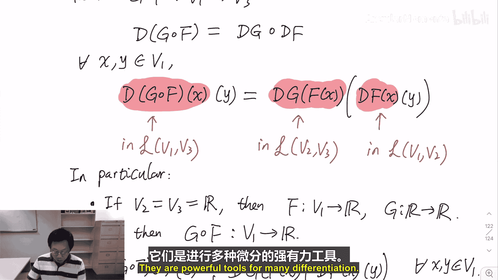

**数据分析的数学方法：第16讲：微分法则详解** 🧮

在本节课中，我们将学习向量空间之间映射的微分法则。我们将重点介绍两个核心法则：微分的线性性质与链式法则，并通过几个重要的特例来展示其应用。

---

### **微分的线性性质**

上一节我们介绍了映射的微分定义，本节中我们来看看微分运算的第一个基本性质——线性性质。

设 **F** 和 **G** 是两个从向量空间 **V₁** 到 **V₂** 的映射。考虑映射 **αF + βG** 在点 **x** 处的微分，其中 **α** 和 **β** 是实数。微分运算具有线性性质，即：

\[
D(\alpha F + \beta G)(x) = \alpha D F(x) + \beta D G(x)
\]

这个性质表明，微分运算与线性组合是可交换的。我们可以先进行线性组合再求微分，也可以先分别求微分再进行线性组合，结果是相同的。

---

### **链式法则**

链式法则在之前已经引入过，它是处理复合函数微分的强大工具。

设 **F** 是从 **V₁** 到 **V₂** 的映射，**G** 是从 **V₂** 到 **V₃** 的映射。那么复合映射 **G ∘ F** 是从 **V₁** 到 **V₃** 的映射。链式法则告诉我们：

\[
D(G \circ F)(x)[y] = D G(F(x))[D F(x)[y]]
\]

对于任意 **x, y ∈ V₁** 都成立。这个公式涉及三个线性有界算子：**D(G ∘ F)(x)**、**D G(F(x))** 和 **D F(x)**。

链式法则非常强大，我们曾用它推导出函数求导的基本法则。接下来，我们将看几个链式法则的有趣特例。

---

### **链式法则的特例**

以下是链式法则在特定场景下的应用，这些特例在实践中非常有用。

**特例 1：V₂ = V₃ = ℝ**

在这种情况下，**F: V₁ → ℝ** 是一个函数，**G: ℝ → ℝ** 也是一个函数。复合函数 **G ∘ F: V₁ → ℝ** 是定义在希尔伯特空间 **V₁** 上的函数。

应用链式法则，我们可以得到其梯度：

\[
\nabla (G \circ F)(x) = G'(F(x)) \cdot \nabla F(x)
\]

这个结果正是我们最初介绍的基础版链式法则。

**特例 2：V₃ = ℝ**

在这种情况下，**F: V₁ → V₂**，而 **G: V₂ → ℝ**。我们先通过 **F** 将向量从 **V₁** 映射到 **V₂**，再通过 **G** 将其映射到实数 **ℝ**。复合函数 **G ∘ F: V₁ → ℝ** 是 **V₁** 上的函数。

应用链式法则并利用伴随算子的概念，我们可以推导出其梯度公式：

\[
\nabla (G \circ F)(x) = [D F(x)]^* (\nabla G(F(x)))
\]

其中 **[D F(x)]*** 是微分算子 **D F(x)** 的伴随算子。

**进一步简化：若 G 是线性有界泛函**

如果 **G** 本身是从 **V₂** 到 **ℝ** 的线性有界泛函，根据 Riesz 表示定理，存在一个向量 **g ∈ V₂**，使得对于任意 **z ∈ V₂**，有 **G(z) = ⟨g, z⟩**，且 **∇G(x) = g**（常数）。

此时，梯度公式简化为：

\[
\nabla (G \circ F)(x) = [D F(x)]^* (g)
\]

**更进一步：若 F 也是线性有界算子**

如果 **F** 本身是从 **V₁** 到 **V₂** 的线性有界算子，那么其微分就是它自身，即 **D F(x) = F**。

此时，梯度公式最终简化为：

\[
\nabla (G \circ F)(x) = F^* (g)
\]

这个特例在推导最小二乘法等问题的目标函数梯度时非常有用。

---

### **总结**

本节课中我们一起学习了向量空间映射微分的两个核心法则。
*   我们首先了解了**微分的线性性质**，它允许我们交换微分与线性组合的顺序。
*   接着，我们深入探讨了强大的**链式法则**及其一般形式。
*   最后，我们通过几个重要的**特例**（特别是当目标空间是实数域 **ℝ**，以及映射为线性算子时）展示了如何应用链式法则来简化复杂复合函数的梯度计算。这些特例是许多实际微分计算中的有力工具。