# 096：欧几里得空间之间的映射与雅可比矩阵 📐

在本节课中，我们将学习向量值多元函数的微分，即从 **R^N** 映射到 **R^M** 的函数的导数。我们将看到，这种导数是一个线性算子，具体表现为一个矩阵，即**雅可比矩阵**。

上一节我们介绍了多元函数的梯度，本节中我们来看看当函数的输出也是一个向量时，其微分形式是怎样的。

## 映射的定义与微分形式

我们考虑一个映射 **F**，其定义域是 **R^N**，值域是 **R^M**。这是一个向量值多元函数。输入是一个 **N** 维向量，输出是一个 **M** 维向量。我们假设 **R^N** 和 **R^M** 空间都装备了标准内积。

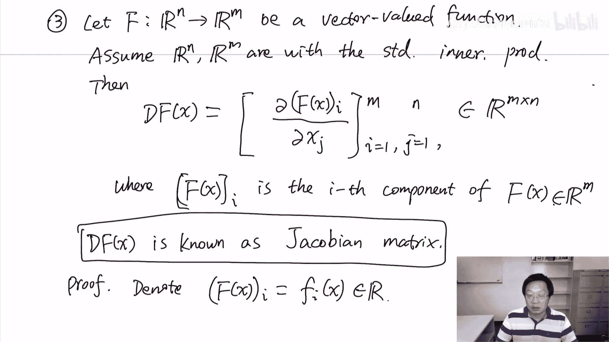

那么，映射 **F** 在点 **x** 处的微分 **DF(x)** 是一个从 **R^N** 到 **R^M** 的线性有界算子（或线性变换）。在线性代数中，我们知道线性变换可以表示为一个矩阵。因此，**DF(x)** 就是一个大小为 **M × N** 的矩阵。

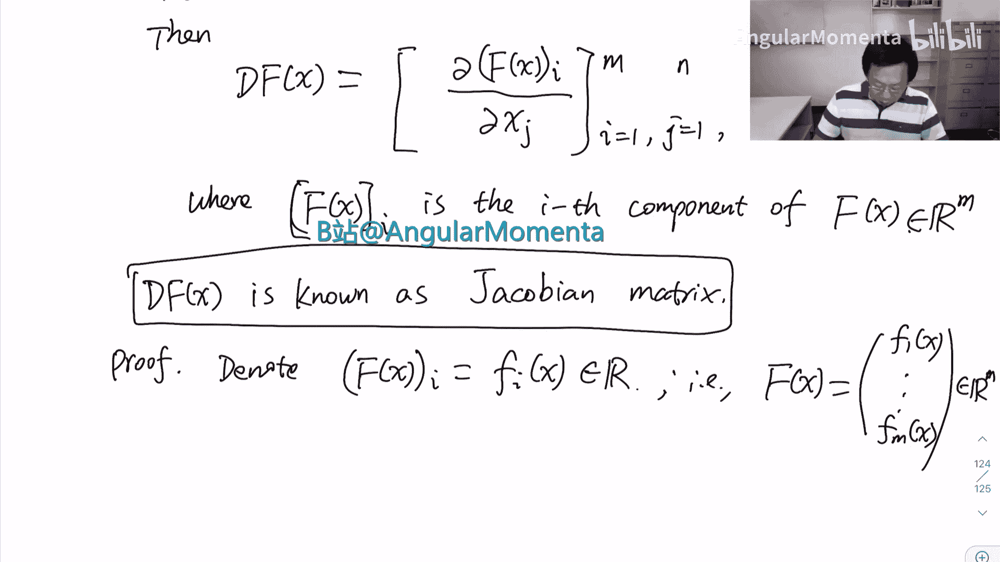

以下是该矩阵的显式形式：

*   其第 **(i, j)** 个元素是函数 **F** 的第 **i** 个分量关于第 **j** 个输入变量的偏导数。
*   其中，**i** 的取值范围是从 **1** 到 **M**，**j** 的取值范围是从 **1** 到 **N**。
*   我们用 **F_i(x)** 表示 **F(x)** 的第 **i** 个分量。

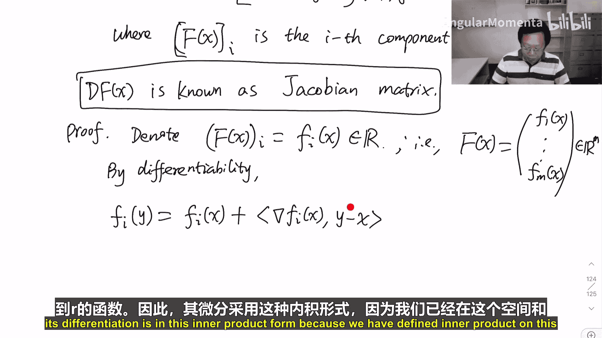

用公式表示，雅可比矩阵 **J_F(x)** 为：

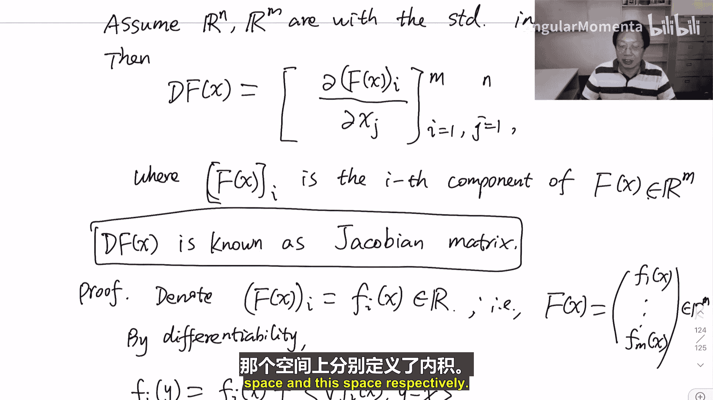

**J_F(x) = DF(x) = [ ∂F_i / ∂x_j (x) ]_{M×N}**

在微积分中，这个矩阵被称为**雅可比矩阵**。

## 雅可比矩阵的推导证明

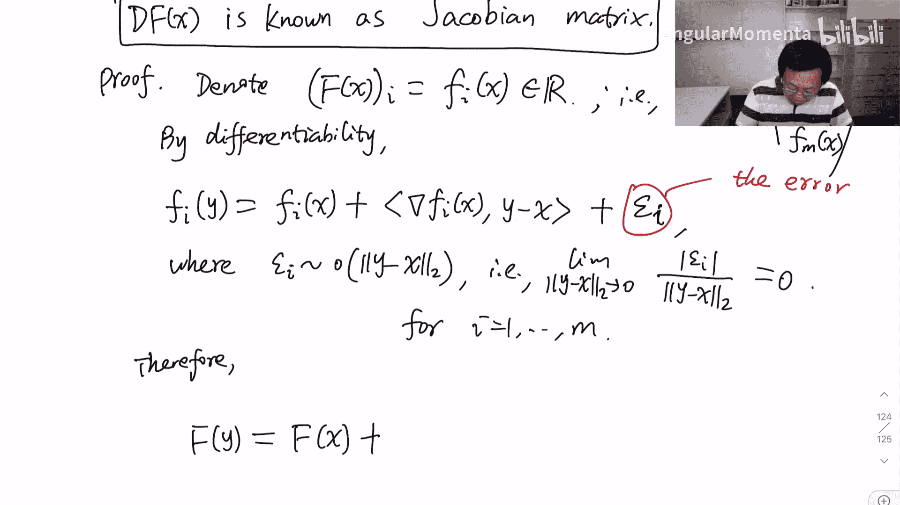

为了证明上述结论，我们假设映射 **F** 的每一个分量函数 **F_i: R^N → R** 都是可微的。根据可微性的定义，对于每个分量函数，在点 **x** 附近有如下仿射近似：

**F_i(y) ≈ F_i(x) + ∇F_i(x)^T (y - x) + ε_i(y)**

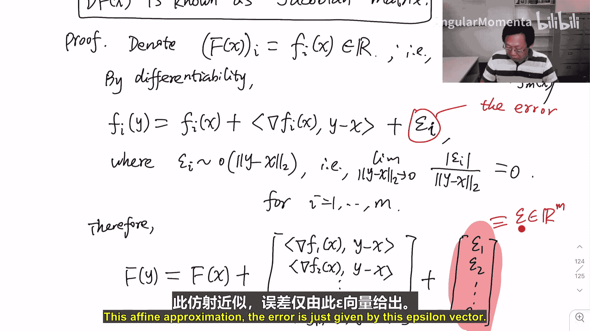

其中，误差项 **ε_i(y)** 满足极限性质：当 **||y - x||_2 → 0** 时，**|ε_i(y)| / ||y - x||_2 → 0**。

现在，我们将这 **M** 个方程组合并成一个向量方程：

**F(y) = F(x) + [ ∇F_1(x)^T (y - x); ∇F_2(x)^T (y - x); ...; ∇F_M(x)^T (y - x) ] + ε(y)**

这里，**ε(y)** 是一个由所有 **ε_i(y)** 组成的误差向量。

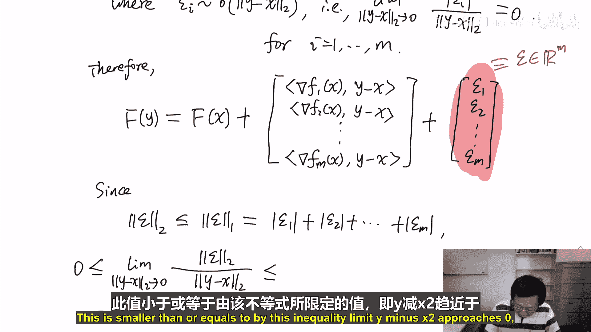

接下来，我们需要证明误差向量 **ε(y)** 满足 **||ε(y)||_2 = o(||y - x||_2)**。利用有限维空间中范数的等价性（特别是 **l2** 范数不大于 **l1** 范数），我们可以通过考察每个分量误差的极限来证明整体误差向量的极限也为零。具体推导表明，误差向量确实满足可微性定义中对高阶无穷小的要求。

因此，上述仿射近似中的线性部分就是微分 **DF(x)** 的作用。将其写成矩阵形式：

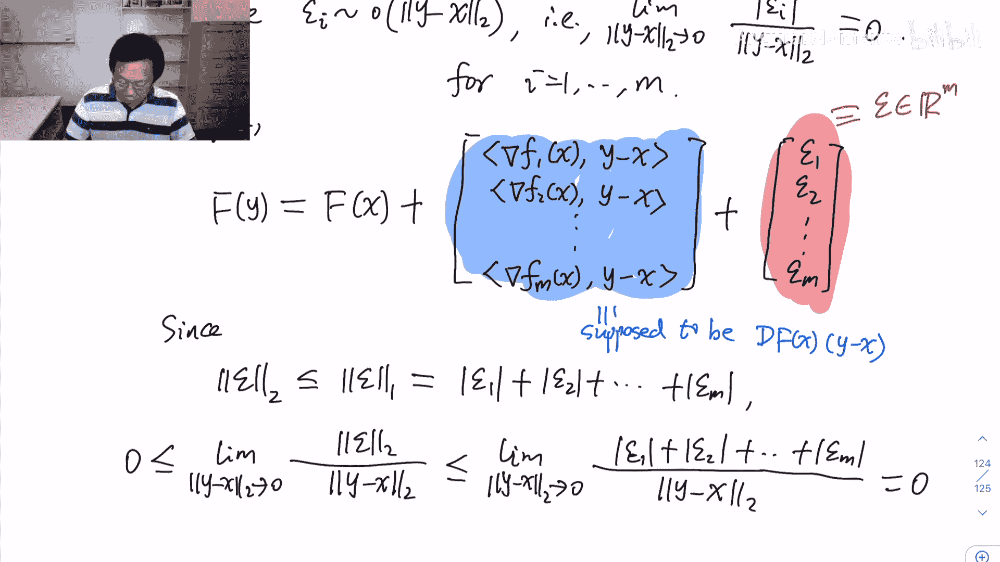

**DF(x) (y) = [ ∇F_1(x)^T; ∇F_2(x)^T; ...; ∇F_M(x)^T ] · y**

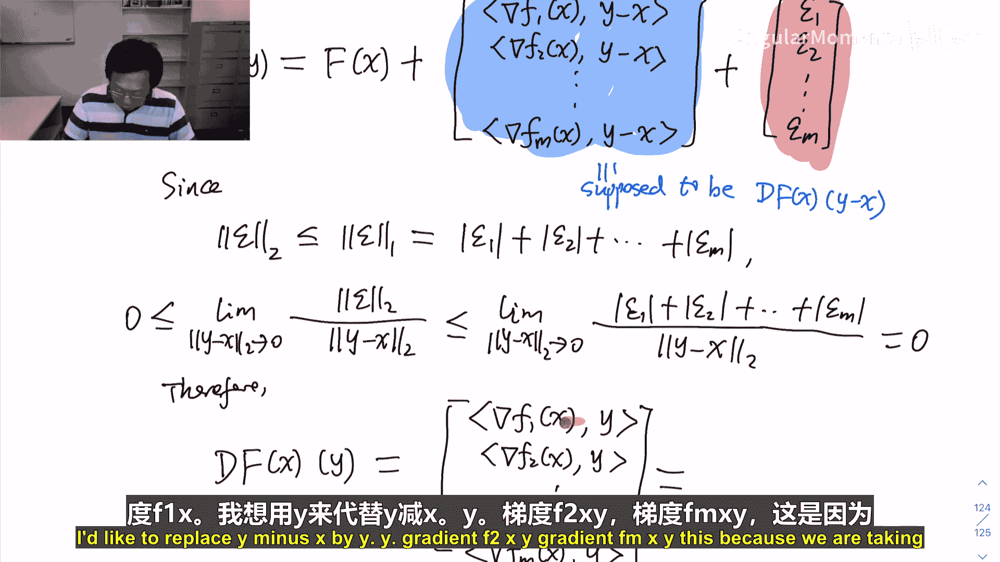

这个矩阵的行由各个分量函数的梯度向量的转置构成。回忆一下，对于多元函数 **F_i**，其梯度为：

**∇F_i(x) = [ ∂F_i/∂x_1 (x), ∂F_i/∂x_2 (x), ..., ∂F_i/∂x_N (x) ]^T**

将这个表达式代入上面的矩阵，我们就得到了雅可比矩阵的最终形式：

**DF(x) = 
[ 
∂F_1/∂x_1, ∂F_1/∂x_2, ..., ∂F_1/∂x_N;
∂F_2/∂x_1, ∂F_2/∂x_2, ..., ∂F_2/∂x_N;
...;
∂F_M/∂x_1, ∂F_M/∂x_2, ..., ∂F_M/∂x_N
]**

证明完成。

## 核心结论

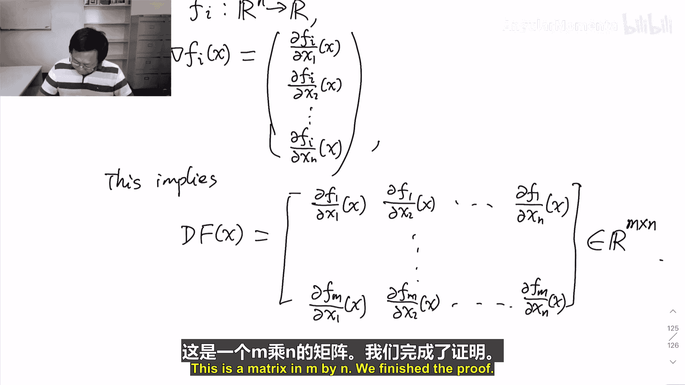

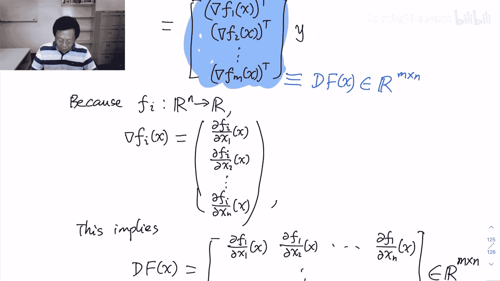

从以上推导我们可以得出核心结论：**向量空间之间映射的微分，是向量值多元函数的雅可比矩阵概念在更一般框架下的自然扩展**。它统一了标量函数梯度和向量函数导数的表示，为后续研究更复杂的分析问题（如链式法则在向量情形下的形式）奠定了基础。

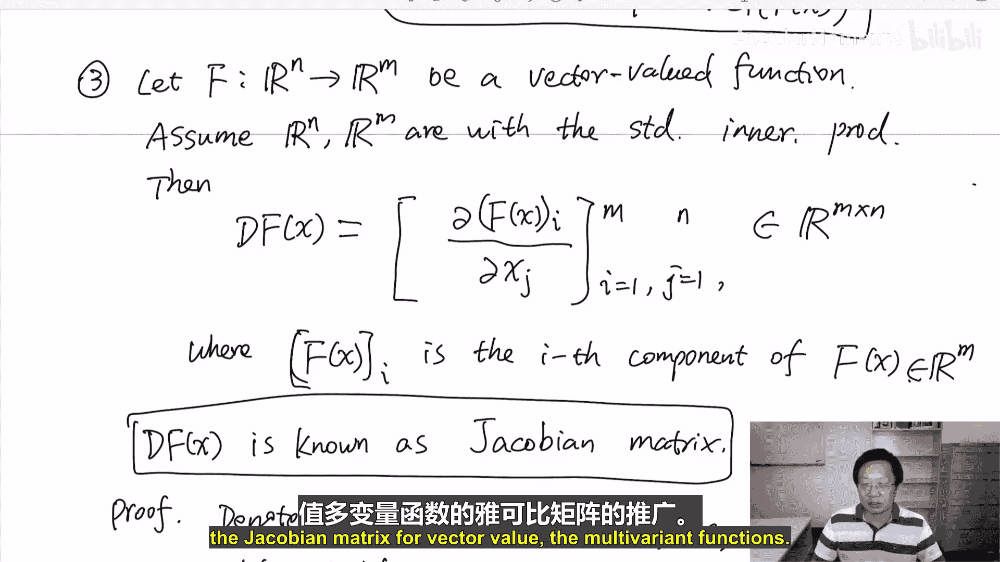

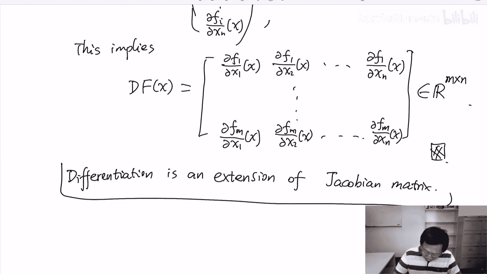

本节课中我们一起学习了从 **R^N** 到 **R^M** 的映射的微分。我们证明了其微分算子 **DF(x)** 具体表现为一个 **M × N** 的雅可比矩阵，该矩阵的第 **(i, j)** 元素是输出向量的第 **i** 个分量关于输入向量的第 **j** 个分量的偏导数。理解雅可比矩阵是理解多变量微积分和数据分析中许多优化与变换模型的关键一步。