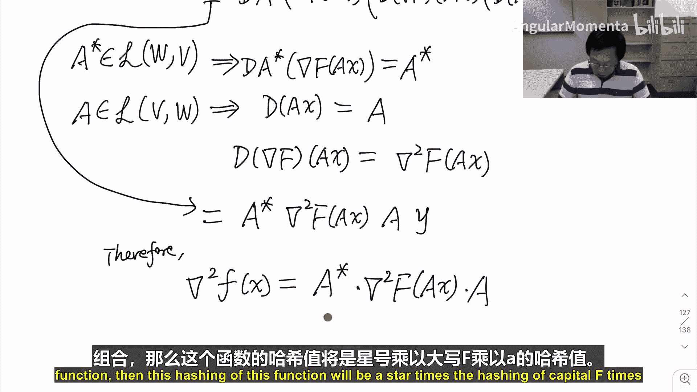

数据分析的数学方法：5.3：函数的Hessian矩阵

在本节中，我们将学习如何定义向量空间之间映射的高阶导数，特别是函数的二阶导数，即Hessian矩阵。我们将从梯度的概念出发，逐步推导Hessian的定义，并通过具体例子来理解其计算和应用。

---

### 概述


向量空间之间映射的微分使我们能够定义高阶导数。本节将重点讨论希尔伯特空间上函数的二阶导数，即Hessian矩阵。我们将从一阶导数（梯度）的定义出发，通过对其再次微分来定义Hessian，并探讨其在具体函数形式下的计算方法。

---

### 从梯度到Hessian

上一节我们介绍了函数的一阶导数——梯度。对于一个定义在希尔伯特空间V上的函数 **F: V → R**，其在点x处的梯度 **∇F(x)** 是V空间中的一个向量。

现在，我们希望定义二阶导数。二阶导数本质上就是一阶导数的导数，即对梯度映射本身进行微分。为此，我们将梯度视为一个映射：**x → ∇F(x)**。这个映射将一个V空间中的向量映射到另一个V空间中的向量。因此，我们可以定义它的微分。

**∇F** 在点x处的微分，就是 **F** 的二阶导数，因为它是对导数的导数。这个二阶导数被称为 **Hessian**。

**Hessian** 的定义公式为：
```
∇²F(x) = D(∇F)(x)
```
这里，**D(∇F)(x)** 表示梯度映射 **∇F** 在点x处的微分。

这个 **∇²F(x)** 是一个从V到V的线性算子。我们有一个专门的记号来表示它，即 **∇²F(x)**。因此，**∇²F(x)** 是一个从V到V的映射。由于它是梯度映射（从V到V）的微分，因此它本身也是从V到V的线性有界算子，属于 **L(V)** 空间。


---

### 欧几里得空间中的特例

有一个特别有趣且常见的情况：当函数 **F** 是从 **R^N** 到 **R** 的函数时，即它是一个多变量函数。


此时，梯度 **∇F(x)** 就是偏导数向量。具体来说，其第i个分量是 **∂F/∂x_i** 在x处的值。

那么，梯度映射的第i个分量函数就是第i个偏导数。我们知道，一个多变量向量值函数的微分就是其雅可比矩阵。对于雅可比矩阵，其第(i, j)个元素是第i个分量函数对第j个变量的偏导数。

因此，对于梯度映射的微分，其第(i, j)个元素是：
```
∂²F / (∂x_i ∂x_j)
```
其中，i和j都从1取到N。

所以，对于从 **R^N** 到 **R** 的函数，其Hessian矩阵 **∇²F(x)** 就是一个N×N的矩阵，其第(i, j)个元素是二阶偏导数 **∂²F / (∂x_i ∂x_j)**。在这个意义上，希尔伯特空间上的Hessian算子是欧几里得空间中Hessian矩阵概念的推广。

---


### 示例分析


理解了Hessian的定义后，我们通过几个例子来看看如何具体计算它。

#### 示例一：最小二乘目标函数


我们考虑函数：
```
F(x) = (1/2) * ||A x - b||_W²
```
其中，**A** 是一个从V到W的有界线性算子，**b** 是W中的一个向量，**||·||_W** 是W空间中的范数，**x** 属于V。

我们知道这个函数的梯度是：
```
∇F(x) = A* (A x - b)
```
这里，**A*** 是 **A** 的伴随算子。我们可以将其进一步简化为：
```
∇F(x) = A* A x - A* b
```
由于 **A*** A 是一个从V到V的线性有界算子，而 **A* b** 是V中的一个常向量，因此梯度 **∇F(x)** 是一个线性变换加上一个常向量，即一个仿射变换。


当我们对这个梯度进行微分以求得Hessian时，常数项消失，线性部分保持不变。因此，函数 **F** 的Hessian就是线性部分 **A* A**：
```
∇²F(x) = A* A
```
它属于 **L(V)**，是一个从V到V的线性有界算子。


**特别情况：矩阵形式**
当V是 **R^N**，W是 **R^M**，且 **A** 是一个M×N矩阵时，上述函数就是经典的最小二乘问题的目标函数：
```
F(x) = (1/2) * ||A x - b||₂²
```
此时，梯度为：
```
∇F(x) = Aᵀ (A x - b)
```
Hessian矩阵为：
```
∇²F(x) = Aᵀ A
```

#### 示例二：复合函数

我们考虑一个复合函数：
```
f(x) = F(A x)
```
其中，**A** 是一个从V到W的线性有界算子，**F** 是一个从W到R的函数。即，我们先对向量x进行线性变换 **A**，然后再应用函数 **F**。

根据链式法则，这个小写 **f** 的梯度为：
```
∇f(x) = A* ( ∇F(A x) )
```
这里，**A*** 是 **A** 的伴随算子。

现在，我们要求 **f** 的Hessian，即需要对梯度 **∇f(x)** 进行微分。我们将其视为三个函数的复合：最内层是线性变换 **A**，中间层是 **∇F**，最外层是 **A***。


根据链式法则，复合函数的微分等于各层微分的复合。因此，**f** 在点x处的Hessian计算如下：
1.  最外层 **A*** 的微分就是它自身（因为它是线性的）。
2.  中间层 **∇F** 在点 **A x** 处的微分，根据定义，就是 **F** 在点 **A x** 处的Hessian，记作 **∇²F(A x)**。
3.  最内层 **A** 的微分就是它自身（因为它是线性的）。


将这三部分复合起来，我们得到 **f** 的Hessian为：
```
∇²f(x) = A* ∘ ∇²F(A x) ∘ A
```
其中，**∘** 表示算子的复合。因此，如果一个函数是一个线性算子与一个外层函数的复合，那么它的Hessian就等于：伴随算子 **A***，乘以外层函数Hessian在 **A x** 处的值，再乘以算子 **A**。


---


### 总结



本节课我们一起学习了希尔伯特空间上函数的二阶导数——Hessian矩阵。我们首先回顾了一阶导数（梯度）的概念，然后通过对其再次微分，严谨地定义了Hessian算子 **∇²F(x)**。我们探讨了在欧几里得空间这一特例下，Hessian表现为一个由二阶偏导数构成的矩阵。最后，通过两个具体的例子（最小二乘目标函数和复合函数），我们实践了Hessian的计算方法，并看到了链式法则在其中的应用。理解Hessian对于后续学习优化算法（如牛顿法）和分析函数的局部性质至关重要。