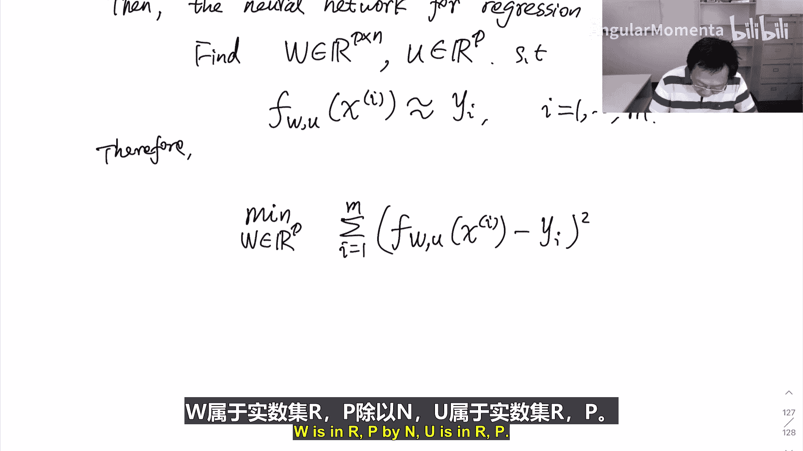

# 098：深度学习中的深度神经网络训练案例研究 🧠

在本节课中，我们将学习如何将深度神经网络应用于回归问题。我们将从回归问题的基本定义出发，逐步介绍人工神经元、单层神经网络的结构，并最终构建出用于回归的神经网络模型及其优化目标。

---

## 回归问题回顾

在回归问题中，我们有一个训练数据集，包含多个输入-输出对。每个输入 **X_i** 是一个 **R^N** 空间中的向量，每个输出 **Y_i** 是一个实数。我们的目标是找到一个函数 **F**，它能将输入 **X_i** 映射到输出 **Y_i**，使得 **F(X_i)** 尽可能接近 **Y_i**。

用数学公式表示，即：
**F: R^N → R**
使得对于所有 **i = 1, 2, ..., M**，有 **F(X_i) ≈ Y_i**。

在传统的线性回归中，我们选择 **F** 为线性函数。然而，线性模型能力有限。因此，我们转向更复杂的非线性模型，例如在特征域上的线性函数，或者更强大的深度神经网络。

---

## 从人工神经元到神经网络

上一节我们回顾了回归问题，本节中我们来看看构成神经网络的基本单元——人工神经元。

### 人工神经元模型

一个人工神经元接收多个输入信号，每个信号乘以一个权重后求和，再经过一个激活函数处理，最终产生输出。

以下是其工作原理的分解：
*   **输入**：**x1, x2, ..., xN**。
*   **权重**：每个输入对应一个权重 **w1, w2, ..., wN**。
*   **信号整合**：神经元接收到的总信号为 **w1*x1 + w2*x2 + ... + wN*xN**。
*   **激活函数**：总信号通过一个非线性激活函数 **σ** 进行处理。一个典型的例子是阶跃函数，当信号弱时输出0，信号强时输出1。
*   **输出**：最终输出 **y = σ(w1*x1 + w2*x2 + ... + wN*xN)**。

使用向量记法，令 **x = [x1, x2, ..., xN]^T**， **w = [w1, w2, ..., wN]^T**，则输出可以简洁地表示为：
**y = σ(w^T x)**

### 构建单层神经网络

单个神经元能力有限。我们可以将多个人工神经元并行排列，构成一个单层神经网络。

以下是其结构描述：
*   输入层接收相同的输入向量 **x**。
*   该层包含 **P** 个神经元，每个神经元有自己的权重向量 **w_i**。
*   第 **i** 个神经元的输出为 **σ(w_i^T x)**。
*   所有神经元的输出通过另一组权重 **u1, u2, ..., uP** 进行加权合并，得到最终输出 **y**。

最终输出 **y** 的公式为：
**y = u1 * σ(w_1^T x) + u2 * σ(w_2^T x) + ... + uP * σ(w_P^T x)**

---

## 神经网络的紧凑数学表示

为了更清晰地分析和计算，我们需要为单层神经网络引入一套紧凑的数学符号。

定义以下变量：
*   **权重矩阵 W**：将每个神经元的权重向量 **w_i^T** 作为一行，构成一个 **P × N** 的矩阵 **W**。
*   **输出权重向量 u**：将合并权重组合成一个 **P** 维向量 **u = [u1, u2, ..., uP]^T**。
*   **向量化激活函数 σ**：定义函数 **σ** 作用于向量 **y** 时，是对其每个分量独立应用激活函数，即 **σ([y1, y2, ..., yP]^T) = [σ(y1), σ(y2), ..., σ(yP)]^T**。

利用这些定义，整个单层神经网络函数 **F** 可以非常简洁地表示为：
**F(x) = u^T · σ(W x)**

其中，**W x** 是一个 **P** 维向量，其第 **i** 个分量正是 **w_i^T x**。随后 **σ** 函数作用于该向量的每个分量，最后与向量 **u** 做内积求和。

这个函数由参数 **W** 和 **u** 完全决定。不同的 **W** 和 **u** 对应不同的神经网络函数。

---

## 应用于回归任务

现在，我们将这个神经网络模型应用到回归任务中。

我们的目标是找到一组最优的参数 **W** 和 **u**，使得神经网络函数 **F_{W,u}(x)** 在训练数据上的预测值尽可能接近真实值。

为了量化“接近”的程度，我们定义一个损失函数。这里采用常用的平方误差损失。

优化目标是最小化所有训练样本上的总平方误差。该问题可以形式化为以下优化问题：

**最小化： L(W, u) = Σ_{i=1}^{M} [ F_{W,u}(X_i) - Y_i ]^2**
**其中， F_{W,u}(x) = u^T · σ(W x)**
**W ∈ R^{P×N}, u ∈ R^P**

通过求解这个最小化问题，我们就能得到训练好的、适用于当前回归任务的神经网络模型。

---

## 总结

本节课中我们一起学习了：
1.  **回归问题的定义**：寻找一个函数来拟合输入-输出数据对。
2.  **人工神经元**：神经网络的基本单元，包含加权求和与非线性激活。
3.  **单层神经网络**：由多个人工神经元并行组成，其函数可表示为 **F(x) = u^T · σ(W x)**。
4.  **神经网络回归**：将神经网络作为回归模型，并通过最小化平方误差损失来训练模型参数 **W** 和 **u**。

这构成了使用深度神经网络解决回归问题的基本框架。后续的课程可能会深入讨论更复杂的网络结构、不同的激活函数以及更高效的优化算法。