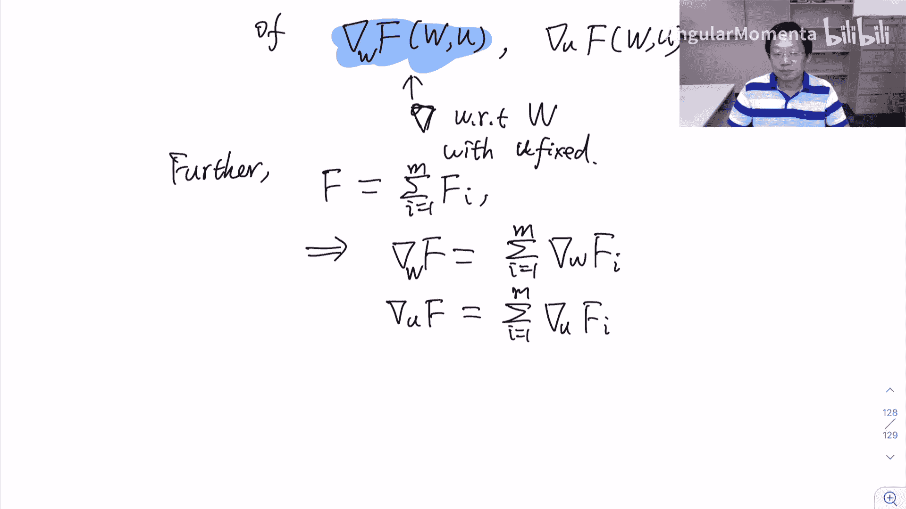

# 099：神经网络训练与梯度下降 🧠

在本节课中，我们将学习如何训练一个神经网络。具体来说，我们将了解如何通过最小化预测误差来求解网络中的权重参数 **W**  和 **U** ，并探讨梯度下降法在这一非凸优化问题中的应用。

---

上一节我们介绍了神经网络的基本结构，本节中我们来看看如何通过训练来确定其中的参数 **W** 和 **U**。

给定输入输出数据对 `(X_i, Y_i)`，其中 `i` 从 `1` 到 `M`，通过最小化预测误差来求解 **W** 和 **U** 的过程，被称为**神经网络训练**。这是深度学习中的一个关键阶段。

为了训练这个神经网络，我们首先需要定义关于 **W** 和 **U** 的两个函数。

具体地，我定义大写的 `F_i`，它代表第 `i` 个方程的误差：
`F_i(W, U) = (f(W, U; X_i) - Y_i)^2`
这个误差被视为 **W** 和 **U** 的函数。改变 **W** 和 **U**，我们会得到不同的误差值。

由于在神经网络训练中，我们需要对所有 `M` 个方程的误差求和，因此我们定义总误差函数 `F(W, U)`：
`F(W, U) = Σ_{i=1}^{M} F_i(W, U)`

我们需要解决的问题是：
`min_{W, U} F(W, U)`
或者等价于：
`min_{W, U} Σ_{i=1}^{M} F_i(W, U)`
其中，变量 **W** 属于 `R^{P×N}`，**U** 属于 `R^P`。

为了求解这个最小化问题，我们需要关注函数 `F(W, U)` 或 `F_i(W, U)` 的性质。

首先，函数 `F(W, U)` 是可微分的。这里的 `σ` 是激活函数。如果激活函数 `σ` 是可微的，那么 `F` 也是可微的，因为 `F` 是由平方误差、内积、激活函数和矩阵向量乘法等平滑运算复合而成的。

其次，函数 `F(W, U)` 通常**不是凸的**。即使我们选择一个凸的激活函数（如 ReLU），由于函数复合的方式非常复杂，`F` 仍然是非凸的。

`F` 的非凸性给神经网络的训练带来了一些障碍。因为我们目前只学过梯度下降算法，而我们知道，对于非凸函数，梯度为零的点并不一定是全局最小值点。它可能是局部最小值、局部最大值、鞍点，或者什么都不是。因此，梯度下降法**不能保证**找到全局最小值。

深度学习中的一个令人惊讶的事实是，尽管没有理论保证，梯度下降法或其变体（如随机梯度下降法）在实践中仍然能为该优化问题提供非常好的解。我们得到的解通常非常接近一个全局最小值。

目前尚不完全清楚为什么梯度下降法在神经网络训练中效果如此之好。这仍然是一个深刻且神秘的现象，也是深度学习理论中的一个热门研究课题，涉及复杂的数学。

无论如何，我们直接应用梯度下降法来训练神经网络。

因此，我们需要计算函数 `F` 在点 `(W, U)` 处的梯度。由于 `F` 包含两个变量 **W** 和 **U**，其梯度可以表示为关于 **W** 的梯度和关于 **U** 的梯度的组合。

这里，我用 `∇_W F` 表示仅关于 **W** 的梯度（此时 **U** 固定）。类似地，`∇_U F` 表示仅关于 **U** 的梯度。所以，为了求出 `F` 的梯度，我们只需要分别求出 `∇_W F` 和 `∇_U F`。

进一步，因为 `F = Σ_{i=1}^{M} F_i`，根据微分的线性性质，我们有：
`∇_W F = Σ_{i=1}^{M} ∇_W F_i`
`∇_U F = Σ_{i=1}^{M} ∇_U F_i`
因此，我们只需要求出每个 `F_i` 关于 **W** 和 **U** 的梯度即可。

---

本节课中我们一起学习了神经网络训练的基本框架。我们定义了总误差函数 `F(W, U)`，并认识到它是一个非凸的可微函数。尽管非凸性使得寻找全局最优解变得困难，但梯度下降法在实践中被证明是训练神经网络的有效工具。最后，我们将计算总梯度的问题分解为计算每个数据点梯度之和，为后续具体实施梯度下降算法奠定了基础。