# 100：神经网络梯度计算

在本节课中，我们将学习如何运用已掌握的微分工具，分别计算损失函数关于权重矩阵 **W** 和参数向量 **U** 的梯度。我们将通过链式法则，将复杂的神经网络函数分解为多个简单函数的组合，从而逐步推导出梯度公式。

上一节我们介绍了链式法则的基本概念，本节中我们来看看如何将其应用于具体的神经网络模型。

## 计算关于权重 W 的梯度

我们的目标是计算损失函数 **F_i(W, U)** 关于 **W** 的梯度。该损失函数定义为预测值与真实值之差的平方：

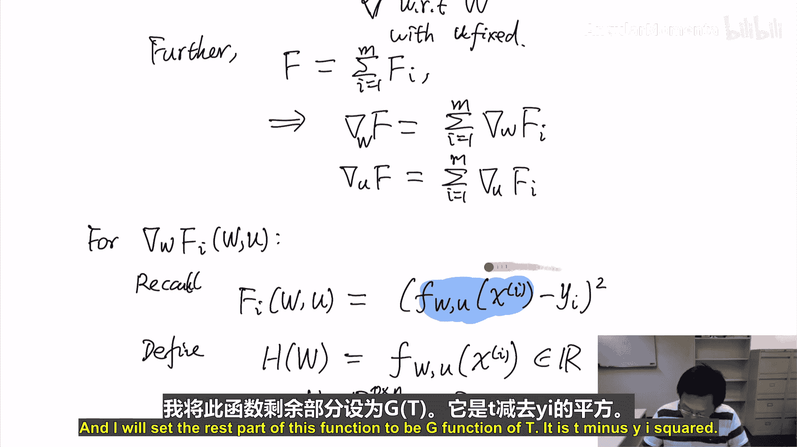

**F_i(W, U) = (f(W, U; x_i) - y_i)^2**

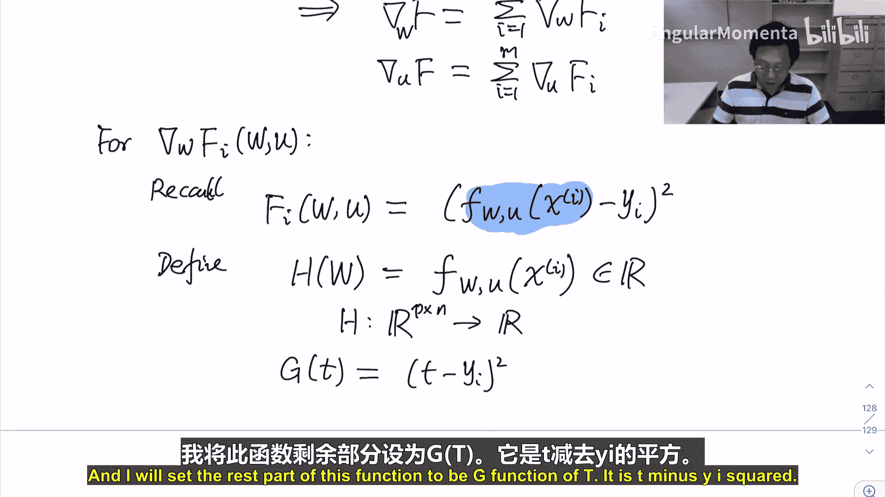

为了应用链式法则，我们将其重写为复合函数的形式。首先，我们定义内层函数 **H(W)** 和外层函数 **G(t)**。

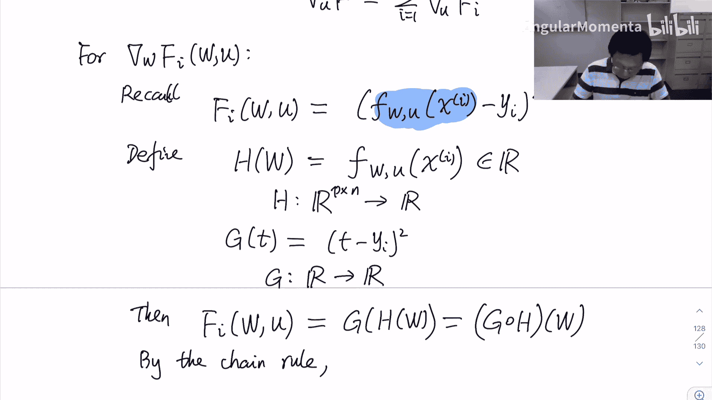

*   **内层函数 H(W)**：将 **W** 映射为神经网络的输出值。
    *   **H(W) = f(W, U; x_i)**
    *   这是一个从矩阵空间 **R^(p×n)** 到实数 **R** 的映射。
*   **外层函数 G(t)**：计算平方误差。
    *   **G(t) = (t - y_i)^2**
    *   这是一个从实数 **R** 到实数 **R** 的映射。

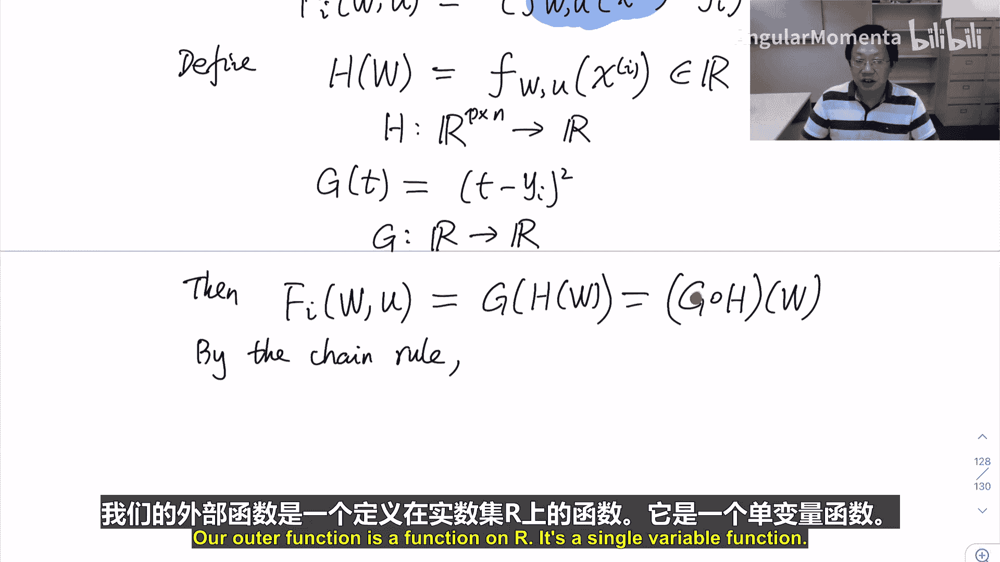

因此，原函数可以表示为：
**F_i(W, U) = G(H(W))**

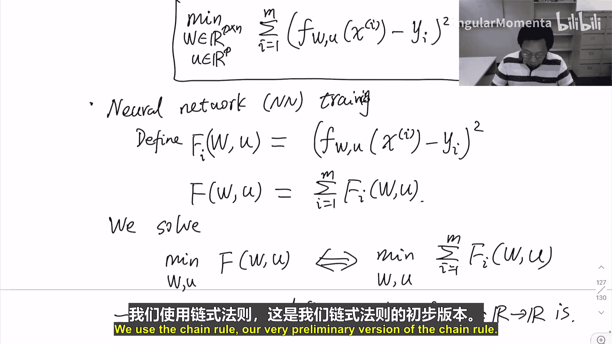

现在，我们应用链式法则。由于内层函数映射到 **R**，外层函数也是 **R** 上的函数，我们可以使用最基础的链式法则形式：

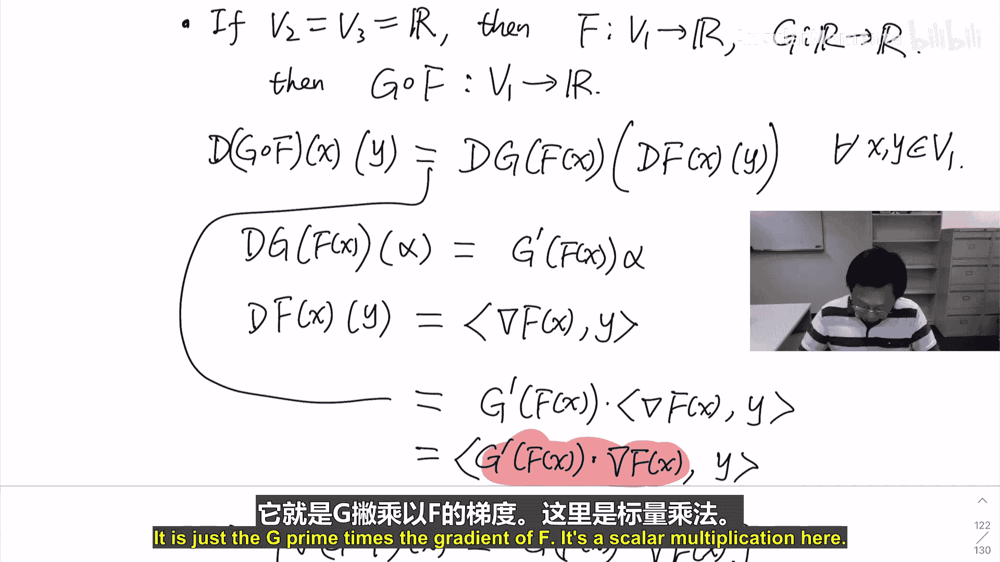

**∇_W F_i(W, U) = G‘(H(W)) * ∇_W H(W)**

其中，**G’(t) = 2(t - y_i)**。将 **t** 替换为 **H(W)**，我们得到：

**∇_W F_i(W, U) = 2 * (f(W, U; x_i) - y_i) * ∇_W f(W, U; x_i)**

至此，问题转化为计算神经网络输出 **f(W, U; x_i)** 关于 **W** 的梯度。

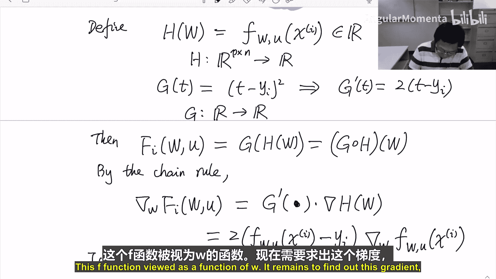

## 计算神经网络输出关于 W 的梯度

神经网络函数定义为：
**f(W, U; x_i) = U^T * σ(W x_i)**

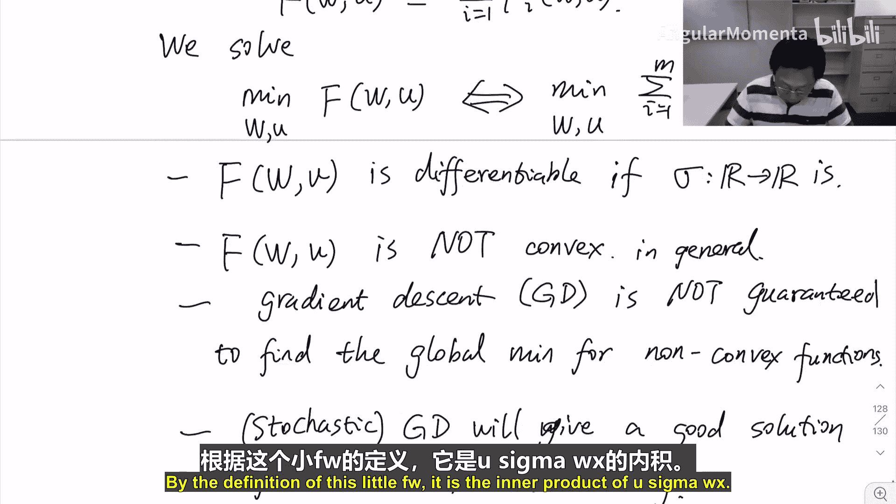

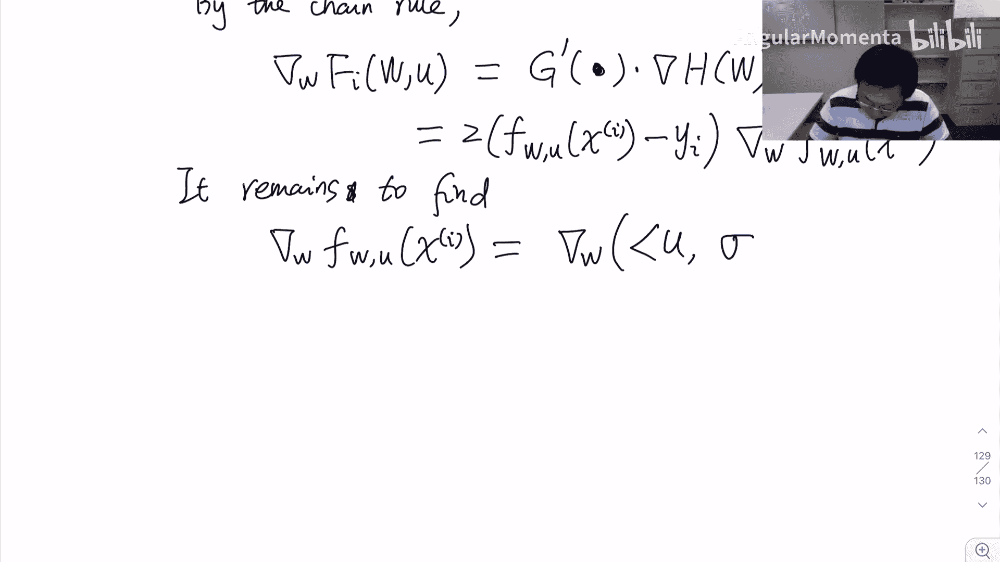

其中 **σ** 是激活函数。我们再次将其视为复合函数以便求导。

*   **内层函数 H(W)**：应用激活函数。
    *   **H(W) = σ(W x_i)**
    *   这是一个从矩阵空间 **R^(p×n)** 到向量空间 **R^p** 的映射（对 **p** 个神经元分别激活）。
*   **外层函数 G(Z)**：计算内积。
    *   **G(Z) = U^T * Z**
    *   这是一个从向量空间 **R^p** 到实数 **R** 的线性映射。

因此，神经网络函数可以写为：
**f(W, U; x_i) = G(H(W))**

现在，我们应用适用于向量空间映射的链式法则。关键在于，我们的外层函数 **G** 是线性的（内积形式）。对于线性函数 **G(Z) = A^T Z**，其梯度就是其转置 **A**。

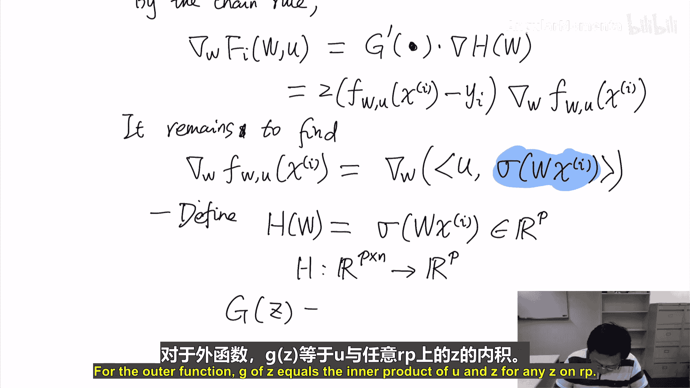

应用链式法则，我们得到：
**∇_W f = (D H(W))^* [∇_Z G]**

其中 **(D H(W))^*** 是内层函数 **H** 在 **W** 处的微分算子的伴随算子，**∇_Z G** 是外层线性函数 **G** 关于其输入 **Z** 的梯度。对于 **G(Z) = U^T Z**，有 **∇_Z G = U**。

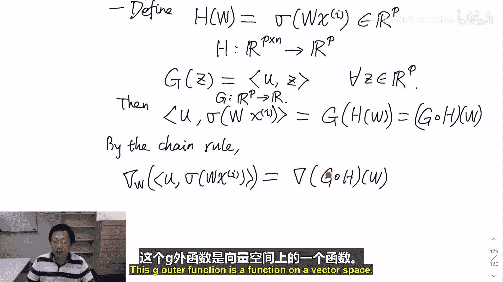

因此，公式简化为：
**∇_W f(W, U; x_i) = (D_W σ(W x_i))^* U**

这里，**(D_W σ(W x_i))** 是激活函数 **σ** 应用于 **W x_i** 后，关于 **W** 的微分（雅可比矩阵），*** 表示取其伴随（对于实数域，通常就是转置）。

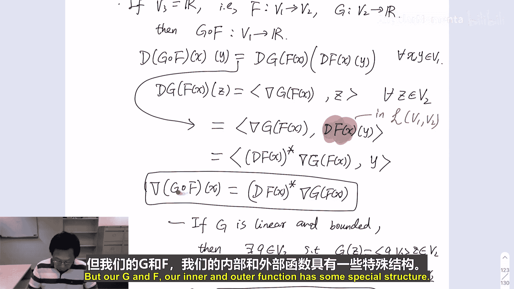

## 核心公式总结

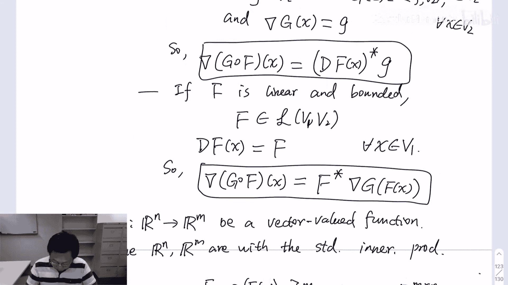

以下是计算梯度的核心步骤与公式：

1.  **损失函数关于 W 的梯度**：
    **∇_W F_i = 2 * (预测值 - 真实值) * ∇_W f**

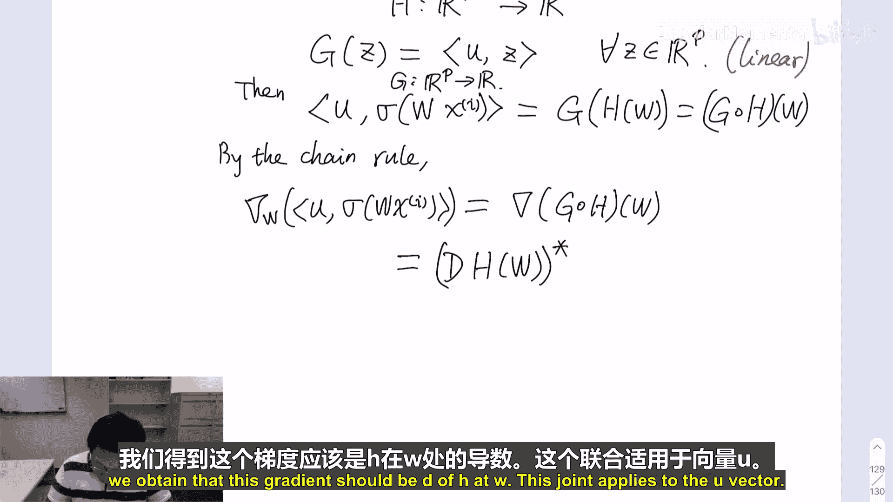

2.  **神经网络输出关于 W 的梯度**：
    **∇_W f = (D_W σ(W x_i))^T U**

    其中，**D_W σ(W x_i)** 是激活函数 **σ** 在点 **W x_i** 处关于 **W** 的雅可比矩阵。对于逐元素激活函数（如ReLU, sigmoid），这个雅可比矩阵是一个对角矩阵，对角线元素是 **σ‘ (W x_i)** 的各个分量。

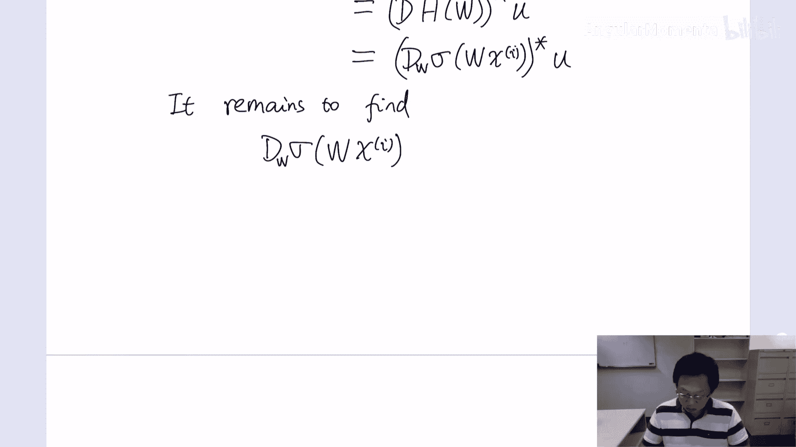

本节课中我们一起学习了如何利用链式法则分解神经网络，并逐步推导出损失函数关于权重矩阵 **W** 的梯度公式。关键在于将复杂函数分解为内层映射和外层函数，并注意外层函数的线性特性可以简化梯度计算。理解这个推导过程是应用反向传播算法进行神经网络训练的基础。