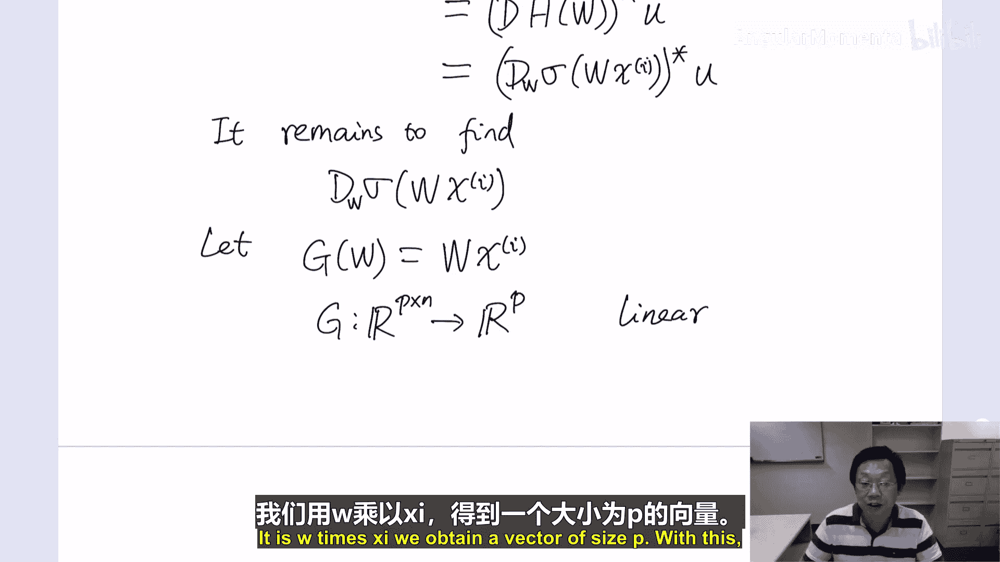
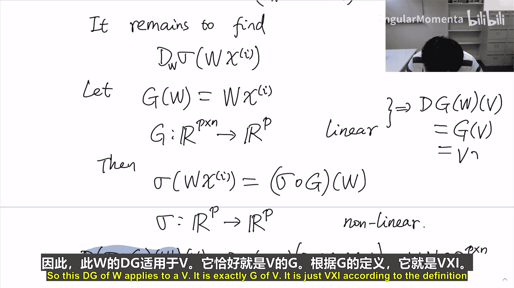
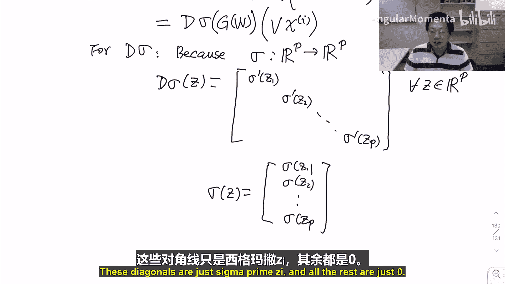
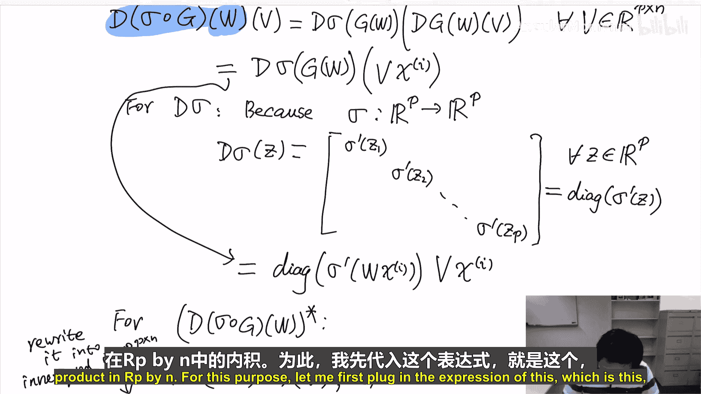
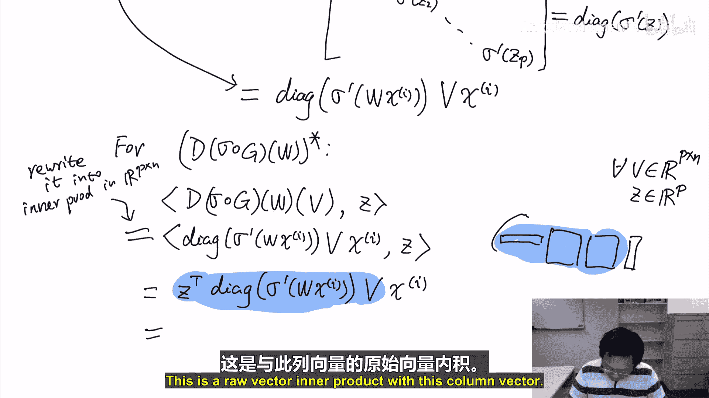
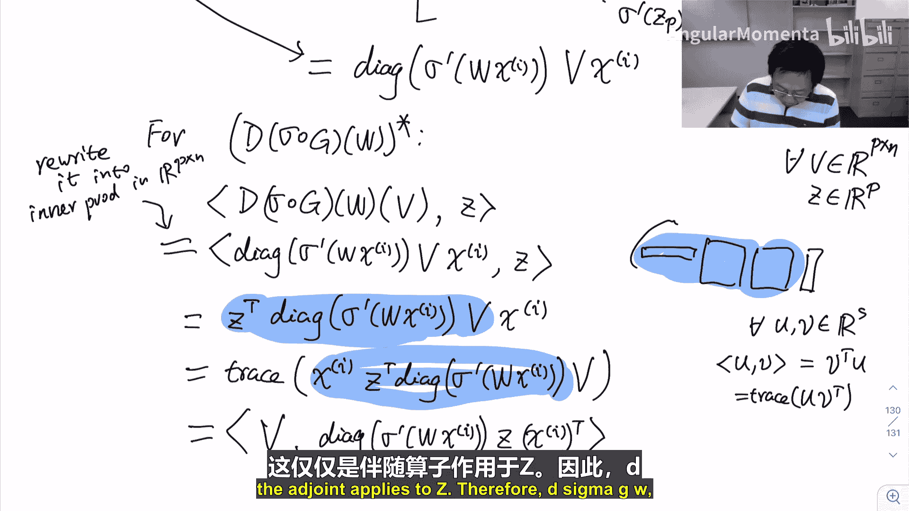
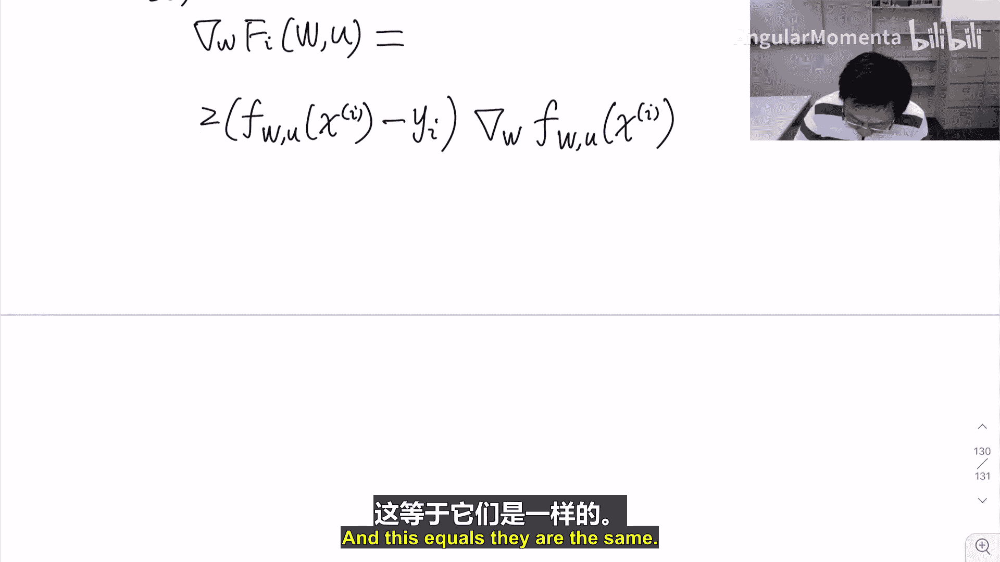
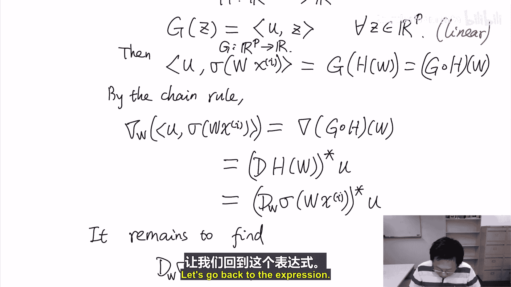
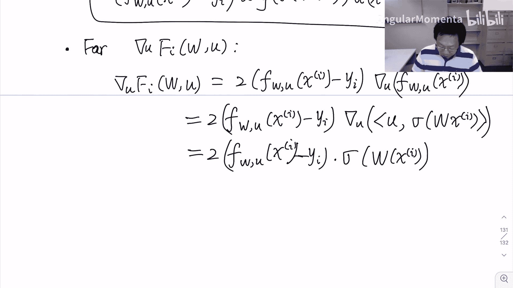

# 101：单层神经网络梯度计算

在本节课中，我们将学习如何计算单层神经网络的损失函数关于权重矩阵 **W** 和向量 **U** 的梯度。我们将通过链式法则，将复杂的函数分解为多个简单函数的组合，并逐步推导出梯度的解析表达式。

## 函数分解与链式法则应用

上一节我们介绍了损失函数的基本形式，本节中我们来看看如何通过函数分解来应用链式法则。

为了计算损失函数中关于 **W** 的项 **σ(Wxᵢ)** 的导数，我们首先将这个函数写成两个函数的复合形式。

令函数 **G** 定义为：
**G(W) = Wxᵢ**
这是一个线性函数，它将一个 **P × N** 的矩阵 **W** 映射为一个 **P** 维向量。

通过这个定义，我们的 **σ(Wxᵢ)** 现在可以写成 **σ** 与 **G** 的复合函数：
**σ ∘ G(W)**
其中 **σ** 是从 **Rᴾ** 到 **Rᴾ** 的非线性激活函数。

现在应用链式法则。导数 **D(σ ∘ G)(W)** 是一个线性算子，作用于一个与 **W** 同尺寸（**P × N**）的矩阵 **V**。对于任意 **V**，有：
**D(σ ∘ G)(W)[V] = Dσ(G(W))[ DG(W)[V] ]**
因此，我们需要分别求出 **Dσ** 和 **DG**。

## 计算线性部分 **G** 的导数

首先计算 **DG**。因为 **G** 是一个线性变换，其导数就是它本身。所以：
**DG(W)[V] = G(V) = Vxᵢ**

因此，链式法则中的项变为：
**Dσ(G(W))[ Vxᵢ ]**

## 计算激活函数 **σ** 的导数

接下来求 **Dσ**。**σ** 是一个逐元素的激活函数，其雅可比矩阵是一个对角矩阵，对角线上的元素是 **σ** 在各分量上的导数。

对于任意向量 **z ∈ Rᴾ**，有：
**Dσ(z) = diag( σ'(z₁), σ'(z₂), ..., σ'(zₚ) )**
这是一个 **P × P** 的对角矩阵。

将 **z = G(W) = Wxᵢ** 代入，我们得到：
**D(σ ∘ G)(W)[V] = diag( σ'(Wxᵢ) ) · (Vxᵢ)**
这是一个 **P × P** 矩阵乘以一个 **P** 维向量，结果是一个 **P** 维向量。

## 求算子的伴随并得到梯度

在我们的最终表达式中，需要这个导数算子的伴随。根据伴随的定义，对于任意向量 **z ∈ Rᴾ**，有：
**< D(σ ∘ G)(W)[V], z >_{Rᴾ} = < V, [D(σ ∘ G)(W)]^*[z] >_{Rᴾˣᴺ}**

将前面的表达式代入左边：
**< diag( σ'(Wxᵢ) ) · (Vxᵢ), z >_{Rᴾ}**

利用矩阵内积与迹的关系（对于任意向量 **u, v**，有 **uᵀv = tr(uvᵀ)**），我们可以将这个 **Rᴾ** 中的内积重写为 **Rᴾˣᴺ** 中的内积形式。

经过推导（具体步骤见原视频板书），我们得到伴随算子的作用结果为：
**[D(σ ∘ G)(W)]^*[z] = diag( σ'(Wxᵢ) ) · z · xᵢᵀ**

## 得到关于 **W** 的梯度

最后，我们将这个结果代入损失函数关于 **W** 的梯度表达式中。损失函数中相关项为 **Fᵢ(W, U) = (Uᵀσ(Wxᵢ) - yᵢ)²**。

通过链式法则和上述推导，我们得到其关于 **W** 的梯度为：
**∇_W Fᵢ = 2 (Uᵀσ(Wxᵢ) - yᵢ) · [D(σ ∘ G)(W)]^*[U]**

代入伴随算子的结果：
**∇_W Fᵢ = 2 (Uᵀσ(Wxᵢ) - yᵢ) · diag( σ'(Wxᵢ) ) · U · xᵢᵀ**

## 计算关于 **U** 的梯度

关于参数 **U** 的梯度计算相对简单。损失函数 **Fᵢ** 中只有 **Uᵀσ(Wxᵢ)** 项与 **U** 有关。

因此，其梯度为：
**∇_U Fᵢ = 2 (Uᵀσ(Wxᵢ) - yᵢ) · ∇_U (Uᵀσ(Wxᵢ))**

注意到当 **W** 固定时，**Uᵀσ(Wxᵢ)** 是 **U** 的线性函数。线性函数的梯度就是其系数向量。所以：
**∇_U (Uᵀσ(Wxᵢ)) = σ(Wxᵢ)**

最终得到：
**∇_U Fᵢ = 2 (Uᵀσ(Wxᵢ) - yᵢ) · σ(Wxᵢ)**

## 总结

本节课中我们一起学习了单层神经网络损失函数的梯度计算。我们通过以下步骤完成了推导：

1.  **函数分解**：将复杂的函数 **σ(Wxᵢ)** 分解为线性映射 **G** 和非线性激活 **σ** 的复合。
2.  **应用链式法则**：分别计算线性部分和非线性部分的导数。
3.  **处理线性算子**：利用线性变换的导数即其本身这一性质。
4.  **处理逐元素激活函数**：其雅可比矩阵是一个对角矩阵。
5.  **求伴随算子**：为了得到矩阵参数的梯度，需要将向量空间的内积转化为矩阵空间的内积，这引入了伴随算子的概念。
6.  **合成最终梯度**：将各部分结果代入链式法则，得到关于权重矩阵 **W** 和参数向量 **U** 的清晰梯度表达式。

核心公式总结如下：
*   关于 **W** 的梯度：**∇_W Fᵢ = 2 (Uᵀσ(Wxᵢ) - yᵢ) · diag( σ'(Wxᵢ) ) · U · xᵢᵀ**
*   关于 **U** 的梯度：**∇_U Fᵢ = 2 (Uᵀσ(Wxᵢ) - yᵢ) · σ(Wxᵢ)**

这个推导过程展示了如何系统性地使用多元微积分和线性代数的工具来解决机器学习中的优化问题。