# 102：多层神经网络与深度学习 🧠

在本节课中，我们将要学习多层神经网络的基本概念。我们将从单层神经网络出发，探讨如何通过堆叠多层结构来构建更强大的模型，并了解如何利用这种模型解决回归问题。

上一节我们介绍了单层神经网络，本节中我们来看看它的扩展形式——多层神经网络。

## 多层神经网络的结构

多层神经网络是单层神经网络的推广。我们将多个单层神经网络堆叠在一起，形成一个多层神经网络。

具体而言，下图展示了一个单层神经网络。在多层神经网络中，我们不直接使用神经元的输出来形成最终输出。相反，我们将第一层的输出作为下一层的输入。

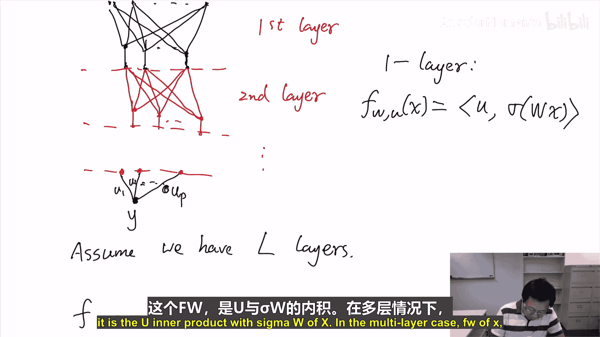

这是第二层中的一个神经元。它的输入来自第一层。我们在第二层放置许多神经元。第二层中的神经元数量可能与第一层不同。


我们到达第二层。这是第一层。这个过程是递归进行的。第二层的输出将成为第三层的输入，依此类推，直到第L层。

假设这是第L层的输出。然后我们使用一个线性组合来获得最终输出。这就是一个多层神经网络。

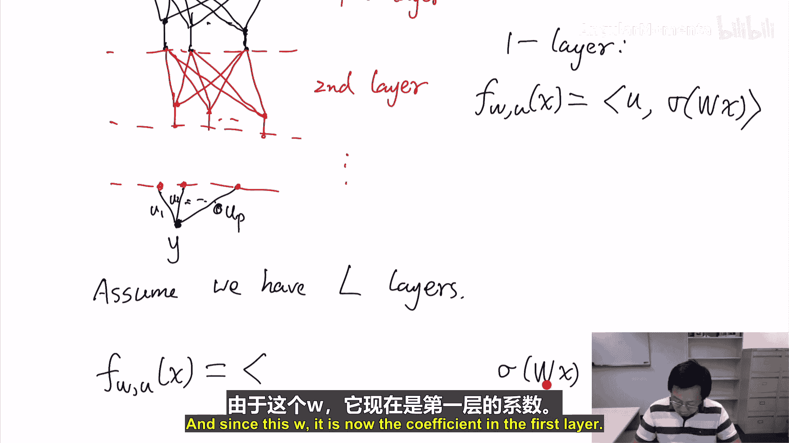

## 数学表示

现在，假设我们拥有所有层。在单层情况下，我们知道函数 `F_W(x)` 是 `U` 与 `σ(Wx)` 的内积。在多层情况下，函数 `F_{W,U}(x)` 的表示如下：


第一层的输出由 `σ(W^1 x)` 给出。这是第一层的输出。由于这里的 `W` 现在是第一层的系数，因此我使用上标 `(1)` 来表示它是第一层的权重。

第一层的输出将成为第二层的输入。所以在第二层，我们只需将 `W^2` 应用于此输出，然后进行 `σ` 激活。这将是第二层的输出。这个过程重复进行，直到第L层：`W^L` 应用于第 `L-1` 层的输出，然后我们进行激活。因此，这是第L层的输出。这个输出将与向量 `U` 进行内积，以形成最终输出。

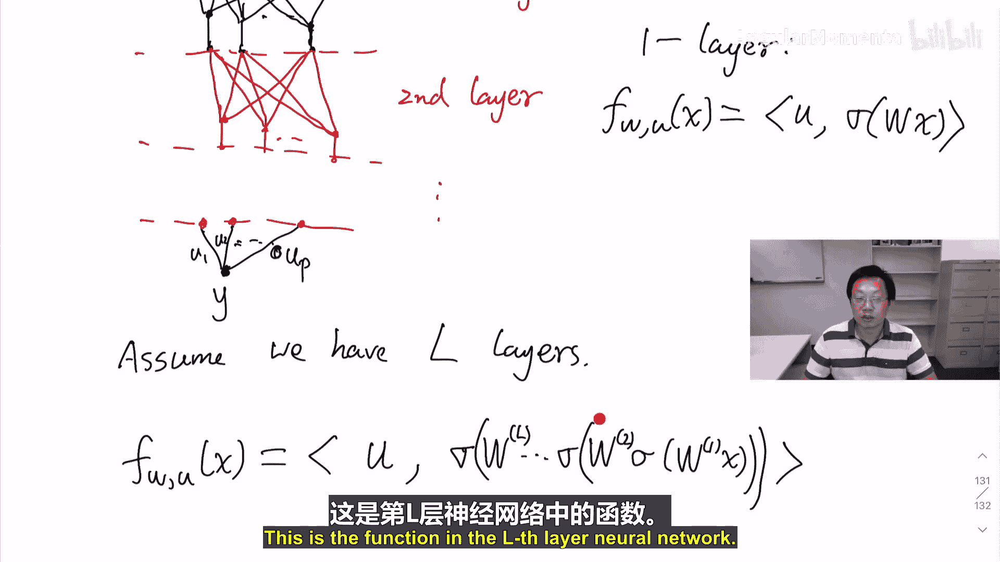

这是多层神经网络中的函数。


我现在将其写成复合函数的形式。首先将 `W^1` 应用于 `x`（`W^1 x` 表示矩阵 `W^1` 乘以 `x`，因为 `W^1` 可以理解为一个矩阵或线性变换）。在应用 `W^1` 之后，我们将其与非线性激活函数 `σ` 复合，然后再与 `W^2`（第二个线性变换）复合，接着是 `σ` 激活，依此类推，直到 `W^L` 和 `σ`。

以复合形式表示，`F_W(x)` 是这种形式。因此，多层神经网络只是我们递归地使用线性变换和非线性激活 `L` 次，然后进行最终的内积以获得最终输出。这里的参数 `W` 是所有系数矩阵的组合，即 `W = {W^1, W^2, ..., W^L}`。这就是由多层神经网络表示的函数。

## 深度神经网络与深度学习

当层数 `L` 非常大时，意味着这个神经网络非常深。在这种情况下，我们称之为深度神经网络。

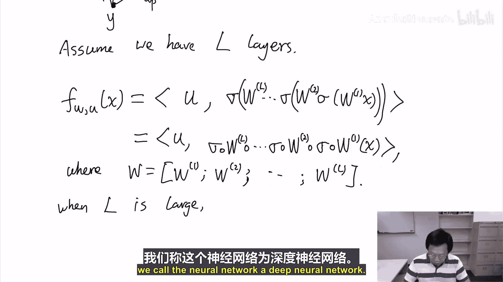

当我们使用深度神经网络执行机器学习任务时，就得到了所谓的深度学习方法。因此，深度学习就是用于机器学习的多层神经网络。


## 用于回归问题的深度学习

让我们看看如何使用深度学习来解决回归问题。对于回归，我们只需使用 `F_{W,U}` 作为我们的函数 `f`。然后，我们寻找 `W` 和 `U`，使得对于所有训练数据对 `(x_i, y_i)`，有 `F_{W,U}(x_i) ≈ y_i`。

为此，我们最小化以下目标函数（其中 `W` 和 `U` 是参数）：
```
min_{W,U} Σ_{i=1}^{M} [F_{W,U}(x_i) - y_i]^2
```
你可以选择其他误差函数或损失函数。例如，如果我们的 `y_i` 是二元的（即用于分类），在这种情况下，我们应该将这个平方差函数替换为其他函数，如逻辑函数，以进行逻辑回归。无论如何，对于回归问题，我们希望解决这个最小化问题。

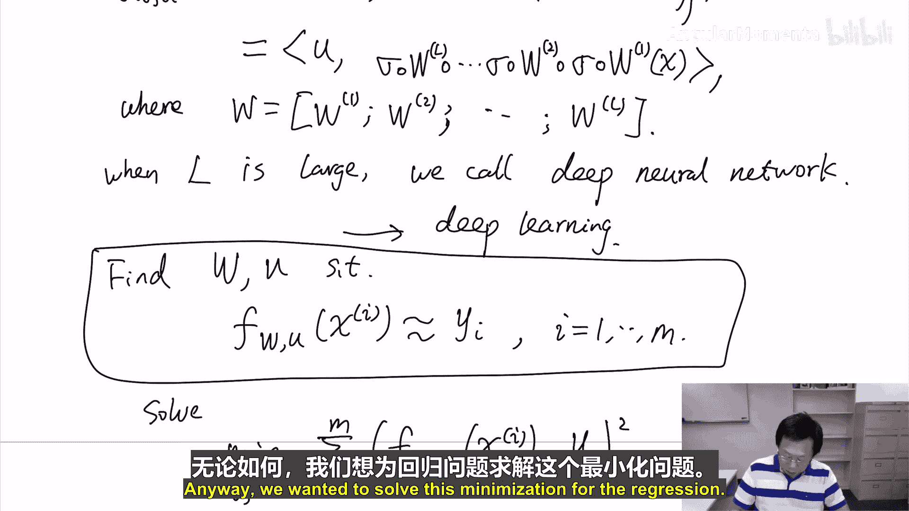

因此，训练一个神经网络等价于寻找 `W` 和 `U` 以最小化上述函数。这里，我想将这个关于 `W` 和 `U` 的函数记为 `F_I(W, U)`，因为在这个优化问题中，`W` 和 `U` 是参数。

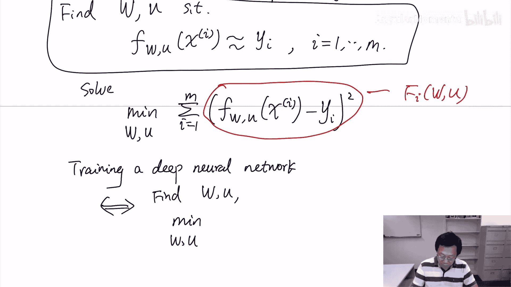

我们得到 `F(W, U) = Σ_{i=1}^{M} F_i(W, U)`，其中 `F_i(W, U) = [F_{W,U}(x_i) - y_i]^2`。

因此，为了训练这个用于回归的深度神经网络，我们需要解决关于 `W` 和 `U` 的这个最小化问题。现在，`W` 是 `L` 个矩阵的集合。这些矩阵可能具有不同的大小。


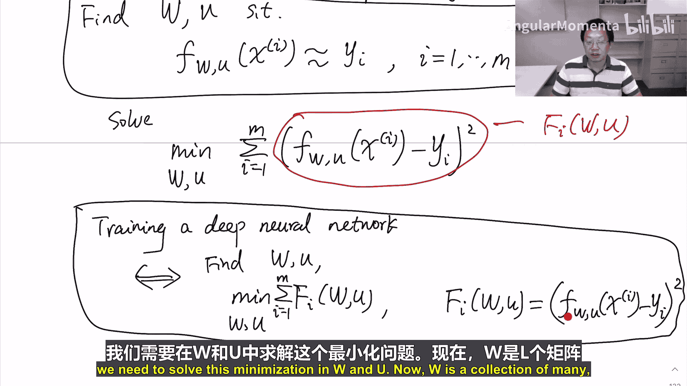

但是，所有的 `W` 仍然形成一个希尔伯特空间，因为我们有 `L` 个矩阵，每个矩阵都在希尔伯特空间中，我们可以将这 `L` 个希尔伯特空间做积来形成一个新的希尔伯特空间。对于这个 `W`，这个优化问题就在希尔伯特空间中。


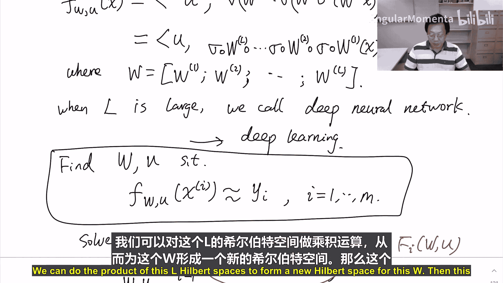

然后，我们可以使用梯度下降法或随机梯度下降法来解决这个优化问题。同样，如果 `σ` 是光滑的，这个函数 `Σ_i F_i` 是光滑的，并且通常是非凸的。因此，梯度下降法不能自动保证找到全局最小点。


然而，因为我们的深度神经网络具有非常特殊的结构，梯度下降法或随机梯度下降法在实践中对于神经网络的训练效果非常好。它通常能为我们提供一个非常接近该最小化问题全局最小点的解。

## 计算梯度


在随机梯度下降法或梯度下降法中，我们需要 `F_i` 的梯度。

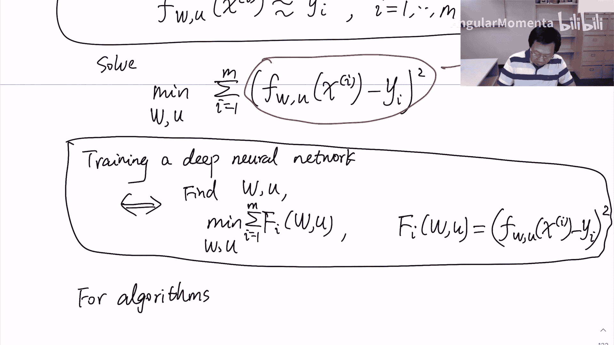

这意味着我们需要 `F_i` 关于 `W` 的梯度和 `F_i` 关于 `U` 的梯度。

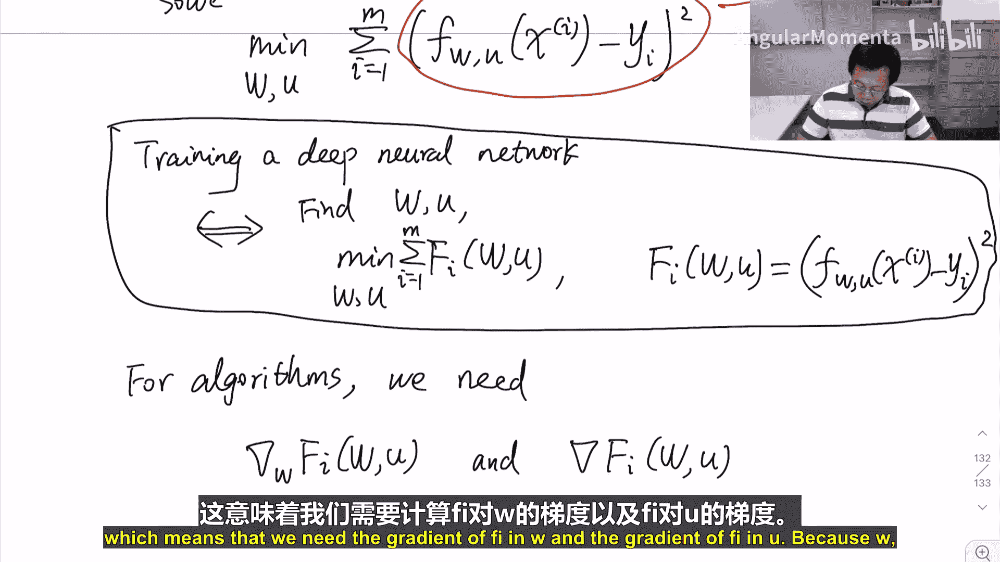

因为 `W` 现在是 `{W^1, ..., W^L}`，我们可以进一步将其分解为关于每个 `W^l`（`l` 从 `1` 到 `L`）的梯度。


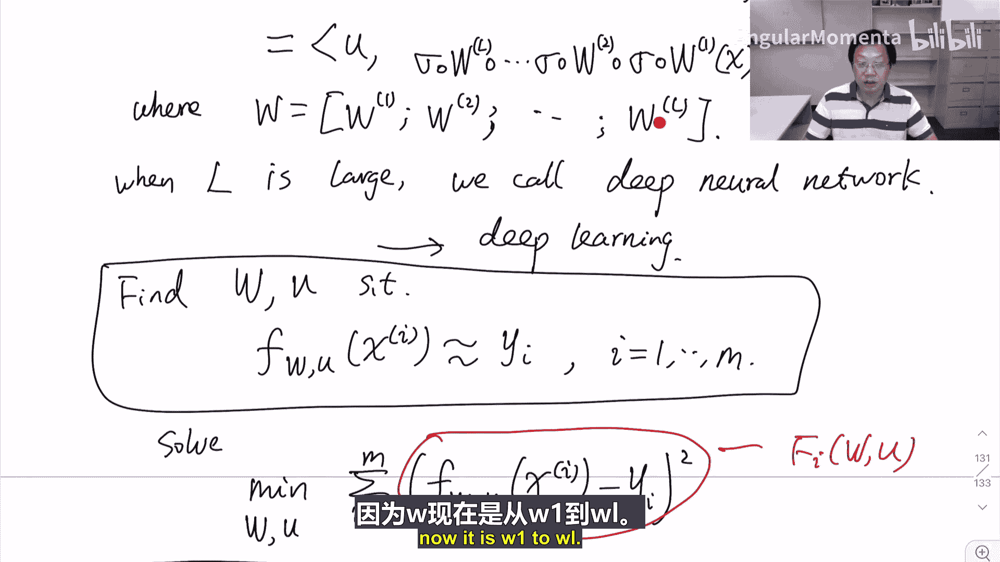


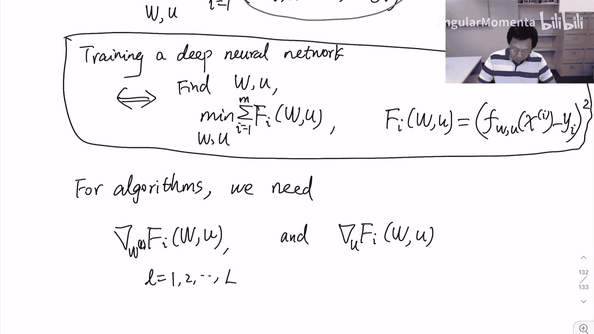

---


本节课中我们一起学习了多层神经网络的结构及其数学表示，理解了深度神经网络与深度学习的关系，并探讨了如何将其应用于回归问题，包括目标函数的构建和通过梯度下降法进行优化的基本思路。