# 103：多层神经网络梯度计算

在本节课中，我们将学习如何计算多层神经网络中损失函数关于权重矩阵 **W_L** 和输出层权重向量 **U** 的梯度。我们将引入清晰的符号系统，并通过与单层网络类比的方式，推导出梯度计算的通用公式。

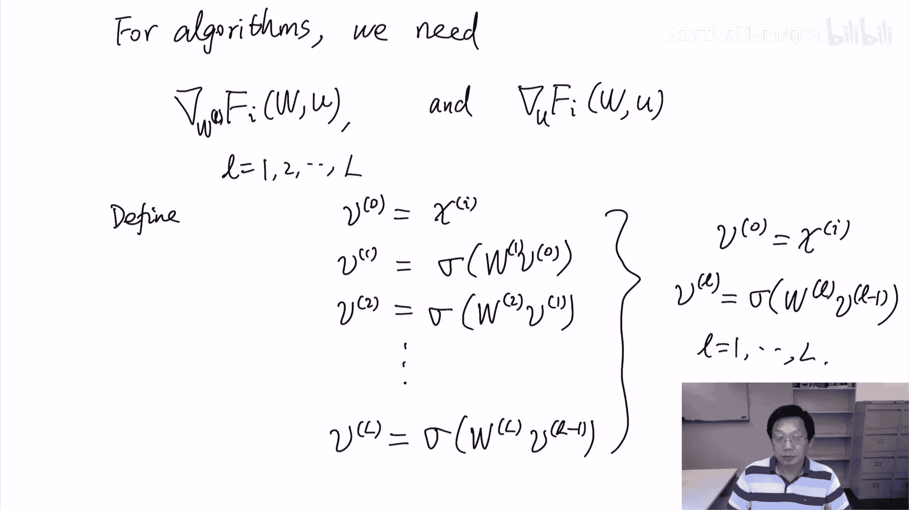

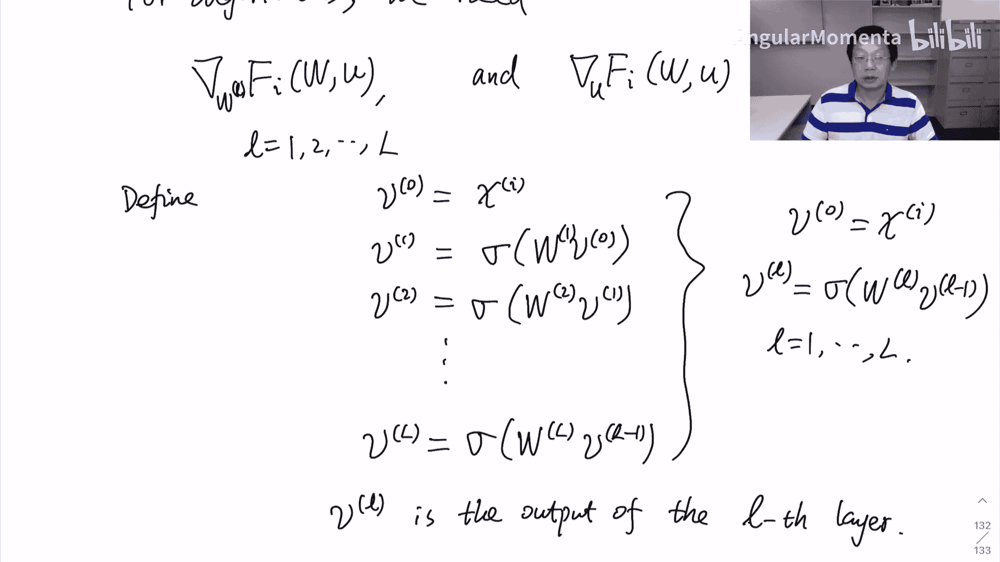

## 符号定义与网络结构

为了清晰地计算梯度，我们首先需要为神经网络的每一层定义符号。

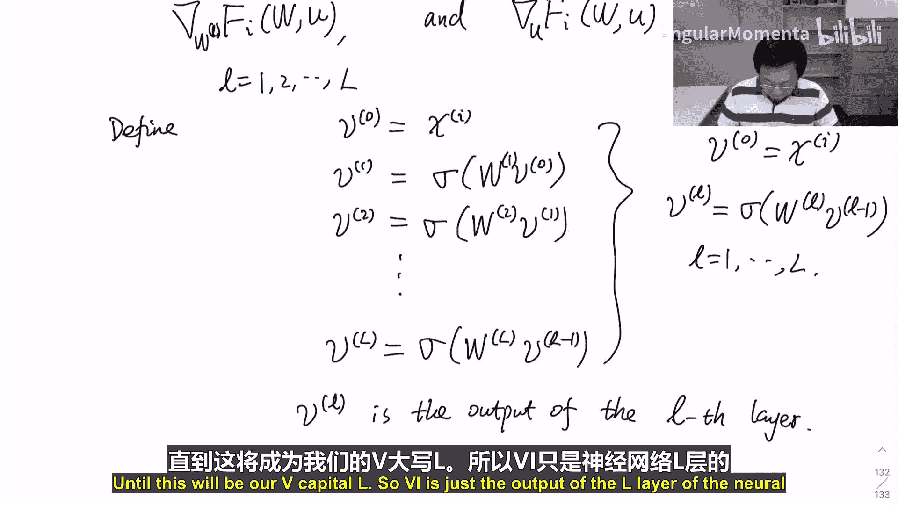

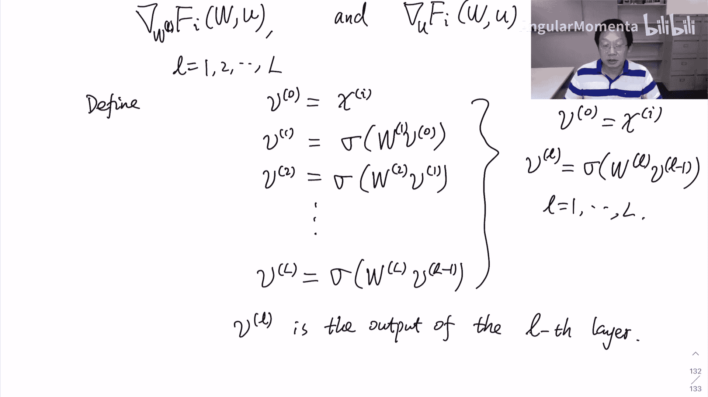

*   **V_0**：定义为输入 **X_i**，即神经网络的输入。
*   **V_l**：定义为第 `l` 层的输出，其计算公式为：
    **V_l = σ(W_l * V_{l-1})**，其中 `l = 1, 2, ..., L`。
    这里的 **σ** 是激活函数，**W_l** 是第 `l` 层的权重矩阵。

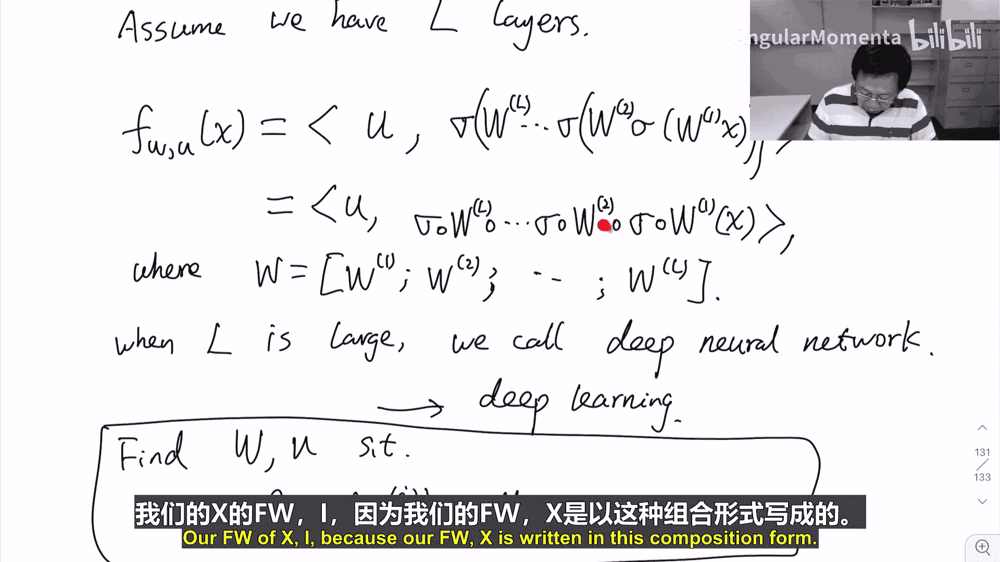

因此，**V_l** 就是神经网络第 `l` 层的输出。

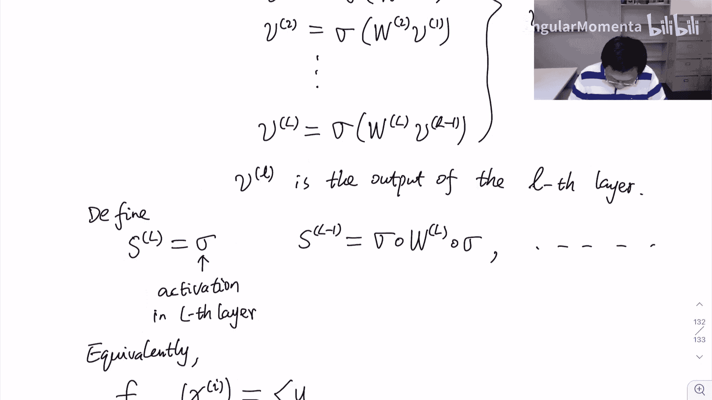

我们同时定义算子 **S_L** 和 **S_{L-1}**：
*   **S_L = σ**，表示第 `L` 层的激活函数。
*   **S_{L-1} = σ ∘ W_L ∘ σ**，这是一个复合函数，表示第 `L` 层激活函数、权重矩阵 **W_L** 和第 `L-1` 层激活函数的组合。

基于这些定义，我们的神经网络函数 **F_W,U(X)** 可以写成简洁的复合形式：
**F_W,U(X) = U · V_L = U · S_L(W_L · V_{L-1})**

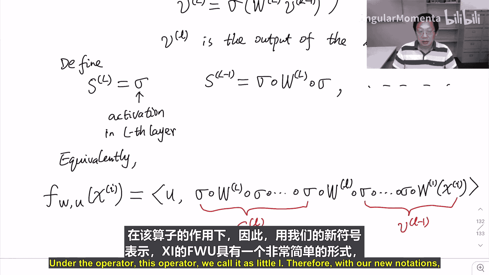

这个形式清晰地展示了输出是最后一层输出 **V_L** 与权重向量 **U** 的内积。

## 计算关于输出权重 U 的梯度

现在，我们开始计算损失函数 **F_I(W, U)** 关于参数 **U** 的梯度。损失函数定义为：
**F_I(W, U) = (F_W,U(X_i) - Y_i)^2**

根据链式法则，我们可以将其视为一个复合函数：内层函数是 **F_W,U(X_i)**，外层函数是平方误差函数。

梯度计算如下：
**∇_U F_I(W, U) = 2 * (F_W,U(X_i) - Y_i) * ∇_U F_W,U(X_i)**

由于 **F_W,U(X_i) = U · V_L** 是关于 **U** 的线性函数，其关于 **U** 的梯度就是 **V_L**。

因此，最终公式为：
**∇_U F_I(W, U) = 2 * (预测值 - 真实值) * V_L**

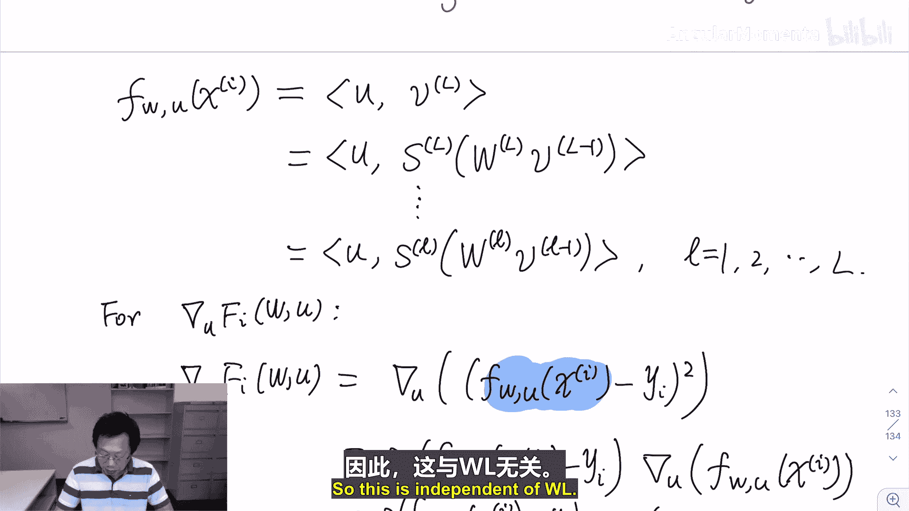

这个结果非常直观：关于输出层权重 **U** 的梯度，正比于预测误差与最后一层输出 **V_L** 的乘积。

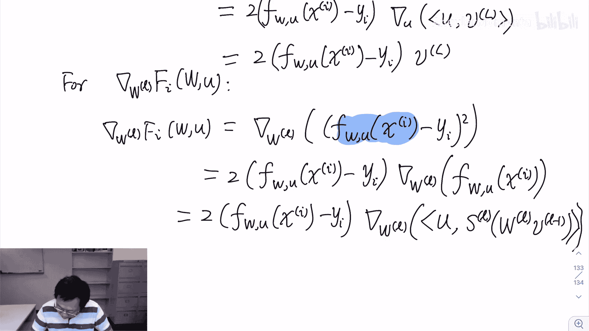

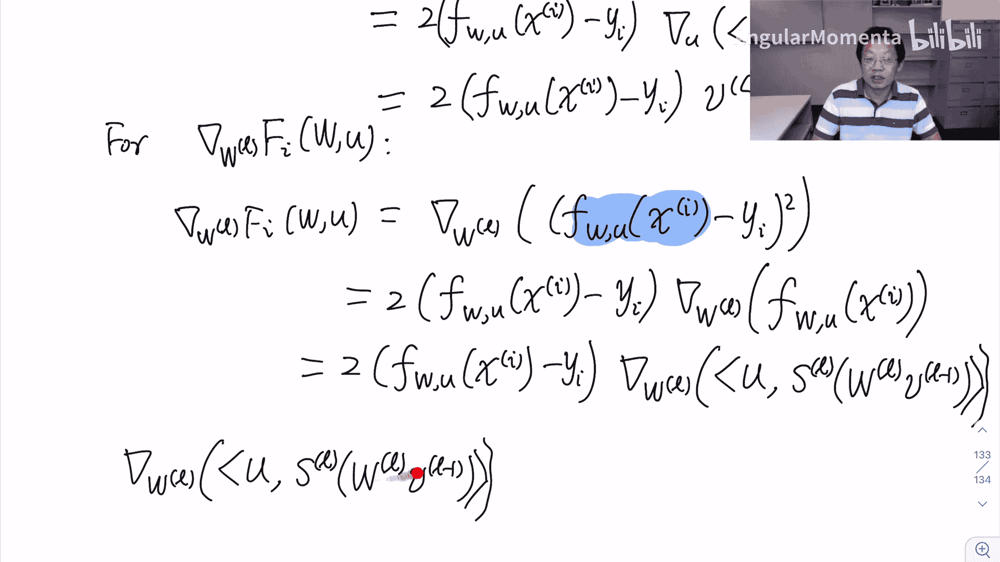

## 计算关于隐藏层权重 W_L 的梯度

上一节我们计算了关于 **U** 的梯度，本节中我们来看看如何计算关于某一隐藏层权重 **W_L** 的梯度。这部分计算更为复杂。

首先，同样应用链式法则：
**∇_{W_L} F_I(W, U) = 2 * (F_W,U(X_i) - Y_i) * ∇_{W_L} F_W,U(X_i)**

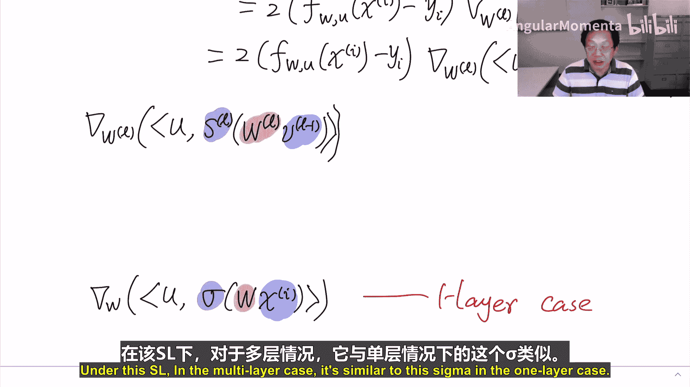

接下来，我们需要计算 **∇_{W_L} F_W,U(X_i)**。利用我们之前定义的符号，将 **F_W,U(X_i)** 写成与 **W_L** 直接相关的形式：
**F_W,U(X_i) = U · S_L(W_L · V_{L-1})**

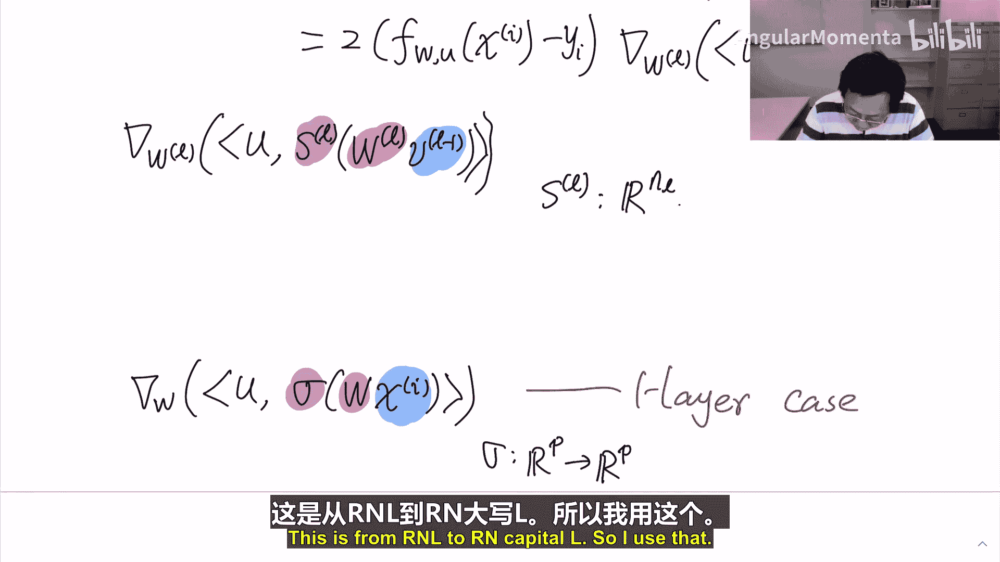

这里，**V_{L-1}** 是第 `L-1` 层的输出，它不依赖于 **W_L**，因此在当前梯度计算中被视为常数。

这个形式与单层神经网络的情况非常相似。回顾单层网络（输入 **X**，权重 **W**，激活函数 **σ**，输出权重 **u**）的梯度公式为：
**∇_W (u · σ(W · X)) = [Dσ(W·X)]^T * u * X^T**

通过类比，我们可以将单层网络中的对应项替换为多层网络中的项：
*   单层网络的 **X** 对应多层网络的 **V_{L-1}**。
*   单层网络的标量激活函数 **σ** 对应多层网络的向量值算子 **S_L**。
*   单层网络的输出权重标量 **u** 对应多层网络的向量 **U**。

因此，将单层网络的梯度公式进行推广，我们得到多层网络中关于 **W_L** 的梯度公式：
**∇_{W_L} F_W,U(X_i) = [DS_L(W_L · V_{L-1})]^T * U * (V_{L-1})^T**

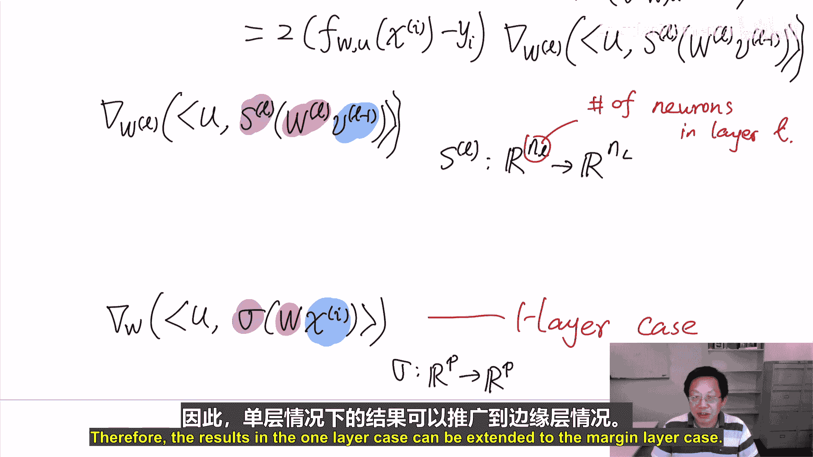

其中，**DS_L** 是算子 **S_L** 在其输入点 **Z = W_L · V_{L-1}** 处的导数（雅可比矩阵）。对于常见的逐元素激活函数（如 ReLU, Sigmoid），**DS_L(Z)** 是一个对角矩阵，其对角线元素是 **σ'(Z)** 在每个维度上的值。

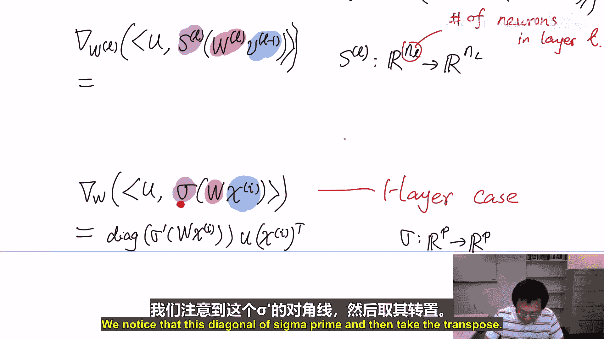

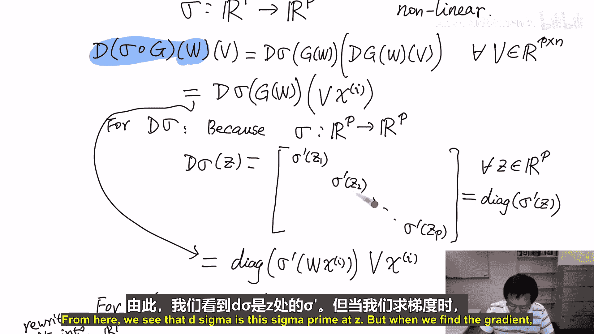

我们定义矩阵 **M_L** 为：
**M_L = [DS_L(W_L · V_{L-1})]^T * U**

最终，损失函数关于 **W_L** 的梯度为：
**∇_{W_L} F_I(W, U) = 2 * (预测值 - 真实值) * M_L * (V_{L-1})^T**

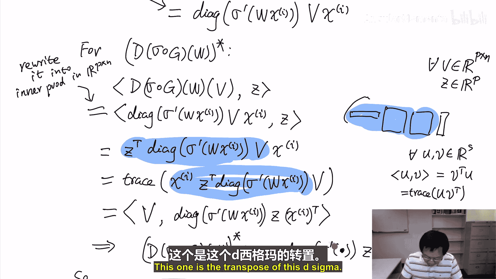

## 总结

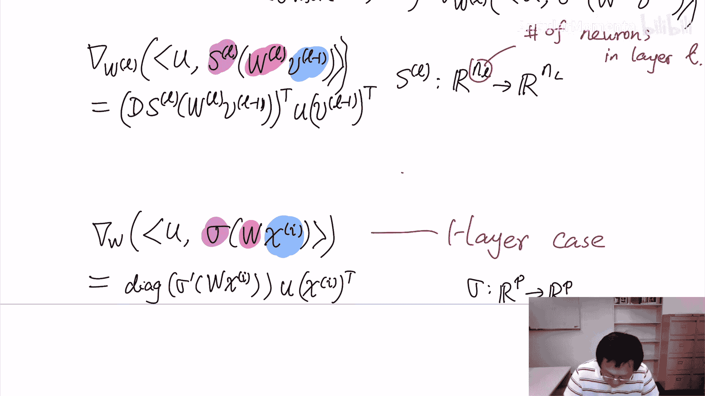

本节课中我们一起学习了多层神经网络的反向传播梯度计算。我们首先建立了清晰的层输出符号 **V_l**，然后分别推导了损失函数关于输出层权重 **U** 和隐藏层权重 **W_L** 的梯度公式。

关键结论如下：
1.  关于 **U** 的梯度计算简单直接：**∇_U F_I = 2 * 误差 * V_L**。
2.  关于 **W_L** 的梯度可以通过与单层网络类比得到：**∇_{W_L} F_I = 2 * 误差 * M_L * (V_{L-1})^T**，其中 **M_L** 包含了当前层激活函数的导数信息以及来自更深层的误差信号 **U**。

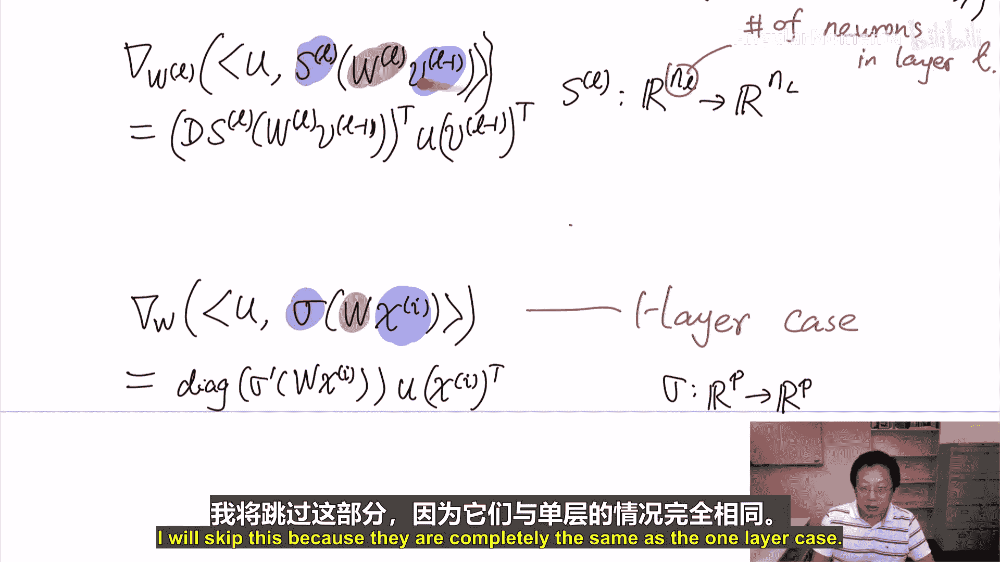

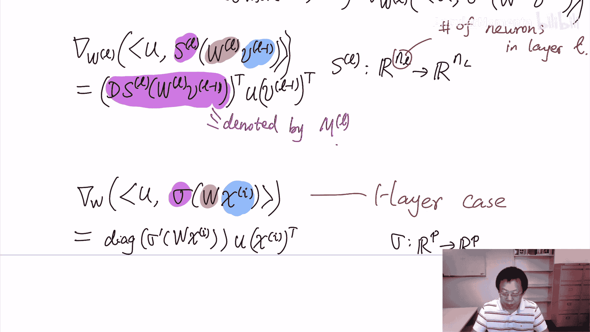

这些公式构成了反向传播算法的核心，使我们能够有效地训练深度神经网络。