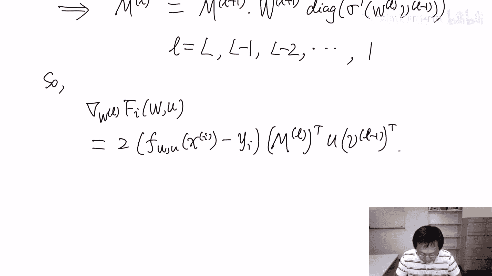

# 104：多层网络梯度计算 🧠

在本节课中，我们将学习如何计算深度神经网络中损失函数关于权重参数的梯度。我们将重点推导一个递归公式，用于高效计算每一层的梯度矩阵。

上一节我们介绍了单层网络梯度的基本形式，本节中我们来看看如何将其扩展到具有多个隐藏层的深度网络。

## 核心递归关系推导

我们目标是找到损失函数关于第 `L` 层权重 `W^L` 的梯度。定义函数 `S^L` 为从第 `L` 层激活函数输入到网络最终输出的映射：
`S^L(v) = σ(W^{L+1} σ( ... σ(W^L v) ... ))`

其导数 `DS^L` 是一个从 `R^{n_L}` 到 `R^{N}` 的线性变换矩阵，其中 `n_L` 是第 `L` 层的神经元数，`N` 是输出层维度。

根据链式法则，`DS^L` 可以通过 `DS^{L+1}` 递归计算：
`DS^L = DS^{L+1} · D(W^{L+1}) · D(σ)`

以下是各组成部分的详细说明：

*   `DS^{L+1}`：这是从第 `L+1` 层到输出的导数矩阵，我们将其定义为 `M^{L+1}`。
*   `D(W^{L+1})`：线性变换 `W^{L+1}` 对其输入向量的导数就是其自身的矩阵 `W^{L+1}`。
*   `D(σ)`：激活函数 `σ` 的导数是一个对角矩阵，其对角线元素是 `σ'` 在对应输入处的值。

因此，我们得到核心递归公式：
`M^L = M^{L+1} · W^{L+1} · diag(σ'(W^L v^{L-1}))`

## 梯度计算算法

基于上述递归关系，计算所有权重梯度 `∇_{W^L} F_I` 的算法步骤如下：

1.  **前向传播**：计算每一层的激活值 `v^L`。
2.  **初始化输出层梯度**：`M^{L} = diag(σ'(W^{L} v^{L-1}))`，其中 `L` 是输出层。
3.  **反向递归**：对于 `l = L-1, ..., 1`，计算 `M^l = M^{l+1} · W^{l+1} · diag(σ'(W^l v^{l-1}))`。
4.  **计算各层权重梯度**：对于第 `l` 层，梯度公式为 `∇_{W^l} F_I = 2 * (F(x_i) - y_i) * (M^l)^T · (v^{l-1})^T`。

## 总结

本节课中我们一起学习了深度神经网络反向传播中梯度计算的递归方法。关键点在于定义了中间矩阵 `M^L`，并通过公式 `M^L = M^{L+1} · W^{L+1} · diag(σ'(W^L v^{L-1}))` 从输出层向输入层递归计算。最终，每一层权重 `W^L` 的梯度由残差 `(F(x_i)-y_i)`、转置后的 `M^L` 矩阵以及前一层的激活输出 `v^{L-1}` 共同决定。这种方法避免了直接计算复杂导数，是训练深度神经网络的高效算法基础。