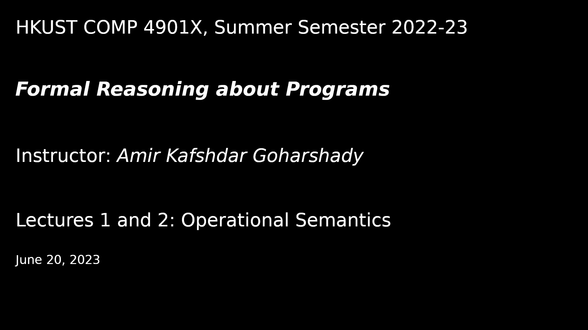
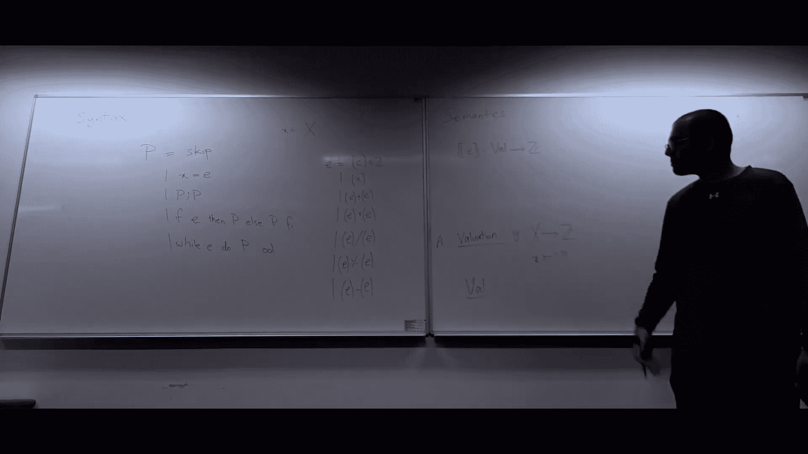
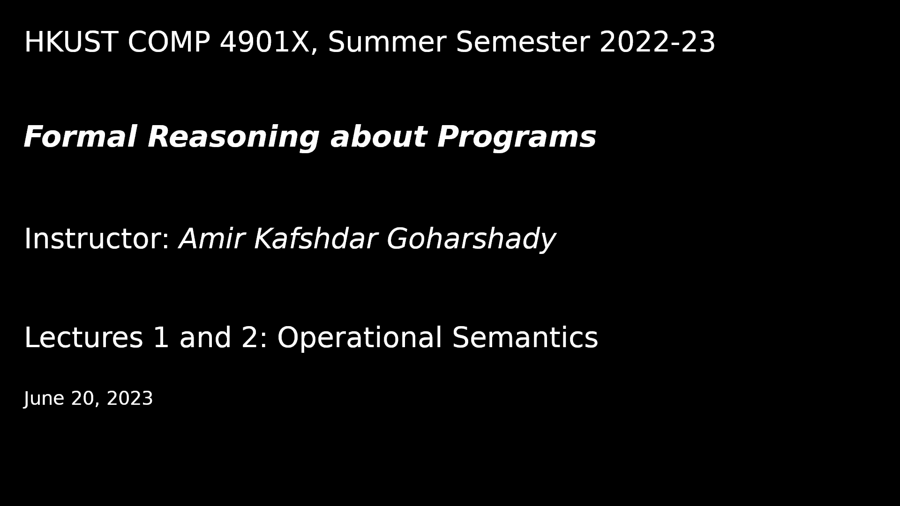

# 程序的形式化推理：第1讲：操作语义



## 概述

在本节课中，我们将学习如何为程序定义**形式化语义**。我们将从一个简单的编程语言开始，理解其**语法**和**语义**的区别，并重点学习**操作语义**的定义方法。操作语义通过描述程序执行的每一步来赋予程序意义。我们将通过定义规则来形式化描述程序状态如何转换，并最终尝试手动证明一个简单程序的终止性，以体会形式化推理的过程与挑战。

## 语法与语义

每个程序都包含两个部分：**语法**和**语义**。

*   **语法**指的是程序作为字符串的书写形式，即你在编辑器中输入的代码。
*   **语义**指的是程序的含义，即如何执行程序、程序具有哪些性质。

本课程将花很少时间讨论语法，而将重点放在如何**形式化地定义语义**上。我们需要在人类可理解和机器可自动化推理之间找到平衡。

## 一个简单的编程语言

为了开始，我们设计一个最简单的命令式编程语言。它的语法由以下规则定义：

*   **程序 (P)** 可以是：
    *   `skip`：一个不执行任何操作的语句。
    *   `x := E`：将表达式 `E` 的值赋给变量 `x`。
    *   `P; Q`：顺序执行程序 `P` 和 `Q`。
    *   `if E then P else Q end`：如果表达式 `E` 为真（非零），则执行 `P`，否则执行 `Q`。
    *   `while E do P end`：只要表达式 `E` 为真，就重复执行 `P`。

*   **表达式 (E)** 可以是：
    *   常量 `c`（整数）。
    *   变量 `x`。
    *   算术运算：`E1 + E2`, `E1 - E2`, `E1 * E2`, `E1 / E2`, `E1 % E2`。
    *   比较运算：`E1 > E2` 等。
    *   逻辑运算：`E1 and E2` 等。

我们假设所有变量都是整数类型，且取值范围无界（不考虑溢出）。表达式应具有正确的括号，但在书写时可以省略，默认已正确括号化。

任何能由该语法生成的字符串都是一个有效的程序。目前，这些程序还没有任何含义。

## 为什么需要形式化语义？

即使对于如此简单的语言，形式化语义也是必要的，原因如下：

1.  **消除歧义**：不同的编程语言对相同语法结构可能有不同解释。例如：
    *   **变量初始化**：未初始化的变量值是未定义的、零还是会导致错误？
    *   **短路求值**：在 `if (condition1 and condition2)` 中，如果 `condition1` 为假，还会计算 `condition2` 吗？
    *   **类型转换与溢出**：当运算结果超出类型范围时会发生什么？
    *   **副作用**：函数调用是否会修改外部状态？
    *   **除零错误**：除以零时程序是崩溃、抛出异常还是忽略？



2.  **编译器验证**：我们需要证明编译器生成的代码 (`P‘`) 与源代码 (`P`) 在语义上等价。优化也必须在不改变程序语义的前提下进行。

因此，我们需要一个精确的、数学化的语义定义，以便进行严格的推理。

## 表达式的语义

我们首先为表达式定义语义。我们用双括号 `[[E]]` 表示表达式 `E` 的语义。

一个**估值** `V` 是一个函数，它为程序中的每个变量 `x` 赋予一个整数值。表达式 `E` 的语义是一个函数，它接收一个估值 `V`，并返回 `E` 在该估值下计算得到的整数值。即：
`[[E]] : Valuation -> Integer`

我们可以用基于规则的方式定义各种表达式的语义：

*   **常量**：对于任何估值 `V`，`[[c]]V = c`。
    ```
    ---------------
    [[c]]V = c
    ```

*   **变量**：`[[x]]V = V(x)`，即变量 `x` 在估值 `V` 下的值。
    ```
    ---------------
    [[x]]V = V(x)
    ```

*   **加法**：如果 `[[E1]]V = a1` 且 `[[E2]]V = a2`，那么 `[[E1 + E2]]V = a1 + a2`。
    ```
    [[E1]]V = a1    [[E2]]V = a2
    ------------------------------
    [[E1 + E2]]V = a1 + a2
    ```

*   **整数除法**：如果 `[[E1]]V = a1`，`[[E2]]V = a2`，且 `a2 ≠ 0`，那么 `[[E1 / E2]]V = a1 / a2`（整数除）。
    ```
    [[E1]]V = a1    [[E2]]V = a2    a2 ≠ 0
    ---------------------------------------
    [[E1 / E2]]V = a1 / a2
    ```

*   **取模运算**：如果 `[[E1]]V = a1`，`[[E2]]V = a2`，`a2 > 0`，且存在整数 `c` 和 `b` 使得 `a1 = c * a2 + b` 且 `0 ≤ b < a2`，那么 `[[E1 % E2]]V = b`。
    ```
    [[E1]]V = a1    [[E2]]V = a2    a2 > 0    a1 = c*a2 + b    0 ≤ b < a2
    --------------------------------------------------------------------
    [[E1 % E2]]V = b
    ```

*   **比较运算**：如果 `[[E1]]V = a1`，`[[E2]]V = a2`，且 `a1 > a2`，那么 `[[E1 > E2]]V = 1`（真）；否则为 `0`（假）。
    ```
    [[E1]]V = a1    [[E2]]V = a2    a1 > a2
    ---------------------------------------
    [[E1 > E2]]V = 1

    [[E1]]V = a1    [[E2]]V = a2    a1 ≤ a2
    ---------------------------------------
    [[E1 > E2]]V = 0
    ```

*   **逻辑与（短路求值）**：如果 `[[E1]]V = 0`（假），那么 `[[E1 and E2]]V = 0`。如果 `[[E1]]V ≠ 0`（真）且 `[[E2]]V ≠ 0`（真），那么 `[[E1 and E2]]V = 1`。
    ```
    [[E1]]V = 0
    -----------------
    [[E1 and E2]]V = 0

    [[E1]]V ≠ 0    [[E2]]V ≠ 0
    ---------------------------
    [[E1 and E2]]V = 1
    ```
    *(注：这里简化了，通常还需要处理 `E1` 为真但 `E2` 为假的情况)*

注意，除法和取模的语义是**部分函数**，并非对所有输入都有定义（例如除数为零时）。

## 程序的操作语义

上一节我们定义了表达式的语义，现在我们来定义程序的语义。我们将使用**操作语义**，特别是**小步操作语义**。这种方法通过描述程序执行的**单步转换**来定义语义。

### 程序状态



我们定义**程序状态**为一个二元组 `(P, V)`：
*   `P`：**待执行的程序**（即尚未执行的部分）。
*   `V`：当前的**估值**，给出了所有变量的当前值。

初始状态是 `(完整程序, 初始估值)`。当状态变为 `(skip, V‘)` 或 `(, V‘)`（空程序）时，程序终止，`V‘` 是最终估值。

我们用 `(P, V) -> (P‘, V‘)` 表示从状态 `(P, V)` 经过一步执行，转换到状态 `(P‘, V‘)`。

### 语义规则

现在，我们为语言中的每种语句定义转换规则。

*   **skip 语句**：`skip` 语句不执行任何操作，直接终止。
    ```
    ----------------------
    (skip, V) -> (, V)
    ```

*   **赋值语句**：执行 `x := E`。首先计算表达式 `E` 在当前估值 `V` 下的值 `a`，然后将变量 `x` 的值更新为 `a`，得到新估值 `V[x -> a]`，程序变为空。
    ```
    [[E]]V = a
    --------------------------------
    (x := E, V) -> (, V[x -> a])
    ```

*   **顺序组合**：执行 `P; Q` 的第一步，就是执行 `P` 的第一步。如果 `P` 经过一步变成 `P‘`，且估值变为 `V‘`，那么整个程序就变成 `P‘; Q`，估值变为 `V‘`。注意，这里要求 `P` 不是空程序。
    ```
    (P, V) -> (P‘, V‘)    P ≠ 
    -------------------------------------
    (P; Q, V) -> (P‘; Q, V‘)
    ```

*   **条件语句**：执行 `if E then P else Q end`。首先计算条件 `E` 的值。如果值非零（真），则待执行程序变为 `P`，估值不变；如果值为零（假），则待执行程序变为 `Q`。
    ```
    [[E]]V ≠ 0
    ------------------------------------------
    (if E then P else Q end, V) -> (P, V)

    [[E]]V = 0
    ------------------------------------------
    (if E then P else Q end, V) -> (Q, V)
    ```

*   **循环语句**：执行 `while E do P end`。首先检查条件 `E`。如果为假（零），则循环体一次都不执行，直接终止，状态变为 `(skip, V)`。如果为真（非零），则循环体 `P` 需要执行一次，执行完后还需要再次检查循环条件，因此状态变为 `(P; while E do P end, V)`。这体现了循环的**展开**。
    ```
    [[E]]V = 0
    ----------------------------------------
    (while E do P end, V) -> (skip, V)

    [[E]]V ≠ 0
    ---------------------------------------------------------
    (while E do P end, V) -> (P; while E do P end, V)
    ```

这些规则共同定义了程序所有可能的单步执行路径。

## 大步语义简介

除了小步语义，还有**大步语义**（也称自然语义）。大步语义不描述中间步骤，而是直接定义程序从初始状态到最终状态的**整体执行结果**。

我们用 `(P, V) ⇓ V‘` 表示程序 `P` 从估值 `V` 开始执行，最终终止于估值 `V‘`。

其规则示例如下：
*   **skip**: `(skip, V) ⇓ V`
*   **赋值**: 如果 `[[E]]V = a`，则 `(x := E, V) ⇓ V[x -> a]`
*   **顺序组合**: 如果 `(P, V) ⇓ V‘` 且 `(Q, V‘) ⇓ V‘‘`，则 `(P; Q, V) ⇓ V‘‘`
*   **条件语句**: 如果 `[[E]]V ≠ 0` 且 `(P, V) ⇓ V‘`，则 `(if E then P else Q end, V) ⇓ V‘`；如果 `[[E]]V = 0` 且 `(Q, V) ⇓ V‘`，则 `(if E then P else Q end, V) ⇓ V‘`。
*   **循环语句**: 如果 `[[E]]V = 0`，则 `(while E do P end, V) ⇓ V`。如果 `[[E]]V ≠ 0`，且 `(P, V) ⇓ V‘`，且 `(while E do P end, V‘) ⇓ V‘‘`，则 `(while E do P end, V) ⇓ V‘‘`。或者，可以使用展开规则：`(while E do P end, V) ⇓ V‘` 当且仅当 `(if E then P; while E do P end else skip end, V) ⇓ V‘`。

大步语义更简洁，但小步语义能提供更细致的执行过程信息，对于某些分析（如并发）更有用。


## 程序终止性的形式化证明

现在，我们尝试使用定义好的语义规则，手动证明一个具体程序的属性。我们以证明下面这个计算两数最大公约数（GCD）的欧几里得算法程序**对于所有整数输入都会终止**为例。

程序 `P`:
```
while (x > 0 and y > 0) do
    if x > y then
        x := x - y
    else
        y := y - x
    end
end
```

### 定义终止性

基于小步语义，我们定义程序终止。首先定义**多步转换**的**传递闭包** `->*`：
1.  **零步**：对任何状态 `S`，有 `S ->* S`。
2.  **一步**：如果 `S -> S‘`，那么 `S ->* S‘`。
3.  **多步**：如果 `S ->* S‘` 且 `S‘ ->* S‘‘`，那么 `S ->* S‘‘`。

程序 `P` 在初始估值 `V` 下**终止**，记作 `Term(P, V)`，当且仅当存在某个估值 `V‘`，使得 `(P, V) ->* (, V‘)`。即，可以从初始状态经过有限步转换到空程序状态。

### 证明思路

我们希望对所有整数 `x` 和 `y` 的初始值，证明 `Term(P, V)` 成立。证明采用分类讨论和数学归纳法。

1.  **情况1：`x ≤ 0`**。
    *   根据语义，`x > 0` 为假。
    *   根据短路求值规则，`x > 0 and y > 0` 为假。
    *   根据while规则（条件为假），程序一步转换为 `(skip, V)`，进而转换为 `(, V)`。
    *   因此 `Term(P, V)` 成立。

2.  **情况2：`y ≤ 0`**。证明与情况1对称。

3.  **情况3：`x > 0` 且 `y > 0`**。这是需要归纳的核心情况。
    *   令度量 `N = x + y`（初始估值下的和）。
    *   **归纳假设**：对于所有满足 `x‘ + y‘ < N` 的估值 `V‘`，`Term(P, V‘)` 成立。
    *   **归纳步骤**：我们需要证明对于满足 `x+y = N` 的初始估值 `V`，`Term(P, V)` 成立。
        *   由于 `x>0` 且 `y>0`，循环条件 `x>0 and y>0` 为真。
        *   根据while规则（条件为真），程序一步转换为：
            `(if x>y then x:=x-y else y:=y-x end; while ... end, V)`
        *   现在需要证明这个新程序终止。根据顺序组合规则，我们需要证明：
            1.  第一部分的 `if` 语句从 `V` 开始执行终止于某个 `V‘‘`。
            2.  第二部分的 `while` 循环从 `V‘‘` 开始执行终止。
        *   对于第1点：`if` 语句会根据 `x>y` 的真假选择分支，执行相应的赋值语句。赋值语句显然一步终止。关键在于，无论执行哪个分支，执行后的新估值 `V‘‘` 都满足 `x‘‘ + y‘‘ < x + y = N`（因为正数减去正数，和严格减小）。
        *   对于第2点：由于 `V‘‘` 满足 `x‘‘+y‘‘ < N`，根据我们的**归纳假设**，`Term(P, V‘‘)` 成立，即 `while` 循环从 `V‘‘` 开始会终止。
        *   结合顺序组合规则，整个程序从 `V` 开始终止。

通过以上分类和归纳，我们证明了对于所有可能的初始值，程序 `P` 都会终止。

### 证明的挑战与启示

这个手动证明虽然逻辑清晰，但若完全展开，将涉及大量琐碎的规则应用（如表达式求值、比较运算、短路求值、赋值、顺序组合、循环展开等），以及整数算术性质的引用（如正数相减和减小）。写成一个机器可检查的完整证明会非常冗长。

这正体现了**手动进行形式化推理的繁琐和易错性**。本课程的目标，就是引入并学习使用**自动化工具**（如证明助手Coq）来帮助我们完成这类推理。我们可以将语义规则和要证明的属性输入工具，然后通过交互方式指导工具构建证明，最终由工具确保证明的每一步都符合规则，从而得到严谨可靠的结论。

## 总结

本节课我们一起学习了程序形式化推理的基础：
1.  区分了程序的**语法**（形式）和**语义**（含义）。
2.  理解了为什么需要**形式化语义**来精确描述程序行为、消除歧义并支持编译器验证。
3.  为一个简单的编程语言定义了**表达式的语义**，使用基于规则的表示法。
4.  重点学习了**操作语义**，特别是**小步操作语义**，通过定义**程序状态**和**单步转换规则**来描述程序的执行过程。
5.  了解了**大步语义**作为另一种描述程序整体行为的方式。
6.  通过一个具体的例子，演示了如何利用已定义的语义规则，手动进行**程序终止性的形式化证明**，并体会了其复杂性和对自动化工具的迫切需求。


从下一节课开始，我们将探索如何将这些理论应用于实践，利用自动化工具来减轻形式化推理的负担。