# 程序的形式化推理：第2讲：Coq入门教程

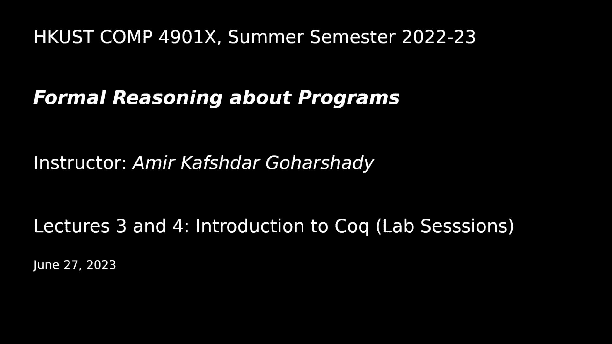

在本节课中，我们将学习如何使用Coq定理证明器来形式化地证明逻辑命题。我们将从基础开始，逐步介绍Coq的界面、基本语法和核心证明策略。

## 概述

Coq是一个交互式定理证明器。它允许我们编写形式化的数学陈述，并通过一系列称为“策略”的指令来指导它构建证明。本节课我们将学习如何编写简单的命题逻辑证明。

## 界面与基础

打开你的Coq IDE。如果你没有在笔记本电脑上安装，可以打开Coq JS网站，那里有网页版本。

Coq编辑器分为三个部分：
*   代码编辑区：你在这里编写代码。
*   目标面板：显示当前需要证明的子目标。
*   消息面板：显示语法错误或执行状态等信息。

在Coq中，每个命令都以一个点 `.` 结束。

我们可以定义“节”（Section）来组织代码，它限定了变量的作用域。

```coq
Section A.
```

执行这行代码（例如，点击向下的箭头或按Ctrl+向下箭头），如果看到绿色提示，则表示执行成功。

要结束一个节，可以这样写：

```coq
End A.
```

## 第一个证明：恒等蕴含

现在，让我们证明第一个定理。首先，我们声明一个命题变量 `P`。

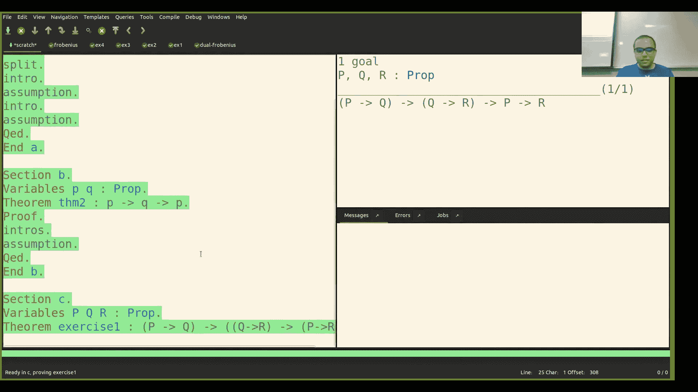


```coq
Variable P : Prop.
```

然后，我们陈述一个定理：`P` 蕴含 `P`。

```coq
Theorem my_thm : P -> P.
```

执行这行后，目标面板会显示我们需要证明的目标：`P -> P`。同时，假设列表中会显示 `P : Prop`，这仅表示 `P` 是一个命题类型，并不假定 `P` 为真。

我们通过 `Proof.` 命令开始证明。

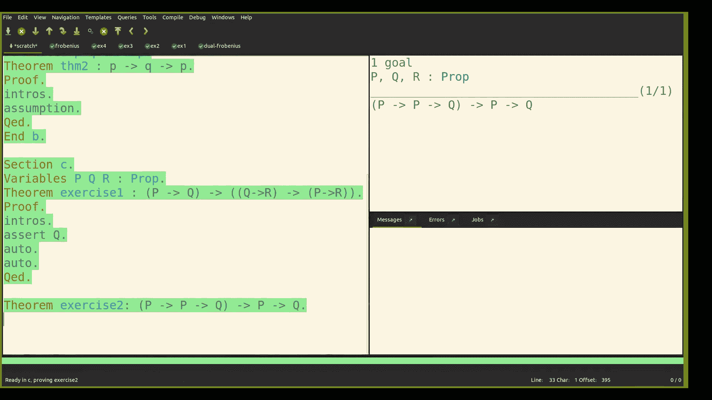

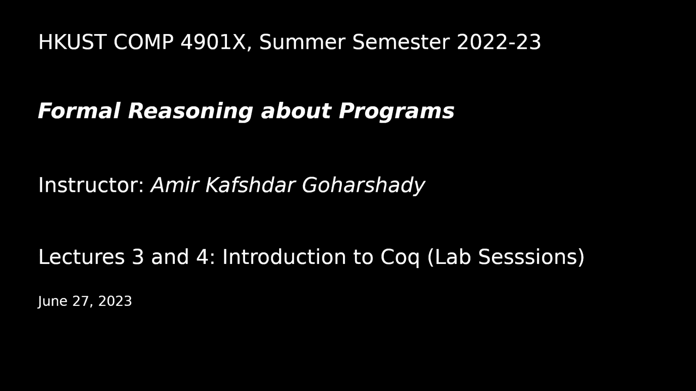

```coq
Proof.
```

现在，我们需要指导Coq完成证明。我们使用“策略”（Tactics）。对于蕴含式 `A -> B`，标准的策略是 `intro`，它将前提 `A` 作为假设引入。

```coq
intro H.
```

执行后，假设列表中出现 `H : P`，而目标变为 `P`。由于目标 `P` 现在已经是假设之一，我们可以使用 `assumption` 策略来完成证明。

```coq
assumption.
```

此时，目标面板显示“No more goals.”，表示所有子目标都已证明完毕。我们用 `Qed.` 命令结束证明。

```coq
Qed.
```

`Qed` 通过后，意味着Coq已经验证了我们构建的证明是正确的。

我们可以检查或打印已证明的定理：

```coq
Check my_thm.
Print my_thm.
```

到目前为止，我们学习了三个策略：
1.  `intro`：用于证明蕴含式，将前提引入为假设。
2.  `assumption`：当要证明的目标已经是假设之一时使用。
3.  `split`：用于证明合取式（`A /\ B`），将其拆分为两个需要分别证明的子目标。

`intros` 是 `intro` 的复数形式，可以连续应用 `intro` 策略直到无法应用为止。

## 练习：链式蕴含

让我们进入一个新的节，并尝试一个练习。

```coq
Section C.
Variables P Q R : Prop.
Theorem exercise1 : (P -> Q) -> (Q -> R) -> P -> R.
```

我们的目标是证明这个链式蕴含。我们可以使用 `intros` 策略一次性引入所有前提。

```coq
Proof.
intros H1 H2 H3.
```

现在，假设为 `H1: P -> Q`, `H2: Q -> R`, `H3: P`，目标是 `R`。

为了证明 `R`，我们可以使用 `H2`，但需要先证明 `Q`。我们可以使用 `assert` 策略来声明并证明一个中间引理 `Q`。

```coq
assert (HQ : Q).
```

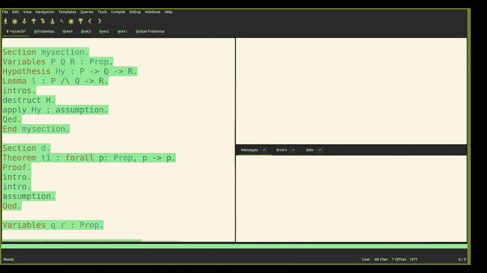


这创建了一个新的子目标：证明 `Q`。要证明 `Q`，我们可以使用 `H1` 和 `H3`。`apply H1` 策略表示：要证明 `H1` 的结论 `Q`，需要先证明其前提 `P`。

```coq
apply H1.
assumption.
```
现在，中间引理 `HQ : Q` 被证明，并加入到假设中。最后，要证明目标 `R`，我们应用 `H2`。

```coq
apply H2.
assumption.
Qed.
```

`auto` 策略可以自动处理一些简单的推理步骤（如应用蕴含式）。`tauto` 策略专门用于证明命题逻辑的重言式。

## 合取与析取的证明

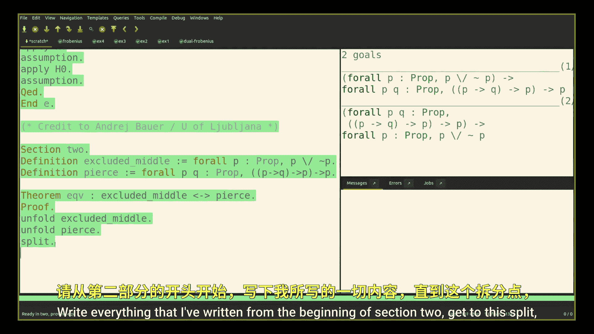

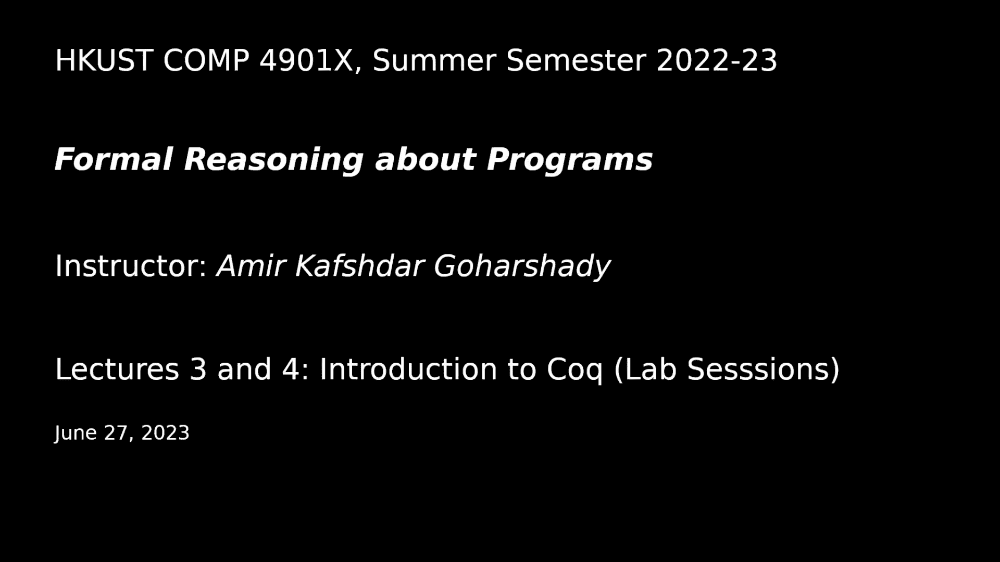

上一节我们处理了蕴含，本节我们来看看如何处理合取（与）和析取（或）。

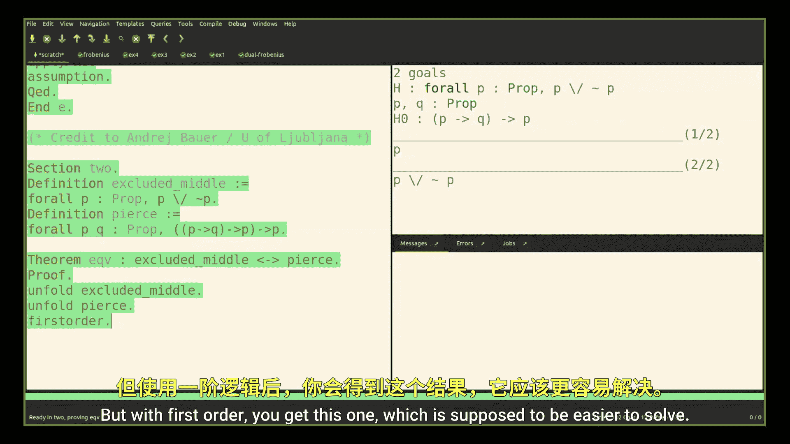


首先，证明一个析取式：`P -> P \/ Q`（`\/` 表示“或”）。

```coq
Theorem or_example : P -> P \/ Q.
Proof.
intro H.
```

现在目标是 `P \/ Q`。要证明一个析取式，我们可以选择证明左边或右边。`left` 策略表示我们选择证明左分支。

```coq
left.
assumption.
Qed.
```

类似地，`right` 策略用于选择证明右分支。

对于合取式 `P /\ Q -> Q /\ P`，证明开始时，我们引入前提。

```coq
Theorem and_example : P /\ Q -> Q /\ P.
Proof.
intro H. (* H : P /\ Q *)
```

假设 `H` 是一个合取式。`destruct H as [HP HQ].` 策略可以分解合取式，将其两个组成部分分别命名为 `HP` 和 `HQ`。

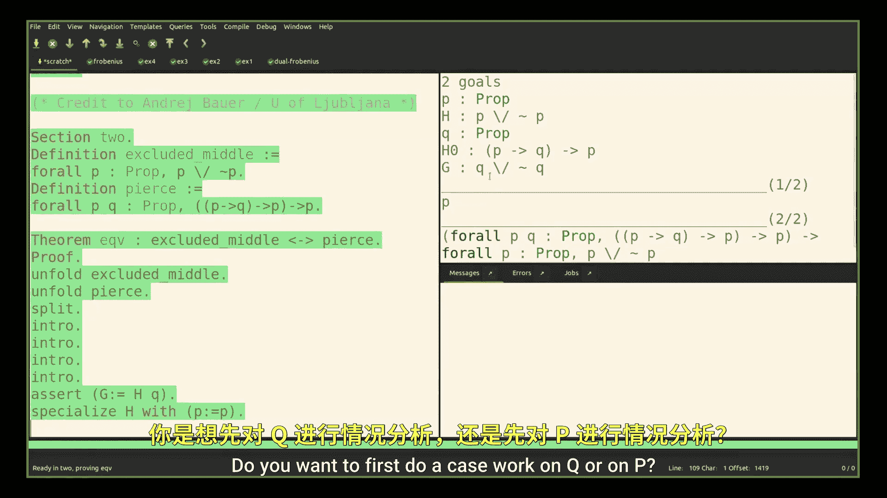


```coq
destruct H as [HP HQ].
```

现在假设变为 `HP : P` 和 `HQ : Q`，目标是 `Q /\ P`。我们使用 `split` 策略将目标拆分为两个子目标：`Q` 和 `P`。

```coq
split.
- apply HQ. (* 证明 Q *)
- apply HP. (* 证明 P *)
Qed.
```

## 使用全称量词

现在，我们来看看如何处理带有全称量词 `forall` 的命题。

首先，证明一个全称命题：`forall P : Prop, P -> P`。

```coq
Theorem forall_example : forall P : Prop, P -> P.
Proof.
intro P.    (* 引入命题 P *)
intro H.    (* 引入假设 H: P *)
assumption.
Qed.
```

这里，第一个 `intro` 引入了量词 `forall P` 中的变量 `P`（及其类型 `Prop`）。第二个 `intro` 引入了蕴含式的前提。

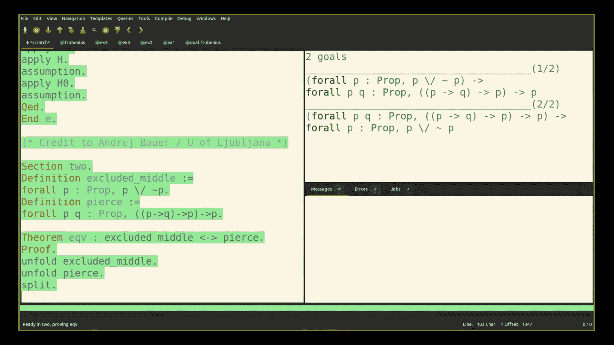


如果我们已经证明了一个定理，可以在另一个定理中引用它。例如：

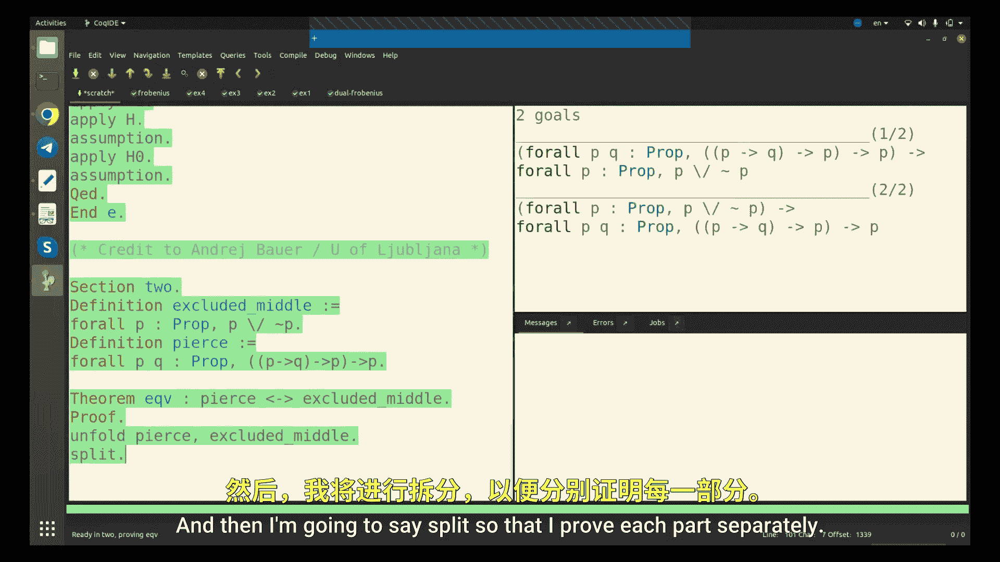

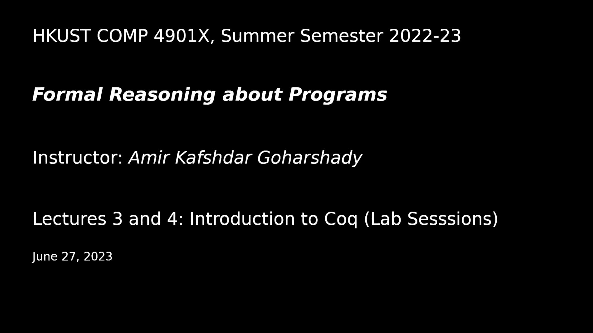

```coq
Theorem T1 : forall P : Prop, P -> P.
Proof. ... Qed.

Variables Q R : Prop.
Theorem T2 : (Q -> R) -> (Q -> R).
Proof.
pose proof T1 as H.
```

`pose proof T1 as H` 将已证明的定理 `T1` 作为假设 `H` 引入。`H` 的类型是 `forall P : Prop, P -> P`。

为了在当前上下文中使用 `H`，我们需要用具体的命题（如 `Q -> R`）来实例化其中的全称量词 `P`。这可以使用 `specialize` 策略。

```coq
specialize (H (Q -> R)).
```

现在 `H` 变为 `(Q -> R) -> (Q -> R)`。要证明目标 `(Q -> R) -> (Q -> R)`，直接应用假设 `H` 即可。

```coq
apply H.
Qed.
```

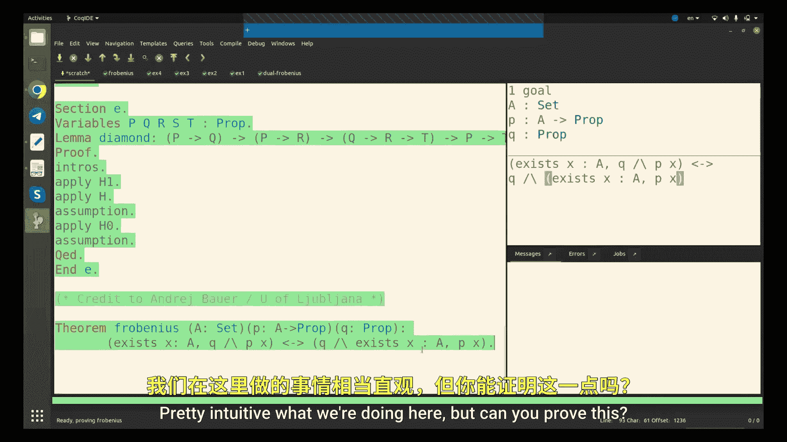


## 经典逻辑定律

在经典逻辑中，排中律（Excluded Middle）和皮尔士律（Peirce‘s Law）是等价的。排中律表述为：`forall P, P \/ ~P`。皮尔士律表述为：`forall P Q, ((P -> Q) -> P) -> P`。

在Coq中，默认的直觉主义逻辑不承认排中律。但我们可以将其作为公理引入，然后证明它与皮尔士律等价。

```coq
Axiom excluded_middle : forall P : Prop, P \/ ~P.
Definition peirce : Prop := forall P Q : Prop, ((P -> Q) -> P) -> P.

Theorem equiv : excluded_middle <-> peirce.
Proof.
unfold peirce. split.
- intro H_em. (* 假设排中律成立 *)
  intros P Q H. (* 引入 P, Q 和假设 H: ((P -> Q) -> P) *)
  (* 证明思路：对 Q 使用排中律进行分情况讨论 *)
  pose proof (H_em Q) as [HQ | HnQ]. (* Q 为真或假 *)
  + (* 情况1: HQ : Q *)
    (* 此时易证 P *)
    admit. (* 此处省略具体证明步骤 *)
  + (* 情况2: HnQ : ~Q *)
    (* 利用 H 和 ~Q 证明 P *)
    admit. (* 此处省略具体证明步骤 *)
- intro H_peirce. (* 假设皮尔士律成立 *)
  intro P. (* 引入命题 P *)
  (* 利用皮尔士律证明 P \/ ~P *)
  specialize (H_peirce P (P \/ ~P)).
  admit. (* 此处省略具体证明步骤 *)
Admitted. (* 由于证明较长，我们用 Admitted 暂时跳过 *)
```

这个证明展示了如何在Coq中处理复杂的逻辑等价性，并使用了公理、实例化、分情况讨论等策略。

## 量词分配律：弗罗贝尼乌斯定理

最后，我们看一个涉及谓词和量词的例子：弗罗贝尼乌斯定理。它描述了存在量词与合取式的分配关系。

```coq
Variables (A : Type) (P : A -> Prop) (Q : Prop).
Theorem frobenius :
  (exists x : A, Q /\ P x) <-> (Q /\ exists x : A, P x).
Proof.
split.
- intro H_ex. (* -> 方向 *)
  destruct H_ex as [x [HQ HPx]]. (* 分解存在量词和合取式 *)
  split.
  + assumption. (* 证明 Q *)
  + exists x. assumption. (* 证明 exists x, P x *)
- intro H_and. (* <- 方向 *)
  destruct H_and as [HQ H_ex]. (* 分解合取式 *)
  destruct H_ex as [x HPx]. (* 分解存在量词 *)
  exists x. split; assumption. (* 证明 exists x, Q /\ P x *)
Qed.
```

这个证明清晰地展示了如何分解和构造存在量词与合取式。分号 `;` 用于将同一个策略（如 `assumption`）应用于当前生成的所有子目标。

其对偶形式涉及全称量词与析取式，并且其证明需要用到排中律公理，这再次体现了经典逻辑与直觉主义逻辑的差异。

## 总结

本节课中，我们一起学习了Coq定理证明器的基础知识。我们了解了其界面，学会了如何编写命题和定理。我们重点掌握了一系列核心证明策略：
*   `intros` / `intro`：引入假设或全称变量。
*   `apply`：应用一个蕴含式或假设来证明当前目标。
*   `split`：分解合取式目标。
*   `left` / `right`：选择证明析取式的某一侧。
*   `destruct`：分解假设中的合取式、析取式或存在量词。
*   `assert`：声明并证明一个中间引理。
*   `assumption`：使用当前假设之一来证明目标。
*   `exists`：构造存在量词证明。
*   `specialize`：实例化一个全称量词假设。
*   `unfold`：展开一个定义。

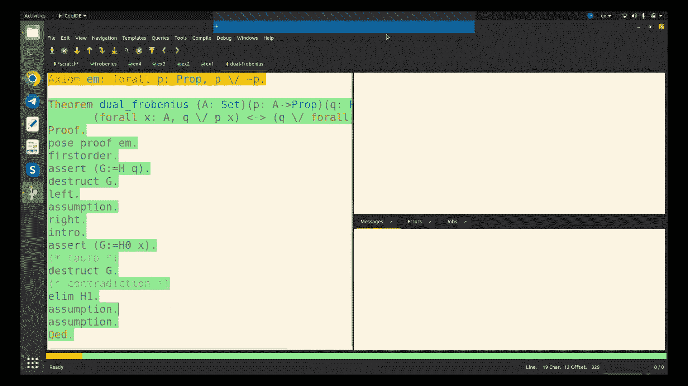

我们还通过例子看到了 `auto` 和 `tauto` 等自动化策略的用途，并初步接触了公理的使用。这些是使用Coq进行形式化推理的基础，后续我们将运用这些工具来证明程序的性质。