# 程序的形式化推理：第3讲：指称语义

在本节课中，我们将学习程序语义的另一种定义方式——指称语义。与之前讨论的操作语义不同，指称语义将程序视为数学函数，通过结构归纳的方式，为每个程序赋予一个从输入状态到输出状态的（部分）函数作为其含义。我们将重点学习如何为包含循环的程序定义指称语义，并理解“最小不动点”这一核心概念。

## 回顾：操作语义

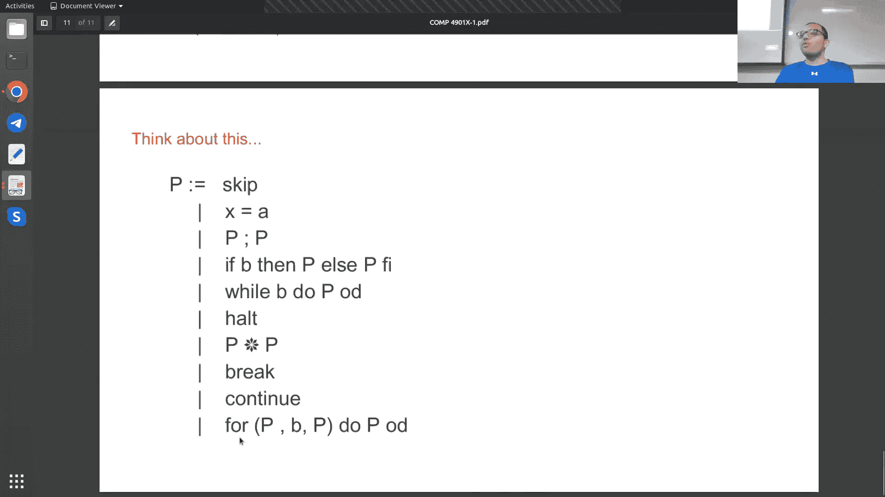

上一节我们介绍了操作语义，它通过一系列规则定义了程序如何一步步执行。我们定义了两种操作语义：
*   **小步操作语义**：定义了程序单步执行的规则。
*   **大步操作语义**：定义了程序从初始状态到终止状态的完整执行过程。

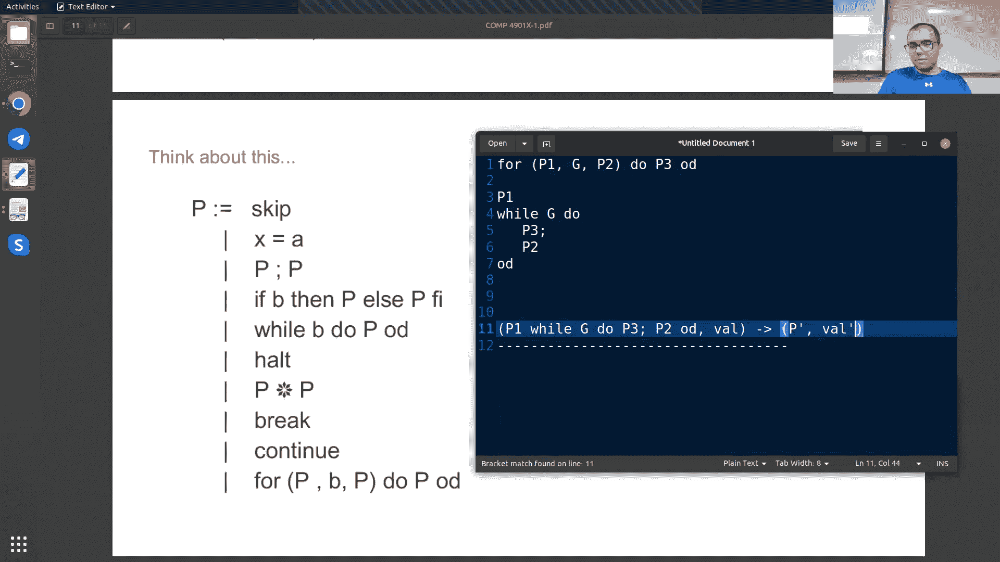

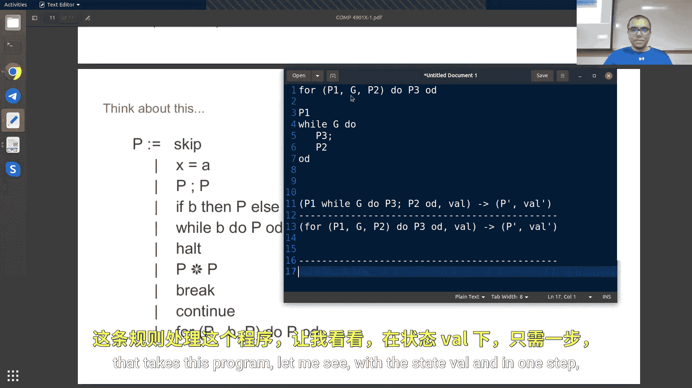

我们还扩展了语法，引入了**非确定性选择**（`P * Q`）和**停机命令**（`halt`）。非确定性选择意味着程序可以执行`P`或`Q`，但具体选择哪一个是不确定的。这可以用来模拟不受程序控制的用户输入或环境因素。

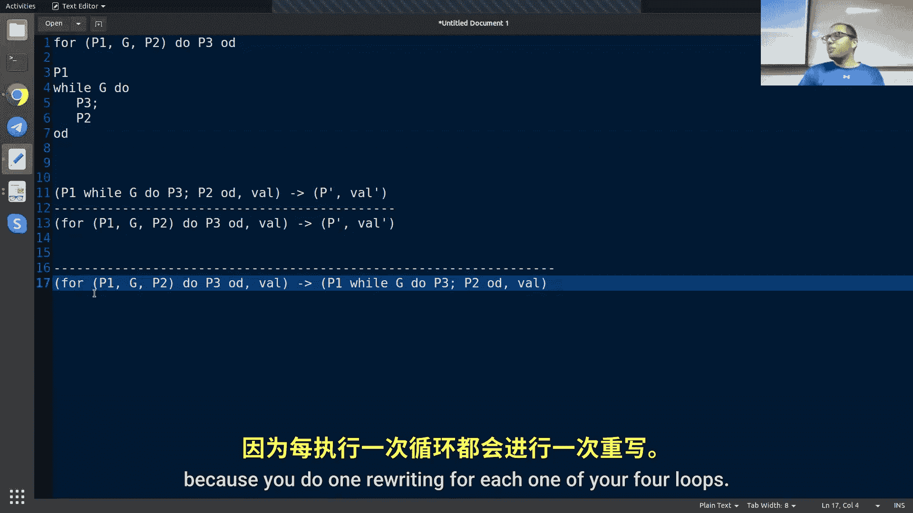

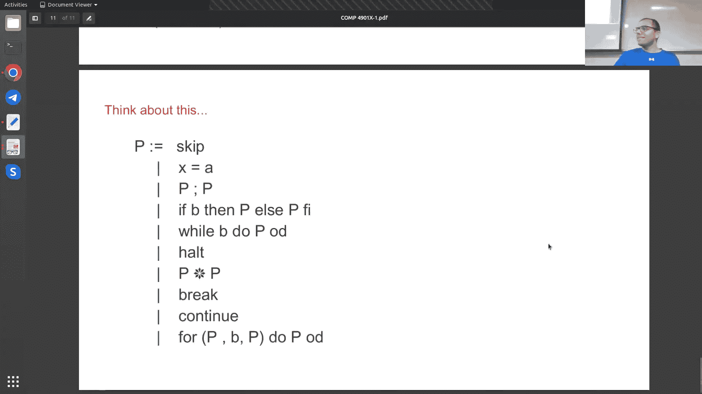

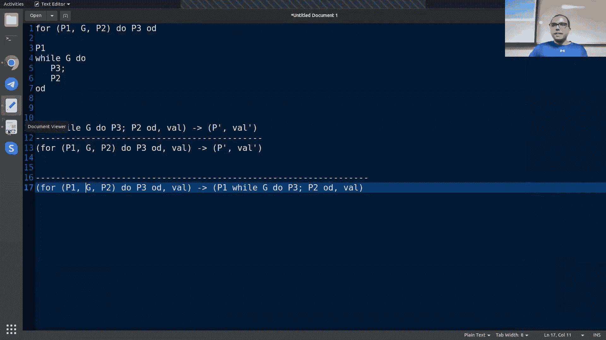

以下是处理非确定性选择的规则：
*   如果 `(P, Val) -> (P‘, Val’)`，那么 `(P * Q, Val) -> (P‘, Val’)`。
*   如果 `(Q, Val) -> (Q‘, Val’)`，那么 `(P * Q, Val) -> (Q‘, Val’)`。

## 指称语义的核心思想

本节中，我们来看看指称语义。其核心思想是将程序视为数学对象——具体来说，是**函数**。每个程序`P`的语义 `[[P]]` 被定义为一个**部分函数**，它将一个输入状态（变量估值）映射到一个输出状态。

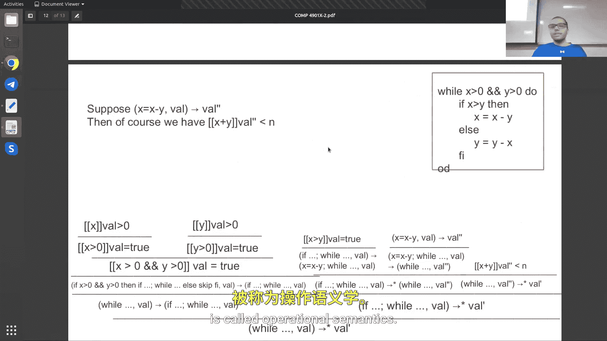

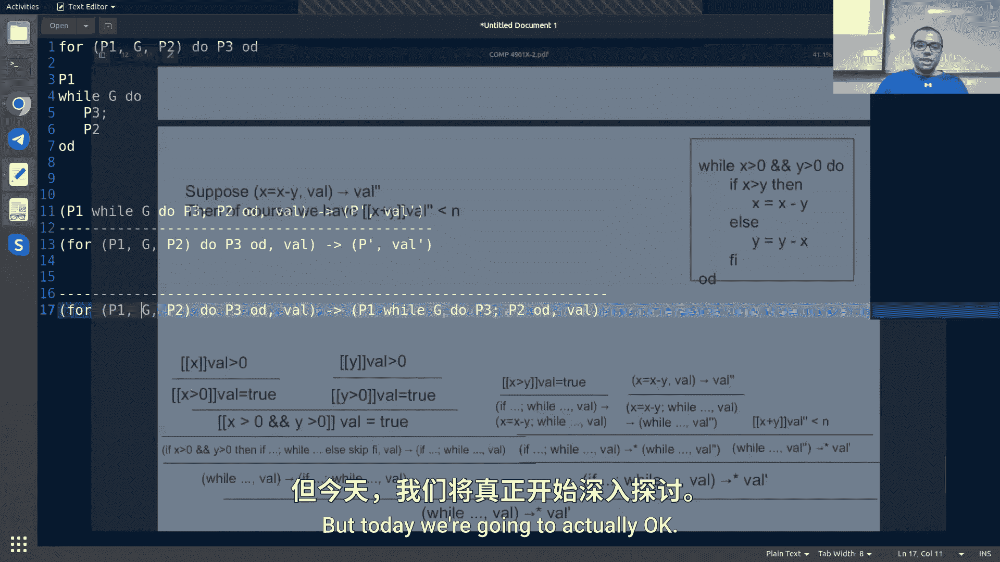

我们用 `Sigma` 表示所有可能状态的集合。状态在这里被简化为**估值**，即一个将程序中的每个变量映射到一个整数的函数。因此，语义函数的类型是：
`[[P]] : Sigma -> Sigma`

这是一个部分函数，因为对于某些输入，程序可能不会终止，此时函数在该输入处无定义。

## 表达式和布尔条件的语义

在定义程序语义之前，我们需要先定义程序中出现的**算术表达式**和**布尔条件**的语义。它们的语义也是函数：
*   算术表达式 `E` 的语义 `[[E]]` 是一个从状态到整数的函数：`[[E]] : Sigma -> Z`。
*   布尔条件 `B` 的语义 `[[B]]` 是一个从状态到布尔值（真或假）的函数：`[[B]] : Sigma -> Bool`。

定义是结构归纳的：
*   **变量**：`[[x]](Val) = Val(x)`
*   **常量**：`[[c]](Val) = c`
*   **加法**：`[[a1 + a2]](Val) = [[a1]](Val) + [[a2]](Val)`
*   **比较**：`[[a1 > a2]](Val) = ([[a1]](Val) > [[a2]](Val))`
*   （其他运算类似定义）

我们还需要一个**语义条件运算符**，它将在定义`if`和`while`时用到。给定一个布尔条件`B`和两个语义函数`F`、`G`（代表两个子程序的含义），条件运算符定义为：
`(B -> F | G)(Val) = { F(Val), 如果 [[B]](Val) 为真； G(Val), 如果 [[B]](Val) 为假 }`

## 基本命令的指称语义

现在，我们可以为基本程序结构定义指称语义。以下是核心定义：

*   **skip**：`[[skip]](Val) = Val`
*   **赋值**：`[[x := a]](Val) = Val[x -> [[a]](Val)]` （将`Val`中`x`的值更新为`[[a]](Val)`）
*   **顺序组合**：`[[P; Q]](Val) = [[Q]]( [[P]](Val) )` （先应用`P`的语义，再将结果作为`Q`语义的输入）
*   **条件语句**：`[[if B then P else Q]](Val) = ([[B]] -> [[P]] | [[Q]])(Val)`

这些定义都非常直观，直接反映了命令的意图。

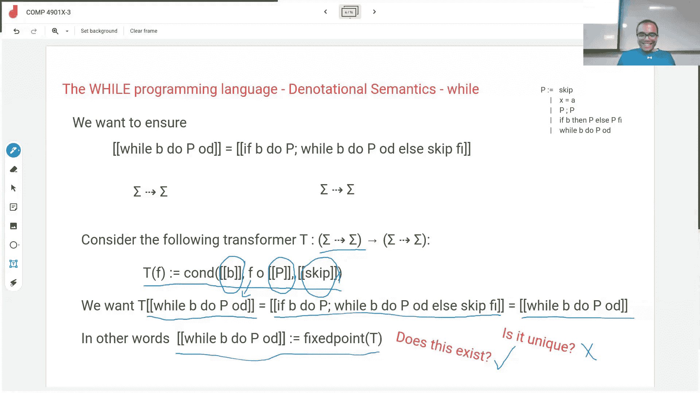

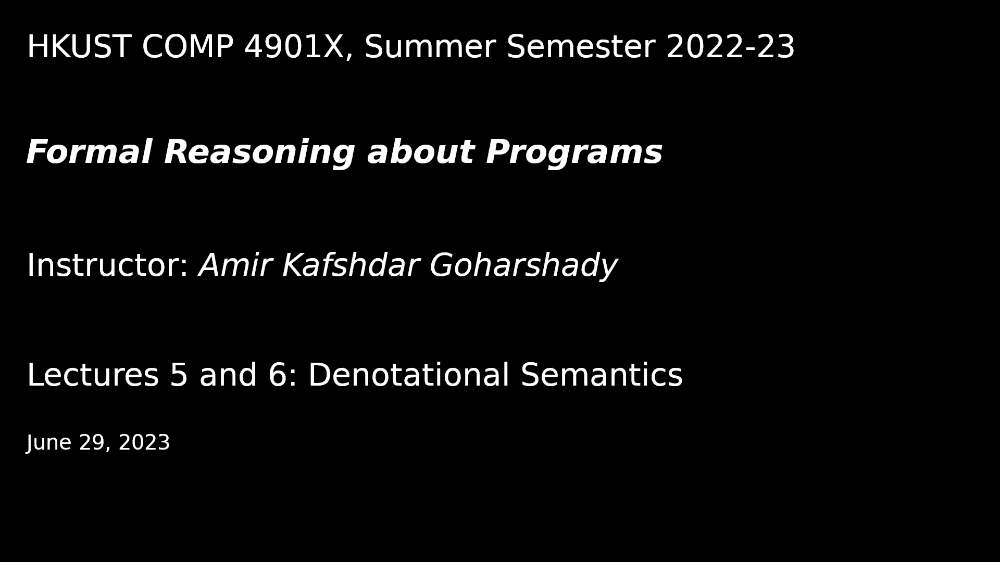

## 循环与不动点

最复杂的情况是`while`循环。我们想为 `while B do P` 定义语义 `[[while B do P]]`。直觉上，这个循环等价于：
`if B then (P; while B do P) else skip`

但是，我们不能直接在定义右侧引用 `[[while B do P]]` 本身，这会形成循环定义，在数学上是不允许的。

为了解决这个问题，我们引入一个**变换子** `T`。`T` 接受一个语义函数 `F`（我们暂时将其视为“某个可能的while循环语义”），并返回一个新的语义函数：
`T(F) = ([[B]] -> (F ◦ [[P]]) | [[skip]])`

这里，`F ◦ [[P]]` 表示先执行`P`的语义，再执行`F`。`T` 的作用可以理解为：**将while循环“展开”一次**。如果条件`B`成立，就先执行一次循环体`P`，然后再考虑循环`F`；否则就跳过。

我们的目标是找到一个函数 `F`，使得 `T(F) = F`。这样的 `F` 称为变换子 `T` 的**不动点**。这个不动点函数恰好满足我们直觉上的等式，因此我们自然地将while循环的语义定义为：
`[[while B do P]] = 满足 T(F) = F 的某个不动点 F`

## 存在性、唯一性与最小不动点

然而，这引出了两个问题：
1.  **存在性**：这样的不动点一定存在吗？
2.  **唯一性**：如果存在，它是唯一的吗？

**存在性**可以通过参考我们已经定义的操作语义来证明。操作语义为每个程序（包括while循环）定义了一个确定的输入-输出关系，这个关系对应的函数可以被验证是变换子`T`的一个不动点。因此，不动点是存在的。

**唯一性**则不然。可以构造出`T`的多个不动点。例如，对于某个永不终止的while循环，操作语义给出的函数在该输入处是**无定义**的。但我们可以定义一个“坏”的不动点，它在所有输入上都有定义（例如，总是返回全零状态），并且它也是`T`的不动点。

为了得到与操作语义一致、符合直觉的语义，我们需要在所有不动点中挑选出**最精确**的那个，即**最小不动点**。我们通过比较函数的定义域来定义“最小”：函数`F`小于等于函数`G`，当且仅当`F`的定义域是`G`的定义域的子集，且在两者共同的定义域上`F`和`G`取值相同。

**最小不动点**就是所有不动点中，定义域最小的那个（即在最多的地方是“无定义”的）。可以证明，这个最小不动点：
1.  **是唯一的**。
2.  **恰好对应于操作语义**（对于终止的输入给出结果，对于不终止的输入无定义）。

因此，while循环最终的指称语义定义为：
`[[while B do P]] = T 的最小不动点`

## 非确定性的挑战

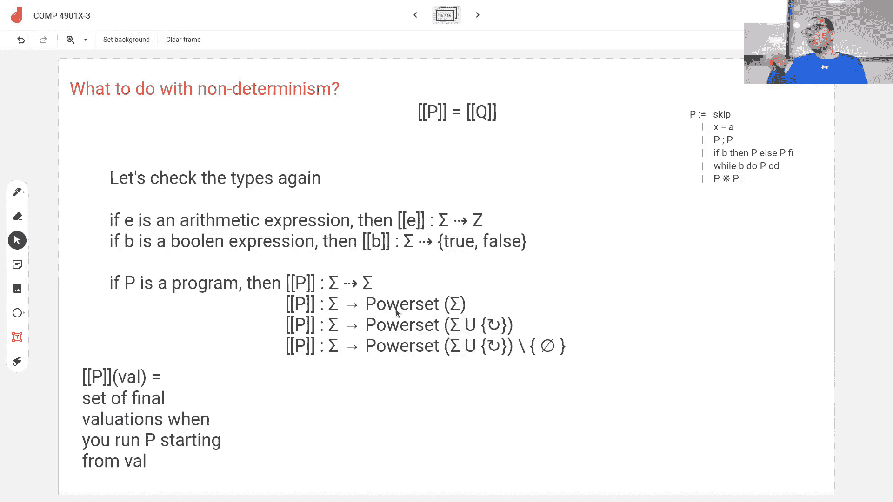

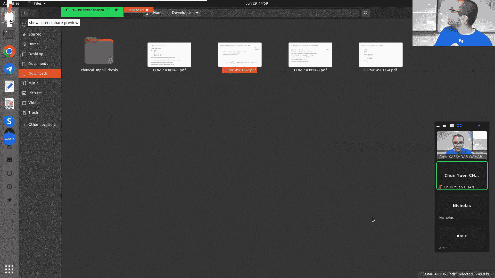

最后，我们简要探讨一下如果将**非确定性**引入指称语义会带来的挑战。在非确定性下，一个程序对于一个输入可能产生多个输出，也可能不终止。此时，程序的语义不能再是一个简单的 `Sigma -> Sigma` 部分函数。

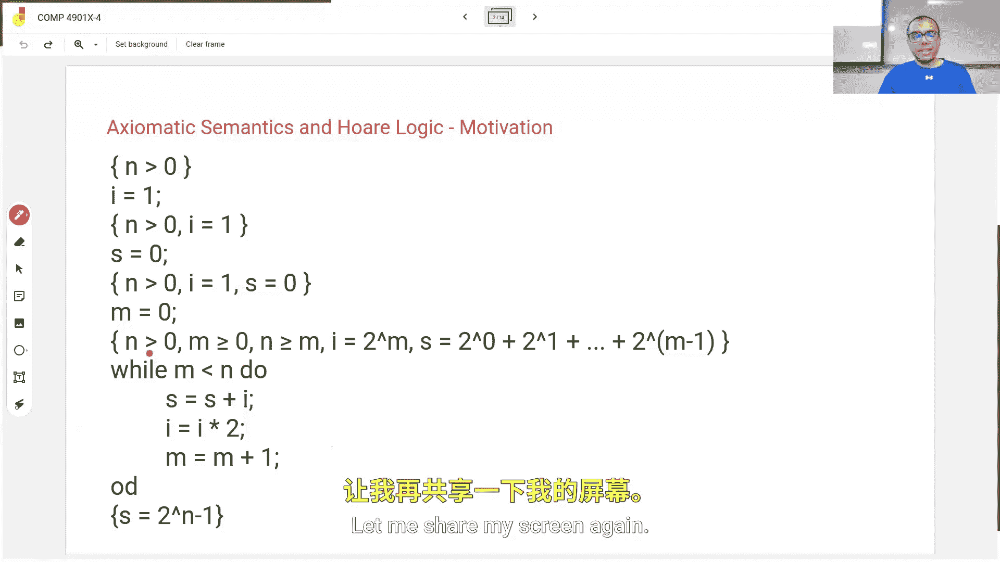

一种可能的类型是：`[[P]] : Sigma -> P(Sigma ∪ {⊥})`，其中 `P` 表示幂集，`⊥` 是一个表示“不终止”的特殊符号，并且结果集不能为空（因为至少有一种执行可能性）。这大大复杂化了语义域和不动点的理论。在这种情况下，通常使用操作语义来处理非确定性更为方便。

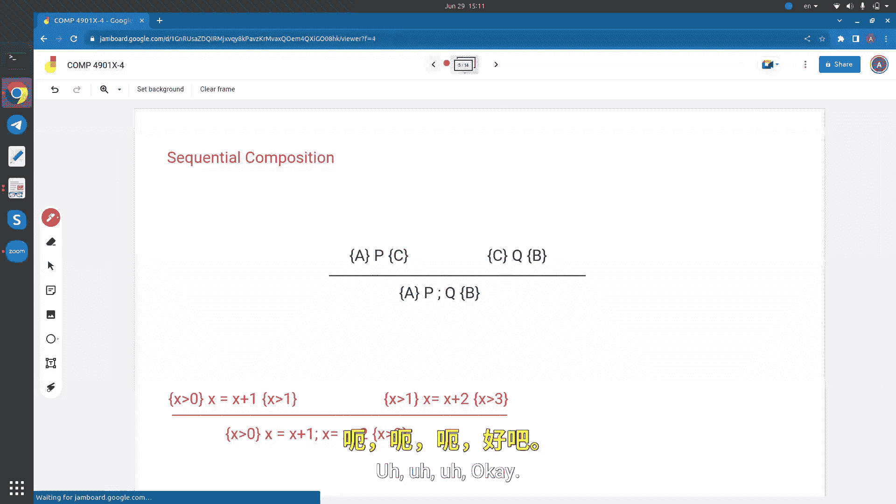

## 总结

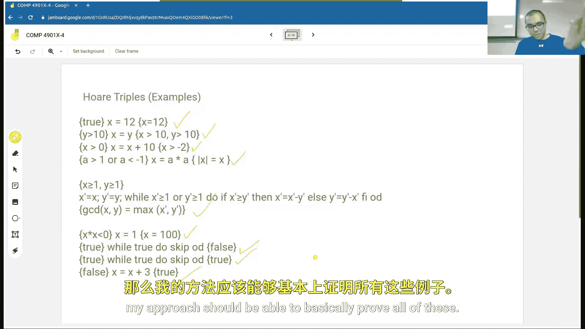

本节课中我们一起学习了**指称语义**。我们了解到：
*   指称语义将程序视为从输入状态到输出状态的**函数**。
*   通过**结构归纳**，可以简洁地定义`skip`、赋值、顺序组合和条件语句的语义。
*   处理`while`循环需要引入**变换子**和**不动点**的概念。
*   为了保证语义的合理性和与操作语义的一致性，我们选择变换子的**最小不动点**作为循环的语义。
*   指称语义提供了另一种强大而数学化的程序含义描述方式，为后续的程序推理和验证奠定了基础。