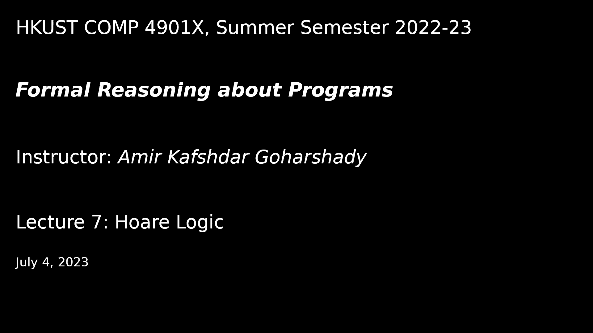

# 004：霍尔逻辑



在本节课中，我们将学习霍尔逻辑，这是一种用于推理程序正确性的形式化方法。我们将了解如何通过前置条件、后置条件和循环不变式来证明程序满足特定性质。

## 概述

在前面的课程中，我们学习了操作语义和指称语义，它们描述了程序如何执行。然而，直接使用这些语义来证明程序的特定性质（例如，程序结束后某个变量具有特定值）通常是困难或不切实际的。霍尔逻辑提供了一套基于逻辑推理的规则，使我们能够系统地推导出关于程序行为的断言，即“霍尔三元组”。一个霍尔三元组 `{A} P {B}` 表示：如果程序 `P` 开始执行时断言 `A`（前置条件）为真，并且 `P` 终止，那么当 `P` 终止时，断言 `B`（后置条件）将为真。

## 从示例程序到霍尔逻辑

让我们通过一个具体的程序来理解为什么需要霍尔逻辑，以及它是如何工作的。

考虑以下计算 2^n - 1 的程序：
```plaintext
i := 1
s := 0
m := 0
while m < n do
    s := s + i
    i := i * 2
    m := m + 1
end
```
我们想要证明的程序后置条件是：`s = 2^n - 1`。为了证明这一点，我们需要一个前置条件：`n > 0`。

### 使用指称语义的困难

指称语义将程序视为从初始状态到最终状态的函数。要证明后置条件，我们需要计算这个函数并检查其输出是否满足条件。然而，对于包含循环的程序，其指称语义是某个变换函数的最小不动点，而计算这个不动点通常是不可行的。实际上，由于停机问题的不可判定性，我们无法有一个通用算法来计算任意程序的完整指称语义函数。

### 使用操作语义与归纳推理

使用小步操作语义，我们可以通过归纳法来手动推理。例如，我们可以证明在 `while` 循环的每次迭代后，某个不变式（例如 `s = 2^m - 1` 且 `i = 2^m`）都成立。然而，这种推理是特定的、非形式化的，难以自动化或由机器检查。

### 引入程序不变式

一种更系统的方法是在程序的各个点标注“不变式断言”。一个不变式是在程序执行到该点时总是为真的断言。对于我们的示例，我们可以在循环开始前标注一个关键的不变式：
```
n > 0 ∧ m ≥ 0 ∧ n ≥ m ∧ i = 2^m ∧ s = 2^m - 1
```
通过证明这个断言在第一次到达循环前（基础情况）成立，并且每次循环迭代都保持成立（归纳步骤），我们就可以证明它始终成立。当循环结束时，我们有 `m ≥ n` 和不变式，结合 `m < n` 为假，可以推导出 `m = n`，从而得到最终的后置条件 `s = 2^n - 1`。

这种方法的核心思想是：为程序中的每个控制流转移证明，如果转移前的断言成立，则执行转移后的代码，转移后的断言也成立。

然而，这里仍然存在挑战：
1.  **不变式的生成**：如何自动找到合适的不变式是一个难题。
2.  **形式化与自动化**：如何将这种推理过程形式化，以便像 Coq 这样的自动化工具能够验证证明的正确性？

霍尔逻辑正是为了解决第二个挑战而设计的。

## 霍尔逻辑：公理与规则

霍尔逻辑的核心是定义一组证明规则，用于从简单的霍尔三元组组合出复杂程序的霍尔三元组。一个霍尔三元组 `{A} P {B}` 的形式化含义是：
对于所有状态 `σ`，如果 `σ ⊨ A`（状态 `σ` 满足断言 `A`），并且程序 `P` 从 `σ` 开始执行并终止于状态 `σ'`，那么必有 `σ' ⊨ B`。

以下是霍尔逻辑的基本规则：

### 基本规则

**Skip 公理**：`skip` 语句不执行任何操作。
```
{ A } skip { A }
```

**赋值公理模式**：对于赋值语句 `x := E`。
```
{ A[E/x] } x := E { A }
```
其中 `A[E/x]` 表示在断言 `A` 中将所有变量 `x` 的出现替换为表达式 `E`。这意味着，为了在赋值后使 `A` 成立，在赋值前必须满足将 `x` 替换为 `E` 后的 `A`。

### 组合规则

**顺序组合规则**：如果程序 `P` 执行后满足 `C`，并且接着执行 `Q` 能从 `C` 达到 `B`，那么顺序执行 `P; Q` 能从 `A` 达到 `B`。
```
{ A } P { C }    { C } Q { B }
—————————————————————————————————
        { A } P; Q { B }
```

**条件语句规则**：对于 `if B then P else Q end`。
```
{ A ∧ B } P { C }    { A ∧ ¬B } Q { C }
———————————————————————————————————————————
        { A } if B then P else Q end { C }
```

### 强化与弱化规则

**后承规则**：这是霍尔逻辑中非常关键的一条规则，它允许我们强化前置条件或弱化后置条件。
```
A' ⇒ A    { A } P { B }    B ⇒ B'
———————————————————————————————————
           { A' } P { B' }
```
如果 `A'` 比 `A` 更强（即 `A'` 蕴含 `A`），并且 `B` 蕴含 `B'`，那么我们可以将三元组的前置条件替换为更强的 `A'`，后置条件替换为更弱的 `B'`。

### 循环规则

**While 循环规则**：对于 `while B do P end`。这里需要一个**循环不变式** `I`，它是一个在循环每次迭代前后都保持为真的断言。
```
{ I ∧ B } P { I }
——————————————————————————————————————————————
{ I } while B do P end { I ∧ ¬B }
```
规则解读：如果当不变式 `I` 和循环条件 `B` 都成立时，执行循环体 `P` 能保持 `I` 成立，那么我们可以断言：只要循环开始前 `I` 成立，那么循环结束后，`I` 仍然成立，并且循环条件 `B` 为假。

## 规则应用示例

让我们使用这些规则来证明一个简单条件语句的霍尔三元组。
我们想证明：
```
{ n > 1 } if x < n then x := n else x := x + 1 end { x > 0 }
```

以下是证明步骤：

1.  **应用条件语句规则**：目标拆分为两个子目标。
    *   `{ n > 1 ∧ x < n } x := n { x > 0 }`
    *   `{ n > 1 ∧ x ≥ n } x := x + 1 { x > 0 }`

2.  **证明第一个子目标 (`x := n`)**：
    *   应用**赋值公理**：要得到后置条件 `x > 0`，赋值前需满足 `n > 0`。所以我们有 `{ n > 0 } x := n { x > 0 }`。
    *   应用**后承规则**：我们需要证明 `(n > 1 ∧ x < n) ⇒ n > 0`。这显然成立，因为 `n > 1` 蕴含 `n > 0`。因此，`{ n > 1 ∧ x < n } x := n { x > 0 }` 得证。

3.  **证明第二个子目标 (`x := x + 1`)**：
    *   应用**赋值公理**：要得到后置条件 `x > 0`，赋值前需满足 `x + 1 > 0`，即 `x > -1`。所以我们有 `{ x > -1 } x := x + 1 { x > 0 }`。
    *   应用**后承规则**：我们需要证明 `(n > 1 ∧ x ≥ n) ⇒ x > -1`。由于 `n > 1` 且 `x ≥ n`，所以 `x ≥ n > 1`，因此 `x > 1 > -1` 成立。因此，`{ n > 1 ∧ x ≥ n } x := x + 1 { x > 0 }` 得证。

4.  **结论**：根据条件语句规则，原霍尔三元组成立。

这个证明过程可以构建成一个证明树，其中每一步都对应一个霍尔逻辑规则的应用。

## 关于霍尔逻辑的进一步讨论

*   **合取规则**：虽然可以添加规则 `{A}P{B}` 和 `{A}P{C}` 可推出 `{A}P{B∧C}`，但这并非必需，因为它可以通过在其他规则中直接证明 `{A}P{B∧C}` 来实现。不过，该规则可以使证明更模块化。
*   **非确定性选择规则**：对于非确定性选择 `P or Q`，规则如下：
    ```
    { A } P { B }    { A } Q { B }
    ————————————————————————————————
        { A } P or Q { B }
    ```
    因为要保证无论选择哪条路径，后置条件 `B` 都成立。
*   **霍尔逻辑的完备性与可计算性**：霍尔逻辑是相对完备的，即所有有效的霍尔三元组都存在一个形式化证明。然而，**自动生成**这个证明的过程是不可判定的。例如，三元组 `{true} P {false}` 有效当且仅当程序 `P` 永不终止（部分正确性视角）。判断程序是否永不停机本身就是不可判定的问题。因此，在实践中，我们依赖像 Coq 这样的半自动化工具，由用户提供关键的不变式和证明思路（如应用哪条规则、如何强化前置条件），然后由工具完成细节验证。

## 总结


本节课我们一起学习了霍尔逻辑的基础知识。霍尔逻辑通过定义一组形式化规则（如 Skip、赋值、顺序、条件、循环规则和后承规则），为我们提供了一种系统化、可机器检查的方法来推理程序的正确性。其核心是围绕前置条件、后置条件，特别是循环不变式进行推理。虽然自动找到证明（尤其是循环不变式）是困难的，但霍尔逻辑框架使得我们可以将人类的高层推理与机器的精确验证结合起来，这对于确保关键软件的正确性至关重要。