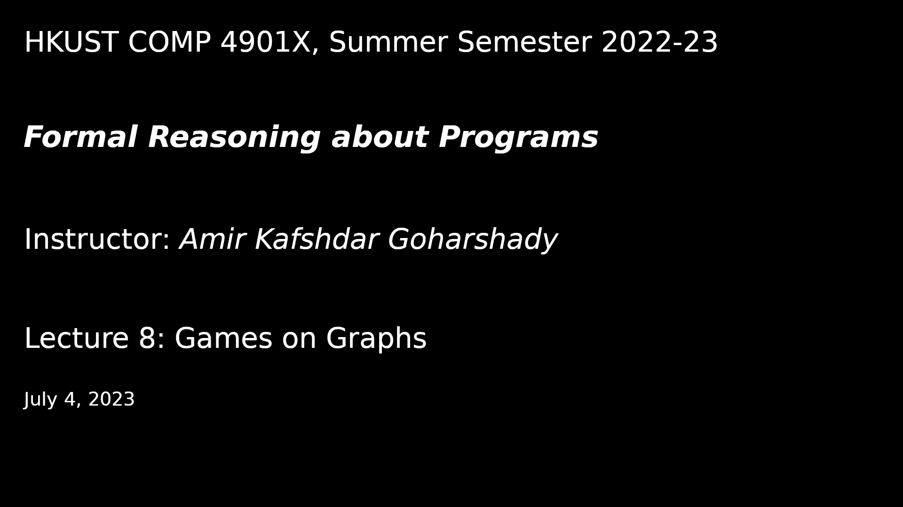
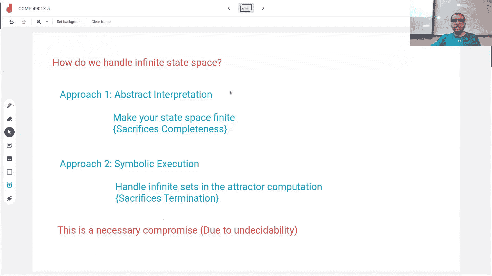

# 005：图上的游戏 🎮

在本节课中，我们将学习无限时长双人图游戏。这些游戏是程序验证的有用工具，但今天我们将专注于其理论部分。我们将定义游戏图、目标、策略等核心概念，并学习如何求解可达性目标。

## 游戏图与目标 🎲

上一节我们介绍了课程安排，本节中我们来看看什么是图游戏。

一个**游戏图**（或称竞技场）本质上是一个有向图，包含顶点集合 `V` 和边集合 `E`。其特殊之处在于，顶点集合 `V` 被划分为两个子集：`V1` 和 `V2`，分别属于玩家1和玩家2。

游戏从某个初始顶点开始。在每一步，当前顶点的所有者玩家从该顶点的出边中选择一条，游戏移动到该边指向的顶点。我们假设每个顶点至少有一条出边，以保证游戏可以无限进行下去。

游戏进行产生的顶点序列称为**路径**。一个无限长的路径称为游戏的**结果**。

一个**目标**定义了玩家希望达成的结果集合。例如，玩家1的目标 `O1` 是某个无限路径的集合。如果玩家2的目标 `O2` 是 `O1` 的补集，即 `O2 = 所有无限路径 \ O1`，则称该游戏是**零和**的。

我们主要关注几种经典的目标类型。以下是它们的定义：

*   **可达性**：玩家希望至少访问一次目标顶点集合 `T`。
    *   `Reach(T) = { 路径 ρ | ρ 访问的顶点集合 ∩ T ≠ ∅ }`
*   **安全性**：玩家希望始终停留在安全顶点集合 `T` 内。
    *   `Safe(T) = { 路径 ρ | ρ 访问的所有顶点 ∈ T }`
*   **布奇**：玩家希望无限多次访问目标顶点集合 `T`。
    *   `Büchi(T) = { 路径 ρ | ρ 被无限次访问的顶点集合 ∩ T ≠ ∅ }`
*   **科布奇**：玩家希望所有被无限次访问的顶点都在集合 `T` 内。
    *   `CoBüchi(T) = { 路径 ρ | ρ 被无限次访问的顶点集合 ⊆ T }`

可达性与安全性互为对偶，布奇与科布奇互为对偶。这意味着求解一个目标的问题可以转化为求解其对偶目标。

## 奇偶目标与尾目标 🎯

上一节我们介绍了四种经典目标，本节中我们来看看更一般化的目标：奇偶目标。

一个**奇偶目标**由一个优先级函数 `P: V -> {0, 1, ..., d}` 定义。玩家1的目标是确保在结果路径中，被无限次访问的顶点里，最小的优先级是**偶数**。
*   `Parity(P) = { 路径 ρ | min{ P(v) | v 在 ρ 中被无限次访问 } 是偶数 }`

奇偶目标非常强大，它可以表达布奇和科布奇目标。
*   对于布奇目标 `Büchi(T)`，可以定义 `P(v) = 0` 若 `v ∈ T`，否则 `P(v) = 1`。
*   对于科布奇目标 `CoBüchi(T)`，可以定义 `P(v) = 2` 若 `v ∈ T`，否则 `P(v) = 1`。

奇偶目标的对偶也是奇偶目标。如果原目标由函数 `P` 定义，则其对偶目标由函数 `P'(v) = P(v) + 1` 定义。

如果一个目标的性质不依赖于路径的任意有限前缀，则称其为**尾目标**。形式化地说，目标 `O` 是尾目标，当且仅当：如果路径 `ρ` 在 `O` 中，那么 `ρ` 的任意无限后缀也在 `O` 中。布奇、科布奇和奇偶目标都是尾目标，但可达性目标不是。

不过，我们可以通过修改游戏图，将可达性目标转化为布奇目标（进而成为奇偶目标）。方法是将所有目标顶点 `T` 的所有出边移除，并为每个 `t ∈ T` 添加一条指向自身的自环。这样，一旦到达目标顶点，就会永远停留在那里，相当于无限次访问了它。

## 策略与获胜集 ⚔️

上一节我们定义了游戏的目标，本节中我们来看看玩家如何通过策略来达成目标。

玩家 `i` 的一个**策略** `σ_i` 是一个函数，它根据当前游戏的历史（已访问的顶点序列）和当前顶点，决定下一步移动到哪个顶点。策略必须遵守图的边。

如果给定了初始顶点 `v`、玩家1的策略 `σ1` 和玩家2的策略 `σ2`，则游戏会产生一个唯一的结果路径，记为 `Outcome(v, σ1, σ2)`。

我们特别关注两种简单的策略：
*   **无记忆策略**：策略决策仅依赖于当前顶点，与历史无关。可以表示为 `σ_i: V_i -> V`。
*   **持久策略**：如果玩家在某个顶点做出过一次选择，那么之后每次回到该顶点，都会做出同样的选择。

给定玩家1的目标 `O1` 和初始顶点 `v`，策略 `σ1` 称为一个**获胜策略**，如果对于玩家2的**任何**策略 `σ2`，结果 `Outcome(v, σ1, σ2)` 都在 `O1` 中。反之，如果存在一个玩家2的策略 `σ2` 使得结果不在 `O1` 中，则称 `σ2` **破坏**了 `σ1`。

玩家 `i` 的**获胜集** `Win_i` 是指从这些顶点开始，玩家 `i` 拥有一个获胜策略的所有顶点的集合。
如果对于所有顶点 `v`，都有 `v ∈ Win_1` 当且仅当 `v ∉ Win_2`，则称该游戏是**确定的**。
“零和”与“确定”是两个不同的概念。零和关乎单次游戏结果的归属，而确定关乎是否存在应对所有对手策略的必胜策略。

## 求解可达性目标 🧮

上一节我们介绍了策略的抽象概念，本节中我们来看一个具体的算法，用于求解玩家1在可达性目标 `Reach(T)` 下的获胜集。

算法通过迭代计算一个称为**吸引子**的集合 `A`。`A` 包含了所有玩家1可以强制游戏到达目标集 `T` 的顶点。
计算过程如下：
1.  初始化 `A0 = T`。（如果起点就在目标里，直接获胜）
2.  对于 `k = 1, 2, ...`，计算 `Ak = Ak-1 ∪ { v ∈ V1 | 存在边 v->v' 且 v' ∈ Ak-1 } ∪ { v ∈ V2 | 所有边 v->v' 都满足 v' ∈ Ak-1 }`。
    *   如果顶点属于玩家1，并且有一个后继已经在获胜集里，那么玩家1可以选择去那里，从而获胜。
    *   如果顶点属于玩家2，并且**所有**后继都在玩家的获胜集里，那么无论玩家2怎么走，下一步都会进入玩家的获胜集。
3.  当集合不再增长时停止，即找到不动点 `A = ∪_{k>=0} Ak`。

可以证明，集合 `A` 就是玩家1在目标 `Reach(T)` 下的获胜集 `Win_1`。并且，玩家1可以使用一个简单的**无记忆获胜策略**：在任意顶点 `v ∈ A \ T`，如果 `v ∈ V1`，则选择一条指向 `Ak-1` 集合的后继边；如果 `v ∈ V2`，则任意选择（因为所有选择都对玩家1有利）。

此外，集合 `A` 的补集 `V \ A` 是玩家2的一个**陷阱**。陷阱 `C` 满足：
1.  `C ∩ T = ∅`。（陷阱里没有目标）
2.  对于所有 `v ∈ C ∩ V1`，`v` 的所有后继都在 `C` 中。（玩家1无法逃出陷阱）
3.  对于所有 `v ∈ C ∩ V2`，`v` 至少有一个后继在 `C` 中。（玩家2可以选择留在陷阱里）

如果游戏是零和的（玩家2的目标是 `Safe(V \ T)`），那么从 `V \ A` 中的任何顶点开始，玩家2都有一个获胜策略：始终选择留在陷阱 `V \ A` 内的边。这保证了游戏永远不会进入 `T`。

这个算法可以在 `O(|V| + |E|)` 的线性时间内实现，类似于使用队列的广度优先搜索。

## 与程序验证的联系 🔗

上一节我们给出了求解可达性目标的具体算法，本节中我们探讨这些图游戏概念如何应用于程序验证。

在程序语义中，我们常遇到非确定性。在图游戏的框架下，我们可以将两种非确定性分别建模为两个玩家的选择：
*   **玩家1**：可能代表程序本身或用户输入。
*   **玩家2**：可能代表环境或其他不可控因素。

于是，程序验证的许多问题可以转化为图游戏问题：
*   **证明程序终止**：相当于玩家1（程序）希望到达表示终止状态的集合 `T`（可达性目标）。
*   **证明存在漏洞**：相当于玩家2（环境）可以强制程序到达表示崩溃的错误状态集合 `T`（可达性目标）。
*   **证明安全性（无漏洞）**：相当于玩家1希望始终停留在安全状态集合 `T` 内（安全性目标）。
*   **证明非终止**：相当于玩家2希望始终停留在非终止状态集合内（安全性目标）。

然而，程序的状态空间通常是**无限**或极其庞大的（例如，包含整数变量）。我们之前给出的线性时间算法无法直接处理无限图。

有两种主要方法处理大规模状态空间：
1.  **抽象解释**：将具体状态聚合成有限的抽象状态，对程序行为进行**过近似**。这样得到的抽象模型是有限的，可以应用图游戏算法。这种方法**保持可靠性**（如果抽象模型安全，则原程序也安全），但会**丧失完备性**（抽象模型报错，原程序未必真有错）。
2.  **符号执行**：不显式枚举状态集合，而是用逻辑公式等符号形式来表示和计算像吸引子 `A` 这样的集合。这种方法可能面临**不终止**的问题，即计算无法到达一个不动点。

根据图灵机和莱斯定理的不可判定性，在程序验证中，我们无法同时获得可靠性、完备性和算法终止性。必须在三者之间进行权衡。

## 总结 📝

本节课中我们一起学习了无限时长双人图游戏的理论基础。
我们首先定义了游戏图、路径、结果和各类目标（可达性、安全性、布奇、科布奇），并介绍了更具一般性的奇偶目标。
接着，我们探讨了玩家的策略，特别是无记忆策略和获胜策略的概念。
然后，我们详细讲解并证明了求解可达性目标获胜集的吸引子算法，该算法能产生无记忆获胜策略，并在线性时间内运行。
最后，我们将图游戏与程序验证联系起来，展示了如何将程序正确性问题建模为游戏求解问题，并讨论了处理无限状态空间所面临的挑战及抽象解释等近似方法。
这些概念为后续使用形式化工具进行程序推理奠定了重要的理论基础。