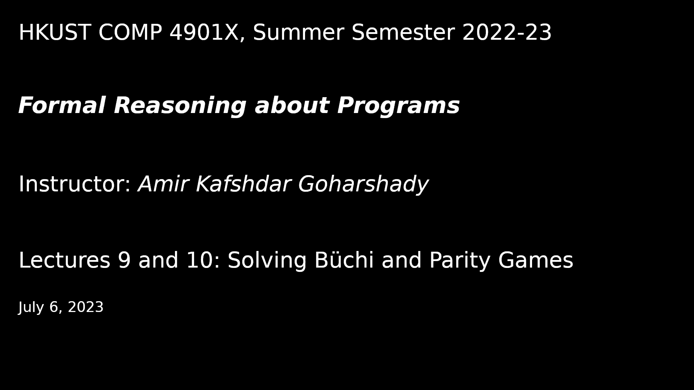
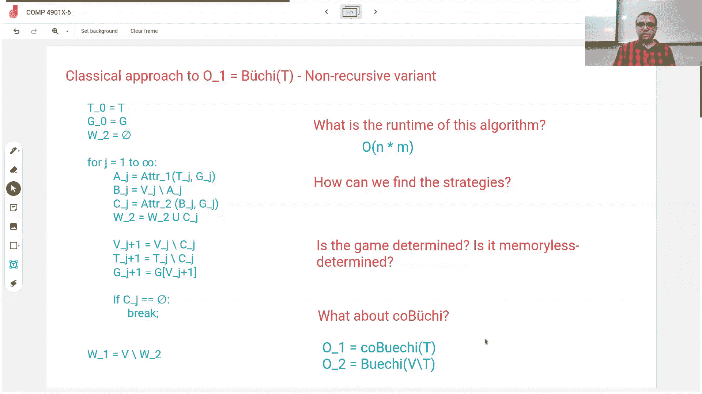
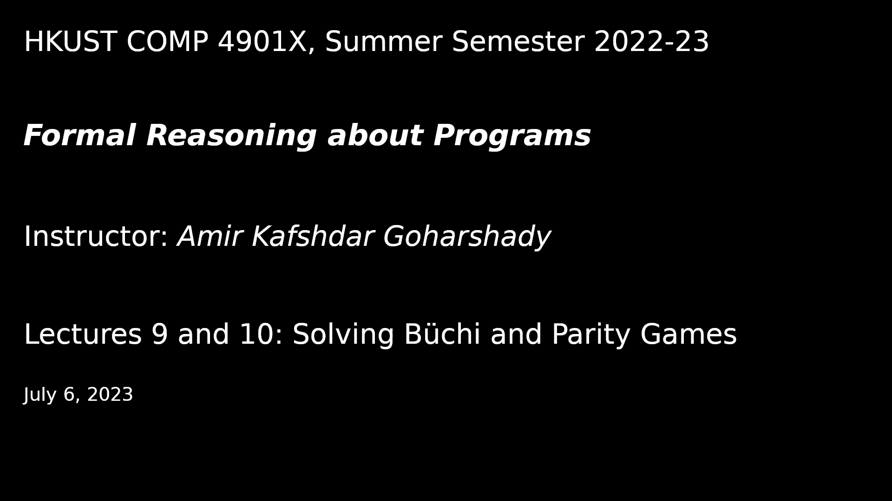
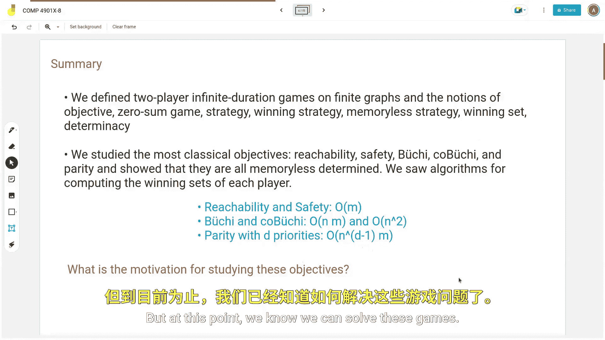

# 程序的形式化推理：第6讲：求解Büchi与Parity游戏



## 概述

在本节课中，我们将学习如何求解具有Büchi和Parity目标的图游戏。我们将回顾图游戏的基本定义，然后深入探讨求解Büchi目标的经典算法及其优化版本，最后将算法扩展到更一般的Parity目标。我们将证明这些游戏不仅是确定的，而且存在无记忆的必胜策略。

## 图游戏回顾

上一节我们介绍了图游戏，本节中我们来看看其核心概念。

首先，我们定义了图游戏。我们说一个竞技场本质上是一个图，其中顶点被划分为两个集合：由玩家1控制的顶点集合和由玩家2控制的顶点集合。这是一个划分，因此每个顶点只有一个所有者。

为了使游戏能够无限进行，我们假设每个顶点至少有一条出边。这个假设在本节中非常重要。

我们讨论了游戏的玩法：从起始顶点开始，每当处于特定顶点时，该顶点的所有者选择走哪条出边。他们无限地进行下去，从而在图上产生一条无限路径，这被称为一个玩法或游戏的结果。

我们定义了目标：玩家的目标本质上是一组无限路径。玩家I希望游戏的结果在其目标集合 OI 中。

我们定义了零和的概念：如果一个玩家的目标是另一个玩家目标的补集，则游戏是零和的。这意味着给定游戏的任何结果，你都可以判断玩家1还是玩家2获胜。

我们定义了一些经典目标。以下是这些目标的简要回顾：

*   **可达性**：玩家希望至少访问一次目标集合 T 中的顶点。
*   **安全性**：玩家希望始终停留在集合 T 中，永不离开。
*   **Büchi**：玩家希望无限多次访问目标集合 T 中的顶点。
*   **Co-Büchi**：玩家希望确保最终进入集合 T 并永远留在其中，即集合 T 之外的顶点只被访问有限次。
*   **Parity**：这是一个更复杂的条件。我们为每个顶点分配一个优先级（数字），然后观察被无限多次访问的顶点的优先级，并希望这些优先级中的最小值是偶数。

我们证明了Büchi和Co-Büchi是Parity的特殊情况，因此我们将更关注Parity目标。

我们讨论了策略的概念。策略本质上是一个函数，它接收游戏的历史和当前顶点，并告诉玩家从当前顶点应该去哪里。它只是扩展游戏的配方。我们总是使用下标来表示策略、目标等属于哪个玩家。

我们讨论了无记忆策略：如果策略只依赖于游戏的当前状态，而不依赖于游戏的历史，则它是无记忆的。例如，井字棋有无记忆策略，但国际象棋没有，因为存在三次重复局面判和规则。

我们还讨论了，如果为每个玩家固定一个策略并给定初始状态，我们将得到一个唯一的结果。如果玩家1无论玩家2采取什么策略，都能确保游戏结果在其目标集合中，那么该策略就是玩家1的必胜策略。

玩家的必胜集是从该玩家拥有必胜策略的所有状态集合。我们定义了一个游戏是确定的：如果从每个顶点开始，恰好有一个玩家拥有必胜策略。这与零和游戏是不同的概念。

## 可达性与安全性求解

上一节我们介绍了可达性目标，本节中我们来看看其求解算法。

可达性目标是指玩家1希望到达特定集合 T。我们通过吸引子计算来求解。吸引子 Attr1(T) 是所有玩家1可以确保游戏最终到达 T 的状态集合。

以下是计算吸引子的算法步骤：

1.  初始化 A0 = T。
2.  对于每个不在当前集合中的顶点：
    *   如果它是玩家1的顶点，并且有一条边指向当前集合，则将其加入。
    *   如果它是玩家2的顶点，并且其所有出边都指向当前集合，则将其加入。
3.  重复步骤2，直到没有新顶点可以加入。最终得到的集合 A 就是玩家1的必胜集。





集合 B = V \ A 是玩家1的一个陷阱。在 B 中，玩家2可以确保游戏永远不会到达 T。因此，游戏是确定的，并且双方在各自的必胜集中都有无记忆策略。

求解可达性的算法可以在线性时间 O(n+m) 内完成，其中 n 是顶点数，m 是边数。安全性目标是可达性目标的对偶，因此也可以用线性时间求解。

## Büchi目标求解

现在，让我们进入今天的主要内容：求解Büchi目标。

Büchi目标是指玩家1希望无限多次访问目标集合 T。这不仅仅是到达 T 一次，而是需要反复到达。

我们首先定义一些符号。设 A = Attr1(T)，即玩家1可以确保到达 T 的状态集合。设 B = V \ A，即玩家1的陷阱。设 C = Attr2(B)，即玩家2可以确保最终到达 B 的状态集合。

我们声称，从集合 C 中的任何顶点开始，玩家2都有必胜策略。策略如下：首先使用可达性策略到达 B，然后一旦进入 B，就使用陷阱策略永远留在 B 中。由于在到达 B 的路径上可能有限次访问 T，但这不影响Büchi目标（玩家1需要无限次访问 T），所以玩家2获胜。

因此，我们可以将 C 标记为玩家2的必胜集的一部分。对于剩余的图 V' = V \ C，我们可以递归地求解。因为玩家1不会主动进入 C（否则会输），而玩家2也无法从 V' 强制进入 C（否则 C 会更大），所以 V' 构成一个子游戏。

以下是求解Büchi目标的经典算法伪代码：

```
W2 = ∅ // 玩家2的必胜集
G_current = G // 当前游戏图
T_current = T // 当前目标集

while True:
    A = Attr1(T_current) in G_current
    B = V_current \ A
    C = Attr2(B) in G_current
    if C is empty:
        break
    W2 = W2 ∪ C
    V_current = V_current \ C
    T_current = T_current \ C
    // 更新 G_current 为在 V_current 上的子游戏

W1 = V \ W2 // 玩家1的必胜集
```

该算法的时间复杂度为 O(n * m)。每次循环需要计算两个吸引子，时间为 O(m)，最多循环 n 次。

## 更快的Büchi求解算法

上一节我们介绍了Büchi的经典算法，本节中我们来看看一个更快的算法，目标是将时间复杂度降至 O(n²)。

经典算法的瓶颈在于，每次迭代可能只找到一个很小的陷阱，却要扫描整个图（O(m)时间）。优化思路是：**用 O(n * k) 的时间找到一个大小为 k 的陷阱**，这样将所有迭代的 k 累加（最多为 n），总时间就是 O(n²)。

为此，我们引入分层分解和子图陷阱的概念。我们构建一系列稀疏子图 G0, G1, ..., G_{log n}，其中 Gi 的边数约为 n * 2^i。我们尝试在 Gi 中寻找一个陷阱，该陷阱不仅能将玩家1困在顶点集 S 中，还能将其困在边集 E(Gi) 内（即玩家无法使用 Gi 之外的边）。

关键结论是：如果在 Gi 中找到了一个陷阱 Si，那么 Si 的大小至少为 2^{i-1}。而处理 Gi 的时间是 O(n * 2^i)。因此，找到大小为 k 的陷阱所需时间为 O(n * k)。

将这个高效的找陷阱算法嵌入到之前的Büchi算法框架中（用找到的任意陷阱代替原来的 B），我们就得到了一个 O(n²) 的Büchi求解算法。

## Parity目标求解

最后，我们将算法扩展到更一般的Parity目标。

Parity目标中，每个顶点有一个优先级 p(v) ∈ {0, 1, ..., d}。玩家1获胜当且仅当在无限玩法中，出现无限多次的顶点的最小优先级是偶数。

我们通过归纳法来证明Parity游戏不仅是确定的，而且存在无记忆必胜策略，同时这也给出了一个求解算法。

**归纳基础**：当优先级数量为1或2时，游戏退化为平凡的或Büchi/Co-Büchi游戏，结论成立。

**归纳步骤**：假设对于优先级数量少于 d+1 的游戏结论成立。考虑一个具有优先级 0 到 d 的游戏。

1.  令 P0 为优先级为 0 的顶点集合。计算 A = Attr1(P0) 和 B = V \ A。
2.  由于 B 是陷阱，可以在 B 上定义子游戏。该子游戏没有优先级0，因此优先级数量 ≤ d。根据归纳假设，该子游戏是确定且有无记忆策略的。设 B1 和 B2 分别是子游戏中玩家1和玩家2的必胜集。
3.  **声明1**：在原始游戏中，从 B2 中的任何顶点开始，玩家2有必胜（无记忆）策略。策略就是采用在子游戏 B 中的必胜策略。因为 B 是陷阱，玩家1无法离开 B 进入 A，所以游戏实际上被限制在子游戏 B 中。
4.  **声明2**：令 C = Attr2(B2)。在原始游戏中，从 C 中的任何顶点开始，玩家2有必胜（无记忆）策略。策略是：首先使用可达性策略到达 B2，然后切换到声明1中的策略。由于Parity是“尾属性”，有限前缀不影响最终胜负，所以该策略有效。
5.  现在，集合 C 是玩家2的必胜集。考虑剩余的子游戏 V' = V \ C。由于 C 是吸引子，V' 是其补集，因此是一个陷阱，可以定义子游戏。
6.  我们在 V' 上递归地应用此过程。该过程最终会停止。
7.  当算法无法再找到非空的 C（即 B2 为空）时，意味着在子游戏 B 中，玩家1处处必胜。此时，我们可以为玩家1构造一个全局必胜策略：
    *   当游戏在 A 中时，玩家1采用到达 P0 的可达性策略。
    *   当游戏在 B 中时，玩家1采用在子游戏 B 中的必胜策略。
    *   如果玩家2有限次进入 A，则游戏最终永远留在 B 中，玩家1因在 B 中的策略而获胜。
    *   如果玩家2无限次进入 A，则玩家1无限次访问 P0（优先级0），从而满足Parity条件（最小偶优先级）而获胜。

该算法的时间复杂度递归式为：T(n, m, d) ≤ n * [T(n, m, d-1) + O(m)]。解之可得时间复杂度约为 O(n^{d-1} * m)。

## 总结

本节课中我们一起学习了：
1.  回顾了图游戏、目标、策略、确定性和无记忆策略等基本概念。
2.  学习了求解可达性和安全性目标的线性时间算法。
3.  深入探讨了求解Büchi目标的经典 O(n*m) 算法及其优化后的 O(n²) 算法。
4.  将算法扩展到Parity目标，证明了Parity游戏的确定性和无记忆策略存在性，并给出了一个时间复杂度为 O(n^{d-1} * m) 的求解算法。



这些算法是形式化验证和自动机理论中的重要工具，为分析系统属性（如活性、公平性）提供了基础。