# 程序的形式化推理：第7讲：Coq中的归纳推理与类型


## 概述

在本节课中，我们将学习Coq作为一种函数式编程语言的基础知识。我们将从定义新类型和函数开始，逐步深入到使用归纳定义、模式匹配和递归函数。最后，我们将学习如何在Coq中证明关于这些定义的定理，包括使用归纳法进行证明。

---

## 定义新类型

在Coq中，我们可以使用`Inductive`关键字来定义新的类型。这类似于在C语言中使用`struct`或在C++/Java中使用`class`，但Coq的类型定义是归纳式的。

以下是定义一个表示星期几的新类型`day`的示例：

```coq
Inductive day : Type :=
  | Monday
  | Tuesday
  | Wednesday
  | Thursday
  | Friday
  | Saturday
  | Sunday.
```

执行此定义后，Coq会声明`day`是一个已定义的类型，并创建了相应的构造函数。

## 定义函数与模式匹配

定义好类型后，我们可以定义操作该类型的函数。在函数式编程中，我们通常使用模式匹配来定义函数。

以下是一个函数`next_workday`的示例，它接收一个`day`类型的参数并返回下一个工作日：

```coq
Definition next_workday (d: day) : day :=
  match d with
  | Monday => Tuesday
  | Tuesday => Wednesday
  | Wednesday => Thursday
  | Thursday => Friday
  | Friday => Monday
  | Saturday => Monday
  | Sunday => Monday
  end.
```

在Coq中进行模式匹配时，必须覆盖所有可能的情况，否则Coq会报错“模式匹配不完整”。

我们可以使用`Compute`命令来执行计算：

```coq
Compute (next_workday Wednesday). (* 结果为 Thursday *)
Compute (next_workday (next_workday Tuesday)). (* 结果为 Thursday *)
```

## 定理、引理与示例

在Coq中，`Theorem`、`Lemma`和`Example`关键字本质上是相同的，都用于陈述需要证明的命题。我们通常使用`Example`来编写测试。

以下是一个示例，它陈述了一个关于`next_workday`的事实：

```coq
Example test_next_workday:
  (next_workday (next_workday Tuesday)) = Thursday.
```

当我们写下这个`Example`时，Coq会进入证明模式，我们需要提供证明。对于这个简单的等式，我们可以使用`compute`策略来计算左边，然后使用`reflexivity`策略来证明两边相等。

```coq
Proof.
  compute.
  reflexivity.
Qed.
```

`reflexivity`策略足够智能，它会在尝试证明等式前自动进行计算。

## 定义布尔类型与操作

现在，让我们在一个新模块中定义自己的布尔类型和基本操作，以避免与标准库冲突。

我们首先定义布尔类型`bool`：

```coq
Module MyBool.
Inductive bool : Type :=
  | true
  | false.
```

接着，我们定义布尔取反操作`negb`：

```coq
Definition negb (b: bool) : bool :=
  match b with
  | true => false
  | false => true
  end.
```

使用`Check`命令可以查看表达式的类型，使用`Compute`命令可以计算表达式的值。

```coq
Check (negb true). (* 类型为 bool *)
Compute (negb true). (* 结果为 false *)
```

现在，我们来定义合取（与）操作`andb`。有多种定义方式，例如使用短路求值：

```coq
Definition andb (b1 b2: bool) : bool :=
  match b1 with
  | false => false
  | true => b2
  end.
```

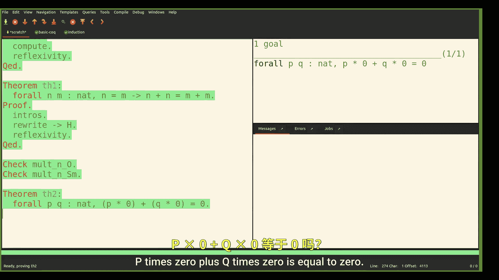


或者，通过同时匹配两个参数来定义：

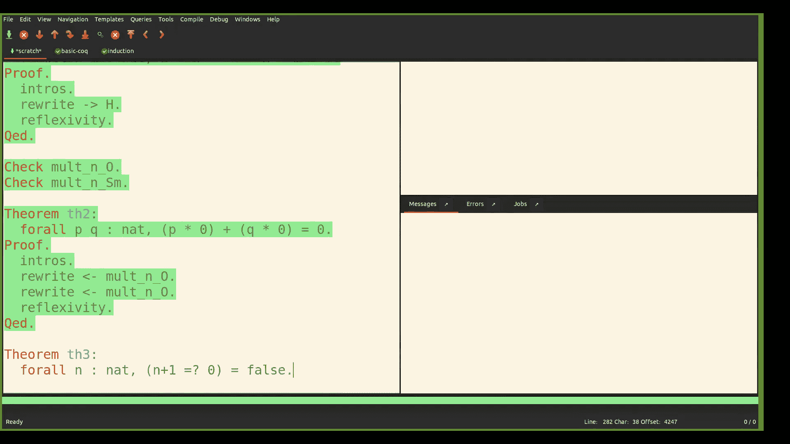


```coq
Definition andb' (b1 b2: bool) : bool :=
  match b1, b2 with
  | true, true => true
  | _, _ => false
  end.
```

我们也可以为操作符定义中缀记号，使其使用起来更自然：

```coq
Notation "x && y" := (andb x y).
```

## 定义更复杂的类型

Coq的归纳类型定义可以包含参数，从而构建更复杂的数据结构。

例如，我们可以先定义一个基本颜色类型`rgb`，然后定义一个扩展的颜色类型`color`，它除了包含黑白两色，还能包含一个`rgb`类型的基本色：

```coq
Inductive rgb : Type :=
  | red
  | green
  | blue.


Inductive color : Type :=
  | white
  | black
  | primary (p : rgb).
```


这里，`primary`是一个构造函数，它接受一个`rgb`类型的参数。因此，`primary red`、`primary green`等都是`color`类型的合法值。

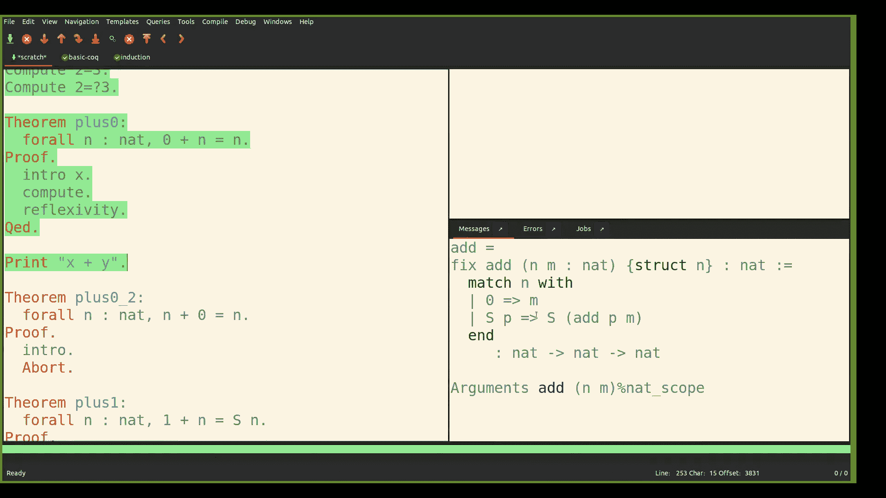


我们可以定义一个函数来判断一个颜色是否为黑白（单色）：

```coq
Definition monochrome (c : color) : bool :=
  match c with
  | white => true
  | black => true
  | primary _ => false
  end.
```

## 定义自然数与递归函数

自然数在Coq中是通过归纳法定义的：一个自然数要么是零（`O`），要么是另一个自然数的后继（`S n`）。

```coq
Module MyNat.
Inductive nat : Type :=
  | O
  | S (n : nat).
```

这里，`O`代表零，`S`代表后继函数。因此，`S O`表示1，`S (S O)`表示2，依此类推。

现在，我们可以定义操作自然数的函数。例如，定义前驱函数`pred`：

```coq
Definition pred (a : nat) : nat :=
  match a with
  | O => O
  | S n' => n'
  end.
```

对于更复杂的函数，如判断一个数是否为偶数的函数`my_even`，我们需要使用递归定义。在Coq中，我们使用`Fixpoint`关键字来定义递归函数。

```coq
Fixpoint my_even (a : nat) : bool :=
  match a with
  | O => true
  | S O => false
  | S (S n') => my_even n'
  end.
```

然后，我们可以基于`my_even`定义判断奇数的函数`my_odd`，而无需再次使用递归：

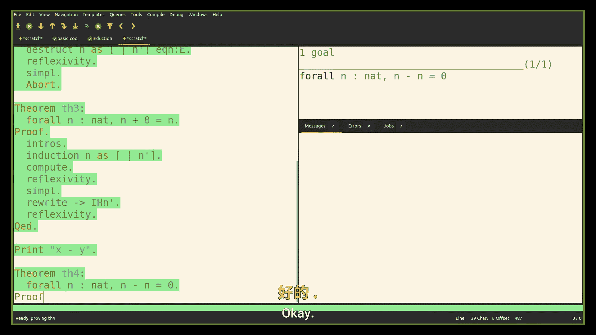


```coq
Definition my_odd (a : nat) : bool :=
  negb (my_even a).
```

## 定义算术运算

现在，让我们定义加法、乘法等算术运算。我们将使用Coq标准库中已定义的`nat`类型。

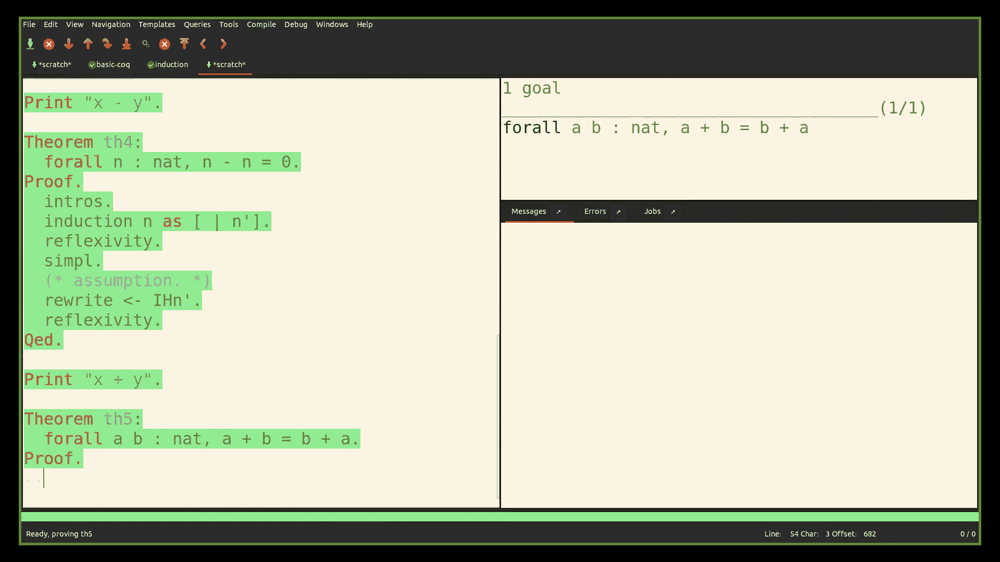

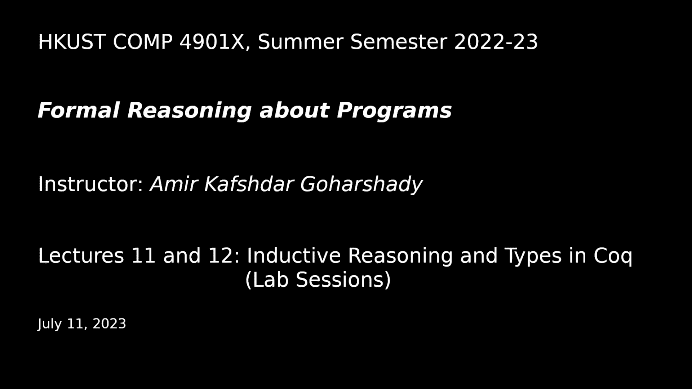

首先定义加法`plus`。加法的定义是递归的：如果第一个参数是`O`，则结果为第二个参数；否则，结果为第一个参数的前驱加第二个参数的后继。

```coq
Fixpoint plus (n m : nat) : nat :=
  match n with
  | O => m
  | S n' => S (plus n' m)
  end.
```

类似地，我们可以定义乘法`mult`：

```coq
Fixpoint mult (n m : nat) : nat :=
  match n with
  | O => O
  | S n' => plus m (mult n' m)
  end.
```

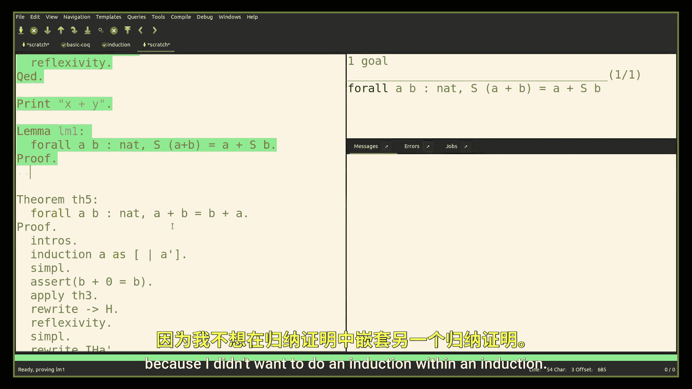

以及减法`minus`（这里定义的是截断减法，即如果结果小于零则返回零）：


```coq
Fixpoint minus (n m : nat) : nat :=
  match n, m with
  | O, _ => O
  | S _, O => n
  | S n', S m' => minus n' m'
  end.
```

## 证明关于自然数的定理

有了这些定义，我们就可以开始证明定理了。Coq中的证明是通过一系列策略（tactics）来完成的。

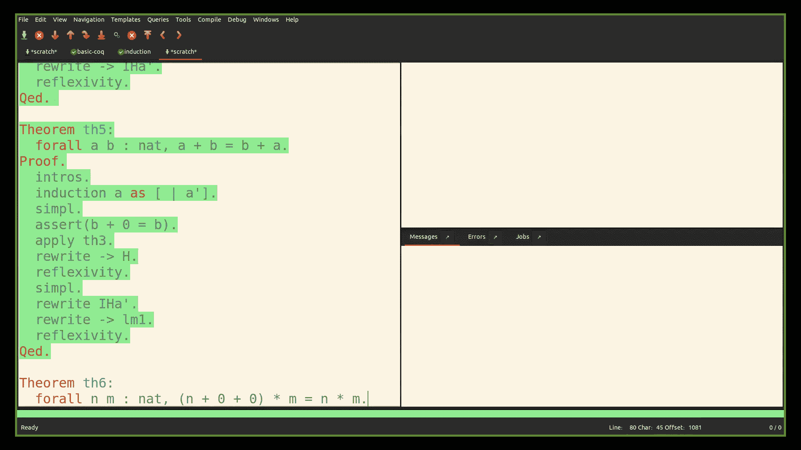


第一个简单的定理是：对于任意自然数`n`，`0 + n = n`。

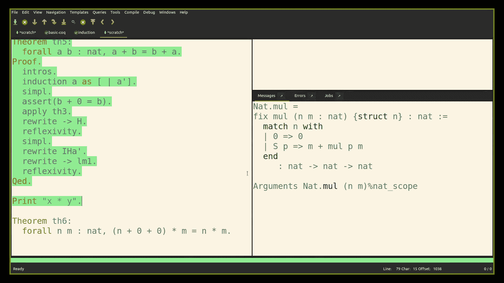


```coq
Theorem plus_O_n : forall n : nat, 0 + n = n.
Proof.
  intros n.
  compute.
  reflexivity.
Qed.
```

证明过程如下：
1.  `intros n`：将全称量词`forall n`引入上下文，得到一个假设`n : nat`，目标变为`0 + n = n`。
2.  `compute`：计算目标左边`0 + n`，根据`plus`的定义，结果就是`n`。目标变为`n = n`。
3.  `reflexivity`：根据自反性，证明`n = n`。

然而，如果我们交换加数的顺序，证明就不会这么简单了。考虑定理：对于任意自然数`n`，`n + 0 = n`。

```coq
Theorem plus_n_O : forall n : nat, n + 0 = n.
Proof.
  intros n.
  compute. (* 这里计算不会简化目标，因为plus的定义是对第一个参数进行模式匹配 *)
```
直接计算无法简化目标，因为`plus`的定义递归地依赖于第一个参数。我们需要对`n`进行归纳证明。

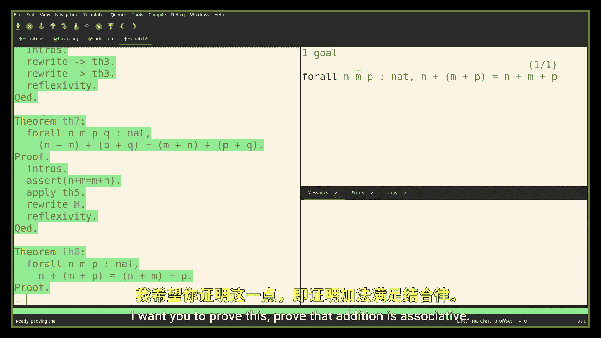


```coq
  induction n as [| n' IHn'].
  - (* 情况 1: n = O *)
    compute.
    reflexivity.
  - (* 情况 2: n = S n' *)
    simpl.
    rewrite -> IHn'.
    reflexivity.
Qed.
```

证明过程如下：
1.  `intros n`：引入`n`。
2.  `induction n as [| n' IHn']`：对`n`进行归纳。这会产生两个子目标：
    *   **基础情况**：当`n`为`O`时，证明`O + 0 = O`。
    *   **归纳步骤**：假设对于某个`n'`有`n' + 0 = n'`（归纳假设`IHn'`），需要证明`(S n') + 0 = S n'`。
3.  基础情况：`compute`后使用`reflexivity`。
4.  归纳步骤：
    *   `simpl`：简化目标左边`(S n') + 0`，根据`plus`的定义，它变成`S (n' + 0)`。目标变为`S (n' + 0) = S n'`。
    *   `rewrite -> IHn'`：使用归纳假设`IHn'`，将`n' + 0`重写为`n'`。目标变为`S n' = S n'`。
    *   `reflexivity`：根据自反性完成证明。

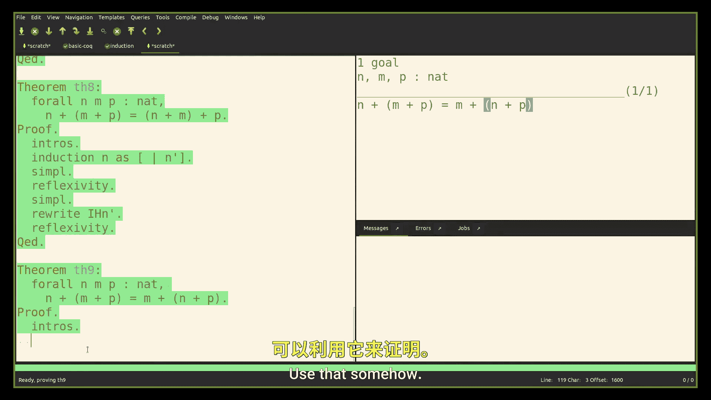


## 证明更复杂的定理

使用归纳法和已有的引理，我们可以证明加法的交换律和结合律等更复杂的性质。

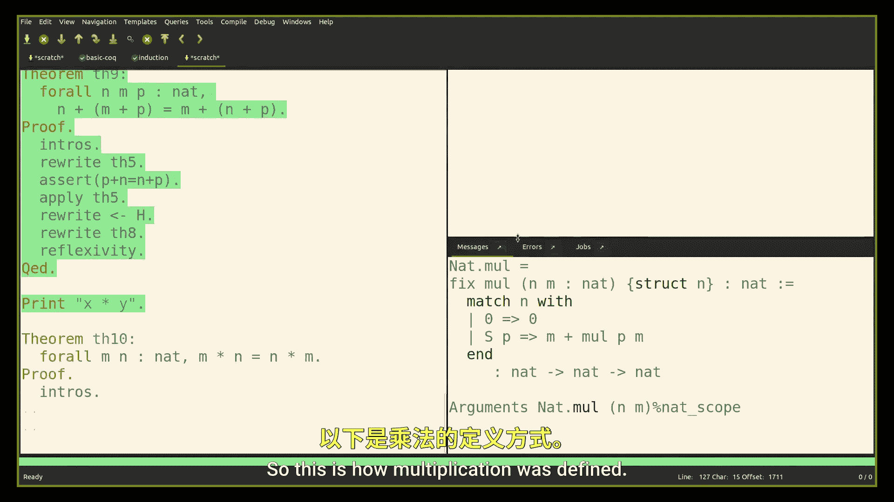

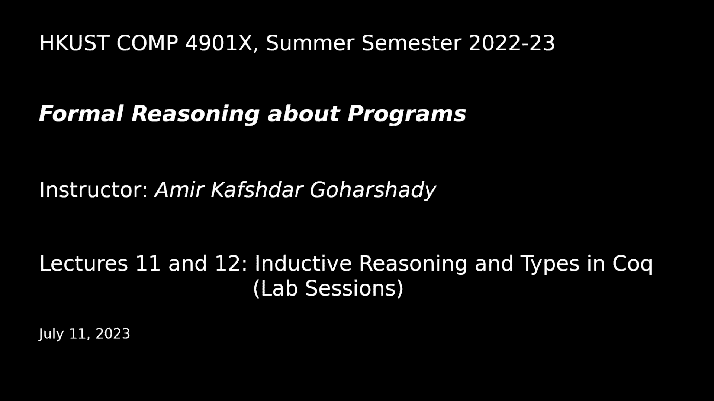

例如，证明加法交换律`plus_comm`：

```coq
Theorem plus_comm : forall n m : nat, n + m = m + n.
Proof.
  intros n m.
  induction n as [| n' IHn'].
  - (* 基础情况: n = O *)
    simpl.
    rewrite <- plus_n_O. (* 使用定理 plus_n_O: forall n, n + 0 = n *)
    reflexivity.
  - (* 归纳步骤: n = S n' *)
    simpl.
    rewrite -> IHn'.
    (* 此时需要证明 S (m + n') = m + (S n') *)
    (* 这本身需要另一个引理 plus_n_Sm : forall n m, S (n + m) = n + S m *)
    rewrite -> plus_n_Sm.
    reflexivity.
Qed.
```

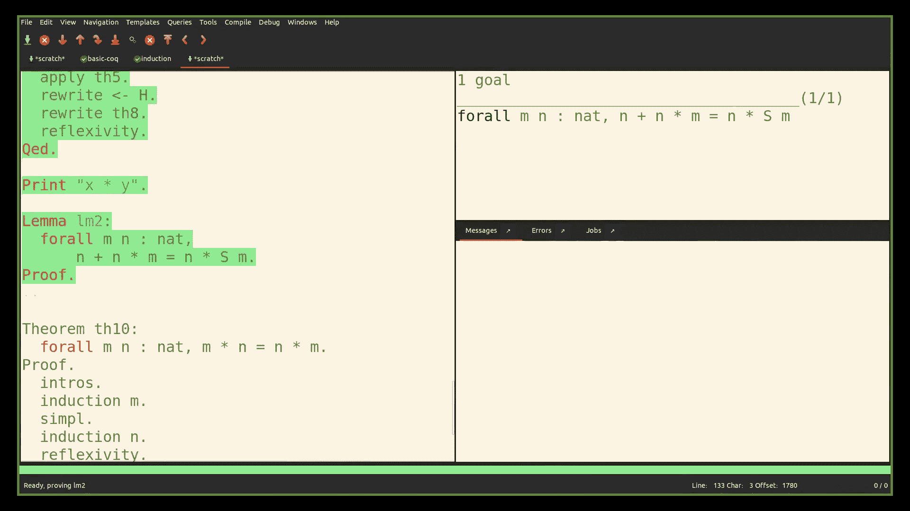

其中，引理`plus_n_Sm`也需要通过归纳法单独证明。


## 总结

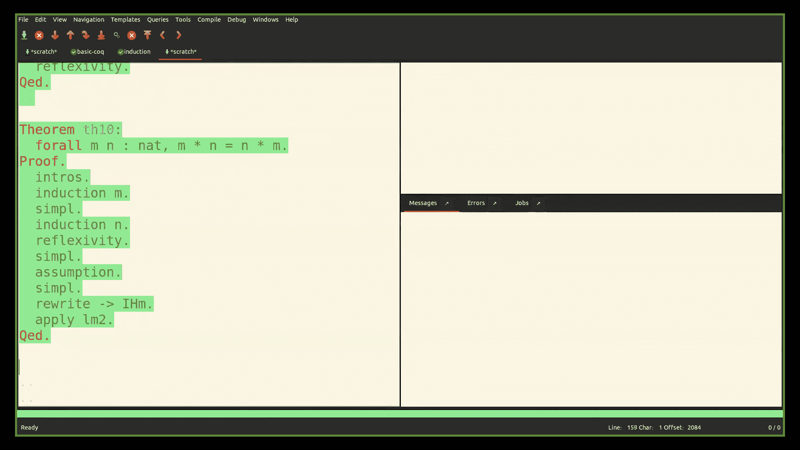


本节课我们一起学习了Coq编程语言的基础。我们了解了如何使用`Inductive`关键字归纳地定义新类型，如何使用`Definition`和`Fixpoint`通过模式匹配来定义函数和递归函数。我们掌握了基本的证明策略，如`intros`、`compute`/`simpl`、`reflexivity`、`rewrite`和`destruct`（用于分情况讨论）。最重要的是，我们学习了如何使用`induction`策略进行归纳证明，这是证明关于递归定义的性质的核心工具。通过这些基础，我们已经可以开始形式化地定义数据结构并证明其属性。