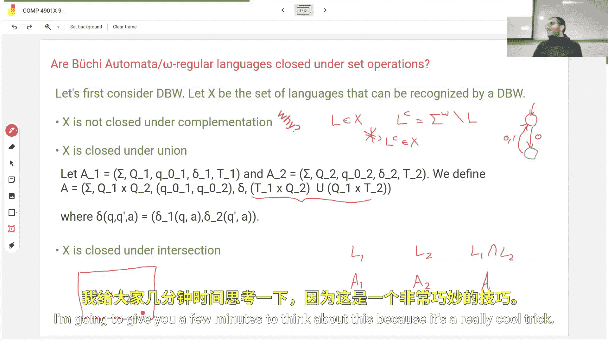
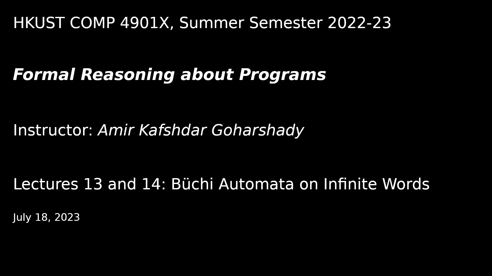
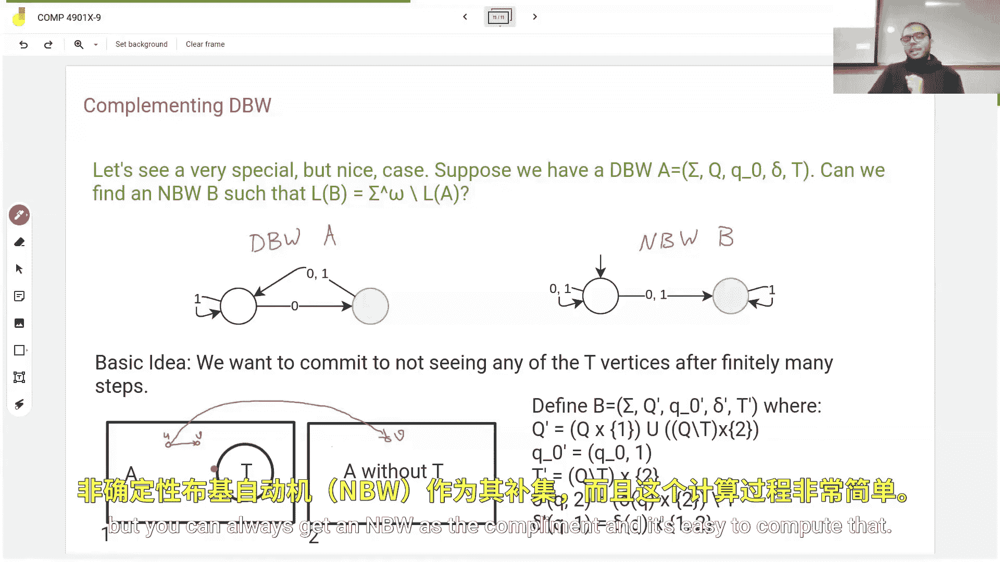
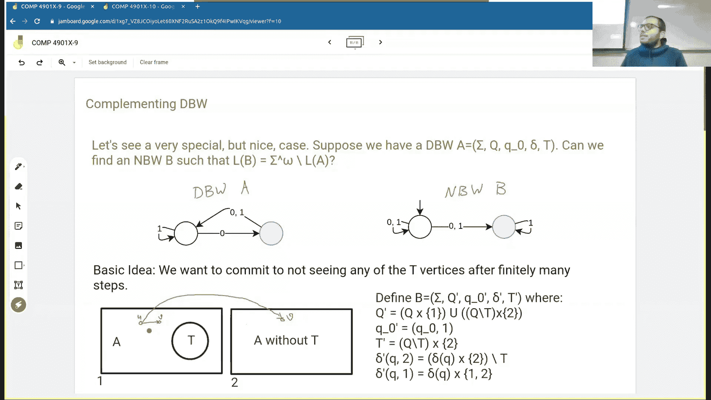
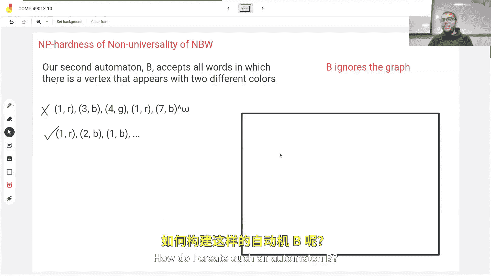
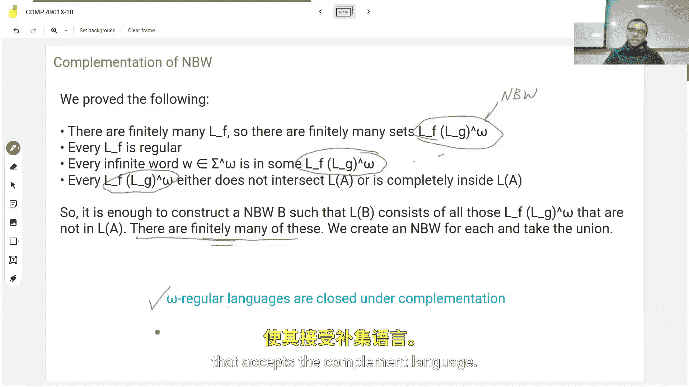
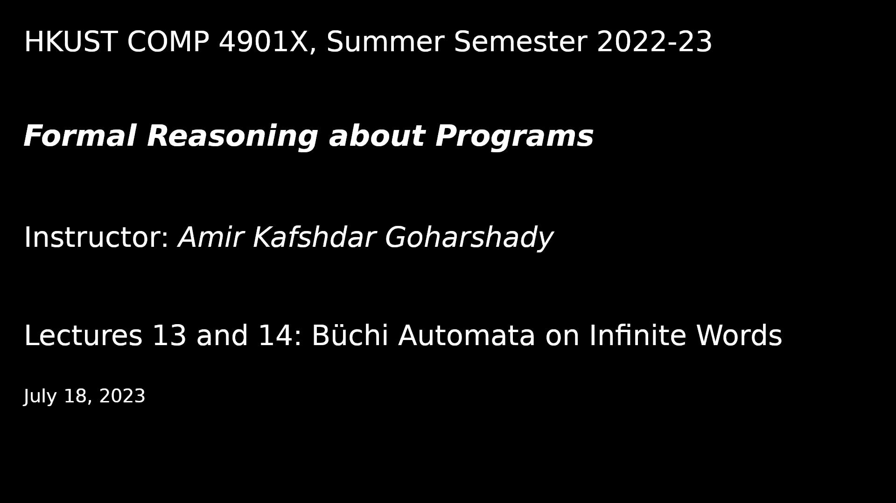

# 程序的形式化推理：第8讲：无限词上的Büchi自动机

在本节课中，我们将学习一种处理无限序列的自动机模型——Büchi自动机。我们将从回顾有限自动机的基本概念开始，逐步扩展到无限词上的非确定性Büchi自动机，并探讨其表达能力、闭包性质以及相关的判定问题。

## 概述：从有限自动机到无限自动机

上一节我们介绍了游戏与无限路径的关系。本节中，我们将学习一种专门处理无限输入序列的自动机模型。这种模型是理解程序在无限时间上行为的关键工具。

首先，让我们回顾一下确定性有限自动机的基本组成部分。

## 确定性有限自动机回顾

一个确定性有限自动机由以下几个部分组成：
*   一个有限的字母表 Σ，用于书写单词。
*   一个有限的状态集合 Q。
*   一个初始状态 q₀ ∈ Q。
*   一个转移函数 δ: Q × Σ → Q，它定义了在给定状态和输入字母下，自动机将转移到哪个状态。
*   一个接受状态集合 T ⊆ Q。

自动机从初始状态 q₀ 开始，逐字母读取输入词。对于每个字母，它根据转移函数移动到下一个状态。当整个词读取完毕后，如果最终状态在集合 T 中，则该词被接受；否则被拒绝。自动机接受的所有词的集合称为它的语言。

例如，考虑以下自动机：
*   状态：Q = {q₀, q₁}
*   初始状态：q₀
*   接受状态：T = {q₁}
*   转移：δ(q₀, 0) = q₀, δ(q₀, 1) = q₁, δ(q₁, 0) = q₁, δ(q₁, 1) = q₁

这个自动机接受所有至少包含一个字母“1”的有限词。

## 非确定性有限自动机回顾

非确定性有限自动机扩展了确定性模型，允许在状态转移和起始状态上存在选择。

一个非确定性有限自动机定义为：
*   字母表 Σ。
*   状态集合 Q。
*   初始状态集合 I ⊆ Q，而不仅是一个状态。
*   转移函数 δ: Q × Σ → 2^Q，它给出一个可能的下一个状态集合。
*   接受状态集合 T ⊆ Q。

对于一个输入词，非确定性自动机可以有多条不同的运行路径。我们定义：一个词被接受，当且仅当存在至少一条从某个初始状态开始、最终停在某个接受状态的运行路径。

## 无限词与Büchi自动机

现在，我们将关注点从有限词转移到无限词上。我们希望自动机能够读取一个无限的输入序列。这被称为ω-自动机。

如果我们简单地将一个有限自动机应用于无限输入，会遇到一个问题：运行永远不会结束，因此无法根据“最终状态”来判断是否接受。我们需要一个新的接受条件。

以下是两种重要的接受条件：
1.  **Büchi条件**：给定一个接受状态集合 T。一个无限运行是接受的，当且仅当它无限次地访问 T 中的状态。形式化地，设 `Inf(ρ)` 为运行 ρ 中无限次出现的状态集合，则接受条件为 `Inf(ρ) ∩ T ≠ ∅`。
2.  **Parity条件**：为每个状态分配一个整数优先级。一个无限运行是接受的，当且仅当在运行中无限次出现的最小优先级是偶数。

我们主要关注Büchi自动机。根据其转移函数是确定性的还是非确定性的，我们分别记作 **DBW** 和 **NBW**。

## Büchi自动机示例

让我们通过几个例子来理解Büchi自动机接受的语言。

以下是几个Büchi自动机及其接受的语言分析：
*   **自动机A1**：接受所有包含无限多个字母“1”的无限词。
*   **自动机A2**：接受所有“最终全是1”的无限词，即存在一个位置，在此之后只出现字母“1”。其语言可表示为 `(0+1)*1^ω`。
*   **自动机A3**：接受所有包含无限多个“1”，或者包含有限个“1”但个数为奇数的无限词。
*   **自动机A4**：接受所有同时包含无限多个“1”和无限多个“0”的无限词。

这些例子展示了Büchi自动机强大的表达能力，能够描述各种复杂的无限行为模式。

## 确定性 vs. 非确定性Büchi自动机

在有限自动机理论中，非确定性有限自动机与确定性有限自动机具有同等的表达能力。然而，对于Büchi自动机，情况并非如此。

**定理**：非确定性Büchi自动机严格比确定性Büchi自动机更强大。存在一种语言，可以被一个NBW识别，但没有任何DBW可以识别它。

**证明思路（反证法）**：
考虑语言 L = { w ∈ {0,1}^ω | w 中只包含有限个0 }，即“最终全是1”的语言。可以构造一个NBW识别L。假设存在一个DBW A 也识别L。利用A状态数有限的性质，可以构造一个特殊的无限词，它被A接受（根据假设），但其中包含无限多个0，这与L的定义矛盾。因此，这样的DBW A不存在。

这个结论非常重要：当我们谈论ω-正则语言（由Büchi自动机识别的语言）时，默认允许非确定性。

## Büchi自动机的闭包性质

我们研究Büchi自动机在集合运算下的封闭性。

**对于确定性Büchi自动机**：
*   **对并运算封闭**：给定两个DBW A1和A2，可以通过构造乘积自动机来模拟两者，并定义新的接受条件为“A1接受或A2接受”。
*   **对交运算封闭**：同样构造乘积自动机，但接受条件更复杂。我们需要运行无限次访问A1和A2各自的接受集。可以通过一个“交替检查”的构造来实现：创建两个副本，当在第一个副本中看到A1的接受状态时，切换到第二个副本；当在第二个副本中看到A2的接受状态时，切换回第一个副本；并将最终接受集定义为第二个副本中A2的接受状态。这样，要无限次访问最终接受集，就必须无限次访问A1和A2的接受集。
*   **对补运算不封闭**：这是DBW与NBW表达能力不同的直接体现。

**对于非确定性Büchi自动机**：
*   **对并运算封闭**：构造非常简单，将两个自动机并列，让非确定性选择从哪个自动机开始运行即可。
*   **对交运算封闭**：可以采用与DBW类似的“交替检查”乘积构造，但由于基础自动机是非确定性的，乘积自动机也是非确定性的。
*   **对补运算封闭**：这是一个深刻的结果，其构造远比并和交复杂。我们将在后面详细讨论。

## 从DBW到NBW的补运算

虽然DBW对补运算不封闭，但给定一个DBW A，我们可以构造一个NBW来识别其补语言。这个构造相对直观。

**构造思路**：
1.  创建自动机A的两个副本：副本1（原始A）和副本2（从A中删除了所有接受状态T）。
2.  在副本1中，对于每个状态q和字母a，除了原有的转移到δ(q,a)（仍在副本1），**增加一条非确定性转移**到副本2中的状态δ(q,a)。
3.  选择这条新增的转移，意味着“承诺”从此不再看到接受状态。
4.  将副本2中的所有状态设为新的接受状态。

**原理**：原DBW A接受一个词w，当且仅当w的唯一运行无限次访问T。在构造的NBW中，要接受w，必须在某个有限前缀后，通过非确定性选择进入副本2，并永远停留在那里（因为副本2没有T中的状态）。这正好对应了原运行只有限次访问T的情况，即补语言。

**注意**：这个构造严重依赖于A的确定性（每个词有唯一运行）。对于NBW，由于一个词可能对应多个运行，此构造失效。

## Büchi自动机的判定问题

现在我们来探讨几个关于Büchi自动机的核心判定问题。

1.  **空性问题**：给定一个NBW（或DBW）A，问 L(A) 是否为空集？
    *   **解法**：将A视为一个单玩家Büchi游戏图（所有状态由玩家1控制）。空性问题等价于问：玩家1是否存在一条从初始状态出发、无限次访问接受状态T的路径？这是一个Büchi游戏的可解性问题，可以在 **O(n+m)** 时间内解决（n为状态数，m为转移数），例如通过寻找包含接受状态的、非平凡的、可达的强连通分量。

2.  **全集性问题**：给定一个NBW A，问 L(A) 是否为所有无限词的集合 Σ^ω？
    *   对于DBW，这个问题可以在多项式时间内解决。因为词与运行一一对应，全集性等价于问：在自动机图中，是否所有从初始状态出发的无限路径都无限次访问T？这可以通过检查是否每个可达的环都包含T中的状态来解决，同样是线性时间。
    *   对于NBW，全集性问题要困难得多。事实上，它的补问题（非全集性问题）是 **NP-难**的。这可以通过从经典的NP完全问题“图的三着色问题”进行归约来证明。因此，除非P=NP，否则不存在多项式时间的NBW全集性判定算法。

3.  **包含问题**：给定两个NBW A和B，问是否有 L(A) ⊆ L(B)？
    *   如果我们已经解决了补运算和空性问题，那么包含问题可以归约到它们：`L(A) ⊆ L(B)` 当且仅当 `L(A) ∩ (Σ^ω \ L(B)) = ∅`。因此，先构造B的补自动机B'（NBW），再构造A与B'交的自动机C，最后检查C是否为空即可。

4.  **补运算问题（针对NBW）**：给定一个NBW A，构造一个NBW B，使得 L(B) = Σ^ω \ L(A)。
    *   如前所述，这是可能的，但构造复杂。已知的Büchi原始构造是双重指数时间的。下面概述其核心思想。

## NBW补运算的构造（Büchi构造概述）

Büchi的补运算构造非常精巧，它利用了**拉姆齐定理**这一组合数学工具。以下是构造步骤的概要：

1.  **定义有限词的等价关系**：对于两个非空有限词u和v，定义它们等价（u ~ v），如果对于自动机A中的任意状态对(p, q)，满足：
    *   存在一条从p到q、标记为u的路径，当且仅当存在一条从p到q、标记为v的路径。
    *   存在一条从p到q、标记为u**且经过至少一个接受状态**的路径，当且仅当存在一条从p到q、标记为v且经过至少一个接受状态的路径。
    *   这个等价关系只有有限多个等价类，记某个等价类为 `[w]`，其对应的语言（有限词集合）是正则的。

2.  **应用拉姆齐定理**：考虑任意一个无限词w。将自然数索引视为完全图的顶点。对于顶点 i < j，用子词 `w[i,j)` 所属的等价类来给边(i, j)着色。由于等价类有限，根据拉姆齐定理，存在一个无限的单色顶点子集 `i₁ < i₂ < i₃ < ...`。这意味着所有子词 `w[i₁, i₂)`, `w[i₂, i₃)`, ... 都属于同一个等价类，记作 `[v]`。而前缀 `w[0, i₁)` 属于另一个等价类 `[u]`。因此，任何无限词w都可以写成形式 `w ∈ L_u L_v^ω`，其中 `L_u`, `L_v` 是某个等价类对应的正则语言。

3.  **关键性质**：对于任意两个等价类 `[u]` 和 `[v]`，集合 `L_u L_v^ω` 要么与 L(A) 不相交，要么完全包含在 L(A) 中。这是因为，如果有一个词 `w = u v v v ...` 被A接受，那么利用等价关系的定义，可以将任何 `u' ∈ L_u` 和 `v' ∈ L_v` 进行替换，得到的词 `u' v' v' v' ...` 也会被A接受。

4.  **构造补自动机**：由于等价类有限，形如 `L_u L_v^ω` 的集合也只有有限多个。补自动机B就是所有那些**不包含在** L(A) 中的 `L_u L_v^ω` 集合的并集。对于每个这样的集合，由于 `L_u` 和 `L_v` 是正则的，我们可以构造一个NBW来识别 `L_u L_v^ω`（例如，用NFA识别 `L_u`，然后连接到识别 `L_v` 的NFA，并将后者的接受状态连回其初始状态以形成无限循环）。最后，取这些NBW的并集，就得到了识别补语言的NBW B。

这个构造证明了ω-正则语言在补运算下是封闭的，尽管构造本身在计算上非常昂贵。

## 总结

本节课中我们一起学习了Büchi自动机及其理论。
*   我们首先回顾了有限自动机，然后将其扩展到无限词上，引入了以Büchi条件和Parity条件作为接受条件的ω-自动机。
*   我们明确了非确定性Büchi自动机比确定性Büchi自动机具有更强的表达能力，并且ω-正则语言通常由NBW定义。
*   我们探讨了DBW和NBW在并、交、补运算下的封闭性：DBW对补运算不封闭；NBW对所有三种运算都封闭，但补运算的构造非常复杂。
*   我们研究了几个判定问题：空性问题可在多项式时间内解决；全集性问题对于NBW是NP-难的；包含问题可以归约到补运算和空性问题。
*   最后，我们概述了Büchi提出的NBW补运算构造，该构造巧妙地运用了拉姆齐定理，证明了ω-正则语言对补运算的封闭性，尽管其时间复杂度很高。

理解Büchi自动机是进行程序形式化验证，特别是针对线性时序性质验证的基础。在接下来的课程中，我们将看到如何将这些自动机理论与逻辑和验证任务结合起来。