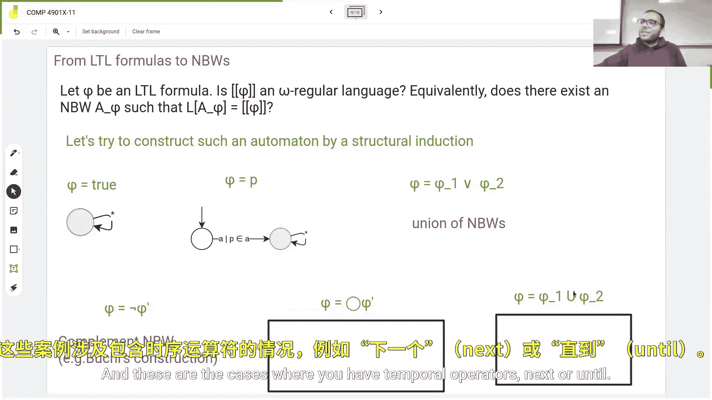
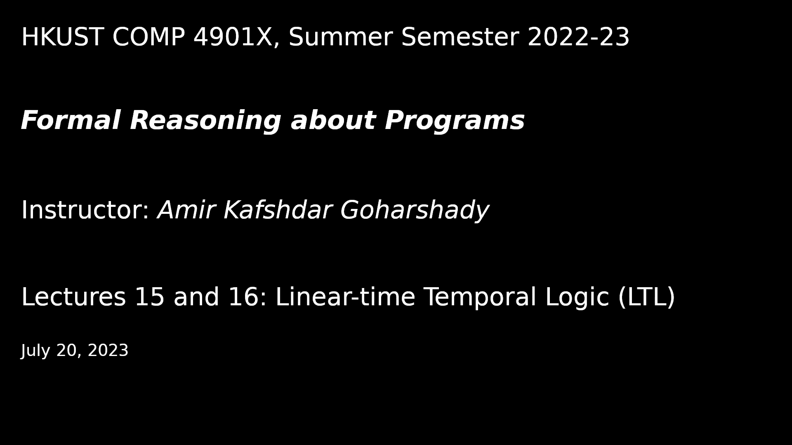
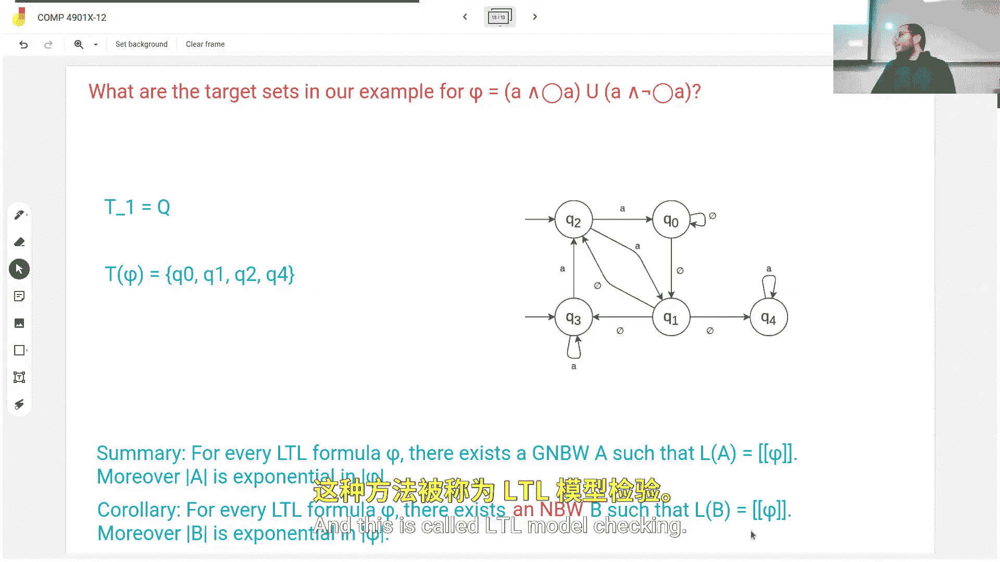

# 程序的形式化推理：第9讲：线性时序逻辑 (LTL)

## 概述

在本节课中，我们将学习线性时序逻辑。这是一种用于描述程序运行时行为的逻辑语言。我们将看到如何用它来形式化地表达程序应满足的时序性质，并最终将其与之前学习的自动机和游戏理论联系起来，构建完整的模型检查流程。

---

## 从游戏与自动机到逻辑

上一节我们介绍了模型检查的两种形式化方法：无限时长双人游戏和无限字上的自动机。本节中我们来看看它们如何解决同一类问题。

这两种方法本质上都在处理语言包含问题。在游戏中，玩家一的目标是确保所有可能的游戏进程都属于一个可接受的无限字集合。在自动机中，我们希望证明程序所有可能的运行都包含在满足规范的运行集合中。这同样是检查一个语言是否是另一个语言的子集。

现在，我们将看到第三种形式化方法：线性时序逻辑。它使用逻辑公式而非自动机来描述规范，为模型检查提供了另一种视角。

---

## 线性时序逻辑简介

线性时序逻辑是一种可以描述时间相关性质的逻辑。“线性时间”意味着我们只考虑单一的、线性的未来，而非分支的多种可能性。

LTL 公式用于指定无限字的集合。与使用自动机 B 来定义可接受的运行不同，我们使用一个逻辑公式来描述程序运行应满足的性质。

---

## 基本定义：迹与原子命题

首先，我们定义一些基本概念。

*   **原子命题集 P**：一个有限的命题集合，每个命题在任意时刻可以为真或假。
*   **字母表 Σ**：所有 P 的子集构成的集合，即 Σ = 2^P。
*   **迹 τ**：字母表 Σ 上的一个无限字，即 τ ∈ Σ^ω。一个迹表示一个无限的运行时序，其中每个时刻 τ_i 指明了哪些原子命题成立。

**示例：交通灯系统**
假设原子命题为 {R, G, Y}，分别代表红灯、绿灯、黄灯亮。一个正确的迹可能只在每个时刻恰好有一个灯亮，例如序列 {R}, {G}, {Y}, {R}, ...。而不正确的迹可能包含 {R, G}（红绿灯同时亮）或 ∅（所有灯都灭）。

我们希望用逻辑公式来表达“任何时刻都恰好有一个灯亮”这一性质。

---

## LTL 语法

LTL 公式 φ 的语法归纳定义如下：

1.  **true**：恒真公式。
2.  **p**：若 p ∈ P 是一个原子命题，则 p 是公式，表示“命题 p 在当前时刻（时间0）成立”。
3.  **¬φ**：若 φ 是公式，则 ¬φ 是公式，表示逻辑非。
4.  **φ₁ ∨ φ₂**：若 φ₁, φ₂ 是公式，则 φ₁ ∨ φ₂ 是公式，表示逻辑或。
5.  **X φ**：若 φ 是公式，则 X φ 是公式，表示“下一个时刻 φ 成立”。
6.  **φ₁ U φ₂**：若 φ₁, φ₂ 是公式，则 φ₁ U φ₂ 是公式，表示“φ₁ 一直成立，直到 φ₂ 成立为止”。

其他逻辑连接词（如 ∧, →, false）和时序算子（F, G）可作为语法糖定义：
*   **F φ (eventually)**：定义为 true U φ，表示“未来某个时刻 φ 成立”。
*   **G φ (always/globally)**：定义为 ¬F ¬φ，表示“从现在起所有时刻 φ 都成立”。

---

## LTL 语义

一个 LTL 公式 φ 的语义是一个无限迹的集合，即所有满足该公式的迹的集合。我们定义迹 τ 满足公式 φ，记作 τ ⊨ φ。

以下是满足关系的归纳定义规则：

*   **τ ⊨ true**：恒成立。
*   **τ ⊨ p**：当且仅当 p ∈ τ₀（原子命题 p 在迹的第一个时刻成立）。
*   **τ ⊨ ¬φ**：当且仅当 τ ⊭ φ。
*   **τ ⊨ φ₁ ∨ φ₂**：当且仅当 τ ⊨ φ₁ 或 τ ⊨ φ₂。
*   **τ ⊨ X φ**：当且仅当 τ¹ ⊨ φ，其中 τ¹ 是 τ 去掉第一个时刻后的后缀。
*   **τ ⊨ φ₁ U φ₂**：当且仅当存在某个 j ≥ 0，使得 τʲ ⊨ φ₂，并且对于所有 0 ≤ i < j，有 τⁱ ⊨ φ₁。
*   **τ ⊨ F φ**：当且仅当存在某个 i ≥ 0，使得 τⁱ ⊨ φ。
*   **τ ⊨ G φ**：当且仅当对于所有 i ≥ 0，都有 τⁱ ⊨ φ。

---

## 表达经典目标

我们可以用 LTL 公式来表达之前在游戏中定义的经典目标（如可达性、安全性、Büchi、Co-Büchi、奇偶性）。

设 A_P 是所有包含原子命题 p 的字母（即状态）的集合。

*   **可达性 (Reach(A_P))**：公式为 **F p**。表示最终会到达一个 p 成立的状态。
*   **安全性 (Safe(A_P))**：公式为 **G p**。表示始终不会进入 p 不成立的状态。
*   **Büchi (Büchi(A_P))**：公式为 **G F p**。表示无限经常地访问 p 成立的状态。
*   **Co-Büchi (CoBüchi(A_P))**：公式为 **F G p**。表示从某个时刻起，p 永远成立。
*   **奇偶性 (Parity)**：可以通过嵌套的 G F 和 ¬ 组合来表达。例如，最小无限经常出现的优先级为偶数，可以表达为 (GF p₀) ∨ (¬GF p₀ ∧ ¬GF p₁ ∧ GF p₂) ∨ ...。

---

## LTL 公式的等价性

两个 LTL 公式 φ₁ 和 φ₂ 是等价的，当且仅当它们具有相同的语义（即满足它们的迹集合相同）。

以下是一些重要的等价关系：
*   ¬ X φ ≡ X ¬φ
*   F (φ₁ ∨ φ₂) ≡ F φ₁ ∨ F φ₂
*   F (φ₁ ∧ φ₂) **不等价于** F φ₁ ∧ F φ₂ （因为满足时间点可能不同）
*   G (φ₁ ∧ φ₂) ≡ G φ₁ ∧ G φ₂
*   G (φ₁ ∨ φ₂) **不等价于** G φ₁ ∨ G φ₂
*   φ₁ U φ₂ ≡ φ₂ ∨ (φ₁ ∧ X (φ₁ U φ₂)) （这是“直到”算子的展开式）
*   F φ ≡ φ ∨ X F φ
*   G φ ≡ φ ∧ X G φ

最后三个等价式揭示了 LTL 公式与程序语义中 while 循环的相似性，都可以通过不动点来定义其指称语义。

---

## 从 LTL 到广义 Büchi 自动机

模型检查的关键步骤是将 LTL 公式转换为等价的自动机。由于某些性质（如 Co-Büchi）无法用确定性 Büchi 自动机表达，我们使用非确定性广义 Büchi 自动机。

**广义 Büchi 自动机 (GNBW)** 与普通 Büchi 自动机 (NBW) 类似，但接受条件是一组目标状态集 {T₁, T₂, ..., T_k}。一个运行被接受，当且仅当它**无限经常地访问每一个** T_i。

**定理**：任何广义 Büchi 自动机都可以转换为一个接受相同语言的普通 Büchi 自动机。构造方法是创建 k 个自动机副本，并在访问完一个目标集后切换到下一个副本。

---

## LTL 到广义 Büchi 自动机的构造

对于任意 LTL 公式 φ，我们可以构造一个广义非确定性 Büchi 自动机 A，使得 L(A) 正是满足 φ 的所有迹的集合。

构造的核心思想是：自动机的每个状态代表公式 φ 的**闭包**中一组可能成立的子公式。闭包包含 φ 的所有子公式及其否定。

**构造步骤**：
1.  **计算闭包**：找出公式 φ 的所有子公式及其否定。
2.  **定义状态**：状态是闭包的**初等子集**。一个初等子集 q 是满足以下条件的最大一致子集：
    *   **命题一致性**：对于每个子公式 ψ，ψ 和 ¬ψ 有且仅有一个在 q 中；连接词（如 ∧）的处理符合命题逻辑。
    *   **时序一致性**：满足“直到”算子的语义约束。例如，如果 (ψ₁ U ψ₂) ∈ q 但 ψ₂ ∉ q，则必须有 ψ₁ ∈ q。
3.  **初始状态**：初始状态是所有包含 φ 本身的初等子集。
4.  **转移关系**：从状态 q 在读入字母 a 后，可以转移到状态 q‘，当且仅当：
    *   **原子命题匹配**：a 必须恰好等于 q 中所有原子命题的集合。
    *   **下一时刻公式**：如果 X ψ ∈ q，则必须有 ψ ∈ q‘。
    *   **直到公式**：如果 (ψ₁ U ψ₂) ∈ q，那么要么 ψ₂ ∈ q，要么 (ψ₁ ∈ q 且 (ψ₁ U ψ₂) ∈ q‘)。
5.  **广义接受条件**：对于闭包中每一个形如 (ψ₁ U ψ₂) 的公式，定义一个接受集 T_(ψ₁Uψ₂)。该接受集包含**所有不包含 (ψ₁ U ψ₂) 的状态**，以及**所有包含 ψ₂ 的状态**。一个运行被接受，需要无限经常地访问**所有**这样的接受集。这保证了任何承诺要满足 (ψ₁ U ψ₂) 的状态，最终都必须到达一个真正满足 ψ₂ 的状态。

此构造产生的自动机状态数最多为 2^(|Closure(φ)|)，即相对于公式长度是指数级的。

---

## LTL 模型检查流程

现在，我们可以将整个模型检查流程串联起来：

1.  **程序建模**：将待验证的程序 P 建模为一个非确定性 Büchi 自动机 A_P，使得 L(A_P) 是程序所有可能运行的集合。
2.  **规范描述**：将期望的程序性质（规范）描述为一个 LTL 公式 φ。
3.  **规范转换**：使用上述构造，将 LTL 公式 φ 转换为一个非确定性 Büchi 自动机 A_¬φ，使其接受**所有不满足 φ** 的迹。这通常先构造广义 Büchi 自动机，再转换为普通 Büchi 自动机，最后利用 Büchi 补全算法得到 A_¬φ。
4.  **语言包含检查**：验证是否 L(A_P) ⊆ L(A_φ)。这等价于检查 L(A_P) ∩ L(A_¬φ) 是否为空集。
    *   计算自动机交集 A = A_P ∩ A_¬φ。
    *   检查 A 的语言是否为空（即是否存在可接受的运行）。这可以通过在 A 的状态图上寻找满足接受条件的环来完成。
5.  **得出结论**：
    *   如果 L(A) 为空，则程序 P 满足规范 φ。
    *   如果 L(A) 非空，则 A 中任何可接受的运行都是程序 P 违反规范 φ 的一个反例。

## 总结

本节课我们一起学习了线性时序逻辑。我们了解了其语法和语义，看到了它如何用于描述程序的时序性质。更重要的是，我们掌握了将 LTL 公式转换为等价的 Büchi 自动机的核心构造方法。结合之前学习的自动机补全、交集和空性检查算法，这最终形成了一套完整的、自动化的 LTL 模型检查流程，使我们能够形式化地验证程序是否满足其规约。