# 010：Coq中的列表、选项与多态性


在本节课中，我们将学习Coq中函数式编程的基础知识，包括如何定义和使用列表、选项类型以及多态性。这些概念是后续在Coq中进行自动化或半自动化逻辑推理的基础。

## 概述

上一节我们介绍了线性时序逻辑和霍尔逻辑。本节中，我们来看看如何在Coq中定义和使用基本的数据结构，如列表和选项类型，并引入多态性的概念，以便编写更通用的代码。

## 定义自然数对

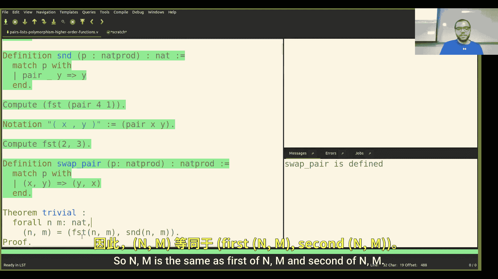


首先，我们定义一个由两个自然数组成的类型，称为 `NatProd`。

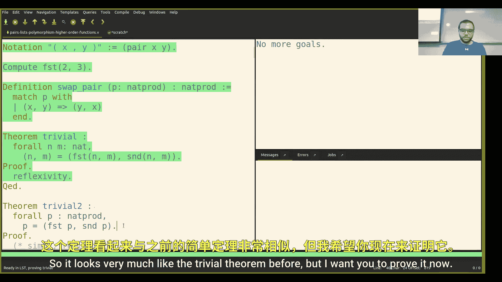


```coq
Inductive NatProd : Type :=
| pair (n1 n2 : nat).
```

接下来，我们定义两个函数来获取对中的第一个和第二个元素。

```coq
Definition first (p : NatProd) : nat :=
  match p with
  | pair x y => x
  end.

Definition second (p : NatProd) : nat :=
  match p with
  | pair x y => y
  end.
```

为了简化书写，我们可以定义一种记号，使用括号和逗号来表示对。

```coq
Notation "( x , y )" := (pair x y).
```

现在，我们可以轻松地创建和操作自然数对。

```coq
Compute first (2, 3). (* 结果为 2 *)
```

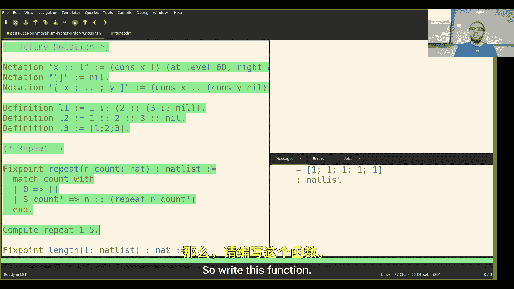


## 定义自然数列表

接下来，我们定义一个自然数列表的类型 `NatList`。

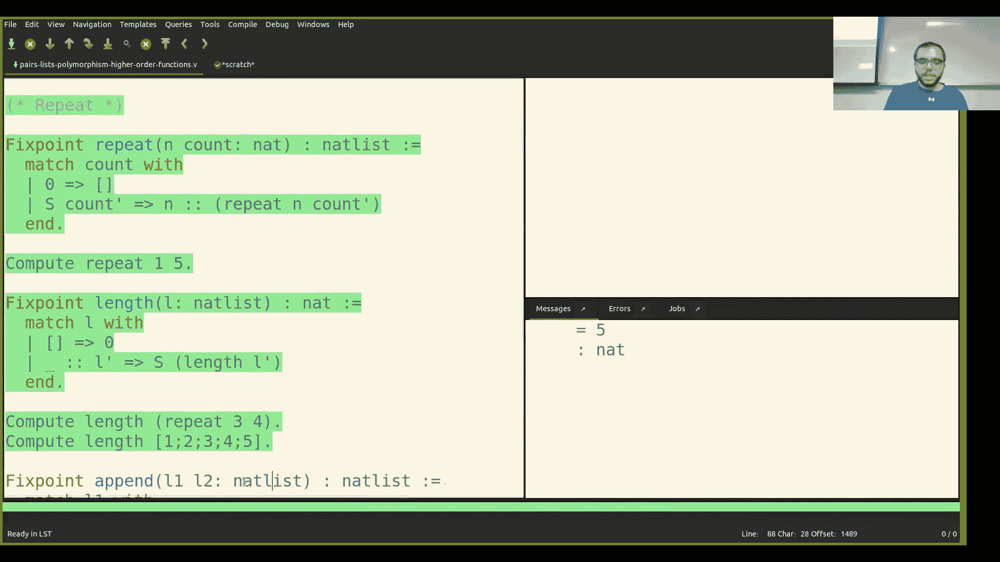


```coq
Inductive NatList : Type :=
| nil
| cons (head : nat) (tail : NatList).
```

为了简化列表的表示，我们定义一些记号。

```coq
Notation "x :: l" := (cons x l) (at level 60, right associativity).
Notation "[ ]" := nil.
Notation "[ x ; .. ; y ]" := (cons x .. (cons y nil) ..).
```

现在，我们可以方便地创建和操作列表。

```coq
Definition example_list := [1; 2; 3].
```

## 列表的基本操作

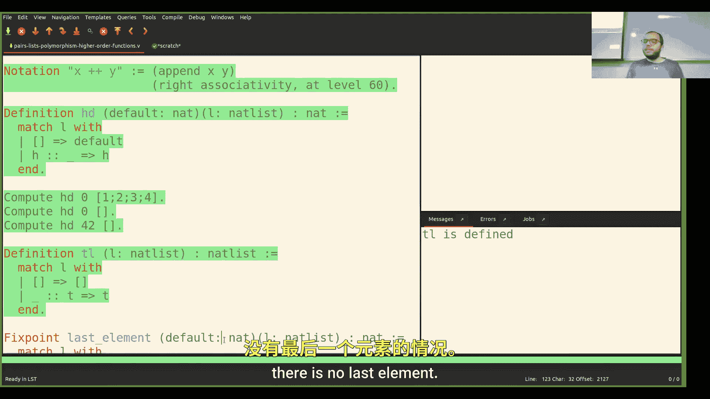


以下是列表的一些基本操作函数。

### 重复元素函数

`repeat` 函数将一个自然数重复指定次数，生成一个列表。

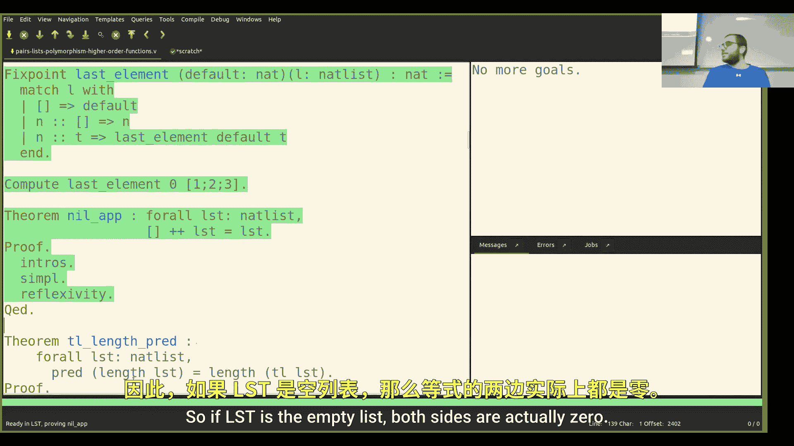


```coq
Fixpoint repeat (n : nat) (count : nat) : NatList :=
  match count with
  | O => []
  | S count' => n :: (repeat n count')
  end.
```

### 计算列表长度

`length` 函数计算列表的长度。

```coq
Fixpoint length (l : NatList) : nat :=
  match l with
  | [] => O
  | h :: t => S (length t)
  end.
```

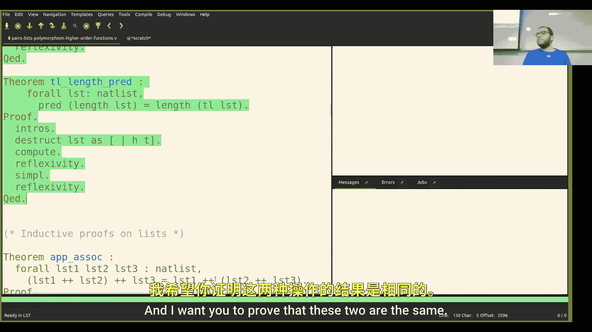


### 列表连接

`append` 函数将两个列表连接在一起。

```coq
Fixpoint append (l1 l2 : NatList) : NatList :=
  match l1 with
  | [] => l2
  | h :: t => h :: (append t l2)
  end.

Notation "l1 ++ l2" := (append l1 l2) (at level 60, right associativity).
```

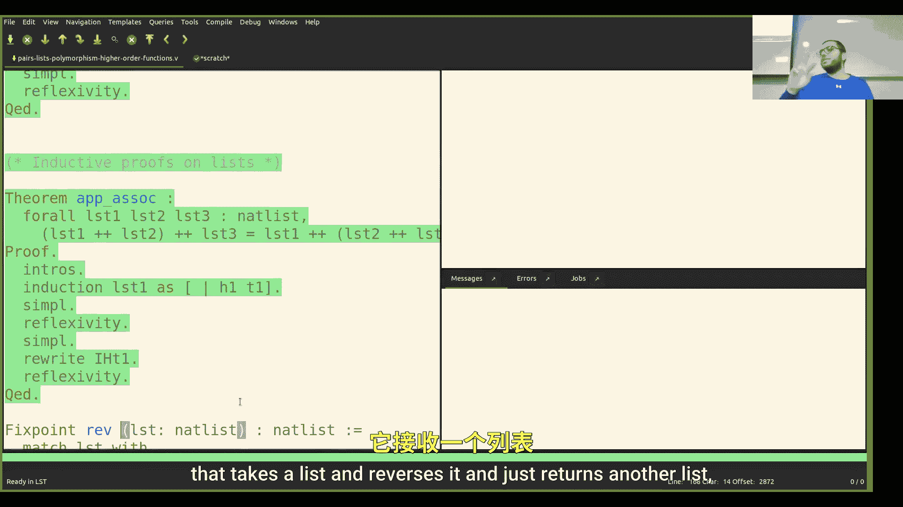


### 获取列表头部和尾部

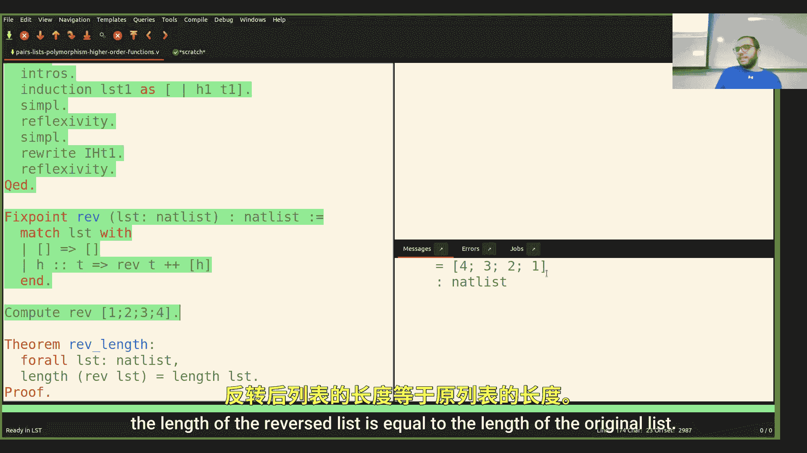


`hd` 函数返回列表的第一个元素，需要一个默认值来处理空列表的情况。`tl` 函数返回列表的尾部。

```coq
Definition hd (default : nat) (l : NatList) : nat :=
  match l with
  | [] => default
  | h :: _ => h
  end.

Definition tl (l : NatList) : NatList :=
  match l with
  | [] => []
  | _ :: t => t
  end.
```

### 获取列表最后一个元素

`last_element` 函数返回列表的最后一个元素，同样需要一个默认值。

```coq
Fixpoint last_element (l : NatList) (default : nat) : nat :=
  match l with
  | [] => default
  | [n] => n
  | _ :: t => last_element t default
  end.
```

## 列表的定理证明

现在，我们证明一些关于列表的基本定理。

### 定理：空列表连接

首先，证明连接空列表不会改变原列表。

```coq
Theorem append_nil : forall l : NatList,
  [] ++ l = l.
Proof.
  intros l.
  simpl.
  reflexivity.
Qed.
```

### 定理：列表长度与尾部


证明列表尾部的长度是原列表长度的前驱。

```coq
Theorem length_tl : forall l : NatList,
  length (tl l) = pred (length l).
Proof.
  intros l.
  destruct l as [| h t].
  - simpl. reflexivity.
  - simpl. reflexivity.
Qed.
```

### 定理：连接操作的结合律

证明列表连接操作是结合的。

```coq
Theorem append_assoc : forall l1 l2 l3 : NatList,
  (l1 ++ l2) ++ l3 = l1 ++ (l2 ++ l3).
Proof.
  intros l1 l2 l3.
  induction l1 as [| h1 t1 IH].
  - simpl. reflexivity.
  - simpl. rewrite IH. reflexivity.
Qed.
```

### 列表反转

定义 `reverse` 函数来反转列表。

```coq
Fixpoint reverse (l : NatList) : NatList :=
  match l with
  | [] => []
  | h :: t => (reverse t) ++ [h]
  end.
```

### 定理：反转列表的长度不变

证明反转列表的长度与原列表相同。

```coq
Theorem length_reverse : forall l : NatList,
  length (reverse l) = length l.
Proof.
  intros l.
  induction l as [| h t IH].
  - simpl. reflexivity.
  - simpl.
    rewrite -> length_append.
    simpl.
    rewrite -> IH.
    rewrite -> nat_add_comm.
    simpl.
    reflexivity.
Qed.
```

## 选项类型

在处理可能不存在的值时，我们使用选项类型 `NatOption`。

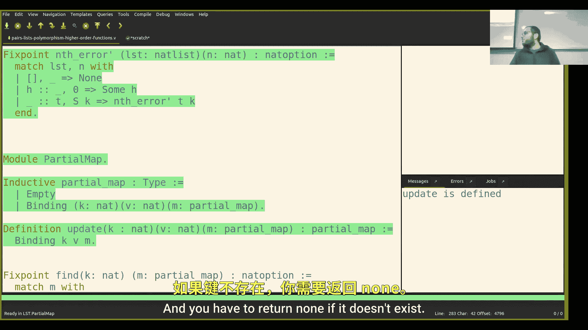


```coq
Inductive NatOption : Type :=
| none
| some (n : nat).
```

### 安全获取列表元素

使用选项类型，我们可以安全地获取列表的第 n 个元素。

```coq
Fixpoint nth_error (l : NatList) (n : nat) : NatOption :=
  match l with
  | [] => none
  | h :: t => match n with
              | O => some h
              | S k => nth_error t k
              end
  end.
```

## 部分映射

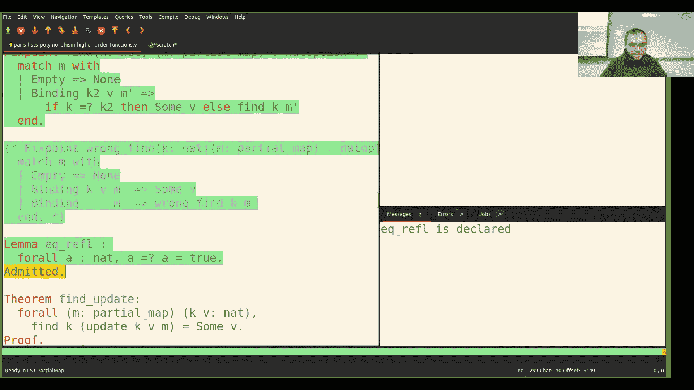


我们还可以定义部分映射类型 `PartialMap`，用于将键映射到值。

```coq
Inductive PartialMap : Type :=
| empty
| binding (k : nat) (v : nat) (m : PartialMap).
```

### 更新和查找映射

定义 `update` 函数来更新映射，以及 `find` 函数来查找键对应的值。

```coq
Definition update (k : nat) (v : nat) (m : PartialMap) : PartialMap :=
  binding k v m.

Fixpoint find (k : nat) (m : PartialMap) : NatOption :=
  match m with
  | empty => none
  | binding k' v m' => if k =? k' then some v else find k m'
  end.
```

### 定理：更新后查找

证明在映射中更新键值后，查找该键会返回更新后的值。

```coq
Theorem find_update : forall (m : PartialMap) (k v : nat),
  find k (update k v m) = some v.
Proof.
  intros m k v.
  simpl.
  rewrite <- eq_refl.
  reflexivity.
Qed.
```

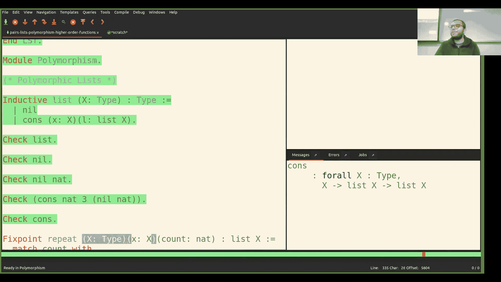

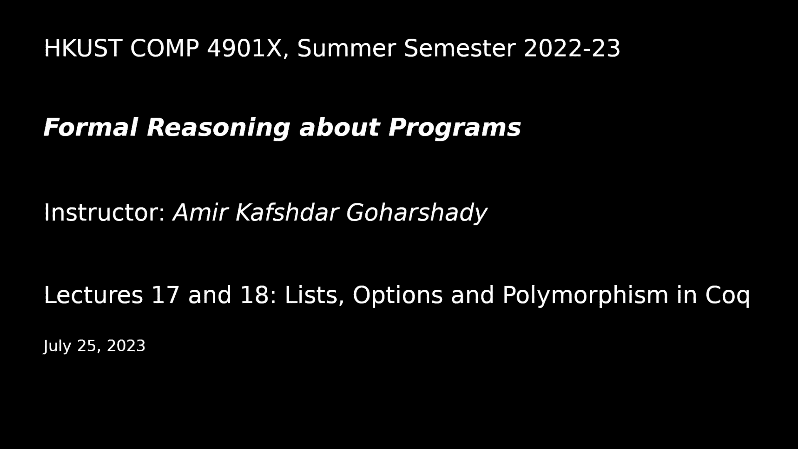

## 多态性

为了使代码更通用，我们引入多态性。例如，定义多态列表类型 `List`。

```coq
Inductive List (X : Type) : Type :=
| nil
| cons (x : X) (l : List X).

Arguments nil {X}.
Arguments cons {X} _ _.
```

### 多态重复函数

定义多态的 `repeat` 函数，可以重复任何类型的元素。

```coq
Fixpoint repeat {X : Type} (x : X) (count : nat) : List X :=
  match count with
  | O => nil
  | S count' => cons x (repeat x count')
  end.
```

### 多态连接函数

定义多态的 `append` 函数，可以连接任何类型的列表。

```coq
Fixpoint append {X : Type} (l1 l2 : List X) : List X :=
  match l1 with
  | nil => l2
  | cons h t => cons h (append t l2)
  end.
```

### 多态定理证明

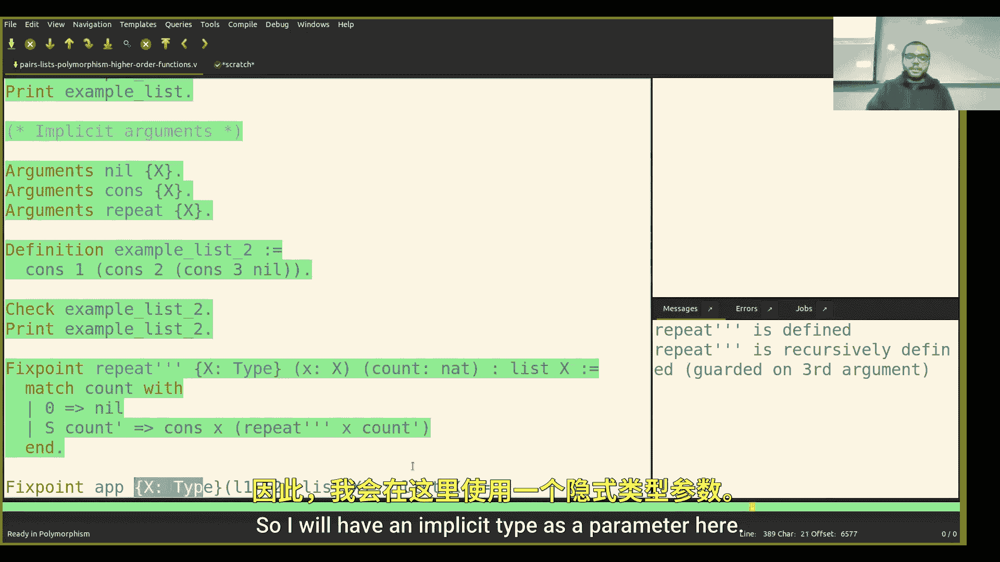


证明多态列表的连接操作结合律。

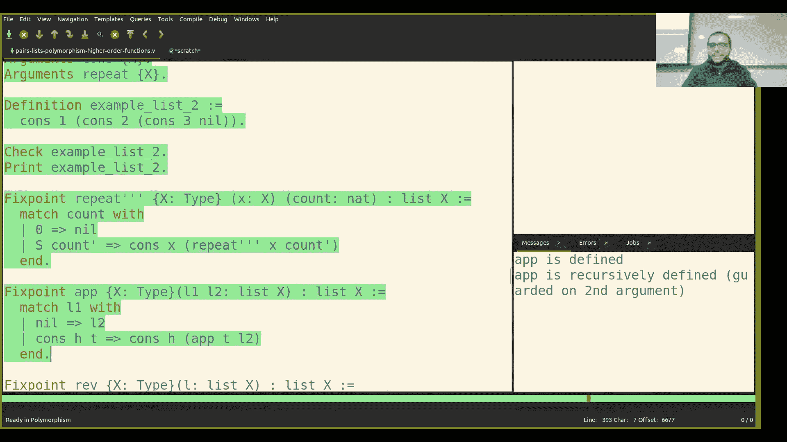


```coq
Theorem append_assoc_poly : forall (X : Type) (l1 l2 l3 : List X),
  (l1 ++ l2) ++ l3 = l1 ++ (l2 ++ l3).
Proof.
  intros X l1 l2 l3.
  induction l1 as [| h1 t1 IH].
  - simpl. reflexivity.
  - simpl. rewrite IH. reflexivity.
Qed.
```

### 多态选项和乘积类型

我们还可以定义多态的选项类型 `Option` 和乘积类型 `Prod`。

```coq
Inductive Option (X : Type) : Type :=
| none
| some (x : X).

Inductive Prod (X Y : Type) : Type :=
| pair (x : X) (y : Y).

Arguments pair {X} {Y} _ _.
```

### 多态 zip 函数

定义 `zip` 函数，将两个列表的元素配对。

```coq
Fixpoint zip {X Y : Type} (lx : List X) (ly : List Y) : List (Prod X Y) :=
  match lx, ly with
  | [], _ => nil
  | _, [] => nil
  | cons hx tx, cons hy ty => cons (pair hx hy) (zip tx ty)
  end.
```

## 总结

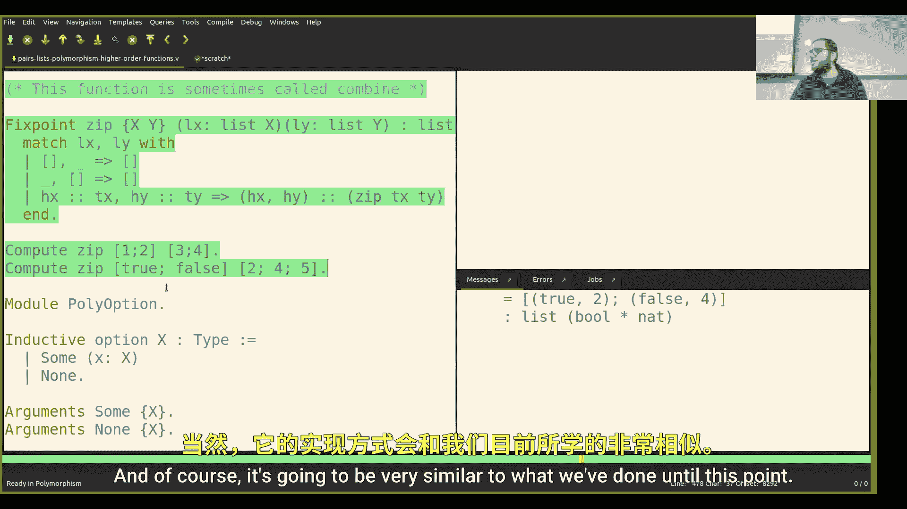


本节课中，我们一起学习了Coq中列表、选项类型和多态性的基本概念与操作。我们定义了自然数对、列表及其基本操作函数，如重复、长度计算、连接、反转等。通过选项类型，我们能够安全地处理可能不存在的值。引入多态性后，我们可以编写更通用、可重用的代码，定义多态列表、选项、乘积类型及相关函数。最后，我们通过定理证明巩固了对这些概念的理解，为后续在Coq中进行形式化推理打下了坚实的基础。