# 011：Coq中的高阶函数与进阶策略

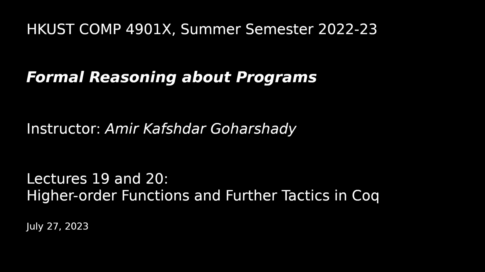

在本节课中，我们将学习多态性的更多示例，然后探讨证明新定理的技巧。我们将看到已学策略的新用例，并学习一些新的策略。

## 多态类型与函数

上一节我们介绍了多态类型，本节中我们来看看如何定义和使用多态函数。

### 积类型（Product Type）

我们定义了一个积类型，它接受两个类型 `X` 和 `Y`，并提供一个构造器 `pair`，用于创建一个包含类型 `X` 的元素 `x` 和类型 `Y` 的元素 `y` 的对。

```coq
Inductive prod (X Y : Type) : Type :=
| pair (x : X) (y : Y).
```

为了使代码更简洁，我们将类型参数 `X` 和 `Y` 设为隐式参数，这样在写 `pair` 时只需提供具体的值 `x` 和 `y`。

```coq
Arguments pair {X} {Y} _ _.
```

我们还可以定义方便的记法，使用括号和逗号表示对，用乘号表示积类型。

```coq
Notation "( x , y )" := (pair x y).
Notation "X * Y" := (prod X Y) : type_scope.
```

### 多态函数示例

以下是两个简单的多态函数，分别返回一个对中的第一个和第二个元素。

```coq
Definition first {X Y : Type} (p : X * Y) : X :=
  match p with
  | (x, y) => x
  end.

Definition second {X Y : Type} (p : X * Y) : Y :=
  match p with
  | (x, y) => y
  end.
```

### 拉链函数（Zip Function）

拉链函数接受两个列表，一个类型为 `X` 的元素列表和一个类型为 `Y` 的元素列表，并将它们组合成一个对列表。

```coq
Fixpoint zip {X Y : Type} (lx : list X) (ly : list Y) : list (X * Y) :=
  match lx, ly with
  | [], _ => []
  | _, [] => []
  | hx::tx, hy::ty => (hx, hy) :: zip tx ty
  end.
```

如果两个列表长度不同，该函数会忽略较长列表中多余的元素。

## 多态选项类型（Polymorphic Option Type）

选项类型允许我们表示一个值可能存在也可能不存在。我们定义了一个多态选项类型。

```coq
Inductive option (X : Type) : Type :=
| Some (x : X)
| None.
```

同样，我们将类型参数 `X` 设为隐式参数。

```coq
Arguments Some {X} _.
Arguments None {X}.
```

### 列表索引查找函数

我们定义了一个函数 `nth_error`，它接受一个列表和一个索引 `n`，返回列表中第 `n` 个元素（索引从0开始）。如果索引超出范围，则返回 `None`。

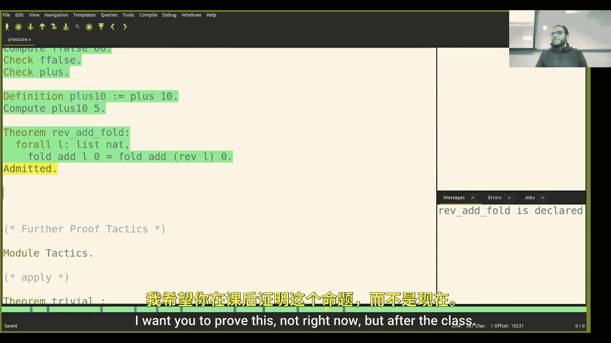


```coq
Fixpoint nth_error {X : Type} (l : list X) (n : nat) : option X :=
  match l with
  | [] => None
  | a :: l' => match n with
               | 0 => Some a
               | S n' => nth_error l' n'
               end
  end.
```

## 高阶函数（Higher-Order Functions）

高阶函数是指接受其他函数作为参数或返回函数的函数。在Coq中，许多函数实际上都是高阶函数。

### 简单加法函数

考虑一个简单的加法函数 `simple_add`，它接受两个自然数并返回它们的和。

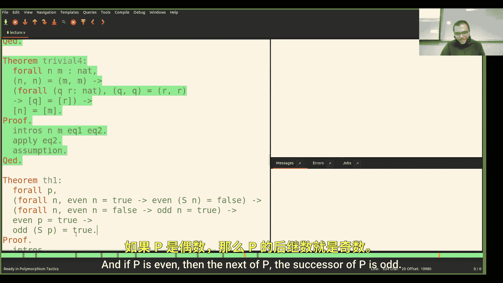


```coq
Definition simple_add (n m : nat) : nat := n + m.
```

检查其类型，你会发现它实际上是一个接受一个自然数并返回一个函数（该函数再接受一个自然数并返回自然数）的函数。

```coq
Check simple_add. (* simple_add : nat -> nat -> nat *)
```

这意味着我们可以部分应用这个函数。

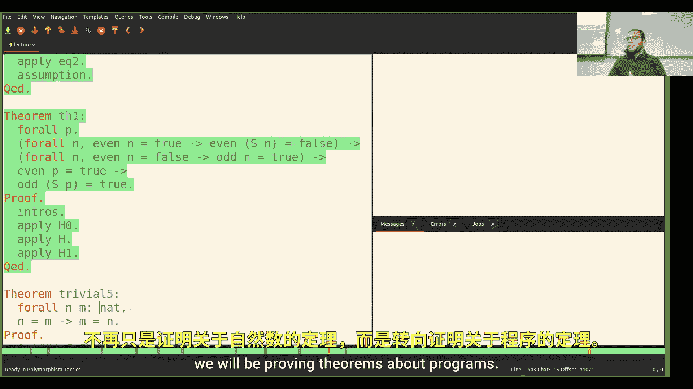


```coq
Definition plus10 := simple_add 10.
Compute plus10 5. (* 15 *)
```

### 应用三次函数

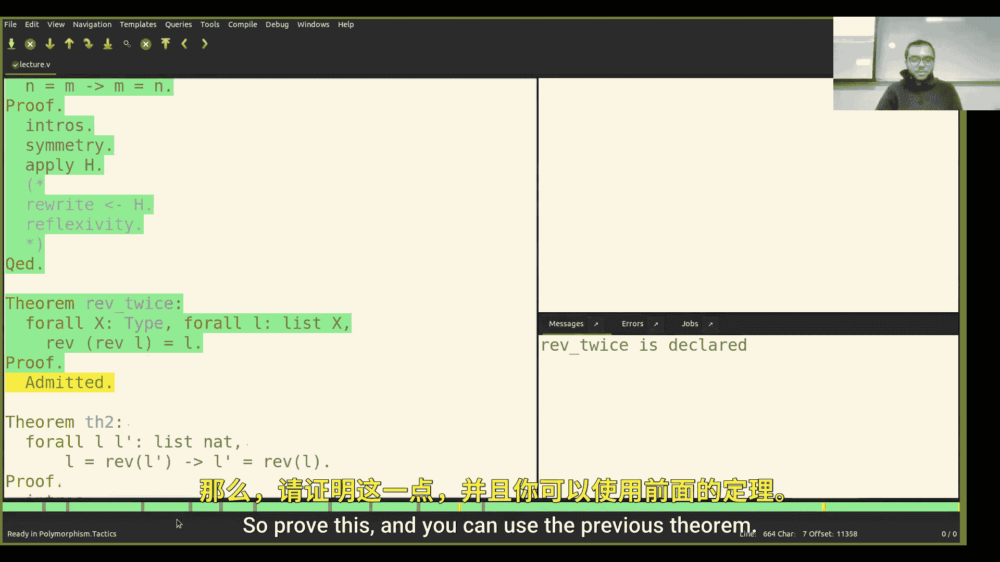


定义一个函数 `apply_thrice`，它接受一个函数 `f` 和一个值 `n`，并将 `f` 应用三次于 `n`。

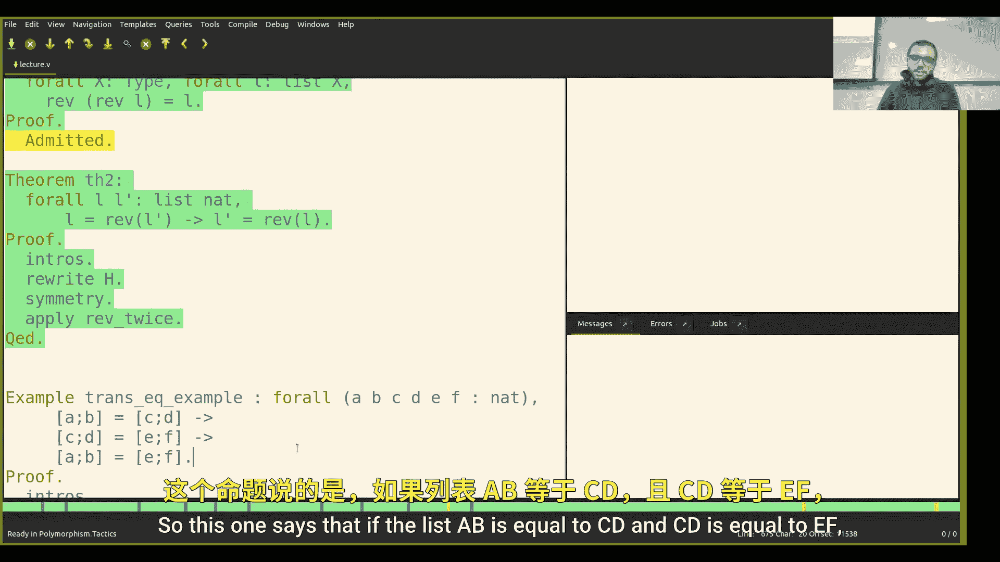


```coq
Definition apply_thrice {X : Type} (f : X -> X) (n : X) : X := f (f (f n)).
```

这个函数是多态的，可以用于任何类型 `X`。

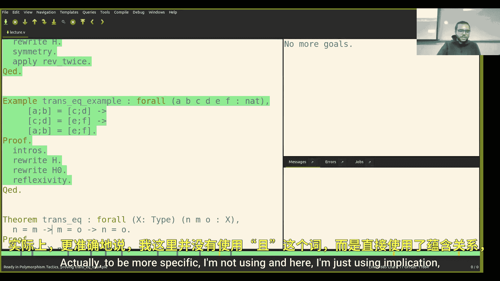


```coq
Compute apply_thrice (fun n => n * n) 2. (* 256 *)
```

### 过滤函数（Filter Function）

过滤函数接受一个测试函数和一个列表，返回列表中所有通过测试的元素。

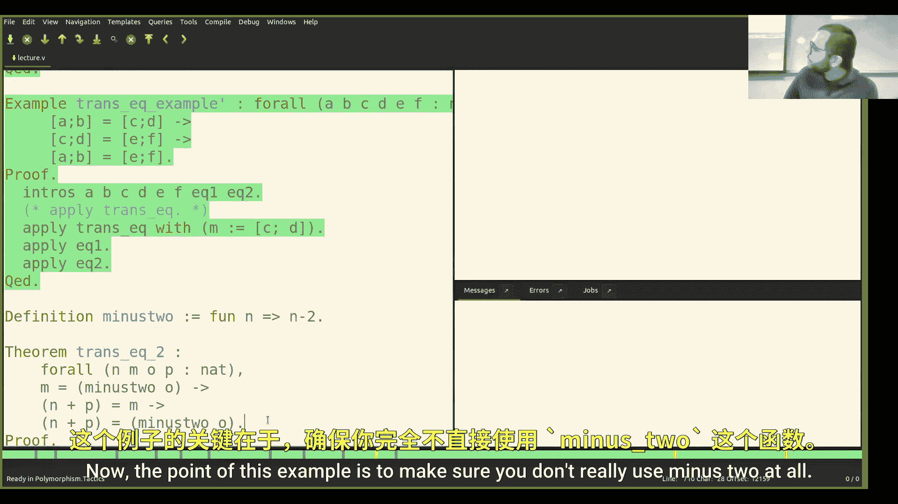


```coq
Fixpoint filter {X : Type} (test : X -> bool) (l : list X) : list X :=
  match l with
  | [] => []
  | h :: t => if test h then h :: filter test t else filter test t
  end.
```

例如，我们可以过滤出一个列表中的所有偶数。

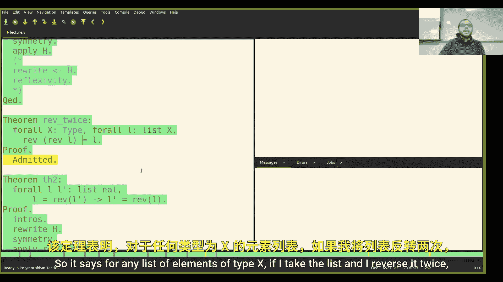


```coq
Compute filter even [1; 2; 4; 5]. (* [2; 4] *)
```

### 映射函数（Map Function）

映射函数接受一个函数 `f` 和一个列表，将 `f` 应用于列表中的每个元素。

```coq
Fixpoint map {X Y : Type} (f : X -> Y) (l : list X) : list Y :=
  match l with
  | [] => []
  | h :: t => f h :: map f t
  end.
```

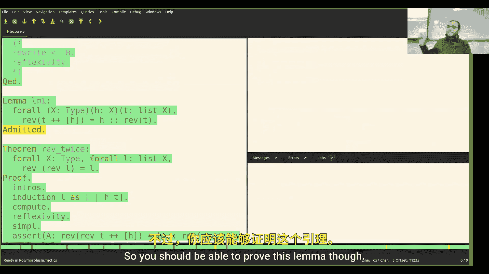


例如，将列表中的每个元素加3。

```coq
Compute map (fun x => x + 3) [1; 2; 3]. (* [4; 5; 6] *)
```

### 折叠函数（Fold Function）

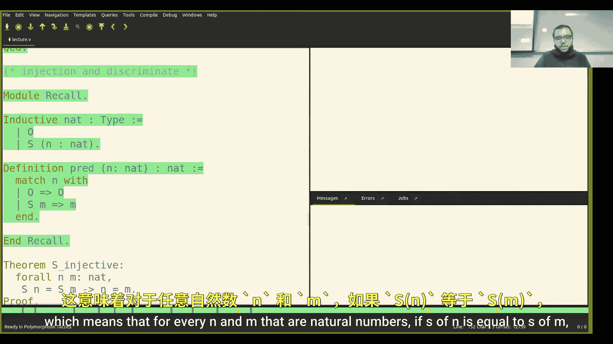


折叠函数将一个列表“折叠”成一个单一的值。它接受一个二元函数 `f`、一个初始值 `b` 和一个列表，然后递归地将 `f` 应用于列表的元素和累积值。

```coq
Fixpoint fold {X Y : Type} (f : X -> Y -> Y) (l : list X) (b : Y) : Y :=
  match l with
  | [] => b
  | h :: t => f h (fold f t b)
  end.
```

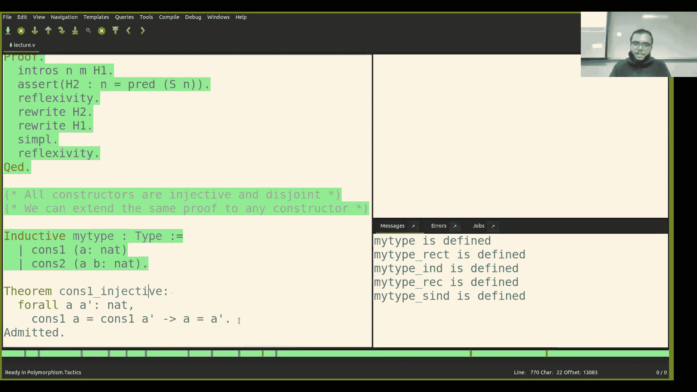

例如，使用折叠函数计算列表中所有元素的乘积。


```coq
Compute fold mult [3; 5; 2] 1. (* 30 *)
```

### 常量函数

定义一个函数 `constf`，它接受一个值 `x`，返回一个常量函数，该函数总是返回 `x`。

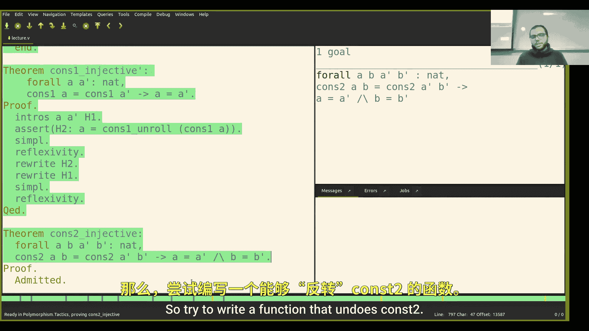


```coq
Definition constf {X : Type} (x : X) : nat -> X := fun k => x.
```

## 证明策略（Proof Tactics）

上一节我们介绍了一些基本的证明策略，本节中我们来看看更多高级的策略。

### 应用策略（Apply Tactic）

`apply` 策略用于将当前目标与某个假设或已证明定理的结论进行匹配。如果匹配成功，目标会被替换为该假设或定理的前提。


考虑一个简单定理：对于所有自然数 `n` 和 `m`，如果 `n = m`，则 `n = n`。

```coq
Theorem trivial_example : forall n m : nat, n = m -> n = n.
Proof.
  intros n m H.
  apply H.
Qed.
```

### 对称策略（Symmetry Tactic）

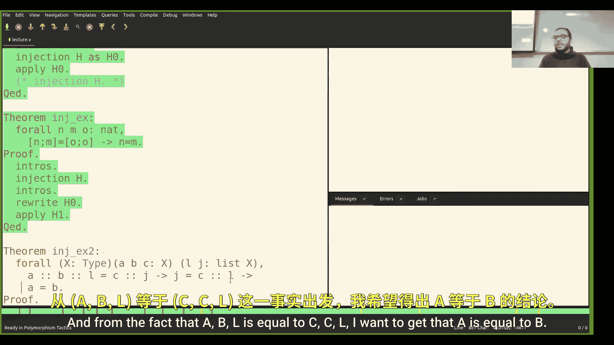


`symmetry` 策略用于交换等式两边的位置。例如，证明如果 `n = m`，则 `m = n`。

```coq
Theorem symmetry_example : forall n m : nat, n = m -> m = n.
Proof.
  intros n m H.
  symmetry.
  apply H.
Qed.
```

### 传递性定理（Transitivity Theorem）

我们证明一个一般性的传递性定理：对于任何类型 `X` 和元素 `n`、`m`、`o`，如果 `n = m` 且 `m = o`，则 `n = o`。

```coq
Theorem trans_eq : forall (X : Type) (n m o : X), n = m -> m = o -> n = o.
Proof.
  intros X n m o H1 H2.
  rewrite H1.
  apply H2.
Qed.
```

### 使用 `apply with` 策略

有时，`apply` 策略无法自动推断出所有参数。这时可以使用 `apply with` 来显式指定参数。

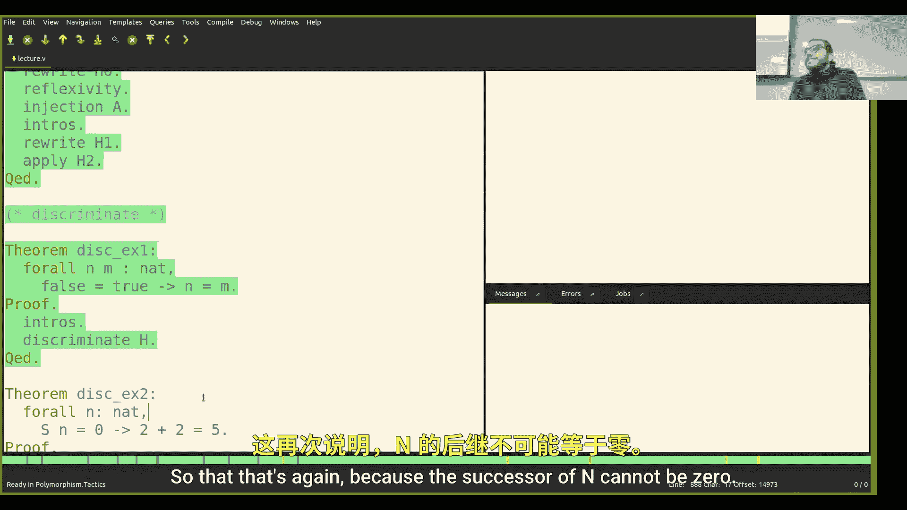


例如，证明如果列表 `[a, b]` 等于 `[c, d]` 且 `[c, d]` 等于 `[e, f]`，则 `[a, b]` 等于 `[e, f]`。

```coq
Theorem example_with : forall a b c d e f : nat,
  [a; b] = [c; d] -> [c; d] = [e; f] -> [a; b] = [e; f].
Proof.
  intros a b c d e f H1 H2.
  apply trans_eq with (m := [c; d]).
  - apply H1.
  - apply H2.
Qed.
```

### 注入策略（Injection Tactic）

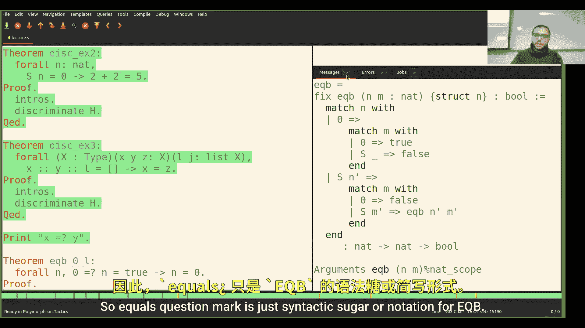


`injection` 策略用于利用构造器的单射性。如果两个由相同构造器创建的值相等，那么它们的参数也相等。

例如，证明自然数的后继构造器 `S` 是单射的。

```coq
Theorem S_injective : forall n m : nat, S n = S m -> n = m.
Proof.
  intros n m H.
  injection H as H0.
  apply H0.
Qed.
```

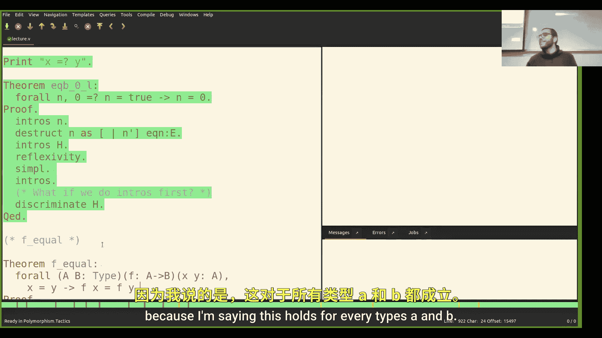

### 判别策略（Discriminate Tactic）


`discriminate` 策略用于处理由不同构造器创建的值不可能相等的情况。例如，证明 `false = true` 蕴含任何结论。

```coq
Theorem discriminate_example : forall n m : nat, false = true -> n = m.
Proof.
  intros n m H.
  discriminate H.
Qed.
```

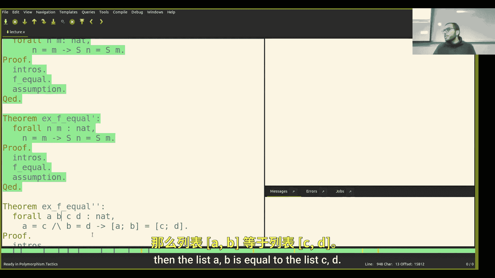


### 函数相等策略（F_equal Tactic）

`f_equal` 策略用于证明如果两个值相等，那么将它们应用于同一个函数后结果也相等。

例如，证明如果 `n = m`，则 `S n = S m`。

```coq
Theorem f_equal_example : forall n m : nat, n = m -> S n = S m.
Proof.
  intros n m H.
  f_equal.
  apply H.
Qed.
```

### 在假设中应用策略

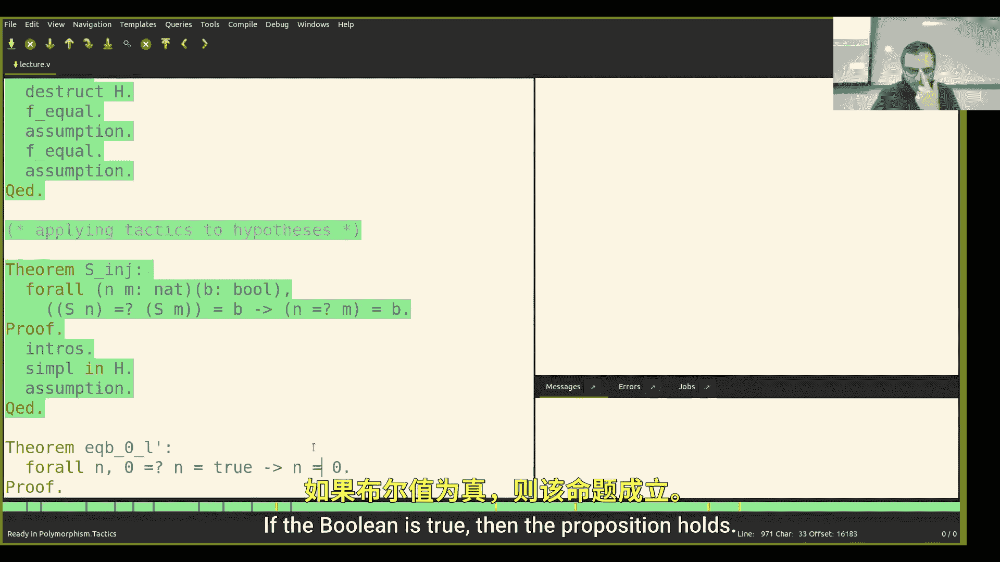


我们可以在假设中应用策略，而不仅仅是在目标中。例如，使用 `simpl in H` 简化假设 `H`，或使用 `apply H in H0` 在假设中进行前向推理。

```coq
Theorem forward_reasoning : forall n m p q : nat,
  (n = m -> p = q) -> m = n -> q = p.
Proof.
  intros n m p q H H0.
  symmetry in H0.
  apply H in H0.
  symmetry.
  apply H0.
Qed.
```

## 总结

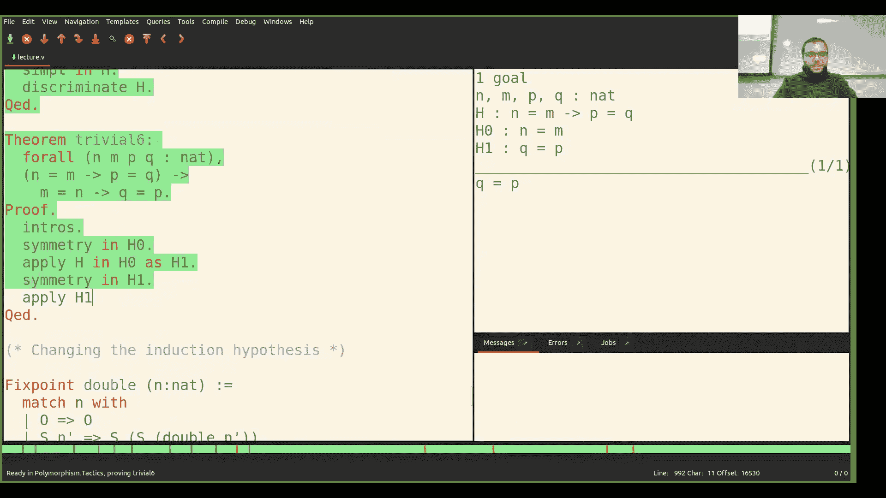


本节课中我们一起学习了多态类型和高阶函数的定义与使用，包括积类型、选项类型、拉链函数、过滤函数、映射函数和折叠函数。我们还探讨了多种证明策略，如 `apply`、`symmetry`、`transitivity`、`injection`、`discriminate` 和 `f_equal`，并学习了如何在假设中应用这些策略。这些概念和技巧是进行程序形式化推理的基础，帮助我们更有效地在Coq中构建和证明定理。