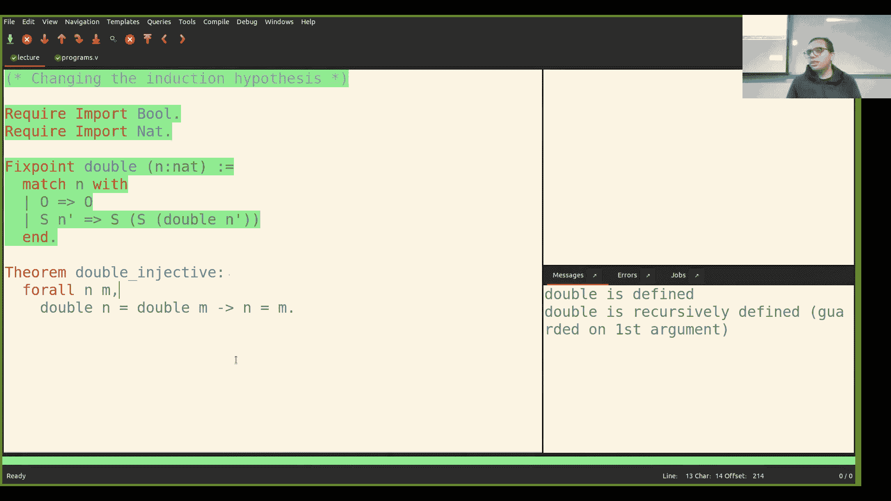
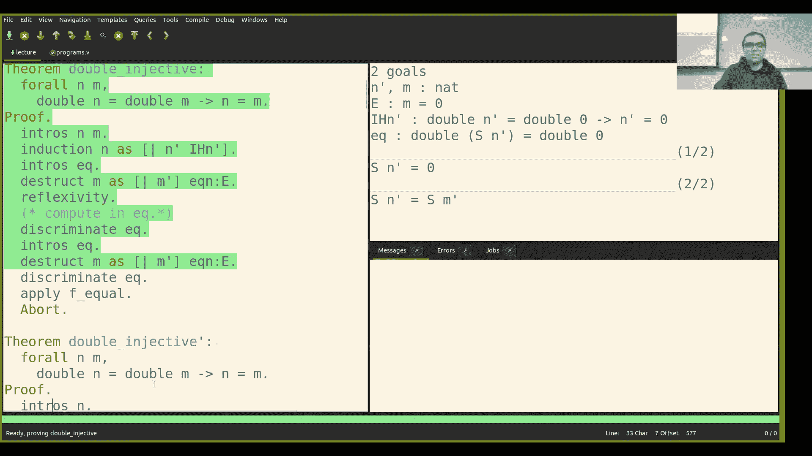
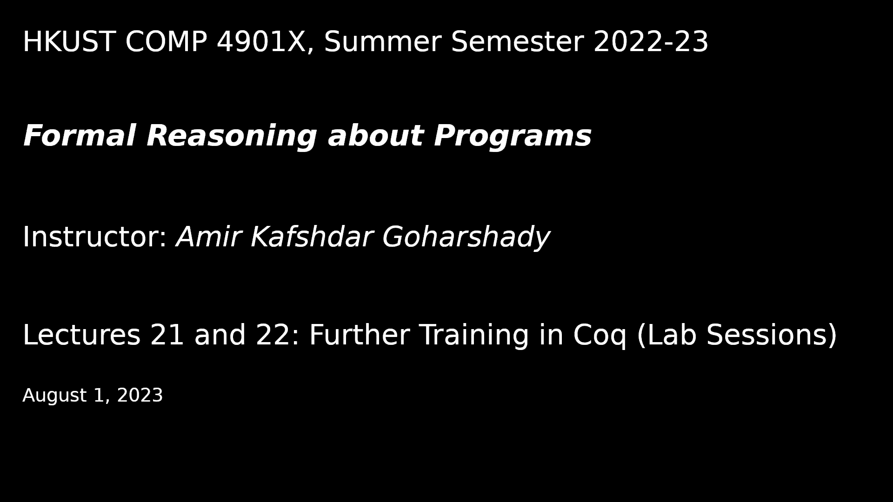
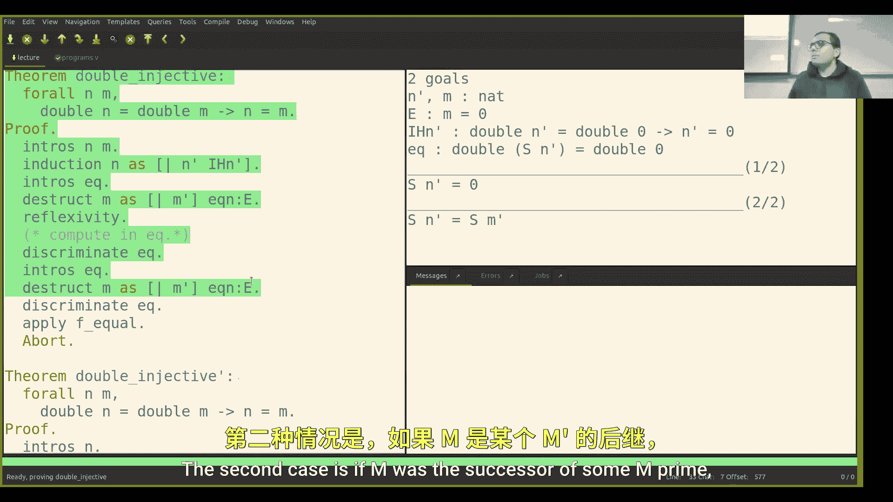
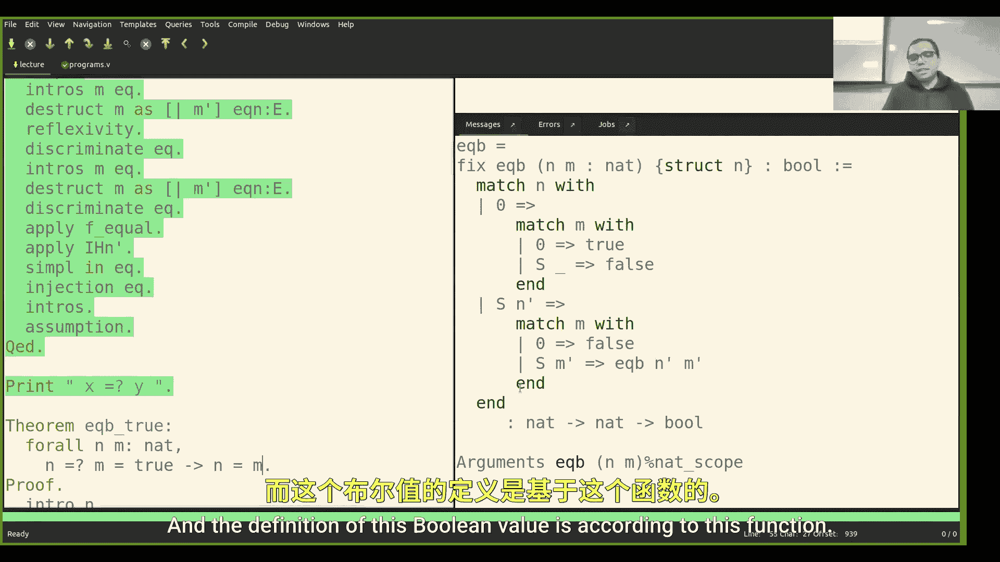
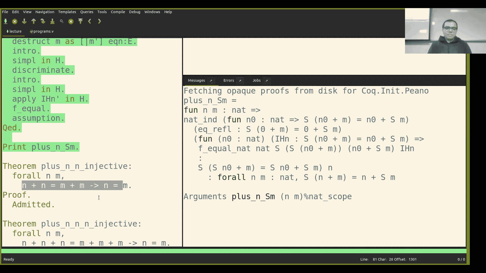
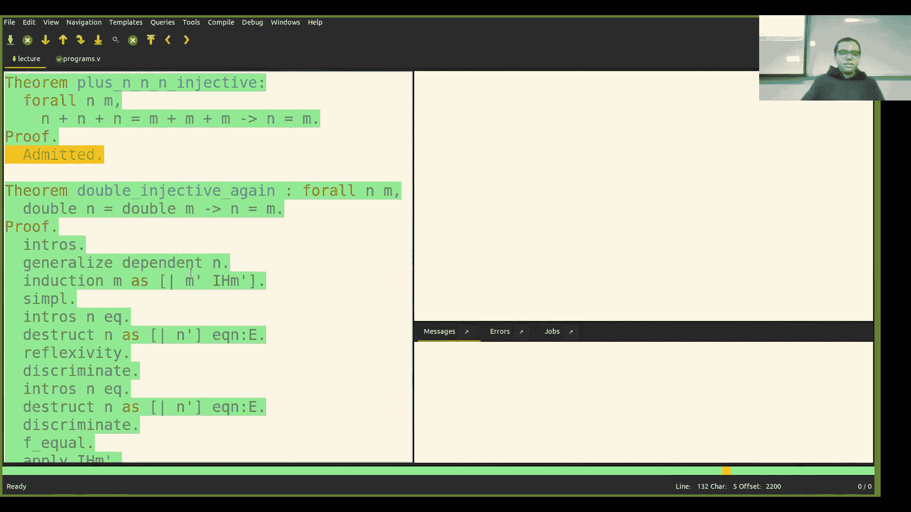

# 程序的形式化推理：第12讲：Coq进阶训练





在本节课中，我们将深入学习Coq证明助手，通过一系列具体的定理证明练习，掌握处理全称量词和归纳证明时的关键技巧。我们将重点关注如何避免过早引入变量，以及如何有效地组织归纳证明。

## 1️⃣ 过早引入变量的问题

上一节我们介绍了基本的证明策略。本节中我们来看看一个常见的陷阱：过早地使用 `intros` 策略引入所有变量。

我们首先导入必要的库并定义一个简单的函数。

```coq
Require Import Bool Arith.

Fixpoint double (n : nat) : nat :=
  match n with
  | O => O
  | S n' => S (S (double n'))
  end.
```

函数 `double` 递归地将自然数 `n` 翻倍。接下来，我们尝试证明这个函数是单射的。

**定理**：对于所有自然数 `n` 和 `m`，如果 `double n = double m`，那么 `n = m`。

一个直观的证明思路是使用归纳法。以下是初学者可能尝试的错误证明：

```coq
Theorem double_injective_wrong : forall n m, double n = double m -> n = m.
Proof.
  intros n m. (* 过早地将 n 和 m 都引入上下文 *)
  induction n.
  - (* 情况 n = 0 *)
    intros H.
    destruct m.
    + reflexivity.
    + discriminate H.
  - (* 归纳步骤 *)
    intros H.
    destruct m.
    + discriminate H.
    + (* 此处陷入困境 *)
      (* 归纳假设是：对于特定的 m，若 double n' = double m，则 n' = m *)
      (* 但我们需要证明的是关于 S n' 和 S m' 的结论，无法直接应用归纳假设 *)
Abort.
```

这个证明在归纳步骤中失败了。问题在于，当我们执行 `intros n m` 时，`m` 变成了一个**特定的**自然数（例如，想象 `m` 是 10）。然后我们对 `n` 进行归纳。归纳假设变成了“对于这个**特定的** `m`，如果 `double n' = double m`，那么 `n' = m`”。然而，在归纳步骤中，我们需要处理的是 `S m'`，这与归纳假设中固定的 `m` 不匹配，导致证明无法进行。





核心问题在于：**在对一个变量进行归纳时，另一个变量应保持全称量化状态**。



## 2️⃣ 正确的证明策略


基于上述观察，我们调整证明策略：先只引入一个变量，保持另一个变量在全称量词内，再进行归纳。

以下是 `double` 函数单射性的正确证明：

```coq
Theorem double_injective : forall n m, double n = double m -> n = m.
Proof.
  intros n. (* 只引入 n，m 仍然被 forall 量化 *)
  induction n.
  - (* 基本情况：n = 0 *)
    intros m H. (* 现在引入 m 和假设 H *)
    destruct m.
    + reflexivity. (* m = 0，目标 0=0 *)
    + simpl in H. discriminate H. (* m = S m'，H 变为 0 = S(...)，矛盾 *)
  - (* 归纳步骤：n = S n' *)
    intros m H. (* 引入 m 和假设 H: double (S n') = double m *)
    destruct m.
    + simpl in H. discriminate H. (* m = 0，矛盾 *)
    + (* m = S m' *)
      simpl in H.
      injection H as H1. (* 利用构造子 S 的单射性，得到 double n' = double m' *)
      apply IHn in H1.   (* 应用归纳假设，得到 n' = m' *)
      f_equal.           (* 目标 S n' = S m' 简化为 n' = m' *)
      assumption.
Qed.
```

**证明解析**：
1.  `intros n.` 只将 `n` 引入上下文，`m` 仍受 `forall` 约束。
2.  对 `n` 进行归纳 (`induction n`)。
3.  **基本情况** (`n=0`)：引入 `m` 和假设 `H`。对 `m` 分情况讨论。当 `m=S m'` 时，假设 `H` 变为 `0 = S(...)`，可通过 `discriminate` 得出矛盾。
4.  **归纳步骤** (`n=S n'`)：引入 `m` 和假设 `H`。对 `m` 分情况讨论。
    *   当 `m=S m'` 时，简化 `H` 得到 `S (S (double n')) = S (S (double m'))`。
    *   使用 `injection` 策略（因为 `S` 是构造子，具有单射性），得到新假设 `H1: double n' = double m'`。
    *   应用归纳假设 `IHn` 到 `H1` 上，得到 `n' = m'`。
    *   使用 `f_equal` 将目标 `S n' = S m'` 简化为 `n' = m'`，然后由假设得证。

这个证明成功的关键是，归纳假设 `IHn` 的形式是 `forall m, double n' = double m -> n' = m`。这意味着它对**所有**自然数 `m` 都成立，因此我们可以将具体的 `m'` 实例化进去。

## 3️⃣ 布尔相等性的证明

让我们将相同的策略应用于另一个定理，证明自然数的布尔相等性 `=?` 与命题相等性 `=` 在结果为真时是一致的。

首先，我们查看 `=?` 的定义（即标准库中的 `eqb` 函数）。

```coq
Print Nat.eqb.
```

**定理**：对于所有自然数 `n` 和 `m`，如果 `n =? m = true`，那么 `n = m`。




以下是证明步骤：

```coq
Theorem eqb_true : forall n m, (n =? m) = true -> n = m.
Proof.
  intros n.          (* 只引入 n *)
  induction n.
  - (* n = 0 *)
    intros m H.
    destruct m.
    + reflexivity.          (* m=0，目标 0=0 *)
    + simpl in H.           (* H 变为 false = true *)
      discriminate H.       (* 矛盾 *)
  - (* n = S n' *)
    intros m H.
    destruct m.
    + simpl in H. discriminate H. (* m=0，H 为 false=true，矛盾 *)
    + (* m = S m' *)
      simpl in H.                 (* H 变为 n' =? m' = true *)
      apply IHn in H.             (* 应用归纳假设，得到 n' = m' *)
      f_equal.                    (* 目标 S n' = S m' 简化为 n' = m' *)
      assumption.
Qed.
```

**证明解析**：
这个证明的结构与 `double_injective` 的证明几乎完全相同。
1.  只引入 `n`，对 `n` 进行归纳。
2.  在每种情况下，再引入 `m` 和假设 `H`。
3.  对 `m` 进行分情况讨论 (`destruct m`)。
4.  在归纳步骤中，当 `n=S n'` 且 `m=S m'` 时，假设 `H` 简化为 `n' =? m' = true`。直接应用归纳假设 `IHn` 即可得到 `n' = m'`，从而完成证明。

## 4️⃣ 加法单射性的证明

现在，我们证明一个关于加法的类似性质：对于所有自然数 `n` 和 `m`，如果 `n + n = m + m`，那么 `n = m`。

这个证明需要用到加法的一个引理 `plus_n_Sm`。




```coq
Check plus_n_Sm. (* forall n m : nat, S (n + m) = n + S m *)
```

**定理**：`forall n m, n + n = m + m -> n = m`

以下是证明：

```coq
Theorem plus_injective : forall n m, n + n = m + m -> n = m.
Proof.
  intros n.
  induction n.
  - (* n = 0 *)
    intros m H.
    destruct m.
    + reflexivity.
    + simpl in H. discriminate H. (* 0 = S(...+...)，矛盾 *)
  - (* n = S n' *)
    intros m H.
    destruct m.
    + simpl in H. discriminate H. (* S(...) = 0，矛盾 *)
    + (* m = S m' *)
      (* 目标：S n' = S m' *)
      (* 假设 H: S n' + S n' = S m' + S m' *)
      rewrite <- plus_n_Sm in H. (* 将左边的 S n' + S n' 转化为 S (n' + S n') *)
      rewrite <- plus_n_Sm in H. (* 将右边的 S m' + S m' 转化为 S (m' + S m') *)
      simpl in H.                (* 化简：S (S (n' + n')) = S (S (m' + m')) *)
      injection H as H.          (* 得到 n' + n' = m' + m' *)
      apply IHn in H.            (* 应用归纳假设 *)
      f_equal.
      assumption.
Qed.
```

**证明解析**：
1.  标准步骤：`intros n. induction n.`
2.  基本情况 (`n=0`) 与之前类似。
3.  归纳步骤 (`n=S n'`) 需要更多操作：
    *   当 `m=S m'` 时，目标为 `S n' = S m'`，假设 `H` 为 `S n' + S n' = S m' + S m'`。
    *   使用引理 `plus_n_Sm` 重写假设 `H` 的两边，将形如 `S a + S b` 的表达式转化为 `S (a + S b)`。
    *   然后使用 `simpl` 进一步化简，得到 `S (S (n' + n')) = S (S (m' + m'))`。
    *   利用构造子 `S` 的单射性 (`injection`)，得到核心等式 `n' + n' = m' + m'`。
    *   应用归纳假设 `IHn` 即得 `n' = m'`，从而完成证明。

这个证明展示了如何利用已有的引理来重写表达式，从而将问题转化为归纳假设可以直接应用的形式。

## 5️⃣ 使用 `generalize dependent` 调整变量顺序

有时，我们可能希望对第二个变量进行归纳，而不是第一个。`generalize dependent` 策略可以帮助我们调整量化变量的顺序。

回顾 `double_injective` 定理，假设我们想对 `m` 进行归纳。直接 `intros n m` 会将两者都固定，导致归纳假设无效。我们可以这样做：

```coq
Theorem double_injective_gen : forall n m, double n = double m -> n = m.
Proof.
  intros n m H.                (* 引入所有变量和假设 *)
  generalize dependent n.      (* 将 n 从上下文中移回目标，重新被 forall 量化 *)
  induction m.
  - (* 基本情况：m = 0 *)
    intros n H.
    destruct n.
    + reflexivity.
    + simpl in H. discriminate H.
  - (* 归纳步骤：m = S m' *)
    intros n H.
    destruct n.
    + simpl in H. discriminate H.
    + simpl in H.
      injection H as H1.
      apply IHm in H1.
      f_equal.
      assumption.
Qed.
```

**策略解析**：
*   `intros n m H.` 将 `n`, `m`, `H` 全部引入上下文。
*   `generalize dependent n.` 是关键。它将上下文中的 `n` “推广”回目标中，使目标变为 `forall n, double n = double m -> n = m`，同时 `n` 从上下文中消失。
*   现在，我们可以安全地对 `m` 进行归纳 (`induction m`)，因为此时 `n` 在归纳假设中仍然是全称量化的。
*   证明的其余部分与之前对 `n` 归纳的证明对称。

`generalize dependent` 是一个强大的工具，当你需要改变归纳顺序或因为过早引入变量而陷入困境时，它可以帮你重新组织目标。

---




**总结**：本节课中我们一起学习了在Coq中进行归纳证明时的高级技巧。
1.  我们认识到，**在对一个变量进行归纳时，其他相关变量应保持全称量化状态**，避免过早使用 `intros` 将其固定。
2.  我们通过 `double` 函数单射性、布尔相等性 `=?` 以及加法单射性等多个定理，实践了“先引入一个变量，归纳后再引入另一个”的标准证明模式。
3.  我们学习了如何使用 `injection` 策略利用构造子的单射性，以及如何使用 `rewrite` 结合已有引理（如 `plus_n_Sm`）来转化等式。
4.  最后，我们介绍了 `generalize dependent` 策略，它可以帮助我们调整证明中变量的量化顺序，为归纳证明提供更大的灵活性。掌握这些策略对于构建复杂且正确的形式化证明至关重要。