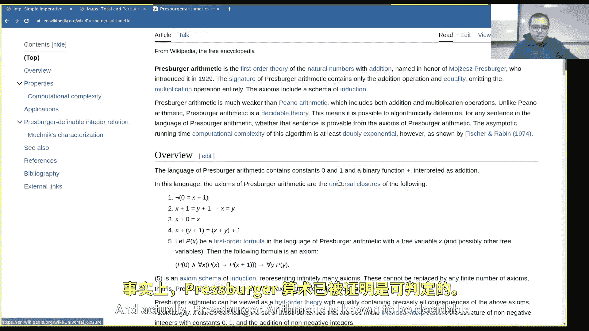
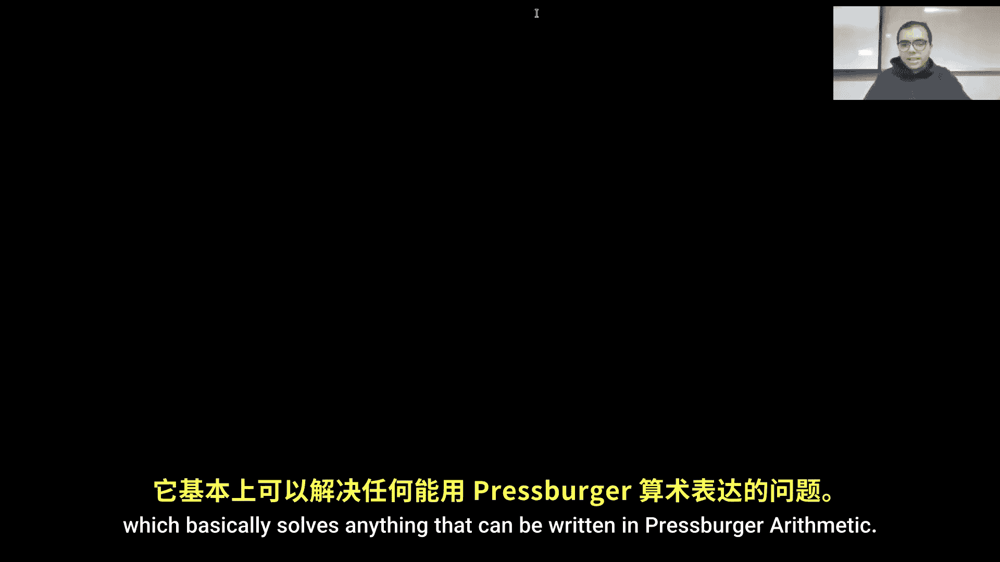
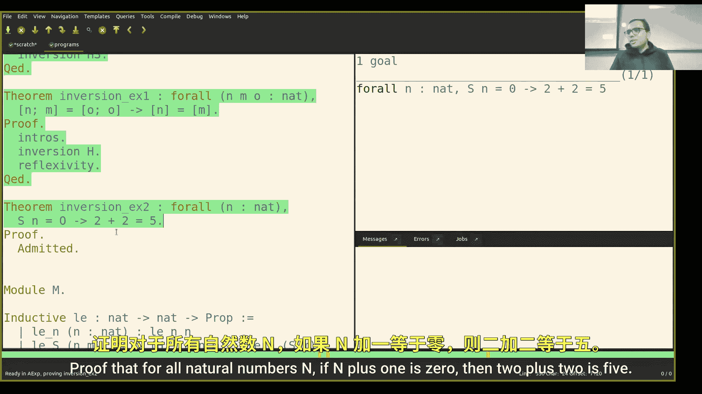
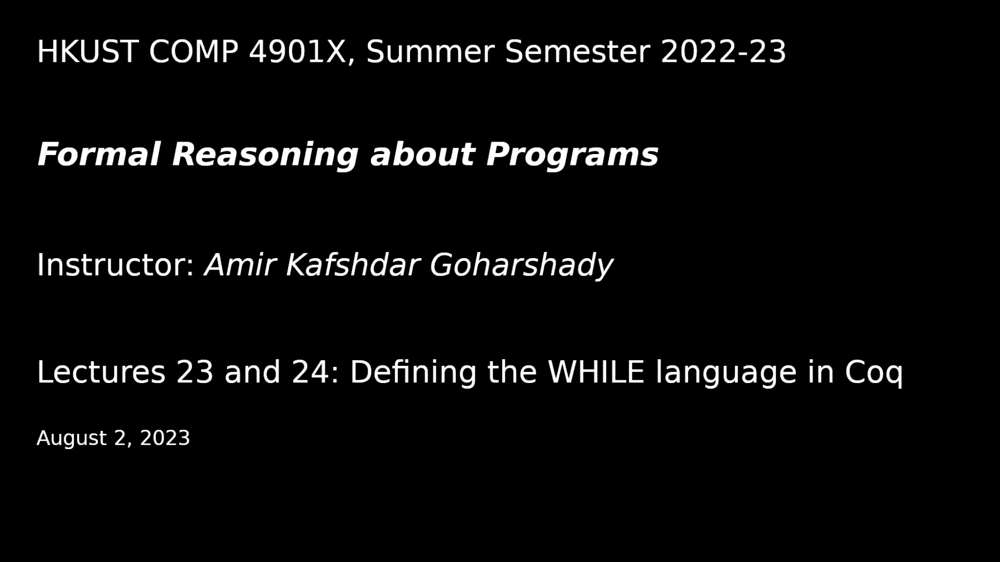
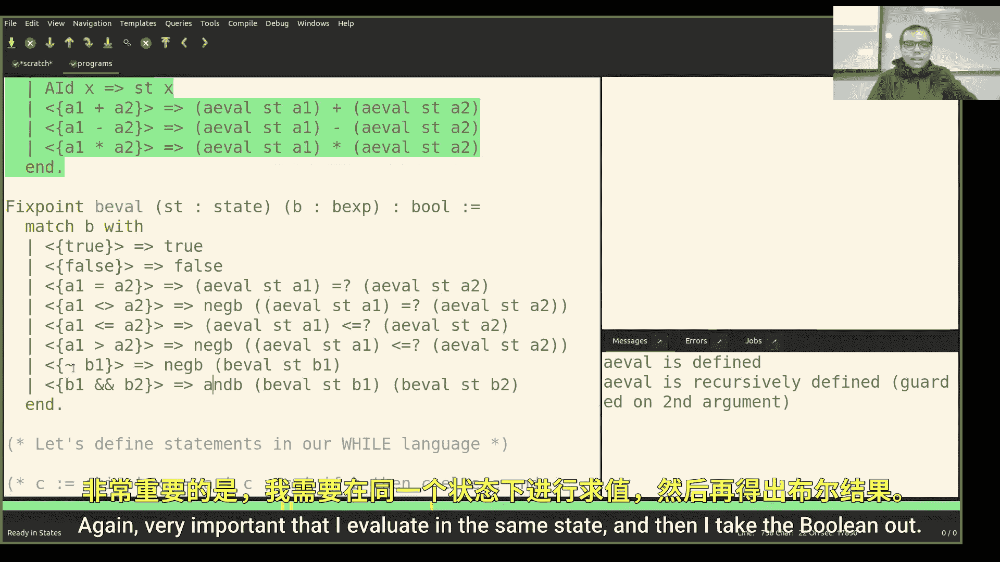
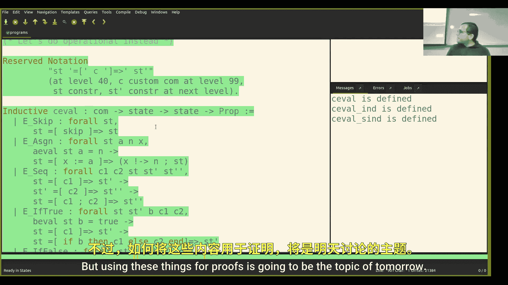
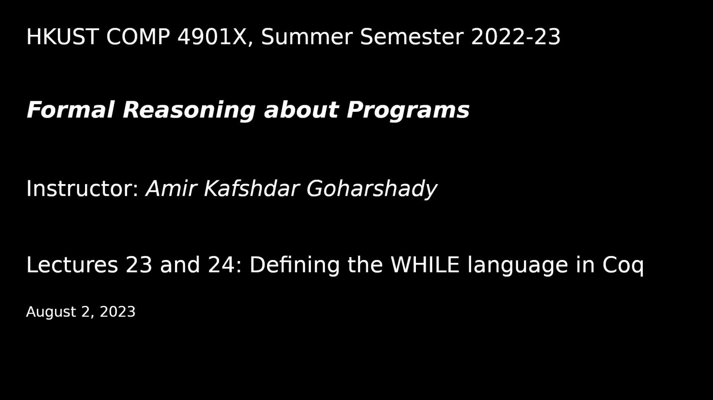

# 013：在Coq中定义WHILE语言


在本节课中，我们将学习如何在Coq中定义WHILE编程语言。我们将从定义自定义证明策略开始，然后探讨如何使用归纳命题来定义关系和语义，最后构建一个包含变量、赋值、顺序执行、条件分支和循环的完整编程语言。





## 自定义证明策略

上一节我们介绍了如何优化算术表达式。本节中，我们来看看如何在Coq中定义自己的证明策略，以简化重复的证明步骤。

以下是定义一个名为 `my_tactic` 的策略的示例：

```coq
Ltac my_tactic H :=
  try injection H; intros; assumption.
```

这个策略尝试对假设 `H` 使用 `injection`，然后引入新假设，最后使用 `assumption` 完成证明。你可以在证明中这样使用它：

```coq
Theorem example: forall A B C: nat, [A; B] = [A; C] -> B = C.
Proof.
  intros.
  my_tactic H.
Qed.
```

## 使用 `lia` 策略处理线性算术

Coq提供了一个强大的策略 `lia`，用于解决Pressburger算术问题。Pressburger算术是一种只包含自然数、加法、相等和比较运算（没有乘法）的理论，它是可判定的。

例如，要证明以下目标：

```coq
Theorem lia_example: forall m n o p: nat,
    n + n <= m + o /\ o + 3 = p + 3 -> m <= p.
Proof.
  intros.
  lia.
Qed.
```

`lia` 策略可以自动处理涉及加法、常数乘法和比较的线性算术目标。

## 归纳定义命题

我们可以使用归纳法来定义命题本身，而不仅仅是证明它们。这类似于基于规则的推导。

例如，我们可以归纳地定义一个自然数为偶数的命题 `EV`：

```coq
Inductive EV : nat -> Prop :=
| Ev0 : EV 0
| EvSS : forall n, EV n -> EV (S (S n)).
```

这里有两个规则：
1.  **Ev0**: 0是偶数。
2.  **EvSS**: 如果 `n` 是偶数，那么 `n+2` 也是偶数。

我们可以使用这些规则来证明4是偶数：

```coq
Theorem ev_4 : EV 4.
Proof.
  apply EvSS. apply EvSS. apply Ev0.
Qed.
```

另一种定义风格是将假设作为参数直接放入规则中：

```coq
Inductive EV‘ : nat -> Prop :=
| Ev0‘ : EV‘ 0
| EvSS‘ : forall n, EV‘ n -> EV‘ (S (S n)).
```

这两种定义在逻辑上是等价的。归纳定义的核心思想是：一个命题成立，当且仅当它能从给定的规则中推导出来。

## 处理部分函数与非确定性：规则语义的优势

当我们尝试在Coq中定义可能不终止或结果不唯一的函数时，会遇到困难，因为Coq要求所有函数都是全函数且终止的。





考虑Collatz函数和步数计算：

```coq
Definition F (n : nat) : nat :=
  if even n then div2 n else 3 * n + 1.

Fail Fixpoint steps_to_one (n : nat) : nat :=
  if n =? 1 then 0
  else 1 + steps_to_one (F n).
```

上述定义会被Coq拒绝，因为它无法证明递归调用 `steps_to_one (F n)` 的参数比原始参数 `n` 更小（结构上递减）。

然而，我们可以将其定义为一个归纳命题，这只需要描述“如何证明”一个数能达到1，而不需要实际计算步数：

```coq
Inductive reaches_one : nat -> Prop :=
| term_done : reaches_one 1
| term_more : forall n, reaches_one (F n) -> reaches_one n.
```

这个定义是可行的，因为它只是声明了一组证明规则。规则语义（或操作语义）在处理部分性（如除以零）和非确定性时也更具优势。

### 除以零的情况

对于包含除法的算术表达式，函数式语义需要处理 `option` 类型，变得复杂：

```coq
Definition opt_div (a b : option nat) : option nat :=
  match a, b with
  | Some n1, Some n2 => if n2 =? 0 then None else Some (n1 / n2)
  | _, _ => None
  end.
```

而规则语义只需在除法规则中添加前提条件即可：

```coq
Inductive aevalR : aexp -> nat -> Prop :=
...
| E_Div : forall a1 a2 n1 n2 n3 n4,
    aevalR a1 n1 ->
    aevalR a2 n2 ->
    n2 > 0 ->
    n2 * n3 + n4 = n1 ->
    n4 < n2 ->
    aevalR (ADiv a1 a2) n3.
```

### 非确定性的情况

假设我们有一个非确定性表达式 `any`，它可以求值为任何自然数。函数式语义无法表示这一点，但规则语义只需一条简单规则：

```coq
Inductive aevalR : aexp -> nat -> Prop :=
...
| E_Any : forall n, aevalR any n.
```

## 定义WHILE语言

现在，让我们正式定义WHILE语言。我们首先需要定义状态（存储变量映射）和表达式。

### 状态定义

状态是变量名（字符串）到自然数值的映射。我们使用函数来实现一个“全映射”，为每个可能的变量名提供一个默认值。

```coq
Definition total_map (A : Type) := string -> A.

Definition t_empty {A : Type} (v : A) : total_map A :=
  fun _ => v.

Definition t_update {A : Type} (m : total_map A)
                    (x : string) (v : A) : total_map A :=
  fun x‘ => if eqb x‘ x then v else m x‘.

Definition state : Type := total_map nat.
```

### 表达式语法

算术表达式（`aexp`）和布尔表达式（`bexp`）现在可以包含变量。

```coq
Inductive aexp : Type :=
  | ANum (n : nat)
  | AId (x : string)        (* 变量 *)
  | APlus (a1 a2 : aexp)
  | AMinus (a1 a2 : aexp)
  | AMult (a1 a2 : aexp).

Inductive bexp : Type :=
  | BTrue
  | BFalse
  | BEq (a1 a2 : aexp)
  | BNe (a1 a2 : aexp)
  | BLe (a1 a2 : aexp)
  | BNot (b : bexp)
  | BAnd (b1 b2 : bexp).
```

我们定义了一些符号和强制转换，使表达式书写更直观：

```coq
Coercion ANum : nat >-> aexp.
Coercion AId : string >-> aexp.
Declare Scope com_scope.
Notation "x + y" := (APlus x y) (at level 50, left associativity) : com_scope.
Notation "x - y" := (AMinus x y) (at level 50, left associativity) : com_scope.
Notation "x * y" := (AMult x y) (at level 40, left associativity) : com_scope.
(* ... 其他符号定义 ... *)
Notation "‘{‘ e ‘}‘" := e (at level 1, e custom com at level 99) : com_scope.
```

### 表达式求值函数

有了状态，我们可以定义表达式求值函数：

```coq
Fixpoint aeval (st : state) (a : aexp) : nat :=
  match a with
  | ANum n => n
  | AId x => st x
  | APlus a1 a2 => (aeval st a1) + (aeval st a2)
  | AMinus a1 a2 => (aeval st a1) - (aeval st a2)
  | AMult a1 a2 => (aeval st a1) * (aeval st a2)
  end.

Fixpoint beval (st : state) (b : bexp) : bool :=
  match b with
  | BTrue => true
  | BFalse => false
  | BEq a1 a2 => (aeval st a1) =? (aeval st a2)
  (* ... 其他情况 ... *)
  end.
```

### 命令语法与语义




WHILE语言的核心是命令（`com`）：

```coq
Inductive com : Type :=
  | CSkip
  | CAss (x : string) (a : aexp)
  | CSeq (c1 c2 : com)
  | CIf (b : bexp) (c1 c2 : com)
  | CWhile (b : bexp) (c : com).
```

我们同样为命令定义了易读的符号：

```coq
Notation "‘skip‘" := CSkip (in custom com at level 0) : com_scope.
Notation "x ‘:=‘ a" := (CAss x a) (in custom com at level 0, x constr at level 0, a at level 85) : com_scope.
Notation "c1 ; c2" := (CSeq c1 c2) (in custom com at level 90, right associativity) : com_scope.
Notation "‘if‘ b ‘then‘ c1 ‘else‘ c2 ‘end‘" := (CIf b c1 c2) (in custom com at level 89, b at level 99, c1, c2 at level 99) : com_scope.
Notation "‘while‘ b ‘do‘ c ‘end‘" := (CWhile b c) (in custom com at level 89, b at level 99, c at level 99) : com_scope.
```

现在我们可以编写WHILE程序了：

```coq
Definition factorial_program : com :=
  ‘{ y := 1;
     z := x;
     while ~(z = 0) do
       y := y * z;
       z := z - 1
     end }‘.
```

#### 指称语义的局限性

我们尝试定义一个求值函数 `ceval`，它接受初始状态和命令，返回最终状态。这对于 `skip`、赋值、顺序执行和条件分支都很直接：

```coq
Fixpoint ceval (st : state) (c : com) : state :=
  match c with
  | CSkip => st
  | CAss x a => t_update st x (aeval st a)
  | CSeq c1 c2 => let st‘ := ceval st c1 in ceval st‘ c2
  | CIf b c1 c2 => if beval st b then ceval st c1 else ceval st c2
  | CWhile b c => st (* 问题！ *)
  end.
```

对于 `while` 循环，我们无法给出一个通用的、总是终止的函数实现，因为WHILE语言包含不终止的程序（如 `while true do skip end`），而Coq不允许定义不终止的函数。因此，这个指称语义定义是不完整的。

#### 操作语义（大步语义）

我们可以通过归纳定义一个大步操作语义关系 `eval` 来克服这个限制。这个关系描述了命令如何将初始状态转换为最终状态。

```coq
Reserved Notation "st ‘=[‘ c ‘]=>‘ st‘" (at level 40, c custom com at level 99).

Inductive eval : com -> state -> state -> Prop :=
  | E_Skip : forall st,
      st =[ skip ]=> st
  | E_Ass : forall st a n x,
      aeval st a = n ->
      st =[ x := a ]=> (t_update st x n)
  | E_Seq : forall c1 c2 st st‘ st‘‘,
      st =[ c1 ]=> st‘ ->
      st‘ =[ c2 ]=> st‘‘ ->
      st =[ c1 ; c2 ]=> st‘‘
  | E_IfTrue : forall st st‘ b c1 c2,
      beval st b = true ->
      st =[ c1 ]=> st‘ ->
      st =[ if b then c1 else c2 end ]=> st‘
  | E_IfFalse : forall st st‘ b c1 c2,
      beval st b = false ->
      st =[ c2 ]=> st‘ ->
      st =[ if b then c1 else c2 end ]=> st‘
  | E_WhileFalse : forall b st c,
      beval st b = false ->
      st =[ while b do c end ]=> st
  | E_WhileTrue : forall st st‘ st‘‘ b c,
      beval st b = true ->
      st =[ c ]=> st‘ ->
      st‘ =[ while b do c end ]=> st‘‘ ->
      st =[ while b do c end ]=> st‘‘

where "st ‘=[‘ c ‘]=>‘ st‘" := (eval c st st‘).
```

这些规则直接对应我们在理论课中学过的大步操作语义规则。例如：
*   `E_WhileTrue` 规则表示：如果循环条件 `b` 在当前状态 `st` 下为真，执行一次循环体 `c` 到达状态 `st‘`，然后从 `st‘` 开始执行整个循环能到达状态 `st‘‘`，那么从 `st` 开始执行整个循环也能到达 `st‘‘`。

这个归纳定义是完整的，它可以描述所有WHILE程序的行为，包括那些不终止的程序（对于不终止的程序，不存在能推导出 `st =[ c ]=> st‘` 的证明）。

## 总结

本节课中我们一起学习了：
1.  如何在Coq中定义自定义证明策略（`Ltac`）来简化证明。
2.  使用 `lia` 策略自动解决Pressburger算术问题。
3.  使用归纳法定义命题（如 `EV`），这实质上是给出了一组推导规则。
4.  认识到规则语义（归纳定义）相较于函数式语义（指称语义）在处理部分函数（如除法）和非确定性时的优势。
5.  在Coq中完整定义了WHILE语言：
    *   使用函数 `total_map` 定义状态。
    *   定义了包含变量的算术和布尔表达式语法。
    *   定义了表达式求值函数 `aeval` 和 `beval`。
    *   定义了命令语法（`skip`, 赋值 `:=`, 顺序执行 `;`, 条件分支 `if`, 循环 `while`）。
    *   指出了在Coq中用函数定义完整指称语义的局限性（由于 `while` 循环可能不终止）。
    *   使用归纳关系成功定义了大步操作语义 `eval`，完整刻画了命令的行为。





我们现在有了一个在Coq中形式化定义的编程语言，以及其操作语义。在接下来的课程中，我们将学习如何利用这些定义来形式化地推理程序的属性。