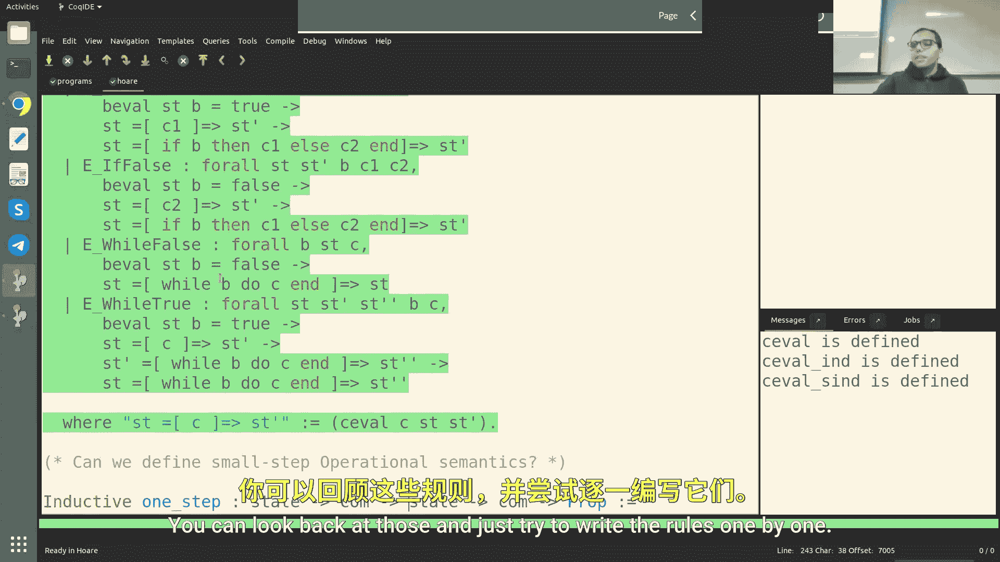
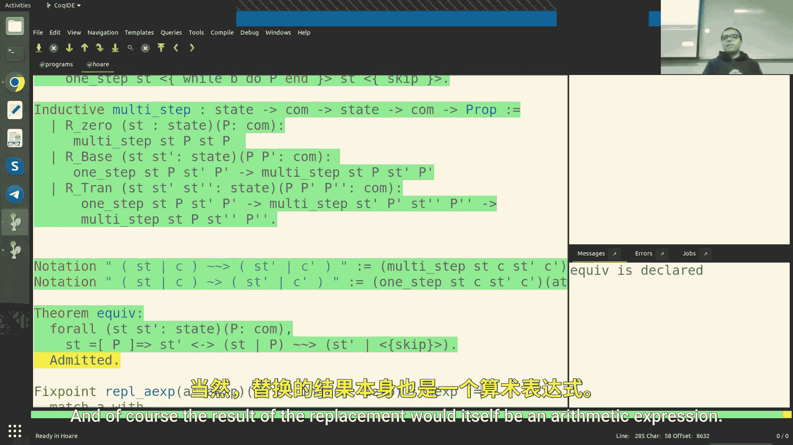
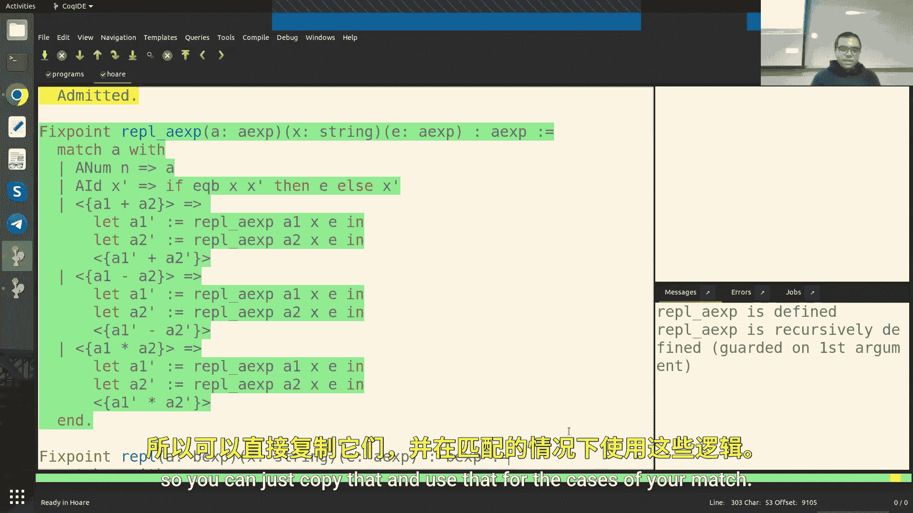
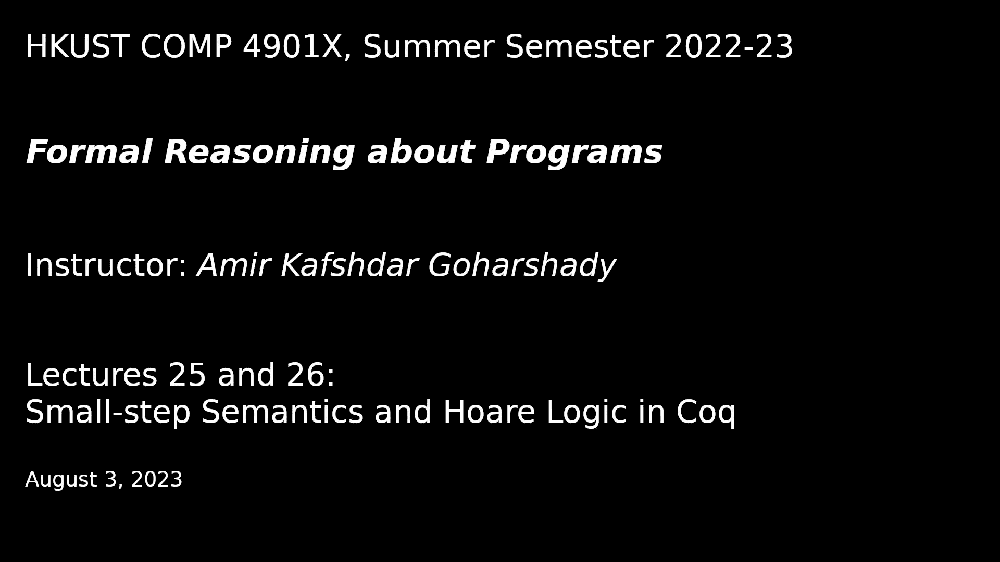
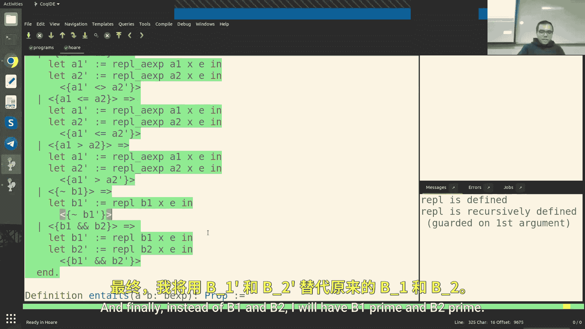
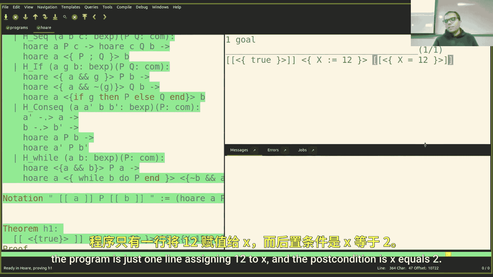
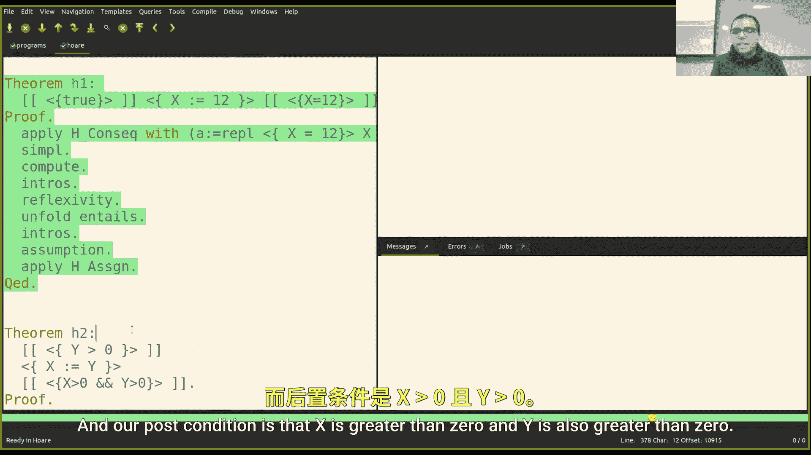
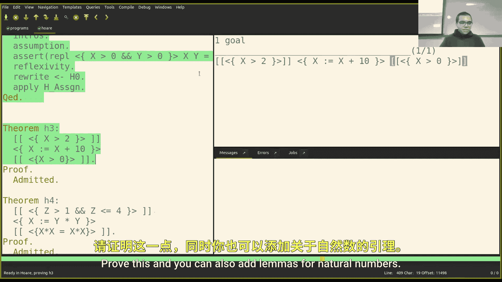
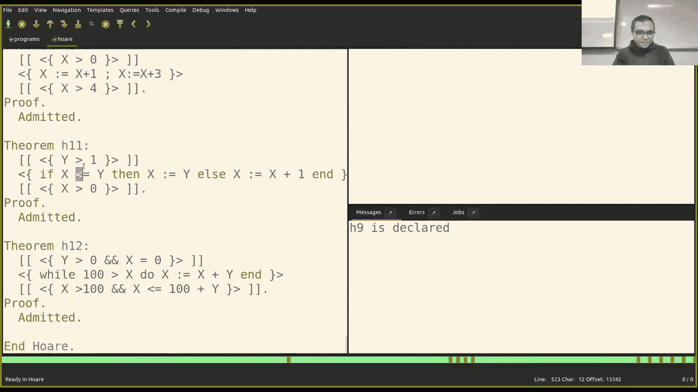

# 程序的形式化推理：第14讲：Coq中的小步语义与霍尔逻辑


## 概述

在本节课中，我们将学习如何在Coq中形式化定义编程语言的语义，特别是小步操作语义，并在此基础上构建霍尔逻辑的证明系统。我们将从定义状态和表达式开始，逐步引入命令的语义，最终实现霍尔逻辑的推理规则。

## 定义状态与表达式

首先，我们需要定义程序运行时的状态。状态可以看作是一个从变量名（字符串）到值（自然数）的映射。我们称之为“全映射”。

```coq
Definition total_map (A : Type) := string -> A.
```

空映射将所有变量映射到一个默认值。更新操作允许我们修改映射中某个变量的值。

```coq
Definition t_empty {A : Type} (v : A) : total_map A :=
  (fun _ => v).

Definition t_update {A : Type} (m : total_map A)
                    (x : string) (v : A) :=
  fun x' => if String.eqb x x' then v else m x'.
```

在我们的编程语言中，状态是变量到自然数的映射。

```coq
Definition state := total_map nat.
```




接下来，我们定义算术表达式和布尔表达式的语法。算术表达式可以是数字、变量，或者由加法、减法、乘法构成的复合表达式。

```coq
Inductive aexp : Type :=
  | ANum (n : nat)
  | AId (x : string)
  | APlus (a1 a2 : aexp)
  | AMinus (a1 a2 : aexp)
  | AMult (a1 a2 : aexp).
```

布尔表达式包括真、假、相等、不等、非、与等。

```coq
Inductive bexp : Type :=
  | BTrue
  | BFalse
  | BEq (a1 a2 : aexp)
  | BNeq (a1 a2 : aexp)
  | BLe (a1 a2 : aexp)
  | BNot (b : bexp)
  | BAnd (b1 b2 : bexp).
```

为了区分Coq代码和我们的编程语言代码，我们使用特定的记号。例如，`<< x + 2 >>` 表示编程语言中的表达式。

## 表达式的指称语义

我们定义函数来评估算术表达式和布尔表达式在给定状态下的值。

```coq
Fixpoint aeval (st : state) (a : aexp) : nat :=
  match a with
  | ANum n => n
  | AId x => st x
  | APlus a1 a2 => (aeval st a1) + (aeval st a2)
  | AMinus a1 a2 => (aeval st a1) - (aeval st a2)
  | AMult a1 a2 => (aeval st a1) * (aeval st a2)
  end.

Fixpoint beval (st : state) (b : bexp) : bool :=
  match b with
  | BTrue => true
  | BFalse => false
  | BEq a1 a2 => (aeval st a1) =? (aeval st a2)
  | BNeq a1 a2 => negb ((aeval st a1) =? (aeval st a2))
  | BLe a1 a2 => (aeval st a1) <=? (aeval st a2)
  | BNot b1 => negb (beval st b1)
  | BAnd b1 b2 => andb (beval st b1) (beval st b2)
  end.
```

## 定义命令

我们的编程语言包含以下命令：跳过、赋值、顺序组合、条件语句和循环。




```coq
Inductive com : Type :=
  | CSkip
  | CAss (x : string) (a : aexp)
  | CSeq (c1 c2 : com)
  | CIf (b : bexp) (c1 c2 : com)
  | CWhile (b : bexp) (c : com).
```

例如，计算阶乘的程序可以表示为：





```coq
Definition factorial_program : com :=
  <<
    z := x;
    y := 1;
    WHILE ~(z = 0) DO
      y := y * z;
      z := z - 1
    END
  >>.
```




## 大步操作语义

大步操作语义描述程序从初始状态到终止状态的完整执行过程。我们定义一个关系 `big_step`，表示从状态 `st` 执行命令 `c` 终止于状态 `st'`。

```coq
Inductive big_step : com * state -> state -> Prop :=
  | E_Skip : forall st,
      big_step (CSkip, st) st
  | E_Ass : forall st a n x,
      aeval st a = n ->
      big_step (CAss x a, st) (t_update st x n)
  | E_Seq : forall c1 c2 st st' st'',
      big_step (c1, st) st' ->
      big_step (c2, st') st'' ->
      big_step (CSeq c1 c2, st) st''
  | E_IfTrue : forall st st' b c1 c2,
      beval st b = true ->
      big_step (c1, st) st' ->
      big_step (CIf b c1 c2, st) st'
  | E_IfFalse : forall st st' b c1 c2,
      beval st b = false ->
      big_step (c2, st) st' ->
      big_step (CIf b c1 c2, st) st'
  | E_WhileFalse : forall b st c,
      beval st b = false ->
      big_step (CWhile b c, st) st
  | E_WhileTrue : forall st st' st'' b c,
      beval st b = true ->
      big_step (c, st) st' ->
      big_step (CWhile b c, st') st'' ->
      big_step (CWhile b c, st) st''.
```

## 小步操作语义

小步操作语义描述程序的单步执行过程。我们定义一个关系 `small_step`，表示从状态 `st` 和程序 `c` 经过一步执行到达状态 `st'` 和剩余程序 `c'`。

```coq
Inductive small_step : (com * state) -> (com * state) -> Prop :=
  | ST_Skip : forall st c,
      small_step (CSeq CSkip c, st) (c, st)
  | ST_Ass : forall st a n x,
      aeval st a = n ->
      small_step (CAss x a, st) (CSkip, t_update st x n)
  | ST_Seq : forall c1 c2 st c1' st',
      small_step (c1, st) (c1', st') ->
      small_step (CSeq c1 c2, st) (CSeq c1' c2, st')
  | ST_IfTrue : forall st b c1 c2,
      beval st b = true ->
      small_step (CIf b c1 c2, st) (c1, st)
  | ST_IfFalse : forall st b c1 c2,
      beval st b = false ->
      small_step (CIf b c1 c2, st) (c2, st)
  | ST_WhileTrue : forall st b c,
      beval st b = true ->
      small_step (CWhile b c, st) (CSeq c (CWhile b c), st)
  | ST_WhileFalse : forall st b c,
      beval st b = false ->
      small_step (CWhile b c, st) (CSkip, st).
```

## 多步执行




多步执行是小步执行的传递闭包。我们定义关系 `multi_step`，表示经过零步或多步执行从状态 `st` 和程序 `c` 到达状态 `st'` 和剩余程序 `c'`。

```coq
Inductive multi_step : (com * state) -> (com * state) -> Prop :=
  | MS_Base : forall st c st' c',
      small_step (c, st) (c', st') ->
      multi_step (c, st) (c', st')
  | MS_Trans : forall st1 c1 st2 c2 st3 c3,
      small_step (c1, st1) (c2, st2) ->
      multi_step (c2, st2) (c3, st3) ->
      multi_step (c1, st1) (c3, st3)
  | MS_Refl : forall st c,
      multi_step (c, st) (c, st).
```

## 替换函数

在霍尔逻辑中，我们需要替换表达式中的变量。我们定义函数 `subst_aexp` 和 `subst_bexp` 来分别替换算术表达式和布尔表达式中的变量。

```coq
Fixpoint subst_aexp (x : string) (e : aexp) (a : aexp) : aexp :=
  match a with
  | ANum n => ANum n
  | AId x' => if String.eqb x x' then e else AId x'
  | APlus a1 a2 => APlus (subst_aexp x e a1) (subst_aexp x e a2)
  | AMinus a1 a2 => AMinus (subst_aexp x e a1) (subst_aexp x e a2)
  | AMult a1 a2 => AMult (subst_aexp x e a1) (subst_aexp x e a2)
  end.




Fixpoint subst_bexp (x : string) (e : aexp) (b : bexp) : bexp :=
  match b with
  | BTrue => BTrue
  | BFalse => BFalse
  | BEq a1 a2 => BEq (subst_aexp x e a1) (subst_aexp x e a2)
  | BNeq a1 a2 => BNeq (subst_aexp x e a1) (subst_aexp x e a2)
  | BLe a1 a2 => BLe (subst_aexp x e a1) (subst_aexp x e a2)
  | BNot b1 => BNot (subst_bexp x e b1)
  | BAnd b1 b2 => BAnd (subst_bexp x e b1) (subst_bexp x e b2)
  end.
```

## 霍尔逻辑

霍尔逻辑用于推理程序的部分正确性。霍尔三元组 `{P} c {Q}` 表示如果程序 `c` 在满足前提条件 `P` 的状态下开始执行，并且终止，那么终止状态满足后置条件 `Q`。

我们首先定义布尔表达式之间的蕴含关系。

```coq
Definition entails (P Q : bexp) : Prop :=
  forall st, beval st P = true -> beval st Q = true.




Notation "P |== Q" := (entails P Q) (at level 80).
```

接下来，我们定义霍尔逻辑的推理规则。

```coq
Inductive hoare_triple : bexp -> com -> bexp -> Prop :=
  | H_Skip : forall P,
      hoare_triple P CSkip P
  | H_Ass : forall P x e,
      hoare_triple (subst_bexp x e P) (CAss x e) P
  | H_Seq : forall P Q R c1 c2,
      hoare_triple P c1 Q ->
      hoare_triple Q c2 R ->
      hoare_triple P (CSeq c1 c2) R
  | H_If : forall P Q b c1 c2,
      hoare_triple (BAnd P b) c1 Q ->
      hoare_triple (BAnd P (BNot b)) c2 Q ->
      hoare_triple P (CIf b c1 c2) Q
  | H_While : forall P b c,
      hoare_triple (BAnd P b) c P ->
      hoare_triple P (CWhile b c) (BAnd (BNot b) P)
  | H_Consequence : forall P P' Q Q' c,
      P' |== P ->
      Q |== Q' ->
      hoare_triple P c Q ->
      hoare_triple P' c Q'.
```

## 霍尔逻辑证明示例

让我们通过一个简单的例子来演示如何在Coq中使用霍尔逻辑进行证明。

**定理**：`{True} x := 12 {x = 12}`

**证明**：
1. 应用后果规则，将前提条件改为 `12 = 12`。
2. 证明 `True` 蕴含 `12 = 12`。
3. 证明 `x = 12` 蕴含自身。
4. 应用赋值规则，完成证明。

```coq
Example hoare_example1 :
  hoare_triple BTrue (CAss "x" (ANum 12)) (BEq (AId "x") (ANum 12)).
Proof.
  apply H_Consequence with (P := BEq (ANum 12) (ANum 12)) (Q := BEq (AId "x") (ANum 12)).
  - unfold entails. intros st H. simpl. reflexivity.
  - unfold entails. intros st H. assumption.
  - apply H_Ass.
Qed.
```

## 总结




在本节课中，我们一起学习了如何在Coq中形式化定义编程语言的语义，包括大步操作语义和小步操作语义。我们还实现了霍尔逻辑的推理规则，并通过示例演示了如何使用这些规则进行程序正确性证明。这些工具为形式化验证程序提供了坚实的基础。