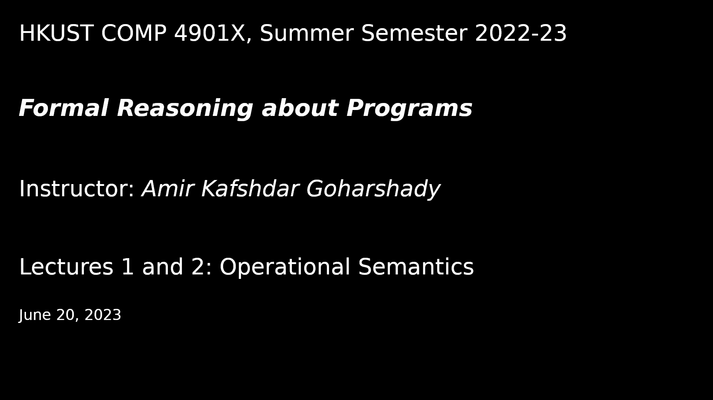
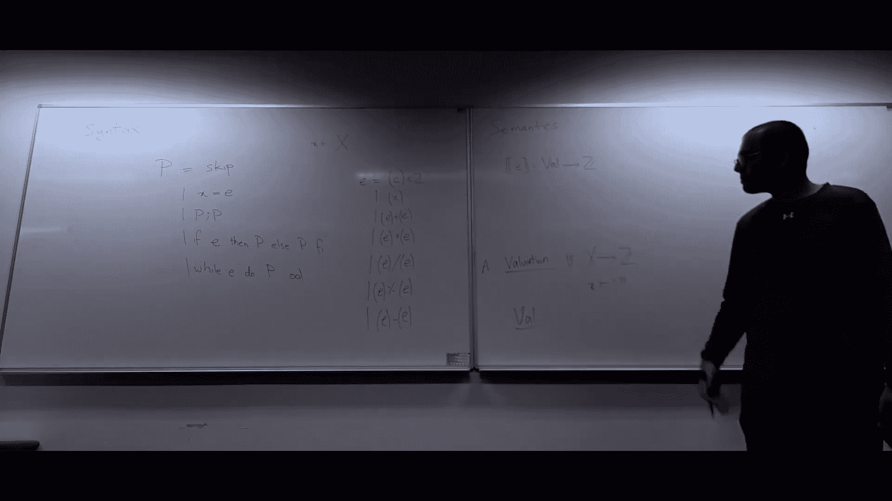
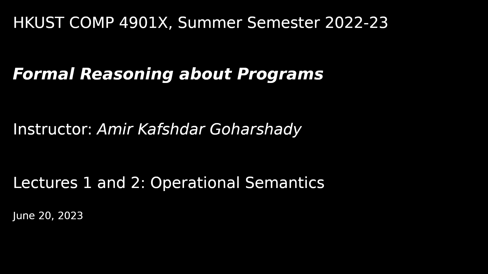
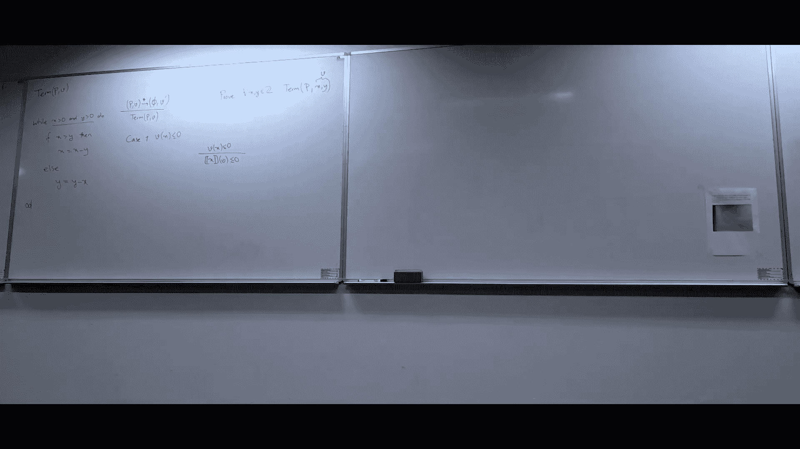

# 香港科技大学【中英⚡程序的形式化推理｜COMP4901X 2023 Formal Reasoning about Programs】 p01 p0 s 1 and 2 - Operational Semantics -BV1roXTYaEmJ_p1-

Welcome to formal reasoning about programs。So let me just define what I mean by each one of these steps。

So in this course， when we say formal。That basically means mathematical go。

So when I say something is formal， I mean that it has a well defined mathematical definition and we can reason about it mathematically。

 which is of course the second word reasoning。But when I talk about reasoning in this course。

 I usually mean automated reasoning。So the idea is that I'm lazy， I don't want to do too much math。

 I want to have a system that does the reasoning for me， that automates everything。And actually。

 today I'm going to do some manual reasoning so that you all see how painful it's going to be。

And then hopefully from next week， we will see how we can automate all parts of this reasoning and basically avoid the pain。

Hopefully you know what about means。Programs。You've all done some programming before。

 you know what the program is。But for the purposes of discourse。A program is just a string。

That is generated。P。So I'm going to have a grammar that defines all of my programs。

And then any string that satisfies that grammar， any string that can be generated by that grammar is called the program。

So when I say program， I don't mean anything deeper than that， it's just a piece of text。Okay。

So yeah， with that being said。Let me actually erase all of this。

And let's talk about the difference between syntax and semantics。

So every program basically has two parts。There is the part where we call the program。

 which is just what you write， the program as a string。

And that's usually what we call the syntax of the program。So this is what you type。In your I D。

That's the syntax of the program。And then the other aspect of the program is its meaning。

 so what does the program mean， how should I execute the program。

 what properties does the program have？And this aspect is what we call the semantics。

So how can I run my program？What do these symbols mean？A C++ program， for example。

 is just a bunch of characters。How am I really assigning meaning to these characters？

That's the semantics of the broker。Now I'm going to spend very little time on syntax。

But several of our lectures are going to be focused on how to formally define the seantics。

And the problem that we have is that we need to strike a balance。

 we need to define the semantics in a way that is understandable to humans。

But also understandable to machines， so I have to make sure that I can do formal automated reasoning using these semantics。

So I cannot give semantics that are， for example， unbounded or infinite or uncountable or things like that。

 because if I say the meaning of my program is some mathematical object。

 let's say the meaning of my program is a graph。And if that graph is infinite。

Then it would be almost impossible for a computer to reason about it。

RightSo I want to avoid this kind of infinite objects。

 I want to try to really just have rules and reasoning steps that can be automated as much as possible。

But okay， let's get the syntax out of the way first。So usually when I talk about syntax。

 I just have a grammar。And that grammar tells me what kind of programs I can write。

 So I'm going to start with the simplest possible programming language。

 Let's say I want to design a programming language thats。

Just does some basic operations with integers， let's say I want to have a loop。

 but I cannot have any functions or recursion or anything like that。

 so I'm just going to define a very simple procedural or imperative programming line。

So I'm going to write a grammar and I'm going to say that in this grammar， my program。

 which I show with the symbol P。Can be created using any of these rules。

So the first thing I'm going to allow in my program is an operation that doesn't do anything at all。

Okay，And I'm just going to call this operation。By the way， as I'm defining my syntax。

 I'm talking also a little bit about the semantics of the program， for example。

 I just said this is an operation that doesn't do anything。But you shouldn't look at it that way。

 so I'm giving you some intuition about it。But。As far as the syntax is concerned。

 this is just some string， I can write this string and it's a valid program。

 so my program can just be this string skip。Or。The other thing that I can have in my program is that I can take some variable。

 let's say this variable is x。And I can assign some expression to it。

 and let's say the expression is E。Okay。Now for this to make sense。

 I should also have a set of variables。So let's just assume that I do have a set of variables and I showed my set of variables with big x。

And this small x has to be in big x。Okay， and then of course I have to also define what an expression is。

 but I will do that later。I want to also allow some other operations here。

Let's say I have two programs。I can just put them sequentially next to each other。

 so if I have two programs I can。Together， this is a larger program。Not the 홀에서。Other than this。

 I want to also have an if condition。So， I say， if。Some boolean condition homes。Or actually。

 instead of Juliaian， I'm just going to write E for expression if some expression holds。Then。

Do something。Else， do something else。And。Just to make things simple， I always have an end for my if。

 which I show with fee。And also， my ifs always have an L。

So I want to keep the syntax as simple as possible。

 so I don't allow if that don't have an enough part。Okay， and finally， I'm going to have a loop。

So I'm going to have something like this。 I'm going to say while some expression， do something。

And then I have something for the end of my loop so I can just write the O， which is。

The opposite of two。And this is my programming language。

So this is the simplest possible programming language I could design。

 of course I have to still talk about what expressions mean。And I will do that。But for now。

 let's talk about the types of the variables。 So I'm going to again， make things really simple。

 and I'm going to say all of my variables are going to take only integer values。Okay。

And let's say I don't want to have overflow and underflow and things like that。

 so let's assume they can take integer values that are unbounded。

 so from minus infinity to plus infinity， whatever you want。Okay。Now let's define these expressions。

So what can an expression be？So I'm going to allow an expression to just be a constant。

 so some number C， which is an integer， so any integer is an expression。Or it can be a variable。X。

Or it can be the sum of two expressions。Or the multiplication of two expressions。or the division。

 and this is integer division， but again， that's something that has to do with semantics。

 so I'm not going to get into it right now。Or let's say I have the modulus operator as well。嗯。

I forgot subject。O。Now， one thing that immediately comes into mind is that。Well。

I also need parenthesesis here。So technically， I would define my expressions like this。

So that they always have the correct。Penttheization， and I'm sure that there are no two ways to。

Consider the same expression， right。So technically this is my syntax。

 but in practice when I write programs， this is too cubersome so I will not put the parentheses。

 but you should assume that they're there。just imagine everything that I write has correct parenthesesis there。

O。So this is the syntax of my program of my programming language， so if you give me any string。

I can just check if that string can be created using this particular grammar。

 like this whole thing is the grammar。Then I say it's a valid program， otherwise。

 it's not a valid program。And by now， my programs have no meaning。 it's just every program is a。

Sequence of characters， let's say， and it can have like these keyboards in it。

 it can have numbers and so on。But I'm not really assigning any meaning to this problem。

So now let's talk about the actual thing that we care about before that' any questions about syntax？

How this works。Okay。So you can imagine that no matter how complicated your language is。

 you can probably just come up with some grammar or some rules to decide whether a particular string is a program or not。

And that's actually the role of a parser， so when you have a compiler and you give it a particular code to compile the first level is that it runs a parser and the parser checks if the code is syntactically valid。

嗯。ほら。Now one question that might come to mind is why do we even need the formal semantics。

 so why do I need to define mathematical semantics？

It feels like at least if I have a programming language that is so simple as this one。

Everyone has the same understanding of what the program does。Right。So， do you think。

For a programming language as simple as this one， we still need formal semantics。

Of course the answer should be yes， otherwise we wouldn't have a course。呃。But why。

So to give you some examples of why we need these things。

Let me give you a piece of code that can be written in， let's say， C++。嗯嗯。

I want you to consider this， let's say I have a function。Whose job is to just multiply two numbers。

Let's say I give you two numbers， x and y， and these are， let's say unsigned numbers。Okay。And。

Let's say this first defines。A pointer P。And then it does this。

 It says if x is greater than or equal to 0。And y is greater than。Or。

Y is greater than or equal to 0 or。The value of p is greater than what we equal to0。Then。

X gets multiplied by y。And at the end， I return next。Very simple program。5 lines of code。

Does this program correctly multiply x and y？Okay， so what are the issues？Okay。

 what's the problem with P？Yeah， so one problem is that this P here， it's aninitialized variable。

And it's a pointer， so it's pointing to some random garbage area。Right。

And then here I'm using the value of P。So should that be some sort of a runtime error？

Would we have a problem？Actually， no， yeah， at least in C+ plus somantics。

 we will not have a problem。But why is that？It science or it should be。So okay。

 let me just write the issues that we are describing here。So one issue was。Initialization。ok。

And even if you initialize it to null， then you will have like a null pointer dereferencing problem here。

 so the other issue is null pointers。Right。But then in C++ at least。

The way and if condition works is that if you have or like this， you do short circuiting。

 so you check the first condition。And if the first condition holds， you no longer check the rest。

So when this program is compiled by a C++ compiler， if you have a standard compiler。

 it would actually never check this part。So I would actually never have an error here because x is unsigned and an unsigned variable is always greater than equal to zero。

Okay。So the next issue that we have here， which was not so trivial。

 was whether we have short circuiting or not。O。There are more issues with this code。

What else is wrong？Okay， what's wrong with the return value？Yes。So。We are。

Multiplying these numbers and whatever， and let's say the answer is in x。

And the type of X was unsined。But then I'm returning it here and the type of my function is int。

So when I'm returning it， I'm converting an unsign to an int。And that's not a safe conversion。So。

If we are， let's say， in a 32 bit system。An integer。

An int is an integer that is between minus 2 to the power of 31 to 2 to the power of 31 minus1。Right。

Whereas an unsigned variable。Can take values， which are from -2 to the power of。Oh， sorry， from zero。

To2 to the power of 32-1。Right。So if this variable x is outside this range。

It just doesn't fit into an integer。So I convert it to an integer and actually again the way it works in C+ plus is that I get a negative integer。

 which makes no sense I'm multiplying two positive numbers， getting a negative number。

So I have a problem with type conversion。But even before that， I have a problem here with overflow。

Right。So the fact that x and y fits in the range for an unsigned variable doesn't mean that their multiplication is also fitting in the same range。

So it might be that I need a much larger range for that， so I'm also having problems with overflow。

Now， this was an example in C++， but different languages make very different decisions about all of these issues。

So for example， if you don't initialize a variable。

C+ plus I don't give you any guarantee on the value of this variable。

 and this is something that was inherited from C。It's just that if you define a variable like this。

 it can have any value at the beginning。Right， but many programming languages actually put as zero value in terms in case of。

This pointer， they will just put no。So how we initialize actually is part of the semantics of our programming language。

And then let's say I have something like a new pointer， I mean。

 whether we have a pointer or not is itself， of course。

 a choice that was made in the programming language like Python doesn't have pointers at all。

But what happens if this pointer is null and I try to dereference it？Do I just get a garbage value。

 do I get a runtime error？Does my program terminate？

Who knows these are all things that should be defined in the semantics。Okay。

 do I have short circuiting or not again？If I check this one here。And if this check passes。

 if this part is true， would I go on and check the rest？

And this is actually very important for the final programmer as well， because if you consider。

 for example， C++。At least I personally write quotes like this a lot。

 so let's say I have some string S。And I write something like if S that lengths。Its not zero。And。

S 0 is a。Right？Then do something。Now， in an language like C++ where I have short circuiting。

The way this works is that it checks this first part of the if。

And if the length of this string is zero， it doesn't check the second part。

 so I don't have a problem。But if I was writing something similar in one of the old languages in Pascal。

 let's say， which doesn't have short circuiting。Then it would first check this。

And then it would again go ahead and check this one as well， but then since let's say S was empty。

 if S were empty， then S0 would not exist and I would get like an out of bound error here。

So you see the experience that you get from your program is very much dependent on the details of the semantics。

Of course， type conversion and overflow are problems that I'm sure you've all experienced before they're nasty。

嗯。我的天。Oh， there is one more issue here。I forgot。What other issue do we have here？

The other issue we have is that these variables。They're passed by reference。Right。So this function。

 when it changes the value of x， it changes the value of x for the parent function as well。

So this is what we call a side effect。So this function has some extra side effects as well。

 so if I just ask you， does this function correctly multiply two numbers？

That's really not a good enough specification， I have to be more specific about what I mean。

What does correct mean， does it mean that it multiplies these two numbers and I don't care about the side effects。

 or does it mean that it multiplies these two numbers and it should have no side effects？So。

This actually brings us to another point， which is that we basically need two different languages in a sense。

 when we want to see if a program is correct。We need a language for writing the program itself。

 which is what we're talking about， the syntax and semantics and so on。

And then we need a different language for writing the specification。

 for writing the properties that we want to verify。

And usually these properties are written in a logic， and we will see that later in the course。

But for now I just want you to remember that this is formal reasoning about programs。

 so we should have a very formal definition of what our program is and what the semantics of our program are。

 and then we should have a very formal definition of the property that we want to check。For example。

 I want to check if this program correctly multiplies these two numbers and has no side effects。

But then I would need kind of another language to write this property。But we will get to that later。

It's like several sessions。O。So this is the first reason we need formal scientists because it's not at all obvious。

What kind of decisions we have to make about all sorts of details。

 so even though a programming language like this might seem trivial。I mean， even in this language。

 what would happen if I divide by zero？Do you just ignore it。

 go to the next line of code and continue the execution， do you end the program？

Do you throw some sort of exception what you do， it's not well defined。

I need to give it some antics for that to make sense。Okay。Great。

The other issue where we actually need semantics is actually for compilation。

So let's say that I have a program in one language。

And I want to compile it and get another program in a different language。

So let's say you've again written some C++ code， you give it to a compiler。

 let's say you give it to G++， which is my favorite compiler。

And it's supposed to give you machine code or assembly or whatever you call it。Okay。

So you have a program P here， you get a different program P prime here。

 of course the languages are different， the syntax is different。

You want to somehow prove that they have the same semantics。 You want to make sure that。

Your compiler is not changing your program。That after compilation。

 this P prime does exactly what P was supposed to do。Because the machine is going to run P prime。

But the programmer wrote P， so the programmer shouldn't have to even think about P prime。

But somehow to the programmer， it should look as if P is the program that is being executed。

So in a sense， the executions of P prime should have the same behavior as the executions of P。

 they have to be semantically equivalent and we will define that later。Okay。But then in compilation。

 we have another issue， and that's the issue of。Optimizations。So again， if I want to。

Give me an example， let's say I have this piece of code。

 let's say the programmer has written something like this， decrease y by one。

 and then increase it by two。Okay， and let's say I'm a compiler and I want to optimize this。

 I don't want to do two operations， I say instead of this， let's just increase y by1。

So the question is， is this a valued optimization， can I do this？And again。

 it really depends on the semantics of your language and how things work。So。

If this is a bounded integer， if it's like a 64 bit integer in C+ plus， no， you can't do that。

Because it might be that this one actually， sorry in C++ you can， because yeah， since C++ 11。

 you can。Okay， but here's the thing， it depends on how you define the behavior when an overflow happens。

So。In this case。Let's say that y was an unsigned integer。And then I decreased it by one。

And let's say originally it was zero， so it couldn't be -1。

 and let's say the semantics of my program says that in this case。

 I should throw an exception or I should just terminate the program。Right。

Then this optimization is an invalid optimization because there is an execution in the original program that crashes。

But this optimization never crashes。Or at least doesn't crash for the same reason。

So when you're taking a program and you're optimizing it as a compiler。

 you have to make sure that you really don't change any of the semantic behavior of the program。O。

I think that's enough for motivation。 I have a bunch of other examples here but。Yeah。

 you get the idea。So let's define semantics for our toy programming language。How do I define cement？

Well。Let's start by defining semantics for our expressions first。Okay。

So I want to give some mathematical meaning to every one of my expressions。And。

Generally the notation I use is this， I use a double bracket E。To mean the semantic meaning of E。

Okay。So first of all， what is the meaning of an expression， what does an expression do。

 so we have this syntax for expressions。But what does an expression actually do？Yes。

 so we basically have。These variables。And each one of our program variables will have some value。

And then the expression maps the values of the program variables to some other integer value。

So it's good to actually。First， define the concept of evaluation。So。I'm going to write it here。

What is。Evaluation， evaluation V。Is basically a function。

That gives a value to every one of my program area。Okay。

 so evaluation just tells me what is the value of each variable， it's a function， takes a variable x。

Mps it to its value as a standard。So now the semantics of an expression is going to have a more complicated type。

And let's say that I showed the set of all valuations by VAL， so this is the set of all valuations。

 I use small V for a single valuation。嗯。ok。So。Every expression should basically take evaluations。

And give me values。So it should be a function from valuations to numbers。

And I'm just working with integers。Okay。Now I'm being nice to you today because this is the first session of this course。

ポイツ。The way people usually write this。えです。Just this， they say。This is the tank。Right。

So it's a function that takes a function。Mapping variables to values and maps each function to value。

オケ。Don't think about it like that for now， at least。

And I promise you I'm not going to do any functional programming。Okay， the intuition， I guess。

 is clear， evaluation is just a set of values for each one of the variables。

It mapps each variable to a value。And then the meaning of an expression is that if I give you the values of all the variables at this point in the program。

What is the value that this expression evaluates to？Okay。So now we want to define this meaning。

So let's do this。いる。And this is basically going to be a casework。

 I'm just going to go over every type of expression。And I'm going to define its back。O。So。

What is the semantics of a constant C？So for example， what is the semantics of the number 100？

So this is going to be a constant function， right？It just completely ignores the valuation and just gives you this thing。

So it's going to be the constant function C， and I write it like this。So for example， here。

 I just say it's 100。And by this， I mean that it doesn't really depend on any of my program variables。

And any of the variables in。O。But maybe it's easier to write it like this。 I can say for every。

Valuation V。The semantics of C at V is just C。Okay。So， remember。

This is a function that takes the values of all the variables。

And maps it to the value of the expression。And this is a constant expression， it's just a number。

So no matter what your variable values are in your program， you're going to get the same number。

It's like。Very easy case。O。Now。What if I have an expression of this type， what if I just have X？😔。

And again， I'm not going to write the parentheses anymore。To for that。What happens if we just have X？

So my expression is x。And x is one of my variables。

And my valuation V tells me the value of every variable。

 so I can just take the value of x from my valuation。So， x of V。エスビーアフエックス。

We're going to see a lot of funny things like this。Okay， but you have to understand here。

 the types are really important。So V was valuation。

So V is a function that is mapping each one of my program variables to a value。

And here x is a program variable。So v of x is the value of this particular variable。Right。

But now here， this is the semantics of the expression X。This is not a variable， it's an expression。

It just happens that it's this type of expression， which was basically variable。

So the meaning of an expression has this type， it takes a value of evaluation over all the variables and gives you a value which is the value of that expression。

So the semantics of the expression x at the valuation V is the value of the variable x in the valuation V。

that's how we rank this。Hopefully。First of is going to be a little。So if I have two expressions。

 E1 and E2。And I sum them up。And I sum them up at point V at valuation V。What am I supposed to get？

Yes， so I just take the semantics of E1。And I apply it to V plus。The semantics of E2。といちと。Again。

 what I'm writing here is very trivial， I'm just saying that if you have the expression E1 plus E2 and this expression contains a bunch of variables in it and it has all those operations as well。

 and if I give you a value for each one of the variables and I say what is the value of E1 plus E2？

You should simply find the value of evonne first。And then add the value of E2 to it。

So I've done this case， this case， and this case。Now。

 multiplication and subtraction are very similar to addition。

 I can just define them in the exact same way。So I don't need to define those。

But before going to the definition for the other two， because they're kind of troublemakers。

I'm going to also have a different way of writing these semantics。

And I'm going to use what I call rule based。So。This is very common notation in programming languages。

And basically， this is how it works。I draw a line。And I write some things on top of this line and some things on the bottom。

And what I mean is that I'm writing my assumptions here。And I'm writing my result here。

And this is supposed to be a rule， so whenever I write something like this。

 I mean that if the assumptions hold， then the results will also hold。Now。

 the reason I want to have rule based semantics is because later on in this course。

 we're going to see。A software system called Cock。W can actually use this kind of representation to do automated reasoning。

And this kind of representation makes automatedizing much easier in general。

 it's not just because of。Okay， so here's how I can define。The semantics， these three equations。

Using a rule based notation。So for the first one。I just write it。ライフです。

So I don't need any assumptions。And it's just that it always holds so for every valuation we。

The semantics of CV is just。And this one as well， I don't need any assumptions here。

I can just say the semantics of x。At valuation， V is B of a。Now for this one。

 I can write it like this。I can say， suppose。That the semantics of E1。At V。What some value was a1。

I also suppose that the semantics of E2。And V was some value， for example， A2。Okay。

Then assuming these two things。The meaning of E1 plus e2 is just going to be。エボンとす。おです。O。

It's basically the same thing， it's just that I'm giving names to these two different parts。

I'm saying assume that the value of E1 at valuation v is a1 and the value of E2 at valuation v is a2。

 then the value of this expression。It's going to be the sum。And again， a very important point here。

 A1 and A2 are integers， so this is the sum of two integers。Even and two are expressions。

So this is just a string that has the character plus in there。It's not the sum。

 I'm just defining what that character means。Okay。So we're going to write most of our semantics like this and again。

 whenever I write something like this， I mean that if these assumptions hold。

 then you can also assume this one。O。あ、ワイドタイニードってす。Because I want to define integer division。たいいすね。

Here's the semantics word。Let's say that I want to define the value of e1 divided by u2。

At some valuation。Okay。And let's say that E1。At this valuation， V evaluates to a1。And E2。

Evaluates to a2。Yes， I want to say this is a1 divided by a2， but the problem is I cannot divide by0。

Okay。So I need an extra assumption here。And my extra assumption is that a2 is not zero。So as you see。

 it's actually kind of easier to write this。In this rule based manner。

Than the previous kind of formula that we had。Because now I can just add the assumptions as I like。

Okay。But what does this mean， this means that now I have undefined behavior in my code。

I can have a situation， well， at least my syntax allows it。Where someone is dividediding by 0。

But if they divide by 0。I'm not defining any value。So this value is only defined。When a2 is not zero。

 I'm not saying what happens if a2 is0。Okay， so I'm leaving that's undefined for now。

And I'm going to do the same thing for。Modulus。So。Here's the thing here I'm going to say that。

If you want to compute module or something， that thing better be positive。

 I don't even want to allow you to take。Some number， modular， another negative number。

 even though you can technically do that in C or C++。So。I'm going to do this。

 I'm going to say suppose that the value of E1。At V is a 1。And the value of E2。V is a 2。

And I want to define the value of e1 moduleo E2。FB。O。So the first thing is， as I said before。

 I'm going to say。I'm also assuming A2 is positive。But what should I put here？

So one way is to just figure out the formula using like the previous ones。Right。Yeah， so I can。

I can do something like this， right， so I can say it's the value of e1。At V。Minus。The value of。

E1 over E2。At V。Times。え。对。Or actually， this one was supposed to be a1。I can just say it's a1。

Minus and then I use the integer division。Timeイムス。Okay。That's one way of doing it。

 but it doesn't look that good。I actually like to do it in a different way。I want to say。

Suppose that's okay， the first number is a1， the second number is A2。And A2 is greater than 0。

And let's say that a1 is equal to。Let's give it some other notation， so let's say B plus CA2。Okay。

And let's say that B。Is between zero and82。So I'm just adding assumptions。Okay。

 so I'm saying that if。E1 at V evaluates to A1 and E2 at the same valuation evaluates to A2 and A2 is positive。

 and A1 can be written as B plus CA2。Where B is between0 and A2 so I'm basically doing division。

 I'm literally writing the definition of the mod operator。Then the value of even。

Mod E2 at v is going to be B。Okay， so I can have a rule like this。Which basically defines it。Okay。

 now I have the definitions for all of that。But of course， the problem here is that。

My definitions don't always work。 They work when I have these side conditions， for example。

 when I want to divide。I can only divide by a non zero。If it's zero， I haven't defined anything。

So actually these functions， they're not total functions， they're partial functions。

 and we write it like this。And what this means is that this is a function that is defined on some valuations。

 and for some valuations it's going to give you a value C。But it's not defined for every valuation。

 it might be that you give it a valuation it just it's not defined。Okay。

And sometimes we also have a notation for not defined， I don't know。

 we use something like this to say it's not defined。And。We'll use this later。Okay。

But I did all of this work。And all of this work has just defined。The semantics of expressions。です。Oh。

 okay， yeah， yeah， you're right。So here I'm actually。Not as formal as I should be。

I have to again write the same thing， I have to say suppose that a1 is B plus CA2 and B。

Is between0 and a2。Then here I have C。でがとないことじ要しやす。Yeah， so here I have to actually。You see。

 that's the problem with formal semantics。Very careful， I have to say。

The absolute value of is less than the absolute value。This finally works， hopefully。Okay， and okay。

 and B should also be。啊，O是。Let's do this， let's say B is greater than or equal to0。

 but less than the absolute value of8。Now it works。Okay。So yeah， this is the very hard business。

 as you're seeing。And okay， so don't drop the course because of these things。The first two sessions。

 like today， my job is to show you how hard these things are so that we actually have motivation for automating them and not having to do them by hand later。

Okay， so we've defined semantics for our expressions。We should now define semantics for our program。

So。For an expression， I could easily say that， well， the meaning of an expression is just a function。

 of course it was like a higher order function that took evaluation which was itself a function and mappeded to a number。

 but that's fine。It's a function anyway。But if I want to define semantics of my program。

I can't really think of my program as a function in the same sense。So you might be able to say， oh。

 well， you're。Program variables are going to have some initial valuation and when the program terminates。

 they're going to have some final valuation so we can think of programs as just functions that map valuations to valuations。

But that doesn't work that well because what if my program has an error somewhere。

 what if my program runs forever， what if my program doesn't terminate？🤢，And also。

 if I give a definition like that。If I just say that the meaning of a program。嗯。Actually。

 I want to erase this one。This one turn。O。If I tell you that the meaning of the program。

It's just a function。That takes。An initial valuation for my variables and gives me the final valuation。

There are two problems with this， the first problem is that sometimes my program fails and doesn't give me any output。

And I can solve that by saying， okay， this is a partial function。

It gives me evaluation only for some values。But then I have the second problem。

And the second problem is that this doesn't tell me anything about the execution of the program。

RightSo a program is not just about its input and output。

 it's also about all the steps that we take to get from the input to the output。

So we don't want to lose all that information。But then as we will see later。

We can have more expressive programming languages。Where for the same input you might have many different outputs。

So then again， this kind of definition breaks and then maybe you can say that for every input。

 I get a set of outputs。But things get out of hands really fast。So instead of doing this。

And this is actually doable， but I'm not going to do it。Instead of this。

 I'm going to define what we call operational semantics。

And the idea in operational semantics is that in order to give meaning to my program。

 I'm going to tell you how the program is going to be executed。

So I'm going to tell you what every step of the execution of the program is going to do。Okay。

So remember that I already had the definition of what valuation is。And this was just a function V。

That maps my variables。Two integers。Now I want to also define the concept of a state。

And I'm going to give you two definitions。People use both of them。

 I'm going to only use the second one in this course。At least。

I don't guarantee that I will never use the first one， I take that back。But mostly。

 I will use the second。So the first definition of a state。Is that the state is just a pair。LV。Where。

L is a line of code。So it's a line number。And。We will have to then define my number。

And V is a value sorry， is a valuation。So the idea here is that suppose I have。Some code。

 I don't know。 let me write some code here。Let's say I have a cold like this。W？エクセスマな十ポ。

Ex is positive and。Why is positive？嗯。系。BasedMy syntax， but I think。If you were doing that。

I'm going to have an out here。And then I say if x is greater than y。Then。X becomes x minus y。あす。

Why the conline。エックス？O。So if I can somehow assign line numbers。

And I'm going to assign line numbers are together， but let's say that。In my syntax。

I had a pay of assigning line number。So let's say I have some standard way。

 I don't know how where I say this is line1， this is line2， this is line3。This is line four， five。6。

Now when I'm running my program。As I'm taking steps in my program。

 I can say that this state that I'm in。Is uniquely determined by which line I'm at？And also。

 what is the current value of all the variables？So if I'm at line2 and I know that x is 2 and y is 1。

Then it's well defined and I know that， okay， this condition is satisfied so I have to go to line three。

So， if。I'm at line2 and let's say x is2 and y is1， I'm going to write it like this。

 but actually you know that this whole thing is V。なんですすら。So if I might line to。

And the value of x is2， and the value of y is1。Then I can transition and go to line three。

And the values remain the same。Now， if I'm at this line and these are the values。

Then x becomes x minus y。So x becomes1， y remains1。And where do I go after line three？アゴートゥナインセ。So。

I might be able to write rules that basically tell me how to move through this program。

But I have two problems， the first problem is that this concept of line numbers is not very defined。

So I would have to give a mathematical definition of what a single line is。

So you can think of this again if this were something like C++。

 I could write many commands in the same line。So I have to make that very defined。

And the other problem is that。Anything that I write， any rule that I write。

Is inherently referencing the entire program。Basically。

 I'm assuming that I know the entire program and now I'm telling you how to move in this program。

But it might be that I have a huge program that has many maybe many different functions。

And I want to define the semantics of each function separately。

Then I cannot use this concept of state。So this is the first definition of state。

 but this is the definition that I'm not going to use。A different definition of state。

The one that I'm actually going to use。Is that a state of my program is again a pair。But this time。

 it's not a pair of a line number and evaluation。It's actually a pair of a program an evaluation。

Where P。Is itself a program？And V is evaluation。Now what do I mean by this？

I mean that P is the remaining part of my program that has to still be executed。O。

So if I'm at state PV。That means that my current valuation for the variables is given by V。

 so V gives me the values of every program variable。

And then I know that I have to execute the program P on top of this valuation。

That's the intuition that I have here when I say that my state。Is this。O。

And now just like here when I was trying to define transitions between states。

I'm going to try to define。Transitions between states， but many states are like that。Okay。So。

Maybe this example is not too big。If like this example， I would probably come back to it。

Let's say my program is just。A very simple one。 let's say I have this x equals1， y equals x plus。

Let's say this is my program。And let's say that I also have an initial value。My initial value is。

I don't know。0 zero， originally， let's say all of my variables very zero。

 and then I'm just going to run this program。So what's my initial estate？My initial state。

It's just going to be the entire program。Applied to the valuation。ゼ zero。Okay。So this is my program。

And this is my valuation。Now I'm going to say that I can have a transition and I will give you rules for these transitions later on。

But I just want you to see how these stakes work， I can say that if I'm in this state。What can I do。

 I can run the first command here。And it will set x to1。

So I will go to a state where x is1 and it will not change y so y remains zero now what is the program that I have to execute over this valuation。

 it's only the second part of the program。そ場。Okay， so one level or one step of execution of my program is that I go from this state。

 this entire thing is a state。To this。O。Now， what's the next step， the next step we set。

I'm going to apply this one， so x remains1。Y becomes three。And I no longer have a program with。

So I showed the empty program with this。I don't know。 I can show it with whatever I want。

 I show it with。Okay。So when I get to this point。I have a final evaluation and I don't have any program at all。

So。The intuition here is that the execution of the program has ended， this is my output。Okay。

So that's how I think about my states。Again， let me erase this one。Whenever I say you a state。

 I'm in a pair of a program and evaluation。And I have to apply this program to this valuation。

 so this is the part of the program that has not been executed yet。

The parts that are executed are already removed。Okay。So based on this。Let's write some semantics。

Let's write the semantics of。All the operations that they had。In my grammar。So。

I had a skip operation， which。I said just doesn't do anything。So if my program is skip。And I'm。

That valuation V。What happens？Well， it doesn't do anything， it just terminates。So in one step。

I go to the empty program and evaluation。オケ。And this is a rule that doesn't have any assumptions。

 and it always works。 I don't need to put any side conditions or anything， always。Okay， that was C。

What if I want to do an assignment？Let's say that my program is x equals e。

And I'm currently at valuation V， where should I go？

So my program says take expression E and assign it to X。

And I know the current value of all the variables。So first of all。

 what happens to my program after one step of execution？The assignment is executed。

 so I will not have anything else to execute so it becomes the empty program。

But what happens to my evaluation？So my evaluation will remain the same as before。

Except for one variable， for the variable x。And what value should x take。

 x should take the value of E？Let's call that value a and I write it like this。

 and by this I basically mean the same valuation v except that only x is replaced by a。Okay。So， our。

Sometimes if we use this notation， maybe I can use this。

I actually don't remember if it was a slash or a back slash， whatever。You know what I mean。

 I just mean that take the same valuation except that put the value of a into x。

 but I have to define what a is。And so this is going to be my assumption。 I'm going to say。

 suppose that。The value of E at valuation v was a。Okay。And I can use this。

Because I previously had rules for this one。Right。So the value of an expression is well defined。

 I have a mathematical definition for it。 I had rules where I erase them。Nothing enough space。

But I have a rule for this。If using the combination of the previous rules that I had at some point。

 I could get this expression， I could figure out that the value of E at v is equal to a。

 then from this assumption I can conclude that I have this particular transition and okay by the way I call this transition so I'm going from this state to this state。

The fact that I can go from this one to that one is called the transition and this is the notation for transitions。

O。Not too hard， pretty easy actually。O。What happens with sequential composition？

So let's say that now I have。A program that looks like this， P semicol and Q。And let's say that。

I have to apply it with the initial state V。With the initial valuation V。Okay。

So where should this program go？In one step of its execution。Yeah， so。Basically。

 I want to only model one step of execution。And so here I want to just model the first step of the execution of P。

 and I don't want to execute any of Q。Right so let's say。In my assumptions。

 let's say that if I just do one step of t over V。I can go to P prime V prime。Okay。Then， here。

I can say that if I have this。Where should I go？So my assumption is that if I ran one step of P over V。

 I would go to the state P prime V prime。Now I want to run one step of PQ over V。

So it's basically the same thing， it's just that I will get to p prime Q and v prime。

 right because the first step of PQ is the first step of P。

But then here after the execution of one step of P， I had to run P prime。Here after that P prime。

 I have to again come back and run Q as well。Again， the rules are very simple。

 it's just that writing them formally is a bit weird。

But I need another condition here and the condition is that P should not be the empty program。Right。

Because the empty program cannot be executed。And okay。

 so I generally assume that the empty program followed by Q is the same as Q。But theres no。

嗯 so you need to define。That's a rule。れって。再組んで先。There's no eal for the empty。

Comine with that information以后。Sure， yes， you're right。

 technically because I cannot evaluate the M program。

 but the problem is then the evaluation will stop if I cannot evaluate the M program。Yeah。

 I'm saying this condition is them。It's not redundant in the same okay。Yeah。

 I can remove this if I add this。Yeah， okay。Great， so。呃。Remember this one at the back of your head。

Going to raise it。Now we have these conditions。Now we're getting to the nice part。

 What happens if I have an if condition？So。I have， if。第一。Then。皮。LQ。And I should also have the。

So if I have this， and I start。Ands。I start at valuation V。Where should I go？

So if you run one step of a program， that is just an if。What do you do？Well。

 basically in the first step of execution of this program。

 you're going to decide whether the condition holds or not。And if the condition holds。

 you're going to do Q， if the condition doesn't hold， you're going to do Q。オ。So。

I can just write that up here。I'm going to say I take my condition。

And I find this value at the valuation V。And if that value， well。

We have to kind of define true and false。So I'm going to say zero is false and everything else is true。

I'm just going to make that decision at this point because I'm giving semantics and I'm giving meaning to my programs。

 this is one of the decisions that I have to make。So I'm going to say if this is not zero。接。

If this condition holds。Then what kind of transition should I have here？Where should I go。

So this is again， my state。I should go。グピ？Yes， so I have to execute P。

 but I have to execute it over the same valuation， my valuation does not change。Okay。

The other rule is quite simple， if it is zero， then I have to run Q over the same valuation。

If this thing。Is0 then。I have a transition from F E then PQ。3？And of。And the V。さよ。Okay。

We don't have enough time for the white loop。We're going to。Go have lunch。come back at2 o'clock。

And we're going to write the rules for a while。

We were doing operational semantics and we were basically talking about these transitions。

And I said that each transition models one step of the execution of the program。

 and these rules tell you when you have a transition between two states。

So without we already wrote rules for S for。Assignments， sequential composition， and if。

Sometimes instead of if I say branching because we're branching to two different branches。

So now we have to write rules for our loop， which is a wide loop。

 so I just wrote the syntax here again。So what kind of a rule can I write？

So I want to have a rule that looks kind of like this。

 let's say my program is while some expression E。Do some sub program P。

And let's say that I want to apply this program to an initial valuation V。

So what happens in one step of execution of a value？

What's the first step that you take when you want to execute a white loop？Yes。

 so we checked the condition。And actually， there is one trivial case。

 and that trivial case is if the condition is false。So if the condition is false。

 we said that we show that like this。And I always forget to put the V in there。

We should be here as well。So。If the expression E evaluates to0 at V。

Then I basically don't have to do this while loop。So I can say that I have a transition from this to the empty program or maybe to skip andV。

Right。This is the easy case， this is the case where your wide loop doesn't run even for one iteration。

 be careful about the recording。ok。But what happens if the condition of the vi loop。

 the vial guard is actually satisfied？So。This is my second case。Let's say that。

This value of e at this position v is not zero。Which basically。

 I said that anything non zero is assumed assumed to be true， okay？So if my value is non zero。

How am I going to run my program and again， my program is。Ve。上品。And I'm starting at valuation。

So what happens at one step of execution？There one。嗯哼。Yes， copyP to the front。

 that's easier than executing one line of the。Because if we copy P to the front。

 then this other rule。This one will be applied and then in the next step we run the first line of P so I can have something like this。

 I can have P followed by the same program that I had here， followed by the same while loop。So。

While e。猪皮。And my evaluation remains the same。So the intuition is actually quite simple。

 it's just that I'm checking the condition of the while loop。And if that condition holds。

 I have to first run the body of the loop， which is P。And then after that。

 I have to run the while loop again。Okay。So this is the first time that we're seeing a recursive role。

So in a sense， in order to define the semantics for while， we are using the semantics for vi again。

And by the way， I'm not really teaching complexity theory or theory of computation here。

But this is also a proof that having a loop has the same expresssivity as having recursion。

 so loops and recursion are inherently the same thing。

Because we're defining the meaning of the loop using regression。O。Nice。

 now we have operational semantics and actually this kind of operational semantics is usually called small step operational semantics。

Or sometimes it's also called structural operational semantics。And。

It's a small step because were saying what happens in one small step of the program each time。Right。

Okay， can you think of a different while loop？Can you think of a white loop that doesn't have any assumptions here。

 So let's say I don't want to evaluate E。Can I write a white loop that doesnt evaluate？Well。No， no。

 I want to write a rule for vile。That does not the value。So here's the thing。

 what's the difference between these two parts， it's just that here I'm doing P。

So would it be correct if I write this？By the way， in this course。

 whenever I add you would it be correct whenever I ask you that the answer is no it would not be correct。

 so you should tell me why this doesn't work so let's say I have。1 e。肚皮。And I'm starting at。

Valuation V。And I just say you can always rewrite the program。

You can always rewrite it like this if E。T0 p。As。Nothing skip。

 so just check I'm rewriting my program， but this is what my program does。 It says that check if the。

Guard of the vi loophole， and if so， do one iteration。Otherwise， skip。And then after this。

 do the white。Why is this not a valid rule？Because intuitively， it should make sense， right。

 so what do I do， I check the condition of the vine。And if the condition is satisfied。

 then I do one iteration。Otherwise， I don't do anything。 Remember， skipped didn't do anything。Okay。

And then after that one iteration， I have to do the vi again， so I just do the vi again。

Is this a correct rule？And I have no assumptions at all。Okay。

 maybe I shouldn't have told you that the answer is always no。But okay。

 now tell me why is this not correct？So。Just imagine that you have a program with a wide loop and try to apply this rule to execute your program。

So think of these rules as a dictionary definition of how you should execute your program at every step。

 what goes wrong if I use this rule？I'm just going to wait until someone figures it out。

So just look at how we're doing the rewriting every time I have this while。

And I'm doing an if followed by a while。And then when I want to execute this。Based on this rule。

 I'm first going to execute the if。But after I finish executing the if， I again have the vibe。

And I again apply this rule， and then I again have the if。Finish the if。I still have the vial。

 so the vial stays there forever。Endless yeah， it's endless there is no way that using this rule。

 a program that has a vi actually terminates because we will just keep running it forever。Right。

And actually， that's a big problem because if in this case， for example， let's say。

Let's say I'm at a state where E false。What am I going to do， I'm going to go here。

 I'm going to check and see that E is false， and so I do nothing。But then I again do the vibe。

How do I do the vi， again， go back， check that E false？So basically with this sctics。

 when the condition of a vial is not satisfied， we will just keep checking the condition of the vi forever。

We need to add a con that E is satisfied。Yeah， well， actually。The problem here is with the nesting。

So。Here's how we can fix this。Okay， and by the way。

 you should get used to writing flat code like this。So here I have this if and the if ends here。

And the vial starts after the end of the eighth。But what I should actually do is to take this while and put it after P。

So the vial has to go inside。Okay。Now this rule doesn't have the same problem as the previous rule。

 this is actually a correct rule。So the difference is that the vial is now inside the if。

 it's inside the then part， and it's coming after P。So what I'm saying here is that I'm saying。

 check the condition of the vial。And if the condition were true， run P once。

 run the iteration of the vile once， and then run the rest of the vi， but if the condition was false。

 just don't do anything， skip。And so I will not have an infinite run when my vi condition is not satisfied。

 when my vi condition is not satisfied， I will just jump to skip and that's it。Okay。So。

You have a choice， you can use these two as your while rules。

 or you can use this one as the while rule。Both of them work。Okay。

So I said that these are called small step semantics。

 which means that we should also have something called big step。And video do。

So the difference between small step and big step is that。In big step， semantics， we don't just go。

One step of execution at a time， we just have a single transition that does the entire execution。

And actually， I think that small step semantics is more natural。

 but big step is also called natural semantics。So that's a different type of semantics。

 I'm going to erase this one。It's just too complicated。But。Let's look at this big step。Or natural。

Operational semantics。O。Here I'm going to use a different notation。

And my notation is going to look like this。I'm going to write a state like this PV。

 and then I'm going to write a down arrow and then write in cry。

And what I mean by this is that if I run the program P over the state V， over the valuation V。

When the program terminates， I will be at valuation V prime。Okay。So the difference is again。

 that this kind ofarrow takes one step of execution at a time。

Whereas that one basically does the entire execution。

Now I want to see if we can write rules for that one。Just like before。

 I have to write rules for each type of combination that I have in my grammar。So let's start with S。

If I have skip。And my program starts at valuation V， of course。

 my program just ends at the same valuation。So， I can。That's my first。Now let's do assignments。

Assignment is also very similar。So let's say that my program is just。X equals E。And I'm at state V。

Or it's valuation B。And。Let's say that the value of E at v is a。

So I would basically end at the same valuation V， except that the value of x。Become。

So these two rules are basically the same as these two rules。Because in these cases。

 we were just finishing the program in one step and getting to the N program。

So it doesn't matter which type of semantics I'm using small step or big step， it's just one step。オ。

Now let's try the rule for sequential composition and let's see how we can write that。

So let's say that I have the program P followed by Q。And I want to run it on V。

Where does this program end？So this gets a little bit trickier， I have to add nicer assumptions here。

Well， intuitively， I'm going to first run the program P and see where I end up when I run the program P。

 and then I have to run Q starting from that point from the point where P ended at。

So let's say that I run P。On the valuation V。And let's say that it ends at V prime。Okay。And then。

 I run queue。From V prime。And let's say this ends at B double prime。

So this one should also end at we。So but it's really important to understand what this rule says。

This rule says that。If there is an execution of P。That starts at valuation V and ends at valuation V prime。

 and then there is an execution of Q that starts at this valuation at V prime。

And ends at V double prime， then there is an execution of P semi calling Q that starts at V and ends at VW。

Again， all of these things are kind of trivial and towards the end of this course they will be absolutely trivial to you。

 but at first it takes some time to get used to the notation。Let's do this。

So what should I write for if？So I have if some expression E。电皮。やす you。And I'm running this。

Where does it end？So again， I can do a tastework。I can say either this E holds or it doesn't。Okay。

So first， let's say Ehos。Which means it's not zero。If it's not zero。

Basically I will end up wherever I would end up if I executed P。Because this condition is true。

 so I'm executing P。So here in the。Assumptions， I can say， assume that P。Running on V and Z V prime。

Then this whole thing will also end up。Because I'm basically just running key。Okay。

 the other rule is effectively the same。I say that if I take this E。

And take it at valuation V and it's false。Then I basically have to do Q， so I look where Q goes。

 so I say if I rank Q and V， where do I end up， let's say I end up as B from。

Then this whole program E。Then P LQ。And V also ends at V prime。Can你 do the hard one。Can you do why。そ。

Say， I have this。 I have。YL P， Sir。Y一。调皮。And'm starting at state B， where should I go？衣服的一后人。

We should first execute supposes P the end with。And then we are around the world。

Which is run the while again on the faith。Right。Okay。

So that's the variant where we're using these two cases。

 but we can also do it without the case of okay， let's do it with the casework。So。

The first case was actually， is this is false。So if this E evaluates the false。Then what happens to。

So the white look doesn't run at all， if nothing changes， it's stressful。Okay。

 so since this case was trivial off。Let's look at the other case。I'm now to lazy it write it again。

So。If it's one。Where should I go？couldビな you。ああおそですなんですよ。Because everything that is not zero is true。

So。If it's not zero。Well， I basically know that I have to run P at least once。

So let's see where I end up if I run P at least once， so let's say I run P1。OnV。

And let's say that death ends on V。Now what， then after that。I have to run the entire vi on V prime。

So， let's say that。Running this entire vi。Y E do P。And V prime。Andds at V double prime。

Then this wide answer me。Does this make sense to everyone？Of we're doing this。これで、すね。

OD end of while啊，right。我的。I have a lot of syntax errors， so hopefully not some antithes。Okay。

Combinine that to us some。新な。Yes。Sure， instead of all of this， that's actually。不し的。I can say that if。

P followed by。发。今日に。From the。And that's。We need the whole crime been this。

And we can also write a rule that doesn't have any assumptions， just like before。

 because you can basically rewrite the file in terms of itself。嗯。Actually， I would still。そうね。あつの。So。

The idea was this， if I have Vine E2 P。I said that this is basically the same program。As if E， then。

P followed by the same one。第。And then in my else， I didn't have anything。

And if this programs starting at we。And it be fine？Then this program started。对。So。Again， your choice。

 you can have these two rules， one of them I already raised。Or you can just have touch one。

Most people in programming languages community actually prefer this one。Yes。It looks simpler。

And by the way， this thing like the。The conversion of this Y loop to this format is called unging the loopop。

So I'm kind of like opening the loop for one iteration that what happening。O。

So now they have two difference。Types of semantics。

Let's see if we can actually use them for something。So， I'm going to。Is this one。

Suppose that I want to prove that particular program terminate。How can I do this？

So I have to first give you a definition of what it means for a program to terminate。

So using the big step semantics， it's actually quite easy to save when a program term。Right。

 if I have。Any statement of this form， if I have any statement that says this program at this starting point and at some other starting point。

 that means a program tag。So let's do this。 Let's say that。す。Let's say all right。Term PV。

To mean that the program P， if run under initial state V， will eventually terminate。O。

So with big step semantics， it's easy to define this。I can just say that。If。

PV ends at any position v prime， and I don't care about V prime。Then。I have the determination。

So if this， then that。But how can I define it if I don't want to use big step semantics。

 what if I just want to use small step semantics？So how do you suggest I define termination？

If I didn't have this operator， if I could only talk about small step。So in small semantics。

 each transition is just modeling one step of execution。And when I say the program terminates。

 I mean that I can take a finite number of steps。Until I reach the N program at some point。Okay。

So let's define that。Let's actually do something like a transitive closure。

So what is transitive closure， it's very simple。嗯。I want to define a new operation。

And this is the operation I'm going to define， I'm just going to put a star here。And by this。

 I mean that there is some execution pass。That starts at state PV。

And reaches the state P prime P prime。But it doesn't necessarily take just one step。

 it might take many steps。But again， we are doing semantics， so we want to write rules。

Let's write rules for this。How can I write a rule for this Well， first of all， my easiest rule。

 if I start at a particular state。I can definitely reach that same state I started get there。Now。

 another rule。If I start at some state。And I can go to another state， P prime v prime。

And then if from there， p prime v prime。I can go to yet another state。

Then I could just start at this first one。😔，And go with more than one step to that last。But also。

 there is no need to assume that I take one step here， I could take many steps here。

And the same thing here。Okay， these two rules are actually enough。There's one more。For the ones that。

 yeah。I forget that one。If。If I can go in one step from PV to P prime v prime。

Then I can go in many steps。From TV to be private。Okay， basically， you have to do zero，1。

 and everything more than one。So this is the rule for zero steps。 This is the rule for one step。

And this is the rule for everything。O。Now that I have this transition with a star。

I can define termination very similarly。So， I can say that。If。I can go from P。

To the empty program and any state。Then that means thats PV terrible。Okay。

So I'm actually going to use that definition mostly。

 but now that we know the definition of termination。本当ね？Let's see our first proof。いんですか。Okay。

 but before I do this proof， just remember that the whole point of this proof is for you to understand that this is painful。

Okay，Because we want to automate this later on。We want to show that there is a software tool that can basically do all of this for us。

But now we're going to go through the pain。Okay。So I'm going to write the same algorithm that we had before。

This was actually a code of the Euclidean algorithm。For computing， the greatest common device。

So it's this while x is greater than 0。Y is greater than 0。嗯。If。X is greater than y。

Then x becomes x minus y。Otherwise。Y becomes y minus。Okay。

So for those of you who remember anything from number theory。

 let me actually see if I'm recording at all。Okay。For those of you who remember number theory。

 at the end of this， one of x and y will be the GCT of the original values and the other one will just be0。

Or something like that。あるな。検さし。No， no，It's GCD because I'm saying if x is greater than y subtract。

X from y otherwise subtract y from x。Yeah， yeah， so it continues until one of them becomes a divisor of the other。

 and then it continues until that other one becomes zero。O。

But I don't really care what this program does， what I care is that I want to prove this program terminate。

And I want to prove that it termmininates for any initial value of x and y。So。

This is what I want to prove prove。That for every X and y。That are integers and they can be negative。

This program terminates， let's call this program P。Termininates on x slide。Now， intuitively。

 it's kind of easy to prove this， right， it's obvious to us。Because I have two variables， x and y。

 and these are non negative variables， and in every iteration I'm decreasing their sum。

So at some point it's retirementinate， it cannot run forever。O。Now。

 the problem with that argument is that it's not formal。Now we'll get back to what formal means。

At the beginning of the previous session， I said formal means mathematical and this argument sounded mathematical。

But in order for an argument to be formal。Or for a proof actually to be formal。

We also need it to be checkable by a machine。So I need to be able to write a proof。

That basically just uses all these rules that I wrote here all day。

And then any machine should be able to just check my proof and say， okay， I see every step。

 I see which rule you use at every step。So using only the rules that I've written today。

And of course， also basic rules of arithmetic， we can make those axiomatic and right rules for how addition and multiplication of numbers work。

 but I don't want to do that。Using basically only these rules， I want to prove this， I want to prove。

That we have term of pxy for every X y。Let's do maybe a case for it。And let's do the easy case first。

So what are the easy cases where you can easily see that this program terminateates without even talking about like？

The value decreasing and on。If this wild condition does not hold。The program will force them。

So I'm just going to do a case for it。And here's my case with。My first days。

Is that I want to consider initial values where x is less than or equal to0。Okay。

So my first case is the case where。X。Initially it's less than or equal to zero。Actually。

 I don't know why I wrote it like that， I could just start the V of。V of x lesss than equal to 0。

My second case is going to be the case where y is less than or equal to zero。

 but that's very similar， so I'm not going to do it。

And then the really hard cases is when both of them are positive。い済ね。Yes。こすす。

So I'm going to write it and you can see that at every step we can just use one of our rules and it's a basic application of them so a computer can also check this。

So the first thing I say is this。I say， V of x。Is less than or equal to0。Therefore。X。

 the valuation of the expression x at V is also the standard causes。

This was the rule that defined the semantics of my expression。This is easy。Oh。We have a problem here。

 and the problem is that I forgot to define the semantics of comparisons。

And I also forgot to define the semantics of ant。Okay， so in my expressions。

 I had all of these things。I forgot to add and and comparisons and so on。

So let's take a detour and let's first do that。And then we come back， okay。So here's the地。啊。

How do I define comparison？So。E greater than zero。Sa or。E1 greater than E2。Let's do this。

If I want to define this。I say thats suppose that's my expression， Ynne。

At valuation V has a value of a1。And my expression E2。At V has a value of a2。

And suppose that A1 is larger than a2。Then this one has a value of one。If it's true。

And then my other rule would be that if a1。Is less than or equal to a2。

 then this comparison will have a value of。So I use  zero and one for two and false here。And。

The same thing for other types of comparison。 So I'm not going to write all the rules。

 You understand how this works。Okay， and then we can also have logical operators。So。I can say that。

If E。It's not zero， which means it's true， I always forgot。こっちていい。

If E1 evaluates to true and if E2 also evaluates to true。Then E1 and E2 evaluates the true。对以。

And then of course， I can add all the other cases。And this is the part where I actually have to talk about short circuiting。

So if I can have short circuiting， I can write something like this。I can say， if E。Of the as false。

Then E1 and E2 is also false。This is a rule that has short circuit in it。Because it says that。

In order to find the value of Ivan and Itu。If you found the value of E and that value was false。

 you don't even need to look at it too。It's already false。 if1 and2 is's already false。And then。

 of course， I need another case where it says that if E1。Is true。But E2 is false。Then。

E1 and E2 is false。So with short circuiting I actually only need to write three rules if I didn't have short circuiting。

 I had to write four rules for every case。Whether E1 is true or false and E2 is true or false。Okay。

 now that we know these things， let's get back to our proof。

We want to prove that this program terminateates。And we are now in the easy case。

 in the case where the value of x at the beginning of the program was less than equal to 0。Okay。

 so I said the value of x is less than or equal to0。So。

The expression X has a value that is less than or equal to 0。 Again， this is the variable x。

 This is the expression iss the difference。And。From that。

 I can talk about this expression x greater than zero。I can say that because of this。

The expression x greater than0。Is false。Okay。And this was the definition of the greater than operator。

Now， to be more specific。I have to also add this， I have to also add that。The value of zero。

At V is 0。Right。And0 is less than or equal to0。Because。This is the rule that I want to apply。

In order to apply this rule， I need all of the assumptions of this rule。Remember。

 I want to write this proof in a way that a machine can check。So a machine， when it sees this rule。

 it needs all three assumptions。 I have to give it all three assumptions so that it can verify that this holds。

So this is the first assumption。呃。This is the second， this is the third。Okay。

So now I know that this part is false。So I can now apply this rule。This is the short circuit en rule。

 which said that if you have an and and the first part of your and is false， then the entire。

Thank you much。So， from this。I can deuce that。X， greater than 0。And。Y greater than 0。This false。O。

This thing。Is the guard of this value。And we had the rule。

 which said that if the guard of your vi loop is false。You just transition to the empty program。

So because of this。Because I have this， then I can just say that my vial。

Transitions to the empty program。So， vine。X greater than0。And。Y greater than zero， blah， blah。

 let's call this while 1 and I'm just going to write while 1 here。

So that I don't have to write the entire program。So while one and everything in it。呃。From V。

Transitions to the empty program。Now we have to use the rule that defined the transitive closure。

We said that if from a state， I can go to another state in one step。Then I can go in multiple steps。

So from this。I can get。That's the same program。From V。In multiple steps。Ends it and teeth。Finally。

 I used this rule that defines seration。So from this。I can get。Term of PV。

And this is the proof for case one。And this was our easiest case。

This was the case where the boy didn't even execute。Right。Okay。Nice。So this is case one？Now， case2。

Is the case where the value of y is less than or equal to0， it's very similar。

I can basically write the same things there。except that at some point I use this rule now I have to use this rule。

No worry the cares to vote that， if they're the same。So。Let's go to the case that action matters。

Which is the case where both of them are positive。This is case three。

Imagine that both x and y are positive， and I'm just going to write this because there is just one step of deduction from this format to this format。

We don't really care about the distinction。X。Is positive。And why is also possible。

So here we have to do mathematical induction。And again。

The concept of induction is easy enough that you can explain it to an algorithm。

And if you can just do the steps of induction。You can have a machine that checks that your internaldirect proof is correct。

Okay， so here's what。I'm going to define N。To be。The value of x plus y。

And I'm going to do an conjunctionn on this。Let's do induction on N。And this is strong induction。

So what on again？If I want to do induction， my base case。In this case， it when n is 2。If n is2。

 then x and y are both1 because I'm in the case for both September positive。

So I can just run the program。So my proof for the base case is that I just write the entire execution of the program。

Step by step using all the rules that I had。And because it's a finite proof。

 I can do that and a computer can change that。Let's agree that。The base case。

 I'm not going to write it。But then we have the induction step。Now the good thing in the induction。

 step。Is that it basically gives us one extra rule。And what is the extra rule， it's this one。

It says that。If I have a smaller value of n。Then my program terminates。Okay。So。

If there is some other valuation， v prime。Such that。X plus y。In V prime。

Has a value that is less than。Then， I can assume that。My program。

 I write P for my entire program maybe I can just write while1。

My program buy one and everything in it。Starting at re primeme。This program terms。

So the way I do induction is that I just write my induction step。

My induction assumption as a new route。And then I can use this rule in my proof as well。

 so now I have to write a proof that uses this new rule。

Along with all the rules that I had for the semantics of my program and the definition of termination。

To show that my program there。I don't have this written because it didn't fit into one page。

How can I do this， so I want to write a bunch of things。And at the end of it。

 so here's the thing I want to construct this proof。

 I'm going to construct it from the bottom up because it's too hard to do in the natural order。

 I cannot do it in the natural order like this。Okay。So here's what I want to prove。I want to prove。

Term of the entire vi loop。Starting at position V。Okay， to prove this。

I know that I have to somehow apply this role。So I have to somehow。Prove that's PV。

As a transition that goes to the empty program and some Vper。Okay。How can I do that？Well。

My program P， which was this。While， basically。When does it end up somewhere？

We saw this idea of unrolling the while loop。Right so it ends。

If I can show that this program ends and this program is， I just have if。

And then I have this condition。And let me give this part here a name， let me call this one p prime。

And actually， let me give this one a name to， I'm going to call this one G because it's the guard。

So I'm going to have F G。Then。P prime。T。E skip。From V。Ands at。Some stay to me private。Noか。

How can I prove this one now？まれけたしま。So this is the rule that we had for Y， which said that。A vi ends。

If and only if it's unrolled version ends。If the unrolled version of the vi ends。

 then the vi itself ends。O。So now I have to prove that this thing。How can I improve that this term？

Using the value and decreases after execution。Yes。So I have to show several things。

I have to first show that this G actually holds。Right。

But I am already in the case where all of these two were positive， both x and y were positive。

So G holds， so I don't really have to care about the L skip part。

But unfortunately that was the easy part， so I'm just cutting out the easy part。

 but the hard part remains。Right。So I have to first write a proof here， let's say， that says GHs。

And then。I have to write a proof， let's say here， that says p prime P。Ends at V prime。

And then I can put those together and say that this if ends at。Okay。So let's do this。

In order to get this one。I need two things， I need to show that P prime P。When starting at V。

Ends at this state V prime。Okay。And。I also need to show that G is basically true。So。

 I need to show that。ジ？V。By the way， we don't even have this role， but we can。

Deducuce this rule from the other rules that we had。So if you remember the rules that I had for if。

Only talked about one step。But I can just write my if rule with multiple steps。

 so this is a variant of the if rule that is using multiple steps instead of one step。

But it's a valid rule， and I can also deduce it from the definition that I had for。

Multiple steps and the role that I had work。So just accept this as a lemma because otherwise I have to give you like 10 lines of proof for that。

O。How do I do this？How do I prove that？GLV is one。Well。G is basically the end of two things。

 x greater than0 and y greater than0。So I have to show that both of them want so that I can use the Android。

Okay， so to prove this。I have to show that。X greater than0 at v has a value of1 or true。

And y greater than zero。And V has a value。Okay。Now。As you're seeing here。

 my proof is no longer linear right here， I'm actually having a branching proof。

Because I have to prove this branch first， and then I have to come back and prove this branch。

And then again， here it's branching。But the two branches are actually kind of the same here。

 so I'm just going to do one of them and the other one is similar， so forget about this one。

Let's prove that x greater than0 at v has a value of true。O。How can I show that？

I have to use the rule that define the semantics for comparison。Okay。So what was that rule， well。

 it was basically that I have， first of all， this assumption。

I have the assumption that the value of x。It's greater than zero。

And then I know that the value of zero is0。Right。And。I also know that well。

Maybe I can write it like this， I can write it great。One， I'm working with integers。

 so it doesn't matter。Okay， and I also know that。One is greater than zero。

So combining these three facts， I know that x greater than zero。And again。

 I have to write a similar proof here， but it's literally the same thing except that I have y instead of it。

Okay， so this branch is done， now let's do this branch。I want to show that p prime P。Applied to V。

Terramids。How can I show that？I have to show two things。I have to show that P prime。

Termininates at some position if applied to V。So I want to show this p prime starting at V。

Termininates at some position， let's call this B double f。Right。And then what？

I have to also show that the value of n here at v double prime。Is smaller。

But let's not get ahead of ourselves， let's just apply one rule。

 so which rule should I apply here to get a result that looks like this。

 I have to apply the rule for sequential composition。So I have to say that P prime。Apped to V。

Ends at some V double prime， and then P applied to that V double prime。And that。MT B prime。

If I had these two things， I could deduce this。O。Now things are even more complicated。And again。

 this is the sequential composition rule， but this is the variant that has star in it。

 so I could write it as a separate rule， or I could prove it as a lemma。How do I prove each of these？

そう。Well， induction for this one， but what about this one？い中民そで。Each of the one。So。Well。

 this one is actually talking about the termination of key crime。

So I have to prove that P prime terminates。But this is much easier because P prime doesn't have a loop。

So it's easier for me to prove p prime deminants。But that's not the only thing that I need。

 I need to show that P prime terminates。And I also need to show that。

At the position where P prime terminates。The value of n， which is x plus y。

 is smaller than the original line。How do we do that？Okay。Let's leave this， let's say。

 assume that I could somehow do that。Okay， how would I write this part？I would just say that。

At this position after doing one iteration。The value of n。Actually。And just。Define n to be X plus Y。

 this is easier。And then I see induction on the value of。O。嗯。I say the value of n。あs。

The double prime is less than the value of n at my original place v。

And then here I can just apply the induction step well in the induction step， maybe instead of term。

 let's just write the definition of term that makes it easier。So let's say this。Cl to。And that。さ。

I don't care how many crime。Okay。嗯。one is enough。Okay， so this is using the induction step。

But in order to do this， I need the extra assumption。That this thing is less than that。Okay。So。

Now I need to prove these two things at the same time。I need to prove that if I just run the T prime。

 which is one iteration of the loop starting at position V。I view the first stuff I'll terminate。

And secondly， not only I terminate。But the value， when I terminate the value of n。

 which was the sum of x and y is going to be less than the initial value。こ industrial。

You're using't eat be primeed twice。But only using。Oh okay， yeah yeah， so sorry。Yes。

 then this says that you start a while， and then you can terminate at every possible。いいかい。No no。

This is saying that if there is a V double prime。Where the value of x plus y at v double prime。

 or okay， actually let me write it as just n instead of x plus y， the value of n。

At V double prime is less than or equal to the value of n at V。Then， we have this。

So I'm saying if the value of n。If I give you some state where the value of n is less than what it is at V。

Then from that state， my program terminates。It's basically doing an induction on the value of it。

Yeah， but this is。The V prime is quantified。やばした。No。No， no， this is just the rule。

And this doesn't have any quantification。Bo to anything then there will vote for。No， no。

 this is double prime， this is double whole prime， and this is just some blue prime。

It's existential and all of time。Well it's existential on V double prime and on V prime。

Because ready for。When there's something free then。It holds for all instances of it。No。

 so in my rules， everything is quantified existentially。On both sides。Okay。Now。

 how do we prove these two things？So again， I need another casework。

Right and the casework that I need。Is to check。This。

 whether x is greater than y or y is greater than x。So I'm going to call this one case 3。1。

Which is the case where。X。Is greater than why。And again， the other case is the mirror image of this。

 so you have to write this whole thing， including the induction for the other case separately。

But again， for a computer， it doesn't matter if you have two copies of this。

 it can check both copies。Okay， we' are humans， so we have to。Do thisExe me so call it or call。

Is this what？あ。The logic for a call。Yes， so basically what Cork does is that it automatically finds a proof like this and also automatically checks it。

So that we don't have to go through all this pain。But again。

 this session is about us going through the pain。To see how hard it is。Okay。So， now from。These parts。

 we want to prove these two things。This site。Just imagine that everything I'm writing here。

Is actually written here。I want this P prime to start at V and end at V double prime。So。

P prime starting at V。Go to。Mmpty program M V。Okay， P prime is this if。

 and I want to say that the if holds。O。So I first write a proof that the F holds。And。

Let's say we get to the point where we say x greater than y。That we。Is one。 so the ifO。Again。

 the proof that I write for this is very similar to the proof that I wrote in the previous case for saying that the vi holds right this is just following the definitions。

 following the rules for value of x value of y and compares。And of course。

 our assumption that the value affects。Okay。Since I have this。Then。What do I know about P prime V？

What happens if I run one step of P prime V？So the F holds。So I just go to this line。

Which is x equals x minus y。And。Okay。Now。おわの。About x equals x minus y and V。Where does this one go？

So。What do I know， I know that。This goes to， let's say， if the value。Of x minus y。Ats。

Disposition V was a。This goes to the empty program。

And the same valuation as v except that x gets a value of a。So I have these two things。

 I know that p prime V goes to here and this one goes to here。So if I put them together。

And if I call this thing。V double prime。I can use the transitive rule。

 and from these two I can get this one。Is it clear to everyone？What percentage of you are lost？

I feel like a lot of people are confusing。Okay。So this actually gives me a proof that。

P prime termminants。This is a proof that P prime terminates， but that's not all that I needed。

 I also need to say that when it terminates the value of n， which I defined as x plus y。

Is also going to decrease。O。How can I add that to this proof？

Which part of this proof should I change？So that I can also argue about the value of。

So here's what I need here， I need to know that a is less than x。

If at this point I know that a is less than x because here I'm replacing x。With a。

I know that X is decreasing。Right。And I also want to know that y remains the same。Right。

But that's fine because。Why remaining the same is by definition here I'm not changing anything。For y。

 so v double prime of y is the same as v of y。Since that's my definition， I can just write it here。

V double prime of y。Is V of y。Okay。And。Since I had a less than x。This is getting hard to fit。取題ないで。

It's like kind of like this。 I have a less than x。And I have V double prime of Phi is v of yhi。

 so these two things together。Give me a。And。Of V double crime。Is this than？And of the。And again。

 this is because v double prime was just v， except that I gave the value of a to x and if a was I'm sorry less than the value of x at v。

Then that means that the value of y remained the same， the value of x decreased。

 so the sum decreased。But again， this is also not a direct application of any rule I need ruless for integers that say that if I have。

Two integers， and I reduce one of them the sum decreases。

But those are like classical rules for integers and proof assistant like Cock already have those rules built in。

I can do this。Okay， but this is not yet finished because I have to also prove this one now。

I have to prove that the value of a。Is less than。X， so I have to prove that x minus y is less than x。

 y is positive Yeah， that's because y is positive。Okay。So。呃。Yeah， let's prove this one。I'm sorry。

 this proof is all over the place， it's really hard to write it。Okay， to prove this one。

I have to write several things。Well first of all， a was the value of x minus y。Secondly。

 Y was positive。So the value of y is greater than 0。So， I want to say that。

A is less than the value of x。Okay。So。How can I write that in a nice survey？嗯。Why greater than 0。

 okay。I can。Okay， A is the。嗯。I can actually bring this one up。😔。

I can say that the value of x minus y。に。Plus a， which means that the value of x。At v minus。

The value of y。いい？I a。So and then the value of y at d is greater than zero。

 so I have this minus this is a and this second thing that I subtract that is greater than zero。

So the first thing should be greater than a。And this is finally what they have。

So this finishes the proof after using a lot of symmetry after。A lot of saying， oh。

 this case is exactly like that case。If I wanted to write the entire proof。

It could very well be like six， seven pages。Okay。But why did we do this absurd exercise？

Because we wanted to show that it is actually possible。Use the basic principles？

The definitions of our operational semantics， the definitions of these comparisons， everything。

 and also this definition of termination。To prove that this program terminateates。Now。

 the hand wy parts of these proof were the parts where I use the basic operations on。Integers。

 for example， I'm using this rule here， which I didn't really define。

I'm saying like if I subtract something positive from something， then the result is smaller。Right。

I didn't really have that as a rule， but it's a general rule that exists for integers。

 so I could also define all of my integers with their rules。

 I could add more semantic rules that define what I can do with integers。

And you can imagine that if I had a richer programming language。

 if I had a programming language where my variables had different types。

Then I had to have different kinds of rules for the different types， so for example。

 if I have a string， I can have a ton of rules for what happens with this string。But anyway。

 at the end of the day， if we do all of these cases and if we write all of these things with maximum detail。

We actually， I hope I've convinced you that we actually get proof。That is checkable by a machine。

So we get a proof such that if I just give all the rules to a machine and also give this proof to the machine。

 the machine can just check that， okay， every rule is applied correctly and it gives us the final result that we want。

But of course， this machine should also understand induction。So it should have like a bay of。

Understanding that， okay， I can do induction and how does the induction step look like。

 but that's easy to define。Now the really hard part is actually when you want your machine to write this proof。

So。Here I as a human had an intuition of what I should do。So I knew that I had to do induction。

 I know what kind of parameter I have to apply my induction on。

 I knew that I have to do induction on N。And I could actually prove this。But。

Imagine if I just give this code。To an automated system。

 let's say that I want to have an automated algorithm that takes the code of any program and just decides whether it terminates or not。

The problem is that it can't really find this proof3， because there are probably。Infinitely。

 many different things that it can prove， right， so it can start from the。Basic assumptions。

 the rules that didn't have any assumptions。Actually， we call those axioms。

 it can start with the axioms and it can just keep applying all the rules。

And it will just prove a bunch of random theorems， and by the way。

 anything that I have a proof for is a theorem， so this is a theorem。

 but also everything in between is also a theorem。Right。In general。

 a theorem prover would just have to search for all sorts of theorems。

And it's really hard to get to this particular one。

So normally what we have are not completely automated tier improvers。

We have what we call proof assistance， so these are tier improvers that get some hints from the programmer。

So let's say you're the programmer of this particular program and you want to proof that it terminates。

 you want to find a proof like this so that a machine can check that it terminates and we're sure that the proof is correct。

Right so a system like Coch cannot find the proof immediately， but if you give it some hints。

 if you say。Define n like this and then try to do induction on N。

Then a system like Co can find the rest of the proof。

So you give it something that looks like a human readable proof and it actually creates a machine readable proof and checks that machine readable proof and when you have that you're sure that your program is correct。

 in this case， you're sure that your program。Okay， apparently， Thursday。It's a holiday。

 so I'll see you next week。

