# 香港科技大学【中英⚡程序的形式化推理｜COMP4901X 2023 Formal Reasoning about Programs】 p02 p1 s 3 and 4 - Introduction to Coq -BV1roXTYaEmJ_p2-

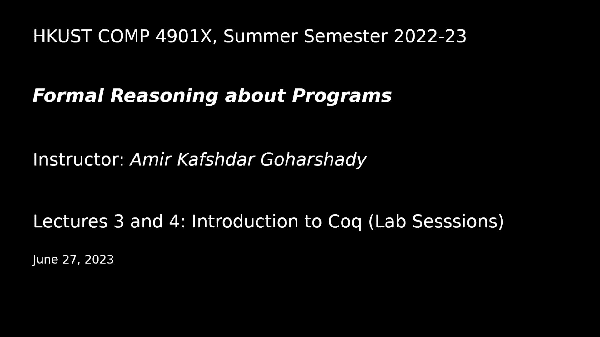

Please open your Coka IE and if you don't have it on your laptop， just open it on。

The Coch JS website， so there is this web version。Today we're going to start actually proving stuff with Cock。

 but I'm not going to dive any deeper into how Cock actually works。

 so I'm just going to show you how to use Cock for today。Now， if you remember the last session。

 one of the things that we did in the last session was to write a really huge proof。

And this was the proof that I wrote here and you saw that I had to start from my conclusion and make my way back basically。

 so I had a huge proof tree。Now I want to do something similar。

 but now I want to use Coque to help me。So。Let's do the very basics， so first of all。

When you open the Coque editor， you have three parts here， so this is where you write your code。

And this part is where you will see what you have to prove， we will see that very soon。

 so it will show you the subgos that you have to prove in order to prove the original TorM or lemma that you wanted to prove。

And here it gives you just a bunch of messages。So if you write something that doesn't mean anything。

 like if you have syntactical errors or anything， you will get the messages here。And generally。

Every command in Cock ends with a dot， so if you're a C or C++ programmer you're used to putting a semicolon at the end of everything here。

 you just have to put a dot。Okay。😊，So let's start。So in my quote。

 I can have different sections and you can think of a section basically。Function。

 you can also think of it。As a small block of code that is somehow different from the rest of the code。

 you don't necessarily have to use sections， but you can， so let's just have a section。

 so I just define section a。I can give whatever name I want。And everything ends with a dot。

Now here's the thing Cock is an interactive theorem improver。

 so as you write your code you can also execute it at the same time。

And the way you can execute this one line of code that you've written is by。Clicking this one。

Basically the down arrow， which goes forward by v command。

Or you can also do control and down arrow and so here's what happens here in this case。

 it was successful we successfully created a section， congratulations。

So whenever you see the green color， it means that。The execution of that part of code was successful。

And if I want to end a section， I can just write end A。

And basically the idea here is that any variables that I define inside this section are only accessible in this section and nowhere else in my code。

So very much defining scopes for variables， that's all these sections do。Okay。

But let's say that I want to prove a very easy theor。Okay。

 so let's say I have a variable and let's say I call this variable P and it's of type prop which means proposition。

So I just have a propositional variable P。And here's the very first theorem that I want to prove。

 so this is a theorem and I'm going to name it my THM。And what this theorem says is that P holds。

If and only if P holds。ok。😊，So I'm just showing you how to write athereorem。

So you have to give it a name， then you have to write what the theorem is and everything ends with a dot。

Okay， so can you open that door， please。Now here's the thing。

 as soon as I execute this line of code and you see that this is now green again。

So I immediately get a goal on this side， so this is what I have to prove。

I have to prove to Coke that P if I only P。And these are basically written like the proof ruless that we saw in the previous session。

So I have to prove this。And currently I have only one goal and my only goal is to prove this。

Now let's look at my assumptions and let's look at my goal。

 so the goal is to of course prove P if and only P。

But I have one assumption and this assumption is that P is a proposition。

So that's how we read this assumption， it doesn't mean that P holds。

 it just means that P is an object of type proposition。Okay。So I have to prove this。

 so we usually start with the word proof on one line。For itself to start proof。Okay。

 how would you suggest I improve this？对。Basically， I have to create a proof tree。

 but I don't want to create a proof3 myself。I want to kind of guide Coke into the right direction so that Coke can find the proof。

So I don't want to create a tree like that as before。

So instead what we have are called a bunch of tactics and each tactic is basically one level of reasoning。

 you can think of it like that。So a tactic basically takes my current goal and converts it to some other goals。

And of course， those goals have to be equivalent to the original one so that I continue this until I get a bunch of goals that are trivial。

And then I'm done with the proof。ok。😊，So。One of the first tactics that we have is called actually split。

 so I can write split here。And look at this part here and see what happens when I do splits。ok。😊。

So basically， this was an if and only if。Right， and when I'm doing split。

It's splitting it into two different sub goals， I have to first prove one side of the implication and then the other side。

 I mean in this case both sides are basically the same。So now I have two goals that are the same。

Okay， now I have to continue with proving the first one。So I want to prove P。Employs P。Okay。Now。

 what I can do at this point is that I can take this first P and I can put it up here in the assumptions。

Right because this is an implication。Now， the tactic that does that is called intro。So if I do intro。

As you see here， it just took the P， put it up here as an assumption， and it also gave it a name。

 so this assumption is now called H。ok。😊，And so I have an assumption P， I have to prove P。

I have what I want to prove as an assumption so I can just write assumption。

which basically tells Ko that at this point what I want to prove is already in my assumptions and I do this and as you see as soon as I executed this assumption。

 the first goal is achieved so the first goal is removed and now I have to do my second goal so I have to prove the second part。

But of course， the second part is proven exactly in the same way so I can repeat the same proof。

 or later on I'll show you how you can avoid repetitions。But anyway， so I can do intro。

 which puts the P up there， and then I can do assumption。And that's it， so it says no more goals。

 I proved everything that I claimed， I claimed a very trivial theorem。And I gave a proof for it。

So at the end of every proof， you have to write QE。And if QED passes。

 it means that you have really proven everything that you have claimed。Okay。

 so in the homeworks of this course， I generally give you a theorem and you have to write a proof and you have to pass QED。

ok。No。😡，I have this theorem。So here's what I can do， I've given it a name， it's called my THM。

I can first write， check my THM。Sorry， capital C。And it shows me what my THM is。

But I can also say print my THM。And this one is actually the proof tree。

Of how this whole thing worked， but this is not very human readable。

 so we don't really care about proof trees in general。

 but the important point here is that I just guided proof assistant to approve。

And then the proof assistant could find a formal proof。

 something that looked like that tree that I drew for you last session。

And then it could also verify that proof。So all of those things must happen for QED to pass。Okay。

But this was a very simple example and I can also end my section and I always forget that these are capital letters。

Okay。This was our very first proof and you saw already。Three different tactics。

 so one tactic is split， one is intro， which basically says that if you want to prove an implication。

 you can take the left hand side of the implication and put it in your assumptions。

And then the other one was literally called assumption。

 it's when you want to prove something that is already in your assumptions。Okay。

Let's open a new section。And let me see。Let's say now I have two variables， so I have two variables。

 PNQ， I have to write variables here。And they're both propositions。And as you see。

 as I execute this in the messages， it just says that P andQ are declared。Okay。

 now I want to prove this theorM， so I'm just going to call it theorem2。I want to approve。This。边。😊。

P entails Q and tails P。Okay， and by the way， when I don't put parenthesesis， this is what I mean。ok。

So I give it this theorem and again you see that I have one goal now。

 which is to prove this and the only assumption that I have is that P andQ are propositions。

Again I have to repeat this many times this does not mean that i'm assuming P is true or Q is true。

 it just means that I'm assuming P and Q are of the type pro。So it's just the type of PNQ。

 there are propositions。Okay。😊，So let's start to proof， how would you prove this？Firstly。응。

First split， well， there's nothing to split here， so if I say split。It just gives me an error。

So previously I could do split because it was an if and only if。

 and then I could say split the proof into two parts。

 first proof one side of the implication and then prove the other side。Okay。

 but which one of the three tactics that we've seen can be applied here？Yeah， so I can just do intro。

Right， so I do intro。And P is now one of my assumptions。Now， again， I can do intro。

And now Q is one of my assumptions。And now I just need to prove this， but as you can see。

 I have to prove P， but P is already in my assumptions。So I can just say assumption at this point。

And that's it， this is a proof。And I have no more goals， so I can just write QE and QE past。

By the way， if my proof is not finished and I write QE。You see that I get an error like this。

And if this happens in your homeworks， you get zero pointss。Okay。But there are also some shorthands。

 for example， let's say。I'm here， let's say I'm at the beginning of my proof。

Instead of writing intros several times， I can just write intros。

And it just does intro as many times as it can。RightAnd then here again。

 I can just write the assumption。And cute。嗯，这不行。Actually。

 I don't want to end my section that I be there。嗯。Okay。

Let me give you an exercise now and I want you to do it right now in your。Coke ID。

 so let's say that's okay， actually， let me end this section。Cause I don't want to。

Use it so that you can just。Type everything in so you can just type starting from here。

 let's say I have a new section C and I have variables P Q and R， and they're all propositions。Okay。

 and this is。At theorem， I'm going to call it。Exercise 1。And this is what my theorem says。

P entails Q entails。Q entails R。Entails， P andtails are。I forgot that these were lowercase。

 okay let's make them uppercase。😔，Okay。So this is what I want you to prove。

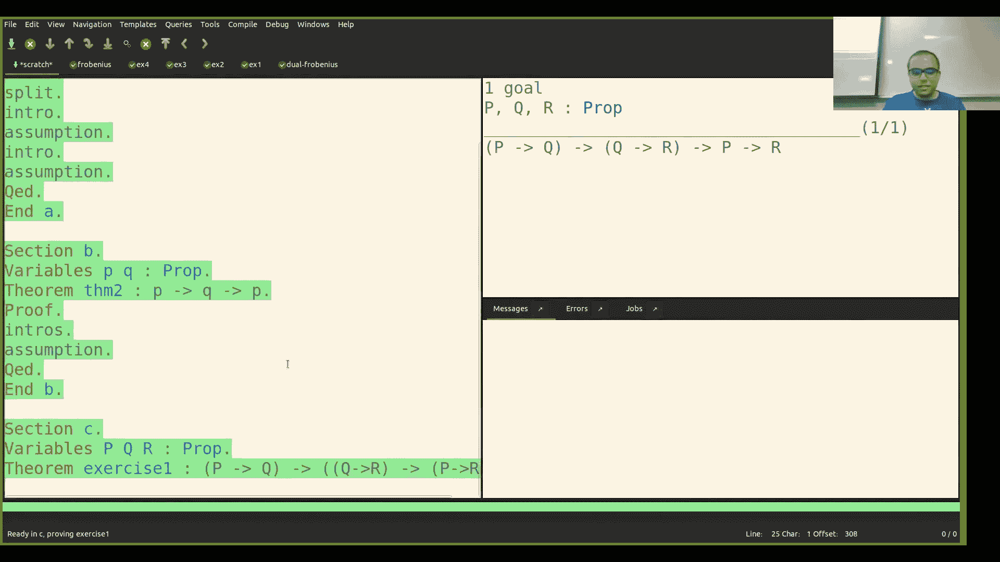

Okay。So I'm going to actually use a new rule here as well a new tactic。

But it was nice having you try。Yeah。Okay， so here I can basically only apply intro， right？

So I can just write intros and it applies intro as many times as necessary。as many times as possible。

 but I want you to just see what happens every step， so if I apply intro one。嗯。

The left hand side of the implication goes up here。And then if I apply it again， again。

 the left hand side goes up。And now I apply it again on the left hand side goes。Okay。

So what is the problem here？Yeah。These are my assumptions， I have the assumption。嗯。

P implies Q Q implies R， and I also have P and I want to prove R。This looks very obvious， right。

 because well， P implies Q and Q implies R， and I already have P。Right。So。What should I do here？

If I wanted to do a normal proof。How would I go on with this？Yeah， so I kind of need a lelemma。

 right， I need to say that Q holds。是。Right。So how can I do that？Yes。So I can write a queue。Okay。

 and this means that I want to prove Q。And then I want to just prove this as alemma。

 and then I want to use it in the proof of R later on。So when I say a third Q， it says okay。

 now prove Q。ok。How am I going to prove you。I have P。I have a P implies Q。

 so if I put H and H1 together， I should get Q。But this is what we call modelpons。Right。So for this。

 actually， when it's this simple， I can just write auto。Okay， and at this point。It understands。

 it understands that if you have P and P implies  Q， you have  Q。

So just writing auto figures that part out。But now here I have P， I have Q。But again。

 I have Q and I have Q employees R and I want to prove R， so again， I can just write out。

And that's nonsense。Yeah， and I can do QED。嗯。呃自己。So the only thing I wanted to show you here was basically this concept of assert。

But then we also have auto。But now this is the part where you will be really angry at me。

This whole thing is a taology。Right， it always holds so we have another thing called Toto。

Which basically checks for taologies。And in this case， I said， this is a taology and。😊。

It To checked that and so。Yeah， that's my proof。That' also in previous section， yes。

But I wanted to teach you about all the other cool stuff。Okay。So。But let's not use Toto at all。

And let's see how we can prove things without total so first of all， we applied intro several times。

 so it's better to just write intros。And when we are here， again， the dilemma that I wanted to prove。

 the thing that I wanted to assert at this point was that QHs。And then I could prove this with auto。

 and then now that I've proven that Q holds， you see that Q is added here as an extra assumption。

That I can now use for my proof of R and now the proof of R is also automatic， it's just what。Okay。

Should I give you another one？嗯。Here's another one exercise two。

 this should now be super easy based on。What we already did。😔，嗯。Do this P。小。一见。Now。

 the point that I want you to really see here is that。These exercises are trivial。

We can easily do them。But if you had to manually reason about this。

 you don't really have a good intuition what this sentence is saying， right？

Like if p implies that p implies Q， then that implies that P on its own implies Q。

So this is something that is not that easy to wrap your mind around as a human。

 but if you just follow these rules and tactics， you can easily prove it in a tior improver like book。

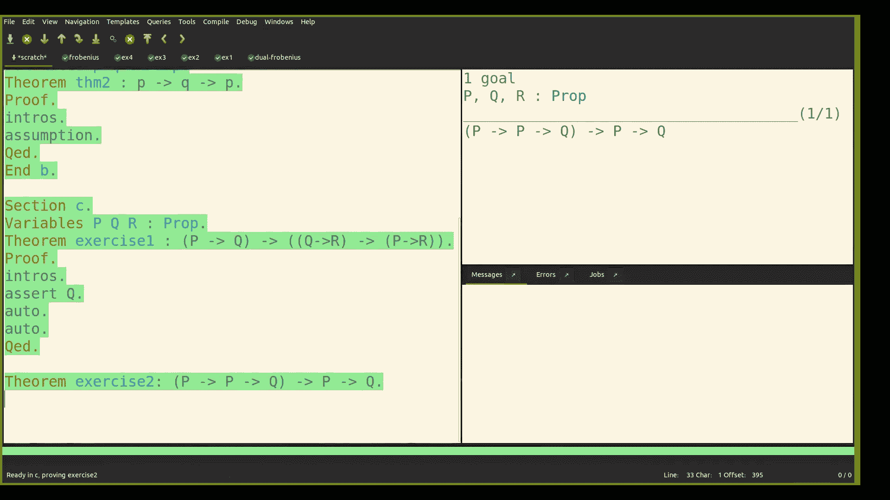

Okay， so prove this one。

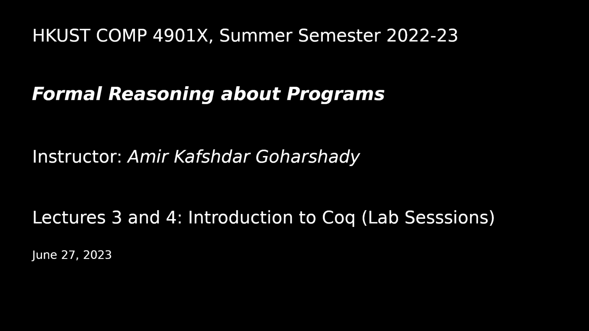

Let's just do intros。And this is what we get。So。At this point， you can just do out。

RightBecause what auto does is that it applies basic reasoning techniques。

 especially like motorponents as many times as it can。So if I apply modelpons once。

What happens here is that I have P and I also have that P implies this， so I get that thing I get。P。

 thank you。 So if I don't want to use auto actually， I can do this， I can assert。That's P implies Q。

Okay， and then I can do auto on this one。And now， as you see， I have P PQ。

But now I have P and I have P employee Q， so I have Q。But again， even without this assert。

 as we saw like at this step， auto is just fast enough that it knows what to do。ok。Great。

Let's do some more interesting stuff。Let me see what I have here。😔，Okay。

 this is basically a variant of whats。We already had。

But let's go over this one as well because this one。Actually has apply as well。Okay。

 so I defined some variables。This is the theorem that I want to prove。I do intros and oh， okay。

 so this is the answer to your question that I didn't remember if I don't want to do auto if I want to do it one step at a time。

I can use apply。So basically the idea here is that I want to prove R。Okay。

 and I have R on the right hand side of H0。So what happens if I apply the rule H0。

 if I apply the assumption H0？It basically means that now I have to prove Q。Right。

 because if I want to apply h0 to prove r， H0 gives me r。

 but that only works if I have already proven Q， so as soon as I apply h0。

 you see that it asks me to prove Q now。Okay。Okay， now I want to prove Q。

But I have this H that has Q on its right hand side， so I can say I apply H。

But in order to apply H to prove Q， I have to now prove P。But P is already an assumption。嗯。

RightSo I can just use assumption and that's it。呃。Actually， Ahma， this is not exactly what you ask。

 this is like the backwards version of what you asked。😊，Because if you look at it again。

So I did intros and this is the state I'm in， these are my assumptions and I want to prove are。

And I say basically that the last step in my proof of R is going to be the application of H0。

That's what I mean by apply H0。So when I do apply H0。

 what I'm saying is that I can prove everything that H0 needs， I can prove the left hand side of H0。

And then I can apply h0 and r would be proven so when I write apply h0。

 then it asks me to prove the left hand side of H0。Which is Q in this case。

Now in order to prove Q again， I say apply H and it will ask me to prove the left hand side of H。

 which is P。And then this P is already an assumption， so that's good。Okay， so until this point。

 we've seen assumption intros apply auto。Let's do something else。 I'm going to。

Copy this here because I don't want you to cheat。So let's say I create a new section。

 what was my previous section's name。To end it and see。😔，Okay。

 I have a new section and here I have new variables， P Q and R。Now， I have a hypothesis， H。

And this is my hypothesis。And now I want to prove alema。

 alemma and Ethereorem are basically the same things， so you can write lema theorem corollary。嗯。

Cock doesn't care about these things， no matter which one of these you write。

 you have to give a proof。So。I have this lemma L now。And by the way， this is how we write and。

 this is P and Q。Okay， one character yeah， it's with two characters。

 so this is how we write and this is how we write or。😊，Okay， you will get used to this。

So I have three propositions， PQ andR not is just detailed。哦，这。Okay， so I have PQ and R。

And my hypothesis is this P implies Q implies R。And using this hypothesis， and I've given it a name。

 I could give it any other name I could。Give it the name HY， whatever。😔，I want to prove this lemma L。

 which says that P andQ。Implies R。And as you see， when I do this here in the goals panel。

 I have one goal。And the goal is to prove the dilemma， but I can use the hypothesis。

Right and I can of course use the fact that PQ and are our propositions if I ever need that。Okay。

Okay。How should I prove this， so tell me。Which tactic to you use now？For sweet。First。It's the。

I don't think we can split it snow。So split is basically applied whenever you'll have to prove two things and you want to say I prove each one of them separately。

Yeah。So here we can apply intros。Right， so let's apply intros。 and let's see。Okay。So I have P andQ。

And I also have the hypothesis that says P entails Q entails R and I want to prove R Now again at this point if you write auto no it's not smart enough。

 okay， thank God， it's not smart enough to just do this automatically。

 but probably Toto is smart enough， yes。But okay， let's not do that。

 let's actually give proof ourselves。Yes， so that's what we call destruct so we can write destruct H。

And here's what it happens， H was P andq， so you now get two different hypotheses， one is P one is Q。

Okay， what next？Okay， this is very similar to one of the previous ones。

 so what would you do at this point？Apart from auto， again， auto will probably work。嗯。

But let's say we don't want to do auto。What's with a third Q home。Yes， so we have to apply。

 but which one we have to apply HY， the hypothesis。Right。

So I want to prove R and R is on the right hand side of Hy， so I can just say apply HY。And。

You see here's what it tells me， it tells me in order to apply HY， now you have to prove to me。

P and Q。Yeah。But post P and Q are assumptions， so I can just for P， I can write assumption and for Q。

 I can also write assumption。And that's it。Can we write assumptions instead of two assumption。No。

 but what you can do is that you can use a semicolon because basically when you're applying this hypothesis。

 you're getting two goals。So you have to have that three notion of the proof in your mind。

 so your three has branched and now on one branch you have to proveve P and on the other branch you have to prove Q。

But if you want to use assumption on both branches。

 you can just use a semicolon and write assumption。

 and then it will apply assumption on both branches。And in this case， it succeed。ok。

Let's see if I had。Yeah， so I have kind of a different proof here so let's go through this so again it's exactly the same level as before。

So first， we're doing intro， so we're taking P and Q and putting it into our assumptions。

And then at this point。Before distracting H0， we're applying H。So if I apply H。

 I have to prove P and I have to prove Q， but I have P and Q， so I de H0 so that I have post P and Q。

And now I say my assumption， I have the assumption P， so its assumption。But look at this。

 so at any given point you're only seeing the assumptions that you have in the current point of your roof tree。

Okay， so。Here's again， this proof， so we start at the beginning。

 we do intro P and Q goes up there in the assumptions。And when I apply H， I have to prove two things。

 I have to prove P， and I have to prove Q。But I have to prove both of them with these set of assumptions。

 but then when I do distract h0， I'm doing it only in the part of the three that is for the proof of P。

Okay， so you see I have this H0 which was P and Q and I destruct it。

 and then I use assumption to prove P， but as soon as P is proven and I'm moving in my tree back to proving Q。

 I again have the H0 that I destructed before。So it just keeps track of what your assumptions are at every node of your proof fee。

Which is quite great， so I have to de H0 again and use assumption again and that sit。Okay。嗯。对。Yeah。

 let's do this。呃。Let's end this one。Let's start a new section。😔，H。

What happens if I actually use quantifiers？So let me first do a very simple。嗯。Example。

 so let's say I have a variable P， which is a proposition。And this is my theorem one。

Which basically says P， if I only if P or。E implies P。Right。

 I can prove this and the proof is actually quite easy again， just like before you do intro。

And you do as such。Or you could just do auto or To or whatever it will work。ok。So。

I have this simple theorem， but now suppose that I want to use this theorem。In another theory。

So for example， let's say this is my second theorem。ok。😊。

So I can of course prove this theorem on its own and this is not that hard because I mean it's a small one so。

We can just do it， yeah let's just do intros and then you see that we just need assumption after that。

Right so it was actually quite easy to prove this theorem on its own。But ideally。

 I want to be able to use the proof of my previous theorem。Right， because previously。

 I'm showing that。P implies P and if I just replace P itself here with P implies P。

 I get this other theorem。Right。But to do that， I will probably need something a little bit stronger。

So here's the thing instead of just saying that P is a variable。Im going to say my first theorem。

Is going to。Give me for all P。That is a pre。So as long as my P is a proposition。P implies P。

So I write my theorem like this。And now I want to prove this new ti。

So the only difference is that now I have a quantifier。I want to say that。

You can see my quantifier here as well， I want to say that for all P。As long as P is a proposition。

 of course， P implies P。O。So what would you do if you want to approve a for all statement normally？

All I want to show you here is that this is very intuitive。So how do you prove a forral statement？

Yes。Basically， if I wanted to prove this， I would just take this part。

 which says that P is a proposition， and I would put it as an assumption。

And then using that assumption， I would try to prove this one。Right？So。Let's see。

 let's see what happens if I write。ISorry。Should I write split intros oh okay， yeah， in this case。

 I can also write intro。So if I just write intro。You see that it takes this part。

 which was basically the assumption in the for。And puts it up here in my assumptions。

 and then I have to prove this。Say this again， I apply intro and now this is what I have to prove。

But again， for this one， I can apply intro。And then I can apply a such。Okay。So。

Now I have a theorem that has a quantifier in it， it says for all P， for all propositions P。

I have this。So let me actually change this name， let's do it something like。This， and let's say。

 I have a variable。😔，Actually， let's have variables Q and R， which are both propositions。

And let's do this。Okay。Now， again， I can just。Write a simple proof。

Or I can try to use the proof of T1。Okay。Now， the way I can use T1 in T2 since I've already proven T1 is that I can just write this。

Prove t okay。And as you see， this just added T1 to my list of assumptions。

Because what I'm saying here is that I've already proven T1。

 give me T1 as an assumption so that I can write a proof for this team。Okay。What should they do now？

是playaseQES2S7。Yes， so I want to take H and I want to replace this quantified variable P。

With this expression， Q implies R。Okay， so we have that as well， it's called specialize。

So I can just write specialize H that。And here I say what I want to put for P。 So I say P becomes。诶Q。

Okay。😊，So all this is saying is that this was a universal quantification I was doing for all。

So I can put whatever I want in place of P as long as it has the right type， of course。

 it has to be a proposition。Right。So all I'm saying here is that instead of P in this expression H。

 wherever you see P put this expression。Q in placer。And I do that， and as you see my age changed。

And this is now the format of H。Okay， what do I do now？I think。No， why apply age。 Yeah。

 this is just the assumption。Yeah， and that's it。So that's how you use the proof of one theorem in another theorem。

对。Okay。嗯。Okay。It's good。What else？ Let me see what other examples I have here。😔，嗯，Okay。

 this is basically。same example。Okay， I just want to do。

One more example with propositional logic maybe。嗯。What happens if I want to prove or so let's have a simple theorem like this？

Let's say that I want to prove that P implies P or Q。Okay， pretty easy。Oh。

 I have not defined P before， okay。Variable P。Ok。So I want to prove this。

So I just want to show you the typical way that we and improve and or。So again， I can do intro。

He goes up there。So I have P， but I want to prove P or Q。ok。😊，Again， I can cheat。

 I can just write autoto or I can write Toto for toologies。And it just figures it out。

But the other thing that I can do is that whenever I'm proving。Disjunction。

 I can basically say that I want to choose to prove the left hand side or the right hand side。Okay。

 so I can just write left。Which means I want to prove the left side of the this jun。

And so it just erases the right side， it says， okay， prove the left side for me。

So here's how it looked like before， but then when I do left it just removes the right hand side and I just have to prove the。

Okay， and now the left hand side is just that。Okay。Okay。Let me see if I can find。

Another nice example。Okay。嗯。Okay， so since we have only five minutes remaining， let's do this。

This is actually an example from the cookbook。So。What's the name of the。Section on sorry MD。😔。

Let's start a new section E。And let's say the variables I have are P Q。😔，R S N T。

And they're all propositions。Okay。And this is thelemma and it's called the diamondd lemma。So。

This is what I want you to prove。你打嗯。你康。You can sit up here。Okay。哦，你好。q r t p单。嗯。Okay， and again。

 just to show you that this is possible， like if it's a taology， Coke can find it on its own but。😔。

Again， I want you to actually write the proof for this one。我 been。Yeah， so in this case。

 we will have to apply intro many times， so let's just write intros。

And this is what happens if you write intros， so it applies intro as many times as it can。

 and now you have this。Okay。So it's again kind of obvious what we should do we want to prove T。

And the only assumption that has T on its right hand side is H1。Right， so let's just try that。

 let's say apply H1。So now instead of T， I have to prove Q andR。Okay， I want to prove Q apply H， yes。

Now I have to prove P， it's an assumption。Now I have to prove R apply H0。

Now I have to again prove P again， this is an assumption。And this。

So as you see in many cases it's actually quite obvious what rule you have to apply and this is actually what auto is doing so auto and actually well not auto what Toto is basically。

Following simple rules of propositional logic and figuring out whether what you've given it is a totallylogy or notance。

Okay。Great， so let's have lunch and let's come back after lunch for some first or logic。

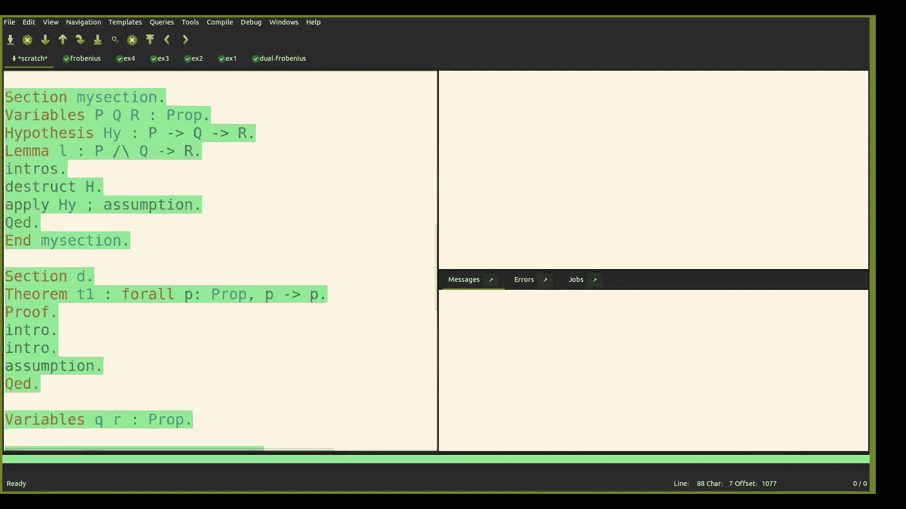

These next examples are actually coming from a course of Andre Ber of the University of Lbliano。

 so I'm giving credit to him。But let's prove some theorems that actually have quantifiers in them。

And let's see how we can do that。it's this one， okay？So。First of all。

 let me just start a new section。嗯。I don't know what to call these sections， whatever。😔，Okay。So。

One of the things that。We know from basic logic but doesn't exist in intuitionistic logic is this law of excluded middle。

 so I can have a definition of this excluded middle。And basically。

 what it says is that for any proposition P， either P holds or not P holds。Okay。

 so if I want to write this， how can I write it， well I can just say for all P。Of type proposition。嗯。

P。Or not be。ok。So that's it so I just defined this and this is by the way I think the first time we're using the keyboard definition。

So I'm just giving a name to this entire expression， so whenever I say excluded middle。

 what I mean is this entire expression。ok。And there is also。Another law in logic， which is， I think。

 equivalent to this。 and this is called。Pierce is low， so I'm just going to call it pierce。😔。

And this is how it goes， it says that。For every two variables B andQ that are propositions。

Suppose that's P entailq ens P。Entails P。Okay， hopefully I wrote this correctly。Yeah。

 this is called Pierce's law。Okay， you can kind of check that both of these。Definitely hold。

So if you just look at this in propositional logic， well， either P is true in which case。

This is true and if P is false then not p is true， so in any case this entire expression would evaluate to true and here you can do something similar。

 you can just try all the possible combinations of true and false for P andQ right？So for example。

 if p is true and Q is false， then this part is false， which means that this part is true。

 which means the entire thing is true。Okay。But a very important point is that。Actually。

 or someone is trying to join yeah。Cook never does that。

 so Cork never draws tables of true and falses and check all the evaluations。

So we don't have something like excluded middle in Coke on its own。But let's try to prove a theorem。

 Let's try to prove。I'm going to call this one EQV because it's an equivalentvalence theorem。

I want to say that excluded middle holds。If and only if P salt。ok。😊，嗯。

So should have just put a dot there， okay。😔，🎼So now， as you see， this is my goal。

 I have to prove this。How would you suggest I start my proof？3。Sure， we can do split。

 but even before that， I want to really replace these names with their actual definitions。

Right so this is called unfolding and I can write unfold excluded middle。好好系报 ok。So and as you see。

 it just replaced excluded middle， it is definition。And now I can do the same thing for peers。

 I can say unfold peers， I could also just write。嗯。One line that said unfold both of them。

 but whatever， now they're both unfolded。So now the first step would be split because I want to prove an if an only statement and well I have to prove both sides and hopefully I want to do each site separately。

Right so let's do split。😔，Okay。So at this point， I want to。Give it back to you guys to prove it。So。

Prove this entire thing。Write everything that I've written from the beginning of section two。

 get to this split。

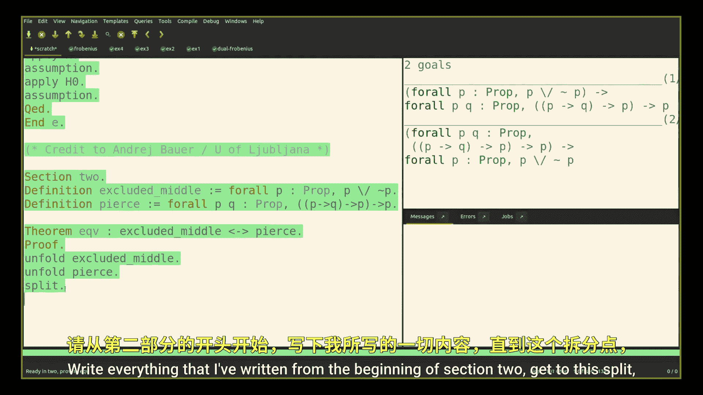

And then， complete the proof。

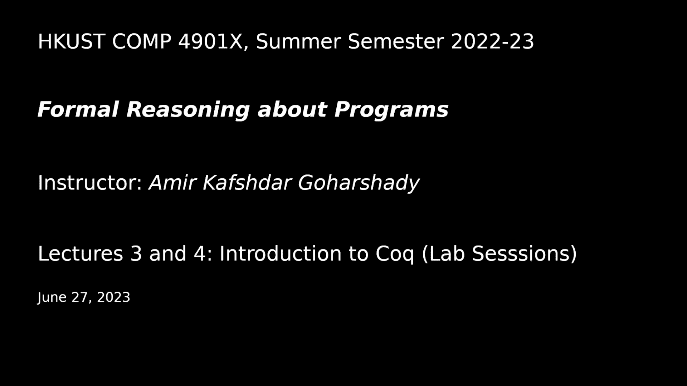

嗯。Okay， so let me tell you what another。One of these tactics that might make your life a little bit easier。

You can write first order。And it basically applies as much as it can basic rules from first order logic。

 so I can do this even before so I can just do first order。It simplifies a lot of things。Okay。

 but you should be able to solve this event without first order。But with first order。

 you get this one， which is supposed to be easier to solve。

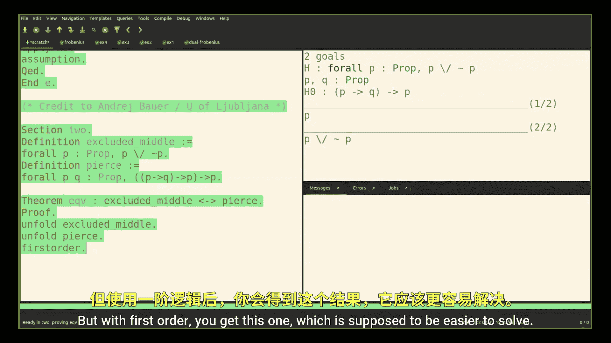

Okay， so let's see what we have here。This is the state where I ask you to continue。

 so I've already done the split。Now I want to prove this first goal。Okay。

So this is an implication and since it's an implication。It actually makes sense to just do what it。

Intro。Yeah。Okay， so I do intro。And this takes the left hand side of the implication up here in my assumptions。

ok。And now again， I have for all PQ that are propositions， something。

 so this is also kind of like an implication because I'm saying that if P andQ are propositions。

 then I have this right so I can actually do intro again。And by the way。

 you can just write intros and it will do intro as many times as it can。

 but I want to do it step by step， so I do intro again。And as you see， it took P out。

And I do intro one more time and it takes Q out。So this is what I have now。

I know that PNQ are propositions， I have an assumption that for all P， there is a proposition。

 either P holds or not P holds。And I have to prove this， but this is again an entailment。

 so I can again do intro。And now this is what I have to prove， I have to just prove P。Okay。

So actually， a lot of you had gotten to this point too， which is nice。But now here's the problem。

 if I want to prove P， I want to probably apply the rule H0 right because。

That's the only rule I insert doing the only assumption I have here that has P on its frame。Andight。

But if I want to apply H0， I have to then do something about Q， I don't know anything about Q。

 I just know that the P and Ls Q， but I don't have any information about Q。

So what really gets almost everyone stuck here is that we need some information about Q。

 so how can I get some information about Q？What do I know about Q if I have all of these assumptions？

So this one is definitely not going to give me anything new about Q。

Right and this one is just telling me about the types， so P and Q are both propositions。But this one。

 this is not talking about a single P， this is talking about any P。

 so it's saying for all P that is a proposition。😊，We have P or not P。

 so I can plug in Q here and see what happens。Right。So how do I plug in Q， I can do specialize。

 I can say specialized H。V。P yeah equal to  Q， so I'm putting in place of P。Okay。

And let's see what I get here。😔，Okay， now this is whether。So I don't have any more quantification。

I can think of this more naturally。Okay， at this point， I can go， this is a taology。But it fails。

 it doesn't find that at。Okay。So。What else can I do？I want to prove P。Yeah。Well。

 I know that either Q。Hs are not cuhole， right so I can actually。第一。

Itplay my proof past so and now as you see first it says， okay。

 first for the case that Q holds proof P and then I have to prove P for the case that the Q doesn't hold。

Astion was Q or not Q after H， which means that I'm first proving the same thing P only having Q in my assumptions and then I'm proving p only having Q in my so this is before the destruction of H this is after the destruction of H before after。

Okay， so now I have Q and I have to prove this one， so I have to prove P。I know H0 as well。

 so I can now say apply H0。Okay， but when I apply H0， I applied H0 to prove P。

 so now I have to prove P and tellss Q。Okay。Noow what。系诶。Apply H again。Would this work， no？

Because the problem is that there is no premise here， it's just Q。right哦哦。We specialize AP andNo。

 but well， if I know that Q holds。Then P impliesq definitely holds as well， no matter what p is。

 right？Yeah， well， not assumption but they can do out。Or I could also do total。Okay。

Now it gives me the other side and the other side is when I have not cu in my assumptions。

I have to prove P and I have not Q。What should they do here？Again， let's apply H 0。ok。

But now it says P implies Q。But that's also fine right， because if I have not Q in my assumptions。

 that means that。Well， Q is false。Right， oh， okay， this is not good。Can I approve this now？😔。

If I have not queue and。😔，哦，你Q is从屁是可 that这就你 true。Yes。But the point here is that since Q is false。😔。

嗯。Okay， so。Let's just do a manual analysis of what's happening here， what happens if you true。

Fer true。This one would be false， right， and false true。 Yeah， but what if fever false。

 then this is false And then No， the first is true false implies anything true true in false。

your Tuesday or p should only be true。Yeah， so。The problem we have here is that we need to also know something about P。

We can't just say we know something about Q here。Right。So yes， but I've already destructed H。😔。

So let's go back here。😔，And let's delete this and let's see what we can do from here again。

So I want to do basically casework I want to。Take the case where I want to do a casework on P and I want to also do a casework on Q。

There has to be an easier way for this， I feel like we're doing too much work， but okay。

Let's do this， so。I can say assert。G。To be h of Q， which means basically put Q in place of p。

The difference which specializes that this one just adds it。And I still have H。

Whereas when I was doing special， I lost age itself。For this one。

 just adding a new assumption without deleting the origin， yes。

So this is like adding specialization of the original one， but also keeping the original one。😊。

And now I can say specialized age。That's。P in place of P。ok。And now， I have。All of these things。Okay。

 at this point I think I can just say auto and will work no it doesn't auto yes auto works Okay。

 so basically the idea was that if you do a casework over both P and Q then it becomes a taology in propositional logic and then you can just write Toto and it works。

 but let's not use Toto let's actually torture ourselves so。How would you solve this now？

Do you want to first do a casework on Q or MP？

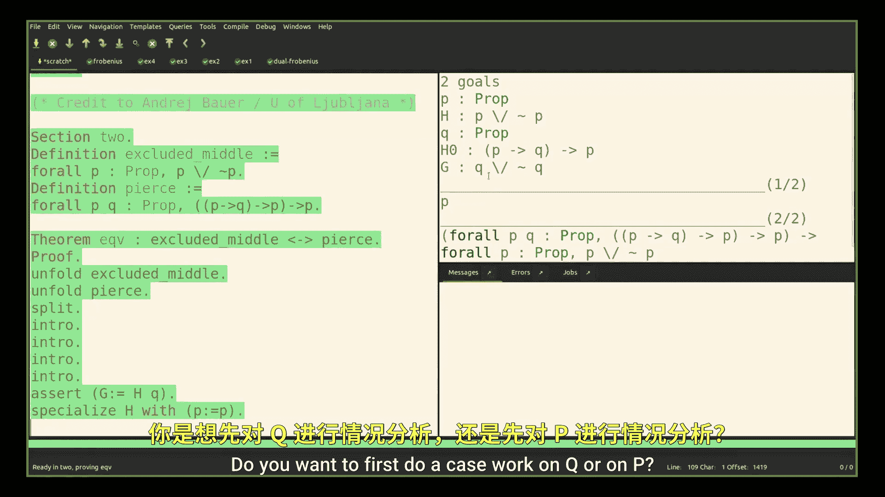

是。You can see my screen again。So let's go back。To the place where we did the specialization。

 So now we have。嗯。The ability to do casework on both P and Q so from this point it should be easy to finish the proof。

So let's do it on。He first died H。And then this one is just an assumption。And for this one。

 let's say destruct G。So。Okay。Now we have to prove this one， or do you prove this one？

What does it mean to prove this one？能。So in my assumptions， I have not P， but I want to prove P。

What does this mean， what do I want to get？哦，我q。We should go Q。 We shall apply it0。

 and then we shall Q is2。No no， that's not the point。

The point is that here I have to show that there is a contradiction in my assumptions。嗯。Right。

 because if my assumptions have no contradiction in them。

Then I have not P here and I cannot get P here。Okay， let's see can taught us solve this， yes。

 so there is definitely。A contradiction in the assumptions， okay。

 but let's just go on as normal and see what happens so I want to prove P I can apply h0。Okay。

Now I have to prove a P implies Q。Okay， the first place we already have each one。Yeah。

 but I have not be， so I know that。Yeah， okay， we already have Q here and if I want to prove。

P implies Q that shouldn't be a problem because I have Q。Right。

 so this one is just auto since I already have Q， I also have。P implies Q okay。

 so now we're going to the other case and this is the case where I had not P and not Q。Okay。

 what do I do here？Again， I do the same thing， right， apply H0。And。Here again。

 because I have not P P implies Q is always true， so I can just do auto I can do To。YeahOkay。

 we approved one side。Now we have to prove the others。

So what we proved until this point is that if we have excluded middle。

 then we also have Pierce's law。Now we want to prove that if we have Pierce's law。

 we also have excluded middle。Let's do this so I'm just going to do intro but I'm going to do intro many times so I'm just going to write intros so this is what we have to prove。

对。We want to prove P or not P。And this is what we have。So what would you do here。般。Okay， specialize。

H。What do you want to put for P and what do you want to put for Q， which one do you want to change？

唱q火 to p changeq to p。It's or notPS。Okay， Q becomes P or not P I'm just following what you're saying sorry specialized H V P sorry P。

Are you sure。你就几蚊。And feel it's not。Okay。So now because we had a P inside H and we had a P outside of H。

Cke understands that these are not the same P， so one of them became P0。好。Okay， what do you do now？

Okay specializedize H0 with P0 also P or notP。真是。嗯。Im sorry， it's got H so。为s。😔，p c。😔。

No such found variable but。Yeah。嗯。So以意思。No， but we should be able to specialize it again。 This is H。

 I should be able to put something for P0， right。😔，Specialized age that's。平时六桥。😔，ok。Its your opinion。

能 search。😔，哦嗯。I don't know what's happening here。😔，Okay， maybe let's go up and let's not do that one。

Can you find a better specialization？He。And extra one is just to be stay clean and to be not。Okay。

 so。You want Q to be not P。🎼Yeah， I like。Okay。And P remains P。I don't know the synt for this， okay。

Specialize H it。P Sp， yeah。Okay。😊，嗯。So P remained P and Q was replaced with not P。

 what would you do from here？就系会落晒。We cannot apply H in order to apply H。

What we want to prove should be the right hand side of age。Right。

 but the right hand side of H is just P。你啲好他。Okay， let's go back to here before our specializations。

What else can we do other than specialize here？嗯。我个 sir。No， well， I want to prove a disjunction。

 right， I want to prove an or。So I can just decide to prove the left hand side or the right hand side。

我讲咩反算。Right。嗯，两。Its talking。Is there something obvious here？Yeah。I think if we choose the other side。

 then we can just modify it by how we rationalize it and then the point。Okay， so you want to again。

 specialize age。WithQ not。And specialize it again。Withs。P zero p。P皮。给。Yeah。对。

Now do you want to prove the left hand side or the right hand side because we have a dysfunction here？

好食ごなさ。but it's enough to approve one of them so if I can just prove the left hand side I would be done。

 but I don't think I can prove the left hand side so here's what happens if I apply H okay。

Now what now we can do intro。But it up there。 Now I have to prove P。So I can again apply H。翻月啦系 ok。

Again， intro。Do you see what's happening here？s哦 endless。安ex。Yeah， okay。

So this idea of specialize is actually correct， but you have to figure out how to specialize。嗯。

But why can't we use off because the。The result is automatically true no matter how the no。

 you see also doesn't work here。How to actually those work？But it only works for the first one。

 which we already。I can just write first order to simplify it a bit。

So this is what you have to solve。Okay。I think we can do the secret thing as we。

 but we do that right， right。Okay， so you want to say right？好啦。So at this point。

 you want to just prove the right side。Yes， okay right。Okay， specialized H widths。Q not P。

And specialize it again。😔，It's PP。I need a space there。Okay。Now what。So you think this is a theology。

 no， it's nice。嗯我也操作 doesn't work没。Yes啲诶。And auto just doesn't do anything。

So Tato fails and auto doesn't do anything。Check。那。O。Okay， let's go all the way back again。

And let's also apply first order so that it simplifies it as much as possible。

So just write this and continue from here and try to finish the proof。

ize it wasOkay so I can do something like this， I can say assert。G， which is H of Q， let's say。

So the idea of specializing and putting something in place of Q is actually correct。

But you have to put something more clever in place of Q。You can't just replace Q with notP。

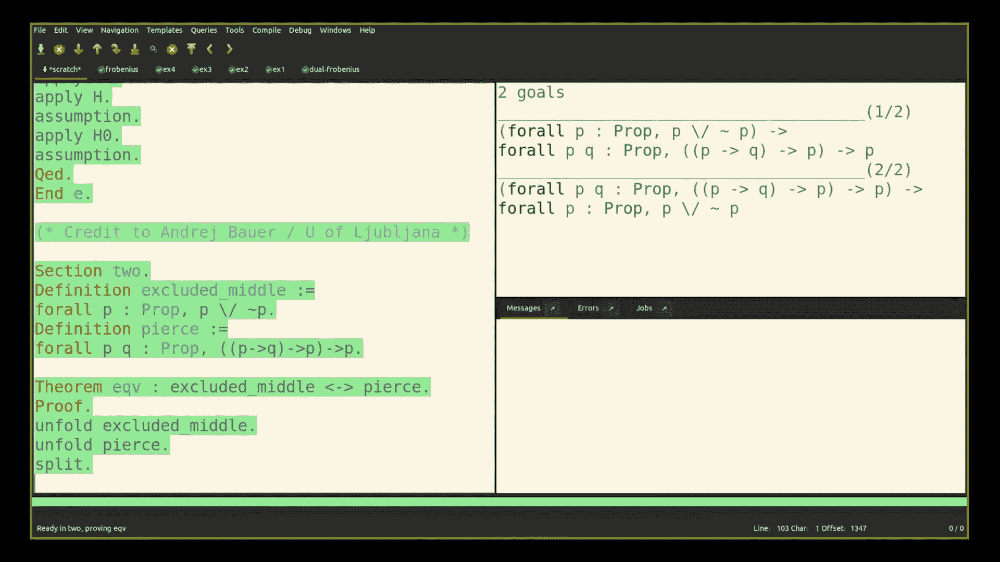

Yes， but that would not work either。With box and p five加 p。

系个屁。I think this would probably work for the first part。

 not for the second part and I mean we could already solve the first part with a lot of effort right so we can solve the first part by doing casework over both P andQ。

The second part is the hard one， so let me actually。

Change this theorem and write it in the other way around so that the hard part comes first。😔，So。

 peers。If and only if。Exlude the middle。Okay， and I'm going to unfold Pis and excluded middle。😔。

And then I'm going to say split so as I prove each part separately。

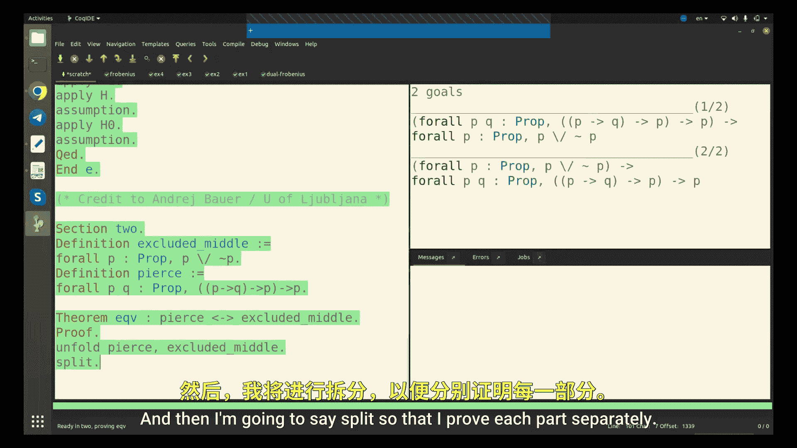

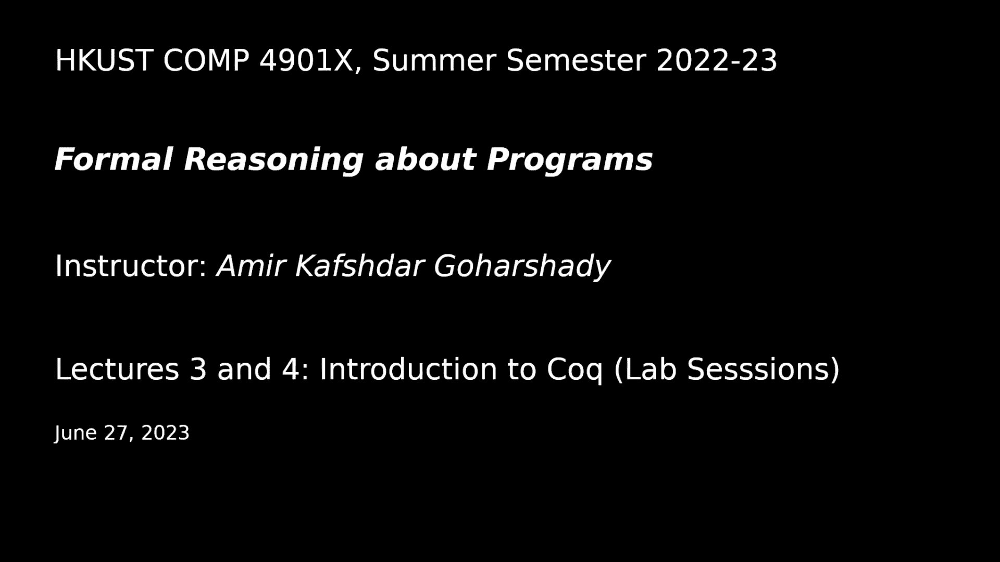

This is what we want to prove， we want to prove that Pierces law holds。

 if and only if excluded middle holds， so we first unfold。

Then because it's an if and only free split。Now I want to prove this one and it's an entaillement。

 so I do intro。Now， the only really interesting part here is the specialization in age。Yes。

 so what you put in place of Q is actually this not of P or not B。Okay。

 and the reason for this intuitively is that you want Q to be false。Right。

So you do this and as soon as you specialize it。You get this。ok。And now。

You can apply the H basically so， but what does it mean to apply H here？So。Look at this。

 this is the part we had before， then I'm saying specialized H and put this expression in place of Q okay。

So this is what I've done now I have a new H after the replacement。Now I want to say apply H。

How can I apply H？14。5。嗯。Okay。So here's the thing in H on the right hand side， I have p0。Right。

And in order to apply H on the right hand side， I need to have P or not P。

So basically when I say apply H， it means that first put this expression in place of p0 because you can do that because this holds for all p0。

And then apply it。 So instead of this， I could first write specialized age with。我 think P to be。

P or not P。Okay， so I could first have this expanded H。And then I could say apply H。ok。

And now after I apply H， total works。Okay。So basically you needed two replacement。

 but the replacements that you needed were these two。Instead of Q， you had to put。

Not P or not B And instead of P， you had to just would P or not be。Okay。

 now why did I give you this example， why did I waste so much of your time？

Because I enjoy that first of all， and secondly， this shows you that it's not easy to find proofs。

I thinkAnd you can now understand why Co cannot prove these things on its own because it's even if you have only a few rules。

 you can apply the same rule with many different parameters， you can when you're doing specialized。

 you could replace this cu with any expression。And you don't know which expression actually works。

And again， it's not trivial to find this， so anyway， you don't need to write this second one。

 you can directly say apply age。Because basically what's happening here is kind of a pattern。

 my think。It's that in order to apply age， I need the right hand side to have this format。

Does this have that format yes， because P0 is supposed to be a proposition and this is for all proposition so I can put P or not P in place of p0 so I didn't need to write the second special I could just directly write the apply and then get the taology。

Okay。Now the second part， the second part is actually the part that we could already solve with。

The casework on PNQ， but let's do it with just one casework so we first do first order which basically just applies all of these other simplification rules that we had。

And this is what we have to prove。So how do you prove this？Well。

 here the only problem I have is that I have this。Extra quantifier in age that I don't like。Right。

 because if I just have P or not P。Then I can do。A casework on P and that's all I need here。

 I just need a casework on P。Okay， so I just say specialized H with putting P in place of P。

Which is just basically saying， get rid of this for allP。And instead， just put thispy。Okay。

Now this is what I have。Okay， now I'm going to do the casework and whenever I say I'm doing casework。

 it's basically disrupting。A disjunction。 So I have this thisjunction here。 I can destruct it。

 which means that I first prove。The entire goal only using P and then I prove it using not to be。

This drug d。So in this case。😊，In my assumptions， I have P and I want to also prove P。

So the proof is just assumption。In this case， my assumptions are just。Contradictory。

So I think I can even write contradiction and it would work now。No， it doesn't work， okay。But again。

 it's a totalology at least， so I can write total。And Q D。Okay。Let's do another example。

But I promise you this example is not going to be as hard as the previous one。Actually。

 let me just call it from here before you can see the proof。😔，So。

This is an example of Ethereorem that has a bunch of parameters。And that's why I like it。

So this is the theorem of Frbinius。So the way we read this is that this theorem has these parameters。

So let's say that a is a set and P is a function that maps each element of a to a proposition。

And Q is a proposition。Okay， so you can think of this as key being some sort of parametric sentence that talks about different elements of a。

 so for every element of a it says some proposition。Okay， so here's what we want to prove。

 we want to prove that these two things are equivalent the first one is that there is an x in the set a。

Such that Q and P of x。Okay， so Q was not parametric， it didn't take any parameters。

 but P was a function。So I want to say that there is an element x in a。

Such that Q and P of x holds if and only if Q holds， and there is an element in a such that P holds。

Okay， pretty intuitive， what we're doing here。But can you prove this？

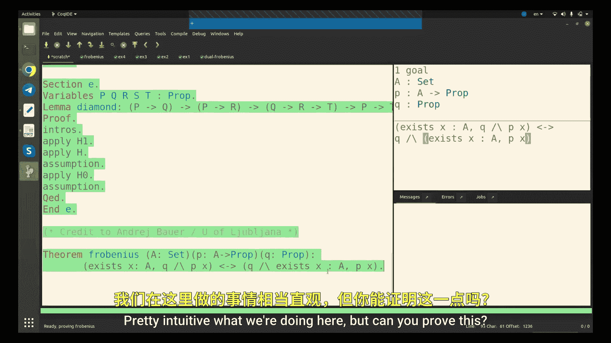

So what's the first step you will do？Yes， we have to first split it。

So now let's prove the first part and this is an implication， so it makes sense to do intros。

 so I did intros。This is what I have now I have。嗯。On these things， but I want to also prove this。

I want to prove that Q and exists in x such that P of x。Okay。

 this is a conjunction whenever you want to prove a conjunction you can again do split。

 so this basically means that I first prove Q and then I come back and I approve this second part。

Okay， so splits。Okay， now it says Pro Q。What do I I know that there is some x in a。

 such that Q and P of x。And I want to just prove you。我能代。Yeah， I think。So what should I say about H？

You want to write to apply H。哦。嗯。I think in that。诶但。Yeah。

 but I cannot say apply what's the name of the command that I should use I can use destruct H Okay so when I do destruct H look what happens here so this was existentially quantified so H used to say that there exists and x。

Such that these other things such that  Q and P of x now when I do destruct H x itself is added here and of course x was in a so all this says is that。

X is of type A， x is in the set a。And。Here now I have Q and P of x。But I just need Q。Right。

 so at this point again， I can probably do auto now I can do total。Yeah。Okay。But anyway。

 if I wanted to be very specific about this， I could then say de age again。

And now I have Q here and I have to prove Q， so it's just an assumption。Okay。

 how about the second part？One of my assumptions is that there is an x in a。😊，Such that Q and P ofX。

But I just want to say that there is an x in a such that P of x。So I just don't need the queue。Yes。

 so I do destruct age。And。Here's the thing， so it again renames this one to x0 because this x is not the same as this x。

But if you want to prove an existential quantifier， you can just point to what。

Has that particular property， so here I want to say that x has the property that is required for this x0。

 so I can just write exist x so I want to prove that there exists an x0 that has these properties I say x is that x0。

So exists x， but when I say this， then it says， okay。

 then you needed to show me that there is an x0 that has this property p of x0。

 if you say x has that you have to prove it to me you have to prove P of x now。Okay。

 but how do I prove P of x it's basically part of H here right， so I can again do total。Or I can。

Destruct age。And then do assumption。ok。Okay。Where half done。Yeah。What do we do for the other side？

So here's the thing I want to prove this。Entaillement。

 I want to say that if Q and there exists an x such that P of x。

Then there exists an x such that Q and P of x。So basically。

 I can move the queue inside the quantifier。Okay， how can I do this one？Okay。Well。

The first thing I do is intro， right， because I want to get the left。

T side of the implication up there。And。Then I can do splits H。Oops sorryrry， isstruct age。😔。

IAl forget this so now I know that Q exists and I know that there exists an x in any such that p of x okay。

 so I now destruct H0。Now I have everything that I wanted。I want。

Show that there exists and x0 such that  Q and p of x0， I say that just use x as this x0。

 So I just say exists x Okay， it says okay so now you have to prove that  Q and P of x。

 but Q and P of x are both assumptions there， so I can just do title at this point。

But if I don't want to use Toto， what else can I do。

 I can also do split again here and then Q is an assumption。And then Px is also a solution。对。Okay。

I have a shorter version of this here as well。嗯。It's basically the same ideas。

I will put this on canvas I'm sure there is also a much shorter proof。

 so there are actually competitions where people try to write the shortest possible cock proofs。嗯。

But。😡，Here's another thing that is interesting。And this is the duall of。The Frbeiaister。And the duel。

Is basically the same as the Frrobinus theorem。Except that instead of having existential quantifiers。

 we have universal for all quantifiers。And instead of and we have order。

So basically this is what it says， it says if for all x's in a， I have Q or P of x。

Then I have Q or for all X P of x and vice ver。ok。😊，Now。

 the funny thing is if you want to prove this one。You cannot do it directly。To prove this one。

You will actually need。This one， the excluded middle law， so you need to have this axiom。

 which says that for all P， that is a proposition， P or not P。And by the way。

 this is how you use axioms， so you can just add an axiom， I added an axiom called EM。

An anaxxiom is just something that we accept without proof。Okay， so in this case， I add this axom。

And then now， when I want to。Use this theorem。So first of all， sorry。

 when I want to prove this theoryorem first of all。

 I want to use the axion and the way I did that was pose proof and then the name of the axion。

And then I say simplify it。ok。Let's look here and let's see what we want to prove。嗯。What do we have。

We have our axiom， which says that for every P。We have P or not P。And then we also have this。

 we know that for every x that is in set a。I had Q or Px。Okay。

 and I want to prove Q or for all x in Ax。Okay。So。What do I want to do here， I want to do a casework。

 what is my casework， I want to say that either Q holds or it doesn't。

 either Q is true or it's false。If Q is true， then I want to say oh， this is trivial， if Q is false。

 then I want to say because Q or px held for every x， then px should hold for every x。

That's the gist of the argument that I want to make here。Right。

 is everyone following some of you are very confused。Okay， I put the recording on canvas。

 you can rewatch this word， it's not really that confusing okay。😊。

So I want to do a casework on Q basically if you didn't understand the last word just understand this word。

 I want to do a casework on Q if I want to do a casework on Q and say Q is either true or false。

 I have to take。My axiom， which said that every proposition is either true or false。

And I have to instantiate that for Q， so I say take H and replace P with Q so assert G is h of Q。

 so now I have Q or not Q。And now I can do my casework and my casework is distractstructing this G basically。

 and when I de it first it says prove the same thing。

 assuming Q and then prove the same thing without Q。

So if I want to prove this and I have the assumption Q and this is an or so I get to choose which side I want to prove。

 I just say I prove the left side because I already have it in my assumptions。

So I say prove the left side， it tells me prove Q， I say， okay， Q is already an assumption。Now。

 what if not Q is an assumption， if not Q is an assumption。

 then I want to prove the right side here because the left side is basically useless。

RightSo in this case I say I prove the right side now I have a for all， so I do intro。Okay。Now。

I want to prove p of x now at this point。ok。But what do I have here？I have。This thing here。

 which says for every x， I have Q or P of x。So I can specifically do it for this specific X。

So I can take H0 and I can instantiate it for this particular x。

So I can say assert and I just give it a new name again I use G G is H0 of。Okay。

 now what do I have here？I have not Q， Q or px， so this means that px re。

Right and that's basically what I have here so at this point I have a autoology at this point I can just say。

😊，Tole。嗯。That actually ends the proof， but what if I don't want to use a toology。

 if I don't want to use a toology， so oh by the way， this is how you write comments。I can de G。

So I can say Q or px I can say okay let's first do the case and then do the case px but this is now very interesting finally I'm two minutes over my time but I got to the point where I wanted look at our assumptions we have Q and we also have not Q yes so we have a contradiction in our assumptions。

And if we have a contradiction in our assumptions。😊，From a contradiction， you can prove anything。

a contradiction implies whatever you want。So if you find a contradiction in your assumptions。

 you can just write contradiction。And that it， and that's a valid proof。

Because you found the contradiction in your assumptions。

 at least in this particular note of the proof three。So you can do contradiction。

But another thing that you can do is that you can try to eliminate one of your assumptions so you can say I want to eliminate H1。

Which means that I want to use my other assumptions to prove the negation of H1。

Wwhich is basically the same as finding a contradiction okay， so I say I want to eliminate h1。

 it says okay， the negation of H1 is Q can you prove Q， I say yes， it's already an assumption。Okay。

And then the last remaining part is also a very easy case where you want to prove Px and you already have Px。

 so that's also an assumption and QET。And。Yeah， so that's how you use Cock for proving stuff。

We will see much more interesting proofs very soon proofs that say that a particular program works correctly。

 for example， let's say I have a sorting algorithm。

And I want to prove that the output of this algorithm is always really sorted。

So I have to give a mathematical definition of sorted and then I have to show that any output of this algorithm satisfies that mathematical definition and I have to give a proof like this。

Okay。

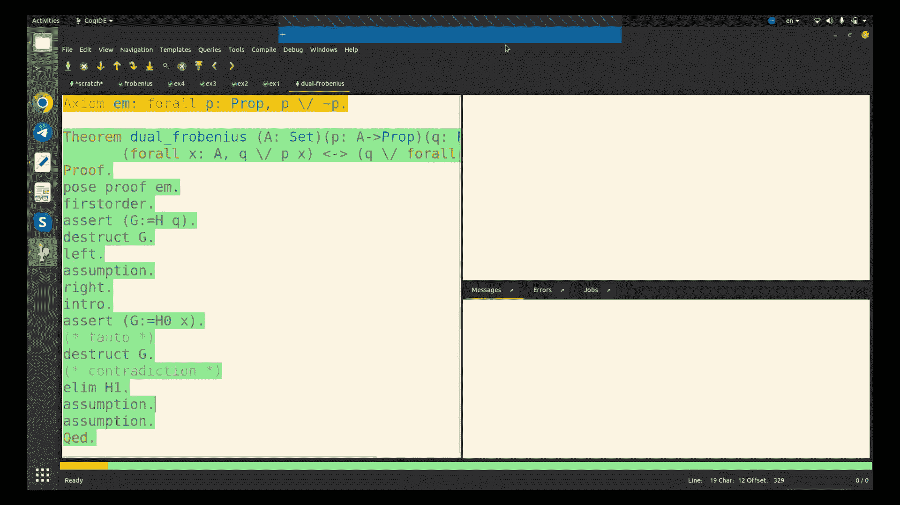

Inuction great， yes， we will have inductive groups as well。😊。

