# 香港科技大学【中英⚡程序的形式化推理｜COMP4901X 2023 Formal Reasoning about Programs】 p03 p2 s 5 and 6 - Denotational Semantics -BV1roXTYaEmJ_p3-

Today， I'm going to mostly do a theoretical lecture again。

And then hopefully at some point our Coch lectures and our theoretical lectures will converge and then we can prove the things that we're seeing in our theoretical lectures in Co。

Okay， so just to remind you from the first two lectures。

We defined a very simple programming language， this was a language where we just had simple integer or real variables。

 let's say。And we didn't have many different operations here， we just had skip。We had assignments。

 we could put two pieces of program together consecutively。We had basically the semicolon。

We had branching with if， and we had a simple loop， while。And then we saw some examples， by the way。

 I've put these slides on canvas as well so you can see them there。

And then we talked about the concept of states， so I told you that in this course we're going to use many different concepts of states。

 so every lecture I have to define what I mean by state in that particular lecture。

So we saw that the state can basically be a valuation， which gives a value to every variable。

 in this case， the value is an integer。Or it can be a line number basically plus evaluation。

 so a pointer to where we are in the code。And then also evaluation that tells us what are the values of all the variables in our program。

And this was the version that we actually used before。

 and this is that we have a valuation and we have a remaining piece of code that has to be applied to that valuation for our program to terminate。

Okay， so generally， no matter what I mean by state。

 I will always use sigma to show the set of all states。Okay。

Now we saw what we call structural operational semantics or small step operational semantics。

 this was the very first thing that we saw。And it basically defineds some rules for executing the program one step at a time。

 one small step at a time。So hopefully you remember these rules or if you don't remember。

 you should be able to easily write them by this point。So we had rules for sequential composition。

 we had rules for if something like this。And we especially saw the rule for while and we saw a wrong rule for while。

So I'm putting the wrong rule in the slides as well so that you remember not to use this。Okay。

 but one thing that I forgot to really talk about was non deterterminism。

So let's first cover that and then we will go to the main topic of this session。

So what's nonterminism？Nodeminism well in our syntax， it looks like this。

 so I have this program P and it can be basically P star P。

So I can have two parts of my program and I just have a store operator in between these two parts。ok。

Now， what does this mean， this means that I will either run the first part or the second part。

So when my program is getting executed， it will run one of these two， but I don't know which one。

Okay， so the program somehow makes a choice。And either goes left or goes right。

But this choice is not known a priori and also it's not probabilistic。

 it's not like it goes left with probability half and right with probability half。

 I don't have a probability。I just know that my program will do one of these two things。

 so if my program is P star Q。It will do either P or Q， but I don't know which one。Now。

 why is this useful and why do we have it in our syntax well？

Basically imagine that you have a program that gets some sort of input from a user or maybe't。

I run inside an environment and it's measuring something from the environment。

And then it's branching based on that。But you have no control over it。

 so you want to say no matter what happens， I want to prove that my program works directly。Okay。

 so imagine that a user can control whether your program executes P or Q so you don't know what the user will choose and when we're doing the analysis of these programs we generally assume that the user wants to really break our program。

We soon that。Pleaseways make divorce worst possible choices， okay？

So we don't know if the user is going to choose P or Q。

But we somehow want to define semantics so that when we prove the correctness of our program。

 we've proven correctness irrespective of the choice that is made。Okay。

 so now how can we define semantic， so again， here is an example。Imagine that x is a variable。

 let's say it's a Boolean variable and you're reading it and the user is providing the value。

 so x is going to be either zero or one。But you don't know which the user gets to choose so at some point in your program you will have something that looks like this it says non deterministically set x to1 or set x to zero。

Okay， so here are the rules that actually give us。Semantics for this。So。

Suppose that I have this program， non deterministic choice between P and Q。

 and currently the values of my variables are given by Val。Now。

I don't know which one is going to be executed， so let's first imagine that the first part is executed。

 so if there is a way of running one step of P and getting to this state to state P prime Val prime。

Then I can also run one step of P star queue and get to the same state。Okay。

 so this corresponds to the user having Tros and P。But now I have another rule here。

 which is basically the same it's just that instead of P I have Q。

 so if running one step of Q over this valuation well，Can get me into a state Q crime well prime？

Then running one step of P star Q over the same valuation can get me to the same state。

And this corresponds to the case where the user has chosen to rank you。ok。Now， very importantly。

I have both of these rules。😡，Yes。I talk about a run of my program。The run is not going to be unique。

Previously before I had nondeminism， if I had some initial valuation。

And or let's say if I had some initial state and I wanted to run my program from that initial state。

 I had only one run。At any given step， I had only one rule that I could apply。

 but now here you see that if I'm for example， at the state P star Q van。

 I have two different rules that I can apply， so I have at least two different round。And of course。

 you can imagine that I can have。This kind of nondeterminism inside the loop。So。Again。

 if you want to imagine it in the real world， imagine that I have a loop and inside this loop。

 I'm reading some input， so the user is constantly giving me input。

So this would actually allow me to have exponentially many different runs from the same starting state。

ok。And what is the difference between P star P and P？What's the difference between P or PMMP。

 that's a good question。Effectively nothing。Yeah， because if you have a non deterministic choice。

 but your choice is to do the same thing or the same thing， you're just doing that one thing。

But this is the grammar that is defining the syntax so here I don't mean that these two are the same。

Right。Okay。🎼please mute yourselves if you join and like don't join the audio in general if you're in class。

Okay。So that's the first thing I wanted to add， I wanted to add nondeterminism。

If the course goes on really fast at some point， maybe I can also add probability。

 so a kind of transition which says with this particular probability。

 I do P and with probability 1 minus P I do Q， let's say。But okay， that's too soon for now。

 another thing that I want to add is an operation called Hol。And basically。

 what this does is that it ends the execution immediately。Okay。😊。

So if my program is just halt and I'm at valuation well。

 my program will terminate in one step and well。When I write something like this。

 I mean that my program is the empty program， so my program has terminated and I've terminated at the same valuation。

But what's interesting is that actually with halt， I will have to change some of my rules。

So for example， imagine that I have a program that looks like this， it's like H and NP。

So think of health as if you're like a C++ programmer， think of it as exit zero。

 it just ends your program immediately。So if I have halt P， I don't want to execute P。Right。

So if I have this kind of sequential composition where it starts with halt。

 no matter what comes after word， I just terminate immediately。

But then this means that I have to go back。And I have to update one of the previous rules that I had。

 and this is the rule for sequential composition。So previously I said this。

I said that if I have something like this， let's say。

The program P from valuation Val can go to P prime v prime in one step。And then I said in this case。

 I can say that PQ can go to p prime Q Q right， but this can only happen if P is not halt。

Because if P is halt and I apply this rule， then p prime would be the empty program and then I would still run Q。

 but I don't want that。To happen I want to say that if I had halt my program actually terminates so you see this is the unintuitive part where by adding new commands。

 you have to sometimes go back and actually change the rules that you had for previous structures in your life。

So in this case， I have to go back and make sure that when I'm applying the sequential composition rules。

 I take care of this corner case， I make sure that my P is not hopped。Okay， nice。

And here's something that I want you to think about， I'm not going to do this in the lectures。

 but I strongly suggest that you think about this because maybe it's going to be your final exam so。

Here are the things that I already have in my program。Sscape assignment， sequential composition。

 branching， lobe， halt， and non deterterminism。Now here's the question。

 what happens if I have break and continue in my programming language？Because until this point。

 I'm just talking about loops that have a guard， you have a condition for the loop and you keep doing the loop as long as the guard holdss。

 okay？But what happens if inside this loop， I can have a break or continue。

 How can I write semantics for this。And actually it gets much more complicated。

 that's why I really want you to think about this。Because basically when you see a break。

 you have to figure out where the vial loop is， like where is the vial that is getting broken by this break？

And the same thing happens for continue。So you have to basically change the definition of state again。

So here we had three definitions of state。But。At this point， if you have break or continue。

 it's no longer enough to just keep track of the rest of the program that is going to be applied。

Maybe you need to somehow keep track of where was the last while loop。So if I do a break。

 where should I jump now？Okay。Just think about this。

A much easier kind of exercise that you can think about is what happens if other than the while loop。

 I also have a forward loop。对。So this one is actually much easier to do。Now。

 why is this easy to handle， can？Any ideas for okay。

 so imagine that I don't have the break and continue imagine that I have all the things that I have right now。

And I'm just adding a for loopbe， why is it easy to handle the for loop in the semantics？No。

 but well， that's even more complicated than what I had in mind。You can just rewrite the form。不是。

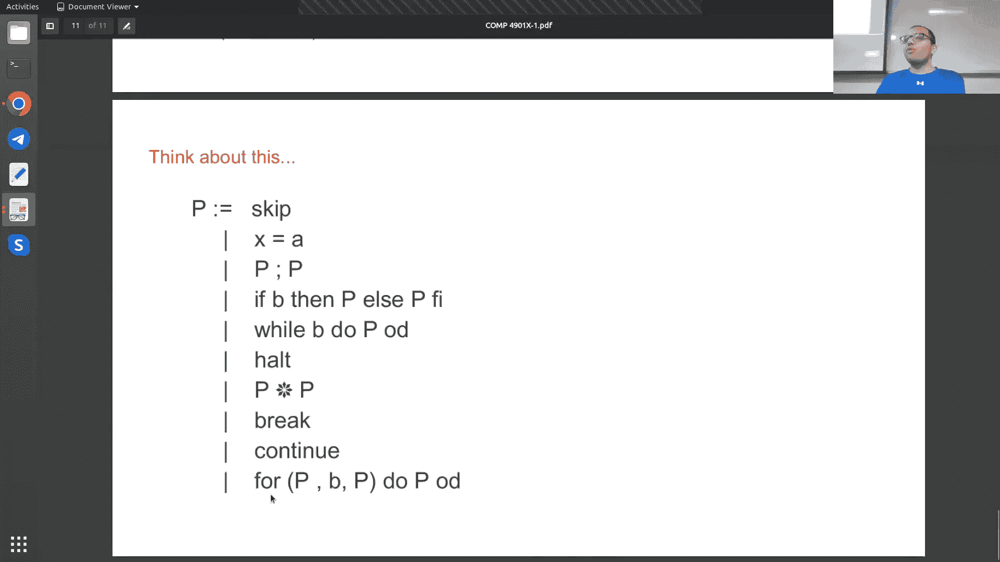

是的。

Okay， it's unfrozen now。Yeah。Okay。So if I have a four， let me actually。Write it here。

 so let's basically I have P1。And then I have a condition。 Why is it so much delayed there。Okay。

🎼This is awful。Okay。So let's say I have P1 then I have some condition G。

And then I have P2 and I say do P3， okay。What does this mean。

 this means that I'm initializing with P1， so I'm doing P1 first。

And then I'm basically doing a vi right and what does my vi do。

 my vial checks G every time if G is satisfied， my vi does p3。And then at the end of it。

 it does P2 and checks G again。Right？So instead of this program， I can basically write P1。

And then I can write viL G to。P3， but then after P3 do P2。And this is the end of flying。Okay。

 so these two programs are basically the same。So I can use this as a rule。I can say that。

In one step of execution goes to some state。Then this program from the same state in one step of execution goes to the same state。

So I can just have one rule。Let me actually write this rule。And my rule is this。😔，Take this one。

It my flatten it？I'm going to say that if this program with evaluation well in one step。

Goes to some program P prime battle prime。

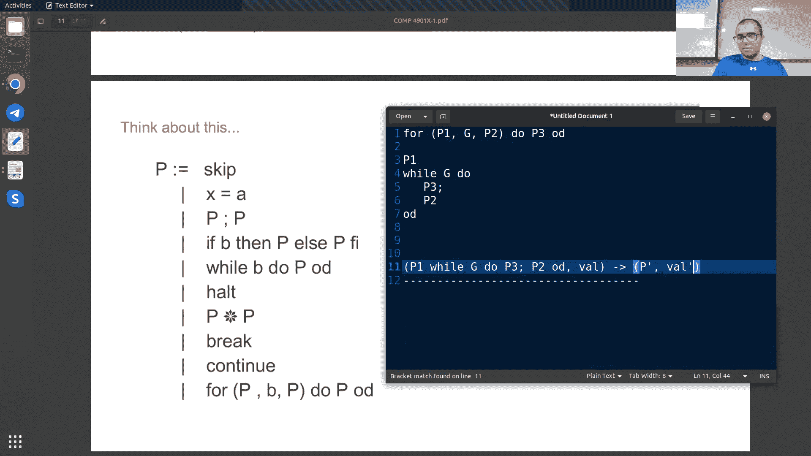

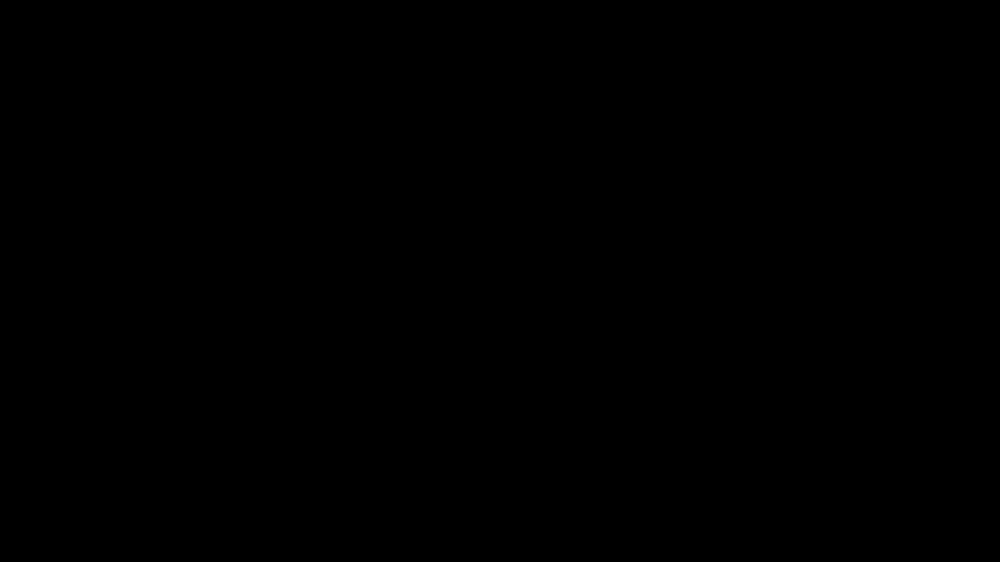

Okay so this was what I was saying， I was saying that if this second program。

 this rewritten program starting from some valuation goes to P prime Val prime step of execution。

 then my for loop will also go to the same state p prime Val prime in one step of execution so basically I'm rewriting my for loop and。

In this case， you see that as soon as I apply this rule。I will not have a4 in my P prime anymore。

 so at least I will not have this four， the four gets removed and it's basically rewritten in terms of why。

And of course， we had rules for while， so we know where while goes。Okay， yes。

 we can have that too that's also fine yes so I can just say that I have a rule。That takes。

This program。系你事。

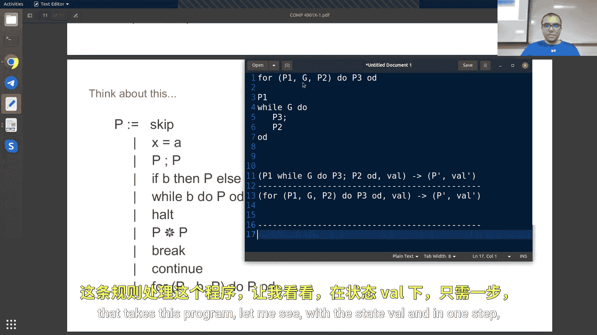

嗯。With this state well， and in one step， it just gives me this other program。It the same states。嗯。7。

ok。We can also define our semantics like this， so I can say whenever I see a4。

In one step of execution， I just rewrite my for as a wild。And then I continue executing the。ok。

There is a very subtle difference between these two rules。

And the subtle difference is that this one actually affects the runtime， in a sense。

 if you define the runtime as the number of times that you apply a rule。按这里。Terinates。

 then this is applying one extra rule for the rewriting so it's taking like one unit of time in that sense。

 whereas this one is not。So again， this is a valid rule。

 but you have to think about how you define runtime if you later want to talk about that。

But the really interesting thing is that， well， we will not talk about runtime in this course。

 but we will talk about termination。And this， whether you choose the first rule or the second rule doesn't really affect termination。

So if your program terminated， it's now going to terminate， it's just going to do some rewriting。

 but the rewriting is going to take finite time because you do one rewriting for each one of your four groups。

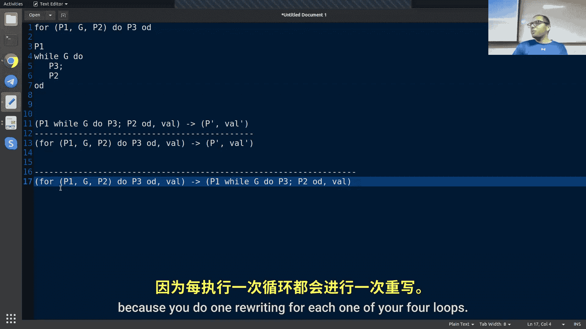

Okay。Yeah， but I really want you to think about the break and continue， that's the interesting part。

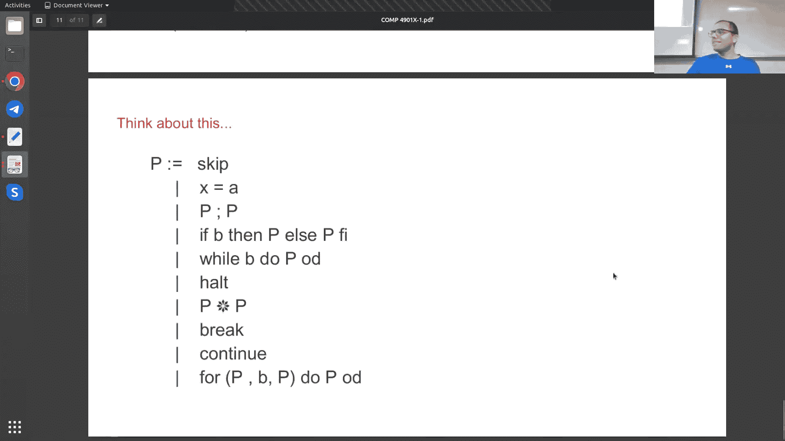

Well， it would be great if you can just do it very simply。

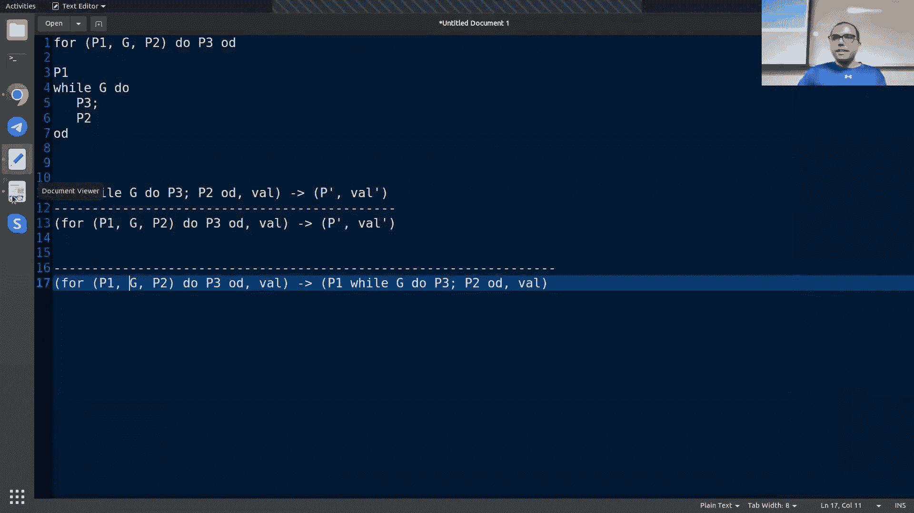

So if you can make sure that your states are as simple as possible。

 you want to save as little information in a state as you can。Okay。So。Yeah。

 so just to do another overview we talked about。These things we talked about this transitive closure of our transition relation which was basically the arrow that does several steps of execution instead of just one and that's why we had this star we had different rules for that。

 we defined semantics of expressions so。All of these are on canvas now。

 and we also defined big step semantics and remember that big step semantics was with this downarrowatinggi and basically。

诶。Whenever I wrote something like this， if I start with valuation Val and I run the program P。

 it will terminate and it will terminate in valuation Val prime。Okay。

So the really big difference between big step and small step is that in small step semantics。

 you had a way of running one step of the program， even if your program was not supposed to terminate overall right so even if your program didn't terminate。

 you could just run one step and then run another step and keep doing that forever。

But here actually you only have rules that tell you what happens if the program terminates so whenever you have this termination is assumed。

Okay， again we saw all the rules for these things， hopefully again you can write these。

 if not you will probably fail the course and we then had this definition of termination。Okay。

And we basically had two definitions of terminationmination。

 one definition was just using the big step semantics， basically saying that well。

If I terminate somewhere， it means I terminate。And the other one was using small step semantics and this transitive closure of the small step semantics。

Okay。And then I actually did an example and here's the example you can again check these things。

 it was quite hard to prove。But the interesting point was that。

🎼Two days ago we saw how we can do proof trees in Co so we're not still at a point where we can do a proof like this in Cock。

 we will get there soon in this course， but we at least know that we can do proof trees and so it's not as scary as it was the first time beside so if I can somehow define all of my rules in quock。

And if I can somehow also define the syntax of my programming language in quote。

Then I can keep applying these rules right so you can think of these rules as tactics in Q。

🎼And then I can just tellok hey， apply this sequential composition rule here and so on。

 and I can just keep going and it will show me the sub goalss that I have to prove so I start here if I were doing this in Co and then it will show me two sub goals and then for each sub goal I say which rule I want to apply and then it will just break it down into more sub goals and I go up until I get to a point very。

Violation， basically。嗯。Okay， you have a delay again。Yeah。

 so I asked you when are two programs equivalent？Right so remember we had this question that I have a compiler。

 it's doing some sort of optimization。I want to to prove that this optimization does not break my program I want to prove that the optimized version has the exact same behavior as the original version so that I'm not changing anything that the program interrupt。

So I need some sort of a mathematical definition of equivalence。And okay。

 so here are two definitions that we can give。So here's the first definition。

 I say that P and Q are equivalents。If for any pair of valuations， v and v prime。

P well reaches well prime and this is with the empty program。

 so it means that it terminated as v prime。If and only if Q well terminates that algebra。

And I can also write this with big step semantics。Okay。So。What is the saying。

 this is saying that two programs are basically the same for me。If for any given input。

 because we can think of this initial valuation as an input to our program。

If for any given input of my first program P。The set of outputs that are possibly created by this program is the same as the set of outputs that are possibly created by the other program。

Okay。And I'm talking about sets of outputs here because I have none determin them。Right？

But very importantly， I'm not really talking about the runs of these programs。

 I'm not saying that every run of the first program should somehow correspond to a run of the second program because it might be that my compiler is doing some sort of optimization and I mean the whole point of an optimization is that you want to reduce the runtime so you want to make your runs small。

Or shorter so。It's possible that you also reduce the number of possible runs。

 but I want to kind of make sure that the set of possible outputs does not change。🎼Okay。

 but this is not really enough， can you see what's interesting here？Yeah。

So if I say two programs are equivalent。If。They basically have the same sets of outputs for any given input。

There is still something missing， there is still another aspect of programs that I'm not really keeping track of here。

And the answer is in this slide， but try to figure it out yourself without looking at the slide。So。

Are these two programs equivalent？哦。Okay， why are they not equivalents？s。Yes。

 so that's basically the point termination is a very important thing。Right。

Here's the thing if I take this definition。No matter what my initial state is。

 P is always going to terminate。And it's always going to terminate with x equal to one。

RightSo my Val prime is always going to map x to one。Now the same thing happens with Q。

If Q terminates and look， what does Q do， Q sets x to zero， and then it says while x is not one。

 non deterministically either don't do anything or set x to1。Okay。

 so the only case that Q terminates is if at some point it sets x to1。

So the only case that Q terminates is that it terminates with x equal to one。So in this sense。

 in the sense of any of these two definitions， P andQ are equivalent。

Because no matter what your starting state is， you're only going to terminate in a state with x equal to1 and you have just one variable so that's all you care about in your value issues。

But the difference is that all runs of P terminate， whereas Q actually has a non terminating run。

And the non terminating run is the run where I do this vi and then when it gets to this non deterterministic choice here。

 it always chooses skip， so it just keeps loopping in the vial。

Right so in that sense P andq are not equivalentence so we need a better definition of equivalence if I had this definition of equivalence and then I had a compiler that actually turns P into Q that would not be a valid optimization because my original program didn't have this problem of nontermination and now because of the optimization I'm getting it so I don't。

😊，And I mean， you can also say the opposite if I had a compiler that turned Q into P I wouldn't be too happy either because maybe the programmer wanted to have this but。

 maybe it was a feature， I don't know， I don't want to change what the programmer has written， right？

And the other point here is that， well， again， this is something that at some point we will converge and we will be able to do what we're saying in theory in Coch as well。

So suppose that you want to write a particular。Optimization for the compiler of a particular language。

 let's say。And this optimization is basically a rule that rewrites the program。

 it takes the first program P and rewrites it as a second program queue。So ideally。

 you want to be able to prove also in Coke。That for every pair of programs， P and Q。

 if your optimization turns P into Q， then p is equivalent to Q。Okay， but at this point。

 what I want you to see is that we have a lot of quantifiers。

And we're going to have quantifiers over programs， I'm going to say for every program P and for every program Q。

 if this particular optimization turns P into Q。Then P is equivalent to Q。

So I would need to be able to quantify over my programs。

 I would need to have a formal definition of my optimization。

 like what is it exactly that my optimization is doing。I should have a formal definition of。

The semantics of my programs。Which is what we're doing right now。

And then I should also have a formal mathematical definition of what it means for two programs to be equivalent。

 and then I have to write a cook proof。That proves the entire thing。

 so you see just to prove that a single compiler optimization works correctly。

 we need to define so many things。And that's why this course is going to go forward very slowly。😊。

We're going to continue with semantics for now， so all of this was mainly a recap of what we've already seen。

😊，This kind of rule based semantics， as I told you last time， is called operational semantics。

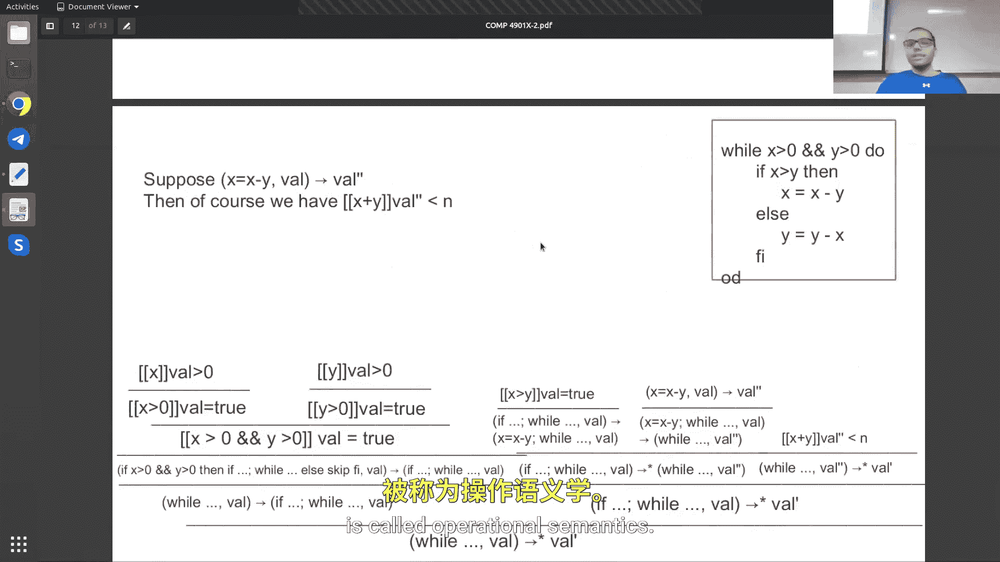

But today we're going to actually。

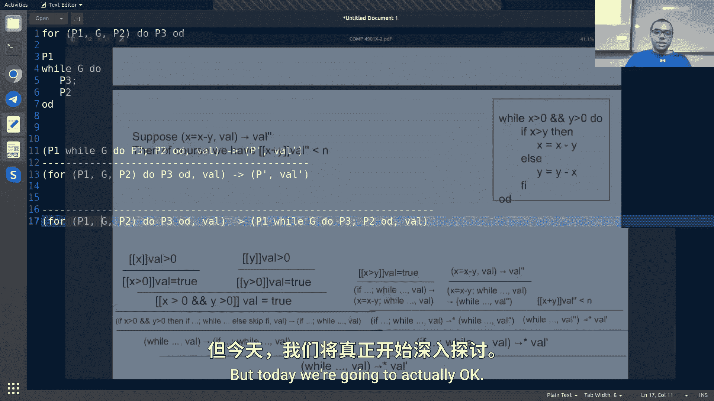

Okay。Yeah。Yeah。So let's do this。What we've seen until this point was operational on semantics and the idea behind operational semantics is that we give meaning to programs in terms of how we can actually run these programs。

RightSo the meaning that I gave， for example， to a vi loop was based on a rule that told me how I can run one step of a vi loop。

Or if it was big step， the meaning was like what happens if I run it all the way？Now。

 the idea in denotational semantics is a little bit different。😮。

So here what I want to do is that I want to look at my programs as functions。

This is like a more mathematical way of looking at things。

 so every program is just a function that gets an input and produces an output。And for now。

 let's say that we are again back to our simple syntax here， so I don't have non determinism for now。

So for any given input， I'm going to have at most one output。Right， so in that sense。

 I can now define my states again， and this time I can choose the simplest definition of state。

 I can just say that my state。Is basically just valuation。

And evaluation is just a mapping of the variables in my program to integers。ok。And again。

 I use Sigma to show the set of all states， so I want to give a meaning to every expression and every program。

But the meaning of my program。😮，Is going to look like this， This is the type of it。First of all。

 I always use double brackets to denotence semantics， so this is the semantics of P。

 this is the meaning of P， so the meaning of P is a partial function from sigma to sigma。

It basically takes an input and it gives you an output， but it's not a total function。

 it's a partial function because your program doesn't terminate on some inputs。So for some inputs。

 I don't have an output。So that's why I have like a dashed arrow here。It's not a total function。Okay。

Yeah。But now I don't want to write rules anymore， instead I want to give inductive mathematical definitions。

And I want to give definitions that basically use what we call structural induction。

So structural induction means that。I look at the syntax。And I say。

 suppose that I know the meaning of all the parts。Can I give a meaning to the hold So for example。

 if my program is vi B2 P。Let's say that I've already inductively defined the meanings of P and B。

 can I use that to define the meaning of the entire y？

Okay so I'm doing an induction but the induction is not like going on natural numbers。

 it's just that I have a large structure and I know the meaning of each part。

 so I'm assuming that each part is kind of smaller than the whole and then I'm doing an induction like that。

Okay。So。But we talked about the meaning of programs。

 but if I want to do a structural induction like this。

 I have to also give meanings to parts of programs， so for example here if you look。At this。

 I'm doing an assignment， so I have some expression。

 I have to somehow define the meaning of this expression。

So if I have an expression like x plus y minus z， what does that mean？Right。And similarly。

Inside my if and vial， I have guards， I have these conditions that should be satisfied in this case for the vial to go and execute P and in this case for the if to decide if it goes to the then part or the L part right so I have to somehow also give meaning to my Boolean expressions。

So when is the Boolean expression true and when is it false？So in that sense。

 if I have an arithmetic expression E。😊，Then the meaning of E or the semantics of E。

Is also going to be a function。And it's going to map every state of my program to an integer because。

Remember， a state of my program is just a valuation that says what is the value of every program variable？

So if I know the value of every program variable， what is the meaning of x plus y minus z。

 it's just the value of x plus the value of y minus the value of z right and that's going to be an integer。

 so I'm going to have a function that maps the states of my programs to integers。

That's the meaning of an arithmetic expression and of course if I have an expression of a different type。

 if I have a Boolean expression， then instead of getting an integer I'm just going to get true or false。

😊，So the semantics of a Boolean expression is just a function that maps my program states to either true or false。

And I just have to emphasize this one more time， we're using a different notion of state than the one that we were using in the previous type of semantics right so previously I when I said state I meant a program and evaluation。

 but here when I say state I just mean evaluation。Okay。

 so this is my definition for the rest of this session and also for the next session。

 I guess so every state is just a valuation that maps variables to values and i'm just assuming that all of my variables are also integers so that's also for simplicity of course you can define a programming language where you have different types of。

Variables and then youll have to map each variable to the current set。But this is just easier。

 let's say everything is integer。Yeah。Okay。You have to go this year。Okay。

 so before I can actually go ahead and define。The semantics， I need another notion here。

 and this is what we call the semantic conditional。So this is just a fancy name for。

This kind of expression that you have probably seen。Again， if you've done C or C++ programming。

So it just checks whether B holds and if b holds， then it gives you the value of F。

 otherwise it gives you the value of G， okay？So we want to define this a little bit more formally。

So let's say that B。Is a function that maps every state to either true or false。

 so B is a condition that I can check at any point of my program。

And let's say that F and G are basically sub programs somehow。

 not exactly sub programs but meanings of sub programs。

 so F is a function that takes some input state and gives you some output state and it's not necessarily a total function and the same thing for G。

Okay， so if I write a conditional of BfG。What I mean is that check B and if b is true to F。

 if b is false to G。But this is also a function。Conditional BFG is also a function that maps states to states and it's also a partial function and this is the definition。

 so the definition is that if I apply this entire function kind of BFG to a particular to a particular valuation to a particular state。

What happens is that it first checks if B is true at that particular state， and if B is true。

 then it returns whatever F returns。If B is false， it returns whatever G returns。Okay。😊，Again。

 very simple， but I mean， we have to be mathematically precise with this。Okay。

 so now that we have this， we can actually go ahead。

And we can define our semantics and what you will see here is that I'm not going to write any rules。

I'm just going to use induction， I'm going to define。

The meaning of every expression based on the meaning of its sub expressions。ok。😊，So。

Let's look at simple expressions like this versus arithmetic expressions。So。嗯。

What if my expression is just a variable， so what is the meaning of a particular variable at a particular state？

So this state value basically was itself a function that gave me the value of every variable。

So the meaning of x as at well is just v of x。Right， pretty easy。

And the same thing goes for a constant， so if I have a constant C and this C is like a constant in Z。

诶。Then what is the meaning of a constant？😡，It's just a function that takes a valuation but ignores the valuation and always gives you that constant back。

Okay， so the meaning of C at the valuation value is going to be C。

And then the rest of these cases are super easy to define， right， so what is the meaning of a plus a？

And sorry， a plus a prime at a particular evaluation value。

 it's just the meaning of a at the same state of the program plus the meaning of B at the same state of the program。

Good。And the interesting part is that I can actually also。Define division very easily。So。

Let's do this。What is the meaning of a divided by a prime？At a particular valuation。IntegerYes。

 this is integer division。Okay， so I can say that suppose that a prime is zero if a prime is zero。

Then this is just going to be undefined。Right， but。What can I say， I can say， suppose。That's a。

Can be written somehow as。Ape crime。Times some x plus some y。

And suppose that y is less than a prime in terms of absolute value。

Then I can define this whole thing to be y okay？So。I can。 Let me see。 I don't have my pen with me。😔。

So I have to draw this by hand。😔，Okay， so this is going to be why。If。嗯。

The meaning of a at well is equal to x times。😔，The meaning of a prime at well。Plus， y。And why。

Is greater than 0。It's really hard to write it in one line and less than the absolute value。😔。

Of the meaning of a prime。That's why。ok。So again， this is just a basic definition of。

Integer division。Oops， yes， I was writing the mod， sorry， it should be X。😔，你出知啊。Sorry。Okay， yeah。

 so here's the thing。What happens if a prime is zero do I need to add another condition here and say like it's something else。

 no because these are partial functions， so if a prime is zero。At that particular valuation well。

 I will just not satisfy this condition at all。Right so then this definition doesn't apply and a divided by a prime is not defined。

And that's fine。Because I said that my definitions can be partial。Right？But okay。

 so here actually because I didn't want to have division。

 I said that my semantics are not partial for these two cases for expressions and Boolean variables。

 but if you have division and then you can just leave something undefined and then this will just be partial functions instead of total functions。

ok。So let me actually delete this and keep everything defined for now。😔。

But we can easily extend this to have division and things like that as well as long as we just work with partial functions。

Its this as well。Okay。So let's now go to Us。So what happens with Boolean expressions。

 again I can do something very similar， what is the meaning of true。

 the meaning of true is always true because true is just a constant。Right。

I don't care what the valuation is， I don't care what state of my program I'm at。

The meaning of the expression true is just the Boolean value through。And the same thing for false。

Now I can define other things as well。If I want to define the meaning of。A comparison。

 whether a is larger than a prime。At a particular program state well。So I already know how to find。😡。

The meaning of a at that state。And I know how to find the meaning of a prime。

 so I just do a conditional， I just check， is the meaning of a really larger than the meaning of a prime？

If so， true， if not false。Right so that's why I wanted the conditional there。

And so the same thing for or and and and not and those things so you just。A。

It's a very simple exercise， it's just that if I want the meaning of B or B prime。

 I just take the meaning of B and the meaning of B prime and I take the or of those two。

RightSo defining these kinds of semantics is super easy， so if we're going to go forward。

This is the part where things actually get interesting。So let's say that now I want to define。

The notational semantics for programs。Not just for expressions inside programs， for entire programs。

 for programs that actually have some operations。Okay。😊。

So let's do this and remember that this is the type of the object that we want to define so every program for us like the meaning of every program is just a transformer that takes an initial state and gives us a final state。

And for some initial states， it just doesn't give us any final state because the program doesn't terminate or has an error or something like that。

 for example， I don't know， you can also define it so that if you had division by zero。

It's just the entire program is undefined。ok。Okay， so first。

 we want to give meaning to the program skip， that's the easiest part right？Intuitively。

 we said that Sip doesn't do anything。So the meaning of skip at an initial input at an initial state well is just going to be well。

So。Another way of looking at this is that if my initial state is well and I run this program if I run Sip。

😊，It will terminate and the final state would be valid。Right， okay。

This is easy now the next one is when I'm doing an assignment。😊。

This one is also easy because I've already defined how to evaluate a particular expression。

So if my program is just x equals to a。What is the meaning of this program when it starts at a particular valuation well。

 well， I just take my valuation。I keep all the variables the same。

 but I just change the value that is assigned to x。What value should be assigned to x， well。

 whatever this expression is， but I already know how to find the value of this expression because I've already defined the semantics of this expression。

J。So I just take that and I replace it in x and this is the semantics。Okay。Now。

 this kind of functional look at programs under their semantics。I's actually really interesting。😊。

Because what happens if I have sequential composition？If I have PQ Val。So what does this mean。

 it means that this is the program that I want to run intuitively。

And I'm starting at this particular initial value， I'm starting at that。So what am I doing。

 I'm first applying P and then I'm applying Q。But I said that the meaning of P is just a function。

And the meaning of Q is also a function， so first applying P and then applying Q。

 that's the same as applying Q O P。The meaning of Q。And then the mean fee or well。

 if you're very much used to functional programming， you will not really put an order。Right， okay。So。

You see， now I'm getting mathematical definitions for what my programs mean。😊。

And I don't have to write rules I can just。great inductive ways of finding the meaning of a program based on the meaning of its sub programss。

Okay， next。What happens if I have？And if。So let's say my program is this if B1 p otherwise Q and that's it and I'm starting at this initial state。

Okay， so this is again where I go back to that definition that I had for the conditional。

So very intuitively， I can find the meaning of B。😡。

So I can evaluate B at this particular place at the state that I'm in。And I can check if B is true。

 then the meaning of this program is going to be the same as the meaning of P。

Because B is true and I have to run P。If these falls at the current state。

 then the meaning of this entire program is just going to be the meaning of Q。

So you can just check that this definition is correct， so I gave you the intuition。

 but if you want to check it。In more detail， you have to go back here and you have to make sure that all the types match and they do so I've written everything with the correct types hopefully。

O。Now the thing that is the hardest。Is wild， so loops are always our biggest problem。

If programming languages didn't have loops， everything would be decable and life would be so much easier。

But programming languages do have loops。Okay。So what happens if I want to write a rule for while？

Sorry， not not a rule if I want to write an inductive denotational semantics for while。对。

So you see up until this point， what I was doing was very easy。

 I was just saying you have this program， take a sub program。

Find the meaning of that subprogram and use that to define the meaning of this bigger program。

So I'm doing induction， but this only works if your sub programs are smaller than your original program。

RightBut the problem with vile is that that doesn't actually happen。😊，So if I have a Y loop。

 let's think of this again intuitively the same way that we thought about if。

So for if I said that I have basically a conditional because I'm going to check whether B holds or not and if B holds I'm going to run P。

 if B doesn't hold， I'm going to run Q。Right so if I do the same kind of reasoning here。

 I get a rule like this which says that I first check if B holds。And if B doesn't hold。

 I don't have to run anything。😡，So I just run skip。Right。

 because this is a vial and the condition of the vi did't halt。😊，But if B does hold。

 then what should I do， I should run one iteration of my while loop。

And then I should run the white loop again。Right so this means that I will have to do this。

 I have to run P1s。And after I ran P。I have to run vi again。But now this is a problem。

Because this is no longer step by step semantics， I can't just do it step by step。

 I'm giving a mathematical definition I'm doing induction here。

I cannot say that the definition of this program depends on the definition of this program。

Because if you look at this definition here。The thing that I had for sequential composition and realized that I also have a sequential composition here。

I actually defined the meaning of this program based on the meaning of this one。

 so now if I want to do something like this， I basically have a cycle。And that's not okay。

 I cannot have a cycle in my mathematical definition because now none of them are defined。Because。

This expression， this semantics on the left is only defined based on this one based on the one on the right。

 and this one is only defined based on this one。You can't have that， that's not how induction works。

Okay， so what can we do？Any ideas？I mean， intuitively。

 it should make sense to you that there is a function that gives me the meaning of while。

 right there is a function of this form。For every program because intuitively again。

 I already know about operational semantics， so if I have a program I can just use the operational semantics to find a function like this。

But now I'm just assuming that I don't have the operational semantics for a second and I want to have an inductive definition。

 so how can I come up with an inductive definition？And this is where we get into fixed ones。Okay， so。

I want you to look at this， this was a rule that we had in our operational on semantics。Right。So。

 and this was like unfolding the vibe。Right。So we said that this program is basically the same as this program。

Intuitively， because when I have a viine。I can what is the first thing that I do。

 I check whether bee holes or not。So I can rewrite my vi and I can say if b， if b holds。

 then do one iteration of P and then do vi again。Otherwise。Skip。

 don't do anything this was a rule that we saw in the first day of this course。

🎼And I also told you that this vi definitely inside this if and if it's outside。

 it doesn't work okay。So we had this rule。And basically what this rule told。

Thats the function that I'm going to define as the meaning of this program should be the same as the function that I'm going to assign as the meaning of this program。

So okay， it's again， not working。Okay。By the way， I don't know why the colors are changing that's also another strange thing。

 so this dot is blue for me on my screen， but for some reason。ok。I don't know how that happened。Okay。

So this is what I know， I know that no matter how I'm going to define my semantics。

I want these two programs to have the same semantics。ok。But。Okay。

Yeah I've basically written the same thing and remember that the semantics of a program is again a function that maps states two states and it's a partial function。

 so whatever partial function I assign to this program should be the same as the partial function that I assign to this。

Now I'm going to define what we call a transformer。And it's not as cool as the original transformers。

 but anyway， so this is a transformer that takes a function and gives me another function。Okay。

So this T takes a function。For example， takes the semantics of this program here and gives me another function。

 for example， the semantics of this program here。Okay， so the type of tea is this。It's going to take。

A semantic function and give me another semantic function。Now， how am I going to define this？

This is now a little bit weird。So this is how I'm going to define it。T of F。

Is going to do this is going to do conditional on B， and then if B holds it's going to do FOP。

 which means first do the meaning of P and then do F， otherwise it's going to do S。Okay。Now。

 why am I doing this weird definition it kind of。😔。

It already looks very ugly unless you're already doing functional programming。

This looks not that nice。Okay， so first of all， this be here is hard coded， okay？

And why am I hard coding B because I know how to compute the meaning of B。

 so I don't want to care about that， I don't want to have that as a parameter。

So I'm just going to hardcode the meaning of P。And the meaning of S also is something hard code that I already know。

Okay。And similarly for P。Remember， I'm still in my induction。

 I want to define semantics for this while， so I'm assuming that I've already defined semantics for all parts of it。

 so as I'm assuming that I already know how to assign a function as the semantics of P。

So this part is hard coded。😊，And this part is also hard coded。Okay， and this is also hard coded。

So these are all parts of the definition of T。Okay。

 so T of f what's f F is a function of this format so T is a transformer that takes a function F that looks like this and then it basically does this it checks if be holds。

And if B holds， it's going to do FOP， and otherwise it's going to do S。And again。

 all of these circled parts are hard quoted there。That's how I want you to think about this。Okay。Now。

Why am I doing this？Because imagine that I apply tea。😮，To the semantics of my vi looppe。Okay。

 I haven't defined the semantics of my vi loop yet。But I say imagine that I have somehow defined it。

And then I apply this function T to it。This transformity。

What happens if I apply T to the semantics of my vilobe？It basically says。

this F is now the semantics of my vi loop。So it says check B and if B doesn't hold do skip。

 if B does hold first do one iteration， first do P。And then do the void loop again。😡，Okay。

 so basically， I mean， the definition looked a little bit weird。

 but what this transformer T is doing is that it's unrolling the value。😊。

It's rewriting the vi loop as an if that has the vi loopbe inside it。

 so it's basically rewriting this program as this program。Okay。

 but we are doing it not on a syntactical level， but on a semantic level。Okay。Okay。

So now I have this transformer which basically takes。My program at a semantic level and rewrites it。

But what did I say， I said that ideally。If I have this program and I rewrite it。

 I want to get the same semantics。RightSo this means that if I apply T。😡，To the semantics of vile。

I will get this semantics。The semantics of this extended program。But ideally。

 I want to define the semantics of y so that this is again equal to the semantics of the y。

So I still don't know how to define the semantics of my vi。

 but I know that no matter how I define it， it has to be a fixed point of T。Does that make sense？

So T is a transformer that takes a function and gives me another function。

And what I'm saying is that the v I've defined T。😡。

If the function that I give as the input to T is the semantics of my while loop。

Then T should give me the same function， the semantics of the viral loop patch。Okay。So。Great。

 so I can use this as a definition， right？😊，Because the concept of a fixed point。

 it's a mathematically well defined thing like right so it's like。If I have a function。

 Tx is a fixed point of T if t of x is equal to x。So I can just say the semantics of while B2p is going to be the fixed point。

Of this function， of this， well it's a function， but it's better to call this a transformer。

 the semantics of my while is going to be the fixed point of this transformer。Yeah。ok。😊，Great。

Now we have actually three problems here， but I'm going to talk about two of them。

The problem that Tom not going to talk about in this session is how the hell do we even compute the fixed point of a transformer function that looks like that？

Right， but at this point that doesn't matter。It doesn't matter how we compute it because we just want to give a mathematical definition。

As long as it makes mathematical sense， I'm happy with it， I don't care how to compute it。

I'm just assigning meanings to programs。😡，Right and as long as I can say that this program has a well defined meaning。

 even if I cannot compute that meaning， I can reason about it。Right so again。

 imagine that at the end of the day， I want to hopefully put all of these things into co right Cock doesn't need to be able to compute all these functions。

What Coch needs to do is to be able to reason about that and if I have a mathematical definition。

 I can reason about it。So that's the whole reason I don't care if I can actually compute this fixed point and honestly I can't。

Because if I could， then I could answer questions like termination。

Because if I could compute this function， then I could basically say well。诶。

When does your program terminate and when does it not terminate， we said that。

The program always terminates if the semantics is a total function。

And if it's a partial function that doesn't get to some output for a particular input。

 then that means your program doesn't terminate。So if I could actually compute this function。

 then I could answer problems like termination and halting and so on， which is undecidable。

 we know we can't answer those questions。Okay， so we're not going to talk about whether we can compute this。

😊，But then even thinking about it mathematically， we have two other problems， these two problems。So。

All I've done until this point is wishful thinking， I'm saying。

I can define this T and I can define T because T's definition only dependented on the definitions of smaller programs。

 and I already had those definitions， so T is well defined mathematically。And then I want to say。

 okay， now that t is well defined， take the fixed point of t and put it as the semantics of the vibe。

 so define the semantics of the vi to be the fixed point of T。But now， first of all。

 what happens if it doesn't exist？But if I don't have a fixed point。

I haven't proven to you that there is definitely a fixed point right so it might be that this。

This T has no fixed point at all。And then the next question is， is this fixed point even unique？

What if I have many different fixed points？Right。So we have to solve these problems。嗯。Any ideas。

 does it exist， is it unique？How would you prove that such a weird fixed point actually exists？

If I give you the answer to this， you will really laugh， it's super easy。

We already know it exists based on something else in this course。你 how well is define。Well。

 we have not defined while yet here， right？😔，So we want to define thenotational semantics of while to be this fixed point。

Its the thing。No， not really， it's actually the operational sevantics。😊，Yeah。

 we already have operational semantics。😊，And because we have operational semantics。We know that。Well。

😡，This function is going to get inputs of this program and give me outputs of this program。

Right and I know based on operational semantics。😊，That that's doable that such a function exists。

 so the function that is defined using our operational semantics。😊。

Its definitely a fixed point of tea。So T does have a fixed point。ok。😊。

We're going to see a complete proof of this。I'm just giving you the high level idea first。

Then we will get into the proof。But for sure， we know that there is a fixed factor。

But is the fixed point unique？😡，Now again， you have to intuitively think in terms of operational semantics because that's what we have right now。

 our denotational semantics is not yet defined， we want to try to define this。

So think about operational semantics。😊，Is this unique？😡，Why is it not unique multiple ways。Well。

 we had multiple ways。Yeah， okay， that's correct in a sense。

 because we had many different wild rules right， but just imagine that I'm keeping only one of those wild rules。

So that you have only one way of defining its inaupo se。Right。

Or another way of talking about this is consider all the other rules， so let's say I have。

🎼I don't know how many different rules I had for violin in my operational semantics。

I think I had three or four different vents that you could use for mine。

Do they really give you different functions if you think of it like this？那个。No。

 they don't give you different functions， so if we go by our operational semantics。

 we should probably get a unique solution here， right？But the problem is not that， oh and by the way。

 we don't have nondeterminism here， nondeterminism makes everything much harder and that's an exercise you have to think about that。

 but without an nondeterminism。It doesn't really matter which rules of my operational semantics or which variance of the vi rule I use I'm going to get the same function。

 the problem is that there might be a different function。

 something that does not really fit into my operational semantics。

 something that doesn't match with my operational semantics， but is still a fixed point of this T。

I have no proof that T has only the fixed points that I can find by my operational semantics。

 it might be that T has some other fixed point as well。Okay。

So what should we do if T has other fixed points？So。Again。

 these are all things that I'm going to prove for you after lunch， but let's say it exists。

 but it's not unique。Okay， so I'm just giving you a proof sketch right now I'm telling you what are the high level ideas of the next session。

But let's say that the fixed point actually does exist because we can get it out of our operational semantics。

But let's say that I don't know if it's unique or not， so let's assume it's not unique。

Because maybe there is another fixed point that I don't know somehow exists。ok。😊。

So if I have many fixed points for T， which one should I choose？

Like what's so special about the fixed point that is defined by our operational semantics？Okay， yeah。

 let's go for lunch and think about this over lunch。😊。

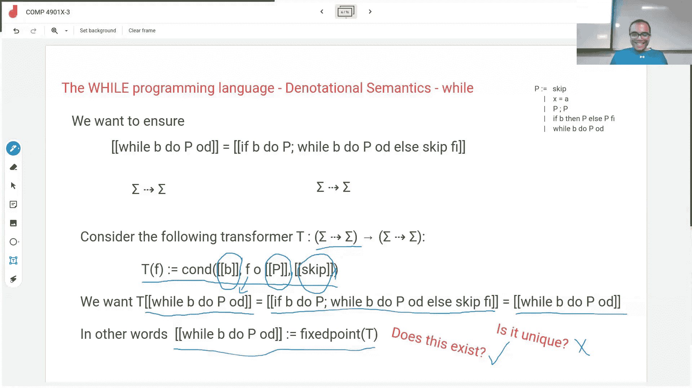

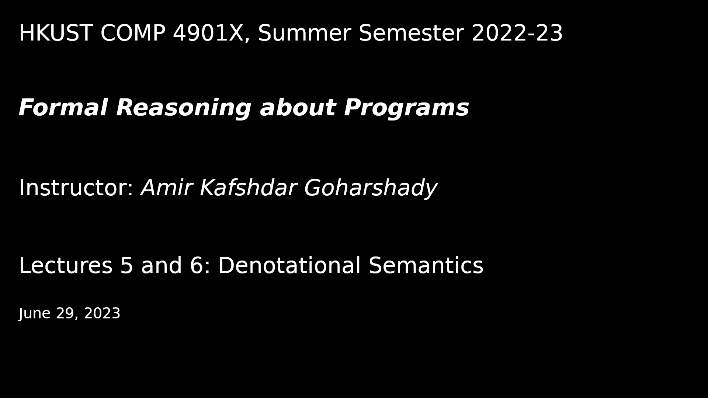

This is where we left off， so let me just。Do that definition of fixed point again。😊。

So if you have a function G。It。Maps the elements from any set A to a。

I'm again distracted because this is red for me but it's somehow bluer and you see when I draw something it's again in red。

😔，I don't know what's happening Okay， let's start the section again。

 this is the official starting time I will cut it from here。

So we were defining the notational semantics for our simple programming language and we got to a part where we actually needed fixed points。

So let's just review what the definition of a fixed point is。

 so let's say that G is a function that maps a to a and it doesn't have to be a total function。

 it's a partial function。And then a fixed point is just some point x in a such that G of x is x。

 so whenever I talk about fixed points， I simply mean that if I apply this function to them。

 I get the same。Now， in our case， we were looking at this。Function T called the transformer as well。

 which basically took a function and gave us another function。

 so the fixed point of T or a fixed point of T would itself be a function。Right？

And we saw that basically。This was here， we saw I to our intuition of what the semantics of vial should be。

 this is what we get， we get the semantics of this program。And again。

 it was our intuition that this program should have the same semantics as the original vial。

 so we have this T and we want the semantics of our vial to be a fixed point of this particular T。

Now。Before going forward， I just want to emphasize one more time why this is important。

 So we are trying to give a definition of semantics that is。对。Based on induction。

 so I want to see sub based of its sub programs。Now， okay， I got disconnected again。Okay。

 and I'm back。So。The good thing about this particular T is that I could really define it based on the semantics of the sub programs。

 I could define it based on the semantics of B and the semantics of P。So this transformer。

 it can be defined inductively if I have the definition of the semantics of B and semantics of P。

 then T made sense。And that's the whole reason why I want to use T， I want to say okay， I now have T。

 now I want to take a fixed point of T and say that that's the semantics of my y。Okay。

 so that I keep everything well defined。But we ended the previous session talking about two things。

 the first thing was whether this fixed point exists at all。

 and the second one was whether it's unique。So。Yeah， this is basically what I said here。

Let's talk about existence。So let's prove that a fixed point exists。Okay。

So I already have the semantics of every。G's defined。

 so I have inductive finishing for my denotational semantics because other than while everything else worked。

Right。Now， here's the thing。Let's go back at our operational on semantics and let's just look at that。

 I'm going to use my operational on semantics to show that a fixed point exists okay。

Now very importantly， I'm not using my operational semantics to define the denotational semantics the way I'm defining the denotational semantics is that I'm just saying the semantics of this while is going to。

Be the fixed point of T。Okay。I'm just using it in argument to prove that a fixed point exists。

 so my denotational semantics does not depend on my operational semantics， okay？

It's just the proof of the existence of the fixed point， okay。So imagine that I defined it like this。

If I define the semantics。Of the program P applied to the initial valuation Val。To be well prime。

If and only if there is an execution of the program P that starts as well and ends at well。

🎼And this should be when the program terminates again。

 whenever I don't write the program when I'm using operational semantics， I mean。

The program has ended， it's the empty program。Okay。😊，If I had defined it like this。

 then you would see that my definition would actually satisfy all of these requirements here。

🎼Right so you can just check it by induction that I get basically the same semantics。所以。喂 you use up。

6。And of course， the operational semantics that I had for this program and this program were basically the same。

So yes， whatever I get from my operational semantics would actually be a fixed point of T。That's it。

So。What is the。What is the F？Yeah， yeah， it's just a parameter  for t。This is how I'm defining T。

 so I defined my T as a transformer that gets a function and gives me another function。Okay。

 so the function that T gets is F。And again， ideally I wanted to have this。

 I wanted to say that if I give the semanmantics of my viine as the input to the function T I。I mean。

 it's a function it just does this thing， right？We have the definition of T here。

 so it just checks if B is satisfied and if B is satisfied， it returns F or P。

 otherwise it returns scale so。I mean， it's not very meaningful if we give it anything else。

 but it's defined。Okay。So。What's the point here， I want to say that a fixed point exists。

 and the way I show that a fixed point exists is that I。

Say my operational semantics actually match my denotational semantics for every other case。

 every case other than while。And then if I just take the operational semantics for a while and do this definition here。

 basically saying that this was the in that I gave you at the very beginning， it was that，Yeah。

If I apply the semantics of P to a。To an initial state well， I get a final state well prime。

 and I get that if and only if I can run the program P on Val and it ends at well prime， right。

 So if I take that。Then what I assign by this definition to vi is going to be a fixed point of T。

 so this proves that there is a fixed point for T。ok。But now again。

The problem wasn't really just the existence， the problem was also uniqueness。

Because I don't want to define my second type of semantics。

My denotational semantics based on my I don't want to just say， oh。

 this is the definition of my denotational semantics because that's no longer denotation。

 that's just my operational semantics right I want to have this inductive definition so my inductive definition is。

This what I have here。And it uses fixed points， I'm just using my operational semantics to prove that a fixed point exists。

But again， this is not enough to show that my denotational semantics is well defined。Because。Well。

 I proved that， but there might be more than one fixed point。But again。

 just remember that I'm not talking about nondeminism at this point。

 so in my program I don't have non deterterminism so whatever my operational semantics gives me is unique。

So。Yes。诶睇游C。How you do。okay， so that's because well。

 this is what I want to prove basically when I want to say that。It's a fixed point， right， Okay。

 so let's do this again。Yeah。There is a function app that when you feel that when you when you go into it and you can set yes。

And then I want to say that that function is the semantics of life。Right。

 so I have two types of semantics that's probably what's confusing here。

I have the notational semantics， which is what I'm defining by induction。

And I have operational semantics， which is what I already had from previous sessions okay so what am I defining by induction I i'm defining by induction that my semantics are these functions。

Okay。And then when it gets to vial， I'm saying that I'm going to define this to be the fixed point of T。

So take these definitions， these are my thenotational semantics lab。🎼Okay。

 so when I'm defining my denotational semantics， I'm not using my operational semantics at all。

 right， I'm just doing inductive definitions based on these formulas here。

 these definitions and a fixed point operator。 I'm assuming that I can somehow。Use that as well。Okay。

Now I have this denotation on semantics and I want to prove that my denotation on semantics makes sense。

 I want to prove that because I'm using fixed point here。

 I want to prove that this fixed point exists and I want to prove that hopefully it's unique。Okay。

 now what do I do to prove the existence？🎼I say， okay， you have this denotational semantics here。

Let's take my operational semantics and let's define another type of semantics now i'm using the same notation that's what's really confusingusing here here。

Let's call this one okay。Let's call this one semantics number two。And。

Let's call this one semantics number one。ok。So it could be simply be a simple this definition。

It's just an example book Ed。Yes， that's exactly what's happening。

 So if I define my semantics like this。It satisfies all the requirements here。

 it satisfies all of these。Okay， hopefully it's working again。😔，Okay。

So I have this inductive definition of semantics。And this is what I call my denotation on semantics。

 okay？This is the entire definition that I have now I have two problems with this after giving the definition。

 the first problem is that I have to prove that there are some functions that actually satisfy these requirements。

Okay， so when I'm saying while is the fixed point of this T。

 I have to prove that there is a fixed point。That's the first thing。

 the second thing that I want to prove is that I want to prove some sort of uniqueness。

So that I want to say there is， there's not more than one fixed point here。Now。

 what I do is that I go back to my original semantics。

 the semantics that I had from previous sessions the operational semantics。😊。

And I say imagine that the semantics that I assigned to a program P and remember that this was again a function that mapped inputs to outputs。

I say this semantics on v， on initial state v is going to be v prime。😊，If and only if。

When I run program P on ValL， according to my operational semantics， I end up at Val prime。

 I terminate and I terminate at Val Prime。Okay。So this gives me a bunch of semantics for each one of my sub programss and my original program as well。

 and they satisfy these requirements here。Now why do they satisfy it well you can just check the requirements one by one。

 they do satisfy all of them， but the one that is actually interesting for us is this one that while is the fixed point of T。

😊，And the reason that one works is that if I。Apply T to the semantics of vial and this is the semantics number two。

 sorry semantics number one， this one。If I apply T to semantics number one of while， what do I get。

 I get semantics number one of this expanded program。That's the definition of T。

But I know that in my operational semantics， this program and the original vial。

Had the same behavior。So I know that this semantics is equal to the semantics of while。

So I know that the semantics that I'm assigning to Vial according to my operational semantics is going to be a fixed point of T。

So this proves that T has a fixed one。So I'm using my operational semantics only to show that T does actually have a fixed point。

ok。😊，Great。So。This semantics makes sense in the sense that there are now functions that actually satisfy all of these functional equations here。

But now I have a problem with uniqueness。And。Let's look at here。

So I can also use like big step operational semantics， it doesn't really make a difference。

 it's the same。Now。This is what we already did， so this is the correct thing to do。To say that。

The meaning of P applied to v is v prime if P v terminates in v prime basically in the operational semantics。

Now， the question is what happens if my program does not terminate？Right， of course。

 normally I would just say that in this case。P of V is undefined because the program does not terminate。

And that's fine because I allowed my semantic functions to be partial functions， I expected this。

Yeah。But now here's a problem that we have。And let's say that I define my semantics in a different way。

 I define them， let's say like this， this is not semantics number three。So。呃。🤢，I say that。

Take let's say I want to define the semantics of Y。

And if this while terminates starting from some initial state well， if it terminates that well prime。

Say that the semantics of vi applied to v is just wellp。But in case it doesn't terminate。

 instead of saying that it's undefined， just say that it's zero。

 it's like a state that gives zero to every variable。So I'm just giving another definition。

And my point is that this one is also a fixed point of T。ok。Why is that？😡。

So do you understand this definition here？So normally I would say that if I apply the meaning of a vi to an initial state。

 I get this final state， if when I actually run the vial and that initial state determines that this final state。

And normally， if my V loop does not terminate， I have to say that this is undefined。

But I'm saying instead of putting undefined， let's just put all zeros。Okay。

 and I'm saying that even that is going to give me a fixed point of T。Okay。Now， you can again。

 check this just based on the definition of T。So。If I want to do it very intuitively。

This is the definition of T， the part of the definition of T that I actually care about。

 this is the actual definition， but this is the part that I care about。So this vi。

 if it doesn't terminate。I expect T to be undefined。

 but I'm saying whenever this file doesnt terminate。Just sets the value of t to all the zeros。Okay。

 but if this while doesn't terminate。😊，Then this one also doesn't terminate。

So this one is also said to all zeros。So you see， this is also a fixed point。

So the case where the while terminated is the same as before。

 the case where while doesn't terminate instead of undefined on putting zero and it's remaining a fixed point and that's because this program does not terminate if and only if this one does not terminate。

RightSo again we have a problem with termination， termination is a very nasty thing in general。😊。

Okay。So this shows us that our fixed point is actually not unique。

I at least have these two different fixed points。But instead of all zeros。

 I can basically put to any other constant， right， I can say all once。

 or I can say put the first half of the variables to be ones the second have to be twos， whatever。

So as long as I'm defining this for the cases where the program does not terminate。

 I can put whatever I want in place of this。And I would still have a fixed point。

So I have infinitely many fixed ones。谢。So which fixed points should they choose？

Of course I want my operational semantics to match my denotation on semantics and in my operational semantics。

 this should be undefined。Because the vial is not terminating。So， ideally。

I want to say that in my denotational semantics， I also have undefined whenever I have a nonterinating program or a non terminating book。

Okay。So this is where I get to the concept of at least fixed point。And by least。

 I mean the least defined fixed points， so take all the possible fixed points of T。

And the way you choose among them is that you find the fixed point that is defined on the smallest possible subset。

And you take that， you take the least defined fixed point， the most undefined fixed point。

 so whenever you have a choice， you have to pick undeect。😊，Okay。😊，And hopefully， well。

 I'm going to show you that that's now unique and then it will work so instead of。😊。

Having this case instead of saying it's F fixed point of T。

Or instead of defining it like fixed point like this。

 I will define it as least fixed point and by least fixed point I'm in the least defined fixed point。

The fixed point that has the most number of undefined results possible。So yeah。

 this is what I already told you， uniqueness is not guaranteed。

 this transformer T can have potentially many different fixed points。

But we want to choose the fixed point that matches our operational semantics。

 and we will see that actually the least defined fixed point is the one that matches our operational semantics。

Okay。Now， how am I going to prove this？Basically， yes。呢票。咩。that。系 like你 this element。Yes， so。Okay。

This is the thing。呃。Let's look at our types again。So my transformer T。

Takes a function and gives me another function。Right。I want a fixed point of T。

 so what is the type of a fixed point of T， the type of a fixed point of T is just this kind of function。

Right。So。The type is just this， the type of。The semantics of while， which is the fixed point of T。

 is just the function that maps my inputs to outputs， valuations to valuations。Okay。

 so if I have two different functions of this type， how am I going to compare them？

The way I'm going to compare them is by comparing where they are defined and where they are undefined。

So I say a function is smaller than another function。If it's domain。

 the place where it's actually defined， not not the entire sigma。

 but the subset of sigma where this is defined。Is a subset？Of where the other function is defined。

Okay， that's how I compare my functions。So when I say I want。My least fixed point。

 I want a fixed point that has the smallest possible domain that is as undefined as possible。

 it's undefined on the largest possible subset of states。Among all the fixed points that I have。

But the set up state。Yeah， that's fine。Do we have model them。

Andm 10 minutes sub for minutes for how about being prepared。Look。

 I have a domain for each one of my functions and by domain I mean the set where this function is defined。

Okay， if the domain of f is a subset of the domain of G， I say f is smaller than G。做音度。No。

I only care about them。And so I'm saying that there is a unique list fixed point。

And I'm saying that that's basically what we have from our operational semantics。

So I've proven that there is a fixed point。I've shown you an example showing that there is more than one fixed point。

But in this example， the fixed point that actually matched my operational semantics was the one that was the least defined。

Okay， so it had the smallest domain in terms of when I say smallest I' comparing as subsets。

So face as the is doing that公司 has。You know， you cannot find something else that has the same domain。

 but different and value。YesYeah， but I'm going to prove that it's enough to just look at the domain and I mean size of the domain doesn't make sense that much it's the least possible domain in terms of like substance relation。

Right。And I'm going to say that's unique。Okay， now again， if you look at all of our definitions。

 the only part where I can violate my uniqueness intuitively is in this fixed points business right so everywhere else I have mininess。

So I can just focus my proof on this。So here's what's going to happen。嗯。I have this while loop。😮。

And again， I wanted to assign a particular meaning to it， I wanted to assign some semantics。

And I said that the semantics of this vi lo。Should be a fixed point of T。

And I already know that T has at least one fixed point。Okay。

 so I'm saying let G just be any fixed point of T。ok。

I'm going to show that the fixed point that I get from my operational semantics has a smaller domain than G。

And again， by smaller， I mean that its domain is a subset of the domain of G。ok。😊，And in this way。

 it would automatically be proven that the least fixed point is unique and it's the fixed point that comes from operational semantics because my operational semantics gives me only one fixed point。

RightAnd if it's smaller than any other fixed point， then it's the uniquely fixed point。Size。

Because I find they might differ in how they。啊。拜拜。明白。No， no。

 so you will see that that does not happen as well because basically the only place where we get a choice is where we have a nonterinating while loop and when we have a nonterinating while loop our operational semantics is saying undefined so if you put anything other than undefined there you're getting a larger fixed points。

And yeah， you will see that we will not。I have a choice for any other case。Okay。

 so if we talked so much about how the proof is going to look like， let's actually do the proof。😊。

So here's what I'm going to do。I know that I want to assign some fixed point of T as the semantics of this y okay so I'm going to say just take any fixed point and I've already proven existence。

 so there is at least one fixed point。Let G be any fixed point of T。ok。😊。

Now and also consider some valuation， some initial state value zero。

 which is the valuation before I started my volume。Okay。

Now I'm going to consider several different cases based on what happens if I start my while loop at this valuation value 0。

Okay。So there are three cases。The first case is that my loop actually terminates。

This means that my loop goes through a finite number of iterations， I can give it a name。

 I can say it goes through n iterations and then it terminates， that's my first piece。My second case。

Is that my loop goes through a bunch of iterations and then at some point one of my iterations does not terminate。

Okay， so maybe inside this function P I have another vi loop and then that internal vi loop does not terminate which would make the entire program not terminate as well that's my second case。

And then the third case is that every iteration of my loop terminates。😊。

So this program P always terminate， but the loop itself does not terminate。

So I have an infinite loop and the problem is not with any inner loops。

 the problem is really with this wide loop。Okay， I'm going to consider each one of these three cases separately。

😊，And I'm going to see what happens with this function G。And just remember。

 G was an arbitrary fixed point of T。Okay。Kind of the simplest case。

Is when my loop actually terminates after N iterations， okay？

So I'm going to show the valuation of my variables at the beginning of iteration I by v。Okay。

So I know that every iteration terminated because the entire loop terminated So what do I know I know that well one is basically p of well zero P was the。

This is my loop okay so P was the thing inside the loop so if I start at well zero and I do one iteration of the loop I do p1s I get to well1 and the same thing for the next iteration so valuation two is P of valuation one。

And so on， and valuation N。Is p of valuation and minus1？O。Now， what else do I know？

I know that I went through this loop and times， so every time。

I had to satisfy the condition of the loop， I had to satisfy the guard B。So B of valuation zero。

 b of valuation1 and B of valuation n minus1， they were all through。But then at the end。对。

My y loop terminated， which means that at the end that B of valuation n was false okay。

 this is just definition finish chasing nothing special。Okay。

Now let's look at the definition of our transformer G sorry our transform G。

And remember that I can just plug G in there， so this was the definition of T。

So TfG was a conditional， it checked B， if B was satisfied， it returned to GOPP。

 otherwise it returns skin。Okay， so that's a conditional Now I want to just plug these values。

Into this function into this equation here Okay， so again this left hand side remember T was a transformer that took a function and gave me another function So T and G is a function so T of G is also a function。

Okay， so I can take T of G and I can apply it， for example， to Val zero。😊，O。And someone is not muted。

 please mute yourself。Okay。So what is t of G of V0？😡，Okay。Yeah， it's G of Val1。

 but why is that because at Val zero B was satisfied， remember？😊，B of well0 was true。

And because B was satisfied， it would just do GOPP。But that means that it does p first。

 but p of well0 is v1， and then it does g of v1。Okay， so T of g of n0 is g of L1。😡。

And I can do the same operation on the others， I can say t of g of v1 is g of L2。

And this goes all the way to end。But what happens for well n well n is the first time？

Where I did not satisfy the condition of the vi。So what is t of G of L n。

 I checked the condition of the vi。And it's not satisfied， so I'm just going to do skip。

 but applying skip to violin gives me violin itself remember that was the semantics of S it doesn't change anything。

Okay。😊，So。I have these equalities。But now I use the fact that G was a fixed point of T。Okay。

 what does it mean that G was a fixed point of T， it means that T of G is the same as G。

So instead of t of g， I can put G， so G of v0 is equal to g of v1。

And G of v1 is equal to G of well2 and so on。So generally。

 G of L0 is equal to g of L1 all the way to G of well n， and again， G of well n is just well n。Okay。

So what I get here is that the value of G on v0 to v n is uniquely determined。So what does this mean。

 this means that I didn't really have a choice here。Right， I took an arbitrary。Fix point G。

And I saw that the value of G on all of these valuations on while 0 v 1 to while n should just be vi n。

And while n was uniquely determined。 Val n is the valuation that I have when my viL ends。

That's a unique valuation， so I don't have a choice here if I have a vi loop that terminates。

All of my fixed points agree on the values of v 0 to v n for that particular volume。ok。😊。

Does this make sense， so again I'm just proving uniqueness and I'm saying in case one。

In the case where I have a wide loop at 10 minutes， I definitely have uniqueness。

All of my fixed points have to have the same value v n。For this initial valuation10。Okay。

 any questions here？A lot of you seem confused， but if you don't ask me questions。

 I just assume that you understood this。O。So this was the case where the viu terminated。

 now case two。😊，Case two is that I start from Val zero。😮，And I do this while loop。

But then the n's iteration of the y loop does not terminate。

 so the end time that I get into running P， P does not terminate， it just goes on forever。Okay。

What do I have in this case？Okay， again， I write the same thing， I say that's。

It's the valuation at the beginning of every Ter I be v。Okay， now what do I have？

I have again the same thing， so every valuation， every v I is obtained by the previous one by just applying one iteration of P so v1 is p of v0 v2 is p of v 1 and so on and v n is p of well n minus1。

Now， P of v n is not defined。Because P does not terminate。ok。Okay。Moreover。

 I can also check what happened here when I was going through this wide loop every time。

RightSo I was always satisfying the condition B because I was always going to the next iteration。

So b of L，0， b of L1， b of L， and they were all true。Now again， I do the same thing。I just。

Write T ofG。And TfG is again， this definition that we had here。And I again do the same thing。

 I say what is T of g of L0？So at Val0 the condition B was satisfied， so I do this one。

 so I apply p and then I apply G but if I apply p to v 0 I get v1。

 so if I apply P and then apply G I get G of v1。And the same thing goes on， okay？

And it goes on until this point。T of g of well n is going to be g of undefined。

 which is just undefined。So in this case， I don't really have a choice either it's like I have to again put all of these。

Values for0 v 1 to V n， I have to say that the g of all of them are equal and again this is exactly the same trick as before it's because G was a fixed point of T so instead of every t of G I can just put G。

Right and then this will give me that G of L0 is g of l1 g of l1 is g of l2 and so on。

 so the G of all of these valuations should be equal。And well。

 if I want the least defined fixed point， I have to put all of them as undedefined。

which is also what happened for P here。So。In this case， I also don't have a choice。

 basically all fixed points G must be undefined on all of these valuations and actually I cared about Val zero so I wanted to prove that it's unique for every Val zero so。

This part， the fact that they all agree on the rest of it and they're undefined。

 that's just something extra that I'm using okay。So in these two cases。

 I didn't really have much of a choice， let's look at case three。This is。My third case。

 And this is really the case where the fixed point becomes。

Actually non unique and then I really have to make a choice to take the least fixed point。

So I have again， this vi loop。And now this is the case where when I run this vi loop。

 it just runs forever。But it runs forever because of this wide loop itself。

So P always terminateates in this case。😮，But the vi loop， the entire thing does not terminate。

So we start from Val zero every okay this is exactly what I said every iteration terminates but the loop itself doesn't。

 so I again do the same definition I say let Val I be the valuation at the beginning of iteration I。

And now I have this equality， well basically v1 was obtained from v0 by applying P because it was like one iteration。

 v2 was applied from v1 by applying P and so on。The only difference in this case is that I have infinitely many iterations。

So I don't have an N where the equality stop， I just have these equalities forever。Okay。

Other than that。Since this while loop is going on forever。

This means that the guard of the viu was always satisfied。Okay。So b of L0， b of L1。

 this is all true for every I， b of L I is true。Okay。Now again， I do the same thing as before。

What do I do？i see。look at the definition of T ofG。And apply T of G to v0 again， this is g of v1。

Okay， because T of G if I apply it at well zero， I have to first check if b holds that well0 and b holds that well0。

 so I have to first do P on Val0， which gives me v1 and then I have to do G on the result so I get g of v1。

And then the same thing happens T of G of v1 is g of v2 and so on， but again。

 I have infinitely many of these equations。Now G was a fixed point。

 so instead of every t of G I can just put G， so G of L0 is equal to G of l1 and so on to G of l n。

Okay。Now。This is the only constraint that we have。So we get to pick what we want for this G here。😔。

So I can say I want g of L 0 g of l1 to G of l n to just be0， let's say。

Or I can say I want it to be the valuation that gives one to every variable or whatever I get to choose。

This is the only place where I actually have a choice。ok。😊，And。😊，Well。

 I want to get something that matches my operation on semantics。

And I know that if I use my operational semantics， it should be undefined here。

Because the operation on semantics just keeps running the vial and it will never end。

So the best choice that I can make is to put this undefined。So whereas in case one， for example。

 when the while actually ended， I didn't have any choice at all。

And all of these fixed points had to agree here I can say， okay。

 I can have a fixed point where the fixed point is undefined on all of these valuations or I can have a fixed point where it maps all of these valuations to valuation that maps everything to zero or valuation that maps everything to one。

 whatever as long as I have this。But now I want the least defined semantics。

I decide to put undefined here。And if I put undefined here， I will still have a fixed point。

 of course。So yeah， in this case， I choose a fixed point G that is undefined on all of these。

So I hope that you are now convinced that the least fixed point in sense of the least defined fixed point is unique。

Because I had these three cases and in the first case I had no choice in the second case。

 I also kind of had no choice， but well， I could put undefined here assuming that it was already put undefined here。

that's fine and then in the third case the choice that would give me the most number of undefined so the choice that would give me the largest undefined set。

Was to put everything here as undefined。Okay。So this actually shows the fact that the fixed point of T is not unique。

But the least fixed point of T is unique and the least fixed point of T matches our operational semantics。

😊，So， finally。Yeah。😊，🎼That's all I want you to remember from this session if you cannot do the proofs。

 it's fine。Remember that we take the least defined fixed point。Okay。😊，So these are now our semantics。

 these are our denotational semantics。So let's just go over this one more time。

The semantics of skip is that if I。😊，Change anything the semantics of an assignment。😊。

Is that it just takes my current valuation？And it replaces the value of x with whatever the semantics of this expression a is at the current valuation。

Okay， the semantics of sequential composition is just the composition of the functions。Right？

And move， this istypo， sorry。This should be okay。😔，So I。If I want to apply PQ on initial state Val。

 I first apply P on Val and then I take the result and I apply Q on that。ok。😊，And。

The case of if was quite easy， it was just this conditional and then for while we had this transformer function team。

😊，And now we have to take the least defined fixed points of T。

And whatever this list defined fixed point is， it's going to be the semantics of my virus。Okay。Yeah。

And remember that this team was basically。Opening up the file， so unrolling the vi for one iteration。

So one more time。Forget about the proof， I just want you to remember the intuition here。

The intuition was that。I wanted to define the semantics of each one of my programs based on the semantics of their sub programs。

 so I wanted to do it in a structurally inductive way。

And the way I wanted to do that was that I ideally wanted to say I want。

While B do P to have the same semantics as this larger program and this larger program is just a program that checks B and if B holds does one iteration of the vial and then does the vi and if B doesn't hold it doesn't do anything in the first place Okay I wanted to have this equality I wanted these two to have the same semantics。

But the problem was that I couldn't say the semantics of vial is just this semantics because then I would have a cycle in my definitions。

But what I could instead do was that I could define this transformer function。

And this transformer function is a function that basically transforms while to this。

 but to define the transformer function， I didn't need to have any cycles in my definition because this transformer function only dependent on the semantics of BPP and S。

 which I already had。So that's why I did that and then I said okay。

 now when I apply this transformer function to the semantics of vial。

 I get the semantics of this larger program， but I want this to be equal to the semantics of the vial。

 so I want the semantics of the vi to be a fixed point of this transformer function。

 but then the next problem I had was that even though this transformer function had a fixed point。

 the fixed point was not unique。And then I proved that， okay。

 if you take the least defined fixed point or we just call it least fixed point。

 if we take the least fixed point。Then that matches our operational semantics。

 so we changed this to least defined fixed points。And finally， this is our semantics。

I've said this many times today， but I just want to say it one more time。

This definition does not use our operational semantics。

This is a completely separate and independent definition of semantics of course we chose it so that it matches our operational semantics in the end。

 but this definition does not use the operational semantics anywhere it just uses some simple functional operations like function composition here。

 this conditional here at least defined fixed point that's all it uses。

So it's mathematically very well defined and I mean it's kind of nice that we can have semantics that are this short。

 this is like the entire semantics of one programming language。😊，And again。

 if I want to somehow enter this into Co， this is probably kind of easier than my operational semantics。

Right， because this is a shorter definition and then I can probably reason with this in an easier way。

Okay。Oh， I hate this。What should we do if we have non deterterminism？😊，So。

I did all of this without nonterranism， right this was my syntax and I always put my syntax。

Here so that you know what kind of programs we're talking about。

So if you remember when we were doing operational semantics， nondeterminism was easy。

It was just a very simple rule， let me see if I can actually find it。😔，Oh。

 I have to change the way I'm sharing my screen。😔，嗯。And there was sharing only。😔，That's one program。

 okay。So。Remember when I wanted to add nondeterminism in my operational semantics， it was quite easy。

 it's just these two rules and the two rules are also basically the same。Right so it was like。

If you want to do one step of P star queue。You can do one step of P or you can do one step of Q。嗯。

But in this case， things get much more complicated。

So if I'm doing thenotational semantics and I'm not going to give you a complete denotational semantics for the case where we have non determinism because。

Yeah， that's just way too hard。I'm going to tell you how you can make it。

 I'm not going to do it step by step。So the problem we have is that again。

 we have a typing problem here。So I said that if。P is a program， the meaning of P or semantics of P。

Is just a function that maps sigma to sigma。RightSo it's just a function that takes the input of the program。

And tells you what the output is going to if I have non determinism。I's again， with termination。

So if I have a nondeterministic make the same inputss right now。Okay， so if I run my。う。

Program on a particular initial state it's going to give me not just a unique outputward。

 but probably many different outputwards because it has different runs based on the anterminism。

So the first thing I can do is that I can just extend the definition and I can say that okay。

 now I say that the semantics of the program maps the input state。To a set of output states。

 so it maps sigma to the power set of sigma。But that's not enough。Because。Previously。

 when I didn't have nondeterminism， I could just say it's a partial function and if my program doesn't terminate。

 then it's undefined。RightBut in this case， if I use this type。

 the problem is that I cannot really distinguish。🎼Between those two problems that we were optimizing the PNQ。

 remember， So they had the same outputs， but one of them always terminated one of them sometimes。对。呃。

原。

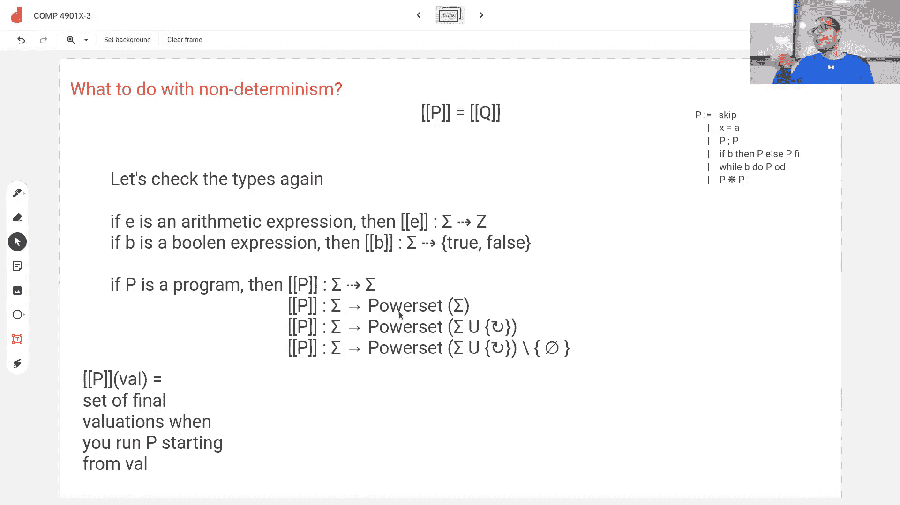

Oh， again， you're not seeing it。Yeah。

What's happening。

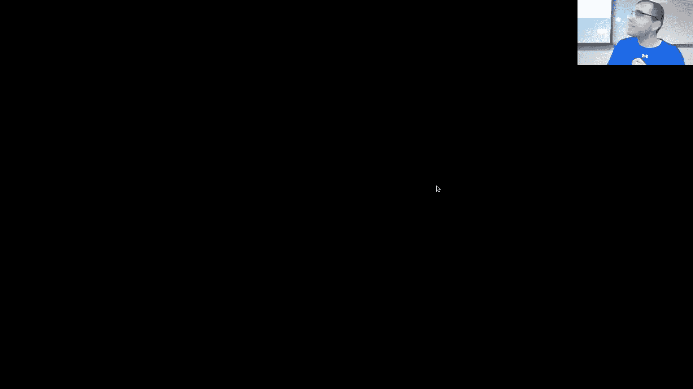

O。Look at these two programs。For any given input， the output of both of these programs is just one。

Right。So at the end of this program， x is one， if it terminates x is also one。

But we said that Q is different from P。Because Q has a run that does not terminate Q has a run where we go into this y loop and we always take this skip and we never set x to 1。

But P doesn't have that run。So when I'm talking about semantics of programs that can have non deterterminism。

😊，It's not enough to say that， well， for every input， just look at the set of possible outputs。

That's not all I have to say for every input， look at the set of all possible outputs and。

This extra symbol， which says that the program just terminate runs forever， right？Now。

 the semantics of my program is even more complicated。

But just to make it a little bit more complicated， I have to also remove the empty set from this because。

嗯嗯。Now I have a different way of showing a non terminationmination and I cannot have empty there。

I hope that makes sense。So basically the idea was that as we were going down these definitions and making our definition more and more generalized。

 so here if I had a program that didn't terminate， I didn't have nondeterminism。

 so I would just say that for this particular input this function is just not defined right here I said that well if it doesn't terminate。

tThen it's just the empty set right because I'm taking the set of all possible outputs and well if it doesn't terminate。

 it doesn't have an output， it's the empty set， but here I specifically created a new element which shows non terminationmination。

So when I do this， then I can have。Something that maps an input to the empty set because that makes no sense。

Right so you should have a non empty subset。Of sigma union with this new symbol that shows non termination。

So just to show you how nonterminism really screws everything up， this is now the type of the。

Functions that we have。So you have to be careful about the type all the time。And well。

What happens then if you want to continue and define these？

Is that you just do the same thing as before。Right so。Every case is simple， except for the vi。

And then for the vi， you have to find the transformer T and you have to say that I want a fixed point of this transformer T。

But now the fixed point。Is kind of more complicated。And I mean， in order to even have a fixed point。

You should have a function that maps from some set to itself。

 but now you have a function that's mapping from subset， not to itself。

 but to this weird different set。So you have to extend it one more time。

You have to say that I want to。Have a function that maps from this set， this weird set to itself。

So again， it's a nightmare， but it's doable， but let's not do it。Okay。

 I just wanted to tell you that it's possible to do it， but let's not do it。Okay。Yeah， and again。

 I was just writing it here and what happens about while。Let's。

Just use operational sematics whenever we have nonterminism。Okay。Now we have 15 more minutes。

But the next thing I want to teach you takes much more than 15 minutes。

So let me see if I can just give you an overview of what we're going to see next time。😔，没意。Okay。

So we've already seen two types of semantics， we saw operational and then denotational semantics。

The next type of kind of semantics that we're going to see is called axiomatic semantics or well。

 we're actually going to focus mostly on ho logic。And here the ideas are kind of different the idea is that suppose I have a program。

 for example， this is my program。And then I want to prove that a particular property holds at the end of this program。

Okay， so I call this a post condition。It's a condition that is satisfied when the program ends。

So now if you look at this simple program， it's basically summing up powers of two。

And I just want to say that if I sum up a bunch of powers of two。

 I get the next power of two minus one。ok。So suppose that I want to prove something like this。

 how can I do that？That's the idea behind our logic。So。

Here's how I can do it I can just keep finding what we call invariance these are conditions at every line of code that are always satisfied whenever we reach that line of code。

Right。So the first one is a。But you can imagine that。嗯。农。嗯。嗯。我。嗯。嗯，啊，不知道。The thing that。

And if I run this equal to one what do I know after I've run this run this line of code。

 I know that n is greater than0 and I is equal to1 so my I'm just updating my knowledge right now if I know these things and I run s equal to0 again I update my knowledge if I run this and I know M is equal to zero I update my knowledge and so on now here this one is more complicated because I have。

A situation where I can do this while and I can come back。🎼Right。

 so I have to make sure that whatever。🎼嗯在。

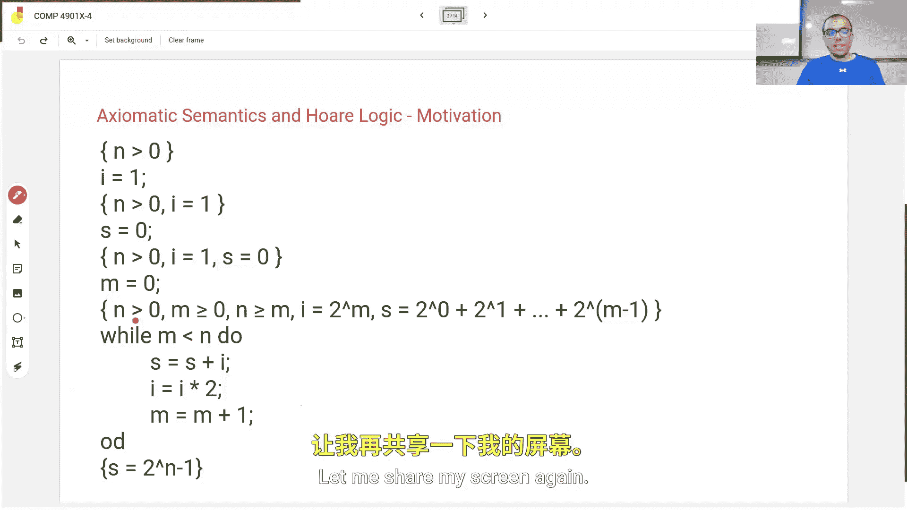

Okay， let me share my screen again。Okay， so this is the kind of reasoning that we want to do next time。

And the way we do it is actually by using what we call ho triples and basically these are triples that look like this。

 I have APB。And A and B are basically some assertions and P is a program， okay？

And the way I read this is that。I say if a holds at the beginning and then I run P。

 then B will hold at the end of the program。So it's a preconditioned post condition kind of thing。

And sometimes there are some books that use this notation， but that looks really strange to me。

 I always use this notation。So。Okay， this is the semantics of this triple。

 it says that if a holds in the current state well and v prime is one of the states that can be reached by terminating run of P that starts at this current state。

 then B holds in Val prime。Okay， and this has non determinism baked into it， so it's like if。

If I want to write this more formally， it's like。For every。Val and well prime。不是。

It's really hard to write with a mouse。😔，If Val satisfies the initial condition or precondition A。

And if I run P from well and it terminates in v prime。

Then Val prime should satisfy the post condition B。Okay。

 so that's how I interpret these whole triples。And then what we're going to see in the next session is oh。

 this is again， okay， yeah， we actually have rules for creating these triples out of other triples。

So I have rules that look like this， like if you originally know that the assertion A holds and you do skip。

 then the assertion A will hold after you skip as well， that's the simplest rule that we have。

But then we have a bunch of things like this， so this one is interesting if a holds and I do P and then after what C holds。

And whenever seahole and I do cu， then Bhole。🎼after。对。

Then if I go over all of these in detail in the next session。Again。

It really for always movie we had to vi hearing out what to do with the vi loops is I。一人。🎼Thank you。

嗯。嗯。然好。2。嗯。

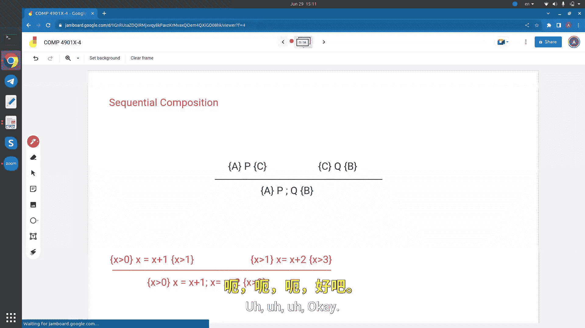

Okay， let's do these examples。Is this first or tripleal valid or invalid？

So what this is saying is that before I start the program， I don't know anything， I just know true。

 I know that true is true。Right and then I run the program x equals to 12 and then at the end of it I know that x is equals to 12。

 so yes， this triple is valid。ok。😊，So if I originally know that y is larger than 10。

And I do x equals y Can I say that now I know that both x and y are greater than 10？Yes。

because x is now equal to y。If x is greater than0， and I do x equals x plus 10。

Can I have the post condition x is greater than minus2？Yes， again。

 so the point here is that these post conditions， they don't have to be tied。

As long as having the precondition and running the program ensures the post condition。

 we're happy with that。ok。How about this one？If a is greater than 1 or a is less than minus1。

And I set x to be a times x。Yes。Can I be sure that the absolute value of x is equal to x？Yes。

 in this case I'm not using the precondition at all， right， I'm just using the program。

So the absolute value of x equals x is the same as saying that x is not negative and it is not negative because it's a square。

 so I don't care what precondition I had so again the point I want you to see here is that I don't have to necessarily use my precondition in my post condition。

Okay。Oh， about this one。嗯。So this is the Euclidean algorithm， it says first take a copy of x and y。

 call them x prime and y prime。And then do the Euclidean algorithm and x prime and y prime。

So as long as they're greater than or equal to one。If x prime is larger。

 then reduce x prime by y prime， otherwise if y prime is larger， reduce y prime by x prime。Okay。

 and then at the end of it， I want to say。That the GCD of X Y。Is yeah。

 the maximum of x prime or by prime again， this is okay， this holds。Yeah。But of course。

 the question is， how would you prove something like this？

So this is why we need proof rules for ho rips so that I can say that。

This program actually works correctly that this program actually calculates the GCT。Right so。

I need to have a proof rule that starts on smaller programs and creates ho ripples on smaller programs and then merges them together so that I can get a ho ripple on this huge program here。

Again， we will see this in the next session。Oh， what this one？嗯。Why not。Yeah。

 so here the issue is that。I'm setting x to one。So previously。X times x was less than 0。

 I don't care really about that if I set x to 1 x cannot be 100， right？

But there is also your point now if we want to care about it。I have to talk about the type of x。

 right， so let's imagine that x is an integer。If x is an integer， does this hold or does it not hold？

OverIt does hold。If x is an integer， right， because x times x cannot be less than  zero。

So my precondition here is false。And if my precondition is false。By this definition。

 the ho Trile holds。Right， so I'm saying assuming that x times x was less than zero。

If I run this piece of code， I will have x equals to 100。

But that's true vacuously because x times x cannot be less than  zero。So this whole tri also holds。

How about this one？啊是。嗯。对钱。嗯。Why not。Yeah， it that that's the thing。

 this program doesn't terminate at all。 So what does the whole triplele says。

 The whole triplele says that whenever。😊，The precondition holds and now you run the program and the program terminates。

 then the post condition will hold， but this program never terminates。

 so I don't care what the post condition is this whole trifle is valid。😊，ok。😊。

How about this one true while true do skip this is also valid because it doesn't terminate so generally our H triples don't tell us anything about programs that don't terminate。

Okay。Yeah， termination is the biggest problem in all of program verification like you you always have this issue how about this last one？

😊，Yes yeah， so this one also holds because my precondition is false。

So these were all examples of valued portraitals， all of them。

So if I have a way of automating the proofs of horrups of finding valid horrups。

 my approach should be able to basically prove all of these。

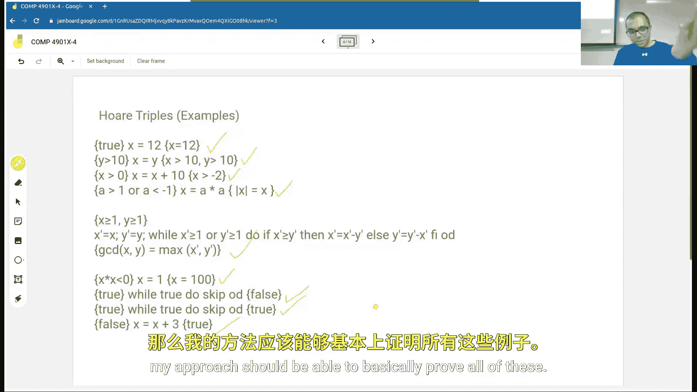

Okay， great， I'll see you next week。😊。