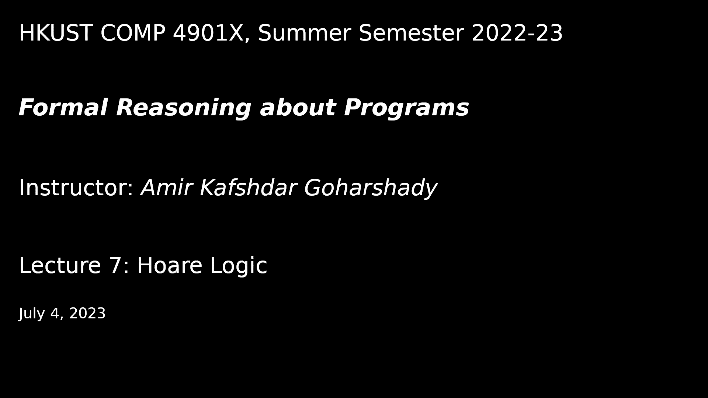

# 香港科技大学【中英⚡程序的形式化推理｜COMP4901X 2023 Formal Reasoning about Programs】 p04 p3 7 - Hoare Logic -BV1roXTYaEmJ_p4-

Our study of semantics really converges to what we were doing with Coch and so hopefully from next week onwards。

Or maybe even this Thursday， we can again switch to cook and actually write some code in Co。Okay。

But this was the motivation that I talked about in the last session a little bit as well。

 let's just look at this program again。So this is a very simple program。

It just initializes these three variables and then it says as long as M is less than n。

This S is going to be a sum variable， so it's just going to be increased by I。

But every time I'm multiplying I by two， so I is always going to be a power of two。Right。

Or actually to be more specific， I is always going to be two to the power of them。

So I'm going to basically compute the sum of all the powers of two。From 2 to the power of0。

 which is 1 to 2 to the power of n minus1 because m goes all the way to n minus1。

So at the end of this。What I know for sure is that s is going to be 2 to the power of  zero plus 2 to the power of 1。

So on。The2 to the power of n minus1。是。对。And of course。

 we all know that this is basically2 to the power of n minus。

So let's say this is what I want to prove， I want to prove that at the end of this program。

The value of S will be2 to the power of n minus1。I'm getting some feedback on my audio。

 please mute yourselves okay。So this is what I want to prove and of course this is a post condition because this is something that I want to hold at the end of my program so generally whenever I use the terms precondition and post conditionition。

The definition is that a precondition is an assertion that holds before the execution of the program and a post condition is an assertion that is supposed to hold when the program ends。

Okay， so what I have here is a pulse condition。And my post condition is that S is2 to the power of n minus1。

I could also have。Many other different post conditions。

 maybe I wanted to just prove that S is less than to the power of n。In any case。

 we usually have a post condition and our post condition is basically what we want to prove。

So let's say in this case， I want to prove the post condition that S is2 to the power of n minus1。

Now we've already seen two types of semantics。We've seen operational semantics and we've also seen denotational semantics。

So if you want to prove this， which type of semantics is easier to use？How would you prove？

Such an assertion using let's say， denotation on semantics。

 you want to prove that when this program ends， s is2 to the power of n minus1。Any ideas。Well。

 what was the main idea in the notnotation on semantics。

 the main idea was that we look at programs as functions。

These are functions that are just mapping inputs or initial states to outputs or final states。Right。

So。If I want to use my denotational semantics here。

 I have to basically compute the semantics of the whole program。

And then I have to prove that for any given input， so let's say I find a function F that is the semantics of this program。

 then I have to prove that for any initial state， if I apply F to that initial state。

 I get a final state that satisfies this post condition as is to the power F lines。Okay。Now。

 why is that not practical？Why can't I just do this。

 why can't I just say whenever I have a program and I want to post condition？

I have my denotation on semantics， I just compute the function and I just look at it and figure out if it satisfies this condition that I want to put。

好。Okay， someone please answer me， I feel like I'm talking to the whole。Okay。

 so what's the problem with computing the denotation on sematictics？So from last session。

 it was actually quite easy to compute the notational semantics except for one case when we had a vi loop。

Because we define the semantics of our viole loop。As a fixed point as a least fixed point of a particular transformer function and we don't really have a good way of computing these fixed points so if'm sorry we don't really have a good way of computing these fixed points。

 so if I'm given a wide look like this，I have a mathematical definition of what its denotational semantics should be。

 and of course it's a function。But I don't know how to compute that function。

 I don't know how to compute that phase points。And actually。

 it's impossible to compute that function。So why is it impossible to compute it？

Because suppose that I have。A particular program P。And let's say that。 I want to compute。

The denotational semantics of P， which I show like this。Okay。So what was this。

 this was basically a function that mapped states to states。

And we said that this is a partial function。So if I apply this to some initial valuation then。Okay。

 so I want to compute。The meaning of P， but if I apply the meaning of P to valuation well and I get well prime。

What I meant by this was that if I run the program P from the initial state well。

 it will terminate and it will terminate in the final state well prime。

Right so if this thing is undefined。Basically， that means that my program does not terminate。

Right so if I apply the semantics function of my program to an initial value to an initial valuation for the variables。

 and then this is undefined。It means my program did not terminate on that particular starting state。

Okay。But。If I could actually compute this function。

Then I could figure out if this function is always undefined or if it's sometimes defined。

So if I had any algorithm that would compute this function。

 the meaning of P the semantics of P for me。I could actually decide whether the program P。

Termininateates on some input or not。Right？But hopefully if you've passed any kind of course on theory of computation。

 you know that that's undecidable， so this is like the theorem of touring。

You cannot have an algorithm that takes the code of a program and some input and decides whether that program terminates。

On that particular input。So what this means is that I cannot have an algorithm that computes this function。

Okay。So。This is not very encouraging because basically I want to prove that my program has some nice property。

 I want to prove that my program satisfies this post condition。

But in order to do that using thenotation on semantics， I have to do something impossible。

 I have to compute the denotational semantics of my program， which is not computer。Okay。So。

Let's say we don't use thenotational semantics， let's say we use operational semantics。So remember。

 the idea in operational semantics was that we talk about one step of the execution of the program。

So what happens if I run just one step of this program or if we had big step semantics。

 then we would get into the same problem， so let's not talk about big step。

 let's say I want to do small step operational semantics。

So every time I just run one step of this program。And I had rules for what kind of transitions I can have between my states。

So using operational semantics， can I somehow prove that whenever my program ends。

 this assertion holds？Well， that's。Doable， in a sense。Because we can do。

The kind of analysis that we would manually perform。

So if you wanted to prove the correctness of this algorithm in， let's say。

 a basic algorithm scores in 3711。How would you prove that this program works correctly？

You probably just use induction， right， and you can actually use induction on N。

So that you say that after every iteration of this while loop， this condition holds。

And so that proves that。And also you say that this Y loop cannot run forever because I have this number n and I also have this M。

 so M is increasing every time。So this while loop will eventually terminate and I also know that this condition holds at the end of every iteration of this y loop so this condition will hold overall。

Okay。Of course， I have to put M instead of end。But there is still。Several programs here。

So one problem is that we are doing inductive reasoning。And there is really no way to automate this。

This kind of reasoning works mathematically speaking， but I cannot really write it in Coch。

And I cannot automate it and I cannot have an automated verification engine that actually verifies what I did because I used a lot of ad hoc reasoning here。

 for example， I wanted to reason about the fact that this wide loop ends。

And the way I did that was that I just said， well， this M increases and it cannot increase forever because it's bounded by n。

 so the Y loop has to terminate but I don't have a formal rule for that。

 I don't have something that I can write in quote。RightSo I have to fix that part。

And the other part was that I said after every iteration of this while loop。

 some particular statement holds， and I'm going to show that by induction。And again。

 that's not very formal。So what we're going to do today is that we're going to see a logic and this is due to or。

And this logic is going to show us how we can actually reason about preconditions and post conditionsditions。

And this is the kind of logic that would actually give us proof rules and proof trees and things that we can work with ink。

In an automated theorem prover like Coch and actually。There is another tool called Boogie。

 which we will also see， which does the same thing。Okay。Let me see。 how can I go to the next slide。

So here's another way of looking at the same problem。Let's say I want to prove this。

I want to prove that at the end of my program， this particular assertion holds。几。Instead， I say。

 let's find the assertions that hold at any point of my program。Okay。

So whenever I'm writing an assertion and then a line of code。

 what I mean is that right before that line of code is executed， this assertion always holds。Okay。😊。

And this is what we call an invariance。If I just。Write it here。

 an invariant at any point of your code is basically an assertion that always holds when you're reaching that point of the code。

Right。So I'm going to add an invariant at the very beginning。

 and the invariant that I'm going to add at the beginning is that I'm going to assume when the program starts n is greater than zero。

And this was actually an assumption that was missing here。

Which also shows why we should be so formal because if here originally n was less than zero。

 then this would not hold。Right so technically this was a false post condition。

 I had to have the precondition n greater than zero for this post condition all。

So let me actually add the precondition here just to make sure our slides are correct。

So at the beginning of my program， I'm going to assume that n is greater than zero。Okay。Anyway。

 this one， which we call a precondition， is just an assumption。

 this is the post condition which we want to prove。

And preconditions and post conditions are also special cases of invariant。 So an invariant， again。

 is just。Any assertion。That I assign to some point of my program and is guaranteed to hold whenever I reach that point of the program。

Okay。So here I've written a bunch of invaris for each line of my code and let's go through this so at the beginning。

What I know is that n is greater than zero and this is just an assumption。

And then I run one line of my code， I just assign I to be1。

Now my knowledge kind of increases right so I already knew that n is greater than0。

 now I also know that I is1。 so at this point of the code I have this。Extra knowledge。

 And I also use comma for ant。 So whenever I write comma that's an ant。Okay。

Then I assign S to0 and the same thing happens， my knowledge just increases。

But can you tell me what's happening here？So why don't I do the same thing when I assign m to be0。

 why don't I just say， oh， I have the same knowledge as before and M is just zero？

Why can't I have that invariance here？Any ideas on。Again， I don't know why no her response。

Are you awake， are you here？Yeah， so basically the definition of my invariance was that。

This is an assertion that should hold whenever my program reaches this particular point。

And for these points， for example， for this point here。

 the only way to reach it was to start at the beginning of the program and execute the program all the way down。

But for this point， which is right before the vi loop。There are many different ways of reaching it。

 so I might just reach it like this or I might execute it like this and then do one iteration of the vi loop and come back here。

Or I might do two iterations of the while loopbe， I might do any number of iterations of the vi loopbe。

 so whenever an iteration of my while loopbe ends。The control of my program comes back to this point。

So whatever assertion I write here as my invariant， it should hold no matter how I reach this point。

So I cannot just write an assertion that holds when I reach this point using this pass。

 it should also hold when I reach it like this many times。Okay。😊。

So now this makes our life a little bit more complicated I have to somehow do inductive reasoning here。

 I have to say well for these assertions it was easy to prove them so this was an assumption。

 it was easy to prove that these these assertions hold but then when I got to this one，I have to say。

 okay， the first time that I start my program and reach here， this assertion should hold。

But then I have to do an inductive reasoning and I have to say that assuming that this assertion holds。

If I do one iteration of my vi loop and come back， this assertion will again hold。

Right so that's the kind of reasoning that I need here I just want you to see that we have induction built into this。

Okay， so what is the invariant or the assertion that I have written here。

 I'm saying that n is greater than0 m is greater than or equal to  zero n is greater than or equal to m I is 2 to the power of M and S is the sum of all the powers of 2 up until 2 to the power of m minus1。

ok。So first of all。If I run my program from the top and reach here。

You can check that all of these things hold so n greater than zero holds because it was an assumption and we never touched n。

M greater than or equal to0， well I've just set m to0， so it is greater than or equal to0。

N greater than or equal to M also holds because n is greater than0 and m is literally just zero。

And you can also check the other ones。So I'm just too lazy to do all of it。

So for the first time this is like the base case of our induction。

 I'm saying the first time that my program reaches this point， this assertion holds。Now。

 suppose that this assertion holds。And I'm doing one iteration of my value。😡，What does that tell me。

 the fact that I'm doing one iteration of my V loop means that I also satisfy the condition of the while loop。

 which is M less than n。Right。I have this assumption， all of it。

 and I also have the assumption that M is less than n。And then I'm increasing S。

 I'm increasing S by I。Well。But I was 2 to the power of M。

 so I'm just adding2 to the power of M to S。And then I'm multiplying i by2。

 but I was2 to the power of M， so I now becomes2 to the power of m plus one。

But then I'm increasing M by one。😡，But before I did this at this point。

 I was 2 to the power of m plus one， but now that I increase M I is again two to the power f。

Because I'm redefining what M is。And so this is how I can prove that after one iteration。

 this one holds I is 2 to the Power。But also S， let's now take a look at S。So originally。

 S was this sum。And I was2 to the power of M， so I'm doing s equals s plus I。

 so S becomes this sum plus2 to the power of M。But then later on， I'm redefining M。

 I'm making M to be m plus one， so again S becomes the same thing it becomes。

Some of all the powers of2 until two to the power of m minus1 because M has now increased。

So every time that I do one iteration of my vi loop。This invariant is preserved。

And so it holds always， okay。Now。I've proven all of these invaris except for the last one for the post condition。

 which I actually wanted to prove。So at this point， I know this one holds， this one holds。

 this one holds， and even for this one I had an inductive proof。Okay。

 how can I prove that my post condition holds？So another way of asking that is。

 how can I reach this particular point of the program， the end of the program？

So the only way I can reach this point。Is if I'm done with running my value。

So I have to get to this point。And then the condition of the vial should not be satisfied。

If this condition is violated， then my V loop terminate。And I basically go to the end of my program。

Okay， but if I'm here， I know that this invariant holds because I just proved that this invariant holds whenever I reach that point。

Okay， so this invariant holds。And also。I have M greater than or equal to n。

Because that's the only way I can violate this volume loop， so M is greater than equal to。Okay。Now。

 what do I know？Based on my invariant， I know that n is greater than or equal to M。

 but because this one is not satisfied， I know the opposite。

 I know that M is greater than or equal to n， so M has to be equal to n。If M is equal to n。

I just plug n here in S， so M and N are the same so I can replace this with n。

So S is just the sum of all the powers of two。Up until2 to the power of n minus1。

And we know that that sum is true to the power of n minus1。So basically。

 what we did here was that we said the invariant before the viine loop。

And the negation of the condition of the vi loop together implied this final post condition that I wanted to prove。

And that's a validd proof that this one holds。Okay。So now as you're seeing here。

 basically by generating invaris at at different parts of this program， I could show。That's。

They desired post condition homes。Now， if I want to be more specific about what I was doing here。

It's not necessarily just an induction on the while loop。

It's just that whenever I'm going from a particular line of code to another line。

 so I don't really care which lines they are， so let's say I have one line of my code here and then then there is a transition to another line。

Okay， what I want to prove， let's say this is line one and this is line two。

I want to say that if they invariant at line1 holds。And I take this transition。

 then the invariant at line two will also hold。And I have to prove this for every transition in my quote。

 or well。We will later see that this is actually every transition in the control photograph。Okay。

But again， this is still not good enough。We have several problems here。

 the first problem is where did we find these invariants in the first place？

And that's actually one of the toughest problems in all of computer science invari generation。

So how do you generate these in this case I just gave you the right invaris and they worked out。

But if I give you just a program and a post condition and I ask you to prove it。

 how do you actually find these invaris？We will talk about this towards the end of the course a little bit。

But。The more immediate problem we have is。How do I give this to Co。

 how do I give this to an automated system that can actually check that my proof is correct？

Because as a human， I cannot really trust myself， I cannot be sure that I did all steps of this proof correctly。

And I want an automated checker to verify it。Okay， so this is where we actually finally get to ho logic。

Okay。So this is what we do and I'm going to basically just use a notation very similar to what we've seen for invaris。

And I defined this in the last session， but I want to go over it in more detail now。

So let's say I have a program P。I want to write and prove statements that look like this。

 theyre like APB。Where A and B are assertions。And A is a precondition。

 it's something that I assume holds before I run my program。

And then I run my program P and then my claim is that when the program P terminates the assertion B holds。

So this thing is called a ho triple because， well it has three parts and it was invented by Ho。

So you have a precondition A， a program P， and a post condition B。Sometimes people use this notation。

 I want to stick to this one throughout this course， okay， but what is the formal meaning of this。

 I can give it a formal meaning based on our operational semantics。So what this means is that。

If in the initial state of my program， if in the current state， let's say the current state is well。

 and again this is a valuation for all the program variables。If in the current state， A holds。

 and then I run the program P。And if P terminates。And when it terminates。

 it terminates in another state vi prime。Then B must hold in Valp。ok。So。

This is how I would write it formally if Val satisfies a。And when I run P on Val。

 it terminates in Val prime， remember this is our big step operation on semantics。

 then Val prime should satisfy B and this is for every val and v prime it's really hard to write with the mouse so okay just remember this that this is。

Quantified over all well and well。Okay， and of course， in the last session。

 we saw so many examples of。Horrups that actually hold and they hold for。

And sometimes surprising reasons。So one case that I want to reemphasize here is that if your program does not terminate。

 the whole Triple doesn't say anything about the program。Right， so the whole point here is that。

I'm saying if P terminates， then wherever it terminates in Val prime。

 let's say that state satisfies B。But if P does not terminate。

 well I don't have a terminating state to talk about it and so I can't really talk about an assertion B at that point and this is also why we call this partial correctness reasoning。

So we are generally not talking about programs that don't terminate at this point。But I mean。

 in the very first session or actually in the second session， technically。

 I showed you one example of how you can prove that a particular program termmininates。So normally。

 if you want to prove total correctness， what you're going to need to do is to give two proofs。

You need to give one proof that's your desired ho triple host。

And then you have to give another proof that the program actually termmininates。

And if you have both of them， then you're sure that your program is totally correct。

 it always terminates and it always gives you the correct results。Okay。So。Again， here。

The thing that I wanted to emphasize is that these whole triples are valid and they're valid because the program inside never terminates。

And also this case was also funny， it's like if your precondition is false。

 if your precondition cannot hold then the entire Hrirupal holds of course。

 and's also that holds vacuously because I'm saying for every valuation that satisfies a and if there is no valuation that satisfies a。

 of course this implication holds。Yeah。Okay。So。Let's actually write some rules or some axioms。

To generate valid orderri。Okay， now why am I doing this because？😡，Ideally。

 what I want to do is to write a proof tree for a ho triple。

And I want this proof tree to be written in Cock， and I want Coq to be able to verify it。Okay。

So the same way that I was defining operational semantics and then defining termination。

 let's say based on operational semantics using a bunch of rules and then trying to find a proof tree。

 I'm going to do the same thing here except that I want to find proof trees。

That prove something about my entire program that proved a ho triple。Now。

This is really important because and it's also really different from what we were doing in operational semantics。

Because if you think about what I did in operational semantics。

 we were always talking about a particular execution of the program。

So I was saying that if you are in this particular state。

 here's the rule that tells you you can go to that other state。

But here I'm writing rules that actually give me hard riples。And in a sense。

 a H Triple is actually talking about all possible executions of the program。So。诶。

If my program somehow has， let's say， nondetermin a minutes。

 let's say this program P has many different possible executions。This horuple is saying that。

If the assertion A， the precondition A holds at the beginning， and if I run the program P。

 no matter which execution of P actually happens。I'm going to have B at the end。😡，So you see。

 this is a statement that is talking about all the possible executions of the program。

 whereas before we were just talking about one step of one execution。So these are， in a sense。

 much more expressive rules。Okay， so here's my first axxiom or my first rule。And this is super easy。

 I it's always easy with S。😊，So if my program is just skip。

 this is a program that doesn't do anything。And if before I run this program。

 I knew that the assertion A actually held， then I know that after I run the program， a also。

Nothing could be more trivial than this。Okay。But now let's actually write axioms for assignments。

 so let's say my program is this let's just do examples first and then I'll show you the rule。

So let's say that I want to prove。Something like this。

 I want to say that my program is just x equals y， so I'm assigning y to x。

And then in the post condition， after the program terminates， I want to have x less than n。

So what should my precondition be？是。Yes。So if before running the program。

 I knew that y was less than n。And then I assigned y to x， then after I run the program。

 I know that x is less than okay， let's do this example very similar to the previous one。

So I'm doing x equals x plus two， I'm assigning x plus  two to x。

 and after I do this I want to have x less than n。So what should I have beforehand。

 what should I have in my precondition？对起。好。Yes。So I should basically have x plus2。Lets that。

Because if originally x plus  two is less than n and then I put x plus two into x。

 then after the execution of this program， x would be less than。ok。Now。

 based on the intuition that we get from these two examples， we can actually have this rule。

So let's say that my program is x equals E， which is。

Basically taking some expression E and assigning it to X。Okay。

 and let's say that in the post condition， I want some。Some assertion A to halt。Okay。

So what should hold beforehand， well the same assertion A。Except that x should be replaced by E。

Right， by the semantics of me。So。You see here， basically it's the same assertion， x less than n。

Except that in place of x， I'm putting x plus2。So this might look a little bit counterintuitive at first because it's like。

I'm。I'm doing this assignment here。But actually the right hand side of the assignment appears in the precondition。

 it doesn't appear in the post condition。But if you look at these examples， it makes perfect sense。

Right so if I have， for example， x equals to y and I want to have x less than n at the end of the execution。

 of course， at the beginning of the execution I should have that the right hand side is less than n。

Right so it's the same thing here， it's just that I'm doing something more complicated I'm just using an arbitrary expression instead of y or x plus two or anything。

 I'm just saying that if I assign an arbitrary expression E to x and then afterwards a holds。

Then before that， I should have had a。A， except that in place of x， I should have replaced D。Okay。

Now another point that I just want to raise here， it's a very simple point， but if you look here。

 I wrote Sip Axxiom， but for this one I wrote assignment Axiom schema。

And the reason for that is that this is not just one rule， right？

This is a rule for every X and every E。So it's like a schema of rules。But anyway。

 you don't need to worry about this too much。But I want you to already think about how you can formalize these things in Cock。

 I mean we will not do it today but just think about this。

 how would you define this in Cock and how would you actually apply these rules in Cock。ok。😊。

Let's talk about sequential composition。Yes。So here I have。A very simple example。

 let's say I just have a program that increases x by one。Okay。

And let's say that I've already proven this， I've already proven and this is I mean a valued whole H triplele so I can probably find the proof for this。

 so I've already proven that I have this whole triplele that if x is greater than zero I write and I run this program。

 then x will be greater than one。And this is also very similar。

 it's just that I'm increasing x by two and I'm saying that if at the beginning x was greater than one。

 then at the end， it would be greater than three。Now。

 the point is that I can put these two programs together in a sequential composition。

And the reason I can do this is because the post condition of this one is the same as the precondition in this oral。

So I can， basically kind of。Oh， these are not two different texts， sorry。

 so I can take this one and put it on top of the other one。And basically I can get this。

 I can get that if initially x is greater than zero and I run the sequential composition of these two programs。

 then x will be greater than three。ok。😊，So of course， in the middle here。

 I also know that x is greater than one， but I don't care about that in hornruples we only care about preconditions and post conditionsditions。

 we don't care about invariance in the middle of the program。Okay。

 so if I want to write a general rule， what should I write so I have。This kind of program。

 P semicol Q， this is the sequential composition of PNQ。

And I have precondition A post conditionition B。What should be？The assumptions for this rule。

Then can I deduce this whole triple？Just based on this example down here。要意事。Yeah。

 so let's say I have APC and。天二嗰啲。CQBで。So if I have something like this。If I know thats。

Whenever I have a and I run P， I will have C at the end of it and whenever I have C and I run Q I will have B at the end of it。

 of course if I have a and I first run P then I have C and then I run Q and then I will have B。

So that's it。This is the kind of axiom that we can have for sequential composition。嗯。O。Let's do if。

Let's say I want to prove something like this， I want to prove that。嗯。If my precondition is a。

 so before running the program， I had the assumption A。And then my program was a simple if， if B。

 then PLQ。And then when the program terminates， I have B。对。

What kind of assumptions do I need to be able to deduce this particular qua tripleruple？

I'm going to give you some time to think about this。可以可你。You don't need mandeterminism here。

 but you can add as many assumptions as you like。Yeah so let's well， let's not get rid of it。

 but let's do a casework on the if condition right so either B holds or B doesn't hold。ok。

What happens if D holds if B holds？Then the program that I'm going to execute is P。Right。

But what is my precondition？So I was already assuming that A holds。

 but I'm also assuming that B holds。So that's my precondition。

And of course I run P and then when I run P， what do I want to hold at the end of it？

I want capital B to hold。Right because this is one of any execution of this H triple。

 basically any execution of the program P where at the beginning I had the assumptions A and B is also an execution of this program。

So I want something like this。What's the other case？So let's say that。The if condition does not hold。

 so I have A and not B。Okay， then what happens， well， I'm going to run the program queue。And again。

 just very similarly to the previous case， I want to have the post condition capital B at the end of this。

So yeah， I basically use these two cases。Oh， I used an instead of commenter， sorry。Okay。

 come on ands are the same for me。So what does this say， this says that。

If I had the precondition A and B。And ran P and got the post condition B。

 so let's say that I somehow had already proven this。

This wholerial and let's say that I have somehow already proven this horial as well。

 that's if I have the precondition a and not B and I apply oops。

That's the title and I applied the program queue。I get B。Then from these two ho triples。

 I can deduce this ho tripbe。Okay。Nice， let's do an example。Let's say I want to prove this。

I want to prove that if my precondition is n greater than1。

 so at the beginning of my program I can assume that n is greater than1 and then my program is this。

 it just says if x is less than n， then set x to n， otherwise set x to x plus1。

I want to say that at the end of this， x would be greater than0。Now， first of all。

 does this make intuitive sense to you why this revolt？So。Basically。

 even if I want to prove this to a human， I would say that， okay。

 there are two cases either if condition holds or not。And if the if condition holds。

 then x becomes n， but n was already greater than1， so x is going to be greater than zero。

And if this doesn't hold。Then this means that x was greater than or equal to n。

Which means that x was greater than or equal to1 because n was greater than1。

Which means actually when I do x equals x plus one。

 x is at least two and it's of course greater than zero。Okay。But let's apply the rules。

So the only way that I can prove something like this using the rules that I have until this point。

Is to apply the rule that I had for if， so this rule。Okay， so here I want to say that。

If n is greater than one， so if I have the same precondition as before and x is less than n。

 so the if guard is satisfied and I run the then part。Then I will have the same post condition。

And here I have the other side， so if I have the same precondition and the negation of the guard。

Of if so x greater than or equal to what。And sorry， x greater down equal to n。

 and then I write I run the L part。Then I should have the same post establish。So you see。

 I'm again doing a proof tree。And I have to somehow now prove these two sub goalss if I want to use coX terminology。

So my initial goal was this， but I applied a tactic and the tactic that I applied was my if rule。

And now I have to prove these two things。Okay， how would you approve this to let's talk about the one on the right first。

How would you prove this？So this program is an assignment， right？

And the only rule that we know until this point that can be applied to an assignment is， well。

 this rule that we had here。Okay， so the only way I really have is to apply this rule。

And let's say I apply this rule。So this is what I get if I apply that rule。

 so I wanted the post condition x greater than zero。

And my program is basically assigning x plus one to x。So as preconditioned。

 I should have x plus one greater than zero。So using that rule。

 I just have this particular ho trickle。But now you see we have a problem。

And the problem is that these two horups they're not the same。They have the same program。

And they have the same post condition。But the preconditions are different。

This one says my precondition is x plus one greater than zero。

But this one says n greater than1 and x greater than or equal to n。Okay。So again， as a human。

 you can probably see very easily。That one of these implies the other。Right。So here's the thing。

If n is greater than 1 and x is greater than or equal to n。

 then x is greater than 1 which means x plus 1 is greater than 0， of course。Right。嗯。So， but。

Can I say that whenever this triple holds？Then this triple will also hold。

Do I have an implication like this？You see， the thing that becomes nontrivial here is that again。

 you have to keep in mind what's the precondition and what's the post condition。So。😊。

What is the assumption that I need here at the beginning of my program to prove this at the end of my program。

 it's just the assumption that x plus1 is greater than zero。What is the assumption that I need here。

 this is these two assumptions。ok。Which assumption is stronger？What。Okay。😊。

So which one is more restrictive， let me paraphrase it like that。Look， what do I know here。

 I know that。X is greater than equal to n and n is greater than1。

 so basically if I wanted to just write it based on x only if I want to talk very intuitively。

What is the bound that I need on X here？The bound that I need on x is that x should be greater than1。

Right， how about here？It's x greater than -1。So what is this horuple saying。

 it's intuitively saying that whenever x is greater than minus1。When I run this program。

My post condition holds。But what I need is actually a special case of this。

 I don't care about the x's between minus1 and1。I just care to prove that whenever at the beginning of the program x is greater than one。

 and I run this program， I will get x greater than it。Okay。So in other words。

What I'm doing here is that I'm。I'm strengthening or making stronger the precondition。

I'm saying that with a weaker assumption， I could already prove this。

But now I can even have a stronger assumption。Right。But of course。

 if I want to again put this into CoC， I will need to have a rule for this。

 I will need to have a rule for strengthening the precondition。And we will add that rule。

But before that， let's go back and look at the left side of our proof tree。So on the left side。

 I have to prove something like this。I have to prove that if I have this precondition and I apply x equals n。

 I get the post condition x greater density。And this is again an assignment， so let's apply the。

Assignment rule that we had from here。嗯，搞。Okay， this assignment rule。

But I'm going to apply it in a slightly different way。

So let's say that I want to apply the assignment rule and I want my post condition to be x greater than one。

Okay， because I mean， it's a rule that I could apply with any post condition。

 I want to apply it with this post condition now。ok。😊，So again。

 this is just a simple program that is assigning n to x。

 so if I want to have x greater than1 at the end， I should have n greater than one at the B。Now。

I want you to compare these two ho triples， this one。And this one。Do I have an implication again？

Does the does this Hruple imp this ho troruple？是。Okay， why， yes。呃是。Yes。我能帮出玩诶要向向玩 so high咯。

All one that gets x。Yes， so basically what I'm saying here in the top one is that。

I know for any initial state where n is greater than one， if I run this program。

 x would be greater than one。But if x is greater than1， then x is also greater than 0。Right？

So in other words， I know for every n that is greater than one。

 if I run this program x would be greater than zero。

But here I have one extra assumption as well that I just don't need。是。So yes。

 this one also employs this one。And actually here we are doing two things。

We are strengthening the precondition。And we are weakening the post condition。Right。

 so in other words， I'm saying that I don't need。Preconditions or assumptions that are as strong as they are here。

 I'm just going to use much weaker assumptions。And I'm also going to prove something that is more than what you wanted me to prove。

😡，Okay， so if I have a ho triple like this， it will also imply a ho triple like this。But in any case。

 again， to。Autommateates this and to have。O。To actually have it in a form that is checkable by a proof assistant like CoC。

I actually need to have some other rules。So that this is so hard to erase。

So that I can say there is a rule such that I can go from this one to this one and from this one to this one。

Because I need to have a proof tree and then my proof assistant is supposed to check that proof tree。

O。Here are those rules。These are what we call the rules of consequence。So。

We can strengthen the precondition。Basically， when you write it like this。

 it actually makes even more sense。Let's say that I have somehow proven that APB。

 which means that whenever a holds。If I run P， then B will hold。And let's say that a prime implies a。

So if a prime implies a and I have APB， I will have a prime PB as well。Because， well。

 in my initial state， I have a prime。And then a prime implies a， so in my initial state I have a。

 so when I run P， I will have B yet。So in other words， we can strengthen the precondition。Now。

Similarly， I can vacen the post condition。So let's say that I have APB。

 so I started with a state that satisfied A， ran the program B I ran the program P。

 sorry I'm guaranteed to end in a state that satisfies B。But B itself implies B prime。

 so this state also satisfies B prime。😡，So I will have the H tripleal APB prime。Again。

 very simple logic。Or actually， I can just merge both of these two rules into just one rule。

Because of course A implies A and B implies B right so I can have just one rule and I can say I can strengthen the precondition and weaken the postcon at the same time so if a prime implies a and B implies B prime and I have the Hrupal AB。

 then I also have the Hrrup a prime P B prime。ok。Does this make sense to everyone？Actually。

 Hor only used this one in his role， so he didn't write these separately。

If you want to use standards or logic， you only have one rule of consequence and this。Okay。But now。

We have something new here。And the new thing is these implications。So until this point。

 I was just saying that。My precondition and post condition are some assertions。

 I was not fixing any language or writing these assertions。I mean， I had some examples of assertions。

 but I didn't tell you how I write this and actually。

You can write it in whatever language you want as long as you can automate proofs for implications like this。

So your assertions can have quantifiers in them， they can be in first order logic。

 they can be just propositional logic， they can be whatever you want。

As long as you can give a proof for sentences like this， you can give a proof for。

Implications between your assertions。And again， if you use first order logic or if you use propositional logic。

 we've already seen how we can do that in Cook。So all the examples of proofs that we've seen in Coch until now we' in first order logic。

Now we have a way of actually putting all of these things together。

And giving proofs for ho tri as long as the。Preconditions and the post conditions in those fourrups are written in first order。

Okay， what other rules do we need？Okay， if I want to just go back to this example， by the way。

 I forgot that I had this example again。So I can basically say that this is my proof tree。

And I can say what rule I used at every step。What rule was used here， This was the if rule。Right。

And then。Here I use the consequence rule I'm just going to write con for that here I also use the consequence rule。

And these two were basically axioms， right， so this was。An assignment exome。

And this one was also an assignment。So ideally。If I can somehow define all of these things in Cock。

I'm going to have this one， this last part here。As my goal。And then I'm going to teleco， okay。

 apply the if rule， and then it will give me these to。Sub goals， let's say。

And then I have to prove each of these circles。But then I want you to realize this part。

 so when I'm applying the if rule， I don't really have any choice。

So if this is my goal and I say apply the ifphru， Coch will give me these two circle goals。

But then if I want to say apply the consequence rule。That's not unique anymore。

I have to say how I want to change my precondition and post condition and again this is something that is not trivial at all。

Because you have to change your pre and post conditions in a way that you can actually prove the subball。

RightAnd again， there is no way for Cog to automate this part。

 so you have to actually say I want to apply the consequence rule and I want to assert this。

And then I want to prove this， and for this， you can say， okay， I just apply the assignment。Okay。

But anyway， this is just preparing your minds for what's going to happen to you in Cock because that's going to be kind of hard。

But at least if I write this whole proof tree again an automated system like Cock can actually check that the proof is correct and that's what we care about the most it's like I want to write a program my program is safety critical I want to make sure that my program is correct。

And the way I do that is that I write a proof of correctness and the most important property is that this proof should be checkable by a machine。

ok。What do you do if you have a vi loop？By the end of this course。

 you will hate all sorts of loops and recursion。Because it's just making life free in the heart。

But let's say I want to complete this， let's say。I have a program like this while x is less than 100。

Increase x by y。And let's say that the only thing that I know at the beginning of my program is that y is positive？

Okay， what can I know at the end of this program？X is positive， okay， how do you get that？Yeah。

 so actually you can say that x is greater than or equal to 100 because if this program terminated。

It means that x was greater than equal to 100， otherwise we will just have another iteration of the loop。

But what else do we know at the end？I mean， the program is not touching Vo at all。Right so。

I know that x is going to be greater than or equal to 100。

And since my program is not touching Y and Y was originally positive， Y is going to remain positive。

Okay。Let me ask you something else。Can I say that， well， every time？I'm increasing this x by y。Right。

 so can I say that I also know that x is less than， let's say 100 plus y？对。hy not。までばです。Yes， exactly。

 so it might be。That at the very beginning， x was 200。Right。

 and then we didn't do this y loop at all， and then we will not have x less than 100 plus y and let's say y was one or something。

So we have to be very careful about what we write here。

 there are a lot of things that sound intuitive and intuitively they seem to be correct。

 but they're not because here I don't know anything about X at the beginning x can be negative x can be larger than 100。

The only thing that I know at the beginning of my program in my precondition is that y is positive。

Okay。So what does this tell you？あ。So if you want to write a post condition based on a given precondition。

 which is what we just did。We had a precondition。We had a vi loop and we wanted to write a post condition。

My post condition has two parts here。So what are these two parts， can you formalize that。

 can you say exactly what I can put in the post condition of my vi program？对。

So what was the argument for the first part and what was the argument for the second part？Yes。

 so the argument for the first part was that， well。

 I definitely have the negation of my vial guard because otherwise my vial would still keep on running。

Okay， so I will definitely always have the negation of my vigar yet。How about the second one。

 what's so special about the second one？Theres no statement。那你。对。Yeah。

 so we said that this Y loop doesn't really change y。But。

I don't want to talk about a single variable， I want to talk about assertions。Okay。

 so I would paraphrase it like this， I would say that I had this assertion at the beginning。

I know that y is greater than zero at the beginning。And I also know that。

Every iteration of the vi loop will not violate this assertion。

So if I have this assertion and every iteration keeps it。Of course， at the end。

 I'm going to still have it。Right？So this is actually what we call a loop invariant。

 generally if you use the word invariant for something that keeps being true。Okay。

 so we've already seen a programming invari before。

 which is like an assertion at a particular line of the program that is always true when we reach that line。

But a loop invariant is an assertion that。Basically is never violated by an iteration of that particular loop。

So here's how I would write my rule。So I'm going to say。Suppose that a is a looping variant。

 so this is actually what I call a looping variant， I say a is a looping variant。If I have this。

If basically， whenever I have a and also the condition of the loop is satisfied。

And I do one iteration of the loop， I will still have A at the end。Okay。

 so if I have an assertion A like this， my loop will never violate this assertion。

 it will preserve it。Why， because well， every time that I have this assertion at the beginning of my vi loopbe。

 either the condition of the vi loopbe doesn't hold in which case I'm happy a will continue to hold because I'm not running anything。

Or if the condition also holds， then I have A and B， so because of this whole triple。

 I know that A holds it。Okay。So this is basically this ho tripleal here is the definition of a being a loopingvari。

So I'm saying that if a is a loopingvari， if a is an assertion that will not be violated by any iteration of my vi。

Then I have this rule， I can say that if a holds at the beginning。Then when my vi loop ends。

 a steel holds。And additionally， I know that the condition or the guard of the vi loop does not hold。

Okay， so this is the rule that I have for my。How find how many variation。Yeah。

 it doesn't matter because look。Okay， so here's how I would think about this。

Either this white loop is never going to terminate。In which case， I don't care。

Right because we said that our hard tris don't say anything about programs that don't terminate。

So this hole holds if the vi does not end。But if the V terminates。

 it's going to terminate in a finite number of iterations。Okay。

 now I can just apply this finite name many times。I can say that a holds at the beginning and if I have the first iteration。

 that means that B also holds at the beginning because otherwise I wouldn't have the first iteration。

And then this P is just the first iteration of the while loop。So based on this assumption。

 I know that after my first iteration， A also holds。

But then I apply the same thing again I say if there is a second iteration if a holds at the beginning and there is a second iteration then B also must hold so I apply that one iteration and then based on this assumption a holds again and so this is like an inductive kind of argument which basically says that every iteration preserves a and of course I can only have an iteration when the condition of the V loop is satisfied so I don't have to write aPA here I can write A and BPA。

Okay， so every iteration preserves a。And then there are two cases。

 either I have finitely many iterations or infinitely many iterations。

 either this file ends or it doesn't。If it ends， I have a finite number of iterations。

 I can just apply this one finitely many times and a holds at the end。

In not to show that this single or month。嗯。No， this is just one iteration right so P is the program that I have inside my body。

No， okay， so this is a rule， this is my assumption。Right so this ho triplele is my assumption。

 assuming that this ho triplele holds， I'm saying this ho triplele also holds。So what does it mean。

 it means that whenever I have A and B and I run P at the end of it， I will also have a。

That's my assumption。So you cannot have a situation where like the second or the third iteration actually breaks it because no iteration will break it according to this。

Okay。Okay。Great， how much time do we have very little time。 Let's just。One。

 this is an exercise that I actually want you to try your best to do。Try to prove this。

In Cock and we will see examples like this as well。

 but before I teach you how to do it I just want you to try your best try your best to formalize everything that we did so define our programming language somehow in in Cock and then define these。

Rules that we had here， and you can define these rules， for example， as axioms。

Right and then write a formal proof for this and this is basically saying that this is the Euclidean algorithm again。

 and what this says is that if my x and y are greater than0 and you can assume there are integers，呃。

The Euclidean algorithm works correctly and it gives us the GCD of the two。

Okay and also of course in order to prove such a thing you need to have a formal definition of GCD so i'm going to give you a formal definition of GCD and this is the formal definition。

 so D is the GCD of A and D。If D divides both A and B。

And if there is any other D prime that divides both of them， then D divides D prime。Okay。

 so I want you to have this formal definition of GCT also in Cock。

And then using that formal definition of GCD prove this ho trickle， this is just one ho trickle。

 this is the precondition， this is the program， this is the post condition。Okay。

Now I want you to look at this one。This is also interesting。

So can I take a conjunction of my post conditions？Can I have a rule like this。

 Can I say that if I have。A B and APC， Then I have AP， B and C。And I mean。

 I've used the logical and the word and comma everything in these slides so I don't know what I was doing。

 but anyway。So this is B。Is this a valid rule， first of all？I mean， yes。

 it makes sense and it's actually quite easy to prove that。This is a valid rule because。

What is this one saying， it's saying that if。My initial state satisfies A， and I run the program P。

 my final state will satisfy B。This is saying the same thing except that it's saying my finance state will satisfy C。

 so if every finance state satisfies B and also satisfies C it has to satisfy B and C。

So this is a correct rule。But the next question is actually more interesting， do I need this rule？

I mean， having it can't hurt， I mean， it can only simplify our proofs。

But when I ask you do I need it， what I actually mean is that does this increase。

 let's say my expressivity， does it lead to cases where I can prove new things that I could not prove using my previous rules？

First of all， let me ask you this， is this a special case of the rules of consequence？No， why not。嗯。

呢真我嘅。Yeah， so if we go back。To the rules of consequence。

I could strengthen the precondition or weaken the post condition。Right。But here。

 actually the post condition that I have is stronger than both of these previous post conditions。

So it's not a special case of the rule of consequence。But again， do I need this rule？Now。

 the answer to this is no， I don't need this rule。So whatever I can prove having this rule。

 I can also prove without it。And the way you can see this is that， well。

 let's say that I wanted to prove the post condition B and C for a particular program。

Instead of first proving the post condition B and then proving the post condition C。

 I could just prove B and C from the beginning in all of my rules。ok。

So this might not make much sense to you， but if it doesn't make sense。

 just do an example of it and you'll see it。I have to give proof for this。

And I have to give a proof for this so that I can put them together using this rule。

 but instead of that， I could just merge the two proofs from the beginning and from the beginning。

 just give a proof of PMC。Okay， so I don't need this rule。

 but actually it's very useful in finding shorter proofs。

Because it helps you basically focus on simpler things to prove。

It's like you can prove each part of your post condition separately and then just say， okay。

 I put all of it together。So it's a good rule to have， but we don't really need it。And actually。

Another point that I have to raise here is that whole logic is complete。

And what that means is that' any whole triple that holds。Has a proof。Okay。But again。

 the fact that every Hy pole that's。That actually is valid as a proof doesn't mean that you can find the proof。

Finding the proof is not a computable problem。Now， why is that？Because let's consider some program P。

I'm running out of time yes， okay， let's consider some program P and consider this hoable。

What does this horse rip say？Through PFAs。When would this whole tripleple halt。

 what does it say about the program here？嗯。So my precondition is true， I'm not assuming anything。

I'm running P and my post condition is false。But if my post condition is false。

 then this ho pole can hold only if P never terminates。

Because if P ever terminates in that terminating state， of course I cannot satisfy false。

 false is never satisfiable， right？So what this horupul says is that P numbertermininateants。Okay。

 so if I had a way to automatically find the proof for this ho tripleal。

I basically have an algorithm that tells me whether P terminates or not。Right。

Or actually whether P doesn't terminate on all outputs on all the inputs sorry so and we know that that's also undecidable。

So。For every ho repul， we have a proof tree。But the proof tree is not computable。

 you cannot have a way of finding the proof tree automatically。So again， we are back to。

Semi automated ti improving we're back to using tools like Co and then we have to give it hints we have to tell it for example。

 I don't know if you're using the rule of consequence here。

 this is how I want to strengthen or weaken the conditions。Okay。One last point before we go to lunch。

What about nondetermin？So what should this rule look like。

 let's say my program is P star Q so it non deterministically runs either P or Q。

And I want to have the more triple A， P star QB。When does this ho hold？Come on， I'm hungry。

 I want to go for lunch， yes。It should have APB and AQB。

Because basically the idea is that in nondeterminism， I don't know which one will be executed。

So if I want to say that having the assumption A at the beginning of the program leads to having the assertion B at the end of the program。

 it should hold no matter which side I run。Right， so I should have AP PB and。Okay， great。

 I'll see you after lunch and we're going to talk about something totally different after。😊。

