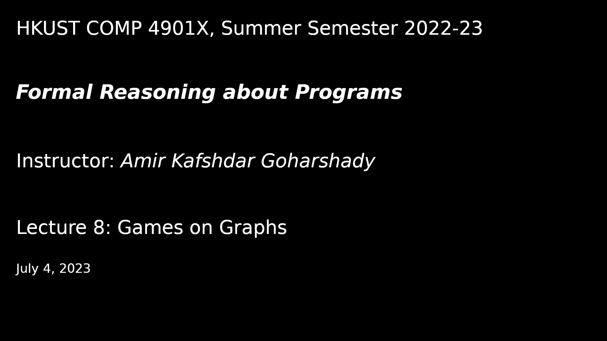
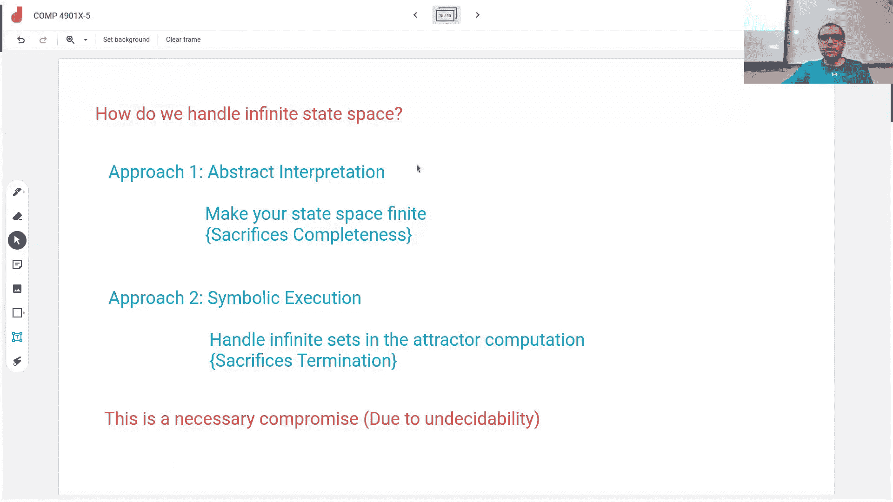

# 香港科技大学【中英⚡程序的形式化推理｜COMP4901X 2023 Formal Reasoning about Programs】 p05 p4 8 - Games on Graphs -BV1roXTYaEmJ_p5-

This will actually be useful for verification of programs。But we're going to talk about games。

And generally my plan is to keep some days theoretical and some days practical so today is going to be entirely theoretical and then next time we will again go back to Cork and we will also see some examples of using another system for proving correctness of programs and that system is boogie but for now I'm just going to do theoretical stuff for today。

Okay， so I want to talk about infinite duration two player games on graphs。What are these games？Well。

 it's kind of in the name， you have a graph， you have two players。And they keep playing forever。Okay。

 and somehow we will see later on how this can actually model a program and the correctness of a program。

But for now， I just want you to think about it as a simple graph game。

Let's actually give a definition。So we have this concept of game graph or arena and a game graph is basically a normal graph。

 so it has a set of vertices V and a set of HsE。And this is a finite graph and it's also directed。

Okay。The only difference is that our set of vertices is going to be divided into two sets， V1 and V2。

 so V1 V2 is a partitioning of V。And the way I look at this is that all the vertices in V1 belong to player1 and all the vertices in V2 belong to player 2。

Okay。😊，So here's an example。Let's say I have this graph here。

And all the circle vertices belong to player one and all the square vertices belong to player two。

Okay。Now how do players actually play， well， we start at some vertex。Let's say I start here。

And then this vertex has an owner， this is a square vertex， so the square player owns this。

So the square player gets to choose one of the outgoing gadges， so if I'm here。

 the square player can choose to just remain here or to go here or to go here。Okay。

 let's say the square player chooses to go here。Now the game is in this state and this is a circle state so the circle player gets to choose。

Can you open the door。Yeah， so the circle player can choose one of the outgoing edges and take it。

Okay。And I'm also going to assume that every vertex has at least one outgoing age because I don't want my game to get stuck。

 I want to be able to continue this forever。Okay。So。

I want to basically say that no matter where I start the game。The game goes on forever。

So at every point in time， the player who owns the current vertex gets to choose an outgoing edge。

 and I'm assuming that every vertex has at least one outgoing edge。So that's fine。

Now I can define a bunch of things here already。So。😊。

I can define a path and a path is basically just a path in this graph。

And it can be finite or infinite。So it's just a sequence of vertices and edges。

 or you can also think of it just as a sequence of vertices such that every vertex has an edge to the next vertex。

ok。And then we also have the concept of an outcome and an outcome is basically an infinite path。

So if the two players play this game and if they keep playing it forever。

 we will get an infinite pass on this whole graph and we call that the outcome of the game。Okay。

So now based on this concepts of outcomes and paths and so on。

 we can actually define objectives and an objective is basically something that a player wants to achieve so I can define a winninging objective or just simply an objective。

For my players and an objective is just a set of infinite paths， it says a set of outcomes。给。😊。

So for example， I can say that the objective of player one。Is these five particular infinite paths。

 so player one wants to make sure that the outcome of the game is one of these five paths。

But I can also have an infinite objective， so just make sure you understand what's finite here and what's infinite。

 so the paths are infinite。The objective can be itself finite or infinite， it's just a set of paths。

Okay。😊，And then I can also define when my game is zero sum。

 so I say my game is zero sum if the objective of player two is basically the complement of the objective of player one。

 so in other words， no matter what the outcome of the game is going to be either player one wins or player two。

And it's impossible that both of them win， it's also impossible that none of them win。

That's the definition of zero。Okay。But we're generally not interested in all objectives because I mean。

 you can come up with all sorts of crazy objectives that don't mean anything。

We are actually interested in several specific types of objectives。Okay， for this to make sense。

Just imagine that this is somehow the graph game is somehow a model of your program。

And let's say that in your program， you have two types of nondeminism。

And you have two players who basically controlled an undeterminism。

So maybe you have a user who can give input to your program and maybe you have， let's say。

 some environment as well。And let's say that one of them。

 wants your' program to fail by some definition of failure， we will define failure later on。

 and the other one wants your program to execute correctly。And so in these classical objectives。

 we want to basically define what it means for the program to be correct in a sense。Okay。

But that's just the intuition let's actually be much more formal about this。

 so let's say that I have an infinite path on this graph and I show that infinite path which row。

And let's say that the vertices in these paths are row1， row0， row 1， and so on。Okay， so first。

 I defined the visit set of row as the set of all vertices that are visited in row。

 that's so obvious。So these are all the vertices such that there is at least one index where that index of the path was that vertex。

And then I define the infinite visit set of row as the set of vertices that are seen in row infinitely many times。

几。😊，Now how can I write this formally？So I have these indices in row。And basically， I want to say。

 I want all the vertices V。Such that V appears in infinitely many of these indices。ok。

That's equivalent to saying that for every index i， there is another index after i ver V appears。

Or another way of saying this is that。There is no index I such that V does not appear in this suffix of my path。

 and this is the suffix where I'm basically cutting the first I minus1 vertices。Okay。

 so I think it's easy for you to convince yourself that this is really defining the property that V is going to be visited infinitely many times。

Because of course， if V is visited infinitely many times and you chop off a finite portion of your paths。

 V should be seen infinitely many times in the rest of it。Right and on the other hand。

 if you have this property， whenever you chop off your past， there is a V after that。

 so you find the first time that you see V and you chop off at that point， you find the second V。

 you chop again and so on so you can find infinitely many bes。So。

This is basically an equivalent way of saying that we seen infinitely many times in Rome。Okay。

But now these are not objectives， of course， these were just defining subsets of vertices based on a given pass role。

But how can I define actual objectives so let's say that I have a subset of my vertices and let's call these vertices T so T we usually call them target vertices。

 it doesn't really mean anything， but anyway let's say I've just marked some of my vertices with T。

Okay。So I define four different objectives and these are objectives that we will use later on。

So the first one is the safety objective。And the safety objective on T。Is basically this。

 It's the set of all paths。Such that these paths always remain in tea。

So it's the set of all paths that never leave the state space team。

So why do we call it safety because imagine that T is the set of all safe spaces？And we want to。

 let's say， as player one， we want to ensure that we will always remain in the safe spaces and we will never go to the unsafe spaces。

So this is what's being defined here， this would be the objective of player one。

Now the dual of safety is reachability。😊，So if player one wants to remain in some safe space and if the game is zero sum。

What does player what does player two want to do player two just wants to reach one of the unsafe states。

So in a sense， you see that there is a duality between safety and reachability。

A reach of T is the set of all paths that visit T at least once， so their visit sets intersects T。

Okay。Okay， so this is the duality here was kind of obvious。But now let's actually talk about。

D vertices that are seen infinitely many times in a past。So。

I'm going to mispronounce this and this is painful for me because I do speak German。

 but everyone in English calls this bookie。So。This is a mispronunciation what everyone calls it as so yeah。

 the bookie objective one T is defined like this it's the set of all paths。😊。

Such that the infinite visit sets of this pass row inters60。

So what does what does it mean if the objective of player one is bookie of the。

 it means that player one wants to visit T infinitely many times。ok。😊。

But again when we write it formally it looks a little bit awkward。

 it's like the objective of player one is to have an outcome such that the set of vertices in that outcome that are seen infinitely many times intersects T。

But yeah， in human language， that means the player wants to CT infinitely many times。Okay。

And then just the same way that we had a duality between safety and reachability。

 we can also define a dual of bookie and we call that Kobuie。So here's the thing。

Suppose that player one wants to visit T infinitely many times。And let's say it's a zero sum game。

 so player two just wants to defeat player one。What's the objective of player2？

If player one wants to CTt infinitely many times， then player two wants to CTt only finitely many times。

Right so player two wants to make sure that every vertex that is seen infinitely many times is outside of T。

Or another way of saying this is that player two wants to make sure that VCT only。

Finly many times and then at some point we exit T and never come back。

Right that's the core book objective， so the core booky objective well is。Again。

 if I want to define it very carefully Kobuki of T is that I want to make sure that all the vertices that are seen infinitely many times are in T。

That's the official definition of CO。I' based on this。Of course。

 we have this duality that I just talked about。So。Reach of T is the set of all outcomes that CT at least once。

Okay， so if you have an outcome， if you have an infinite pass on this graph。

 it's either going to CTt or it's not seeing T， if it doesn't CTt。

 then it's always remaining in v minus t。RightSo reach of t is the complement of save of v minus t that's what I mean by duality and then we have the same duality between bookki and Kobuki right？

So if you have a pass。It's one of two cases， either it sees one of the vertices in T infinitely many times。

In which case it's in booky of T。Or all the vertices that it sees infinitely many times are in v minus t。

😊，But in that case， it's in Kobuki of v minus D。Okay。So that it。

 that's the duality that we have between safety and reachability and cooking and cooking。

But what does this tell me， it tells me that if I want to somehow solve my game。

 if I want to figure out if player one can。When using a reachability objective。

I can just take the dual and look at safety if I want to prove Kobuki and can take the duall and look at bookki。

So the duality is actually very useful and basically we will only see algorithms for reachability and bookie and then we will say that okay。

 safety and Kobookki are duals。Okay。I have to define one more classical objective and this is actually the most expressive kind of objective that we will work with。

But it will sound very unintuitive at this point。So just accept the definition from me at some point in this course。

 you will see that this definition makes sense， okay？So this is what we call a parity objective。

So let's say that I have a function P that assigns some priority to each one of my vertices。

P of V is called the priority of V。Okay， so and let's say that I can assign priorities between zero to d。

Now here's how I define the objective function， sorry this is how I define my objective based on parity based on this P。

 so the parity of the priority P。Is the set of all infinite paths row？

Such that if you take all the vertices that are seen infinitely many times in row。And among them。

You take the smallest parity， that smallest parity is ever。Okay。

 so another way of looking at this is that I've somehow divided my vertices。😊，Into D plus one sets。

From zero to d。ok。😊，And then as player one， I want to make sure that this set that has the smallest number。

 what is also seen infinitely many times， so the sets among the ones that are seen infinitely many times the one that has the smallest number has an even number。

Okay。嗯。Now。Why is this interesting because basically this is the most expressive kind of classical objective that we will look at？

So for example， can you see that bookie is a special case of parity？

So what's a bookie objective in a book objective I have a set T and as player one。

 I want to make sure that I see T infinitely many times。ok。😊，Now。

 if I have a parity objective instead， I just have this function that gives a priority。

And what I want to make sure is that the smallest priority that is seen infinitely many times is even。

So。How would you suggest I define my priority function。

 so here's the thing this is what I want to get。I want to get bookie of T。

 which means that I want to get the set of all paths that CT infinitely many times。

Give me a P function， give me a priority function。Such that the parity objective basically becomes the bookie objective。

I'm going to wait until you give it to me。 You have all the time in the world。70 to0。

 everything to one， yes。So。Here's the thing I say that。

The priority of a vertex v is zero if v is in t， if v is in my target set。And otherwise。

 I set it to one。Now， why are these two things the same？Well。If player one。

If you consider the objective of player one with this priority function。

The objective is to make sure that the minimum priority that is seen infinitely many times is even。

But I have only two priorities， I only have zero and one。

So I want the minimum priority that is seen infinitely many times to be zero。

But that means I want to see zero infinitely many times， and I only have zero ven Im in T。

So I see T infinitely many times and of course this same argument works in the other direction too。

 so the two sets are actually the same。Okay。Let me make it more interesting what happens if I have a Ko book key objective？

Is Kobuki also a special case of parity well I mean it is because parity is the most general objective we will study？

But let's say my objective is Kobook E ofT， which means that I want to make sure。

That's all the vertices。That are seen infinitely many times are in T。Okay。Actually。

 another way of visualizing this， if you want to think about it， like have better intuition is that。

This means that at some point I enter T and then I remain in T forever。

 so in some prefix I might see something outside of T but at some point I enter T and then I just remain in。

Okay， so that's the Ko book key of T objective。How can I do Koguki of T as a special case of parity again you have to tell me what the function P should be。

Does it work if I just swap zero and1 in the previous one？Okay。

 I like you shaking your head there yeah it doesn't work why doesn't it work if I just swap zero on one？

听你好闹咯。Yeah， so basically。If I say I just swap zero and one here。

 then you can have a pass that sees everything infinitely many times。再升个工作边就填到就结数。Well。

 not really because this is what we had right so bookki of T is the complement of the co book key of v minus t。

 so you need two complements。Thank。Okay， again， just think about it very intuitively。

 think that okay， what's the objective that I want， the objective I want。

Is that I want to make sure every vertex that I see infinitely many times is in T。

What can I talk about？I can talk about the minimum priority among all the vertices that are seen infinitely many times。

This is fun， I'm just going to wait for you to forget that。请骄。Okay， what do you want to change it to。

Okay， another way of thinking about this is that you want to ensure。That if a vertex is not in T。

 you're not going to see it infinitely many times。嗯。Right should be minimum and the sport。Yeah。

 we can change that that's part of the definition， you can just change P， it's even。😊，Yeah。

 of course， if I could just put odd here， then it would work。Okay。

 here's the thing I have a bunch of undesirable states， the states outside of T。

I want to make sure that I will not see any of them infinitely many times。

So just make sure that if I see any of them infinitely many times。

 the minimum priority that I've seen infinitely many times becomes odd。How can I do that？

I can give them an odd priority and I can make sure that this is also the smallest priority。

So that if I see one of these undesirable states infinitely many times。

 then the smallest priority that I've seen infinitely many times becomes up。Okay。

 and the simplest way to do that is that instead of zero and one， we just use one and two。ok。😊。

So I say that the priority of v is 2 is if v is in t and it's one， if v is not in t。Okay， now again。

 it's really important that this is the minimum priority that is seen infinitely many times right。

 so what happens here？If I have a path。That's。Where all the vertices that it sees infinitely many times are in t。

 then all the vertices that it sees infinitely many times have a priority of two。

So it satisfies the parity condition。The minimum priority is two and it's even。Now。

 if I have a pest that sees something outside of T infinitely many times。

 that thing is going to have a priority of one。So the minimum priority among all vertices that are seen infinitely many times is going to be one that's odd。

 so it doesn't work out。So this proves that basically Kobook key of T is equal to parity of p where p is defined like this。

Okay， so I mean， by this point， you already have some idea why parity is important because at least at the very least it's generalizing both of these two cases。

So if I want to figure out an algorithm， I can just find an algorithm for parity and then it will help me solve both booking and CoVID。

But what's the use case of bookki and Kobuki itself？So。What does it mean if I have， for example。

 let's say。Bookuki of tea。Oev team means that I will visit T infinitely many times。Right？And。😊。

If I visit infinitely many times。What are the use cases of this in verification， for example。

 suppose that you have， I don't know， a server application and you want to make sure that it's responsive that it will always keep giving answers。

 it will never stop running。So you need a booky objective where you always reach a case where you're giving an output。

And this is a program that is running forever， so you want it to give output infinitely many times。

How about Kobuki？Kobuki is also something similar。Saying that every state that I see infinitely many times is in tea。

So let's say that T is the set of safe states somehow。Okay， I have a program。

And I know that my program will not have a problem if it's Cty。Now。

 what does Kogu Ki of T tell me tells me that well。If your program has been running for a long time。

 there's a good chance that it will be able to run for it。没。But anyway。

 this is just intuition and you have to use the formal differential。Okay。But， generally。

We just saw that。Buki is the dual of Kobuki by this definition。

So what is the dual of parity by this definition？So if I have an objective， that is parity of P。

Can I say that？Its dual is also a pary objective， let me see if I have it here yeah。

So can I do something like this， can I say that parity of P is the complement of the parity of Q for some other function Q？

Well， of course， if I couldn't， I would never ask you。So give me the function queue。So remember。

 parity of P is an objective。It's a set of infinite paths。

So I want to say that every past that doesn't satisfy the parity condition for this priority function P satisfies the parity condition for another priority function Q。

 what should Q be？对。他没有本系吧。I have a condition here， it satisfies right。

So parity of feet defines a set of infinite paths。Right？I want to define its complements。

 and I want to say that its complements is also parity of Q for some other function Q。

But give me you， yes， p plus one。Exactly。So basically， if you just take。

All of your priorities and increase them by one， so you're turning every odd vertex into an event vertex and every event vertex into an odd vertex。

 but you're not changing the order between them。This ensures that you get the compliment。

 so this is also great because。I mean， I didn't have something like this for bookie if I had bookie of tea I couldn't say it's complement is another bookie objective。

 but at least for parity， I can say that if I have parity of P then the complement is just parity of one plus。

Okay， I'm just going to give you one more definition in this slide。And this is the definition that。

We use quite often actually。We say that an objective is a tail objective。

If it doesn't really depend on what happens in a finite prefix， in a sense。

RightSo an objective O is a tail objective if whenever a particular row is in all。And again。

 this row is an infinite path， because remember， an objective was a set of infinite paths。

So it's a tail objective if whenever row is in awe。If I just chop off some finite prefix of row。

 and then I take the suffix of row from index I to infinity。

Then that suffix should also be in my objective。So basically， it's like。

 let's say this is the objective of player one， I want to say that if player one wins in a particular outcome of the game and if I just ignore what happened in a finite amount of time at the beginning of the game。

 then player one would still win。Okay， so you can see that， for example， bookki is a tail objective。

Because the idea in book is that I want to visit T infinitely many times。Now。

 if you just remove a finite prefix of what I have visited， that doesn't matter。

 I'm still going to visit infinitely many times in the rest of the path。And actually。

 the same is true for Kobuki because。It's true for parity， actually。

Right so if you consider disparity。let's say I want to consider parity of P。What am I doing。

 I'm looking at all the vertices that are visited infinitely many times。

And I'm saying take the minimum priority among all of this。Okay。

 but if I just throw out a finite prefix of my pass。

The set of vertices that are visited infinitely many times does not change if you've visited a vertex infinitely many times you're just throwing out at most a finite number of visits。

And also， if in the original past， you visited something finitely and then you remove some parts。

 you're not going to magically visit it infinitely many times。Right so parity bookki and Kobuki。

 they' are all tail objectives。But for example， reachability is not really a tail objective。Right。

 because it might be that I reach my target only at the beginning of my pass and then I can never reach it again。

So if I cut some prefix， I might not have it。So in that sense。

 it seems like I cannot model reachability as parity because parity is a tail objective and reachability is not。

But we will see that with some tricks with some small changes to the。Graph actually。

 we can do that well。It's actually a good question， let me ask you this。

Let's say my objective is to reach a particular set T。

 so I have a bunch of target states and I want to reach T。

Can you change the graph a little bit so that we can write it as a parity objective？

So the problem with parity， bookki Ko bookki， all of these tail objectives that we've seen until this point is that they constantly talk about。

The states that are seen infinitely many times。But in reachability。

 it's enough for me to see one of my target states only once。

So how would you turn this into a case where I have to see it infinitely many times？

It's actually a very simple surgery， a very small change in the graph。Yeah。

 so for every target state， remove all the edges that are going out of this target state and just add a self loop from the target state to itself。

So now you will see a target， if and only if you see it infinitely many times。

RightBecause as soon as you get to a target state， you're stuck and you have to just keep seeing it。

And then you can basically do bookie of tea on this new graph。

And we saw that booky is a special case of parity。So yeah， in that sense。

 parity is actually very expressive， you can express a ton of different things in it。

 especially if you can change your graph a little bit。Okay， let's talk about strategies。😡。

So until this point， we talked about objectives and objectives are like sets of path and player one's goal of was to be in a particular objective。

But we didn't really talk about how a player plays this game， and that's what we call a strategy。

So let's say I have one of my players， player one or two， so I is either one or two。

And a strategy for this player is just a function sigma I。

 and this function is from v star times V to V now what does this mean？V star is， well。

 this is like a regular expression， it's the set of all finite sequences of V。

So the idea here is that suppose I know the history of the game。

Suppose that I know where the game started， what were all the states that I have seen until this point。

 and all of this history is encoded here。Okay， and now it's my turn， I'm in a state that is in VI。

 so it's the turn of player eye。Based on this information。

 based on the history and the current state。I have to choose what the next state is going to be。

And the function that makes this choice is called a strategy。Okay。

 but of course the strategy should respect the edges of the graph。

 so I cannot go to a vertex that doesn't have an edge from the current vertex so if the history of all the vertices that I've seen until this point was W and I'm currently at vertex v I can only go to vertex v prime if there is an edge from v to v prime because otherwise it wouldn't make sense。

 of course I want to play in this graph。Okay。Now， here's a simple question。

 what do I need to fix in order to have a unique outcome？

So an outcome was basically the infinite paths that we are taking over this whole graph。

If I want to have a unique outcome。Well， I can just fix a strategy for player one and fix a strategy for player two and tell them to play。

Right and it should give me a unique outcome， but there's one more thing that I have to fix as well and that's the starting vertex。

So where do you start？If I give you a starting vertex and if I fix a strategy for player one and say you have to play this strategy and I fix a strategy for player two similarly。

 then I will have a unique account。So yeah and this is how I show it。

 I show it as outcome of v sigma1 sigma two so v is the initial vertex Sigma one is the strategy that player one is playing sigma two is the strategy of player two。

Okay。Now， in this session， we're going to have so many definitions。

 but we will eventually use most of these， not all of them actually。Okay。

So we are interested in some specific types of strategies。

Because if you look at strategies in the general sense。

This is kind of too powerful and it makes it hard to compute bit because my strategy is a function that is taking the entire history of the game until this point and based on the entire history it's telling me what I have to do at this point。

But for games and for most objectives， I don't actually need a strategy that remembers everything。

Maybe it's enough not to remember anything other than the current state。So as an example。

 consider chess。If you're playing chess。You don't care how you got to the current state of the game。

The only thing that matters is what you do from the current state on boards。

 so if you only keep the current state in your memory and if you forget everything that has happened before。

 you can still playess very well， there is no problem there。Right。

So this kind of strategy is called a memoryless strategy。

 So a memoryless strategy is basically a strategy that ignores the history of the game。

And just tells you what to do based on the current state and the way we can define this is that for any W and W prime。

The strategy at WV is the same as the strategy at W prime V。

 so the idea is that if I'm now at Vertex V I don't care what my history was before this。

 I'm just going to decide what to do based on my current state。And of course， in this case。

 I can even change the type and I can say that my strategy is just a function that maps states to states。

RightSo sigma I， for example， sigma one， the strategy for player one takes a vertex that belongs to player one and tells me where I have to go。

O。So this is the definition of a memoryless strategy and actually the strategies we will see in this session at least are going to be memoryless。

But then we also have another definition and this is the definition of a persistent strategy。Now。

 what this one says， it's not that I will ignore my history， but it's like when I've made a choice。

 I will never change my choice。What do I mean by that？Suppose that the game has started from here。

And somehow we've had a bunch of transitions or I shouldn't go here。

 I can't go anywhere from there Okay， so the game has started from here。

 I've had a bunch of transitions。And let's say I've got here。And at this point。

 the circle player has chosen to take this edge。Okay， now let's say that the game continues。

And then I get back to the same states。Now， if I get to this state for the second time in the same game。

 in the same play of the game。Then the player will not change his choice。

 he will again go to the same place。Okay， that's the definition of a persistent strategy。

 so what this means is that if I have two different histories W and W prime。

And W is a prefix of W prime， by this notation， I mean prefix。

And if at if the history was W and at V， I went somewhere， then。Came back。And I again at V。

 I will go to the same place again。So sigma I of Wv is equal to sigma I of W prime for every W that is a prefix of w。

Okay。So these are two types of strategies that we really care about。

 honestly we mostly care about memoryless strategies and we will see that memoryless strategies are enough for most of our use cases in this course。

But there is also another concept that I like to mention here and this is。

Kind of in between memoryless and general strategies。Because if you think about it。

 a memoryless strategy just says you don't have any memory， you don't know where you came from。

 you just know where you are right now。A general strategy says you remember everything。

So it's like you have infinite memory。Because of course， the execution here is like the， well。

 I shouldn't say execution， the play of the game。Is going to take infinite time。

 your outcome is infinite， so you're going to have infinite memory to store this function。

But now a finite memory strategy is basically a strategy that can be played using finite memory。

And what this means is that suppose you have a computer and your computer has finite memory。

And you're just running this computer or this tuuring machine with finite memory at the same time as the program。

And you should be able to encode your。Strategy in this finite memory computer。Now， very importantly。

 this doesn't mean that you can only remember a finite number of steps before the current state or that you can remember anything particular。

 so it's just that。You have some sort of memory， let's say you have a RAM and it has a finite number of bits。

And at every step， you can also decide how to change the bits in your memory。

So a finite memory strategy is actually much more expressive and much more generalized than what most people think about at first so it's not。

Again， I just repeat this， it's not that you remember a finite number of previous steps。

It's that you have a finite number of bits and in every step you can decide which bits to change。

Okay。But we're generally going to work with memoryless strategies。

 so you don't need to worry about that too much。Okay。What's the point of a game。

 the point of a game is to win？😊，So we talked about strategies。

 we should of course define winning strategies。And this is the most obvious definition ever。

 a strategy is a winning strategy for player one if it makes player one win。And of course。

 player one should win against any strategy of player two。Right？So let's say。

 of course this also depends on the objective， so let's say that player one has an objective O1。

And let's say that we also know the initial vertex V。

So given the objective for player one and the initial vertex v as strategy sigma one is called the vning strategy。

If it wins against every other strategy Sigma two of player two。

 which means that if we start the game at V and player one plays this winning strategy Sigma one and player two plays any strategy Sigma two。

 the outcome should be in the objective of player one。Okay。

And then we can also define a spoiling strategy and basically we say that a strategy sigma two for player two。

 spoil sigma one， if the outcome when the players play these two strategies is not in the objective of player one。

 so the game is spoiled for player one， player one doesn't win the game。

Now of course I can define the same things for player two。

 I can say what's a winninging strategy for player two。

 what's the spoiling strategy for player one against the strategy of player two。

 it's just a mirror image of all of these。Now。Here's the thing。By definition。

 it's obvious that a strategy is a winning strategy if there is no spoiling strategy against it。

Right so if Sigma one， it's actually if and only， if Sigma1 is a ving strategy。

 then no Sigma two can spoil it and of course if Sigma two can spoil Sigma1 then Sigma 1 is not a。O。

So here's the question。Oh。嗯。Can I say that if player one does not have a winning strategy。

 then player two definitely has a winning strategy？好。

So let's say that player one doesn't have a winning strategy。

 what that means is that for every strategy of player one player two has a way of spoiling it。

But it doesn't necessarily mean that player too can himself win。Right， because well。

 we have different objectives and it might be that。Well， in the most ridiculous example possible。

 imagine that the objective of player two is empty， so player two can never win。

Right so we don't have any kind of general rule that the objectives should be connected to each other。

 but let's say that I have a zero sum game， let's say that the objective of player two is the complement of the objective of player one。

Does this mean necessarily that's？Either player one or player two has a winning strategy。And also。

 let's say I fixed the initial vertex， so I know which vertex I'm starting from and let's say player one does not have a winningning strategy。

And the game is zero sum。Does it mean that player two has a winning strategy？Okay。

This is going to be in your first homework。And诶。Here's the thing， you have to be very careful here。

And if。What does it mean for a game to be zero sound？A game is zero sum， if any play of the game。

 any outcome of the game。Is either in the objective of player one or in the objective of player two？

But we're not talking about outcomes here， we're talking about strategies。

 strategies that win against any other strategy。So。We actually。嗯。Have this definition。Yes。So。

 let's say that。I know the objective of each player。Now the vning set of a player， for example。

 the v set of player one， and I show it like this， this is the vning set of player I using objective I。

This is going to be the set of vertices such that if you start the game from those vertices。

 this player campaign。ok。😊，Now we say that a game is determined。If we have this。

If the winning set of player one is the complement of the winning set of player two。ok。So。

Just to put these two things together， I want you to remember， recall that。A game is zero， song。

If the objective of player one。😡，Is the complement of the objective of player2？给。

So these two things are not the same。And again， this is part of your first homework。

 your first homework will be released， I think on Thursday。Okay。

You have to find games that are zero sum but not determined， determined， but not zero sum。

 both and neither。Okay， so these two things are different。And I mean， intuitively。

 it kind of makes sense because。This one， the zero sum definition。

 it's talking about one play of the game。It's saying that suppose I play the game once。

Either player one is going to win or player two。So it means that there is no case where I don't have a winner。

In one play of the game， but this one。Is talking about all the strategies that the players can have。

So it's saying that in the wind of player one， player one has a strategy such that no matter what player two does。

Player one win。So you see we're not talking about just one outcome of the game anymore。

 we're talking about all the outcomes that can possibly be achieved using this one strategy of player one。

Another way of looking at it is that here I'm fixing the strategy of only one player。

 whereas here I'm fixing the strategies of post players。Okay。Yeah。

 so this is a really nice puzzle and。Well， you going to solve it。Let's go on。

Let's continue and let's talk actually about how to find these winning sets so for today we're just going to talk about reachability objectives and reachability objectives are the simplest possible case。

So let's just do an example here。Let's say that player one is the circle player。

 so the vertices that are shown by circles belong to player one。

And let's say that this player wants to reach E。For example。

 you can imagine that E is an error state in a program and this player is malicious。

 he wants to make sure the program crashes。So his objective is to reachi。Now。

 what are the winning states， which means from which states can the circle player ensure that E is reached？

Now。The simplest thing that we will see at the beginning is that if the game already starts at E。

Well， we've seen E， so I have E itself。😔，Okay， that's in the winning set of player one。嗯。Now。

What if the game starts， for example， here？Well， player one will just choose to CE。

Because this is a circle node so the circle player can choose where to go and of course it doesn't make sense to go anywhere else you can just go to E and win。

And the same thing happens here from here， player one can also choose to go to E and Vin and here to。

I can say any circle and by circle， I mean a vertex that is shown by circle。

 any circle that has an edge to E。Is also in the winning set of player one because player one can easily。

But what else？So take a look at this vertex。😊，This vertex belongs to player 2 to the square player。

But what are the choices that player two has， player two can either go up here or down here。

 but no matter which one they choose， player one would win because these two vertices were both in the winning set of player one。

Okay， so I can say that if I have a case like this， if I have a player two vertex。

But all of the successors of this player 2 vertex are in the winning set of player one。

Then this vertex itself should also be in the v set of player one。So。In other words。

 any square such that all the outgoing edges go to one of the previous cases。Okay。

 so based on this actually in this particular game we're seeing that player one can win and no matter where the starting state is。

 so at every starting state player one wins this。でた zero0。Oh yes， I'm sorry， yeah， I didn't see this。

 you're right。Yeah， except for zero zero， because if you start at0 zero。

 the square player can just decide to take this cell loop。😊，Which I missed。

And they can take this self look forever and we will remain in zero， zero forever。

 and we will never see。So。This is the vning set of player one。

 but I cannot necessarily say that this is the vning set of player two unless I define an objective for player two。

 but if I say that it's a zero sum game and then player two's objective is to ensure we do not reach E。

 then this is the vning set of player two。O。So let's take this simple observation that we had here and let's turn it into an algorithm for general reachability。

Okay， so this is my general case。Let's say I'm given a graph and the vertices in this graph are also partitioned so that I know which vertices belong to player one。

 which to player two。And I also have this objective reach of T for player one， so player one。

Wants to make sure that we reach one of the state in。

I'm not talking about the objective of player two at this point。But。Who cares。

 let's say the objective of player two is the compliments。

 player two wants to avoid reaching T at all costs。ok。😊。

So now what I can do is that I can just keep finding states where player one wins。

And I call this a0 A1 and so on， I'm just going to keep making them larger and larger。

So what is a0 a0 is just t itself， so this is the base case I'm saying if I'm starting at one of the target vertices。

 I've already reached one of the target vertices。Now at every step I'm going to say， for example。

 at step one， I'm going to say okay。I have this set a0 and I know that if I start a0。

 player one will win。But what does this mean， this means that if I have another vertex somewhere else。

 probably。And that vertex belongs to player one， and it also has a successor in a0。

Then player one is also going to win because well。Player one controls the game at this vertex v。

He will just go to the successor that is in his own winning set and then from there he will win。

 this is like an inductive argument。And similarly， I can say the same thing for vertices that belong to player two。

 but player two has no choice but to go to a vertex where player one wins。So if I have a V in V2。

 but all the successors of V are already in the set a0 and a0 was the set where a new player one would play。

Then in these vertices player one wins as well， so I just define a1 like this。And I continue this。

I just continue the same process， I keep identifying new vertices where player one has a winningning strategy。

Okay so generally in step N， I say that I know that in AN minus one player one wins。

 so if there is a vertex that belongs to player one and from there we can go to AN minus1 in that vertex player one wins as well。

 if there is a vertex that belongs to player2 but player two has really no choice no matter what he chooses we will end up in a state that player one wins then at that state player one wins as well。

Okay， and finally， well， I have identified all these states where player one wins so I can just take the union of all of these。

And I call that a so I say a is the union of all the AIs or I mean each AI is a subset of the next one。

 so I can also say this is just the limit of all of them。

 it doesn't really matter union limit fixed point， it's the same here。嗯。So。Yeah， based on this。

 I can say that all the vertices in the set A are also in the winning set of player one。Now。

 how can I prove this formally well I can just do an induction right so I can say that if you have a vertex v and if v is in a。

 then v is in one of the AIs。Let's say V is in okay， let me write it here。Let's say V is in AI。

What do I know， I know that if I start the game at V in one step。

 I will be in another vertex that is in AI minus1。RightBecause if v is in AI。

 then either V was a player one vertex in which case player one has the choice and will go to a vertex in AI minus1。

Or it was a player two vertex， but player two no matter what he does will end up in AI minus1 so if I start somewhere in AI in one step I will be in AI minus1。

Then in the next step， I will be in AI minus2 and so on。And eventually I will end up in a0。

 so very simple induction and a0 is t。And that's all I wanted I wanted to visit T so I'm guaranteed that I can visit T basically I gave you a strategy for player one。

 a winningning strategy for player one and the winning strategy was that if you're in AI。

Take an inch that takes you to AI minus one。And this is just a strategy for player one because I'm only telling player one what to do。

Player two can take any edge that he wants， but it's fine。Okay。And by the way。

 this was a memoryless strategy。Right because you don't need to remember how you got to the current vertex。

 all you need to know is which vertex are you at and for every vertex you just know where you have to go。

Okay。So。I know that if I start anywhere in this set a player one vis。But is this all？

So if I start outside of a， can you show that there is a spoiling strategy for player two no matter what player one plays？

Can you show that if I start， let's say it's a zero sum game。

 let's say player two wants to avoid reaching T。Can you show that if I start the game outside of a。

 then player two has a winningning strategy？Yes。Okay， well， we have time。

 so let me give you some time to think about it。Oh， and by the way。

 this set a is called an attractor。Because the idea is that it's like。When you get into the set a。

 then you will be attracted towards the like player one can make sure you're attracted towards the。

So what I want you to prove is that if I start the game outside of the attractor of T outside of a。

Then player two has a way of ensuring that I will never reach team。Let's say you're player too。

 give me a strategy。冬谢啊你。Yes， that's actually the correct strategy just don't enter a because you know that if you enter a。

 you're going to lose player one is going to win。So just make sure you don't enter it。Now。

 but the question is can you always do that， can you always make sure you're not entering A？

Yes because there is always great that people。Yes， so basically as player two。

 if it's your turn and you're outside of a。You always have a successor that is outside of a because otherwise this vertex would also be in a by definition of a。

 because whenever player2 had no choice but to enter a， that vertex would itself get pushed into a。

So let's formalize this and the way that we formalize this is by a concept which is basically the duall of the attractor。

 so we had the concept of attractor a here。The duall of an attractor is a trap。And a trap。

Is basically a part of the graph。Where player two can make sure that we never exit this part and also this part has none of the target vertices。

 so player two can trap player one and make sure that player one never reaches the targets。Okay。

 what's the formal definition， the formal definition is that a trap for player one。😊。

Is some subset C of vertices？That has these three properties。

 so the first property is that I don't want any of the target states in my trap。Okay。

 the second property。😊，Is that。If I'm in the trap。And I'm at a vertex that belongs to player one。

 player one cannot exit the trap， player one， no matter which successor he takes will remain in the trap。

The third property is that if I'm in the trap and the current vertex belongs to player two。

 then player two has a way of ensuring that we will remain in the trap so maybe player two can also exit the trap but why would he would prefer to remain in the trap so if there is a vertex that is in the trap and it's a player two vertex then there is at least one successor that is also in the trap。

Okay， that's the definition of a trap now what I'm saying here is that the complement of this attractor a is a trap。

😊，Okay。😊，So if I start anywhere outside of this attractor。You can see that player2 always of course。

 has a way of remaining outside the attractor in v minus a。And since v minus a is a trap。

Player twos strategy， player twos winning strategy， actually。诶。

Assuming that he has the complement objective， which is safe v minus t so if player one wants to visit T and it's a zero sum game。

 player two wants to make sure that we are always in v minus t。

 which means that his objective is safety over v minus t。So yeah， to ensure safety in v minus d。

 all you have to do is never enter T。And never enter a， sorry， and' based on the definition of a。

 you always have that option。Okay， great。But again， based on this duality。

 we just found a way of figuring out if you can do safety or not。Right， so if the。We just saw here。

That from every state， there is either a v strategy for player one with objective reach T or a v strategy for player two with objective save v minus t。

Right。So and we also know how to solve reachT， how to figure out from which states you can ensure reachD so if someone asks you for safety。

You just take reach v minus d and you just change the answer from yes to no and no to yes。

Right so this is again the duality between safety and reachability。

 so since we can solve reachability， this is also an algorithm for safety。

What's the runtime of our algorithm？Let's say I have a graph with n vertices and images。

 what is the runfi？能。You can do better than that。This is like 2711 stuff。嗯。

You can do it in linear time， you can do it in n plus N。Please to take before。Now。

 you can basically keep a queue like something like a BfS queue。

Right and initially you push in all the elements in T and every time that you figure out that a particular vertex is in your winning set。

 you push it in the queue and then you process all of the edges that were incoming to this vertex。

So you process every vertex and every edge exactly once， and this is a linear time output。Okay。

Let me see what do I have here。😔，Okay。I already talked about this at the beginning， in some sense。

But let's talk about it a little bit more first of all。

 we saw that when we have a game we basically have two types of nondeterminism。

 we have the kind of nondeterminism that is resolved by player one。

So when player one chooses which edge to take， and then there is the other type of nondeterminism。

 which is under the control of the second player。Now。

We will see more concrete use cases of this in verification。

 but assuming that we have these two types of non determinism。You can actually see that， for example。

 proving termination is a special case of reachability。

So imagine that player one is somehow your user or your program and player two is the environment and player one wants to make sure that the program terminates。

 so you want to prove that your program is correct and terminates。

RightSo you want to prove that program one can reach T where T is the set of all final states。

 all the states where the program has ended。But then on the other hand。

 suppose that you want to prove that your program has a particular bug。

 let's say there are a bunch of undesirable states where if your program gets there。

 it's a bug and your program crashes。Right so in this case you want to prove that player two。

 the environment can actually force the program to crash， can reach it and its proving buginess。

And then again， we've seen that safety is the。Is the duall of reachability？

So you can see that I can do the same things with safety so if I want to prove absence of bug and that's actually why we call it safety it's like I have a bunch of safe states in my program and these are all the states where the program let's say does not crash doesn't do anything bad and I want to make sure that my program always stays in these states。

And also， if I want to prove non terminationmination。

 I just want to make sure that I never reach one of the terminating states。

 so I want to be safe in the nonfin states in the states where the program has not ended。Okay。

 but one final thing that I have to talk about。Is what happens if we have an infinite state space？

So before this lecture， we were talking about semantics of programs。

And we were generally working with programs which had an infinite state space。

So you can imagine as soon as you have an integer variable。

 the variable can take infinitely many values and then we had many definitions of state。

 but any definition of state that we gave before had at least a valuation for the variables。

And if the value of my variable is encoded into my state and if my variable can take infinitely many values。

Then I have an infinite graph， basically。And so all of these algorithms。

 this simple linear time algorithm that I gave you here。They don't work anymore。

 right because I mean if you have a linear time algorithm on an infinite graph。

 it's going to take infinite time。So that's one problem。But then you can say， well。

Real world programs don't really have an infinite state space right so I'm running my real world program。

On my real world computer， which has a finite amount of memory。But in practice。

 it's easier to assume that you have infinite memory。Because even though you have finite memory。

 the memory is so large。That you can't just create all the states of your program and then think of it as a game and do the reachability algorithm and that's not going to work。

So we need a way to handle infinite or at least very large state spaces and there are two solutions in this course we're actually going to see a little bit more about the first solution but nothing about the second one。

The first solution is abstract interpretation。And the basic idea here is that I'm going to take my program and I'm going to approximate its semantics。

 I'm going to actually over approximateroimate it。So。

I'm going to take all of my states and I have infinitely many or。A huge number of states。Yeah。

I'm going to define some sort of an equivalence relation between my states or I'm going to define a partitioning I'm going to take all of my states and partition them into finitely many subsets and then I'm going to say I don't distinguish between two different states that are in the same subsets。

So。In this way， I'm going to over approximateimate the semantics of my program。

 and then I get a program with a finite number of states and then I can apply an algorithm like this reachability algorithm that we saw today。

But the problem with this is that it basically sacrifices completeness or in other words。

 it's approximating what your program does。So this。New abstract program。

 the program that has a smaller state space， can actually have bugs that don't exist in the original program。

So you're taking your original program， you're approximating it by a smaller program and you're sure that if the smaller program is correct。

 the original program is also correct， so this is called soundness， you have soundness。

 but you don't have completeness， it might be that the smaller program is now buggy it has some particular type of bug but the original program didn't have that。

So that's the kind of approximation that we do in abstract interpretation。

The other idea that people use and we're not going to really cover in this course is symbolic execution。

 so here's the thing。I'm calculating this attractor set here。And in my setting。

 I said that suppose I have a finite number of states and I'm just going to do this calculation every time。

 but now instead of this， let's say that I have an infinite state space。

But I don't calculate every member of each one of these sets， instead for each one of these sets。

 I just calculate a symbolic representation。Maybe I just calculate a bunch of。

Constraints or a bunch of assertions that shouldothold。

In order for a particular state of the program to be in this set， so maybe instead of， for example。

 having a target set that tells me exactly which states are in the target。

 I say every state that is at line1 and has x between zero and1 is a target。

And then maybe when you compute a1， you get， okay， any state that is in the first five lines of the program and has x between two and4 and y between five and six or something like that。

And you just continue like this and symbolically compute all of these。Now。

The problem with that is that it might not converge。

So if you have a finite situation like this and you keep computing these a0 a1 to an。

 you know that at some point after a finite number of iterations， you're going to just。

Stop and you're going to have a fixed point。And actually we even saw a linear time algorithm which computed the same thing。

 but now if I'm doing it symbolically， it's possible that it just goes on forever。

So this one sacrifices termination and by this I' mean termination of the analysis algorithm and the algorithm that is trying to figure out if your program is correct on。

Now。对。The fundamental problem that we have here is that。Generally in program verification。

 we can almost never have soundness， completeness and termination。

So you cannot have an algorithm that doesn't have false positives。

 doesn't have false negatives and also always terminates in finite time and the reason for this is again the undecidability theorems of tuuring and rice。

So if you had an algorithm like that， it could take the code of some other program and some input and decide whether that program terminates on that input。

 but we know that's impossible。So you will never get an algorithm that has all of these things。

But anyway， we will see more about abstract interpretation soon。

