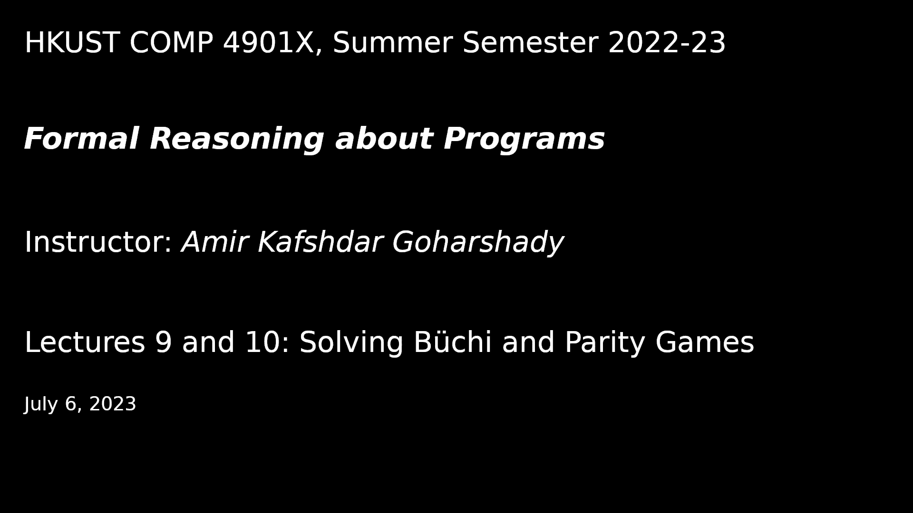
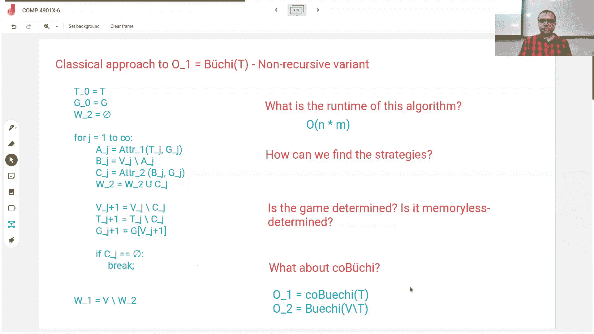
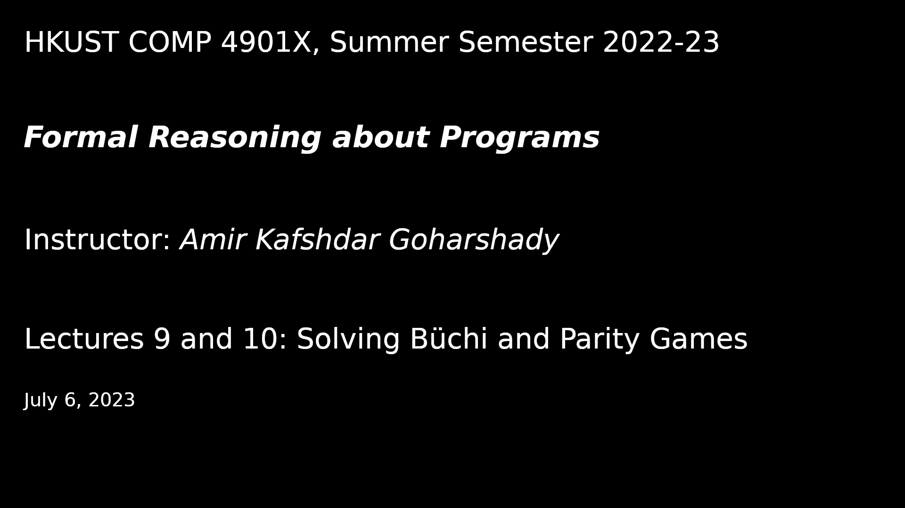
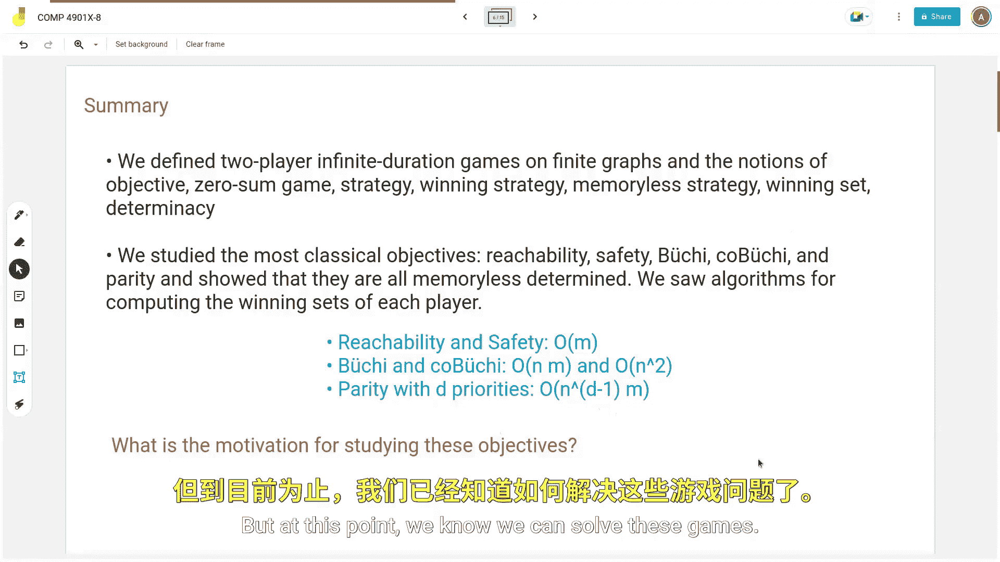

# 香港科技大学【中英⚡程序的形式化推理｜COMP4901X 2023 Formal Reasoning about Programs】 p06 p5 s 9 and 10 - Solving Büchi and Parity Games -BV1roXTYaEmJ_p6-

What we saw in the last session and then today we're going to spend most of our time talking about bookie objectives so here's like a very short summary of everything that we saw。

First of all， we defined graph games and then we said that an arena is basically a graph。

Where the vertices are divided into two sets， the set of vertices controlled by player1 and the set of vertices controlled by player2。

This was of course a partitioning， so every vertex has just one owner。

And then we also said that because we want the play to go on forever。

 we're going to assume that every vertex has at least one outgoing edge。

And this is an assumption that is quite important for this session。And。

We talked about how a play of the game works， basically we have a starting vertex。And at each time。

 whenever we are at a particular vertex， the owner of that vertex that vertex is to choose which of the up pagess to take。

嗯。And then they play this forever， they just keep playing for eternity and then we will have an infinite path on our graph and this was called a play or an outcome of the game。

Okay。嗯。食你死晒。😔，Yes。So we talked about outcomes， we then defined objectives。

 we said that an objective for a player is basically a set of infinite paths and the idea was that player I wants the outcome of the game to be in OI。

And then we define the notion of zero sum， a game is zero sum if the objective of one player is the complement of the objective of the other player。

 so it means that whenever someone gives you a play of the game or an outcome of the game you can tell whether player one has one or player two。

 of course this outcome is again an infinite pass on the graph。

And then we define some classical objective。Just to refresh your memory on this reach of T is that the player wants to reach at least one of the vertices in T。

 so the player wants to CT at least once safety means that the player wants to stay in tea and never leave it。

Bookie team means that the player wants to visit the vertices inT infinitely many times or infinitely often。

Kbukiti was the duall of Guki and basically it meant that we want to make sure that at some point we enter T and then we remain in T forever so we want to make sure that the vertices outside of T are seen only a finite number of times that was Kobuki and then we also had parity which was a much more complicated condition the idea was that we were assigning a number a priority to every vertex and then we were looking at。

Priorities of the vertices that have been seen infinitely many times。

 and then we want the minimum among all these priorities to be even。And。

Another thing that I proved to you last time is that Boki and Kobuki are special cases of parity。

 so we will care about parity more than everything else。

And then we talked about the notion of strategies。We said that a strategy is basically a function that takes the history of the game and the current vertex and tells you where to go from the current vertex。

 so it's just a recipe for extending the game。And again。

 we always use this subscript to show which player the strategy or the。

Objective or anything else belongs to suppose Sigma I would be a strategy for player I。

And so Sigma I only tells you where to go when you're currently in VI in a vertex that belongs to the player eye。

Okay， and then we talked about memoryless strategies。

 we said that the strategy is memory less if it only depends on the current state of the game and doesn't depend on the history of the game。

And then I said something that was wrong， I told you that chess has memoryless strategies。

Apparently it doesn't because there is this rule that if you're in the same state three times you have a draw。

 so you have to remember some of the previous states in。So。Doesn't have memoryless strategies。

 but we can say that I don't know， Ti T toe has memoryless strategies。

So again the whole idea in a memoryless strategy is that you don't need to remember how the game got to the current state。

 all you need to know is what is the current state and based on that you can choose what to do that's called a memoryless strategy。

Okay。We also talked about the fact that if I fix a strategy for each of the players and I initial state。

 I will have a unique outcome and we show it like this that's outcome of v Sigma1 sigma 2 here V is the initial state。

 Sigma1 is the strategy of player one and Sigma2 is the strategy of player2。

And then we said that Sigma1 is a winninging strategy for player one， of course。

 given some starting vertex v。If whenever player one plays Sigma one。

 no matter what player two plays。Every sigma two， the outcome of the game is in the objective of player one。

 so it's a winning strategy if you can win no matter what your opponent does。Okay。

And then we said that the winning set of a player， so for example， win one of01。

Is the set of all states from which player one can win according to their own objective01。

And by can win， I just mean that they have a winningning strategy， okay。

 so V I of all that of all states from which player I has a winningning strategy。

And then we had this nice definition， which was also the source of several of the emails that I got。

But I'm not going to give you the answer to the homework。We said that a game is determined。

If from each one of the vertices， exactly one of the two players has a winningning strategy。Right。

So if the Vet of player won。Then the objective of player one is the complement of the vet of player two based on the objective of player two。

So that's how we define。Determinacy and basically a game is determined。If from any starting vertex。

 only one of the players has a winning strategy。ok， and。I have to be very specific about this。

 so from every initial state we want exactly one of the players to have a winning strategy。

 you might have a case where the objective of both players is just the set of all tasks and then everyone always wins。

We're not looking at those kinds of games when we're talking about determined games。

 it means that from every vertex， exactly one of them have a winning strategy。

So I also don't accept the case where both of them have beginning strategies。Okay。

 this is going to be part of your homework to make sure the recording is working okay。Yeah。

 so I haven't released the first homework yet and the first homework is going to have some proofs in Co。

 but this is also part of the homework。So I want you to really think about the difference between zero sum games and determined games。

So let's go back to the definitions here， remember that a game is zero sum if the objective of player two is the complement of the objective of player one。

 and it's determined if the vet of player two is the complement of the vet of player one。

Two different notions and basically we can have four cases right based on whether a game is determined or not and zero sum or not。

So for each of these four cases， I want you to either give me a game that is in that case。

Or prove that it's impossible So for each of these you have to give me a game like a game that is determined and zero sum not determined but zero sum determined but not zero sum and finally not determined and not zero sum。

And if you think one of these cases is impossible， you have to， of course。

 give a proof that it's impossible。And when I ask for a game。

 I basically mean that you have to give me the graph。

 you have to tell me how the vertices are going to be partitioned between player one and player two vertices and you have to also give me the objectives of the players。

Okay。😊，So this is going to be part of your first homework。

But let's go back to what we saw for reachability。Today。

 I don't want to put too much emphasis on reachability today is all about bookie。But again。

 I got a ton of emails， so it really seemed like many people didn't understand my reachability lecture。

 so I'm going to do parts of it again。So this was the ideal。

 let's say that the objective of player one is to reach a particular set T and I'm showing T here at the center。

So what we did was that we did an attractor computation。And the idea was that the attractor of T。

It's basically the set of all states from which player one can ensure that the game will eventually reach T。

Okay， and the way we defined this was that we said we can just find larger and larger attractors recursively。

So I said that a0 is just going to beT。And so the idea is that if I'm in A0， if I'm in T。

I have already won because my as player won， my objective was to reach D and if I'm starting in T。

 the objective is already reached。Right， and then I said， okay。

Let's say that I know that I'm winning in a0。Let's take vertices that are outside of A0。ok。😊。

And let's say player one is the red player here and player two is the black player。Okay。

 so here's a red vertex。😊，That is outside of the vning cell。But it has an edge to it。

 So if the game starts here， player one can just take this edge and win。Right。

So any vertex that is like this， any vertex that has an edge to the winning set of player one and also belongs to player one should itself be in the winning set of player one。

Because I can just start here， I can just go to another vertex variable I。

And then the opposite case was that consider this vertex， this fund belongs to player two。

But it has only one outgoing edge and the only outgoing edge is reaching the target。

 so no matter what player two does from this point， player one is going to win。

Right and the same thing happens， for example， here， this is a player2 vertex。

 it has two outgoing edges， but both of them reach the target immediately。

So no matter what player two does from this point， player one is going to win。Okay。

 so this is how I defined this second set a1， so a0 was where player one could win in just zero steps。

 a1 is the set of states where player one can win in one step。Basically。

 so it's everything that was in a0 union with all the player one vertices where player one can go to a0 in one step。

 union with all the player two vertices where no matter what player two does。

 we will end up in a0 in one step。And then we said that well。

 we can inductively make our sets larger and larger， so if at some point I have a set AN。

And I know that whenever the game is in A， player one is going to win。I can make the same argument。

 I can say that if there is a vertex outside of AN that is under the control of player one。

 but then in once the player one can go to AN。Then well， player one is going to win。

And the same thing for a vertex that two， but player two has no choice but to go to the vning set of player one again。

 player one is going to win from that vertex too， it's just going to take one more step。Okay。So， our。

Idea was that we just set a to be the union of all these AI。

 so I'm just going to create all these sets AI。And then a is the union of all of them。

And then we said that well。I know that for each vertex that was in one of the AIs。Un could win。

 so of course， from anywhere in a by definition， player one can win because any point that is in a is in one of the AIs。

Right but the part that was interesting was that we said okay， let's say that b is v minus a。

 so let's take all the vertices。That were not in any of the AIs。

 so in this case I have these four vertices。And I claim that from these vertices。

 player2 can ensure that we will never reach the。So if player two's objective is to avoid T at all costs。

 there is a winning strategy for that。Now， why is that？

So we had this notion of a trap and we said that this set B is a trap for player one。

 which means that player two can ensure that the game remains in this set B and never enters a。Okay。

😊，Why is that again， so consider a vertex in this set be。Okay。

 it's either a player one vertex or a player two vertex。If it's a player one vertex。

 it does not have an edge to a。So for example， consider this one。

 this is a player one vertex it doesn't have any h to a why is that because if it had an H to a by definition。

 I would have added it to a。Right。On the other hand， if you take a player two vertex。

 let's say this player two vertex， it might have an edge to a。

 but it definitely has at least one edge that doesn't go。Again。

 this is based on the definition because if all of its edges were going into a。

 I would have added this vertex to a2。Okay。So now if the game is in B。

 if we are outside of this large circle a。Here's a very simple strategy for player two。

 don't ever enter a。Right， so if the game is in B， we know that player one cannot take you to a no matter what player one does。

 the game is going to。And then if the game is in B and you're player too and you have to play now。

You always have the option of taking a successor that is in B and not in A。And if you just do that。

 you ensure that you will never reach a。Right。And of course。

 since the target T or a0 was a subset of a， if I never reach A， I'm never going to reach the target。

So this shows that basically we have determinacy right and this was the question I want to ask。

 but yeah， the game is determined because。Basically the vets of player one。

With the objective of reaching T is the set A。And the wind set of player2 with the objective of being safe in v minus t。

 which means never reaching T is B and their complements， so it's determined。And yeah。

 it's also zero sum， so I solved one force of the homework for you。Good。Okay。

But what's more interesting here is that both players have a memoryless strategy。

Right in their own winning sets。So what is the winning strategy for player one if we are in a。

 the winning strategy is just go closer to the core。Right， every time if。If you're player one。

 and let's say。I don't know。Okay， let's say we're here。This is a player one vertex。

 and it's like in A2， try to go to a1 or try to go somewhere closer。And that's it that's the。

Vinning strategy for player one and of course we know that such energy edge exists so for every one of the vertices I can just pick one of the outgoing edges and I can say this is what you do as player one if you're at this particular vertex。

So again， it's memoryless because you don't have to think about how you got here。

 you just know are in this vertex you're going to take this edge。

The edge that is taking you closer to them okay， that was the strategy for player one and the strategy for player two is of course。

 what I explained to you like always remaining B。So for every player2 vertex that is in B。

 you just take one of the edges that is also going to remain in B and you just fix that。

And that's going to be the strategy for player two， so player two knows that whenever the game。

He has to take this one。And again。It doesn't depend on the history of the game。

 it doesn't matter how we got here， the strategy just says that if you are here go to this successor。

So it's memoryless， it doesn't depend on the history at all。Okay。Now。

 another thing that was apparently confusing is that I said the runtime is linear。

And it wasn't clear how。Because well， we're computing all these different sets。呃。

So I'm going to just give you a pseudocode of the algorithm so that I can really prove to you that this is a linear time algorithm。

Now， the important point here is that I don't really care about computing a0 A1 to AN。

I needed them to， again， mathematically reason about the set A。

 but what I actually care about is to compute this set。Player one， which is a。

 so I don't need to compute all of these and I can compute a in linear time。

 so here's how I would do it。嗯。So first of all， I'm going to start with my set A being just the empty set。

Okay。And every time whenever I figure out that a vertex is in a。I added it to a queue。

And the other thing that I do is that for every vertex。

 I always keep track of how many of its successors are already in a。ok。😊。

So what I'm doing is actually very similar to a BFS here， except that I just have this counter。

 which basically for each one of the vertices， it tells me how many successors does this vertex have in a and initially it's initialized to zero for every vertex。

Okay， so I have a queue and this is the queue of all the vertices that I should add to my set a and initially in this queue I just have all the vertices in T and initially my set a。

 which is going to be the v set of player one is the empty sets。

Now here's what I do I say as long as my queue is not empty。

 let's take one of the vertices in the queue and let's add it to a。Okay。

 so I choose a vertex v and Q， I remove it from Q， I add it to a， but when I add it to a。

 I have to update these counters for all the predecessors。Of this vertex v。

Right because V is now added to a， so let's say this is， I don't know， let's say this is V。

If these is at the。Then this predecessor has a new successor in a， so I have to increase the count。

So for every predecessor of V。I increase discount and of course I keep track of discounts only for vertices that are not already in a if they're already in a。

 I'm done with them。Okay。😊，Now look at it from the point of view of a predecessor。

 let's say I'm a vertex。And I just realized that one of my successors is in A。ok。😊，What happens。

 well let's apply the rule here。If I'm a vertex thats belong to player one。

And I have one successor in a， then I have to be in a myself as well。

RightSo here I say that if this predecessor was a vertex of player one。

 add it to the Q so that we later added to a。What is the other case。

 the other case is that this was actually belonging to player two。But now。

All of its other successors were also in A。And so now when I'm realizing that this successor a is in a I'm realizing that all the successors are in a。

 so if the number of successors that are in a is equal to the out degree is equal to the number of all successors。

 then I also add this vertex W to my Q so that I later add to a and that that's the algorithm。

 I don't really keep track of each of the a I can find a in the end。And finally。

 I just return a and of course， I can also return v minus a， which is B。Now。

 what is the runtime here？Well， the analysis is very much the same as the analysis you do for BFS。

So every vertex is processed exactly once， every vertex is added to this cu at most once。Right。

And then whenever you add the vertex to this cu， you process all of its predecessors。嗯。

It is also processed once， so the total runtime is going to be n plus m or n plus M where n is the number of vertices。

And M is the number of edges。Okay， so this is my runtime now。But this is basically O of M。

 why is that it's because of this small assumption that we had here。

We assume that every vertex has at least one edge going out of it。So。

This means that we are assuming we have at least as many ages as vertices。So if it's O plus M。

 it's also O， so it's really linear time in the number of ages。Okay。

What happens if I want to compute v sets for the safety objective？

If player one wants to remain in tea。And make sure that we never lived you。Well。

 this is the same as saying that player2 wants to。V minus D。

Right so I can first just swap the players。Solve it for player two see like when can player two reach v minus D？

And from any vertex where player two can reach V minus St， player one cannot be safe in T。

 otherwise player one can be safe in T。So safety is basically the duall of reachability and given that I have a linear time algorithm to solve reachability。

 I have a linear time algorithm to。Okay。鬼子意思。嗯。Nice。Okay， finally。

 we can get to what I actually wanted to teach today， which is bookie。

So let's talk a little bit about notation before we go into an algorithm for bookki。So first of all。

 remember what book is bookie is that I have a target set T and as player one。

 I want to reach T infinitely many。跟你都有份。Okay， so it's not enough to just reach T1s。

 I want to reach T and I want to make sure that I come back to T infinitely many times。Okay。

First of all， let's give a name to this sets A and B。

 so I've already told you that when we were doing reachability。

 I said that A is an attractor and B is a trap。But we have to kind of be more specific。So the set A。

It was the attractor one of the， which means that。It was the set of states from which player one could ensure that we will definitely reach the。

Right so。If I'm in a player one has a strategy that no matter what player two does。

 we will reach the so I add this one subscript here and then I would define attractor two of the in the same way。

 it's the set of states where player two can ensure the no matter what player one does。Okay。Now。

And again， remember that our game had this format， so I had。

A vertex set which was divided between player one and player two， and I had a bunch of ages。Now。

 the first thing I want to do is that I want to define。A sub game。I want to say。

Let's say I have my game， I want to remove some of the vertices and I want to still have a game。

Now I can't just remove any set of vertices as I like。Because again。

 we had this extra condition here and this condition seems very trivial， but it affects everything。

So we had this condition that in a game， every vertex should have at least one outgoing gauge。

So if I just take any subgraph of my graph， it might be that I remove all the successors of a particular vertex and then that vertex doesn't have an outgoing gauge。

 so I cannot define a subgate。嗯。So here's how I define a sub game， I say that suppose that W。

Is a subset of my vertices。If every vertex in W has a successor in W itself， then I can say okay。

 we can delete all the other vertices and we have a sub game so we can define the sub game at W like this so G of W。

 the vertex set is W。And then the vertices that are owned by player one don't change they're just V1 but intersect with W because we've deleted everything that was outside of W and the same thing for player2 so the vertices of player two are going to be V2 intersect W and then the edges are just going to be the edges that have both of their endpoints in W。

ok。😊，So now let me ask you some questions based on what we computed in reachability。

 so remember our reachability algorithm started with T and then it computed the attractor of T。

F one of the to be more specific， and we call that a。ok。😊，So here's my first question。

 does a induce a sub game， so do we have a sub game G of a？With this definition。

 so my question is if I remove everything outside of a。Will they still have a valid game？对。喂。嗯。我唔系得位。

For a A then he may not have a success in。 yes， you're right。So basically。

 we said that in order to have a valid sub game， every vertex should have a successor in that sub game。

Now if I have a vertex here， I'm sure that it has a successor in like a closer level to the center right so if I pull and let's look at both players。

If I'm here and I have a player one vertex， the reason it's here is because it has an edge to a level below。

Right and if I have a player two vertex， the reason it's here is because it has several edges。

And all of them were to the level below。So for these cases， I'm happy I have a game。

But the problem is with a0 itself。P tea itself。So it might be that I have。In here。

But all of its successors were outside of age。Because this was our base case。

 we were saying that if the vertex is already in T， I don't have any conditions about its successors。

 I'm winninging anyway。Right。Let's go back here。So if you look at these recursive definitions。

In all of these cases， I'm talking about a successor that is already in a at least one successor。

 except for this case。So if a vertex is in T， it might be that all of its successors are actually outside of a。

So based on that， what happened okay yeah based on that a does not induce a sub game。

 so I cannot be sure that G subb a actually exists。It might be that G subA does not exist。Okay。

Now I'm going to ask the same question。But I'm going to ask it about B now and remember that B was this set。

F。Does B induce a sub game， is there a sub game G sub B？对。Okay。

 so yes or no yes and actually you said something really niceister B is a trap so we can generally prove that any trap would give us a soft game。

Why is that？So B was a trap for player one。What does it mean when I say B is a trap？I think I had。

Do I have the definition of a trap somewhere， it should be somewhere here。

 but they can't find it anyway。😔，The definition of a trap was that no matter what player one does。

 player two can make sure that we remain in the trap。Okay。So， here。

If I'm in the set B and I'm at a vertex that belongs to player2。

 player two has an edge that remains in B。ok。😊，If I'm in the set B and I'm in a vertex that belongs to player one。

 all of its outgoing edges are going to be in B。So in any case。

 each vertex in B has at least one successor in B， and so I can define a subga on B。Okay。Okay。不。

So here's what I'm going to do now。I'm going to say。Take this set B。

And let's compute an attractor of B。But let's compute an attractor of player2。

Here is actually that I want to eventually go to bookie。So。

A and D were the winning sets of players one and two for reachability。So if I were in A。

 I knew that player one could force the game to visit T。And if I were in B。

 I know that player two can make sure we never visit tea。Okay。But here's the thing。

 suppose that I have a vertex somewhere here。And from this vertex， player  two can。

That I can reach the setby somehow。Okay。But， of course。

On the way there I might visit my target several times。But this would not matter if I'm doing booky。

Because if I'm doing booky and I'm player too。I would just say。

 let's reach the set B and well on the way I don't care how many times I've seen the targets。

 but as soon as I reach B， I'm sure that I can make sure we never see the target and then I've win because player one cannot ensure booky of T。

Okay， so that's why I'm looking at this particular set， so let's call this set C。

And C is going to be the attractor2 of B。Which means C is the set of all vertices from which player2 can ensure that we will eventually reach B。

Okay。So now the same question， does C induces okay？嗯。Yes or no。

So we've already seen an attractor that doesn't induce a soane。

 we've already seen that a trap does induce a soine， now this is another attractor。啊 call还见你几个嘢。Yeah。

 this is also yes， yes exactly， so previously when we were talking about this attractor。

We saw that all of these cases have an edge that is inside the attractor itself。

 the problem was with the base case。Right。But our base case here is a trap be。

So I don't have the problem with the base case anymore。

So another way of looking at this is that let's say this is my set。😊。

And it's really hard to write with a mouse， sorry。😔。

And let's say that I compute its attractor and let's say this is the attractor C。Now。

 if I have a vertex。😊，That is already in B， I know that it has a successor in B because B was a trap。

Because I know that GB exists。And if I have a vertex that is in C， but it's not in B。😊。

At the very least， I know that there is a path from this vertex to B right because I mean。

 player two can ensure that we will reach B。Thank you。

RightAnd this pass is going to have I'm just going to take the first edge out of this pass and it's going to remain in C。

 of course。And so this vertex also has an edge， an outgoing edge where the target is also installed。

So。Yeah， nice。So we have this case where we are taking the attractor of D and we can do。

You want that attractor。Now， what if I take the complement of C？But if I take V prime。

 I'm going to call it v prime， but it's the complement of C。

 it's basically V minus the attractor2 of p， which was C。So if I take the complement of C。

Can I define a sob game on that？Okay， people are saying yes， but why？Okay。对。Yes， because it's a trap。

Because the complement of every attractor is a trap。Right， I mean， it's a trap for player two。

 it's not a trap for player one， but who cares I'm just changing the order of the players。

I can always define a sub game on a trap so。This one is also fine。And by the way。These things work。😮。

Even if these sets are empty， even if v prime is the empty sets。

That's fine because I can have the empty game。And okay。

 if that sounds a bit counterintuitive to you just。Look at the definition of the game。

And see what happens if the set V is empty， so V is empty。

 v1 and V2 would be empty and every vertex has at least one outgoing edge because we don't have any vertices。

It's vacuous because I don't have any vertex， every vertex has an outgoing image。Okay。So。

I did all of this so that I can tell you that we cannot talk about a sub game on A。

 but we can talk about sub games on B and C and this complement of C。

And just remember these definitions because I'm going to use the sets A B and C many times now。

 so a is the set of vertices from which player one could make sure we will reach T。

B is the complement of a B is the trap for player one。

 it's the set of vertices from which player two can ensure we will never reach T。

And T was our target set。Now the attractor2 of B， so B was the set of good vertices for player2。

 C is the set of vertices from which player two can force us to visit one of the vertices in B。ok。😊。

So now we're going to talk about the classical approach to solving the。Bookookie objective。

 so let's say that the objective of player one。Is now bookie of tea。So I have this set T。

And player one wants to。Game sees this set T infinitely many times。ok。So again。

 the same definitions here， I have this set a and from anywhere in a player one can make sure that I will visit T at least once。

I have the setB。And from anywhere in B player two can make sure that I don't visit T at all。And then。

 I have C。So let's draw it let。I said see。Okay。And it will include all of B。

So I'm going to call this C。C is the set of vertices。Where if I start the game there。

 player two can ensure that I will eventually reach B。Now， while I'm reaching B。

 it might be that I go through T a number of times before I reach B， but that's fine。Right。

 because player runs。I a T infinitely many times and we're assuming a zero sum game。

 so player two is fine with visiting T a finite number of times。Okay。Now， here's what I claim。

I claim that for every vertex in the set C player 2 has a winningning strategy。Okay。

 give me this strategy。这没什么。OhWell， the objective of player one is bookie of the。

 so player one wants to CT infinitely many times。And it's zero sum。

 so player two wants to make sure we be CT only a finite number of times。哦 by to and。Yes。

 so basically if youre player two and if the game starts in C， you have a strategy to make。

In will reach B， so you just play that strategy and you play it until you reach B。Now， again。

 on the way， you might have visited T a finite number of times， but that doesn't matter。

You're fine with visiting into a finite number of times。But then what happens when you're in B。

 as soon as you're in B by definition of B， you know that B is a trap for the other player so you can keep the game in B。

So as soon as you reach B you switch your strategy to the strategy that was for keeping the game in B and then you just remain in B forever so it's a mixture of the two reach abilities strategies and this gives you a strategy for。

This case， for the case where basically you want to do Kobook key of v minus D。Okay。

So what does this mean？😡，This means that if I want to find the set of vertices where player one wins and the set of vertices where player two wins。

At the very least， I know that player2 wins everywhere in sea so I can mark all of this。

As part of the winningning sets of player2。ok。Now the funny thing here is that it might also include parts of teeth。

So it might be that you have a target vertex， but if the game starts from that target vertex player two can ensure that you see target verticexes only a finite number of times。

So this is how our diagram looks like right now， okay， so I know。That from every point in C。

 player two has a winning strategy。What about the rest of the graph？So what happens here。

 so this part is like v minus c。Yeah。Okay， so you can see the answer already there。

And the answer is that， well， this is just a smaller game。So I'm going to solve it recursively。ok。😊。

But why does that make sense， why does it make sense to look at this smaller？

We will come back to that， but basically the idea is that if I'm in this smaller game。

Player one would never want to go to C because player one knows that if he goes to see player two wins。

So player one keeps us in this smaller game。That's why we can recursively solve over this sub game v minus c。

 okay？So。This is now okay， and I can write this in a recursive variant or I can。

So code innovate doesn't use recursion at all。呃。So here's how I can write the pseudocode without recursion。

I just keep track of my current game and my current game is going to get smaller and smaller Okay。

 so I have T0 and generally I'm going to have T。And I'm going to have okay。

 sorry it's J so during this algorithm I'm going to have a game GJ， which is like。雷神杰。

And then in this game， player one's objective is to have bookki of TJ。

 so to see TJ infinitely many times。Now， initially。

 of course t0 is just t and g0 is the entire game G。And then I keep track of two sets。

 I keep track of W2， which is the set of states from which I know player two has a winningning strategy。

And then I will also have W1， which is the winning set of。But I keep track of W2。

 I just compute W1 at the end。Now， what do I do every time I basically do this same argument that I had here。

I say that， well， let's say that AJ。Is the attractor one of TJ。

 so AJ is all the states from which player one can make sure we reach TJ。

And then I take its compliment。This is the trap that player one。

 and then I take the attractor attractor two of that trap。

So CJ is the set of states from which player2 can ensure that we reach BJ and if we reach BJ。

 then player2 can ensure that we will never reach AJ。Right？

And so I know that based on this simple strategy that I had here， player two will win in CJ。

So I just add CJ to the winningning setup。I say W2 is W2 union with CJ。Okay。😊，Now。😡，Again。

 I found that player two wins in all of these places。

 so I'm going to say now my game is going to be the sub game and the remaining part。

 so I'm just going to now solve this part。So I'm going to say Vj plus one is just Vj minus this Cj because I already know that player two wins in CJ。

And I also update everything else， so the target are going to be minus CJ and I mean the game itself is updated。

Now。For how long should I continue this？Well， I have a four here that basically goes to infinity but。

It's like。I have to do this only until CJ is empty right so every time I'm just finding more and more vertices where player two can win。

If at some point， I cannot find any more vertices。Strategy I just give up， I say that's it。

 that's okay and I break。So。And at the end of it， this is now the controversial part。

I say that the winningning set of player one is just the complement of the winning set of player two。

Okay， so my algorithm is kind of assuming that the game is determined。now。Here's the thing。

 the part that is trivial。Is that if I have a vertex that is in W2。

 player2 is going to win because I gave you the winningning strategy。Right。

What's not so trivial is that if I have a vertex that is in W1， a vertex that is in complement of W2。

 then player one has a winning strategy from that vertex， so we have to prove this。Okay。

Why does player one win in W1？Let me just draw another case for you。So。Remember， we had this set T。

 this was our target set， player one wants to visit T infinitely many times。

Then we had the set a and a was the attractor one of D， so from anywhere in a。

 player one could ensure that we will visit T at least once。Okay。

And then B was the complement and we said that B is a trap， so if we are in B。

 player two could ensure that we will always remain in B and we will never cross this boundary here。

Okay。😊，Now， what did we do？😡，We computed a bunch of sets， so we're calling them like C1 C2 and so on。

 so first I computed the first set， let's do it like this。And this was， let's say my said C1。

Then I computed a larger set， which was C2 and so on， but let's just look at C1。

So this is the first time that I'm computing C。And this is the set of vertices from which player two can reach B。

Layer 2 can ensure that if I start anywhere here， including inside of T。

The game will eventually reach me。And when the game reaches B player two。

 we'll just trap player one and then win。ok。😊，So it's pretty obvious that in C1， player two wins。

Now I want to consider a game that starts outside of C1。

And I want to see if this game would ever reach C1。So consider。

All the edges that go from outside of C1 to C1。Because if my game is going to reach C1。

 I have to take one of those edges。Okay， so some of these。

Are from vertices that belong to player one， so let's say these are vertices belonging to player one and they have edges into C1。

Okay， so consider this vertex。Do you agree that it also has an edge that doesn't go into C？Yes。

 because c1 was an attractor， so if all the edges of this vertex were going into c1 then this vertex itself would be added to c1 so this vertex definitely has an edge that is going somewhere else not into C。

Now let's say you're player one。If you're at this vertex。

 you will never take the edge that goes into c1。Right because that's stupid， if you take that。

 then player two wins， you know that player two wins from everywhere in S。

So we are sure that if we are player one and we are here。We will remain outside of C1。Okay。

 so in other words， I can delete this edge and nothing changes in my game。

Because that was an edge that player one would not take anyway。Okay。

 now let's consider the same thing， but let's say I have a vertex here that belongs to player two。

I claim that this verex cannot have an H to C1。Because C1 was the attractor2 of b。

 if this vertex had an edge to C1， then it would be already put into C1 by definition。

Player two wants to reach B。 He knows that he can reach B from C1 if he had。Like this。

 he would take it and then he could reach B from this vertex as well。

 so this vertex would also be in C1。So if I have a player2 vertex here。All the edges are going out。

 none of the edges are going to see one so in other words。It makes perfect sense。To say that。

Player two wins in this part。And the remaining game is completely independent。

So in the remaining game， you win if and only if you can win without entering C1。Okay。

 because player two cannot enter C1 from the remainder of the game and player one would not enter C1。

Okay。But now let's continue this。So let me era these。😔，I had this set C1。

And then I had this other game to the right， and based on that I computed another set。

 let's call this one C2。Where again， player two wins。And then I computed another one， C3， so on。

 and let's say I go all the way too。CN。Okay。Again， I can say the same thing。

 I can say that in all of these。Player two wins。But now I want to say that if the game starts somewhere here outside of all the CS sets。

 player one wins。Okay， so。Heim has started outside of all these seas。

Give me a strategy for player one， give me a winning strategy for player one。Just don donだす。Yes。

 so our strategies are always super easy。😊，This player one is just never going to the。right。

But is that enough？Because， well， I might have some part of T remaining here。Right。

 so if I just say don't go into the seas， it might be that I'm visiting this small part of T infinitely many times actually let me。

Make this shape a little bit nicer。😔，So。Let's say that。This is CN。

So I know that in all of these parts。Player two is going to win。

And I know that if I'm outside of these C setss， I should never enter them as player one。

 but is that enough to make sure that I win the game？

Because it might be that I choose a strategy that never exits this part of the game。But nevertheless。

 I visit this part of the target set infinitely many times。

So you have to somehow ensure that doesn't happen， how would you do that？你确定做个PSM。不用不用。

Give me an argument for this。是。Okay you。对。对。嗯。Okay， so let's just look at this sub game。

 what is this sub game？This is a subga in which when I computed that st， the C set was the empty set。

Right， because otherwise I would keep expanding my seat。So let's just zoom in to this last sub game。

Nowow that we will not exit the last sub game， so that's good， I can really zoom into it。

I'm going to reuse the same figure， but just imagine that this is not my initial game。

 this is the last so。ok。😊，So I have this last sub game。It hard to erase here， okay。

So I have this last sub game。In this last sub game， I have some remaining part of T。

Then I have a and I have B。😡，What can I say about B？I know that when I computed attractor 2 of B。

 that was empty。I couldn't find any new vertices where player 21。So if a tractor two of P is empty。

 B itself has to be empty。Do you agree with that because B is a subset of itster that was again。

 like the first line of the definition of N。So this B is the empty set。😊，Now， if B is the empty set。

😊，What does it mean， it means that a is the entire game。So all the vertices in my graph are in a。

But A was the attractor of T。😊，Right， so it means that no matter where I start my game。

Player one can ensure that I will reach T。EveryoneOne has a strategy for that because again。

 a was the attractor one of T。But then player one can just play this strategy all the time right so if I'm player one。

No matter where the game starts， I just go ahead and play my reachability strategy until I reach T。

Now the game is going to stay in T for a while and I'm happy as long as it's in T and at some point if we go outside of T again。

😊，I again， apply my reachability strategy。唔是。And then I will do this forever。

So this is a winning strategy for a player one。So this shows that in the remaining part of the game。

In the sub game where I couldn't find any new C vertices for player two。

 player one has a winning strategy。Okay。Are these strategies memoryless？Yes。Okay， why Yes。

 so basically player one strategy。Is memoryless because。

It's just the reachability strategy right we're just using the same strategy and we knew that it was memory less there。

But what about player two？So for player two I have a similar case right it's always like it's a combination of two strategies but it's a combination of two memoryless strategies so my strategy for player two was always that if。

😊，You are in the set B if you're in one of these traps， keep staying in the trap。

And that was a memoryless strategy， and we said that if you're in C but not in D。

Just do the reachability strategy to be。And that was also memoryless and then when you reach me。

 then you do the trap strategy。Great。So we just proved the correctness of this algorithm and we proved two other things。

We proved that our game。Is determined because the winning set of player one is the complement of the winning set of player two。

And we also prove that it's determined with memoryless strategies， which is again， great so。

Here's another example for that one quarter of your homework。So what's the runtime here。

 how much time does my algorithm take？俾系个声通发声。No， it's， it's more than that or more。

呃 and parts because we I do the well at most。Right。

 so we can say that every iteration of the while loop。

Takes linear time because every iteration of the vilu is basically our reachability out。

Just computing attractors right it's I mean it's computing two attractors。

 but who cares it's just a constant。So every iteration。Takes O time。

But how many iterations do we have you're saying at most end？Why do we have attmost N iterations？

ButEach time we add at least one word we CJ meaning that we will decrease the whole expire one。Right。

 okay， well， I would rather talk about the old you two， so every time were at。

W2 I agree that it's because it's in CJ so W2 is getting larger and larger in every iteration and it can at most have a size of M at most we can add all of our vertices to W2 so we're going to have at most n iterations here。

So the overall runtime。Is。O， N times。Good。I've already answered these two questions。

 how can we find these， I just told you the strategies。

And the game is determined and it's also memory less determined， which means that。

It's determined with memory less strategies。So my final question is， how would you solve Kobuki？

我别小系咪 take级。Yes。So。If the objective of player one is Kobook key of T。

This means that player one wants to ensure that all the vertices that are seen infinitely many times are in T。

Which means that player one wants to ensure that all the vertices outside of T are seen only a finite number of times。

But then if we look at it as a zero sum game， this means that player two wants to make sure that there is at least one vertex outside of the that is seen infinitely many times。

So if it's zero sound and our one is called book key of T。

 then the objective of player two would be bookuki of v minus t。

But we know how to solve bookie and we know that bookie is determined。

So we can just solve bookki of v minust and then we just swap the answer like from yes to no and no to yes。

 and that that gives us。The answer here。

In this session we're going to see a faster algorithm for solving the same thing that we solved in the previous session。

 so we're going to consider booky objectives。And then we're going to also extend our algorithm for bookie objectives to general pary objectives。

So。I'm sure you still remember this so were going to have two different types of really important objects here。

 we have attractors。And we also have the complement of attractors which were set which were sorry traps。

Up until this point， the only kind of trap that I've really talked about was that I took this set T and then I computed the attractor of T and then I said。

 let's look at the complement and that's a trap。But let's now look at more general traps。

So my trap doesn't necessarily have to be the complement of this particular attractor。

So here's the formal definition of trap again， I say that a set s substaone vertices is a trap for player one。

嗯。If first of all， there is no way player one can exit from the trap so there is。

No player one vertex in the trap that has an edge to outside of the trap。And secondly。

 if every player two vertex in the trap has a successor in the trap itself。

So if it's player two turn to play and we are in the trap S。There is a successor that is also in S。

 so player two can ensure that we will remain in S forever。Okay， and of course。

 normally I want to make sure that my trap does not include any of the target vertices because I want to make sure that。

First player cannot reach the targets， that's like the whole point of having a trap。

So I would say things like this is a trap of player one out of T。

 which means that the intersection of the trap S with the target set T is empty。谁。😊，Great。

 so let's just look at the algorithm that we saw for booky one more time。

And let's just focus on the traps。Let's see what we're doing here。

So we had this set of target where it is is t and we said that first we compute the attractor of T for player one。

 so this is the set A。And from anywhere in any player one can ensure that we will reach the。

And then we said， okay， let's take the compliment。Of this attractor。

 and let's call that B and we said this B is a trap。Okay， so this is a trap。

I have to stop writing with the mouse。😔，嗯。And then the idea was that not only player two can win starting from anywhere in B。

But actually player two can win starting anywhere in the attractor two of B。

Right and the strategy was also very simple， the strategy was that if I'm inside this trap。

And on player two， I make sure we will never leave the trap and this makes sure I will never have to visit tea。

And if I'm in C， let's say this was C。Which is the attractor2 of B。As player two。

 I would first make sure that we will reach B and then I'll apply the same idea as before I'll just keep our and keep the game in B and not let it go out。

Okay。But again， what I want you to really focus on here is that B is a trap。

And what happens if B is empty？If P is empty， then C is also empty and that's what we used in the previous session to show that in the remainder of the game player one has a winning strategy。

So based on this。And of course， this was a recursive algorithm we would continue solving in the rest of the game as well。

But okay。 this was the。Sudocode that we had for this， so basically every time I computed an A， a B。

 which was the trap， and then I computed the attractor of B， which was C。

And then I would add C to the vning set of player2。

And now I want you to again deconstruct the runtime argument that we had for this algorithm。

 so the runtime argument was that in every iteration I'm adding something to the winning set of player2。

So I can have at most any iterations。And then I was also saying that in every iteration。

 I'm spending OM time because these attractor computations。

 these were just reachability and I know how to do them in OM， so the total runtime is O times。

In this session， we want to decrease it to O n squared。

And this is actually a huge decrease because you can imagine that if you have a very dense graph。

 M can be n squared and so this is actually a cubic algorithm in terms of n whereas this is just quad writing。

Okay。Now which are the parts where I can probably get an improvement？

When I was doing the runtime analysis， I said that I have n iterations and each iteration is taking all M time。

So if I want to somehow obtain an improvement， I have to either reduce the number of iterations or I have to reduce the amount of time that each iteration takes。

Okay。So。First， let's talk about the number of iterations if I want to reduce the number of iterations。

 what do I need？If I want to have a better bound on the number of iterations。

 I need to say that this set W2 increases faster in a sense。

Its size increases faster because right now in my analysis I'm just saying okay。

 every time I'm adding something to W2， but I'm not really caring about how big this thing is I'm just saying that I'm adding at least one vertex to W2 each time。

But ideally， I want to add a lot of vertices to W2。That's the first thing。嗯。

And that gets us to the point where we say that well。If that's the case。

 if I want to add the largest number of vertices， this means that I want to have the largest possible set CJ here。

Yeah。But right now， we're not using that at all。And actually right now in the analysis that we have here。

 it doesn't really matter what CJ is。As long as we're sure that player two has a winning strategy。

But what's even harder is improving the second part of theantti。

So imagine that I want to spend less than M time in every iteration here。

So how can I do that well if I'm computing attractors at the very least I have to process the reachability right I have to go over the graph at least once。

I mean， even just reading a graph with N vertices and MHs is going to take linear time。

So the only solution I can have if I want to reduce the M part of this runtime is to work on a smaller graph。

So somehow I want to avoid working on my original graph， original game。And instead find a sub game。

 a sub game that has fewer edges。And then work on that subject。Okay。

 so these are the two ideas that I want to have in mind， I want to find bigger。Traps， let's say。

 and at the same time I want to do it in smaller graphs。Okay。So。

The first thing I want you to notice here。Is that if I take this algorithm and if I don't care about the runtime。

 if I only care about。The correctness。Instead of this BJ that I have here， I can put any trap。Right。

So previously in the classical algorithm， I said that。I take T， I take the attractor of T。

 and then I take the complement of this attractor。And I call that B。

But instead of taking the complement of this attractor， I could take any other trap。

As long as it's a trap outside of tea， everything else would work because when I was giving the strategy for player two。

 I was saying if you're in the trap， just remain in the trap。

And if you're somewhere else in C not in the trap， first reach the trap and then remainder。

 so the only thing the only property of B that I really used here was that B is a trap of player one absolute of T。

And。Yeah， so instead of this Bj here， I don't have to put Vj minus AJ， I can put any trap。

This is helpful because this means that I don't have to necessarily compute this attractor you see the most time consumingsum part of every iteration was that I had to compute these attractors and then I had to take their compliments but if instead of BJ I can just put any trap and if I somehow magically have a faster way of finding traps。

Then I don't need to compute AJ at all。So that's again， one of the first ideas that I want。Yeah。And。

😊，So the other point is that at least in the analysis that we did initially where we said that this W2 is increasing in size and we didn't care about the amount of increase。

There is really no benefit in finding the largest trap。So in a sense， this Bj is the largest trap。

Right so my algorithm， my original algorithm here is finding the largest trap。

 but then in my runtime analysis， I don't have a bound on the size of this trap。

 so maybe even the largest strap is just giving me one new vertex。

So I'm not benefiting from computing the largest trap here。So what do I want to do。

 I want to first of all， replace the trap Vj with some other trap。But secondly。

 I want to also have a runtime analysis that takes the size of the trap into account。Now。

 why do I say the size of the trap EJ and not CJ because it's just too hard to talk about CJ？Okay。

 and you will see soon， but what do I know if let's say my trap DJ has K vertices？

What does that tell me that tells me that I will find at least K new vertices where player two is winning。

 so CJ always includes BJ。So if I can say that the size of my trap is some number k。

I can basically say that this one iteration increased the size of W2 by at least k。

So based on all of these， this is my wish list now， this is the problem that I want to solve。

Hopefully。I want to find the trap and this is my input， my input is just an arena。

It has n vertices and M edges， and I also have a set of target vertices T。

Now I want to find a trap of layer one outside of T。

But this is the part where things get interesting。If this trap has size K。

 I want my runtime to be ONK。So I want to find an algorithm whose runtime is bounded by the size of the trap that it finds。

Now， why do I want to do this？😮，Because I want to say I spend onNk to find the trap of size k。

 but when I find the trap of size k， this W2 increases in size by at least k。So my overall runtime。

Would be at most n times the sum of all decay case， but the sum of all the case is at most n。

 so my overall runtime would become n squares。So。That's why I want to find a trap of size K in all Nk。

I did。Does this make sense to everyone， are you fine with this？No， we do that anyway。

But that part doesn't take that much time。Okay， so here's the thing。

Let's say I don't have to do this。And to find a trap here， I'm spending onNK。

And I'm finding a trap of sizek。对。ok。😊，So。Computing this CJ， what happens when I want to compute CJ。

 I'm basically doing my reachability algorithm with the Q and everything。

But I'm just putting this trap as the initial elements in my queue。

But everything that I find in that algorithm will be in CJ and will be removed。

So the total runtime that I spend on computing all of the CJs is OM。

Right in all of the iterations not I'm not spending OM per iteration i'm spending OM overall for all the CJs so this part is fine this part is not taking that much time the part that I really had to get rid of was this part。

It's also its been with the the line and details。Thatも word the same timeで。嗯。If we remove that， yes。

Yeah， it will not affect the runtime， I can find the same runtime。呃。But let me see。

 does the correctness proof go through？So here basically you are saying instead of removing C。

 let's remove B。It's possible that the correctness is affected by that， right？Because if youre in C。

 player two has a winning strategy。But if you just remove B， it might be that from a vertex here。

 player 2 no longer has a meaning strategy， can you prove that doesn't happen。

 if you prove that doesn't happen then you don't need to compute C。是。I'm not sure， but。Anyway。

 my point is that the computation of C here doesn't really affect my total runtime， so I don't care。

But yeah， anyway。What's really important for us is that I want to basically spend ON time for finding each one of the vertices that is added to the vning set of player2 so that I can overall say that I'm going to add at most n vertices to the vning set of player two。

 so my overall runtime is end squared。Okay。So now this is my goal， this is what I want to solve。

 I'm given a graph G。嗯。And okay， I have a set of target where this is I want to find。

A trap of player v outside of this target vertices and I want to say that if my trap size is k。

 I want to spend Ok and again it's very important this is n， this is the number of vertices。

 not the number of edges， number of vertices times k。是。Okay。Now。

This is the same problem that I talked about a few minutes ago。

 which is like if I want to spend less than M time if I want to。

Time to not depend on the number of edges， I have to somehow specifyify my graph。

 I have to somehow find a subgraph that is smaller so that I can work with that smaller subgraph because if I want to work with all of my edges。

 I'm going to spend a time that is at least linear in the number of edges。Okay。

 so this is the very simple idea that I have I'm going to discard some of the Hs I'm going to just keep。

A few edges， and then I'm going to try to find a trap in this limited graph。Okay。

 but let's just define what this means， so this is what I call a subgraph track。

So let's say that I have a set E prime， which is a subset of my current ages。And basically。

 what I want to do is that I want to trap player one。Not only inside a set of vertices。

 but also inside this set of edges。ok。😊，So let's say that I have E prime and I have s so S is a subset of vertices E prime is a subset of edges。

 I want to trap layer one so that he cannot reach any vertex outside of s and he cannot reach any edge outside of E prime。

ok。😊，And this is called an E prime trap。And of course。

 I want to make sure he doesn't reach T as well， so T is the target set。

 so T intersect S is going to be the empty set。Okay。

 this is basically the same as the definition of a trap。😊。

It's just that I want to say player one cannot take any edge outside of E prime。

 so I say for every vertex v that is in this set s。If that vertex belongs to player one。

 if it's in s intersect with V1， then all of the outgoing edges must be in EP。Okay。

 this ensures that player one can never take an edge that is not in Eri。

And then the rest of it is just the definition of a normal trap。

 it's that I should not have any of my target vertices in my trap。

And also for every vertex that belongs to player one， all the outgoing edges remain in the trap。

Now this one is going to change a little bit and it says that for every vertex that belongs to player two。

There is an outgoing edge that keeps us in the trap。

 but this outgoing edge should also be in E prime。Okay， so basically I'm saying I'm player two。

 I want to trap player one。I can get rid of some of the edges。

 but I have to make sure that I can trap him even without the edges that I got rid of using only the edges that are remaining there。

Okay。So that's the only thing that changes。Okay。Based on this。

 let's actually talk about the subgraphs that we want to have。And so remember。

 the intuition here is that I want to define a bunch of subgraphs。

 I want to define subgraphs that have very few edges。

 and then I want to trap player one in these subgraphs instead of the original graph。Okay。Okay。

Here's how we're going to do this， this is going to sound really bizarre and weirdered at this point。

 but just understand the definition and at some point in the proof you see why this definition helps us okay。

So here's what I'm going to do I'm going to just。Give an order to the edges in my graph。

 so basically I'm going to give numbers to them， I'm going to number them E1， E2 and so on。

But this numbering has。A particular peculiarity and this is the way I'm numbering。

I'm saying that first， find all the edges UVv。Such that U is in V2， but it's not in T。Okay。

 what does this mean， this means that I'm taking all the edges that are going from going out of a player2 vertex。

Okay， a player2 vertex that is not a target vertex。So I'm numbering all of my edges。

 but the only constraint is that first I find all the vertices that belong to player two。

 but are not targets。And I'm first numbering all of the ages that are going out of these。

And then I'm numbering the rest of my edges。Okay， so I'm just giving priority to these particular verer types of edges。

And you'll see how this helps。Other than this， I don't have any other constraints。

 so I have many different ways of numbering the same graph。Okay。

Now here's how I'm going to define my subgraphs and this is called a hierarchical decomposition because I have a bunch of subgraphs and I'm going to call them G0 G1 G2 to G log n。

And。😊，Again， intuitively， the idea is that。I'm going to start with a graph that has。

Almost the same number of edges as vertices and then every time I'm going to almost double the number of Hs that I have and that's why I have umost log n well it's log n I don't know two log n or something like it's all login it's not exactly login。

But the number of graphs that I have is like a factor times log Okay。

 now how do I actually define these graphs？Or actually it might be log n plus one I't Okay。

 so I say that my graph G。Basically has the same set of vertices as my original graph。

 but it only has a subset of theHs。And I include an edge in this graph GI if and only if the edge is one of these two cases。

So the first case is that this is an edge from U to v and the out degree of U is at most two to the powerify。

So if I have a vertex U like this and the number of edges that are going out of you is that most due to the power of I。

 I include all of them in my GI。Okay。For the second case。

 I'm going to look at the incoming edges of the vertex。

 I'm going to say look at the vertex v and look at all of its incoming edges。

 it might have a ton of incoming edges。But I'm going to take the first two to the power of I of those edges and include them in GI。

Okay， so an edge will be included either if the starting point of the edge has only two to the power of I or less outgoing edges。

 or if this edge is one of the first two to the power of I in edges of its endpoint。ok。

Any questions are you all fine with this？So how many edges does this GI have？

How many edges can I have in my graph GI？Someone， please answer me。系的。Well， for every vertex。

 I'm going to add at most2 to the power of I outgoing edges。

And at most two to the power of i incoming edges， and I'm counting some of these twice。

 so I have at most n times two to the power of i plus one edges。Right。

 but if I want to use the O notation， it's just O n times 2 to the power of I。

That's the number of inches there。Okay， now why is this interesting？😊，This is interesting because。

I'm basically starting with a graph that has。ON edges and I'm just doubling the number of edges every time。

 almost not exactly， but almost doubling。Okay， let me show you an example。

Let's say that this is my graph and let's say player one is circle and player two is square。Okay。

So the first thing I do is that I give a number to each one of the AHs。

 but the rule was that I have to first start with the Hs that go out of a player to non target vertex。

ok。😊，So this is a target vertex so I don't care about this。

 this is the only player2 vertex that is not a target vertex。

 so first I number all the edges that go out of this so one， two and three。

And then I can number everything else in whatever order I like。

 so I just pick their random order and number it done。Okay。

So now let's see how we create these sub graphs， so let's say I want to create G0 because this is a small graph anyway。

 I'm going to only show you G0。So。In G0， I'm first going to find all the vertices in the original graph that had an out degree of one or less to the power of one。

And I'm going to put all of those edges。So for example， if you look at this node。

 it had an out degree of1， so that edge is going to be in y g0。And these two notes。

 they also had an out degree of one h so this one had an out degree of one。

 this one had an out degree of1， so these three hs are included for the first reason。

And then I'm going to say for every vertex， look at the edges that come into it。

And take the first two to the power of I。 so in this case。

 take the first edge that comes into every vertex。Okay。😊，So for nine。

 the only edge that comes into eight is nine， sorry for this T。

 the only edge that comes into eight is nine。This one doesn't have any incoming edges， no problem。

 so this one has a bunch of incoming edges， it has six and eight。

 but I'm taking the one with the smaller number so I'm taking six。This one has three and 10。

 so I'm taking three and so on， so this one actually has two， five。And seven， so I'm taking two。

So you see two is included here because among the incoming edges to this ver text， to this one。

 two had the smallest number。But five is also included because this vertex had only one outgoing gauge and that was five。

So I have both of them。And this is my graph G0， and we've already shown that in general。

 the graph GI has O times 2 to the power of IHs。Okay， now in this case， of course。

 my original graph was already small and sparse， so my G0 looks very similar to the original graph。

But in general， that would not be the case right in general。

 my G0 is actually much spaer than the original graph。And of course， as I continue。

 my graphs are getting denser and denser until my G log n or maybe G log n plus one becomes the original graphe。

O。Now。If that was not complicated enough， I'm going to do one more complication and I'm going to color the vertices。

Okay。So I take my graph GI。And I color the vertices with three colors。

So here's what I do first of all， the vertices that have a very low degree。😊。

They're going to be colored white because they're not important vertices。

And the way I define that is that if the number of edges that are going out of this vertex is at most two to the power of I。

 then this vertex is white。ok。And then for the high degree vertices。

 the ones that have an out degree of more than two to the power of I。

I color them based on which player they belong to， so I color them blue if they belong to player one and red if they belong to player2。

So from now on， whenever I say white， it means a vertex with low degree， whenever I say blue。

 it's a high degree vertex of player one。And red is the high degree vertex of player2。给。

And this is again an example， so these are low degree vertices they each have just one outgoing edge so they're colored white and this one has more than one。

 this one has three outgoing edges but it's a player two vertex so it's colored red and this one is blue。

I don't know what's happening here。 this is wrong， This should be white。😔，Okay。Oh no， no。

 sorry sorry， yeah， I have to look at the degree in the original graph G。😊。

So I'm not looking at the degree in this graph， I'm looking at the degree in the original graph。

 but I'm doing the coloring in the smaller graph。Because of course， because I can't make things easy。

 so this one is blue because in the original graph， it had an out degree of two。😊，ok。😊。

So another way of looking at this is that。😊，If I've included all of the outgoing edges due to the first rule here。

Then the vertex is white， otherwise the vertex is either blue or red based on who own it。OK嗯。Finally。

 we want to find traps。And we want to find traps in these sub graphs， of course， because otherwise。

 what would be the point of defining these sub subgraphs。

So I'm going to define a set X and this is going to be a set of vertices。

 and these are the vertices that are either blue in GI or they are red in GI but have no outgoing edges。

O。Now， why do I care about these vertices？I want to find a trap。

That not only traps player one away from the target vertices。

 but also traps him inside GI Now the problem is that if player one can reach any of these two types of vertices。

Or if the game can reach any of these two types of rightticisees。

 then player one can break out of GI and go to the rest of the original graph。Okay， now why is this？

First of all。What does it mean if a vertex is blue in GI？

It means that this vertex belong to player one。And it adds more than two to the power of iron outgoing gauges。

But呃。If that's the case。It might be that I'm not including one of the outgoing edges。😡。

In my graph GI。So it's possible that player one takes an outgoing edge。From the graph GI。

 from this blue vertex that basically goes outside of GI。

 it's an edge that exists in G but not in GI。How about this one？This is a red vertex in GI。😊。

So this is a vertex that belonged to player2 and in the original graph it had more than two to the power of I edges going out of it。

 but for some reason none of its outgoing edges are in the current graph GI。

 so it means that if the game ever gets to this point，Player2 is forced to go outside of GI。

Right so I want to make sure that I find a trap in GI such that we never reach these two bad cases so that we really remain in GI。

Okay。Now。How do I do this， Well， finding traps is easy， We know how to find traps。

That's basically the same thing that we used to do for reachability。So I start with my graph g0。

 I look at E0 and I try to find a trap of player one outside of t union with x0。

 so t was the set of target vertices and x0 ver this。Vird veres here where if I got to them。

 I could exit the current sub graph and I didn't want to allow that。Okay， so if I find such an S0。

 I would be very happy and I just output it as my trap。Okay， if not， I just try with the next graph。

 I try with the graph G1。And I continue this。So eventually I will find the trap。

Because my last subgraph is my original graph。And if there is a trap in the original graph in the last iteration。

 I will find it。But why do I even care about this， why am I doing these weird things。

 why am I trying to trap the player inside these subgraphs first？

It's basically because of theanttime。So let's just answer these questions here。

 how to find a subgraphraft to easy， we just do reachability in that subgraphra。Right。呃。But。

What is the runtime if I do reachability inside one of these subts？So I know that my sorry subgraphs。

 I know that my subgraph I has the n times 2 to the power of i edges。

So if I do the reachability there， it's going to take me only all n times  two to the power of I。

Okay。Whereas if I did reachability in the original graph， it would take n plus N。

So I'm hoping that n times 2 to the power of I is much smaller than n plus。Okay。

 that's what I hope I have to prove it， of course。嗯。So I know how to find a subt sorry。

 I know how to find a subgraph trap。And I know how much time it takes。But。

Let's just go over this again， let's say I find a subgraph trap outside of T union Xi。

 why is this a trap in the original graph it's a trap in the original graph because I cannot reach T of course and I cannot reach any of these vertices so I cannot exit Gage。

So basically， the game is really constrained to GI。ok。

And of course I told you why it finds a trap at all because eventually my largest subgraph is just my original graph。

 so in the worst case I'm just wasting a ton of time on the smaller subgraphs。

 but at the end I'm finding a trap in the largest。Okay。But from now on。

 let's assume that we find our trap at iteration I。

 so I've spent n times two to the power of eye time。And I found my trap。ok。😊，How big is this trap？

And by the way。😊，The I' iteration takes n times 2 to the power of I。

 but also the first I iterations combined also take n times 2 to the power of I because the sum of powers of two is always smaller than the next power of  two。

Right， okay。So how big are these traps？Here's my claim。 I am claiming。

That if I find the trap SiI and if I find it in the graph GI。

Then my trap has at least two to the power of I minus1 vertices。Okay。😊，So before I prove this。

 do you agree that if I prove this， then I have an O squared algorithm for bookki？😊。

Because the amount of time that I'm spending is n times 2 to the power of I and I'm finding a trap that has two to the power of i minus one vertices so half of that。

So basically to find a trap of size k， I'm spending all Nk time。

 and that's exactly what I needed to have n squared time overall。Okay。Let's prove this。嗯。

I'm going to do a casework， but I'm going to ask you to fill in for each one of the cases。

This is what Im assuming I'm assuming that I found my trap SI in iteration I of the algorithm。

 so I found my trap in the graph GI。Okay， this means that I couldn't find the trap in G minus1 because if I could find the trap in G minus1。

 I would just stop there。Okay， now here's my first case and I want you to solve this case the first case is that we have a player one vertex u。

😊，And this U is inside the trap。But it used to be blue in the previous iteration。Okay。

 what can I say if I have a vertex like this？So what does it mean that it was blue in the previous iteration。

 it means that it belonged to player one。😊，And it also means that the out the was more than two to the power of i minus1。

So in the original graph， it had at least two to the power of i minus1 edges going up of it。Okay。

 what does that say about the size of my trap in the next subgraph？

I'm just going to wait for you to figure it out。So this is a trap。

And this is a player one vertex that is inside this trap。 What does that tell you？

Yes exactly so since this is a player one vertex and it's inside my trap and remember we've already proven that this is not just a trap in GI it's also a trap in G。

Right so。All of its successors should also be inside this trap。But we know that in G。

 it has more than2 to the power of i minus1 successors。

So here it has also at least two to the power of I minus one successors that are all inside this trap。

 so the size of the trap is at least two to the power of I minus1。

Because they're just two to the power of I minus1 successors of this vertex that are in the trap。

Okay。First case is soft。Well， the second case is of course， if we don't have a blue ver test。So。

This is my second case。Suppose that I have found my trap in GI。

 so there was no such trap in G minus1 that my algorithm could find。

And let's assume that all the player one were decs。😊，That are in this trap。Used to be white before。

In step y minus one， because if I have even one blue vertex， case one has already solved。Okay。

So this is the first claim that I make。I claim that there is a player2 vertex U。

That has another edge that has an edge to another vertex v。In this trap。

Okay and I don't know which player V belongs to I don't care。

 but my claim is that there is a player 2 vertex U that has an edge to another vertex in the trap and this edge was not there in G minus1 this is a new edge that is only added in GI。

Can you prove this， so answer this why？It's actually very intuitive when I tell you。

 so you will be embarrassed for not finding this out immediately。嗯嗯。而全什的。Okay。

Do you agree that there should be some edge here that wasn't in G minus1？

Because if all the edges that are in SiI here were also here。

 then I would have the same trap SI on the left side too。And I would find it there。

 so there is at least some new edge here。But what I'm claiming is that there is a new edge that is coming out of a player2 vertex。

But why is that？Let's use our assumption。All of the player one vertices were white。😊，In this site。

 in G minus1。If they were wide， it means that the number of edges that were they had the number of outgoing edges was atmost 2 to the power of i minus1。

So all of their outgoing gauges were already included in G minus1。Because remember。

 we said if we have a vertex that has at most two to the power of I minus one outgoing edges。

 we put that vertex and all of its edges in G minus1。

So I cannot have a new edge that comes out of a player one vertex because if I had something like that。

 that player one vertex would be blue and I don't have a blue vertex。

So the new edge has to come out of a player2 vertex， that's it。

So this proves that there is a player too where it takes you。That has an edge to another vertex v。

And these are both in。In my trap in GI， but this edge did not exist in G minus。Okay， now finally。

 I'm going to use the ordering on my edges。Hopefully you remembered that I had an order in on my head。

😊，Okay。😊，Yeah。What do I know。Let's go back here to the。The粉 here。So for every vertex。

I'm putting the first two to the power of i in edges。

 the first two to the power of i edges that are coming in。Okay。😊，So。But this is a new edge。

This is an edge that didn't exist before。But even in this graph。

 I had the first two to the power of i minus1 edges that were coming into V。Right。

 so what this tells me is that this edge was not one of the first two to the power of i minus one edges that come into Vhi。

O。But then what else do I know？So let's take a look at V and let's take a look at all the edges that were coming into V。

And one of them is the edgeUv， there might be more edges。

 and there are some edges that came before this。Okay。But what do I know about vertex U？😡。

Which player does it belong to？It's a player two vertex。Is you a target vertex？No。

 because it's in my trap。I'm not including target where this is in my trap that would be stupid。Okay。

But here。You finally understand why I had this ordering here。

 I said that I order the edges such that I put the edges that are coming out of a player to non target vertex first。

right。So。This edge， this new edge from U to V， it's actually a high priority edge。

 it's one of those edges that was numbered first。So it means that all the edges that were before this。

 these were also high priority edges。Because otherwise this one would get a smaller number。

So this means that all of these previous vertices， let's call them W1。

 W2 and so on that had edges to v and these edges were included in G minus1。

All of these were also player to two vertices。And they were not target vertices。ok企。

What does that tell you？I have this vertex v V is inside my trap。

 I have a bunch of player2 non target vertices that have Hs to v。What does that mean？Just be。

It means all of them are in the trap， well I mean we found the trap using our reachability algorithm。

 so we always find the largest trap in the current sub graph， so yes， they're already in this trap。

So all of these vertices are inside my trap， but how many of them do I have。

 I have at least two to the power of I minus one。RightBecause these are the vertices that had edges to v in G minus1。

But。By my second rule here。For every V， I added two to the power of i minus1 in edges。In G minus1。

 so I have at least2 to the power of I minus1 ws here and all of them are inside this trap。

 so the size of my trap is at least2 to the power of I minus1。And this finally ends my proof。

So I spent a time that was O times2 to the power of I。

And I found a trap whose size is at least two to the power of I minus1。

 and this was proof by two cases casework。I know this was really complicated， but it works out。

So here's our summary。It took us2 to the power of i times n time to find the trap that has a size of at least2 to the power of i minus1。

 so let's call the size of this trap K。So in order to find the trap of size K。

 I'm spending Ok because this is at most twice k。Right。So， finally。

I just remember that here in my algorithm， I said that instead of VJ I can put any trap so I do this。

 I say let's have the same algorithm that we had for bookki。

But every time just find a trap of size k that was computed using this hierarchical decomposition algorithm。

Take its attractor， add the attractor to the vning set of player two and just continue like that。Now。

Each iteration。Takes O N K time。And adds at least K vertices to W2。

So my total runtime is O n times the sum of all these case。But k。

 the sum of all these case is at most n because W2 can have a size of attmost n。

 so my total runtime is all n squared。So finally， if we have an algorithm with runtime O squared。

 thats solve bookie。Any questions？At some point， I will ask you to quote this algorithm if you don't ask any questions。

Okay。So let's go on and let's now。Talk about something more general so these were our algorithms for solving bookie we first saw a classical algorithm that took Nm time and then we saw another algorithm that took n squared time asyically。

But now let's say I want to solve a part again。Can you somehow extend the algorithm that we've seen for bookki？

To the case of parity games。Now。One thing one main problem that we have when we get into parity games is that we don't even know if these games are determined。

Right for reachability and for bookie we had very simple proofs that showed that the game is determined。

 we could always find a winning set for player one and then if we were outside of the winning set of player one we had a simple strategy for player two to win。

And so we saw that those games were actually not only determined。

 but they were also determined with memoryless strategies。Now。

 the question here is if I have a parity game。Is it going to be determined？Well the answer is yes。

 we're going to prove it。And then。Is it determined with memoryless strategies and again the answer is yes and we're going to prove it。

 but it's not obvious at all。And actually， it turns out that when we prove this。

 the proof will also give us an algorithm for solving parity games。Okay。

 so first of all let's just recall what a parity game was。

 so it's a zero sum and i'm just assuming all of our games are zero sum so it's a zero sum infinite duration graph game。

We have a priority function P that is assigning a priority from0 to d to each one of our vertices。

And then the objective of player one is parity of P。

 which means that player one wants to make sure that in the outcome of the game。

If we look at all the vertices that were visited infinitely many times。

And if we look at the smallest priority among these vertices， that smallest priority is even。

That's what player one wants to ensure。Okay， and again， because we are assuming the game is zero sum。

 we've already seen this last time we've seen that the objective of player two is going to be parity of p plus one because the dual of parity of P was parity p plus one in instance。

Okay， and also， if we don't have priority zero at all。

 we can also say that the objective of player two is parity of p minus one because you can just shift priorities forwards or backwards。

 but in order to shift it backwards， you shouldn't have priority zero in the first place because you cannot have minus one。

Okay。So let's do a bunch of claims and let's prove them。First of all。

I'm going to do an induction on the number of priorities on D。佢。😊。

Actually on D plus one to be more specific because we have D+ one priorities。

So everything that I say from this point until the end of this lecture is inside an induction， okay。

 just remember that。Now。Here's the first thing that I want to do。

 I want to say that without loss of generality I can add two assumptions。First， I can assume that。

Either priority zero or priority one exists in my set of priorities。

 so there is a vertex that has either priority zero or priority one。Why can I assume this？

Because imagine that all of my priorities are two or larger。

 I can just shift all the priorities by two。I just subtract two from all the priorities and nothing changes。

So I can do this to simplify my problem a little bit。

But the second assumption is that I'm going to assume that my priorities are contiguous。

So I'm going to assume that if I have two priorities somewhere in my graph。

 I have all the priorities in between as well。Now why does this work。

 this is again actually the same thing， it sounds different， but it's basically the same。

 so let's say that I have some priority I and I don't have priority I+ one and let's say I have priority I+2。

Now， what I can do in this case is that I can merge i and I+ 2。Anywhere that I have i+2。

 I can just put I。And nothing changes again， in the game。

 like an outcome would be winning for player one。If would be the objective of player one。

 if and only if it is after this。Now， what if I have I， I don't have i plus1， I don't have i+ two。

 I have i+ three。Well I can take priorities i+3 and higher and I can shift all of them to the left by two positions。

 so I take i+3， I turn it into i+1。I+4 becomes i+2 and so on。

 so I just subtract two from every priority that is at least i+3。And again。

 nothing changes in my game so but what happened here is that I could create priority i+ one。

 so I could make sure that all of my priorities are contiguous。Okay。So from now on。

 I'm going to assume these things， I don't know why I can't delete this now。

I'm going to assume my priorities are contiguous and I'm going to assume that I'm doing an induction。

 so I'm。I have to do the base case of the induction right so what is the base case of the induction？

What if I have only one priority。If I have only one priority， that priority is either zero or one。

If it's zero， if everything has priority zero， then player one is going to win no matter what， right。

 every outcome is good for player one。If the only priority that exists in the game is one。

 then player two is going to win no matter what。So in any case。

 the important point is that the game is determined and they have memoryized strategies and what is the memoryless strategy that works just any strategy？

Because the strategy doesn't matter at all。Okay。Now the second base case is if we have two priorities。

 so if I have two priorities， my priorities are what。

 given that I had this simplification without loss of generality here。If I have only two priorities。

 they are either zero，1 or one，2。Those are the only cases。But if I have priorities zero and one。

What kind of game do I have？So remember when we were proving that bookie is a special case of parity。

 we said that if you just take parity with priorities zero and one， that's bookie。

And if you take parity with priorities one and two， that's Kobuki。

And we've already proven that both of those types of games。

Are determined and they have memoryless strategies， so if I have two priorities。

 then again the base case of my induction holds I'm either in a bookie game or in a co bookie game。

And I have memoryless strategies and I have determinacy。Okay。

Now finally I can do induction and now I say that I want to prove it for D。

And I can assume it for all the smaller values， so for d minus1， d minus2 and so on。

 I can assume that I've proven that the game is determined and has memory less veining strategies。

Okay。Yeah。So。Here's another thing that we can do if we have more than two priorities。

Without loss of generality， we can assume that priority zero appears in the game。Why can I do this？第。

嗯。No， well let's say priority zero does not appear in the game。

 I just subtract all the priorities by one。And we've seen that that dualizes my game， right。

 so it's like。Look here。Player one wins with partP。

If and only if player two does not win with pairtp minus1。

RightSo if the objective of player one is priorityity P and I don't have priority0。

 then the objective of player two is priorityity P minus1。So I can just solve pitp minus one instead。

And parttp minus1 will have zero in it。Okay。😊，So without loss of generality。

 I can assume that I have priority zero as well。😊，So let's say my priorities are zero to d。

And I have deep loss one priorities， so based on all these without loss of generalities that I've said until this point。

 I have all the priorities from zero to D。Okay。What else do I know so I have D plus one priorities and because I'm doing induction。

 I know that I can assume that any parity game with D priorities is memory less determined。Okay。

 so basically I have D+ one priorities， I have to get rid of one of them。

And the easiest one to get rid of is zero， so I want to get rid of priority zero somehow in my game。

Okay。So we want to somehow get rid of all ver of priority zero and find the sub game。Now。

This is again the definition of subga， but you remember it hopefully。

 so it's just that I'm taking some subset W of my vertices。And。

I can define a subgame as long as I can make sure that every vertex in W has a successor in W itself。

ok。😊，And this was what we used for our previous algorithms for book as well。Okay。

Here's what I'm going to do I'm going to basically apply something very similar to my bookie algorithm。

Except that I'm going to say my target set is my set P0。

 the set of all vertices that have priority zero。ok。

So let's say P0 is the set ofulcer vertices that have priority zero。

And then I compute A and B just the same way that I did for bookie。

 so I'm going to say that a is the attractor one of p0。

 so from every vertex in a player1 has a memoryless strategy that can ensure we will eventually get to p0。

And B is the complement of a， so B is the trap。And for every vertex in B。

 player2 has a memoryless strategy that makes sure we will remain in B。

 and no matter what player one does， we can never go to the left side to a。Okay。

So B traps player one outside of P0， actually it also traps player one outside of a。ok。

We can define a sub gameme on B。Why can't we define a sub game on B？Because B is a trap。

 that's like the one lemma that we keep using if you have a trap， you can define a cell payment。Okay。

Now the good point here is that all of my priority zero vertices were in p0， so they were in a。

So if I define a subgame on B， that subga is not going to have any priority zero vertices。

Wwhichch is awesome because that's all I wanted， I wanted to have one fewer priority。

 I can say that the subgraph the subgame on B has at most D priorities so I can use the induction hypothesis and I can say that the subgame on B is determined with memoryless strategies。

Okay。So yeah。But if the subgraph MBB is determined with memoryless strategies。

 it means that I can divide it in two parts。The vertices where player one has a winninging strategy and the vertices where player two has a winningning strategy。

 that's the definition of the termminacy， so I do that。

So I say let's B1 be the winning set of player one in the subga on B。

 and let's say that B2 is the winning set of player two。Okay。😊。

These are not winning sets in the original game， they're just winning sets in this sub game and the sub game MV。

Okay。Okay。So here are my claims。😡，My first claim。Is that playerer2 has a winning strategy。

 not only in the sub game， but also in the original game。If the game starts somewhere in B2。

Can you prove this？So I know that in the subga， if I don't have a and the game starts somewhere in B2 player two wins。

 player two has a winning strategy， and that winning strategy is also memoryless。

 I know all of these by induction hypothesis。But I'm saying consider the original game。

 which also has the a part。And let's say that it starts here。

Let's say it starts in one of the vertices of P2。I claim that player two can win in this case as well。

 prove this claim。Well， E can never supposed to be one but otherwise better and other other cases if you go to A。

 but that very devastating to go。Is it easier at。No， well， you can't really say that because。You see。

 you're now saying that player two should avoid A and B1。And he should also win in B2。

But he does have a strategy to win in V2， how do you know that this strategy doesn't get us into A？

That's the problem like you have a strategy for winningning in the sub game and you also have a strategy for avoiding a。

 but you have to somehow show that these two strategies coincide。

Because you cannot play two strategies at the same time。Okay。

 but this is actually easier to reason about if you just look at the fact that B is a trap。

Since B is a trap。Player one can never get into a。That's the definition of a trap there is no edge that takes player one from a player one vertex in B to some vertex in a。

Okay， so if I start here。I'm just going to play the same strategy as player two。

 I'm going to play the exact same strategy that I was playing in the sub game。

And I am sure that I will never leave the sub game。

Because the subga was inside the trap and player one cannot leave this trap to go back to it。

And I know that I won in this sub game， so I would win overall。嗯。Does that make sense to everyone？

So basically， because B is a trap， because B is a trap， player one can never go out of B。

And then player two had a strategy to win in B。And that strategy never went outside of me either because it was in the sub game B。

 so if player two just plays the exact same strategy。

 the game will never leave B and so basically we're playing the sub game in the original game。

So player two has a winning strategy from every vertex in B2 in the original game and this is exactly the same strategy that he would play in the sub game。

Okay， nice。Here's my second claim。So we're doing this。

And double attractor strategy that we had in Boki again。So I'm saying。

 forget about this sub gameme or whatever。Now， what do I know in my original game， I know that。

If the game starts in B2， player two is going to win。So let's take the attractor of B2。

And let's call that C。And this is going to be a tractor 2 of B2。

So C is the set of all vertices from which player two can force the game to reach B2。Okay。

I'm claiming that。Every vertex in C is also a winningning vertex for player2。Why is that？So you see。

 I've already proven that if the game is in V2， player two wins。What I'm saying。

Consider a vertex from which player2 can force the game to reach B2。If I forced the game to reach B2。

 can I then win the game？Well， you have to talk about the fact that parity objectives are tail properties or tail objectives as we talked about。

 I think on Tuesday。Right so if I have some outcome of the game and if I chop off some finite prefix。

 it doesn't change anything， it doesn't change the set of vertices that are seen infinitely many times。

 so it doesn't change the overall parity， it doesn't change who wins the game。So in this case。

If I start somewhere here。Then player2 can make sure that after a finite number of steps。

 I'm going to reach B2。But those finite number of steps， they don't matter。

 no matter what kind of priorities they saw， they saw a finite number of things。

And we don't care because we only care about things that we see infinitely many times。

 we only care about vertices that are seen infinitely many times。So as soon as I reach B2。

 then I'm going to win again as player2。So yes， we proved this one as well。And also。

 the winninging strategies that are used for both of these claims are memoryless。Now， why is that？

In the first claim， I just said， use the exact same strategy that you were using in the sub game。

And the subgame was my induction hypothesis and so it's memoryless， I can just assume that。

Now in this second case， I have what is my strategy。

 my strategy is that if you're already in B2 play the memoryless strategy from induction hypothesis if you're outside of B2 but in C。

Play the reachability。Strategy until you reach B2。So you just play the reachability strategy。

And well， the reachability strategy was also memoryless。

So at no point do you need to think about the history of the game， everything is memoryless。

So this is also proven now。Great。😡，Now we're going to do exactly what we did for Boki。

So now I have this set C and I know that inside of C。If the game starts in C。Player two will win。

What do I do with the rest of the graph， I say it's just a sub game， so solve it recursively。ok。So。

But is this true， can I have a stop game on v minus C？So if I take the other vertices。

 the vertices that are not in C。Do they define？It's so game。Yes， because C is again an attractor。

 of course it's an attractor for player two， but that doesn't matter。

And the complement of every attractor we've seen is the trap。So v minus c is a trap。

And we've seen that we can define sub games on traps。So I do have a valid sub gameme on v minus C。ok。

So basically， again， I have the same exact argument that I had for the case of Cookooky。

I say that if the game starts here。Somewhere outside of sea， player one would never。

 ever transition to sea。Because if he chooses to go to see he's losing。

 as soon as he goes to see player two will win。So if there is a player one edge that goes in here。

 I can just delete it。That science's going to happen。And if there is a player to edge。

 that goes from outside to inside。That's a contradiction because if there was a player to edge。

 then I had to put this inside C as well because C was an attractor。

So this tells me that I can really play the part of the game that is outside of C。

 I can play v minus C completely independently。And be sure that I would never reach see if I start there。

So I know the answer in C and then I can recursively just do the exact same thing。

 compute another C in that。Remainder of the game and then continue this until I converge。

Until I cannot find this at sea anymore。Okay。But。How long would this continue so I will find every time I will find a B。

 I will find B1 and B2 using my induction。And then I will find C。

But this continues until at some point C is empty， when C is empty。

 I cannot find any more winning vertices for player2。But when it's C empty。

 in order for C to be empty， B2 should be empty。Because C is the attractor of B2。Okay， so。

This recursive algorithm continues until at some point。I get to a case where B2 is empty。

And remember。B2 was the part of B where player 2 had a winning strategy， so if B2 is empty。

 it means that B is basically equal to B1。ok。😊，So this is the final case that we have to analyze。

So I had this set p0， p0 was the set of all vertices that had priority zero。

I computed the attractor of p0 for player1， so that's a from anywhere in a。

 I'm sure that player1 can ensure we reach p0 and then I took its complement， that complement is B。

But then when I looked at the subga1 B， I saw that in that sub game player one wins all the time。

Okay， that's what it means for B2 to be the empty set。Okay。Now here's the claim in this case。

I claim that if I have a game like this player one it's just going to win from everywhere。

Can you prove this， can you prove that no matter where I start my game？

If I have a situation like this， player one is going to win。Just give me a strategy for player one。

Well， you can't really say that because， okay， remember B was a trap for player one。So player one。

 if we started here， player one could not go to a。But it's possible that player two could go to a。

Right。So let's consider the different cases。First of all。Let's say that I'm here。I in币。

So if I remain in B forever， if I never go back to the A side。I know that player one will win。

But the problem is that B was a trap for player one， it wasn't a trap for player two。

So player one cannot go from B to A， but player two possibly can go from B to a。

RightAnd player two knows that if he stays in B， he's going to lose because B is equal to B1 everywhere in B。

 player one is winning。So of course， at some point， player two has to decide to go to a。Yeah。

But I want to give a strategy a winning strategy for player one， so let's say you're player one。

You're playing here and you're playing according to your strategy in this sub game。

 hoping that player two would never go to the other side。

 but at some point player two goes to the other side。So what would you do？Yes。

 so here in a as player one， you have a strategy that ensures you will cp0。

So you just apply that strategy， you make sure that if player 2 goes to the left。

 we're going to punish him and we're going to CP0。ok。😊，Now we're going to remain in p0 for a while。

 and then we're going to exit p0。If we exit P0 and we are again in a。

 we're going to apply the same strategy， we're going to see P0 again。Okay， but it's possible。

And that from P0， we jump back to B。Now， if this happens as player one。

 we're going to just play our strategy in this sub game。

Right so the strategy of player one is simple whenever I'm on the right hand side。

 I'm going to play the same strategy that I had in the sub gameme whenever I'm on the left hand side I'm going to make sure I'm visiting p0。

Now， player two basically has two choices。Either he jumps to the left hand side。

Finitely many times or infinitely many times if we only spend a finite amount of time on the left。

Then we are spending an infinite amount of time on the right and on the right player one wins。

RightSo if I'm only spending a finite amount of time on the left， it means that after some time I。

 I'm always on the right。But parity is a tail objective I don't care about the finite prefix of what I've seen。

 so if I'm always on the right， I'm going to win on the right because player one has a winning strategy on the right。

Now the other case is that player two decides I'm going to go to the left side to the a side infinitely many times。

But that's fine if he goes to the left side infinitely many times every time that he goes to the left。

 we're going to visit P0。Which means that the total parity like them。

 the minimum priority that is visited infinitely many times is zero because zero is literally the smallest priority and then again player one bin。

So the strategy for player one is very simple on the left hand side。In a。

 play the reachability strategy， just reach P0。Whenever you're in B。

Played the strategy for the sub game， which had one fewer parity。

 one fewer priority in its parity function。P1 has controlled。

To keep that if the game goes somewhere in aid， you have a control to always keep it in A because it un track。

No， so。A is an attractor， but what player one can do is that he can make sure we will visit P0。

But then again， we have that pesky special case that's like when you reach p0。

 that's your target in your attractor and you don't know maybe you reach p0 and this is a player2 vertex and maybe it has an edge to B so player two can decide to go to B so basically what I'm saying here is that as player one you should never care about switching between A and B you just don't switch between A and B because in a you can win and in B you can win。

You just let player two do the switching。And if player two switches a finite number of times。

 you're going to win， if he switches an infinite number of times， you're going to win。

 you're going to win anyway。ok。Great， so。😊，But the most important point here。Okay。

 this is exactly what I told you in B play as as in the subgame in a play with the objective of reaching p0。

But this is also a memoryless strategy。RightBecause if you are in B。

 youre playing the same strategy that you had from induction hypothesis。

 which was assumed to be memoryless， and if you're in a。

 youre playing Grability which is also which also had memoryless strategies。

 so it's memoryless as well。So basically our induction showed that parity games are memoryless and they're determined with memoryless strategies because remember so we were doing this thing and we were saying that as long as I can find a set C。

 player two has a winning strategy in that set C and as soon as I couldn't find a set C。

 I could prove that player one wins everywhere。Yeah。Okay。What's the runtime of our algorithm。Yeah。😀呵。

😊，Well， it is polynomial kind of， but what is the exact run time， can you say？我对对。I think。Yeah。

But this is now kind of。More complicated， right because？

It's not just that we are finding this set C every time， but in order to find the set C。

We have to solve another parity game with one fewer priority。Right。

So here's the thing if I have this， how many times how many iterations should I do for finding different Cs well this is the same analysis that we had in the case of Puy so I have to find at most N Cs C sets。

And in order to find each one of them。I have to solve first a game of parity with one fewer priority。

 and then I have to compute this attractor C， which is the attractor of P2。So basically I have this。

😔，If I show my time based on the number of vertices， number of edges and D。

 which was the number of priorities。Then my runtime is that most n times t of Nmd minus1 plus O。

 and this OM is for computing the attractor。And the base case is that T of Nm2 is just ONm。

 which is for poie and actually we could also put n squared here。Okay， solve this。Okay。Okay， come。

 this should be either 2711 or 3711， this is easy to solve。

So my runtime is n to the power of d minus1 times n。Because I mean。

 every time you're reducing d by one and you're multiplying by n。

 so of course you're going to get n to the power of d minus1。Okay。Great， so here's the summary。

We defined two player games on graphs， we saw what objectives are， what zero sum games are。

 what winningning strategy， vning set determinacy and so on means you guys are going to show that being zero sum and being determined are not really yet related to each other。

And we studied some classical algorithms and we found solutions for them。

 so we found that reachability and safety can be solved in n plus M or actually just OM since M is larger than N anyway。

For Buki and Cobuki， we found the first classical algorithm which was n times M and then this new and improved hierarchical decomposition algorithm。

 which was n squared。And then for parity with D priorities。

 we saw n to the power of d minus1 times M。Now the question is why did we do all of this。

 what is the use case， what is the motivation， we will see it in the rest of this course。

But at this point， we know we can solve these games。

