# 香港科技大学【中英⚡程序的形式化推理｜COMP4901X 2023 Formal Reasoning about Programs】 p07 p6 s 11 and 12 - Inductive Reasoning and Types in Coq -BV1roXTYaEmJ_p7-

And I'm cold because of this class and I don't know what to do with it。

So now you'll have to get used to this new voice。Okay。

Today we're going to talk about Cock as the programming language。

 basically Co's programming language is a functional programming language and we're going to see some of the very basics of this language。

Now， if you've done any kind of functional programming before。

 everything I say in this session is going to be trivial。Okay。So let's start。First of all。

 I have to say that the credit for all of these examples goes to。Michael Clarkson。

 I'm just plagiarizing his examples。So。Here's one thing that we often do in Cock。

 we write check and then some expression。And what this does is that it performs a type check。

So it tells you the type of that expression， for example， true is of type pool。Okay。No。

One question would be， how do we define new types？So you can think of it as the same way that we use astruct in C or a class in C++ and Java。

So here we can actually define new types inductively and you will see what I mean by inductively very soon。

So let's say I want to define a new type called T。This is how I define it， I say that day is a type。

And then I have to give a definition for day。And this definition is going to consist of a bunch of constructors。

 and it's basically very similar to the weight that you define in grammar。So for example。

 in this case， if I'm talking about days of the week， I'm going to say。

That a day is going to be either Monday。Or Tuesday。Someone's trying to come in or。

Wednesday or Thursday。😔，Friday。Saturday or Sunday。I remember all of our command and with a。

So this is how I define a day and as you see when I execute this。

 it says that day is defined and some other things are also defined。Okay。So。

We will get back to these things and what they are at some point in the future。

 but for now all you need to know is that this is how I define a new type。

And this is actually very similar to how you define an enumerative type in C++ so and you define an enum。

 but we will see that this inductive definition can actually be more powerful than that。ok。

But now let's say I want to define a function。How can I define a function well I can use a definition。

 I can say， let's say I want to have a function that gives me the next work day。

And the way it works is that it gets some ADd。I like to put underlines。

 but you can just do without underline as well， you can give it whatever name you want。

And you have to say。What's the return type and the return type is also day？

And now you have to define the function。No。The way we usually define a function like this is that we use pattern matching。

And again， if you've done any kind of functional programming， this is going to be very similar。

So this is what I'm going to write， I'm going to say match DV。可以。

And then basically I'm going to do a casework， I'm going to say if the day is Monday。

Return the next day， which is Tuesday。If D is Tuesday， return Wednesday。If it's Wednesday。😔。

Return Thursday。😔，And so。But I'm doing next workday， so if it's Friday I'm going to return Monday。

If it's Saturday。😔，I'm going to return Monday。 And if it's Sunday， I'm going to also return。Okay。

OopsYeah， and every match should end with an end keyboard， okay。So this is now defined。

 but here's the thing whenever you're doing this kind of pattern matching in Cog。

You have to make sure that you consider all the possible cases。

So this is supposed to be a function that maps days today days， so for example。

 if I remove this line， if I don't have Thursday in there。

You see that it says the pattern matching is not exhaustive。And I get that了。Okay。And I mean。

 one other thing I can do is that well。I can say that all of these things are going to be mapped to Monday。

 so at this point I'm just going to write it like this。So this just， it's like an。If LF and so on。

 so it tries to match D with Monday， then it tries to match it with Tuesday and so on。

The matches always go from top to down， so when it reaches this point。

 everything matches and then it just returns from。Okay。Now how can I actually compute using this。

 well I have the keyboard compute for that。So I can write something like this。

 I can say compute the next work day。Of， let's say Wednesday。嗯。

And it tells me that it's Thursday and its type is a day。Okay， and。I can also。Do it in a nest way。

 So compute the next work day。After next work they。Of， let's say Tuesday。Okay。

 and this is Thursday Tuesday。😔，Okay， very easy until this point。

Another thing that we do we've already seen theorem。

 so another name for theorem is Lema and another name for Lema or theorem is example。In Coke。

 all of these things are the same example， Theorem， lema， they they mean the same thing。

But we usually use example when we want to write a test。So I'm going to have an example called test。

And what this example says。Is that I want the。Next workday。😔，Often next workday of Tuesday。😔。

To be Thursday。几。😊，Now， did you see what happened there？As soon as I wrote an example。

Now I have to prove it。Because examples are basically the same as levels and theorems。

 so I'm going to start a proof。How would you suggest they approve this？啲身体咧佢自己咁你。Yes， so。

There is a tactic for that and that's called compute。So if you just write compute as a tactic。

 it will do the computation and basically it computed the left hand side。

 look at the left hand side here。It computes it and it says， okay。

 now you have to prove Thursday is Thursday。O。But if I want to just do one step instead of computing everything。

 I can also write simple like this without the E。It stands for Sim and it tries to simplify and in this case。

 I mean simplification gives me the same thing as computation。So let's say I write compute。

How do I prove this？は。It seems to be very trivial， but。😔，No， we don't have any assumptions here。Yeah。

 so this is the reflexivity of equation， right， so I can just write reflexivity。😊，And it understands。

 of course you can also do auto。对，我s。One point is that actually。Reflexxivity is quite smart。

 so even before doing compute I can write reflexivity。

And it does the compute itself and then it says it's proven， but okay。

This makes more sense for human， so I'm going to write it like this。 Thank you。😔，Okay。

Now let's define some other things I'm going to start a new module here because。

I'm going to define things that are already in Coch standard Library and I don't want to have clashes。

So let's say I want to define Boolean， so I'm going to create a new module called my ball。And。

Let's just define Booleans and operations Zmbians。So I will have an inductive type again。

 I'm going to call it bull and it's a type。And I'm going to say it's either true。Or Fox。ok。

And now Bolu is the fact。So now I want to define some operations。

Let's say I first want to define a unary operation， which is just negation。

 so I'm going to define Boolean negation N B。And this is an operation that gets a Boolean and also returns a Boolean。

Okay， how should I define this？Yeah， so match PV and it's just like if P is true， return false。

And if he is false return true。And you have to always remember that you end your match with ends and you end your command with a dots。

Okay， so now negation of bees defined。So here's the thing， if I write check make B of true。ok。

What I want you to see here is that it doesn't actually compute Na of Tru， it just checks the type。

Because it knows that true is a boolean and so Naby is also a function that maps Boolean to Boolean。

 so Na of true is going to be bullolean。But of course， if I write compute。Make be of true。

 this will give me the answer， which is false and it can tell me that it's also good。Okay。😊。

How do you define？Let's say， conjunction and。So let's say I want to have and speaking。

 how should I write this Juliaan at？So， I need。Two parameters now， I need a B1。

 which has to be Boolean， and I need a B2。Which should be pulled in and I'm going to return a poll。

And okay。What's the definition？How would you do this？是。

If you want be to work a children which two otherwise。Right。match match B one B two。对。

Can you do it with one match so let let's。I will write it the you said too， but let's first match B1。

And I'm going to say if B1 is false。Return false。And if B1 is true。What do you want to do then？B too。

 yes。对。Okay， yes， this works。But this is basically an an operation that does short circuit think。

 right？If B1 is false， it doesn't even look at B2。ok。Let's do a different definition and by the way。

 I can write the tool parameters like this， I don't need to write them like that。

This saves some space and I'm going to return Napoan。😔，Okay。

 I can actually have nested matches so I can say match be one with。If B is false， just false。

And if B one is true， then let's do another match， match B2 with。And with B2 is true then true。😔。

If B2 is false， start false。😔，And then I have to end both of my matches。😔，Okay。

 this looks a little bit stupid。But anyway， this is like another way you can write this function。

Okay。But what if I don't want to have short circuiting。

 what if I actually want to look at both values as you suggested， so let's write it like that。

So I have P1 and B2 that are Booleions and I'm returning a Boolean。And I can do this。

 I can match a pair basically I can write。Match B1， B2 bit。Okay， what are the cases？

So I want to say if it's false， false。Return false。If it false true。😔，Return， Fox。Hi。If it's true。

 false， return false。😔，And only if it's true， true return。Okay， so this is another way of defining。

Okay。唉。But actually。This wasn't too interesting， so let me do another case where。

I do the match on the。And the pair B1 V2。But let's say I write it a little bit smarter。

 so I'm going to say match B1 B2 bit。And then。Basically。

 I'm going to return true only if both of them are true。Right so I'm going to say if it's true， true。

 return true。And in any other case。Return false。Okay， this is Senator。

I could also write this like this。😔，But it doesn't really matter。对。And then of course。

 I can also do computations with this so I can say。What is the end of true and true？我。

It explore true and true and it's true。And。Yeah， I can also combine them and。

Call as many functions as I。Let's also define thisjun or or。

So let's say I have B1 and B2 that are Boolean。And I want to return a Boan。So I'm going to again。

Do I match？And I'm going to say that if both of them are false， I'm going to return false。

And in any other case。I'm going to return true。对。So let me do another example。

 I'm going to call this one test two， and I want to say if I compute the or of true and false。

That's going to be true。Okay， how should I approve this？Yes。

 it's exactly the same as before refer first to compute and then we do reflexivity。Okay。

 another thing that I can do is that I can actually define in fixed notation so I can write something like this。

 I can write notation。X and y。And I can say that whenever I write something， what I actually mean is。

 let's say and be4 of x。ok。And so if now I say print this， print X and Y。

It will actually tell me that， okay， the name of this function is actually and before it's a function that takes two booles。

And this is how it works， so it matches and so on， this is like just the body of my lunch。Okay诶。No。

Another thing that we can do sometimes is that we can just leave part of our program incomplete and come back to it later。

So I can have， let's say， a man operator。Nation of an。And here instead of actually defining it。

I'm going to leave it like that， and I'm going to say admit it。

So it's just something that I can come back to and finish later。

If you have this word in any of your homeworks， you're getting a zero。

Because this is also something that I can do for。Okay。

 so actually here I can just define band very easily right， so it's the negation。Of the end。

Of P1 and2。Okay， and this was called N B。 and this one was like and before。Okay， now I have menned。

Okay。Now， one thing that you have to understand is that everything has a type。

So I can write things like this。This is again， type checking。

 it just tells me that the type of true is bold。But even these functions， they have types。

 so I can say check and B。And it basically tells me that this is the type of9vi。

So the way we read this is that this is a function that takes two boions and gives me another boolean。

But actually， the way。Cch is thinking about it is that it's a function that takes a boolean and gives me another function that maps the second Boolean to the firing result。

Okay， so that's how。It thinks of it， but anyway， that's fine。诶。

Let's define some more interesting types。So let's say I want to define a type for color and let's say I have only three colors。

 red， green and blue。So I can justify define it like this。😔，She。嗯。Okay。I can now define another type。

Let's say I call it color。And here's the thing。I say that my color can be white or it can be black。

Or。It can be one of the previous colors that I had。But I'm going to write it like this。

 I'm going to write primary。SPGB。Okay。What does this mean。Well， the first two parts are trivial。

 so a color can either be white or black。Or it can be just the color primary。

 but if it's a color primary， it also has a parameter。

And the parameter is some P that is itself of the type RGB。ok。So。Now， if I write check white。

 this is a color。Black is the color。Primary on its own， it's not a color。ok。

But if I do primary of red， that's a color。So you see。

 this is a new type of constructor that allows you to have a parameter of some other type。So again。

 primary of blue， this is a color。你行。ok。And also， I don't need the parentheses。

 I can just write it like this of course。Okay， let's say I want to have a function that basically tells me whether a color is black or white。

 so I'm going to call it monochrome。And it takes a color C。

And it returns a Boolean and it should be true if the color was either black or white。

How would you write this？嗯嗯。So this is again about pattern matching right。

 so I can say match see bit。But now， what are the patterns that I have to cover。

 I have to cover all three of these constructors here。So I have to say what happens if it's white。

 I have to， let's say return true what happens if it's black。And what happens if it's primary？

With any parameter。I shouldserv。没有。It。So the point of this example was to just show you that you can have more complicated patterns and you can do pattern matching on them。

And of course， you can also have more complicated constructs when you're creating a type。Okay。

And of course， we've seen how to define variables before， so I'm not going to go over that。

Let's define natural numbers。I'm going to create a new module here again because。Actually。

 I have to end the previous module。 What was it called just my ball。

 So I'm going to write end my ball。😔，Again， natural numbers are already defined in coch。

But I want to define my own natural numbers， and I'm going to define them pretty much the same way that they're already defined in cork itself。

ok。So， let's see。 I'm going to。Have my nets， which are my natural numbers。

So let's say I want to define a new type that。It's a type。

And I want it to be the set of natural numbers， how would you define this？我唔咩能。Yes。嗯。

So if you've passed the course in number theory， you should know about pianos aoms。So basically。

 there is a particular natural number zero。Right and for any natural number， there is a successor。

 there is the next number。So I can say that my natural numbers are either zero。

 which I'm going to show with the capital letter O。ok。Or。

It's the successor of another natural number and how do I write this。

 how do I say it's the successor of another natural。So look at this definition here。

Here we had a case where one of our constructors could take some parameter。

And here I have a constructor S。And I can say that it can take a parameter n， but in this case。

 that parameter is of the same type la， so I'm giving an inductive definition。

I'm saying every natural number is either o， which is my way of representing zero。

 or if it's of the form S of n where n is another natural number。Okay。

So now I can check the type of O， it's a natural number， what is the type of S of O？

This is also a natural number， this is basically how I'm representing one。喂。

And then two is basically S of S of O， that's how I represent too。

Which is also a natural moment and sorry。Okay。Now。How can I actually。Define some operations here。

So let's say I want to define。A predecessor operation， so let's say I want to define pret。

And what this does is that it takes a natural number n。And it returns another natural number。

 and I basically want to return the previous number。So I want to return n minus one。Of course。

 if it exists， if it doesn't exist， if n is already zero， it just returns to。Okay。

 how would you write this？我只要这。fin the0 and one separated and then you define the other other numbers recurs。

We don't even need recursion here， we will get to recursive functions。

 but at this point I don't need recursion。😔，So let's just do a pattern matching。

 so let's say match and width。Now what are the cases that' okay。

 actually let me call this something else， let's call it a。

So let's say match aV and what are the cases that a can have according to its definition。

 according to the definition of the type net。It's either all。Or it's S of some n， so it's either O。

Or it's S of F。ok。😊，So what do I want to return if a is O？

I' want to return all itself because basically this is zero。It's technically not well defined。

Because I don't have an actual number smaller than zero。But I'm going to just say it's zero。

What should I return in this case？Yes。And now I can do computations with this。

 so I can say compute the predecessor of s of s of S of zero， and this is basically three。

 so predecessor of three should be two。Oops， I should write oh that zero。😔，And as you see。

 predecessor of three is two。对。诶。But， I'm going to end this。Natural numbers module。

 and I'm just going to use the。Mat that is already defined in cork itself， so I'm going to do this。

And I'm going to do the same thing for Boolean。And the reason for that is that。

I can now basically use normal numbers， but I just want you to know that they're defined like this。

So。If I say check oh。It will tell me that now always the number is zero。Okay， and check S。

That's the number one。Check S of S of one。That's the number three and so。

So if you import the naturals from coke itself， it at least shows them in a nice way in the decimal representation。

Okay， but let's say I want to define another function。And I basically want to do minus two。

 so I have a particular number a， which is a actual number。

And I want to return a minus2 if it exists and if it doesn't exist， I want to return to。

 so how would you do this？嗯，晚上开定不资了，我忘了。Yes。H对。First of all， can you do it without Rech？

We can't just use the definition of bread， right， so we can say this is the predecessor of the predecessor of a。

Okay。But if I want to do it with match， I say match a width。And now there are several cases。

Either it's0 or0， in which case I want to return zero。Or it's SO or1。

 in which case I want to also return zero。Or it's of this form S of S of n。

 in which case I want to return n。No。Why should it be a。真几定。嗯。No， so a is the parameter here。

I'm saying if a is of this format， if a is equal to s of s of n for some n， return that n。Yeah。几。

So I can say compute minus2 of six now and it will give me four。Okay。Mao。

What if I want to define a function that tells me whether a particular number is even？

So let's say I have a number a and this is a natural number and I want to return a Boolean and basically I want to say whether it's even or not。

How would you define this？你。Soru it is one with4 otherwise， because it's -2。Sure。So I can say this。

 I can say match Avid。And then I can say if it's zero。Or all return true。If it's one return false。

And if it's of the form， S of S of n。Return what。嗯。诶医 of。Yes， well。

 actually I have to change this because event is already defined， so I'm going to call it my event。

Okay。So let's say my even of。Okay， this is the problem we have。

It says the reference my even was not found because， well。

 we're just defining it and we cannot use it in its own definition。对。Yes。

 so if we want to define a recursive function， we have to use。This keyboard。

 we have to use the keyboard fixed points。And if I write it like this， then it will work。Okay。

 and look at this， it says that my event is defined。And it's also reccursively defined。

The recursion is on the first argument。Okay。I could also write it like this， so I could have。😔。

The same function。 And I could just say。If it's zero return true。Otherwise。

 if it's of the form S of n， just return the negation of my even。😔，off it。This would also。

But now when I've defined even， I can also define art， so I can say。And by the way。

 I'm adding my because these are already library functions that are defined。

So if I want to say whether a is odd， I just say take the Boolean negation。Of my even of。Right。

 so I don't need to give a fixed point or a recursive definition for O。Okay， so let's do this。

I want a test which basically says four is not odd。How do you prove this？佢。Yes。

 let's just do compute。And you see， when I do compute， the left hand side just becomes false。

And then I can just do reflective。是。Okay。Now， I want to define addition and multiplication and so on。

 And the problem is that they're already defined。 So I'm going to。呃。

Create a new module and I'm going to define it in that module。So let's say I want to define。

Addition or just the plus operator。And let's say that I have N and M which are natural numbers and I want to also return the natural number。

So how would you define this？Remember that our definition of natural numbers is just that it's either O or it's S of n where n is itself natural。

好，不行。think this pointSure。Let's to a recursive definition， that's a fixed point。嗯 f n is zero n is o。

only all and。打你喂。Otherwise， there return plus the minus one and object。

So I can do it on either N or M， but let's say I do it on N。 So I say。If n is0， you just return an M。

And if n is S of some n prime。Then what do you return？Yeah对。同意。S of off快。Yes。And that's it。

So now I can say compute plus 5，7。😔，And that twelve。这来。好这里。How about multiplication。

 So let's say I want to multiply NNM which are natural numbers。Repon。Yeses is zero just zero。我式睇我灯翻嚟。

Yes， if n is0， we just return zero。And。If n is the successor of some n prime， so n is n prime plus1。

We're just going to take the multiplication of n prime and M。And we're going to add M to it。ok。

And that's it。So computer。708， it's 56。😔，Okay， but。

The point I want you to realize is that I could have defined it in many different ways right so for example。

I'm doing this matching on n for both plus and mold， but I could do them on M。Right。

 but actually from Coch's point of view。Mulplication is now this word。For Coke。

 it actually matters which definition you use。And you will see this a little bit later when we want to prove some stuff。

ok。😊，So let's define the minus operator。Let's say I have NNM which natural numbers。

 How do you define this？你直采在。the。Yes。Okay， so let's do im on both NNM。ok。What are the cases。

 so I basically want to see which ones are zero and which ones are not zero。So first of all。

 if n is0， no matter what M is， I'm going to return 0。ok。What if。M is 0， so I don't know what n is。

 but M is 0。If M is zero， I'm just going to return that。

And now the remaining part is that none of them are zero。So I have S N prime and S N prime。

N is of the form S of n prime and m is of the form S of n prime， what should I return in this case？

Yes。That's it， that's the recursive definition of minus。Okay。

 let's say I want to define greater than or equal to。N and M are natural numbers。

 I want to return a Boolean that basically tells me whether n is greater than or equal to n。

The app is doing the very That true。嗯哼哎哦。嗯。Okay， so here's actually what I can do。

 I can use the minus operator。And I can say take n minus M。Or actually， sorry， take M minus n。

And if m minus n was0， then return true。Otherwise， reurt。Okay， because that's the way my minus works。

对。If M is smaller than or equal to n， M minus n is giving me zero， so I'm using that。Yeah。Okay。

 and now based on this， I can also define quality， basically。So， I can say。

I want to give you several definitions of equality， so N and M are equal。But are they equal？对。没问题。

Yeah， so I can take the Boolean and。Of two things， the first one is that n is greater than or equal to m and the second one is that m is greater than equal。

But what if I just want to define equality recursively on my own？

So let's say I don't want to use any of these previous phase。So I just want to do a matching again。

I can write something like this。 I can say。Do a pattern matching on NNM。Okay， what are the cases。

 either they're both zero in which case you return true？

Or the first one is zero and the second one is not zero。Okay， I'm saying not zero。

 but here in the pattern I'm writing anything and the reason for that is that the patterns are matched in order。

 so if I'm here it means I didn't match this previous pattern。So if n is0 and m is not zero。

 then they're not equal。Similarly， in this case， they're not equal。

And the other remaining case is that each one of them is the successor of some other numbers。

N is the successor of N prime and M is the successor of M prime。What should they do in this case？Yes。

 just return whether end prime and N prime is are equal and that sense。😔，O。

I could also write it a little bit differently I'm just giving you all of this so that。😔。

You get used to writing these kinds of programs， so instead of doing a matching on both of them at the same time I could first。

Do I match on end？And then I could put a matching on M nested inside this。 So I say if n is0。Then。

Match M。And if M is also zero， return true。😔，Otherwise， if M is。

 let's say S of some M prime return false。😔，En of this matching。😔，Back to this。

 if n is S of n prime again。😔，Do another match on M。😔，And if M is zero， return false。😔。

If M is S of M prime。Return， weather。In grim an emperor。O。

I did this just so that I can show you that you can have nested matches like this。Okay， anyway。

 all of these are already defined so if。I just closed that module， but if I write。For example， or B。

 this is already defined， this is the Boolean ore operator。Or。Another way of doing this is。Yeah。

 one other thing that I want to tell you is that。Just the same way that in a lot of programming languages。

 you have different notions of equality， this is the case here as well。

So let's say I write check two equals three。So what is the type of this expression。

 the type of the expression two equals three？没有。It's actually a proposition。

RightSo if I write it like this， Coch basically thinks of it as the proposition two equals three。

But if I write it like this。With a question mark， then this is abuia。Okay。

 so if I say compute 2 equals three， it just gives me two equals three， which is a proposition。

But if I say compute two equals question mark three， it gives me a false， which is a bull。Okay。

 and so we have。The same kind of thing for inequality and all sorts of things like that。

But let's finally approve some theorems， so this is the first theorem I want you to prove。

I want you to prove that for all。Natural numbers N。0 plus n is equal to0 is equal to n sorry。

How would you prove this？Okay， first of all， we have this for all here and we have to get rid of this so we have to do intros。

Or actually just one intro here， or by the way， when you do intro you can also change the name of your variables。

 so if I just do intro it brings n up here into the assumptions。

But I can write intro x and then it renames it to X。对。So。I want to prove that0 plus x is equal to x。

What should they do， can I just do compute？Yes， I just do compute and it computes zero plus x and it gets x and now I have refivity。

Greats。Simple theory。Now I can do the same thing for plus one。For all the N。

 this is a natural number。😔，1 plus n。Is the successor of there。How do you prove this？系。Yes， so again。

 I just do intros。And then I do computes。And I got the same expression on both sides。

 so I say reflexivity。Okay。Here's another very simple theorem。😔。

So I want to say for all natural numbers N an M。If n is equal to M。

Then n plus n is equal to n plus n。Try to get to QED on this。So of course， I have to do intros first。

But now this is the situation， I mean， I have the assumption that n is equal to M。😔，对对。对。

So here's where I can use another really。Useful tactic and this is a tactic that we use all the time and it's just called rewrite。

So if n is equal to M， I can replace。All occurrences of N with M。And。

I can also rewrite in the other direction。So this is how we will do this， I would say rewrite H。

And what I mean by this is that rewrite my goal based on age。Okay。

 and I can also give it a direction， I can give it a direction like this。

And you see that all the Ms are replaced with n if I do this。I could give it the other direction。

And it would do the other replacement。Anyway， so I rewrote my goal using H。

And now my goal is very simple， both sides are the same， so it's reflexivity。Okay。

And lets see if I have a better one， yeah。Let's do this。I want to say that for all natural numbers。

 PNQ。P times 0。Plusus Q times 0。Is zero。几。😊，And before I do this， I want to show you two things。

 okay。I want to show you this one， There is something already defined， which is called malt and O。嗯。

As you can see here， it basically says that for all natural numbers， n0 is equal to n times 0。ok。

That's one thing that is already defined and another thing that is defined is multi NSm。

Which says that for all natural numbers n and M n times n plus n is equal to n times S of n。

 so we already have these theorems or these les。And they're already proven in the。Standard library。

So using these tool， can you approve this theorem， can you approve？

That for all P andq that are natural numbers， p times 0 plusq times 0 is equal to0。

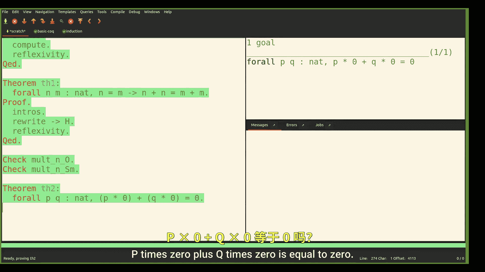

So what do we know we know from thista assumption of this Lamma multi to n0？😔。

That anything multiplied by zero is zero。So I want to somehow use that。First of all。

 I want to get rid of this for all and put them up there in the assumption so I do intros PNQ go up there。

Now， I say。I want to do a rewrite。But I want to rewrite using mot and0， right， so I say rewrite。

Based on molds and。What's going wrong。 Oh， I forgot the direction。O。And see what happened there。

 so it found p times 0， and in multi N0 it knew that p times 0 is 0。

So it puts zero for p times zero and now I can do the same thing， I can say do it again。

And it does it again， and now I have to just prove that zero plus zero is0 and I can just write reflectlexivity for this。

But reflexivity is smart， it does the computations。Cute。Okay。

Here's the next theorem that I want you to prove。I want you to prove that for all。😔。

Natural numbers N。It's impossible。That's n plus 1。Becomees 0。

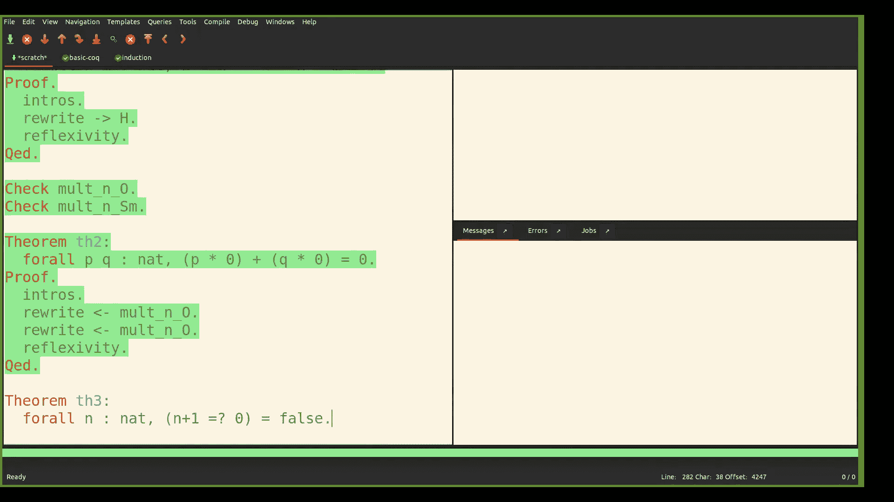

I want you to practice。

So again， as usual， we start with intros。So I want to ask you what happens if I do simple here。

 if I want to try to simplify， let's see。😔，Nothing happens， It cannot simplify it at all。

What happens if I say computes？你 for some reason先。😔，Okay。So if I do compute。

 it does a computation like this， but this is not useful for me at all。

 this is much harder to prove that because it's just putting the definition。And yeah。

 so compute is not good。What do you want to do here？So let's think of a non formal proof。

 let's think of a proof that you would give to another human， let's say that。

You want to prove that for any natural number n， it's impossible that n plus1 is 0。

 How would you prove that？No， again， you're using some sort of understanding of numbers。

 which is different from our definition。The only real definition that I have here。

A natural number is either O or it's s of n where n is an internationalternational number。

 that's all I know about my natural numbers。Thank。If， so instead of n plus1， I agree， we can put SFF。

没。But you want to say that it will never become oh。

 but I mean that's kind of obvious right so if you're S of N。It's not the same as all。

I said look at these thingss as grammars， right。嗯。Where was it。Here is the definition。

So if I want to say something is not all， it's enough to say that it's s of some n because these are the different cases that I had here and always different from S。

ok。So basically， what I would really like to do here is to do a casework on n。

 I want to say either n itself is O in which case n plus one is not O。Or n is some S of M prime。

 in which case， also the same thing。So and we know that for doing casework used the tactic destruct。

So I can write Destruct and I want to distract n， I want to do a case work on。Now， if I do this。

 you see that I will suddenly have two different goals。The first goal is where my n was 0 or0。

And the second goal is where it was of the form S of N。

But it doesn't change the name so I don't like that。I can say destruct N as。

And then I can give the names of the variables that are going to be used。So。

If I look again here at the definition。😔，Ppo it， Okay。

 so this is the inductive definition of the type light。

So it's either O or it's s of some new variable。So I can say destruct Ns and then O doesn't need any kind of parameter。

 but I can say call the parameter of the next constructor and prime。Okay。So this is now what I get。

 so basically I get n prime here instead of n。And additionally。😊。

If I want to also keep the relationship between n and N prime as an equation。

 I can do that too I can write something like this。

And it will add an equation E where it basically keeps the relationship between n and what I have here。

So my first case， when I'm distracting n is that n was0， n was0。ok。And this is what I have to prove。

 I have to prove that0 plus one is not equal to zero， basically。Yeah， let's just do compute。

And we do reflexivity， and that's it。So the other case。Is this。

 I want to show that S of n prime plus1。Is not equal to0。How do I do this？Here I can try to simplify。

And you see that as soon as I try to simplify， this is also giving me false on the left hand side。

 So now why is that it's because it computes S of N prime plus1。

And it sees that the pattern does not match。 it's like it's a pattern that starts with S here。

 this one is a pattern that starts with S。Whereas this one is just oh。

So the fact that the pattern does not match tells it that it's not equal。And that's it。

It just simplified。And we use reflexivity。Okay， again。

 very important that you have to understand Coke is very literal。

It just knows the definition that you have given us and it just uses that definition。Okay。

 let me do another you know。For all。Pulan values of B。

 I want to say that negativeg B of Neg B of b is equal equal to be。 So if I take the negation twice。

 I want to say that I get the same。Okay。So again， I first do intros。Yes， so if I just do compute。

 I get something like this。Which is not great because that's how nabi is defined。ok。

But we can do a case work on B， so I can say destruct B and let's say that I give the equation someday as well。

 I say equation is E。The first case is the case will be is true， and at this point I can do computes。

And then I can do reflexivity or I can just do reflexivity because it does compute itself。

And this is the second case I can do reflexivity here。So。As you're seeing here。

 we basically use intros， we use rewrite， and we also use destruct whenever we want to do a case for。

Okay。Let's do one more theorem。😔，Yeah。I want to say for all BNC。😔，En of B NC is end of C。对。

First of all， there is something interesting in the way I wrote this theorem。

So in all the previous theorems I always gave you the type of the variable that I was quantifying over。

 so I was saying for all B that is a Boolean and here I was saying for all N that is a actual number。

But here I'm just saying for all of BNC。Now， the reason for that is that。

The Coke is actually smart in this sense。And it knows that if I'm using and B on B and C。

 then B and C have to be bulloles。So I don't have to tell it that PNC are ruling of course I can。

 but I don't have to。Okay。How do you prove this？我难我就要佩死我。Okay， how do you do casework。

 What should I write。唔边超。Okay， so I do intro。I actually have to do intros to take post P and C， okay？

嗯你。Okay， so I say destruct B， and I'm going to give the equation the name equation of B。

So this is a casework on B。So the first one is the case where B is true。

 the second one is the case where B is false now I'm going to do no you cannot directly compute here so if you just compute。

 this is what you get。Yeah， but this is actually nice， look what happens when you do compute。😊。

So on the left hand side， you had true and C right， and when you do compute， you just get C。

Because that's the way that and was defined。But for C and true。

 when you do compute you get this you get if C then through elses No。

 it doesn't work at well so reflexivity only works when they are literally the same on both sides or they can be computed to be the same not in your mind。

 but for Cock， there are two different strings right if you think of them as strings。

 they're two different expressions basically。Okay， yes。

 so destruct C and now in this case we have reflexivity， yes， and again， reflexivity。And then again。

 thestruct C。Again， flexibilityivity。cheese。So here's the thing in cases where you have this when you're applying the same thing on both sides of the proof tree。

 you can just put a semicolon and。So you can write it like this， Destruct B， Destruct C。Relexivity。😔。

嗯。That's it。So what this says is that。It says destruct B first and then on all the sub goals。

 do destruct C。And then on all the sub goalss of there do reflexivity so that I don't have to write it so many times。

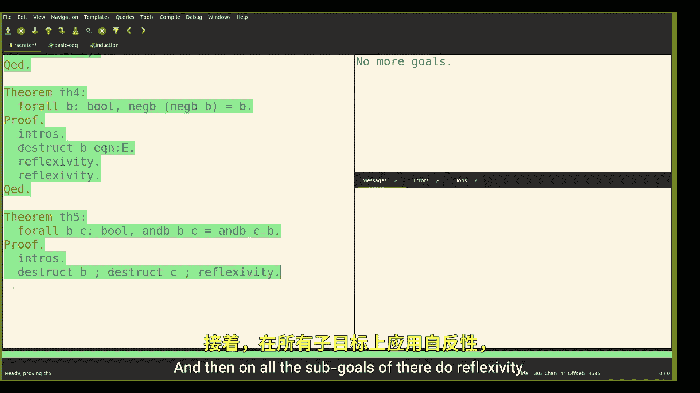

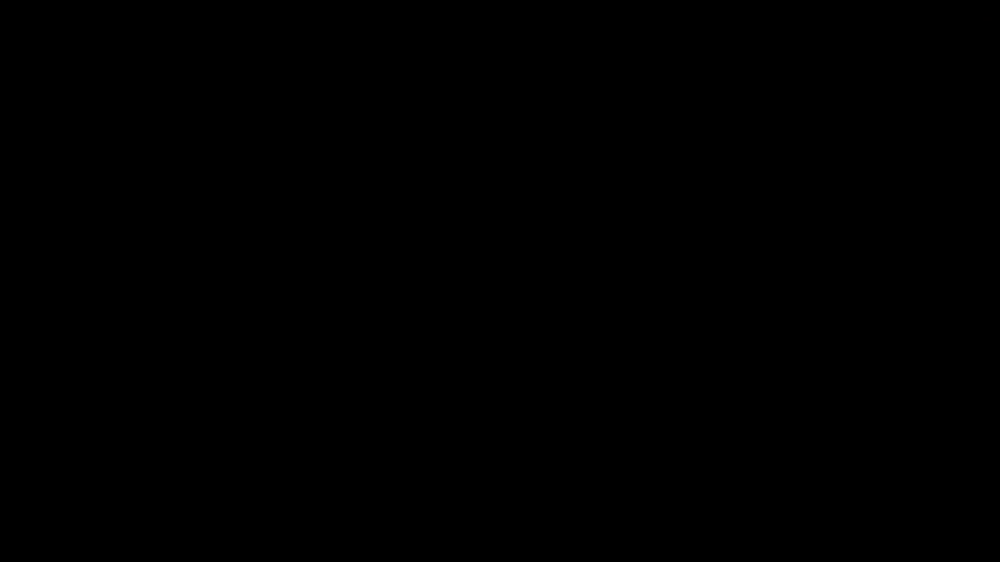

But now one thing that I want to show you here。Is。Well。We had this theorem， which basically said。

0 plus n is n。And it was quite easy to prove it right， so we had this theorem。

 we said for all n that is a natural number，0 plus n is equal to n and we had this simple group。Now。

 what happens？If I do this， if I say for all n that is a natural number， n plus zero is it？Okay。

 so again， as a human， you have a lot of intuition and you think that these are the same。

But these are not the same for Co。Okay， so let's see what happens if I do intro as before and then if I do compute。

This is what happens。And this is because of the way that plus was defined。

So plus does a pattern magic on the first argument。

So Coch knows that0 plus n is just n and can compute that， but n plus0。

 it does a pattern matching on n。And so if I do compute here， this is what I get。😊。

So I cannot just compute。How would you suggest we prove that n plus zero is？And you see for this。

 I have to actually let me abort this， by the way， another keyboard that shouldn't appear in your homeworks。

呃。Let's say I print x plus y。This basically tells me what it means when I say x plus one and it says that it's a fixed point function。

 it's called add。It has two parameters and andM。And this is how it works。

 it tries to match n and if n is0， it returns n。😊，Otherwise， if n is the successor of P。

 it returns the successor of n of P。Now you see that so if I have zero plus n and I do compute。

 I easily get n and I can easily prove this theorem。But if I have n plus zero and I do compute。😮。

I will have this case。

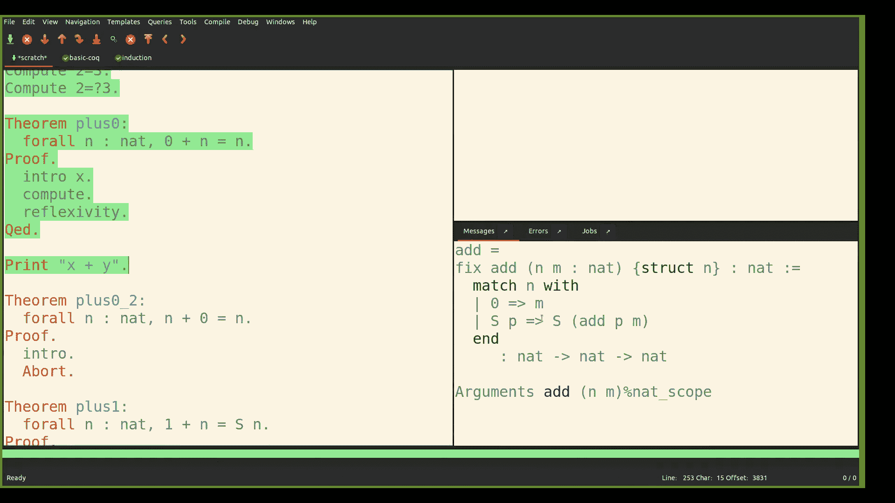

So that's not trivial at all。

So we're going to do inductive proofs。And we talked about the definition of addition。

 so if I do print x plus y。This is what I get， this is the library function that start to add。

And it basically takes two natural numbers as its parameters and it returns another natural number。

 so the type is this。Now， the way it's defined is that it first does a pattern matching on the first parameter。

And if the first parameter is zero， it returns the second parameter。

 otherwise it does this recursive thing where it says if the first parameter is the successor of P。

 first add p to the second parameter and then take the successor of the results。So as humans。

 we know that addition is commutative， but Coke doesn't know that。So。If I want to prove Ethereorem。

 I cannot just use my intuition and say that all addition is commutative。

So we will see that the order really matters the first theorem。

 which is something that we proved in the last session as well。Is that for every natural number n。

0 plus n is equal to n。Now this is kind of easy by just following this definition。

 my first parameter is zero。And in the definition of add。

 I'm going to do a pattern match on the first parameter and if it's zero。

 I'm just going to immediately return the second parameter。

So this is a case where I can actually easily compute the result of the addition。

So let's see the proof of this theorem。And we saw it in the last session as well。

 so of course you're first first going to do intros and now I have to prove that zero plus n is n。

But I can just do compute。And zero plus n is immediately computed as n。Because remember， again。

 this was。The definition of addition and if this first one is zero it immediately gives me the second one so I do compute and now the two sites are the same so I do reflexivity and end。

Okay。Now this was quite easy， what happens if I swap the positions？So this is my second theorem。

Which says for all M。Of course， I want my end to be a natural number。N plus0 is equal to n。

Now you see this is problematic。Because if I have n plus 00 is now my second parameter m here。

 and if I just want to use the definition of add to compute it， I will go into this recursive case。是。

Okay， so let's do it， let's do the compute and let's see what happens， so I want to prove this。

I first say do intros so that I don't have a quantifier there。And then I say， compute。

This is what it computes。It it's the result of this recursive function。

Now I can try to argue about this， but it's really hard。

 this is much more complicated than what I already had。So I probably don't want to do that。

So what would you suggest we do？Well， I can also try to do。Some simplification， let's say， so I do。

Simplification， again， it doesn't do anything。Because this is the second case of the definition of my Ed function。

 which was the recursive case， so Splified doesn't know how to simplify this。Okay。

What else can I do Well， I can say maybe let's do a casework on n let's destruct n because I know that n is a natural number。

 So it's either O， which was0 or it's the successor of some other number。

 So let's say I do destruct n and i'm going to。Dstruct it and called the new number N prime。

 And I'm going to say keep the equation。S一。Okay， so it disrupted it into two cases。

 the first case is when n is zero。And you're already seeing that this is kind of looking like inductive roofs。

So the first case is when n is zero and the second case is when n is not zero。

And the case where n is0 is easy， I just have to prove0 plus zero is0。And I can just compute it。

 or honestly I can just write reflexivity and reflexivity is smart enough to know that。

But now look at this。So I wanted to prove。N plus 0 is n。And now I've written it in this format。

So n is the next number， the successor of n prime。And so I have to prove that Sn prime plus0 is equal to Sn prime。

Okay， let's say I want to simplify this。This is how it simplifies it。

So it says because again this was the definition of add if I have the next number after n prime and I want to add it to zero。

 I first add n prime to zero and then I takes take the next number of that that's。

What I had written in my definition of ads， so when I say simplify， it does this。屋企。

So now what do I want to do？I want to say that n prime plus0 is equal to n prime。

So that I can do a rewrite。So that I can say， okay， instead of this n prime plus zero here。

 just put n prime and then I will have S of n prime on both sides。And I can say， okay， reflexivity。

Okay， but the problem is I don't have that， I don't have that n prime plus zero is n prime because that's。

Basically what I would need as an induction hypothesis。If I was doing an induction an N。

So at this point， I have to just say aboard， I cannot do this like that。

But I basically need to do an induction， so let's write this theorem again。So for all n。

 that is a natural number n plus0 equals n。And let's do a proof。So I'm first going to do intro。

Or intros。Okay， now I want to prove that n plus zero is equal to n and I say I want to prove it with the induction and。

How can I do this， I can just use。This comment， I can just write the tactic induction n。

 which means that I want to do an induction on n， so if I do induction n。

 it creates two goals for me。These are basically the goals that you would expect from induction。

 you have the base case of the induction。And then for the second one。

 you have to prove that if it holds for a smaller value， it will hold for this value as well。

But I like to also rename my variables when this happens， so I say do an induction on end。As and cry。

Now， what does it mean when I write it like this， so let's go back here。

And let's remember our definition of natural numbers， so this is how we defined our natural numbers。

😔，ok。So when I'm doing induction， I'm not really doing induction on natural numbers。

 that's not something that Coch understands。Whatco understands is structural induction。

The idea is that the vein this type nets was。Created was that either I had O and O is an element of typela。

Or I have an element that looks like this looks like S of n where n is itself an element of typex。

So when I'm doing induction。And something of this type of an element of type mat。

What Coke understands is that it tells me it's either this rule or it's this rule。

And you can do structural induction， you can assume that it holds for this internal。I am inter here。

But then you have to prove that it holds for the entire thing。Okay。

 so that's really how the induction is working it's not an induction on natural numbers in the way that you're used to it。

A structural induction， but I mean， in this case， it doesn't really matter if we're doing the same kind of induction anyway。

Okay。But here， when I say induction n as N prime， what I'm basically saying is that。

Look at the constructor for this type。It could either be O or it could be s of something else。

And call that something else and prime。So another way of looking at this is that the constructor of。

Typenet was either O or it was s of n prime right and i'm saying do an induction on n and consider these two cases。

 but I'm not going to put。The names of the constructors， I'm just going to put it like that。Okay。

And now I have two goals， the first goal is basically the base case of the induction and I can just do compute and then I can do reflexivity that's easy now look at my second goal。

This is much better。Because my second goal now。Also includes my induction hypothesis right。

 so it's saying that suppose N prime is an actual number。

And the induction hypothesis is that n prime plus zero is equal to n prime。

Now I have to prove this for S of N prime， I have to say S of n prime plus0 is equal to S of N prime。

Okay。Now， again， I can do a simplification on the left hand side because if I apply the rule in and。

I will get that s of n prime plus0 is S of n prime plus0。So I can do simplification and I get this。😊。

But look， I have this induction hypothesis here， which says m prime plus zero is just m prime。

So I can rewrite using my induction hypothesis， I can write my goal using this。

 so I say do a rewrite。I don't remember which direction， whatever， using this induction hypothesis。

 okay， I use the wrong direction。So let's rewrite in the other direction。

 so you can either replace n prime plus0 with n prime or you can replace n prime with n prime plus zero right so anyway。

I do the rewrite in the right direction and now all I have is that SF N prime is equal to SF N prime and this is just reflexivity。

Okay， and Qity。So we've now proven this year。Yeah。Okay。So let's now try something similar。

 but with subtraction。So let me show you how subtraction works。

So this is the definition of subtraction in the standard library。

There is a function called sub that takes two parameters that are both natural numbers。

 it does a pattern matching on the first parameter if it's zero， it returns n， if it's SK。

 it matches M and then again if it's zero it returns n。Okay。So this is the recursive definition。

Of subtraction Now this is the theorem that I want you to prove。

I want you to prove that for every n that is a natural number， n minus n is0。Okay。

 and this is using this definition of subtraction。Okay。

 I'm going to give you a few minutes to get to QED on this。

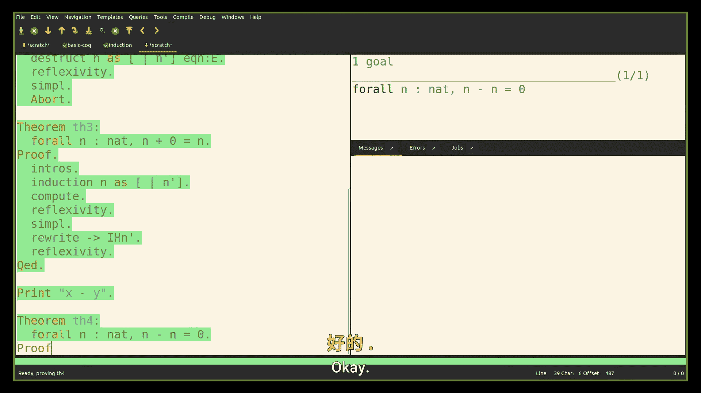

If you get it， you get the Q T， okay。Tell me what should I do。嗯什么。Okay， first we do intros。

 so now I have to just prove that n minus n is equal to zero and my only assumption is that n is a natural number。

What should they do？Okay， induction on。okay， and as before whenever I do induction。

 I like to rename my variable to end prime。Okay。And actually。

 I think I can even add the equation when I do induction now， apparently I can't okay。Okay。

 it's not like this drug， okay。So we have two cases。

We have the base case and then we have the inductive step。So how do you prove the base case？

Good breakfast。Yeah， can just do reflexivity because reflexivity also does compute。

 so it computes that zero minus zero is equal to zero， that's fine。Now we want to prove this one。

 our inductive hypothesis is that m prime minus n prime is zero。

 and then we want to prove the same thing for the successor of M。

So we want to prove that S of n prime minus S of n prime is0， so you say simplify， so we do simple。

 simplify。And here's the thing， why did this work， why does S of n prime minus S of n prime simplify to n prime minus M？

This is back in the definition of minus， look at this。So。This is the definition of subtraction。

 if n was s of k and M was s of L， then this would return subtraction of KN。Okay， so in this case。

Coming back to my proof。K and L are both n prime， so I have S of n prime minus S of n prime and by definition of subtraction that's equal to n prime minus n prime。

So that's why simplifyimpl works here。Okay， but now at this point， this is just my assumption。

Thank you。Yeah。ok。But instead of using assumption， actually， let me ask you this。

 so let's say I don't want to use assumption here。Let's say I don't have this tactic。

Can you solve this using rewrite？对。Yeah， so I can just do rewrite using IHn prime and I can do it in any direction。

 I can do rewrite in this direction and I get0 equals0。

I can do rewrite in this direction and I get n prime minus n prime is equal to itself in any case I can just use。

Reflxivity afterwards。And that's it。Assumption is kind of a special case oflyright。Okay。

So let me recall the definition of add， so this is how we added two numbers。

We do a pattern matching on the first number if it's zero， we just return the second number。

 otherwise if it's the successor of P， we first add p to the second number and then return its successor so this is how addition is defined。

Based on this， I want to。Prove this theorem。 So T H5。

Its this for all A and B that are natural numbers， I want to prove that a plus B is equal to B plus a。

So I want to improve commutivity。Okay。Try this， I'll give you several minutes。

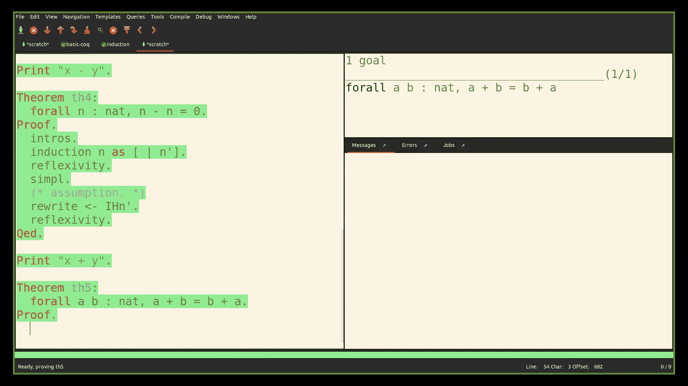

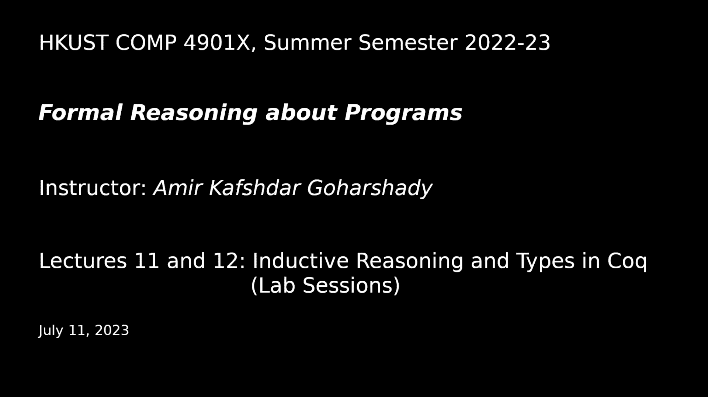

Let's do this a little bit。 Of course we first do intros so that。

Instead of having a quantifier here in the goal， I can just bring them into the assumptions。

Now I want to prove that a plus B is equal to B plus a。

It's almost impossible to do this without induction。So let's say we want to do induction。

Should I do induction on A or on B？Now， normally the rule is that we do induction on the same variable where in the definition。

 we have a pattern， I。And in the definition of a plus B， we have a pattern metric on a first。

But in this particular case， I have B plus a on the other side。

 so it doesn't really matter I can do induction on either A or B。So yeah。

 let's just say we do induction on A。So I do induction and A。And。I'm going to call it a prime。

This is our induction on a。So the base case is the case where。A is0。How do we solve the base case？ok。

First， I can try compute， but this is what happens if I do compute。So not a great idea。

Let's do simplification， let's see if we can simplify any site。And simplification works。

 but it only works for the left side。And we expected this because。Again。

 in the definition of addition， we have a pattern metric on the first parameter。

 so in this case when the first parameter is zero， simplification works very easy。

But now I have to basically prove that b is equal to b plus0。

But I've already had that right so this is like theorM3 p plus0 is equal to be I mean n plus0 is equal to n for any end so I can just say apply theorm3。

And。Okay。You see， it can't really apply it directly， it doesn't know how to apply it。😔。

So instead I do this， I say。Asert。B equals b plus 0。ok。If I do this， okay， actually I do this。

 I say a third b plus0 equals B because that's what I have in my theorem3 right n plus0 is equal to a。

So， I assert this。Which means that I have to first prove it and then I can use it as an assumption。

 so I want to prove that b plus zero is equal to B。I just say use theorem3。

 now I can say applying theorem3。Okay， and now b plus0 equals to b is in my list of assumptions。

But I want to prove that b is equal to b plus0， so what should I do？嗯，明白。Yes。Let's rewrite。My goal。

 using H。Now， again， I got the wrong direction， this happens to me all the time。

So I do this and now I have b equals B and I can just do refivity。

This was just the base case of the induction。Now。Fortunately， of course。

 Coch keeps track of everything， so it will not forget any part of the induction。

 Now you have to prove this。You have to prove that。If a prime plus b is equal to b plus a prime。

Then the successor of Aproum plus B is equal to B plus the successor of Aprom。ok。

So how do we prove this？Let's do a simplification first， right。

 let's see which site can be simplified。And the left side can be simplified。

So here what I have is that the successor of a prime plus B is equal to B。Plus。

 the successor of April。Okay。How can I use my induction hypothesis？明白。Yeah。

 so I have a prime plus B here。And I have it here too， so maybe I can rewrite it。

 maybe I can get B plus a prime instead。So after this simplification， I'm going to rewrite。

Using my induction hypothesis。😔，And if you don't give it a direction。

 it will just choose the default direction。 So now I have this。Now， I have。

That s of b plus a prime is equal to b plus s of a prime。

 and I need to prove this for every pair of numbers A and V。Okay。So basically， for any two numbers。

 I have to say S of a plus b is b plus okay。So what I'm going to do at this point is that I'm going to take this part and I'm going to just define a lemma which is only this part。

And I'm going to prove that La first， and then I can come back to the proof of this theorem and use that La。

几。😊，So just remember this format， I'm going to use the exact same format。

 I'm going to say I have a lemma。Let's call it level one， and this is my level。It's a。

For all A and B that are natural numbers。S of a plus B。Is equal to a plus S of E。Okay。

 and remember S was basically plus one， it was the success。Yeah。Okay。

Prove this one because if we prove this one then we can go back to our theorem and we can actually finish the proof of the theorem as well and actually for this one you will need to do another induction so that's the reason why I took it out as a lema because I didn't want to do an induction within an induction like。

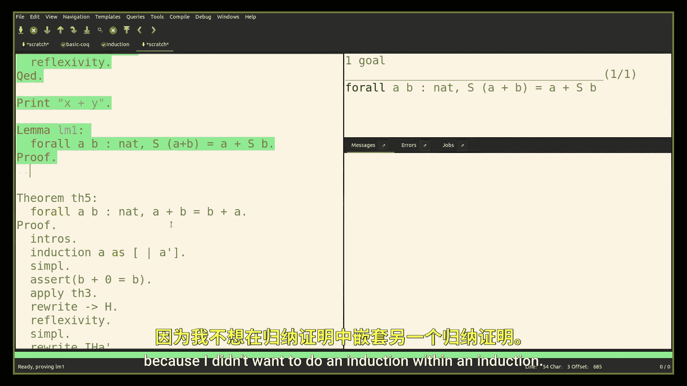

Coke supports that， but it gets very confusing。

Giving these steps。Yes， first we do intros。And now。We want to do an induction。

Now what which variable should we do the induction on so yes。

 but why is it a because you see on this side？I have a plus， but it's nested inside this S。

The only really unned plus that I have is on this site。

And I said that generally we do induction on the variable where we did pattern matching in the definition。

 so in the definition of plus I'm doing pattern matching on the first parameter。

So here I'm going to do induction on a。And again， I'm going to。Call it a prime。

I don't know what's happening here。Okay。So now I have two subcos。I have to first prove this one。

Right which is the base case of the induction when a is0。And then I have to prove the other side。

 so let's say if I can just compute in the base case and you see that when I do compute。

Or actually probably even if I do simplify， I get the same thing I just compute both sides。

And I get S of b equals S of B， which can be done by reflexivity。

Now I have to prove the inductive step。So this is my inductive step。

Successor of a prime plus B is a prime plus successor of B。

Now I want the successor of the successor of a prime plus B to be the successor of a prime plus the successor of B。

 so what would you do here？So what does simplifypl do before I do it？

It will apply to the right hand side here， right？Oh yes。

 yeah it applies to both sides you're right so see how it changes the right hand side。

So this was the successor of a prime plus something。

 now it becomes the successor of a prime plus that same thing。

And it was also applied to the left hand side， what do you want to rewrite？Yeah， so basically。

I want to say that the successor of this thing is equal to the successor of this one。

 but my induction hypothesis is that the first thing is equal to the second thing。

So if I just do rewrite， then I get the successor of the same thing on both sides。

So I can do rewrite， let's say， this direction。Of a induction hypothesis。Okay。😊，I know， as you see。

 both sides are the same。Could I do rewrite in the other direction， Yes。

 this would also give me the same thing almost。So after I have this， then I can say reflexive。

 and thislemma is proven so I put QE。So let's go back to Theorem five。There we did an induction。

 blah， blah， blah， we got to this point。So this is what we needed。

 we needed to say that s of b plus a prime is equal to b plus s of a prime。But I have this here。

 S of a plus b is equal to a plus S of b for every A and B。

 so it's just I have to replace B for a and I have to replace a prime for B。Okay。

 so I can just write apply level one。诶。It's actually。呃。Smart enough to know how to apply level1。

And how to do the replacements。ok。😊，But let me see。😔，Could I do it without apply。

 could I do this with rewrite？So again， I can do rewrite using Le one。

And I can also give it a direction。And again， it understands that Le1 is saying s of a plus B。

 so it understands that it has to put B in place of a and a prime place of Ps。

I did it in the wrong direction again， I always do it in the wrong direction。So after I do this。

 I can also have refivity here andcuity。Nice， so let me give you another theorem to prove this is our sixth theorem。

😔，I want to say for all N and M。N plus 0 plus 0 times M is equal to n times1。

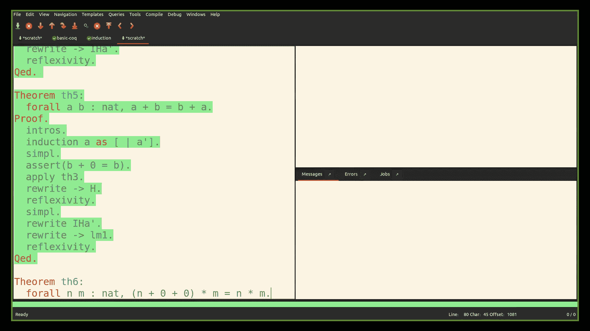

Can you approve this？

To actually prove this， you have to go back and you have to find the definition of times。

So here it is， cranes。Ex tos way。This is our multiplication function。

And this is the definition of the multiplication function。

And you see that the way multiplication is defined is again recursively it says。

Do a pattern matching on the first parameter n and if it's zero。

 the answer is zero because zero times everything is zero。

And if it's the successor of some other number P， then give me m plus p times M。Okay。

 that's how multiplication is defined now using this definition proved this theorem。

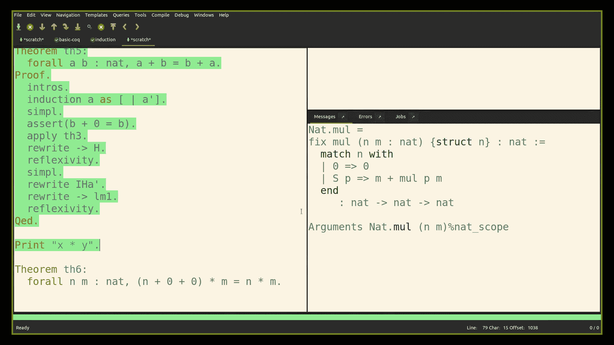

So what's the simplest way to prove this if you wanted to prove this to a human， what would you say？

Previous equalYeah， basically if we want to prove that n plus0 plus0 is equal to n so that we can do a rewrite and then we can get our main result。

So。We've talked about assert before， right， so let's actually refer to intros。

And I assert that n plus0 plus0 is equal to n， which means that I have to first prove this and then I can use it as one of my assumptions。

Okay， so I say a third n plus0 plus zero is equal to n， it says prove it to me。Okay。

 how would you prove that m plus0 plus0 is equal to n？

You just said that we apply one of the previous theorems， which one？This one， right？

Rm3 says that for every n n plus 0 is equal to n。 So what happens if I apply theorem 3 here？

Can I just write apply theorem3 no？Why not？Because you see， interiorim 3。I have n plus 0 equals n。

我们的是微O。We should rewrite how。shouldrite。Okay， so should I do another research？

A search n plus 0 equals n。 But for this one， can I apply theorem3 in yes。O。Now that I have this。

I can rewrite。RightBut I could do this without the insert。So already here。

 I could just say rewrite theorem3。Right because I have tiorem3 and I can do rewrite based on it and I think in this direction I always get the direction wrong。

I rewrite in this direction and it basically replaces n plus0 with it。So I get this。

And I can do it again， I can again rewrite using theorem3。I get n equals in。And at this point。

 I can finally just say this is。Relexivity。Okay， but could I do it without even the first assert so at this point already could I say rewrite。

Based on 03， yes。So The3 says that n plus zero is the same as n。

All I'm doing here is that I'm saying take n plus0 output n in its place based on tier 3。

And I'm going to do it again， so rewrite again based on theorem3 and finally I have reflexivity。

So in this case， I didn't really need to use another reduction。Let me give you something else。

 so let's say this is the7。😔，I want to have many numbers now。

 so I want to say for all NmpP andQ that are natural numbers。

N plus M plus P plus Q is equal to M plus N。Plus P plus Q。ok。😊。

Prove this so I'm basically only swapping the first part， so n plus M is becoming m plus M。

系屘用系到 previous嘅咯。Sure。How do you apply it？我。Maybe we firstOkay， first， we do intros。

 we always first do intros， okay。Then we assert。Yes， be assert this。

And then this was basically this previous theorem right， so it was theorem five。

So I can just say apply here and five。Okay， and now I can do rewrite。But instead of a and apply。

 I could also do it in one then。I could just use rewrite。Tum5。But you see， that doesn't work。

So here's the problem if I say rewrite using theorem5。

What does theorem5 say this is basically commutivity。It says that a plus B is the same as b plus a。

But if I say rewrite using Trm5， it doesn't know what kind of rewrite I really mean。Right， so。

I meant to say that apply it to this portion and this portion， but that's not what it does。

You see it actually appliess it to this plus here， for example。Right。

So that's the problem if you just use rewrite， you don't have much control。

 I mean you have control over the direction， you can give two different directions。

But in cases like this where you can do many different rewrites。

 you don't really get a good choice here。So instead。

 it's always better to just assert what you mean and then prove exactly what you mean。

 So you need n plus m equals。M plus N。You assert it， you apply  tier of5， you now have it。

Up here as an assumption age。And now you can say rewrite using H。And finally。

 the two sides are the same， so we do reflexivity and accurately。Okay。Okay。

Let me give you another theorem， this is theorem number eight。

 I want you to prove that for all NM andP。N plus m plus P is equal to n plus M plus P。😔。

So basically associivity。嗯嗯。I want you to prove this， prove that addition is associative。

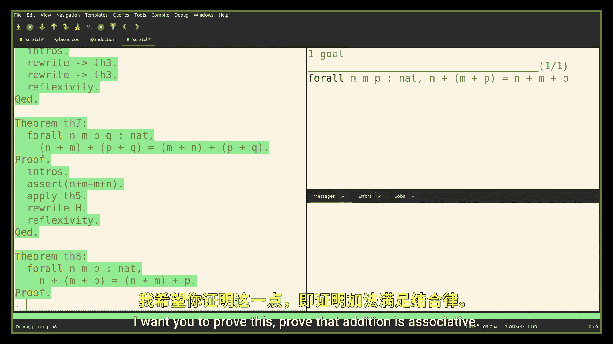

Okay， so as usual refer first to intros， of course。Since we have N on the left hand side。

 let's try to do induction on。So I say do an induction on N。😔，So。

How do you approve the induction base case Yes， let's just simplify and the two sides are the same so reflect。

Okay。How about this one？我度地震多。Okay， so let's simplify to see what we get。

We basically get that s of testing should be equal to S of testing。

 but these two things are equal according to our induction hypothesis。

 so I can just say rewrite my goal using my induction hypothesis。And as soon as I do this。

 the two sides are the same， so I say reflexivity。听不清。

So that's how we prove that we also have associivity for addition。Okay， let me give you another one。

For' all NMNP that are natural numbers。对。呃。We have n plus M plus P equals M plus N plus P。😔。

Can you prove this one and of course， I will start with intros。

So remember this theorem5 that we had here， which basically said that a plus b is equal to b plus a。

😔，Use that somehow。

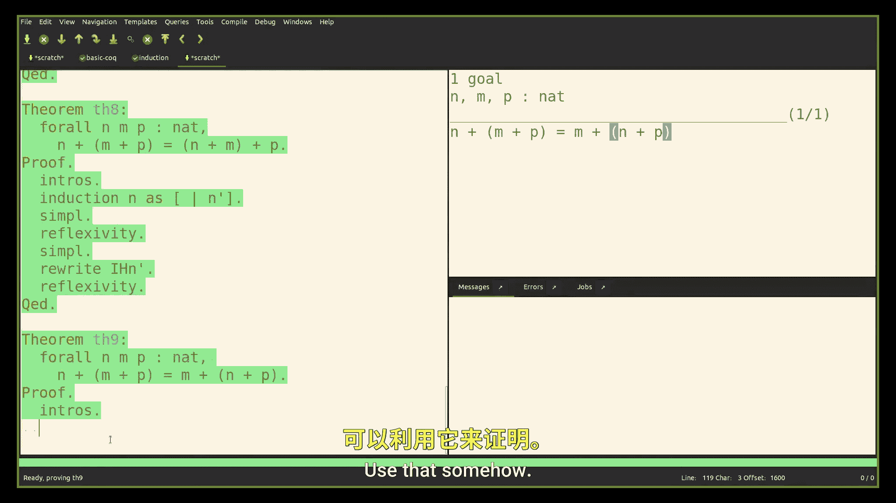

So what happens if I rewrite using theorem 5？This is what I get。

I get m plus p plus n equals m plus n plus B。So what if I rewrite using theorem 5 again。

 I get back to where I was， so it's not good to do it twice。

 but at least I did it once and it had some progress。😔，Yeah， at this point。

 we want to say that p plus n is equal to n plus p。So let's just assert it， assert。That's p plus n。

Is equal to N plus P。How do we prove this， this is again theorem5。Right， so apply ti in 5。Remember。

 Theorem 5 was this。😔，For every AMB， you can swap the order A plus b is equal to B plus a。

 it's commutative。Okay。Now I have this in my assumption that p plus n is equal to n plus v so I can rewrite using H。

I can also choose my direction， let's say I rewrite in this direction， it didn't work。

I rewrite in this direction， okay？And。This is what I get。

 I have to prove m plus p plus n equals m plus p plus n。

But the way the parentheses are put there are different on the two sides， not really。

 so what does this one mean？This is basically we're doing m plus P first and then we're doing plus n Yes exactly。

 so in theorem8 we said that the order doesn't matter。So I can just apply hereates。

But that doesn't work。Says I don't know how to apply a theramate。

And the problem here is that this theorem is like the wrong way around。AllRight， so instead。

 I have to do a rewrite using TrM8。😊，Adds。Now both sides are the same， so I can do reflexivity。Okay。

One last theorem and probably the hardest theorem that I want you to prove today。😔。

I want you to prove that for every M and N that natural numbers， m times n is equal to n times n。

So commutivity of multiplication。5。And of course we start with a， so approve this。

 you can also again check the way that multiplication was defined。😔。

So this is how multiplication must define。😔。

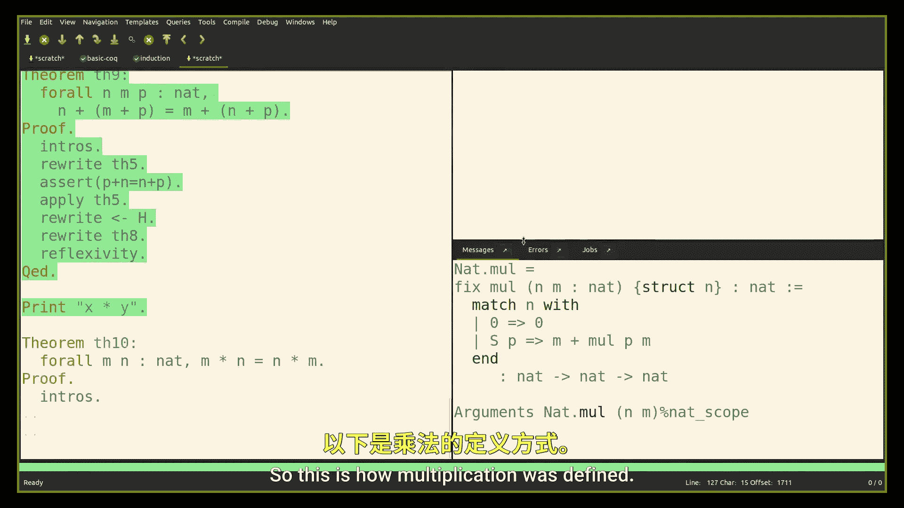

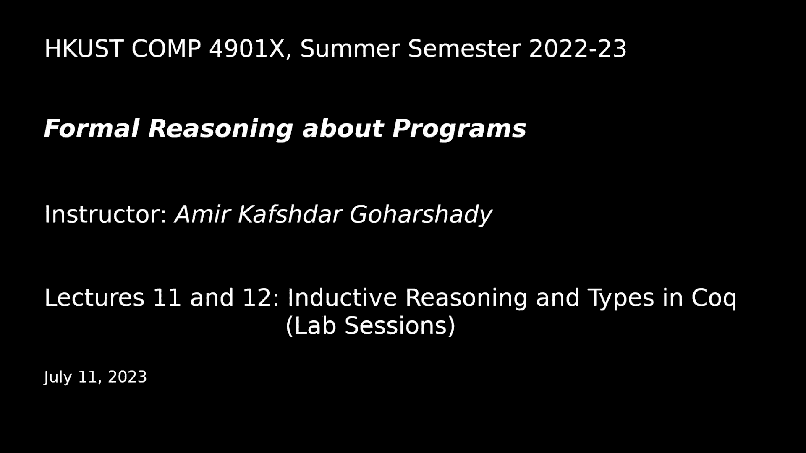

Okay， so let's do this。 let's say I want to do induction。And again， I have。

Kind of a mirror image jumble set I can do induction and either。

 let's say I do induction and this is the base case zero times n equals n times 0。

How can I solve this space case？谢谢。No， no， I just simplify and this is zero equals n times  zero and I had this。

Did I， Did I have it somewhere now。嗯。Should I do another induction， Okay， whatever Yeah。

 but let's just do it here， let's do an induction on N。

Just to prove that n times zero is equal to zero， so first we have to prove that zero is0 times0。

 I can do this with reflectivity。And。I know that zero is equal to n times 0。

 I want to prove that0 is equal to Sn times 0， so I just do a spl here。

And Sn times 0 becomes just n times 0。Because。S N times 0 is 0 plus N times 0， and。

It can also compute that at its entire zero。And this is just the assumption， right。

So I did an induction just to prove my first induction space case base case and now I'm out。Now。

 I have to prove this。I know that m times n is equal to n times m。

And I want to prove that if I take the successor of n times n。

 that's equal to n times the successor of n。So what would you do here？Can we do simplify， yes。Okay。

 this is what Simplified gives us。It says that n plus m times n is equal to n times the successor of。

Okay， but what end do know， I have my induction hypothesis so I can take this m times n here and I can replace it with n times M。

So let's say I do rewrite， hopefully I do it in the right direction this time。😔。

And I applied the infection hypothesis， okay。Now I have this。Okay。

Lbraries close to a definition order。Yes， but let's take this out and let's call it a level。

So I'm just going to have a lemma。😔，Llum 2， let's say La 2。

And this just says that for all M andN that our natural numbers， I have this。Okay， and for now。

 I just write admitted here， which means that I'm assuming this。

 I will come back can approve it later。Let's go all the way here。

So I have this and I can just apply that La if I had that limitma， so I can say apply La2。Andcut。

Okay， so basically what this shows is that I have a proof for tiorm 10 if I can find a proof for Lemo2。

Because I used Lemma 2 here in my proof of Torm 10 and the proof for Trm 10 went through。

So the only remaining part is to prove this sma。So。不是。How do you prove this la。

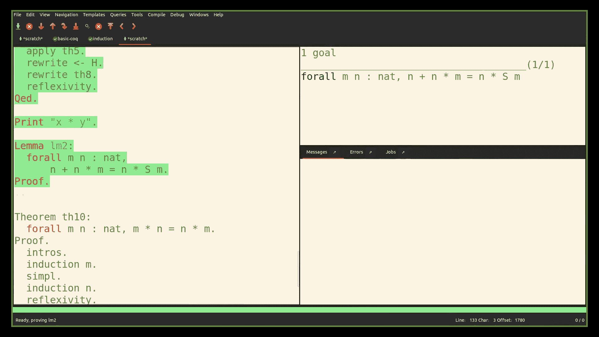

Of course， I start with intros。

Again， the problem here is that I have n times S of M if I had something like S of n times M。

 I could just apply the definition of times， but it doesn't work that way。

 so we have to again do an induction here。应该可以嗯。Okay， that's a good idea， let's do induction on N。

Okay， that's the base case， what do you do for this base case yeah。

The nice thing here is that we have zeros on the left hand side of all of our operators。

 so if I just call compute here， it can actually compute the result。

So let's say compute and great reflex。Okay。Now this is what I have， I have my induction hypothesis。

And this is what I have to prove。Okay， let's simplify first。Im mar right。有俾系叫我推快。

What kind of rewr do you want to do Oh okay， so you have n times Sm。

 you want to put this in its place， right？Okay， so let's say rewrite。Using IHN。This direction。😔。

I'm always bad with the direction of rewrite， I'd never get used to this。😔，Okay。

So this is what we have。We have that S。Of this expression。It's equal to S of this expression。

 but the two expressions are not the same。Yeah。Yes， so we have tier of nine。

 which says that we have we can basically reorder these things， we have associivity。

So let's say I do rewrite using Theorem9， What happens then？😔，No。

 because you cannot directly apply theorem 9。Because you see you have an S here。

And there is no SM No， no， you can just say rewrites using theM 9。Right。

 so it just takes this word and rewrites it using theorem9。

And now the two sides are basically the same， so now I can say this is refxivity。Thank you。

So this proves Lamma 2 and in tiorem 10， I just needed Lamma2 for everything to go through。

 so I've now proven tiorem10。

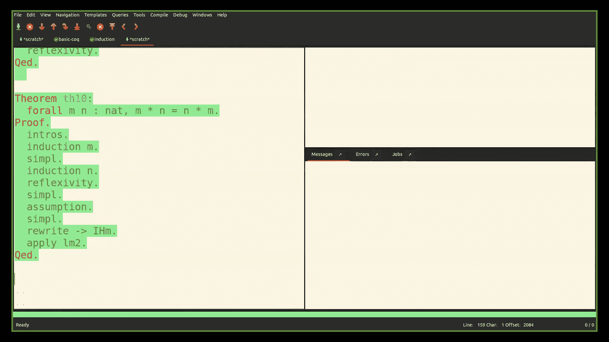

