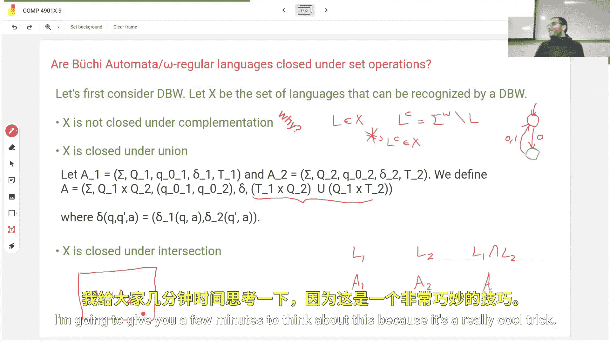
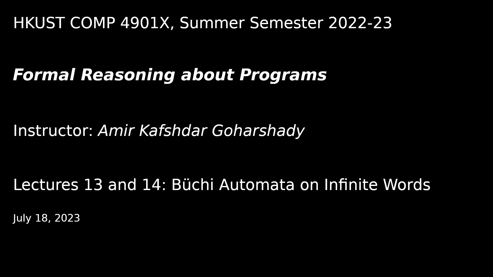
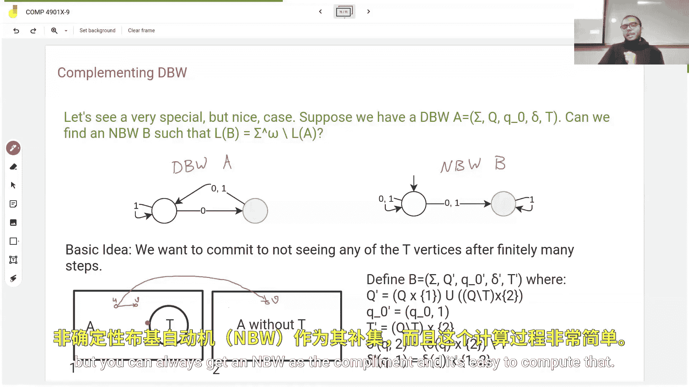
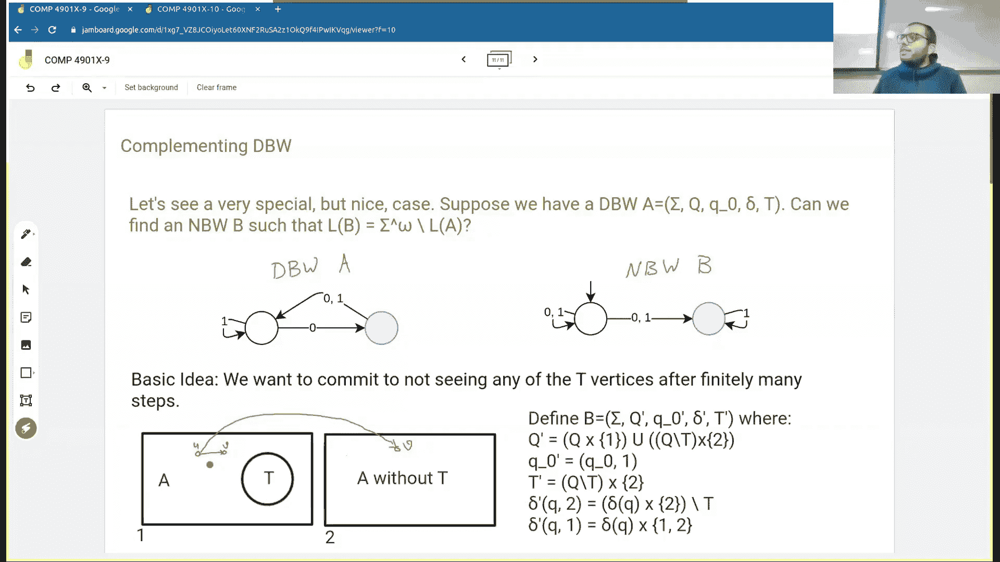
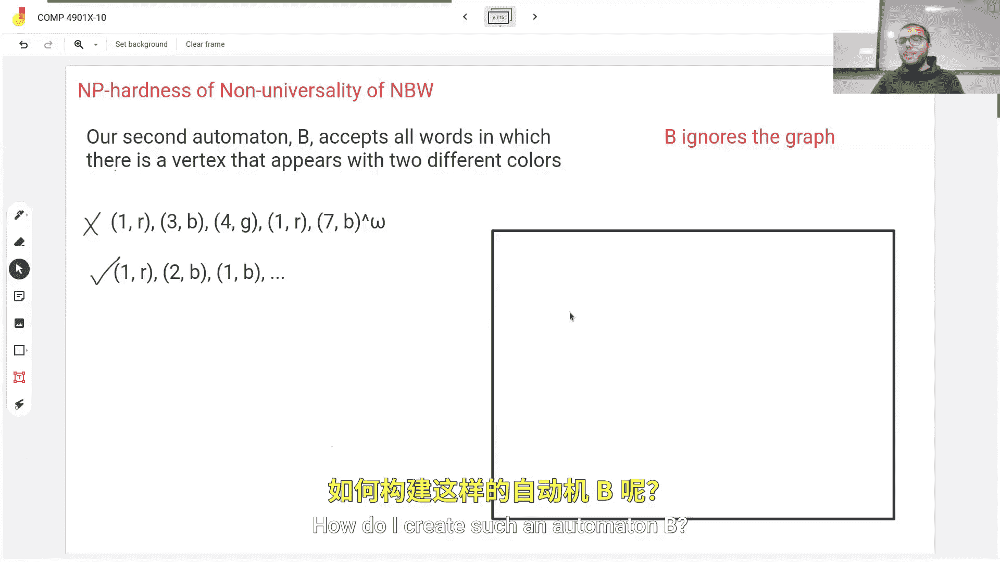
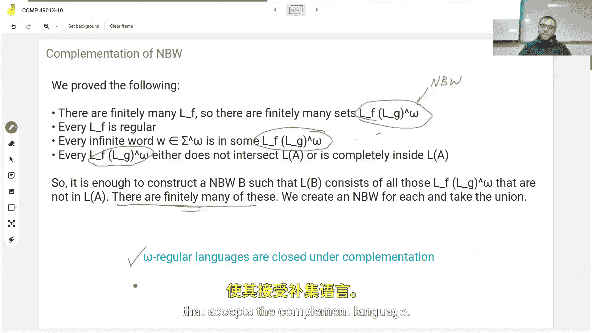
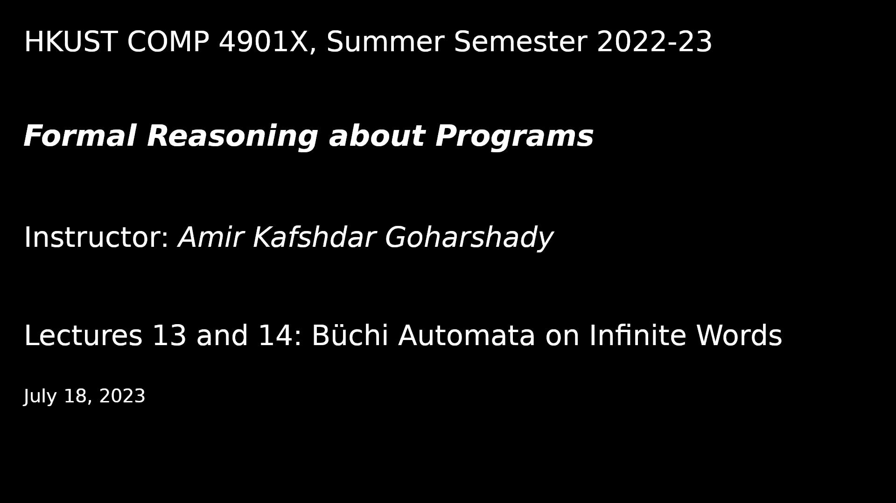

# 香港科技大学【中英⚡程序的形式化推理｜COMP4901X 2023 Formal Reasoning about Programs】 p08 p7 s 13 and 14 - Büchi Automata on Infinite Words -BV1roXTYaEmJ_p8-

Today we're going to talk about automata and infinite。

And this is basically an extension of what you've already seen about normal automata。

 so you've seen deterministic finite automota and non deterterministic finite automata probably I'm going to give you a very short refresher of that as well。

But what we're interested in are basically auto that work on infinite words。

So this is a continuation of what we were doing with the games。

 so if you remember how our games worked， every play of the game was an infinite pass on。

The game graph。so here I want to also have something similar， I want to have an automaton。

And then I want the input to this automaton to be an infiniteite fort。Okay。But before that。

 let's just recall the definitions of automota and finite words。So we said we know， I mean。

 I hope that you know from your previous courses that a deterministic finite automaton basically has。

These parts， and it looks kind of like this。So you have an alphabet which you use to basically write your words。

 so every element in this alphabet is called a letter。

You have a finite set of states in this case I have two states Q0 and Q1。

 you have an initial state which I always show it with Q0。

 so the automaton always starts at this initial state。

And then you have a transition function which basically tells you that if you're in a particular state and read the particular letter of the alphabet。

 which other state you're going to go to the way I show it on the graph is just by labels over the edges so what this means is that if I'm at Q0 and I read the letter1 I will go to Q1。

ok。And then I also have。S said T and I've named it T because I want you to really see the relationship between this and target vertices in games。

So we have a set T， which are the accepting states and I generally show them in blue。对。

So the way this works is that I start at the starting vertex at Q0， my initial vertex。

 and I just read my word letter by letter and every time that I read a letter I take the transition corresponding to that letter。

So for example， if。Let's say my word is 0，01，01， I start here。😔，I read the first zero and I do the。

Li to zero， which keeps me here， then I read the second zero， do the same transition。

 then I read one and go here， then I read zero and the transition for zero keeps me here and then again I read the last one which keeps me in Q1。

So for this particular word。I will end up at Q1 if I run my auto on， okay。

So now I want to say that this automaton is basically a decider。

 it either accepts a word or rejects it。And the way I do that is very simple。

 I say run the word if the run on this word ends。In an accepting state， then the word is accepted。

Otherwise， the word is rejected。Okay。So this gives me basically a set of words that are accepted by this automoton and we call that the language of the automaton so the language of this automaton is the set of all the possible words that are accepted by this autoton。

So。As an example， what is the language of this particular automaton here so what strings。

 what words are accepted by this automaton and remember our words are finite right now yeah so any word that has one in it will be accepted。

Because basically what this cell loop here does is that it ignores zeros。

So any number of zeros at the beginning of the word will just be ignored。

 I will stay in the same state。And then as soon as I read the one。

 I will go to the other state and then as soon as I've come to Q1。

 it doesn't matter what I read again， everything is ignored。

And I'm going to end up in Q1 and I'm going to get accepted so this automaton accepts all words that have at least one。

 one in the。Okay。Now， of course， what's interesting for us。Is to extend our。

Definition of automaton to have nondetermin termminx。

And we've talked about nondeterminism in the context of programs before in the context of automata it's actually very similar so very simply the idea is that。

Let's say I can have more than one starting state， let's say I can have a set of initial states and I can start from whichever I like。

And let's say that my transitions are also non deterterministic， for example， here。

From this state Q0， if I'm at this state and I read the letter one， I have a choice， I can go to Q1。

Or I can go to Q0 prime。Okay， this is what we call nondeterminism in anatmaal。

So if I want to give a more formal definition， the more formal definition is that again。

 it's an automaton is something that it's a tople that consists of all of these things。

But it has an alphabet， which is a finite set of letters， it has a finite set of states。Now。

 the thing that has changed， one thing that has changed is this one。

So instead of just having one initial state， I have a set of initial states。

And you can see it by these arrows here so here I'm saying that both Q1 and Q0 are initial states and then my transition function also changes so previously the transition function said if I know which state I'm in and what letter I'm reading the next state。

But here it says that given a state and the letter that you're reading。

 I'm going to give you a set of states and you can transition to any of them。ok。

So these are the two parts that have changed and again I give you an example here if I'm at Q0 and I read the letter one I can go to both of these places。

Similarly， if I'm at Q1 and I read the letter zero。

 I can take this transition and remaining Q1 or I can take this one and go to Q0 but now since we're introducing nondeterminism。

The result is that for a given word， I don't have a unique run， so in the deterministic case。

 if I gave you a particular word， you had only one run of the automaton。

But here for any word you can have many different runs right because you have choices right you have you have a choice of where to start and you also have a choice of which transitions to take sometimes so we have to again。

Eguage of the automaton and we have to say when the automaton accepts a particular word。

And this is the classical definition that we use。We say that a word is accepted if there is a run that accepts。

So the definition of accepting run is the same as before。

 a run is accepting if it ends at an accepting state。If it ends at one of these blue points。

But now I'm saying that for one particular input for one particular。And have many different runs。

 So I say this input is accepted。If there is at least one of these runs。😡。

That ends at an accepting state。Okay。😊，Another way of looking at this。

 another intuition for this would be that our automaton is somehow extremely smart and knows which run to take and always takes the run that accepts if it can。

ok。But anyway， this is the background that I expected you to have from。Theory of computation courses。

 probably。If you haven't seen these things before， just search on YouTube。

 there are a lot of really nice videos that explain DFA and NFA。

But we are actually interested in are automaton and infinite words。

 so I want to see what happens if I have an automaton and instead of giving it a finite input。

 I give it an infinite input。对。And this is actually also what we call omega automota and again if you've passed sit theory。

 this omega is like the smallest infinite ordial， it's the size of the that of natural numbers。

 but anyway whenever I say omega automota what I mean is that it's an automaton that is taking an infinite input。

Okay。So now what happens if I take the same two automoal as the previous slide？And I say。

 I want to give you an infinity impact。Now for this one， I will still have a unique run。Because。

It's well defined where I start and I have a unique starting point。And then at every step。

 I have a unique transition that I have to take。Okay， so I get a unique run。

 but this run is also infinite it's like an infinite task on the graph of this auto and what happens in this case is that I can actually have。

Many different runs， and this was the case before as well。

 I could have many different runs on the same input， even when the input was finite。

But now that the input is infinite， I can potentially have infinitely many different runs。

Because imagine that my word somehow gets to this point infinitely many times and each time I have a choice。

Of which transition to take so it's possible that I have an automaton and a particular infinite word。

And when I feed this infinite word to my autonotton I have infinitely many different runs and of course every run itself is infinite but fine we don't really have a problem with having many runs because we can use the same solution as before so before I said that a word is accepted。

If there is a run over that word that is accepted。So here I can use the same technique。

 I can say if I have many different runs or even infinitely many different runs。

And some particular word W prime。I say that W prime is accepted by my autotonnoton if there is at least one of the runs that is an accepting one。

But now the problem is how do you define an accepting one？That's a much more problematic situation。

 right because before we said that。Every run ends up at a particular vertex and then we said that this run is accepting if it ends at an accepting state。

But now I have infinite runs， my runs never terminate。So I don't have a last state。

 I cannot say I accept only if I end up at a particular place because I don't end up anywhere。

So what can I do I can basically have the same definitions as before these are the same definitions。

 it's just that the input is infinite， so I have a deterministic automaton and a non deterterministic automaton。

But I'm just going to say that I'm going to have an acceptance condition。嗯。

And the role of this acceptance condition is to tell me whether a particular run is an accepting run or not and as we saw。

 I cannot just say look at the last vertex because there is no last vertex Now one of the first things that come to mind is let's use reachability。

Let's say that my run is an accepting run if it reaches one of the accepting states。Okay。

But it turns out that's not very expressive if you use reachability as our acceptance condition。

 there are very few different languages that we can actually model with our automaton so it's not really interesting and if you think about it that makes sense because reachability is in a sense a finite property。

Right， but we want to talk about infinite runs。So intuitively。

 it's better if we can use something like bookie or parity。ok。So I can use the bookie condition。

 for example， and I can say， okay。In my automaton， I'm going to have some set of states。

 I'm calling them target states or accepting states or whatever， these are like the blue states。

And I say that a particular run is accepting if it visits the blue states infinitely many times。Okay。

 that would be book。Let me see if I have a slide for it， yes。😔，Okay。So in the booky automoton。

 I just say that I have a set T of accepting states and then a run accepting run。

 if it visits T infinitely many times， so if the set of vertices that are seen infinitely many times in this run intersects T。

Okay。😊，And again， if I have an undeterranistic automaton， I say that a word。

 an infinite word is accepted by the automaton if there is at least one accepting run on that particular report。

Okay。Now for parity I can do something similar today we're not going to talk too much about parity。

 but I'm just going to define it anyway。So it's just like the game。

I'm going to assign a priority to every state of my automaton。And then if I have an infinite run。

I can check the parity of the run。Which is like the smallest priority that was seen infinitely many times。

And I can say this run is accepting if the smallest infinitely seen priority is even。Otherwise。

 this one is reject。ok。😊，So I can have auto with bookie conditions or with parity conditions and I can also have deterministic or non deterministic variants of positiveta。

ok。😊，So。The notation that we usually use is that we write DbW for deterministic bookki automaton。

They chose W because A was already taken for the finite autonomata。

So it's the deterministic bookie O， and I don't know why。

And we also write like NBW for non deterterministic booky automaton， and then for parity。

 it's just DPW and NW。O。Let's do some examples。So let's say that I'm just working with bookie Automotool。

Youag all of these automota or bookki automota。I want you to tell me what the languages of each of these automata are。

 so what are the set of infinite strings that each one of these automata accepts？

So let's start with this one， what words are accepted by this auto？哦 no好我。嗯。嗯hm。😊，no。

 so a word is accepted if I see the accepting state infinitely many times because it's a booky。

 right？An infinite number of ones， yeah， that's I think the correct answer， let's see。So。😊。

Let's get some intuition， what does this transition here do。

 it basically says you can ignore a bunch of zeros。So you start here。

 you ignore a bunch of zeros until you read a one and you go here。

And then when you read a one and go to the accepting state on the right。

 no matter what you read afterwards， you're going back here。And then again， you're ignoring zeros。

Until you see another one。Anそ。So the only case where you will actually visit here infinitely many times is if your string has infinitely many ones。

Because every time that you come to the right state， in the next step。

 you are pushed back to the left set and you can come back only if you read of one。Okay。So。

I proved that if a string is accepted by this automaton， then that string has infinitely many ones。

But let's prove the other side， let's prove that if a string has infinitely many ones。

 it will be accepted。So if my string has infinitely many ones。I don't care about the zeros。

 I eventually reach one of these ones and go here。And then I might waste one of my ones going back。

 but it doesn't matter because I have infinitely many of them。

And I can again find the next one and go back right。

So this shows that if I have infinitely many ones， it will accept。

This autotton basically accepts all the strings that have infinitely many ones in。Nice。

 how about this one？Second one。if if we reach a copy then and then we receive zero。

 we remaining in a copy right No， okay， so when whenever we don't have a transition。

 what that means is that if we read is zero here， we're going to reject。Okay， and。

The explanation for that is that like you can imagine that you have a trap and if you read a zero。

 you go to that trap and you will always remain in that trap。Okay。

But I usually don't draw these traps I just if you don't have a transition with a zero。

 it means that if you're here and you read a zero， you reject。I don't know。

 I think we I should have continued once after， but I don't know。对。Yeah， so you're correct actually。

 so let's do this， let's then change my color。So I start here， what does this edge do。

 it just ignores a bunch of zeros and ones。So I can ignore a finite prefix of my string。

 whatever it is using this edge， again， this is just intuition。But then at some point。

 I have to decide to go to the right。Okay， and by the way。

 this is a non deterterministic automaton because you can see that with zero and1。

 I can remain here or I can go to the right。But when I decide to go to the right。😮。

As soon as I make that decision， I have to only see one after that。Because after that decision。

 if I see a zero， I will get rejected。哎， this is。Are rejecting states basically。So this means that。

My string， my input string should have ones at some point and then everywhere after that point。

 so there should be a point after which I only have ones。This is like Kobuki。

 it's like Kobuki of one in a sense。Okay， so。Yeah， this is嗯。Basically my assumption。

 I'm assuming that the set of strings that are accepted here。Is this。

 I have a bunch of zeros and ones， but finitely many of them。And this is followed by Yvan。

For infinitely many times。And this is how I write it as a regular expression。Okay。Now again。

 why does this work？So first of all。If I have a string that is accepted here。

 it means that I had an accepting run。And the only way I can have an accepting run is to go right and then remain there。

 which means that I had ones at some point and at all times after that point。On the other hand。

 if I give you a string that is like this。That has ones at some point and after that there is a run that accepts that string and that's the run that goes to the right just at the right time。

Just when we are sure that。There are going to be only ones afterwards。

 so it ignores all the zeros here。And then as soon as we run out of zeros， it goes to the right。ok。

Nice， how about this one？Its。WithAll the number of one。嗯。What do you mean。An infinite number of ones。

 so you say this is the same as the first one。哦。系啲两个要我到时俾啲点出嚟你咪啲睇。你等话玩 p。Oh， how to express that。

In orderCan you speak up， I can hear。Yeah， okay， so let's consider two cases。

 either my string has a finite number of ones or an infinite number of ones。

If it has an infinite number of ones， it will definitely be accepted。Right。

 because I can just take these forever。But if it has a finite number of ones。

It should have an odd number of ones。Because the first time I read the one I go to the right。

 the next time I read the one I go back to the left and so on， so if I have finitely many ones。

I have to make sure that I end up on the right so that I stay there forever and then I。Get accepted。

And the only way for that is to have an odd number of funds。

 this automatton accepts all those strings that either have an odd number of funds or an infinite number of funds。

Now what's really interesting here is that just how expressive we are。

Like this is a very strange kind of language， but we could express it with just two states in our automata。

And we will see later that these autoat are extremely expressive。

 like there are so many different properties that you can write as an autono。😊，Okay。

 how about this one here？What is the set of inputs that are accepted by this amount？通。

不是 can能 say en one zero cares。Infinite 1，0 pairs。 Okay right after such pair。Okay。

 what you're saying is correct， but can you say it in a simpler way。

 so what does it mean for a string to have infinitely many1 zeros？

It means it has infinitely many ones and infinitely many zeros。

Right these two things are the same because if you look at your string you have a bunch of zeros then a bunch of ones then a bunch of zeros and so on and if you switch from one to zero infinitely many times that's the same as saying I have infinitely many ones and infinitely many zeros okay so our guess here。

Is that。This automotton is going to accept any stream that has both infinitely many ones and infinitely many zeros。

Why is that？So let's say I have a string that has infinitely many ones and infinitely many zeros。

I start here。I take this zero until I reach a one and then I take this one。And then again。

 I take this one until I reaches zero and I then take this one， I reach my target。

I take this one back， I'm here now I just continue the same strategy。

So I will see the target infinitely many times。But this was assuming that I have infinitely many ones and infinitely many zeros。

But now let's say that I have only finitely many onces。😡，So every time that I reach my target。

 I'm using at least one of these ones。Right。And then I'm kicked back to the initial state。

So if I have finitely many ones， it's impossible to reach this target infinitely many times。

I can say the same thing for zeros。Every time I reach this target。

 I'm using at least one of my zeros， so I need infiniteim。So yeah。

This one accepts the set of all strings that have both infinitely many ones and infinitely many zeros。

Okay。Oh what this one？所不是。嗯。Is it。Why do you think it's the same because I mean it looks different right before we if we were here and read of one we would go back to the left。

 but now we are seeing case all the images going in that target is one。Yes。

I think it is even simpler than the first one。Well， I mean they both have the same number of states。

 so I don't think it's simpler， but yes it accepts the same language， that's true。Okay。

So the reason I included this is to just show you that for the same language we can have many different automota and even we can have different minimal automota。

 so I have two automota for the same language。And they both have only two states。

 and I guess it's easy to prove that you cannot have an autoton with one state for this language。

 right？Because an autonotton with one state either accepts everything or rejects everything。Okay， so。

Yeah， automota are not unique， so the same language can have many different automata and they're not unique even if we say we want a minimum。

Okay。Now。One theorem that's。You've probably seen about finite automatized that。

Deterministic and non deterterministic finiteized automota have the same expressive power。

Which means that if you have a language that has a non deterterministic finite automaton。

 that language also has a deterministic finite。Okay。Now， again， if you want to approve of this。

 just Google it or search on YouTube。It's a very classical result。

 you just have to do subset construction and the DFA is actually going to be much larger than the NFA but it doesn't matter what matters is that if you have an NFA and nondeterminmistic finite automaton for a language you also have a DFA。

Now。I want to say that this is not the case。For booky auto。So I want to say that there are languages。

That can be captured by non deterterministic bookotmaton。

 but they cannot be captured by deterministic bookot。Okay。Let's look at this settlement。

It accepts all the words that have finitely many zeros。

Or basically all the words that are just one from some point onwards。Right beside here as well。

This is the same。So basically what this automaton does is that it ignores some prefix and then at some point it chooses to go right and if it goes right it has to only see one from that point onward。

So it accepts if you have only finitely many zeros。Okay。Now my question is。

 can you find it deterministic？Wookki and that accepts the same language。Okay。

 so this is an undeterministic autoatton because of course。

Like if I'm here and I read either zero and one， I can either stay or go to the right。

 so I have an undermin on there。But can I have a deterministic automaton that accepts the same language？

why do you say yes。嗯那边没得。The next zero to stay in the。

And你 no target no one transition target嗯能 stay one whatever。Try it。

 try to draw it and see if it works。😔，哦 my god。嗯。Okay， so intuitively。

 the answer is no and it's no because。If you look at the runs of this automaton。These runs。

The only one that is really an accepting run or okay， not the only one， but okay。

 the runs that are accepting here are the runs that know when to go right。

Right and they go right only after having seen。All the zeros。

But in order to be sure that you've seen all the zeros。

 you have to somehow know something about the future。You have to know that。

What I've read until this point contained all the zeros and I'm not going to see any zeros in the future。

But you cannot do that in a deterministicton。Because the deterministic O only knows what happened in the past。

And it doesn't have the option of branching and saying， oh， maybe I do this or do that。

It has to make a deterministic choice based on what has happened in the past。So intuitively。

We think the answer is not。But intuition is not good enough for us， let's say if were mathematicians。

 we want to prove this。So approve。That there is no deterministic booky autominton that would accept the same language。

Actually， let me give you the proof。So the proof here is actually very similar to what we call pumping glmma or non deterterministic automata。

 let me add a slide here and let me just。T this。Okay。

 let's say that I want to have proof by contradiction。Okay， it's really hard to write by hand here。😔。

So let's assume that there is a deterranistic booky automaton that accepts this language。

 so what is my language， my language。Is basically this it's01 star followed by 1 omega。

So it's the set of all strings that have finitely many zeros。几。Set off all strings。

With finitely many zeros。Okay。Now let's just assume。That there is。

And now there is a deterministic booky automaton that accepts it。

 and let me give this language a name， let's call it L。So assume。A。Is it deterministic？uki automoton。

Such that the language of a is n， so it accepts exactly these strings。

Now every automaton has a finite number of states。Okay， so I'm just going to give it a name。

Let's end。Be the number of states。In a and I know that of course， this is finite。

Because remember when we were defining our autota， the number of states was always finite。

 whats infinite is the inputs。And the runs and so on so， but the number of states is fine。O。So。

Now I want to consider。Some words。And the first word I'm going to consider is the word that just has vs。

佢。😊，So。Consider this word。It's an infinite word and it only has one。

So my autoatton A should accept this word。But this is a booky automaton。

 which means that the run on this word。Had to reach。Some accepting states。

 and it had to reach accepting states infinitely many times。Okay。Great。Now。

 the other point I want to make here is that I can really talk about theran on this word instead of Iran because I'm talking about the deterministic automota。

So on every word， I have exactly one run。ok。So let's say that I take the run on this automaton and I just write。

The states that I reach at every point， so I start at Q0， then I go to Q1， Q2， so on。At some point。

 I'm going to reach an accepting state。So let's call that Q。嗯I okay。So QI is an accepting state。

 this is the first accepting state that I reached。And I reached this after reading I1s basically now。

I say instead of this string， which was one all the way。

 consider this string that is one until position I。

And then it's a zero at position i+1 and then again once after that。

This string also has finitely many zeros， it has only one zero。So this string is also accepted。

Which means that there is another index somewhere here， let's call it。QI prime。

Where this entire string has reached to an accepting state。

Because this string is accepted it reaches infinitely many accepting states。

 I just take the first one I call that QI。And again， remember。

 whatever I don't write here is just one to。Okay， now I can do the same thing。I can say， actually。

Let me change the names instead of I and I Prime， let's say this is Qi1。And this is QI too。Okay。

So I do the same thing， I know that if I start from here and I run this string。

I will reach an accepting state here， so I do the same thing let's copy this。

But then instead of just putting vs after this， I put is zero and then I put all ones。Again。

 this third string has to be accepted。So this third string has to reach an accepting state after QI2 because it has to reach infinitely many accepting states。

 so I take the first accepting state and I call that QI3。And I just continue this。

 again create another string that is the same as the previous one except that it has a zero here。

 and then it has one afterwards。And I find QI for。ok。Now I do this。

Until I find n plus one such accepting states。So I continue。Until I find Q IM plus one。

So I create m plus one of these strings and for each one of them I find the first place where it's。

Okay， now here's the thing。My automaton A had only n states in it。

But here I have n+1 accepting states。Which means that at least two of them should be the same state。

Okay， so。Just as an example， let's say that QIN plus1 is the same state as QI2。

I don't really care which two are the same， what I care about is that there are two states that are the same。

ok。But if this is the case， if these two accepting states are the same。It means that I started。

With this string and I got to this QI too。Right。And this was an。Prefix。

 I don't care about a finite prefix， but anyway， with a finite prefix， I got to QI too。

And then from QI2， I could run this string。And I could get back to QI2。😮，To the same place。Okay。

So let's call this prefix P and let's call this part here which cycles from QI2 to itself。

Let's call it R。Okay， now consider this string p omega。

 which means that I first do P and then I just keep repeating R。ok。What happens here？Well。😡。

P gets me to QI2。😡，And then every time that I'm repeating R， I'm going from QI2 back to itself。

So I'm going to seek QI too infinitely many times。So this string has to be accepted by a。

But the problem is that between each one of these accepting states， I had added zero。

So there is at least one0 in R。😡，So this shrink has infinitely many zeros。

So a is accepting a string that has infinitely many zeros。

So that is a contradiction with the definition of a because a was supposed to accept only strings that had finitely reez。

And this contradiction shows that there is no such automoton age。

You cannot have an automaton A if you want it to be， of course， a deterministic bookie automaton。

 you cannot have a deterministic bookie automaton A。

That accepts the same language as this non deterministic。对。Great。

 so the really important point here and this is something that you have to remember。

 you don't have to remember all of this proof。😊，But what you have to remember。

Is that non deterterministic bookuie automatons are strictly more expressive than deter deterministic bookuieotta。

And why is it strict because of course， if you have a deterministic cookieiootmaton。

 it's also a non deterterministic wiootmoton， so whatever you can get with DBW。

 you can also get it with MBW。But I just gave you an example of an MBW that models a language that no DbW can。

Okay。And also we have the definition of regular languages basically。In the finite case。

 we say that the language is regular if there is a non netterministic finite automaton that excs it。

In the infinite case， we say a language is mega regular if there is a non deterterministic booky account and that accept。

But it's really important that here we distinguish between NvW and DbW and the definition of regular is using Nvw。

 so we' are always。By default allowing nondeterminism。

So the next thing that you've probably again seen about finite automota is that if you have a finite automaton that accepts a language L1。

And another automaton that accepts L2。There is also an automaton that accepts L1 complement。

 L1 intersection with L2， L1 union， L2 and so on。So the question is， can we do these set operations？

On our book you。So first， let's consider the case of deterministic Fuotto。So let's say that X。

Is the set of all languages that can be recognized by a deterministic bookyot？Okay。

 so x is a set of languages， I put a language in x if I have a DbW for that language。Now。First。

 I claim that x is not closed under complement。I cannot say that whenever a language L is in x。

 L complement is also in x。Why。If it is accepted the in the in the language that is。嗯。

So basically what I'm saying is this if the language L is in x。

I can have another language L compliment。Which is basically the set of all possible strings。

Sigma Oomega， this is the set of all infinite strings， minus l， so everything that is not in there。

What I'm saying is that if L is in x。I cannot necessarily。嗯。Say that L complement is also in。

This is not always the case Sure， what is the counterism Yes exactly so。

We know that the language of this automaton。Cannot be shown by a DbW， but what was this language。

 this was the language of all strings that have finitely many zeros。Okay。What is the complement。

 the complement is the set of all strings that have infinitely many zeros。

But you can have a DbW for the set of strings that have infinitely many zeros。Right。Okay。

 let me do that。I can just say。I have an initial state。And if I read the zero。

 I go to this accepting state， let's say this is accepting and use。Blue for accepting。And from here。

 no matter what I read， I go back。This is a deterministic automaton and it accepts all the strings that have infinitely many zeros。

But we know that the complement language cannot be recognized by the terrorististiciootomminton。

 so this means that。X， so the set of languages that are recognizable by DbW use is not closed under complement。

Okay。But let's do the positive things now。So。I claim that X is closed under union。

Which means that if you have two different automata。

 let's say you have an automaton that accepts the language L1 and another one that accepts L2。

 there is another automaton that accepts L1 union L2。对。Can you approve that？

Think it is in L1 union after the should be L one by all assumption should。Sure。

 but you have to create the autoton。Right， so let's say I give you。

Let's say I have this language L1 and I have an automaton A1 that accepts L1。

And I have a language L2 and an auto on a2 that accepts it。So I give you A1 and A2。

 can you give me an automaton that accepts L1 union N2 and we are talking about deterterministic automaton。

Okay， let me ask you the same thing for non deterministic autottamoto first。

So for non deterministic auto。Let's say that。Okay， first of all， for non deterterministic automoton。

 they're also closed under complement， but for now you have to just believe me on that。

 but they're also closed under union。So if I have a language L1 that is recognized by nondeterministic automoton A1。

another language L2 that is recognized by A2。How do you create an automaton that accepts L1 union L2？

Yeah， so I have these two automas， just put them together。

And then for the starting states say that I can start in A1 or I can start in A2。

Right and then let the ondeminism take care of everything。That's all we do here。

So let me see what I have written here， yeah。So let's say that this was my automoton A1。

 it had the set of states Q1， it had like initial states Q01 and so on。I just define the automaton a。

For the union。To be an automaton that has the union of the states and I'm assuming that these states are destroyed。

 so there is no state that is in both of the automata okay。

So I just take a copy of each of these automata and then for my starting point。

 I say you can start in automaton number one or you can start in automoton number two。

 it's a non deterterministic choice。Right and everything else is the same。

 like the accepting states and the transitions， everything remain the same。Right。

So basically this accepts the union because if a string is in the union language。

 then it's either in L1 or in L2。If it's in L1。I can start my automaton in A1 my run of the automaton in A1。

 and then there is a run in A1 that accepts if it's in L2， there is a run in A2 that accepts。So。

Taking union is really easy if you havet nonterminism。But let's go back。

 what if you don't have non termss？So let's talk about deterterministic bookki automota and again I have a similar situation。

 I have a1 that accepts L1， a2 that accepts L2 and I want to create a new automoton A that accepts the union language。

How would you do this？It a beach。6。Right， and then what do you do with it？Ro。That。Yes。Great。Okay。

So basically， what we're going to do is that we're going to take the product。

So I'm going to create a new automaton。Which has。A new state for every possible pair of states in the first autoant and the second auto。

And then this new automaton is going to basically simulate both of the original automata at the same time。

ok。😊，So。I'm going to start at the starting state of both of them。And every time I'm going to say。

 okay， if reading a particular letter， the first automaton is going to state， let's say Q1。

 and the second one is going to Q2， I go to the pair state Q1 Q2。ok。😊。

So this is basically an automaton that is simulating both of the original automota A1 and A2 at the same time。

Okay， by taking the product and just。Again， the。The transition function is also like the product。

 so the transition functions says that。If in the first automaton from the state queue。

 reading the letter A， you would go to another state。Let's call it， I don't know Alpha。

And then if in the second Otamaton reading from the state Q prime reading a。

 you were supposed to go to a state beta。Then in this new automaton A from the state QQ prime。

 because every state is a pair of states reading A， you're going to this pair of states alphabet。

Okay。😊，Again， this is nothing hard at all， I'm just simulating the two automatas at the same time。

Okay。Now， when should I accept， I should accept if either one of my original automotas that I'm simulating are going to accept。

So I should accept if I see T1， the set of accepting states in the first automaton infinitely many times。

Or if I see T2， the set of accepting states in the second one， infinite gra。And again。

 whenever I see T1， whenever I see an accepting state of the first oant。

 I don't care where my second account is。So my accepting states are T1 times all the states in Q2。

And then also Q1， which is like all the states in the first automaton times the accepting states in the second atton。

嗯。Yeah。So this is the same intuition he said， which is like we have a matrix and。

If a row is accepting or a column is accepting， everything you need is accepting。ok。Do intersection。

哦，你知。How do we do intersection， Why is it easy， it's not easy。Can I just change the foundation to P1。

用 tq啊放打嘅 q q 嗯 no哦 no。Yeah， so if I want to take the intersection。

 I cannot just say that I change my accepting states to t1 times t2。

Because T1 times T2 is telling you that you have to visit T1 and T2 at the same time。

Right but when I'm taking the intersection， I want to say that I want to visit T1 infinitely many times。

 and I also want to visit T2 infinitely many times。

But they don't necessarily have to be at the same time。

 maybe in every odd step I see T1 and in every event step I see T2。嗯。So。Yeah。

The same kind of idea works in the sense that well intuitively we understand that we have to simulate both of the autota。

Right， so I'm going to take the product of。Yeah， so。

Let me actually have some way of showing the product at on， so let's say I show it with a1 times a2。

 this is the product account。Okay。And I'm not talking about any of the accepting states here。

 I'm just talking about the transitions and so on。I have this product at hometon。😮。

And when I wanted to do union。I could say， okay， if a1 accepts。Wherever that a1 accepts is accepting。

 So if a1 accept， then this entire。Row is accepting and if a2 accepted here。

 then this entire column is accepting so I could for union easily define。My accepting states。

But for intersection， I can't do that。So tell me what I should do for intersection。So again。

 I want to simulate both A1 and A2。But I want a run to be accepting if it sees both T1 and T2 infinitely many times。

Previous， I just wanted to say if it ceased either T1 or T2 infinitely many times and that was easy。

 but now I need to see both of them infinitely many times。

And I can't just take the product because I might not want to see them at the same time。O。

 you want to。No， no。No。That would not work either。嗯。专持我。嗯。

So the problem here is that instead of just having one bookie condition。

 I basically have two bookie conditions， right？So I have a set T1 and a set T2。

 and I want to see both of them infinitely many times。But in the definition of cookieie auto autota。

 I can have only one bookie condition， I can have only one set that should be seen infinitefinly many times。

I'm going to give you a few minutes to think about this because it's a really cool treat。😊。

Let me give you a hint。If I want to see both T1 and T2 infinitely many times。

I can alternate between them。I can say first I want to CT1 and as soon as I CT1， I can say， okay。

 now my goal is to only CT2。And then as soon as I see T2， I say now my goal is to CT T1 and so on。

Since I'm seeing all of them， both of them infinitely many times。

 I can also imagine that I'm alternating。Right， but not to the starting states。

Because if you connect it to the starting state， you get something that wasn't a run in the original ones。

But you're right， so whenever I get to an accepting state。Of one of them。

 I have to somehow switch to the other。Okay， here's another question， let's say that I take。

A1 times the a2， the product autoton here。And then let's say that I say my accepting states T。

Are just anything that is an accepting state in A1， so it's T1 times Q2。

 so anything in a2 I don't care what's happening in A2。I only the accept。If it's accepting N1。

So this looks like a useless automoton。But actually， you can use it as a gadget in your solution。

So this is an automaton that is simulating A2。But it's ignoring the simulation， right。

 so it's accepting only based on A1。So it accepts the same language as a。

But with the side the effect that it's also simulating nature。ok。

So let's say that I take a copy of this。And I do the opposite there。

 so I take another product automaton。And in this one， I say that's my accepting states。

A Q1 times T 2。对。So this one is simulating a1， but ignoring the simulation and just accepting based on a2。

Right？Now。Why did I create this two automata？Because they have the same state space。

And since they have the same state space， I might be able to somehow connect them together。

So how would you suggest I connect these two auto？So this one accepts the language of A1， L1。

This one accepts N2。How do you connect them so that you accept L1 intersect？嗯。

The idea of alternation was that。I start in L1。And if I get to an accepting state in L1。

I say let's switch to L2。So I take all the outgoing edges of this accepting state in L1。

And if they were going to some vertex in L1， I just connect them to the corresponding vertex in L2。

So I say as soon as you get to an accepting state here， the next step is going to go to end2。

And I'm going to do the same thing， I'm going to say in N2， if you get to an accepting state。

 the next state is definitely going to be in L。对。No。What this makes sure is that。

If I want to see the accepting states in L2 infinitely many times。

I will also be forced to see the accepting states in L1 infinitely many times sorry I shouldn't have said L1 and L2 because those are languages。

 but anyway， so if I want to see the accepting states on the right hand side infinitely many times。

The only way to do that is to also see the accepting states on the left hand side infinitefinly many times。

Because every time that I see an accepting state on the right hand side。

 I'm forced to go back to the left hand side。And the only way I can come back is to see an accepting state。

Yeah， so this basically gives us the intersection。Because now I'm forced to see the accepting states on both sides infinitely many times。

Let's write this formally， let's write what our graph is， let's what our automatton is。

 so it's going to have the same alphabet as the original automata。And instead of Q1 and Q2。

My state state is my state space is going to be Q1 times Q2 times1 and two because I have two copies。

Right or instead of one and two， I can write left and right。对。These are my states。ok。Now。

What is my transition function Sigma？ok。Sigma is like this。

 let's say I'm at the state Q1 Q2 on the left hand side。几。

I just do a simulation and let's say I've read the letter A。ok。😊，So there are two cases。

 either Q1 was an accepting state， in which case I have to go to the right hand side。

Or it was not an accepting state， in which case I just continue my simulation。So this is going to be。

Delta， sorry， this is going to be。Built of v。Of Q1， delta 2 of Q2。

 and remain on the left side if Q1 is not in t1。Yeah。

RightSo if I'm on the left hand side and I have not reached a target of my first automaton。

I'm just going to simulate both of and just continue。But the other case。

Is that this Q1 is actually in T1。And if that's the case， then I'm going to continue my simulation。

 but I'm going to now switch to the right hand side。And this is。If Q1 is in T。

So you see I'm just doing my simulation， it's just that I have two copies。And in the left copy。

 whenever I reach a target of my first automaton， I switch to the right copy in the right copy。

 whenever I reach a target of the second automaton， I switch back to the left copy。Okay。

And I can write the same thing for R， right？If I'm on the right hand side and I read the letter A。

 I'm going to just simulate it。And I'm going to stay in the right hand side as long as I'm not。

In the targets。And if I am in a target and on the right hand side。

Then I'm going to go to the left hand side。唔将声设出。😔，Okay， these are my transitions。Again。

 this might look very complicated， but it's really not that complicated it's just that I have。

Two products each product is simulating both of the original automaton and I'm just saying that in the first one I'm looking at the targets in the first automaton and whenever I reach a target in the first automaton I switch to the right hand side and then in the second one in the right hand side I do the opposite whenever I reach a target of the second automaton I go back and left。

ok。Finally， what should be my target set in this entire automaton that consists of both of these products？

It's enough to say that I want to see the target set on the right infinitely many times。

Right so I can just say this is T2， but I want it on the right， so it's like Q1 times T2。Ts are。

That's my target set。So my target sets are all the vertices on the right hand side。

In which the second automaton that is being simulated is in a target。Okay。

 and why is that enough because we we already saw that if we see these things infinitely many times we have to see the targets on the left for the first automaton infinitely many times all of these were about deterterministic bookki automaton。

 so we saw that。DBWs are not closed under Comp， but they're closed under union and intersection。

And intersection was a bit harder than union。Now， what about non deterterministic Oomo？

So for non thatranuki automoton， first of all， just believe me for now that they're closed under complement。

 just trust me。They're closed under union I already gave you the proof of this。

 it's actually easier you don't even have to take the product when you have nonedeterism。

 you just say take a copy of each of the automata and then say that I either start in the first automaton or in the second。

Okay。They're also closed on their intersection。Why are they closed after their intersection？Well。

This same thing works。It's just that our products are also going to be non deterministic。😔，ok。So。

You see in some sense， non deterterministic bookotmoon。Kind of nicer to work with。😔。

RightBecause we can complement them， we can take unions， we can take intersections。

And they're more expressive as well。So we want to focus mostly on non deterterministic Pokeote。

But before doing that， one last thing that I want to say， so complement is hard。

And we will hopefully see one algorithm for complement and that's actually the contribution of booky and that's why his name is all over the place。

 but it's not an optimal algorithm and we have much better algorithms we're not going to see the better algorithms in this course we know that we can do complement for MBW use but it's hard。

We know that we cannot do complement for DbWs at all。But one nice question that is actually easy。

 suppose that I give you a DBW， so I give you a deterministic cookie automaton。

And I ask you to complement it， but the compliment automaton that you give me can be non deteristic。

ok。So given an input DbW output an NVW that excs the complement language。Let's talk about this。

 this is actually easy， let's look at this very special case。What's the language of this automaton？

We solved this before。Yeah。Yes， so it's the set of strings that have infinitely many zeros。

And this one is the set of strings that have finitely many zeros。Right。And。

We've already seen that we cannot do this as a DbW， but it's an NBW， so this is my original DBWA。

And this is my MBWB。And the language of B is the complement of the language of A。Okay。

But how do I actually find B given a？So here's the thing in A。😊，What was the intuition here。

 I was saying that I'm going to ignore。A prefix of one。And then whenever I'm seeing a zero。

 I'm going to reach my target。And then I lose one letter。

 I don't care about that one letter that I lose， but again， whenever I see zero again。

 I will come back to the target。So when I want to complement it。In a sense。

 what I want to do is that I want to make a commitment and the commitment is going to be that I'm not going to see zeros from this point onwards。

And that's what this automotum does， so it says do whatever you want for a finite prefix I don't care。

But at some point， you have to take this edge and this edge is a commitment edge。

And what that means is that you're committing that after you take this edge。

 you're not going to see any zeros anymore。几。😊，And remember zero corresponded to an accepting state here。

So essentially， what I'm saying is that at some point I'm committing that I'm not seeing any accepting states of the original auto。

Okay。😊，So let's take this and let's actually。Extend it to the general case。

 So let's say I have my automaton a and this was a deterministic O automaton。

And it has a set of accepting states。Now I want its compliments。In the original automaton。😮。

Something is accepted， Iran is accepted if it visits T infinitely many times。

So in the complement automaton， I want to commit at some point。😮，To never c ever again。😡，几。😊。

So I'm going to use the same idea as before， I'm just going to take two copies。

The first one is just my automaton A， the second one is my automaton A except that I have removed all the vertic int。

ok。😊，And from every vertex here that had some transition。

Let's say I have vertex U here that had a transition to V。

I'm going to add another transition that goes to the。Same vertex v， but in the second copy。ok。

So I can go from the first copy to the second copy， but I can never come back。

And whenever I'm in the second copy， it's impossible to see T anymore。

 because I've deleted all the vertices in T from the second。Okay。

So basically whenever I take an edge from the first copy to the second copy。

 I am committing that I am no longer going to see a target in T from now on。Okay。

 that's how I'm doing the commitments。Okay。So basically。

This means that Iran is going to get to the second part。

Only if it visits T finitely many times and not infinite many times。So next。

 what I'm going to do is that I'm going to say everything in this second part。

 this is my target Zena。So my goal is to get to the second part and just remain in the second part forever。

佢。😊，This gives me the complement auto。And it's just a matter of following the definitions。

Because basically in the original automaton， in order to get accepted。

 Iran had to visit T infinitely many times in this complement automaton that I created here。

 in order to get accepted， Iran has to commit at some point after a finite prefix to never see T。

hi is of course， the complement of seeing T infin types。Okay。Yeah。So yeah。

 that's it for this session， we saw that if you have a DbW。

It's possible that you cannot complement it and get another DbW。

But you can always get an NBW as the complement and it's easy to compute that。

Was the definitions of automoal and infinite words。

 we especially saw deterministic and non deterministic puki and parity automota。

And we also said that we say language is omega regular if there is a nondeterministic bookiootmaton that recognizes that language。

And then we talked about whether these languages are closed under set operations。

So for the deterministic case for DBWs， we saw that they are closed on their union and intersection but not under complement。

 so it's possible that you cannot take the complement of a DBW as another DW。

So we also saw that nondeterminism really matters and NBWs are strictly more expressive than DBWs。

And finally， we saw that the languages of these MWs are closed under union and intersection。

I also promised you that they're closed under implementation， hopefully。

Either today or in the next session， we will see why。Okay。

But let's talk about complement a little bit more。The last thing I showed you in the last session was how to take the complement of a DBW to get an NBW。

Right。The fundamental intuition that you have to understand here is why this doesn't work if our original automaton is non deterterministic。

So if my original automaton a is。An NVW and non deterterministic Poki automaton。

Why can't I just apply the same kind of argument where I take two copies of a and I just delete T the set of targets vertices in one of them and then。

I do this， I say that from。Each vertex， you can either have the transition that you already had in a or you can transition to the new copy and that transition is the same as committing that you will never see。

Okay， so intuitively， it seems this should work even if I have non determinism in my original age。

But it doesn't， why doesn't it work？

对。

So here's the thing when the。Or original。Automoton A was deterministic。For every word。

 we had exactly one run。But that's the definition of determinism。So I could say that。

That one run has to eventually go to the second part， and that's what I did here。

So I set my new target set to be everything that is in the second part。Right。

So what I was saying before was that， okay， you have a single run and that run has to come here in order to get accepted。

And any run that would stay in a would not be accepted。Okay可。But now if a is non deterministic。

 the problem is that I can have many different runs in a over the same word。

Right and if I have many different runs。Some of them might go to the right hand side。

And commits to never seeing teaga。But that's not enough。Right。

Because even if I have one run that goes to the right hand side I never see tea。

This construction is going to accept it。But on the other hand。

 even if I have just one run that stays in a and Ct infinitely many times， a is going to accept that。

It's possible that on the same word， I have both of these runs。

I have a run that just remains in a forever and Cs T forever。

 and I have another run that goes to the right hand side and never comes back。

Because of them ontermins。And that basically means that this construction will not work if I have an undeterministic a。

It goes back to the fact that okay， another way of looking at this is。

Suppose I have a word that is accepted by a。It means that there was one run in A that was accepted over this word。

So if I want to compute the complement of a， I have to make sure that none of the runs over this word are accepted。

So previously since I had just one run， I could just make sure that that one run is not accepted anymore。

 but here I cannot do it because I have many different runs。Okay。

But let's get back to the main point of this session。Yeah。

So we're going to talk about several classical problems。And we're going to talk over Bki Automo。

So the first problem is emptiness。So I give you an automaton and I ask you。

 is the language of this automaton empty， does this automaton reject everything or does it accept something？

That's emptiness。The duall of emptiness is universality， so I give you an automaton and I ask you。

 does this automaton accept everything？Or is there a string that is not accepted by this account？

Then we have complement， which is actually。The main problem that we want to talk about。

So I give you an automaton A。And it can be deterministic or nondeterministic， I don't care。

I want you to find another automaton B such that the language of B is the complement of the language of A。

This is the main problem as we have to solve。And finally， we have containment。

And containment is easy， it's like I give you two different automata A and B and I ask you。

 is the language of a a subset of the language of B？Okay。So。

Can you tell me how I can solve containment if I have solutions for the previous three problems？

So what does it mean for the language of A？To be a subset of the language of B。嗯。

This happens if and only if the language of a has no intersection with the complement of the language of B。

But that's the language of P complement， if I can compute B complement。Okay， so this should be empty。

So basically， if I can do complement first。And then I can do intersection and then emptiness。

 I can answer containment。Okay， I already know that I can do intersection we've seen how to do intersection so we can do intersection。

But if I want to answer whether the language of a is a subset of the language of B。

 I first compute B complement and then take its intersection with a and then I ask an emptiness question I。

Is this automatton accepting anything at all？Okay。So basically I'm going to put a check mark here。

 I'm going to say we solve containment because if we have the solutions for the rest of them。

 then containment is also。But now let's actually talk about emptiness universality。

 and then if we had time about complement。So emptiness， I give you。

At deterterministic or non deterterministic O automaton， and I ask you。

 is the language of this automaton empty？Or another way of looking at it is to look at the opposite question。

 is the language of this automoton non empty？Does this automaton accept something？

Okay how can you answer that？So for this automaton to accept something。

 let's say I want to say that there is a word W that is accepted by this automaton。

For this automatton to accept W。There should be an accepting run of the automatton over W。

And an accepting run is a run that visits。My target at T infinitely many times。

So it has to visit the accepting states， the blue states infinitely many times。

So basically my question is。Let's look at this automoton as a graph。

Is there a pass in this graph starting from one of the initial vertices that sees these other vertices。

 these blue vertices infinitely many times？Do I have a pass in my graph that starts at the initial vertices and visits T infinitely many times？

How can I answer that， well， I can just think of it as a game。Right， so look at this same graph。

 let's say this is a bookookie game。And the objective of player one is to visit the blue states infinitely many times。

And let's say that all of the vertices belong to player one。So。It's like a one player game。

 it's a special case of the two player games and graphs that we've seen before。

Where all vertices are controlled by player one， so player one can do whatever he wishes。

And the question is， can he visit target states infinitely many times？

This is a special case of a bookie game， it's actually a single player bookie game and we've seen that we can solve bookie games in polynomial time we had both ONM and ON squared algorithms for that。

So this shows us that emptiness of an automaton can be checked in polynomial time。

It's just asking for vning sets in a bookki。Okay， nice。

Can we do better than this can we have a better runtime than n squared？So here's the thing。

 let's say that I have an infinite path。That sees my target vertices infinitely many times first of all。

 I have a finite number of target vertices。RightSo there should be one particular target vertex that is seen infinitely many times。

But if a particular target vertex is seen infinitely many times。

 it means that I'm going through cycles that start and end at this same vertex。

And every time I might go through a different cycle， but I don't have to。

 I can just take a single cycle。So in other words， I can guarantee that I will see my target vertices infinitely many times。

If I can find a cycle that contains one of my target vertices。

 and then I'll just go to that cycle and cycle around。Right。So what are the conditions that I need。

 well the first condition is that I need there to be a cycle。

The second condition is that I want that cycle to contain one of the blue vertices。And finally。

 I want that cycle to be reachable because I have to be able to reach it from my initial states if I cannot reach it。

 it's a useless cycle。Right。So if I find a cycle like that， I'm happy。Now， in order to do that。

 I can just look at my strongly connected components。给。😊，So I take my graph。

 the graph of my automaton。And I look at it decomposition into a strongly connected components。

 So let's say these are my strongly connected components。 This is strongly connected component one。

Two， three， and let's say four。And then I have some edges between some of these as well。Okay。Now。😡。

First of all， I remove all parts of the graph that are not reachable from the initial states。

How can I do that easy， I just do a DFs from my initial states。

 I remove everything that is not reach。Then I find my strongly connected components in the reachable graph。

 so now here I'm sure that everything is reachable from my initial state。

So now the only question I have to answer is， is there a cycle？That contains a blue vertex。没有。

That's the same as saying， is there a strongly connected component that has a blue verex because if？

If one of these strongly connected components has a blue vertex in it。

I can just go there to this blue vertex and then from this blue vertex I can just remain in the same strongly connected component and go back to itself。

 but there is just one corner case and that's that it should be a non transitional strongly connected component。

So it should be a strongly connected component， which has at least two vertices。I have。呃。A bad case。

 which is this， let's say I just have one vertex。And's its own strongly connected component。

 I can enter it， I cannot remain， I have to pass。Okay， other than this case。

 if I have a strongly connected component with one vertex that has an edge to itself。

 or if I have a strongly connected component with more than one vertex， I'm happy。

Because I just find this vertex and then I just go around in this strongly connected component and I come back to this vertex and I just keep cycling。

ok。How much time do I need to do this， well， I need to do a DFS first to find all the reachable states that's linear time n plus m。

Then I need to find the strongly connected components， hopefully you've seen this in 3711。

 there is an algorithm of Tn which actually also uses DFS to find strongly connected components that's also linear time。

And then finally， I have to just go over my strongly connected components and see if they're non transitional and if they have a blue vertex in there。

So linear time of。Okay， great， so emptiness of deterministic and non deterterministic muchomaton can both be checked in all n plus M。

Where n is the number of vertices and M is the number of edges。Okay。

So you might think that since emptiness is easy。Then universality should also be easy。

Because if you think about it here， I was asking。Does this automaton reject everything or is there something that is accepted？

Right。Whereas in universality， I'm asking the opposite question， I'm asking。

 does this automaton accept everything or is there something that is rejected？

But actually universality is much harder。So first， let's talk about the deterministic case。Okay。

So let's say I have a deterministic book automaton A， and it has N states。

And I want to figure out if the language of a。I's the set of all infinite strings。

 I want to figure out if my automaton accepts everything。ok。

So let's just go over this definition several times and we will eventually get to an answer。

 so if the language of a is everything， it means that every infinite word w is accepted。But。

If every word W is accepted， it means that every run of a is accepted。

Because this is a deterministic automoton， so every word has a unique run and every run has a unique word。

ok。😊，So。I basically want to see if every run of a is accepting。

Now I say let TBb the set of accepting states in a， of course。

 a run is accepting if it visits T infinitely many times。

So if I want to check whether all of my runs are accepting， what I'm asking is。

Do all infinite paths go through T infinitely many times？

Or is it possible to have an infinite path that visits T only finitely many times？

This is my question。ok。😊，So I want to decide if I'm in this case or in this case。

 the first case is that every infinite pass visits to infinitely many times。

The second case is that there is an infinite pass that visits T only finitely many times。

But now this is a kbuki game。So， let's just。Take this graph of my automaton again and let's say that it's a single player Kobook key game。

 so it's a Kobook key game， but all the vertices belong to player one。

AndPlayer one wants to make sure that we visit target vertices only finitely many times。ok。😊。

So again， a single player Kobuki game is solvable in order n squared or NM time we've seen this before。

So universality of deter deterministic bookie automota is actually。

Decidable and it's decable in polynomial time， so we could solve this in。Okay。

But another way of looking at this is that。I want to figure out。

If every infinite pass visits T infinitely often。Right。So consider an infinite path。

I have a finite graph。Since I have a finite graph， this infinite pass has to go through a lot of cycles。

It actually has to go through infinitely many cycles because there is at least one vertex that is seen infinite in many types。

O。Now。Consider all the cycles， consider all the simple cycles， let's say。I have finitely many cycles。

But I have an infinite path。So there is at least one cycle that is seen infinitely many times。Right。

So。Here's the question that I basically have to answer。I have to answer if every reachable cycle。

Has a target vertex。嗯。I claim that this is equivalent to my problem。Why is it a equivalent？So。

If there is a cycle。That I can reach and doesn't have a target in it。

Then I can just go to that cycle and then I can keep cycling forever。

And then I will see my targets only finitely many times。

 only in the prefix that I had before I reach this cycle。ok。

But if every reachable cycle has a target vertex。Then every infinite pass has。

Infinitely many of these cycles in it， I can decompose it into infinitely many cycles and each one of them is visiting the target at least once。

😊，So I'm forced to see the target infinitely many times。So basically these two are equivalent。

 I basically have to figure out if every reachable cycle contains a target vertex。Okay。

How can I do that？Give me an algorithm so forget the algorithm for Kobookki game。

 I mean of course that worked。But I have a graph。I have marked some of the vertices as blue。

And the question is。Is there a reachable cycle that does not have blue vertices in it？

Or is it the case that all reachable cycles have blue？Again。

 just like before I first remove the part of the graph that is not reachable， just do a DFS。

 get rid of the nonreachable part。So now the question is。

 do all of your cycles have a blue vertex in that？Okay， remove the blue vertices。

 check if you have any remaining cycles。You just delete them and checking if you have a cycle is also another DFs。

So again， you can solve this in linear time。So universality of deterministic booko term can be solved in。

Linear time。But。It's very important to see that the same argument does not work for non deterterministicci automata。

Because the main step， the thing that really made everything easy was this step。ok。😊。

I said that if all of the words are accepting， then all of the runs are accepting。

 this is because I had a one to one correspondence between runs and words。

That only exists in the Terministic automata。In a nondeterministic automota。

 I can I just can't say this， I cannot say that。Every run should be accepting because maybe I have a nondeterministic bookki automaton that accepts all the words。

 but for every word it has many different runs and some of those runs are accepting and some of them are not accepting。

ok。😊，So universality of deterministic automata is much easier than universality of non deterterministic automata。

And actually。I'm going to show you that this is a really hard problem I'm going to consider the opposite problem I'm going to consider non universality。

 so I give you an automaton as input， you should output one if this automaton is not universal and you should output zero if this automaton is universal。

This is called the non universality problem， and I'm going to prove that this problem is NPR。ok。

So we went from linear time in universality。For deterministic wki automaton to NP hard for non deterministic。

Okay。If I can prove this claim。Then the corollary that we have is that we cannot really hope for any algorithm that would find the complement of an undedetermistic pumattonium polynomial time。

Why is that？Because if I could find a complement in polynomial time。

 then I could do emptiness checking in linear time on the complement。

 and that would solve universality and non universality both of them。Right。So basically。

 if you find an algorithm that complements a nondeterministic bookie automatton and polynomial time。

 you have proven that p is equal to MP。And this is of course。

 a big open problem and I don't expect any of you to solve it。So。Okay。

 we can really hope for a tea time complement。But let's prove our claim。

 let's prove the claim that non universality of MW is MPH。那有。How do you prove MP hardness。

 you prove MP hardness by your reduction， that's always the case， right？So。I mean， yeah。

 you have other ways of provinging it too， but normally you always prove it by a reduction。

So I take another problem that I know is NP hard， in this case， three coloring。

 which is one of the classical NP complete problems of CARp。

 the first 21 problems that were shown to be MP complete。

And I'm going to give a reduction from three coloring。To non universality of MBW。

And what that means is that if you give me a polynomial time algorithm。😡。

That takes an undeterministic booky Otamoton and tells me whether it's universal or not。

I can use that algorithm。To decide whether a given graph can be colored with three colors in polynomial time。

And because we think we cannot do three coloring in polynomial time。

 so we think we cannot do non universality in polynomial。ok。

Let's just go over the definition really fast， so three coloring。

 the problem is that I've given you a graph G as input。

And you can assign one color to every vertex and you have only three colors， you have red， green。

 and blue。And you want to make sure that no two neighboring vertices have the same color。

This is three coloring and I mean the output is always yes or no we're always talking about decision problems。

 so I don't actually need you to give me the coloring it's just you're going to tell me if it's possible or not。

Okay， and without loss of generality， we're going to assume that the graph G is connected。

Because if I give you a disconnected graph， you can just color each of its connected components separately。

So it doesn't really make that much difference if I ask about a connected graph or a general graph。

Okay。Yeah。So here's what I'm going to do， I have to create a non deterterministic bookki automaton。

So the first thing I have to define。Are the letters of my alphabets？

And I'm going to define the letters of my alphabet like this。

I'm going to say that my alphabet is v times RGb。So every letter of my alphabet is a pair where the first part of that pair。

 the first coordinate is a vertex in my graph。And the second coordinate is a color。

 its either red or green or blue。And this whole thing is just one letter of my alphabet。Okay。

 so when I talk about infinite strings， I'm talking about infinite sequences of pairs like this。

That's what I'm going to do。And now I'm going to define a lot of different NWs using this alphabet。

 this alphabet that basically is the alphabet of vertices and colors。Okay。Well， before I do this。

 let me give you some intuition。I want to。Create an NBW。

And I want to say that my MBW is non universal， if and only if my graph is three color。ok。

So if I have a connected graph， one way that I can prove to you that this graph is three colorable。

Is if I give you an infinite pass on this graph。Where at every step。

I tell you which vertex I am at and which color the vertex is。I mean。

 it's a very wasteful way of proving to you that this is threeable， but if I give you such a pass。

 if I give you an infinite pass，And if this pass goes over all the edges of the graph。

And if at every step of this pass， the color changes。

Then you would be really convinced that this graph is three color。ok。😊。

So another way of seeing this is that the graph is three color if and only if there is。Such a path。

Such an infinite path that has all these nice properties。So what I'm going to do。

Is that I'm going to create an undeterministic bookie automaton。😮。

That accepts all the paths that don't have these nice properties。And then I ask。

 is this automaton universal or not？😊，And if this automaton is not universal。

 then it means that there is a path that satisfies all of those properties。

 which means that the graph is tri。ok。Now this might seem like a lot。

 but let's just go through it and you will see what I'm going to do。So this was just sending。

I'm going to define several different autotas。And remember that the inputs to my automaton。😮。

Is always an infinite sequence where every element of that sequence is a pair and the first element of the pair is always a vertex in my graph and the second element is a color。

Okay。So my first automaton A is an automaton that ignores colors completely。

And just accepts any sequence of vertices that is not a valid path in G。Okay。😊。

So generally I want to create an automota that accept non desirable paths。Okay。

 so the first thing I do is that I say if you give me something that is not a path。

 I will accept it always。And that's the role of automoton edge。So for example。

 let's say this is my graph and my three coloring， let's say this is my first path，4 R， 3 R 2G。

 and then 1b and 6b just repeat it。My automaton ignores the colors， it doesn't care about colors。

 so it checks that from four I can go to three from three， I can go to two from two。

 I can go to one from one， I can go to six back to one back to six back to one so on。

So this is a valid path， so my automaton rejects it。

Okay whereas if I have a pass that starts like this with four and eight from four。

 I cannot go to eight。This is an invalid pass， so my automaton accepts it。Okay。

 how can I create this autoton well， it's actually quite easy。So what I'm doing here。

Is that I'm turning my graph into the automaton。So I'm going to say that my set of vertices。

 the set of states in the automaton are just the vertices in the graph with two additional vertices。

 I add a vertexq0， which is like my initial state。And I also add this down or。I don't know。

 bottom state。Which basically shows failure。And I started at Q0。Now， whenever I read something。

 so if I'm at state Q0 and I read the letter VC， I just go to state V。

Which means I'm now at vertex V， I want to continue my password。If I'm at State U and I read VC。

I go to V if there is an edge from U to v in the graph。

But if there is no edge from U to v in the graph I go to this bottom state。

 so whenever I reach my bottom state in the automaton， it means that this wasn't a pass in the graph。

ok。😊，And from the bottom state， I always remain in the bottom state。No matter what they。

And then my accepting states， T is just my bottom state。

 so my automatton accepts anything that gets stuck that can any past that cannot really exist in the original graph。

Which is exactly what I wanted。So my automoton A accepts any sequence where ignoring the colors。

 the list of vertices is not a valid passage。Okay， that was my first autoer I'm going to create five autoer and you have to remember all of that。

O。So。My second automaton， I'm calling this automaton B and it's kind of the opposite of the first one in that。

It ignores the graph and it only focuses on the colors。Okay。

And it accepts all the words in which there is a vertex that appears with two different colors。

Because ideally， I don't want the color of a vertex to change。😡。

So I say if you give me a sequence and in this sequence， the color of a vertex does change。

 that's terrible。And again， remember my automata are going to accept everything that is terrible。

 so B is going to accept it so for example here I have a sequence1 r3 b4G1 r 7 B。ok。😊。

In this sequence， one is always appearing with the color red，3 is always blue， four is always green。

 seven is always blue。So this is rejected by。Whereas in this one。

 one is red here and then one is blue here， so this is accepted maybe。😊，Okay。

How do I create such an automaton B， so basically I want to accept if I see the same vertex with two different colors。

That's actually exactly the idea here。So I have a starting state Q0。And remember。

 I can have a non deterministic at， so I can have a transition from Q0 to itself。

 which says like whatever you can always do this in transition。And then。

For every vertex and every color I do this， I say there is one R。

And then I can ignore whatever some suffix here， and then I take 1 B。

 and this is an accepting state and it has an edge only to itself。So if anywhere in my sequence。

 I see 1r and later on I see 1b， this automatton will accept it because it will see this state infinitely many times。

And then I do the same thing for 1 R and 1 g and then 1 b and1 R and so on。

For all of my vertices and all of my color combinations。

So this makes sure that if I see the same vertex with two colors， I will definitely accept。

Is this clear to everyone？nice。Next one， so I want my next automaton C to accept all the words。

Which do not contain all the edges of the graph。Okay， so this one is again， ignoring the colors。

Because if I have like an infinite path， there are two cases。

 either it sees all the edges of the graph or it misses some edges。

And I want to accept those paths that miss at least one edge。已经。It's kind of similar。

 I mean it looks more complicated， but it's actually very similar。

Let's say I want to create an NbW that accepts。Every pass that does not have UVv or VU in it。

 so look at this。😡，It starts here and as long as the thing that we are reading is neither U or V。

 it remains here。And if it reads a U， it will go to this state。

And it will remain there as long as it reads a U， and if it reads a V， it will go here。By the way。

 this is a determin don。So if I have UV， I will end up here and that's the only pass because this is deterministic。

And I will reject similarly， if I have VU， I will end up here and because my automatton is deterministic。

 I will also reject because that's the only path。Okay。😊，So this is an automaton。That rejects。

Any string that has UVv or VU in it。😡，ok。So I just create one of these for each one of my edges。

And then I take the union of all of them。And that's going to be my automaton C。

And the automoton C accepts all the words which do not contain all the edges of the graph。

 so it accepts any sequence that misses at least one of the edges of the graph。

Is this clear to everyone？Okay。I promise we're getting to the end of it。😔，Okay。

So I have another automaton D and this one ignores all the vertices。

But it accepts all the words that have the same color twice in a row。No。Yeah。

 so right after each other， so for example。It accepts this one。

Because it has two red vertices right after a showed。And it rejects this one because it goes red。

 blue， red， blue， red blue。Okay， how do I create this automaton， well， it's quite easy really。

The simplest automaton that we have。It's like if I see RR， I get here and I accept if I see G G。

 I get here， if I see B， I get that。Okay。Now， finally。

Let me define my automaton E to be the union of all these four previous automatas that I define。

I define E to be a union， B， union， C， union D。So what does E accept？

E basically accepts any sequence。Where one of these things happens。Okay。We will get back to that。

But before actually doing that， let me go through the claim my claim is that this。

Automoton E is universal if and only if G is not three colorable。

Or another way to say this is that E is non universal， if and only if g is three colorable。Okay。Okay。

So here's the thing。When does E accept an infinite word。

 it accepts it if either A or B or C or D accept it， okay？

But A accepted all the words that were not a valid path。

Be accepted all the words that do not assign a unique color to each vertex。

C accepted all the words that do not visit some of the edges。

D accepted all the words that had two simultaneous vertices with the same color。

So if I have something that is not accepted by any of these。

 if I have a sequence that is not accepted by E。That sequence。Is a valid pass on G。

 it assigns a unique color to every vertex， it visits all of the edges。

 and whenever it traverses an edge， the color is changing。

So if E does not accept a particular string。😡，That means G is three cgable。Im vice versa。So yeah。

 E is non universal if and only if g is three colorable。

And we know that three colorability ismp complete so non universality is MP hard yeah I mean the other side is also quite easy to prove like。

If you do have a valid three coloring， you can create an infinite pass that goes through all of the vertices with the right colors and then that pass will not be accepted by E。

ok。No， before going there。What did we just see。We saw that。

Complementation of deterministic protonton is actually quite easy。We had an easy way to do it。

 this was the way and it was polynomial time。But then we saw that we cannot complement non deterministic Fukiomaton。

In polynomial time， of course， unless p equals z， we don't know if p is equal to MP。

 then maybe you can do it。But if you can do it， you've also proven that P is equal to MP。

And that's because non universality is NP heart。Okay。😊，But anyway。

 I want to compliment my non thaterranistic bookie auto。

 who cares if I can't do it in polynomial time， can I do it at all？

So if I give you a nondeterministic booky automaton A and I ask you to construct another nondeterministic booky automaton B such that the language of B is the complement of the language of a。

I know unless P equals MP， you cannot do it in polynomian time， but can you do it at all。

 like if I give you as much time as you like。I just tell you your algorithm has to terminate。

 you cannot run forever。Can you give me a compliment？And the answer is yes。

 and actually this is the theorem of bookie， but the algorithm of booky。

 which is the algorithm we're going to see is not optimal。It's actually。

 I think going to take doubly exponential time。Which is terrible。

But now this is the part where I'm going to surprise you。

Hopefully you've passed some courses on graph theory and you know about Ramsey theory。Okay。

No one expected this， but yeah we're going to use Ramsey theory for this， by the way。

 if you want to see faster constructions of this looking into the works of near Piterman。

He has better constructions of this， but yeah I'm going to just give you the original thing by bookie and that's as deep as discourse goes。

 we will not go deeper than that。Okay。So let's just do some background in graph theory。

If I have a graph with six vertices， if I have a complete graph on six vertices。

And I color each one of the edges， either red or blue。

 there is definitely a triangle that is monochrome that has all of its edges in the same color。ok。

Now， one proof of this is。This really nice figure that I stole from Wikipedia。

 someone actually just tried all the cases and showed that in every case you have a triangle。

But an easier thing to do an easier way to prove this is using the pigeonhole principle。

 so let's say I have six vertices， I take my vertex number one。

And there are five its going out of this。So by the pigeonhole principle。

 at least three of these edges are the same color。Let's say at least three of them are blue。

So I know that from vertex 1， I have at least three blue edges going out。

 I have two other edges I don't know their color。几。😊，So I look at the endpoints of this。Edges。

If two of these three vertices are connected with another blue edge。

 I immediately have a blue triangle。RightSo the only way that I don't have a blue triangle is if all of these vertices are connected with red edges。

 but then that gives me a red triangle。So in any case， I have a monochrome triangle。

 a triangle of just one color。ok。😊，This was easy， this was just applying the pigeonhole principle。

Nothing hard about it， what happens if our graph is infinite。

 but let's talk about Ramsey's theorem for infinite graphs。

So let's say that I have a complete infinite graphG。😡。

So I have a graph G on infinitely many vertices and it's a complete graph。

 I have an edge between every pair of vertices。😊，ok。😊，And let's say that instead of two colors。

 I have C colors。But C is just a number， it's like a finite number。

I've colored every edge by one of these sea colors。

The theorem is that there is an infinite monochrome click in G。

Which means that there are infinitely many vertices。😊。

Such that if you take the sub graph on only those vertices， all the edges are the same color。ok。😊。

So the proof is actually an extension of the simple proof by Pieonhole principle that I gave you here。

It's very similar， so just as before I'm going to first take one vertex and I'm going to call that a1。

I take this one vertex。And I say， okay， there are infinitely many edges going out of this vertex。

But I have only a finite number of colors， so there should be at least one color that is used for infinitely many of the outgoing gauges。

I'm going to call that color C1。Okay， so a1 was just a vertex that I。Arbitrarily picked。😮。

And C1 is a color that appears infinitely many times on the edges that are connected to a。

 so I'm going to take the other side of all of these edges and I'm going to call that vertex set V1。

So V1 is the set of all vertices that are connected to A1 with the color C1。Okay。

Now I'm just going to remove all of my other vertices。

 I'm going to say I'm only keeping V1 and getting rid of all the other vertices in my graph。

So I look at the induced subgraph on V1， G of V1。This is also a complete graph because our original graph was a complete graph。

Now I do the same thing again， I say this is an infinite graph。I can pick a vertex a2。

And then I can say that there are infinitely many hs going out of A2。

 so there is a color that appears infinitely many times， let's call that C2。

And let's take the endpoint of all theHs with color C2 that are going out of A2 and let's call that V2 and let's erase everything else from the graph and just keep V2。

Again， V2 is infinite so I can do the same thing， so I can do this same thing forever。

And if I just continue this process forever。I get three infinite sequences。I get a sequence of A's。

 which were the vertices that I picked every time。I get a sequence of C's。Which were the colors。

And I get a sequence of Vs。Which were like the remaining vertices。

 the vertices that I kept in my graph and did not delete。Okay。Now， again。

 I'm going to say I have finitely many colors。But these are infinite sequences， especially this one。

This is an infinite sequence。So there is some color， let's call it C prime。

That appears infinitely many times in my C sequence。😡，ok。

So let's consider all the indices where C prime， this infinite color appears。Okay。

 and let's take all the vertices corresponding to them。😊，So I'm going to say V prime。

 this is my definition。I'm going to define V prime。😮，As the set of all vertices AI。

 such that the color that I picked for AI was this C prime C was equal to C prime。Okay。

 remember the color that I picked for AI？Was a color from which I had infinitely many edges going out of AI。

O。Now， my claim is that this V prime is an infinite monochrome cl。First of all， v prime is infinite。

 why is it infinite？Because by definition， C prime appeared infinitely many times。

 and so I have infinitely many AIs in V prime， so it's infinite。Of course， it's a clique because。

Every induced sub graph is a click because my original graph was the complete graph。

I have to prove that all the ages are monochrome。I actually claim that all of the edges that go between two vertices of v prime are of the color C prime。

Now， why is that？Because let's say that's AI。Was of this color C prime and then I had VI here。

And then let's say Aj is another one， another vertex that is of the color C prime and I had VJ here。

So when I had VI。😮，VI was the set of all vertices that were connected to AI with the color C prime。

And I deleted every vertex that was outside of VI。The fact that AJ still remained there means that AJ was in VI。

And if AJ was in VI， it means that the edge from AI to AJ had the color C prime。

And this works for every pair of vertices。In Vpry。So all the edges in my V prime are of the same color and they're of the color C prime。

O。I just want you to step back and just appreciate what we just proved。

I'm telling you that if we have。A graph with infinitely many vertices。And it's a complete graph。

 and we color each one of the edges with one of the colors from one to c。Then inside this graph。

 you can find infinitely many vertices。😊，Such that all the edges between them are of the same color。

It's really amazing。So anyway， there is an infinite monochrome click in G。Okay。

What does this have to do with non deterterministic bookkiot and you might think like I'm just making fun and telling you something completely irrelevant。

 but let's actually。Get back。And let's see。The amazing proof of book and just。

Every time I see this proof， I'm amazed that how he got to this， it's such an nontrivi thing。

But at the same time， it's really easy to explain。So。Let's say I want to complement an NW。

 so I'm given an NWA and I want to construct another NVWB such that the language of B is the complement of the language of A。

Okay。So here's the first step， I say it's too hard to reason about the infinite words。

So let's instead try to reason about finite。So I define an equivalence relation。Overall。

 non empty finite words。So all the words in sigma plus， all the words that are finite but not empty。

ok。And I use this to denote my equivalence relation。So basically。

 I want to say that these is equivalent to W。If I can do replacement。

If whenever I have a string and somewhere in that string， I have V。

 I can just cut V out and put W in its place。ok。So。Again， imagining this， I have an infinite string。

 I'm giving this infinite string to my automoton age。ok。😊，Now， I want to do some small surgeries。

 I want to say。I go over this string and whenever I see V， I just delete V I put W instead。

But I want to do this in a way。😮，That makes sure the behavior of my automaton does not change。Okay。😊。

So based on that intuition， here's the formal definition。

 so I say that V is equivalent to W if these two conditions hold。

The first condition is that if there were a pair of states Q and Q prime in my automaton such that I could go from Q to Q prime using the word V。

I should be able to go the same between the same pair from Q to Q prime using the word W。

Does that make sense， so I'm saying。Previously， I could be at state Q and read the word V。

 and that would transition me to Q prime。If I want to replace V with W。

 I want to have the same kind of transition。And it's also if I only。ok。😊，Now。

 the second thing is also very similar。Except that I want to also keep track of whether I've seen one of my accepting states on the way。

Because here's the thing。It's possible my initial string was just VV V V infinitely many times。ok。😊。

And maybe。I always started at some state Q and went to some state Q prime。

But maybe when I was reading V on the way from Q to Q prime， I saw an accepting state。

 but if I replace the V with a W， I don't see an accepting state。In that case。

 I cannot really replace VVW。Because instead of this， I will get WWW。

And this one is accepted by my autotton， this one is rejected by my autoton。

So this is my second condition， I say that for every pair of states Q and Q prime in my automaton。

If there is a run from Q to Q prime using the word V that also visits my target states。

 then there should also be a run from Q to Q prime using the word W that also visits my target states。

And again， this is if and only if。So that's what I mean when I say two strings。

 two finite strings v and W are equivalent， I basically mean that again， the intuition is I take V。

 I replace it with W， and nothing changes。But the formal definition is that for every pair of states。

I can go from Q to Q prime using V if and only if I could go using W。

I can go from Q to Q prime using V and see a target on the way。

 if and only if I could do the same thing using double。ok。So。Answer this question。

How many equivalence classes do I have， do I have finitely many equivalence classes or do I have infinitely many equivalence classes？

可以。Okay， why is it finite？会会。The answer is actually on this slide，😊，Well， the alphabet is finite。

 but you see these are。These are not letters of the alphabets right so VNW are finite words themselves。

 so they're members of Sigma plus as Sigma plus is an infinite set。

Because you have infinitely many finite words， yeah， so。At the first glance。

 it feels like we can have infinitely many equival classes。😊。

Because it feels like I have equivalence classes over Sigma+ and Sigma+ is an infinite set。

 so it's possible to have infinitely many equivalence classes。

But here's the thing I can basically encode each one of my equivalence classes as some sort of function。

 let's say I have a word V， what does this equivalence relation mean it means that the only things that I care about about this particular word V are two things first of all。

 from every state Q which other state Q prime can be reached using V and secondly from every state Q。

 which other state Q prime can be reached using V while also visiting T。

These are the two things that I really care about。If these two properties are the same for V and W。

 I say V andW are equivalent， they're the same equivalent。

So I can show every equivalence class by a function。

That takes a state and gives me two sets of states。It takes a state queue。

And gives me the set of all states that can be reached。From Q using V。Okay。

 so this is like the set of reachable states， I would say， reachable using V。

And the set of states that are reachable using V， but I can also see a target on the way。

So I call this target reachable。Using the。ok。So for every V， I can basically have a function F of V。

That gives me these two sets。That tells me from every vertex， if I apply V as the input。😮。

What are the other states that I can reach and what are the states that I can reach and I can also see a target in between。

So this function， I call it F of V。And basically， you can just do definition chasing V is equivalent to W if and only if f of v is equal to f of w V is equivalent to W if and only if。

F of V is equal。To F of the so basically。When I'm asking you how many equivalence classes you have。

I'm asking you how many functions like this you can have。And now it's obvious that it's finite。😊。

Right because Q is a finite set， so2 to the power of Q， the subsets of Q， that's also a finite set。

So two to the Q times two to the Q is also a finite set。

So you have the number of functions from a finite set to a finite set， it's finite。It's huge。

 but it's finite。😊，So。Yeah。😊，We have finitely many equivalents classes。

And let's say that I show the equivalence class of the function F。With L of F。 So L of F。

Is a language。It's a set of strings， but it's a set of finite strings。Right。

Because we defined our equivalence relation over finite strings。So L ofF is a set of finite strings。

So the next question is， is this language regular？Because whenever I have a set of finite strings。

 I want to ask。Is there a non deterterministic finite automaton that accepts this set or a deterministic finite automaton that accepts this set。

 is it a regular set？Yes or no。Yeah。So another way of looking at this is that I give you a function F。

Okay， and this function F is basically a map that maps every state to two things。

Everything that is reachable from that state and everything that is reachable and can also see a target on the path when reaching。

And now my question is， if I give you this function。Can you create an automaton。

So that when I give you a word， when I give you a finite word to this automaton。

 the automaton accepts if and only if that finite word satisfies the requirements of this function。

If and only if F of V is equal to F。Okay。So what is this function。

 this function is basically giving you a bunch of constraints。

It's saying that I want to accept words。Such that， for example。

 if I start at the state U and I apply this word， I can get to the state U prime。ok。

You can easily write an NFA that basically accepts that， right？Take this case。

 let's say I have my non deterterministic bookotamaton a。And I tell you create。An NFA。

 so an non deterterministic finite automaton。That existss。All the words V。Such that。Running。V in a。

Can take us。From Q。To Q prime， Q and Q prime or states of a。ok。😊，This is very easy， you just copy a。

😮，You say my starting state is Q。My only accepting state is Q prime。

And this gives you the NFA that you want。It accepts all the words that go from Q to Q prime。No。😡。

If I say you have to go from Q to Q prime and also see a target vertex。That's also easy。

 you just keep track of whether you've seen a target vertex or not。

 you just keep two copies of your automaton。One copy is for when you haven't seen the target where it is。

 the other one is for when you have seen。ok。What if I say create an NA that accepts all the words？😮。

Such that running V and a cannot take us from Q to Q prime again this is the complement of the previous one and we know that we can complement interfaceF。

So for all of these， I can create interface。😊，For all constraints that are like this。Now。

 if I have a function F of this format。And let's say F of the state Q， let's say。Is whatever Q0， Q1。

嗯。招唤。Okay， and let's say that the states that I had were like Q zero， Q1。To Q5。What do I know。

 I know that from state Q， I should be able to reach Q0。😡，But I have an NFA for that。Doesn't go it。

From Q， I should be able to reach Q1， I have an N that encodes stat。😡。

I take those two and I take their intersection。From Q， I should not be able to reach Q2。😡，So。

I have an NFA that encodes that， I add that to I take the intersection of all of those from Q。

 I have to reach Q1 and on the side on the way I have to CT T， I have an NFA for that。

So I just take all of these NFAs。That correspond to all of my constraints。

And I take the intersection of all of them。And that gives me an n。And that's NA。Excepts exactly。

The set of words， the set of non empty finite words。That are in this particular equivalence class。

So for every equivalence class F。I have a language LF。

 which is the set of words that basically correspond to this function， and this language is regular。

And I know how to find an NFA for it。Okay。嗯。Going forward。Here's now where things get interesting。

I'm going to make another claim。So you see， I had this definition of equivalence。

And I basically broke down my。Finite words into finitely many equivalence classes。

And I showed each one of these equivalence classeses by L of sum F。Okay， now what I claim is this。

I say every infinite word， W。Can be decomposed。In this format。

It can be decomposed such that it has one finite word from some L of F。

From one of the equivalence classes。And then it has。

An infinite number of words of finite words from another equivalentvalence class。This means that。

Basically W can be written as V1， V2， V3， so on， such that V1 is in L of F and all the other ones V2 v3。

And so on are in LFG。That's the clear。Another way of thinking about this is that I'm saying。

Every infinite word。Has a prefix。And then after that prefix， it just repeats elements of the same。

Equivalence class， so it has a prefix that is maybe in LF。But then after that。

 it just keeps repeating elements of some LG。That's Mike。Okay。This is where Ramsay comes in。

We have to use this LF and LG and so on， we have to use our equivalence classes as colors in a graph。

And that's why。It was really important for me to prove that I have finitely many equivalence classes because I wanted to say I have finitely many colors。

Okay， so what is the graph that I create， so I say suppose you give me some infinite word W。Okay。

 I want to find some finite substratestrs of W。And I defined WIj。

To basically be the substr from index I to index J minus1， so it includes I， it doesn't include J。ok。

😊，Now I create a graph。And I want an infinite graph。

 so I create a graph where I have one vertex for every natural number in it。

And it's also a complete graph， I have an edge between every two vertices。

And then when I went to color。The edge between vertex I and vertex J。

The color that I used is an equivalence class。And I find my equivalence class like this。

 I first go look at the substr from index I to index J。

And then I ask what is the equivalence class of this substr， since this substr is finite。

 it has one of those equivalence classes。Let's say it was in equivalence class LF。

 then I color the edge from I to J with that color with LF so I'm using my equivalence classes as my colors。

Okay， now the apply Ram。We have an infinite complete graph。

And we've colored the edges with finitely many colors。So this means。

That there are infinitely many indices， basically。There are infinitely many vertices， let's say。

 such that all the edges between those vertices are of the same color。ok。

So that means that there are infinitely many indices， I0， i1， i2， so on。Such that。

The substr from I0 to i1， the substr from i1 to i2 and so on。

 they were all in the same equivalentence square and let's call that equivalentvalence square LG。O。

Great， so I just take the substr from the beginning of my string to I0。

And I take its equivalence class and I call that LS。So now my W is in LF andGomic。

Because I could write my W in this way， basically， I was saying it's from index1 to i0。Plus。

W from index i0。To I。Plus W from index i1。😔，To I2。And so。I don't care about this first one。

 but for all of these other ones。I proved that they are in the same equivalence class。

 and I call that equivalence class energy。And I just called the equivalence class of this one LF。So。

W is in LF LGomicica， it starts with something in LF。

 and then it continues with an infinite number of things in LG。ok。

It's just amazing how he came up with this applying Ramsey theory here。So。不要。Okay。

But let's get back to our actual problem。 Our problem was that I'm given a non deterterministic Boomaton。

And I want to compliment it。So here's what I say。I say consider any two of the equivalence classes。

 let's call them LF and LG。And let's consider the language of my non deterterranistic bookie automaton A that I wanted to complement。

I say that either the language of a does not intersect LFLG mega。

Or the language of a contains all the strings in LFLGome， take all the sets that are of this format。

Of the format LlfLG Omega。For each one of these sets。😡。

Either it's entirely inside the language of a or it doesn't even touch the language of a。

Now why is that， it's because of our replacement property。

RightSo if the language of a touches this set。If there is some W that is in this set and it's also in the language of a。

Okay， what does that mean， it means that I can decompose w into W1， w2， W3。So on。

And W1 is in the language of F and all of the rest of them are sorry。

1 is in LF and all the rest of them are in LG。Okay。😊。

But this means that I can replace W1 with anything else that was in L。

And since A accepted WA will accept the string after that replacement。Similarly。

 I can replace W2 with everything else in LG， any other string in LG can be used to replace W2。

And it will not change the acceptance because again， that's how we define our equivalence relation。

Okay。😊，So this means that any string that is in LlfLG omega is also going to be accepted。

So by assuming that only one string in L geomega was accepted by a。

 we could prove that every string in L geomega is accepted by a。So this proves the theorem。

 it proves that either a accepts everything in LFLG omega or nothing in LFLG omega。Okay。Finally。

 we're getting sober。Here are the things that we proved。

We proved that there are finitely many equivalence classes LF。

So this means that there are finitely many sets of this format， LFLGomic。

 because if I have n equivalence classes here， I can have atmost n squared。Right？Other than that。

 we proved that every LF is regular。And we also prove that every infinite word is in one of the sets that look like this。

Yeah。And each one of the sets that looks like this。😮，Either does not intersect。

The language of my automaton or is completely inside the language of myat。So great。

 I can now come create another automaton B and basically what I do is that I go over all sets of this format。

And for every set of these formats， since I have finite many of them， I can go over all of them。

For every set of this format。If it's accepted by a。😮。

I say I don't put U in B if it's not accepted by a， I say I put U in B。Now， but of course。

 when I want to put it in B。I have to be sure that I can create an NW for this I can say that my MBWB is just the union of all the MWs for sets of this format that were not accepted by a。

ok。😊，But why do I have an MBW for this well， I know that I have an non deterterministic finite automaton for LF。

 I have an NFA for LF。And I have an NFA for LG。So I can just combine them to get an NBW for LFLG omega。

 how can I do that？Well， first。I have to read a word in LF， so I take the NFA of LF。

And I just say that take every accepting vertex and connect it to the initial vertex of LG。right。

And then for creating LG omega， I do something similar。

 so I say take the finite automaton that accepted LG。

And just connect every accepting state back to the initial state。Right。

 so LG omega means that I want to see words in LG infinitely many times。

That's just the same as saying take the finite automaton for LG and connect the accepting states back to initial states so that when you see。

A word that is accepted， you can go back and read the next word。Okay， yeah。

 so I have an MBW for this entire thing。So I have an MBW for each one of the sets that look like this and for each one of the sets that look like this。

 I know whether they are in a or not， and if they're not in a。

 I take their MBW and I take the union of all of these and that's going to give me the MBW for B。

So yeah。The MEWB basically has the language LB， which consists of all those LFLG omegas that are not in the language of A。

And again， the important point is that there are finitely many of these。

And since there are finitely many of these， I have to just take the union of finitely many automata and I know that I can take union。

So。Finally， mega regular languages are closed under complement。

If I give you a nondeterministic booky automaton， you can create。

Another none that Ter done that accepts the compliment language。

