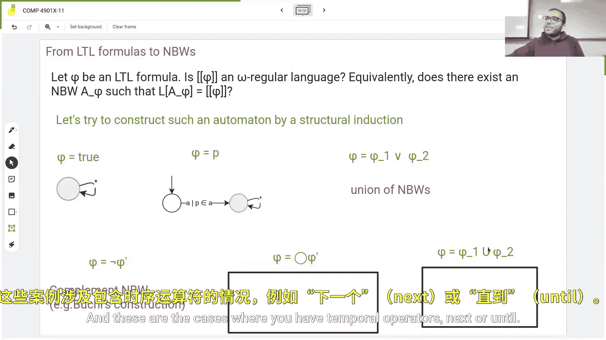
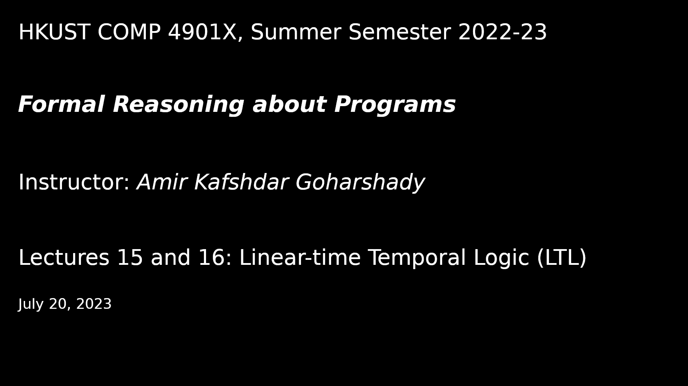
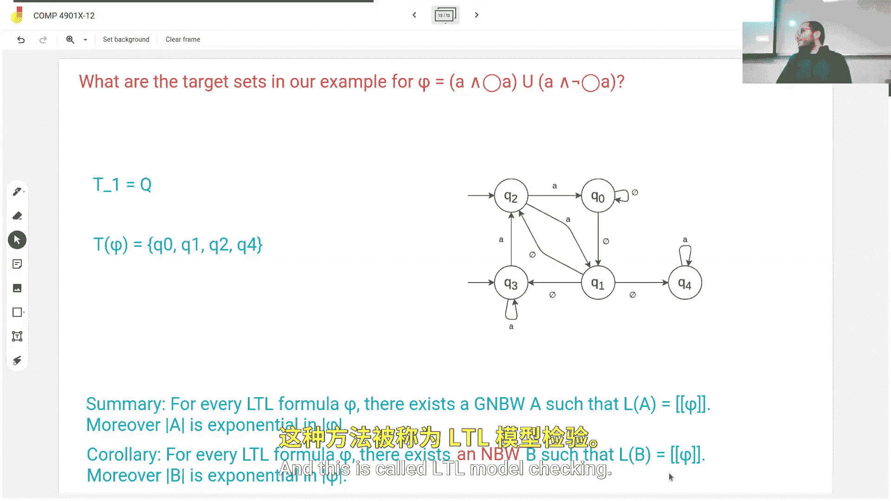

# 香港科技大学【中英⚡程序的形式化推理｜COMP4901X 2023 Formal Reasoning about Programs】 p09 p8 s 15 and 16 - Linear-time Temporal Logic (LTL) -BV1roXTYaEmJ_p9-

We've seen two different formalisms for model checking basically up until this point。

 we've seen two player infinite duration games and graphs and we've also seen automoton infinite words and especially bookie automota we've seen two player infinite duration games and we've seen automota and infinite words now the first thing I want to do today is to show you that these two are actually solving the same kind of problem。

And then we're going to see another formalism， which is linear time temporal logic。

So we have the same problem and we have three different views。

 we have a game view an automaton view and a logical view， so for the game view。Basically。

 we had this set01， which was the objective of player one。

And this was a set of infinite words so or another way of looking at it is that Ovan is a language。

 it's a language of infinite words。And then what we wanted to do。

Find a strategy Sigma one for player one， so let's say that I use this notation to show all the possible outcomes that can happen if player one plays strategy Sigma one。

So no matter what player two place。Okay。Basically what I wanted to do was to find a v strategy。

 I wanted to find a strategy sigma one， such that all the possible outcomes。

 if player one plays this strategy and player two plays anything， this set is a subset of O1。

 so player one wins in every case。Okay， but now the thing that I want you to really focus on is the type of these sets。

 so01 is a language， it's a set of infinite words。And this sit。The set of possible outcomes。

 if you play Sigma one， this is also a language。And it's also a set of infinite words。So basically。

 when I'm solving a two player infinite duration game on graphs。

What I'm doing is that I'm checking whether a particular language is a subset of another language。

And we talked about the use case of this， we said that well， let's say that。

Somehow the plays of the game are the runs of some program， let's say。

And01 are the set of all runs where a particular error does not happen。

 so player one wants to make sure that we're not going to get some sort of error。

So01 are the runs that are acceptable to us。And then we're trying to prove that the runs that can actually happen in the game are a subset of the acceptable runs。

Okay。Now I want you to see that we did basically the same thing when we had automaton infinite words。

 so there again we had languages， so if I have an automaton a and let's say this is a non deterterministic bookie automaton。

The language of a is also a set of infinite words。Okay。Now， imagine that I have two different autota。

 let's say I have one automaton a。And a accepts all runs of a particular program。

 so the language of a。Is the set of all runs that can happen in my quote， let's say。

And let's say that B accepts all runs that satisfy some specification。And again。

 this specification is like the set of runs that are acceptable to me。

If I want to prove that my program does not have a bug。

 if I want to prove that my program works correctly。

 I basically want to prove that the language of a is a subset of the language of B。

So this is again language inclusion， this is the same problem as here I have a bunch of runs that can actually happen in my program and I have a bunch of runs that are acceptable to me that don't have errors in them and I want to say that the runs of my program don't have errors this one is a subset of this one。

Okay， and this was the whole reason why we studied complement and emptiness checking。

Because we said that if I want to check。If the language of a is a subset of the language of B。

I can say that。This happens if and only if the language of a。

Does not intersect the language of P complements。Right and if I can compute be complement and I know how to compute intersection and if I can check whether it's empty or not then I can answer this question and this is like the main question in model checking you just want to see if a particular language is a subset of another。

Now， the thing that is really nice when you're doing modern checking using automata。

Is that you're using the same formalism for your program and your specifications。

RightBoth of them are going to be automota and usually nondeterministic bookie automata。

 so I'm using an automaton B to formalize the specifications and I'm also using an automaton A to formalize my program。

 but today we're going to see a completely different take and the same problem。

And we're going to see that it is basically equivalent to these two。

 and this is what we call linear time temporal logic。

So it's a temporal logic in the sense that it's a logic that can talk about time。

So that's why we call it temporal。And we say it's linear time。Because well。

 if you've seen si time travel and so on， there are different ways of imagining time， right。

 you can imagine time as branching， you can imagine that there are many different possible futures and we are branching into all of them。

Or you can imagine that there's always only one future。

And linear time means that we are considering only one future at any given time。

 so we don't have parallel universes， let's say。But we'll see a better and more formal definition of this very soon。

This is a logical way of specifying sets of infinite words so again here I had an automaton B that basically told me which runs are acceptable instead of having an automaton I want to have a logical formula that tells me what properties should the runs of my programs have。

Okay。Let's start with some definitions。So first of all， I'm going to define a trace。And in a sense。

 a trace is what we normally call a runoff the program。

Here's how I define it let's say that I have a set P and let let's say that this is a finite set and I'm going to call it the set of atomic propositions。

ok。So。Every proposition in P might or might not hold at any given eye。Now。

 what I'm going to do is that I'm going to define my alphabet sigma to be all subsets of p。

And then I'm going to say that a trace is an infinite word over this alphabet。Okay。

 so a trace is basically an element tall。In sigma omega。Now， what does the trace really give me。

A trace is an infinite sequence and at every point in time， so for example， at time zero。

 it tells me which ones of the propositions hold。And then it tells me which propositions hold at time one。

 which propositions hold at time two， and so on。And it's infinite because we have infinitely many times slot。

Okay。If we want to have a simple example， let's say that I have a traffic light。

And let's say that mine traffic light has basically three lights。Red， green and yellow。

 and each one of these lights can be on or off at any given time。ok。😊。

So I have eight states because basically any subset of my lights might be on at any given time。

 so I have three lights， I have two to the power of three states。

But now if you consider a classical traffic light， not the kind of traffic lights that we have in Hong Kong。

 usually you want to have only one color on at any given time。Right。

 so you want even though you have eight states， only three of these states should really occur in a correct implementation if I have a correct code of my。

Traffic light， I should never have two lights on at the same time。Okay， again， not in Hong Kong。

 Hong Kong is weird。So here are some examples of traces。So this is one trace。

 which says that at time zero。Only the red light was on， so the light was red at time one。

 it was green， at time two， it was yellow and so。And to me， this is an acceptable trace。

I'm happy with this。Now what does this one say， remember that every one of my letters is a subset of P。

So this one is saying that at time zero， all the three lights were on。And then at time one。

 red and green were on。At time two red and yellow and so on。

Of course I don't want to accept this if I have a correct traffic light。

 I shouldn't have a case where all the three lights are on or both red and green are on。

 that's kind of ridiculous。Now in this next one， you see that at time zero， it was red， at time one。

 it was green and on， but at some point I have the empty set， which means that everything was off。

And again， this is something that ideally I don't want to accept。

So I want to specify the property that at any given time。Only one of the three lights is on。

 and I want to actually specify the property that at any given time exactly one of the three lights is on。

Now， you can easily create a booky automota that only accepts traces that have this property。Okay。

 I'm not going to create it for you， you should be able to create it yourself， it's super easy。😊，ok。

😊，But now I don't want to really use automata for my specification， I want to use a logical formula。

So this is the logical formula that I want to say， I want to say at every point in time。

Let's say I'm in one of these cases， I want to say that at any point in time。First of all。

At least one of the lights is on， so R or G or y。And then I want to say that it's impossible that I have two lights on at the same time。

 so I don't have both R and G， I don't have both R and y， and I don't have both G and Y。

So this property says that at any given time， exactly one light is on。

Because at least one light is on and no two lights are on。O。😊。

So I want to have a logic that can specify and express these kinds of properties。

Now this part is quite easy， this part is just propositional logic。Right。

The thing that is not that easy is that in my logic。

 I should have an operator that says at every point in time。

So my logic has to be able to talk about time and it has to be able to talk about the future。

 it has to tell me what's happening in the future。Okay。But。

Let's see some more examples of these temporal properties and temporal basically means anything that has to do with time。

So what are some other properties that I want my traffic light to have？ok。So here's another example。

 I want to say at every point in time。If the red light is off right now and if in the next step in the next time slot。

 the red light is going to be on， then at the current time slot I want the yellow light to be on。

RightSo basically the idea is that I don't want the red light to turn on suddenly without first showing the yellow light。

ok。😊，So now to specify this kind of sentence in my logic。

 I need a way of talking about every point in time。

But I also need a way of talking about the next time slot。

So you can imagine every time slot as a second or a transition or whatever。

 but we have some notion of time， we have time zero， which is the start of the system。

 and then we have time one， time two， so on。So I want to say whenever the red light is off。

And in the next step， the red light is on， then in the current state。

 I want to have the yellow lighter。Okay。Another property that I would like to have is that， well。

 look at it from the point of view of a driver。If you reach this traffic light。

 you want to make sure that at some point you can pass it。

So you want to make sure that your traffic light becomes green in the future。

And you want to make sure that this happens no matter when you reach the light， right？

So what I want to say is that at every point in time。

There is a point in the future after that first point。Where the green light is on。

So now I have to be able to talk about two things， I have to say at every point in the future。

 and I have to talk about existence of a point in future。Where something holds。Okay。

Now look at this one， this one says that at every point in time。If the。

Light is green right now or to be more specific if the green light is on right now because。

Maybe several lights are on， but anyway， if the light is green now and if in the next step it's not going to be green anymore。

Then I want to make sure that in the next step it's going to be yellow， so from green。

 I want to only transition to yellow， I don't want to， for example， suddenly transition to red。Okay。

 this is another property that I would like to have。Now， this one is much easier。I want to say that。

Light turns yellow at some point， so I just want to say that there is a point in time。

When the light turns yellow。Easy。Now look at this property。

This property does not start with any kind of quantification on time。

So whenever I have a property like this， for example， when I have y。😊。

I see this as applying to times0。So what this property is saying is that if at time zero。

The light was yellow。Then the light will remain yellow。Until it becomes red。

And what this means this part means is that there is a point in the future where the light is red。

And at every point in time before the light becomes red。The light is yellow。Okay。

 so these are the kinds of properties that I want to be able to express in my logic and I'm going to create a logic now this is the linear time temporal logic。

That can actually talk about these kinds of properties。

And then we're going to see how we can do model checking on this logic。

 how we can verify if all runs of a particular program satisfy this logic。Okay。

Here's finally when I can define the syntax of my logic。

So let's say that P is a finite set of propositions， for example， in my case， P was just red。

 green and yellow。Okay， so every proposition is just some Boolean proposition that can be true or false at any given time and remember that we have infinitely many time slots。

And then I say that a word is basically a subset of P， so I want to say that at any given time。

 a subset of my propositions hold。And then a trace is just an infinite sequence of words。

 so a trace is just。An infinite sequence that tells me which one of my propositions or which set of my propositions。

Hold at any given time。Okay。So this is the syntax that I want to have。

I show my formulas with Phi and these are the formulas that I want to have。

 I want to have the formula true。And I mean， true is always true， okay？

I want to have the formula P whenever P isomic is an atomic proposition。

 so if I have the formula P what I mean is that P holds right now。

 so let's say this is my trace and let's say that at every given point at times zero time1 time two so on I know which positions holds。

And if I know which propositions hold at any given time， when I write the formula P。

 what I mean is that P holds at time zero。Okay。😊，Now I can also have a logical or。

 So if Phi1 and P2 are。Two formulas， I can have Phi1 or V2。And this is simple。

 you know what it means。嗯。Not complicated at all， I can have logical negation。

So I can have not a fee。And if I have or negation， I can define other things。

 I can define and I can define basically all the propositional operators。

Right so I don't officially put the other propositional operators in my syntax。

 I define them as syntactic sugar and what that means is that。For example， whenever I write false。

 what I mean is not true。So this allows me to just define these things on side without having to have them in my formal syntax。

And whenever I say phi1 and Phi2， what I actually mean is that not of not phi1 or not V2。

Right and I can have implications， so for example， P1 implies P2 that's equivalent to saying Phi2 or not P1。

This is basic propositional logic。But the parts of my logic that are actually interesting are the temporal properties。

Okay， so I'm going to have a formula like this and I'm going to read this as next fee。

And what next p means？😮，Is that fee holds in the next point of time？Okay。

 and sometimes instead of a circle， people use x， so they write x phi and it means the same thing。

So again， imagine my trace， I have this trace and when I say next V。

Im I mean that you can ignore the first time step， you can ignore time zero and then at time one fee should hold。

Okay。But fee itself can be a complicated formula， it might be that fee itself is saying。Next B。

 let's say。So I can have things like this， I can have。For example， next， next， next be。

And what this means is that at time three Phole。RightBecause what this means is that， well。

 at time zero， I should have next， next， next P。Which means that at time one。

 I should have next next P。Which means that at time two， I should have next P。

 which means that at time three， I should have P。Okay， so this is how the next operator works。

I will give you four more semantics soon， but this is just giving some intuition about。

what this means。And then the other thing that we have is until。Okay， so if I have P1 until V2。

What this means is that I'm saying at some point in the future， P2 will hold。And generally。

 whenever I talk about the future， it also contains the current type， okay。

 so I don't have a strict future， I have a non strict future。So when I say P1 until P2。

 it means that there is a point in the future where V2 holds。And up until that point。Fvoon Holtz。

Okay， so if my time starts here， if this is 0。0， I'm saying that there is some point I in the future where P2 holds。

And at every time point before I phi1 holds， so that's what Phi1 until Phi2 means。🤧Okay。Now。

 a common problem we have now is that。We are using the same notation for until and union。

 so you have to just be careful。About how this is used and based on the type you have to understand whether it's until or unionion so if it's in a formula it's until if it's in a set it's union。

Okay， so here's an example if I have G and G until R。😊。

What this means is that the light is green at time zero because remember。

 if I have one of my propositions， I'm talking about time zero。Okay。😊，And。😊，Additionally。

 the light remains green until at some point it becomes red。That's what this formula is。Okay。

 any questions until this point？Great。So there are two other operators that we can actually define also as syntactic sugar so we can write them based on until that's why。

In my semantics， I only included until。But in practice， these are very useful。

 so I'm going to just define them as well。So the first operator is what we call eventually。

 so eventually fee。Means that there is some point in the future and maybe that point is right now we fee holds。

Okay， and sometimes people write this as FV。So for example， again， look at this trace。

 let's say this is time zero， time1 and so on， eventually F means that there is sometime I wear fee holds。

Okay。And of course， I can write it in terms of until。

 so you can see that eventually fee is basically the same as true until fee。

Because true until fees is that there is some point in the future where fee holds。

And until that point true holds， but true always holds。

So true until feehi is the same as saying eventually feehi。Okay。So for example， eventually R。

 in our example means that the light will eventually turn red。Okay， or to be more specific。

 the red light will eventually turn out。So there is some time in the future and maybe that time is right now where the red light is on。

And then I have this one and we read this one as always or globally， so always fee。

Means that at every point of time from now and throughout the future， the formula fee always holds。

And sometimes people again write this as GP for global E。So this is like a pictorial representation。

 this is my trace and fee holds at every point。ok。😊，Now， again。

 one thing that I have to really emphasize here is that fee itself can be a complicated formula。

So when I say fee holds here。Fee can actually talk about the future。

 so it can talk about all of this。Suffix when it wants to hold here so fee is not just a propositional thing it's a sub formula and it can have nested operators。

 it can have nested until next thing。Okay。🤧。So。Why do I say this is syntactic sugar？

Because always fee。😮，What does it mean intuitively it means that fee always holds。

 which means that I can never have not fee。So always fee is the same as not eventually not V。

Because consider any trace。Either at some point of this trace， I'm going to have nutvi。

Which means it satisfies eventually not fee。Or I'm having Phi at every point。

 which means it satisfies globally fee， so globally Phi is the negation of eventually not fee。ok。😊。

So。Look at this one。What is this formula， it says globally。😮。

It is not the case that not R and not G and not y。So it means that the light will never turn off。

It will never happen。That all three of my lights are off。Okay。

You will get used to these formulas really soon， but this is like a formal way of writing formulas that actually talk about time。

Okay。Here are some examples， and I want you to tell me what each one of them actually mean。

So what does this first formula mean？Yes， so this is eventually why which means that at some point the yellow light will be on。

What does this one mean。嗯。Someone， what does this one mean？嗯。It means that if at time zero y is on。

 if at time zero the yellow light is on， then the yellow light will remain on until at some point in the future。

 the red light becomes fine。ok。What does this one mean？

So I want you to really see the nesting of these operators。

It is always the case that if the current light is not red and the we know that in the future it will become red。

 then it is yellow， yes。So it says for every time I。If the red light is off a time eye。

But the red light is on a time i+ one。Then the yellow light。Is on a time I。哦，系啊。

That's what this meanss， okay？But actually。This is different from this next one。

And the difference is only in the parentheses， what does this one say？Okay。Yeah。

 so previously what I was saying was that I should have this formula at every time。

 so this formula should hold at every given time， but here I'm saying that if this formula holds at every given time。

 then this one should hold。Okay， so this one is saying that it at if at every given time。

the red light is off and in the next time the red light is on， then at time zero。

 the yellow light should be off。Okay。Does that make sense。

 do you understand the difference between this one and this one？Okay， so basically。

 you can intuitively think of this as a quantification over time。And here this y is quantified。

 so it has to hold that time I according to this quantification。

 but here y is not inside the quantifier。Okay， what does this one mean if I remove some more parenthe？

嗯。嗯的对。在跟你事。Yeah， so it's saying that if at every point in time， I have not are。And if at01， I have R。

 which is basically impossible。Right， but if this is the case， then at00， I should have by。Okay。

 but of course this part is false， so the entire thing is always true。

Because if at every point I have not R， it's impossible that at01， I have R。Okay。

What does this one say？对。哦 think啊 this is。At any point。

 if we know that currently it's green and the next ball is not green。

 Then we know that the next ball is yellow。Yes， exactly。So at any given point in time。

If the light is green right now， but I know that in the next step it's not going to be green anymore。

 then at the next step is it's going to be yellow。So basically， if I'm transitioning out of green。

 I'm only transitioning to yellow。What does this one mean？嗯。我喺呢块经。Either yellow or at the next time。

 step。Yes。So at any given point in time。Either my light is yellow or in the next step。

 it's not going to be red， which means that every red light should be preceded by a yellow light。ok。

😊，What does this one mean？我。对。At any point， we know that in the future it the be Yes。

 so at every point I。There is a point J after I。Where the light is green。But what does that mean。

That means that the light becomes green infinitely many times。Right？Because at every point in time。

 I know that I have a green in my future， so I have to have infinitely many greens。😡。

So this is basically。Very similar to the bookie condition。

 it's saying that I'm going to see infinitely many Greeks。So always eventually green。

Basically says I'm seeing green infinitely many times， but what if I swap these two。

 what if I say eventually always green？哦。Some point in the future， it will always be brief。Yeah。

 so it means that there is some point I。And after point I。It's always green。

So I can have not green only in a finite prefix。And after this finite prefix。

 I will always have green。So this is Kobuki。一对。So now you're seeing the connection between this logic and our games。

ok。So let's see some examples of this。The first example is suppose that you have two processes and let's say that they're being run concurrently and let's say you have a lock。

So。If you've done concurrent programming， you know that you have to acquire a lock。

 so if you want to use a shared resource， for example。

 you have to first have the lock before you can use that resource。So。And let's say I have a log L。😊。

And let's say that my。Atomic propositions are that either process one os l or process two os。

 and these are my two atomic propositions。Okay。So what does this formula say？

It says that it's impossible that the two processes on the lock at the same time。

So it says at any time at or at every time。😡，Either process one does not own L or process 2 does not own L。

So basically， this is saying that I will not have a case where both of them use the shared resource at the same time。

If I want to talk about concurrent programs， this is one way of talking about them in this logic。

Okay。Here's another kind of real world example， let's say that you have a web server。

And let's say that you have a bunch of clients who can send requests to this server。Okay。

 and whenever a client sends a request， I want to make sure that the client receives an acknowledgements。

ok。😊，So what I want to say that is that at every time globally。

 it is the case that if a request is sent from the client at the current time。

Then at some time in the future an acknowledgements will be issued by the。ok。😊。

So globally request implies eventually acknowledge。Nice。Okay。

 now that you have some intuitive understanding of how our logic is supposed to work。

Let's actually talk about formal semantics。So remember， at the beginning of this course。

 we defined formal semantics for programs。Now we want to define formal semantics。

For formulas in our logic， so I know how to write an LTL formula。

I know that my syntax is this and of course I also have syntactic sugar like this。

So I know what a formula is， but for every formula I want to actually define some semantics。

 I want to define the formal meaning of every formula， what does this formula actually mean？

So let's say that I have a formula fee， this is an LTL formula。

I want to define the meaning of phi or the semantics of phi。

And I define it as a set of infinite words。Okay。So basically。

 the semantics of Vhi is the set of all traces that satisfy V。Okay。

And I write satisfaction like this， I write T satisfies phi to say that the formula T satisfi sorry that the trace T satisfies the formula fee。

ok。This is how I write satisfaction and of course。Based on this， I can actually define my semantics。

So let's try to write rules for my semantics。And one other thing that I do here is that I define substrs。

 so if T is an infinite trace， then TIj is basically the finite substring from index I to index J。

And T do dot is the suffix of tau that starts at index I sorry this is ta not T it's the suffix of taud that starts at index I and just goes on forever。

 so this is like an infinite suffix。It's just the same as tar except that I've removed everything from index 0 to i minus1。

ok。😊，So with this notation， let us write some rules that tell us when a particular trace satisfies a particular formula。

So what are the cases that I have to cover， I have to cover all of my formulas and my formulas were either true or P or logical or not next and until。

So let's write rules for all of this when does a trace star satisfy the formula rule？

What should I write in the assumptions of my role？Well， true is always satisfied。😊。

That's by definition， so I don't need any assumptions at all。So I can just have an axiom that says。

Everything satisfies true， no matter what trace you give me， it satisfies true。Okay。

 true is a formula that is always set。What if my formula is of this form， my formula is not fee。

When does the trace tar satisfy not fee？Well， this is also quite easy to define right so I want to say that T either satisfies fee or it satisfies not fee so I say。

If T does not satisfy fee。Then how satisfied is not to be。That's one of my rules。

That's how I define the semantics for negation。Okay。How about this case。

 what if my formula is just one of my atomic propositions？

So we said that if we just see an atomic proposition on its own。

 the way we interpret that is that it should hold at time zero。So tar satisfies P。

If P holds at time zero in top。😡，But。Remember， ta zero？😮。

Is basically a letter of my alphabet and each letter of my alphabet is a set of atomic propositions。

 so if P is one of the atomic propositions in tau0， then tau satisfies P。ok。By the way。

 stop me and ask questions if anything is not clear because if you don't understand this。

 you're going to fail the whole course， this is the most important part。Okay。Now。

What about logical or？When does To satisfy Phi1 or Phi2？But this is also quite easy。

 right if T satisfies P1。Then Tau also satisfies Phi1 or P2。

And I can have another rule that says if T satisfiies phi2。Then to satisfies free v feature。Again。

 this is basically the definition of logical disjunction right， so this is logical disn very easy。

Okay。Next。These are the interesting parts。Let's talk about the temporal operators。

When does star satisfy next fee。我打开小度片。Yeah， so basically next fee means that fee should hold at time one。

So I can take my trace star and I can chop off time zero from it and I can just take the suffix that starts from time one。

And I can say that if this six satisfies fee。Then T itself satisfi its next fee。是。Okay。

This one is a little bit harder， so let's first do these two。😊，In practice。

 I just need to define this one because these were syntactic sugar。But let's talk about this。

V does to satisfy eventually fee。Yes。you see some eyes such as tall stock and。Yes， exactly。

So if there exists sometime I。Such that the suffix of tau that starts from I satisfies phi。

 then tau itself will satisfy eventually phi。How about globally？😮，对。对。Yes， it's just that you use。

A universal quantifier instead of an existential and this for all I。

 it also contains the case where I is zero。Okay。So if for every suffix。😡，Fe holds。

Then in the original trace star。Globally fee also。Okay， how do you define this one now？

If I want to say T satisfies Phi1 until Phi2。🤧。我参你。Ja Roger and I。嗯， no no no。

It on day the perfect time of day is， but it was a services。Yes。Okay， so。There exists some J。I mean。

 you're using J+ one what I'm using J but。It's the same yes， what you say is correct。

But I write it like this， I say that there exists some J。

 such that the suffix starting at index J satisfies P2。

So I'm saying that there is some point in the future。

 some point J in the future where P2 is satisfied。And this J can be zero。

 it can be that P2 is satisfied right now。Okay， and additionally。

 for every i between zero to j minus1。😊，If I take the suffix from index i forwards。

 it satisfies phi1。So again， there is some point in the future where P2 holds and until that point at every point before that Phi1 holds。

ok。😊，This is how I formally defined the semantics for Phi1 untilfi。Nice。

So now we have rule based semantics for our LTL formulas whenever I give you an LTl formula and a trace。

Based on these semantics， you should be able to tell if this trace actually satisfies the forming law。

So now the semantics of the formula phi is well defined because the semantics of phi is just the set of all traces that satisfy feehi。

And we have rules that tell us when a trace satisfies the form。Okay。Now。

 remember that we had some classical objectives， especially when we were talking about games。😊。

And the classical objectives that we saw were reachability， safety， bookie， core bookie and parity。

Now what I want to do here is that I want to show you。

 you can write all these classical objectives in LTA。Okay。So let's say that again。

 P is my set of atomic propositions。And all the same things as before。

 so every letter is a subset of P and I'm looking at a trace， which is an infinite set of letters。

 an infinite sequence of letters。And。Here's the thing。Let's say that I want to say。My trace。

Or my program， whatever eventually reaches a state where P holds and P is one of my atomic propositions。

So I want to say that， for example， at some point the light will be green。Okay， so here's what I do。

 first of all。😊，I cannot really talk about just。I have to talk about letters。😡，RightAnd remember。

 each one of my letters is a subset of my atomic propositions。

So I say let's define AP P as the set of all subsets that contain P。

So AP is all the letters that have pned。Okay。So I can define reach of AP， reach of AP means that。

I will eventually。Reach a state where Phole。Right that was the definition when we were talking about。

Games and what this means is that after a finite number of steps I get to a state where P holds well if I want to write this as LTl。

It's just the semantics of eventualpe。Right， so again， be very careful about the types here。

Reach of A P。Is what its says set。Of traces， it's a set of infinite paths。Right？

So the semantics of eventually P， this is also a set of traces。

And they are both a set of traces that will eventually reach B。

 that will eventually reach a point where P holdss。Okay， how about safety？😊。

If I want to say that I will never reach a point where P does not hold。That's safety。

 that's being safe in Pete。Right？I can write it very similarly。I can say that I have globally。

So at every step of the execution of my algorithm or my system， at any given time I have P。

 that means that I'm safe in P。How about bookie？What if I want to say ICP infinitely many times。

 what is the formula that I have to use for that？你先在过点样。我 yes。

So if I want to say that I seeP infinitely many times。

That's the same as saying that for any given point。There is a point after that where P holds。

So this means。Globally eventually P。So this says that at every point in the future。

 there is a point after that where P holdss。How about Kobuki？Yes， Kobuki is just。The duall。

Its eventually always be。And okay， one nice point here is that if you look at this definition here。

Basically globally is the duall of eventually。And here we have。The same situation。

 we know that bookie and Co bookie were dues。So we see this dualization in the formula lawss as well。

So。Kbuki of AP means that I want to make sure that after a finite prefix， I always have P。

But this is exactly what this says， it says that there is some point in the future。

 there is some point I such that from point I onwards， I always have P。

Which means that if I just discard the finite prefix from0 to i minus1， then I have P everywhere。

 this is again the same as code。ok。Now let's say that I have parity and let's say that I encode my parities as my atomic propositions。

So let's say my atomic propositions are my priorities from zero to d。Okay。😊，How can I write parity？

What is the parity objective？🤧K。So the parity objective said that I want to make sure。

That the smallest priority that I see infinitely many times is even。So this means that。

The smallest priority that I see infinitely many times should be either zero or two or four or so on。

Okay。So。This is what I can say， I can say either I see priority zero infinitely many times。

 and I know that this is how I can say I see zero infinitely many times。Right。

So always eventually zero means that zero is seen infinitely in types。

So either I see zero infinitely many times。Or I don't see zero infinitely many times and I don't see one infinitely many times and I see two infinitely many times。

Or I don't see zero， one， two， and three infinitely many times， but I see four infinitely many times。

And then again， or for six， eight and so on until we reach the。

So this is how I can write a parity objective in LTL。Does this make sense？Great。So。

We can also talk about equivalence of LTL formulas。So when we were working， let's say with automata。

 we could talk about equivalence of automata， we could say that。Two different automota equivalents。

If they have the same language。But in some sense， we know that the semantics of a formula is also a language。

Because。What's the language of an automaton， the language of an automaton？

Is basically the set of all traces， the set of all infinite words that are accepted by that automatton。

But now， I have。The semantics of a formula， which I can also think of it as the language of this formula because it's also a set of infinite words。

 it's the set of infinite words that satisfy this formula。

So I can define equivalence of formulas in the same way that I defined equivalence of automota。

 I can say that two formulas， phi1 and Phi2 are equivalent。

If the semantics of phi1 is equal to the semantics of V2。

Which basically means that for every trace ta， ta satisfies phi1 if and only if it satisfies V2。Okay。

So I can give you some boring examples。One boring example is that。

Nigation of negation of fee is equivalent to fee。Of course， and you can again。

 you can formally prove this using the rules that we had and you can prove this in Cock。But yeah。

 it's painful， but it's obvious。And in general， I have all the equivalences that exist in propositional logic。

 so for example， not Phi1 and P2， this should be P2， this is a typo。Not Phi1 and Phi2。

Is equivalentvalence to not phi1 or not V2？ok。So。Any kind of equivalence that we have in basic propositional logic also holds in NTT。

But again， these are the boring examples， the interesting examples are the examples will use the temporal operators。

😊，So for each one of these， I want you to tell me if the equivalence actually holds or not。

 so I want you to tell me which ones are correct and which ones are incorrect。

Is not next fee equivalent to next not fee？So can I swap next and not？对。Yes。This好。Why。

 because not next fee says that it is not the case。That in the next step fee holds。

 which means that in the next step， not fee should hold。Because in the next step。

 either I have fee or not fee。And when I say in the next step， I basically mean at time one。

 right because I'm always thinking of myself as being at time zero。

 so at time one I either have fee or I have not fee。And。This one is saying that at time one。

 I should have not feed， this one is also saying that at time one I should have not fit。

So they quick。是。And again， of course， you can give a formal proof based on the rules that we had。

For the semantics， but that's not what I want you to do right now。

 I just want to create a lot of intuition for you on how these things work。Okay。

The other question I have is whether I can distribute my temporal operators over normal logical operators。

 so let's say I have eventually Phi1 or Phi2。Is this the same as eventually Phi1 or eventually Phi2？

Why is it the same。Maybe needs。Yeah， so it's saying that there is some point in the future。

 let's call that point I。And at point， I either Phi1 holds or V2 holds。😡，Well。

Just do a casework if P1 holds that point I then I have eventually Phi1 if P2 holds that point I then I have eventually Phi2 and you can do it in the opposite direction too so yes this works。

This is a good。But can I do the same distribution over logical and instead of logical or can I say eventually phi1 and Phi2？

Is equivalent to eventually Phi1 and eventually Phi2。Okay， why not Yes， the times might be different。

 so what this one is saying。Is saying there is some point I in the future。

Where P1 and P2 hold at the same time。At that point， I。

But this one is just saying that there is a point where Phi1 holds and there is a point where P2 holds and there might be different points。

So I do have an implication the left one actually implies the right one。But I don't have equivals。

 these two are not a equivalent。Okay。Now let's do the Du all。

So remember that I told you that globally and eventually are duals。And of course。

 you know from basic logic that and and or are also duals。

 so let's take the duall of this equivalence basically and let's see if that holds。So。

If I have always phi1 and Phi2， is that the same as always Phi1 and always P2？Yes。Because again。

 all this is saying is that at every point in time。Both of them hold both P1 and V2。

And this is saying the same thing， it's saying at every point in time P1 holds and at every point in time P2 holds。

 it's easy to see that they're the same。What if I do it with or？😡，Why not？玩唔弯流流锁俾黑咁嬲。Yes， again。

It's about what's happening at the same time and what's not happening at the same time。So if I say。

I always have phi1 or P2， it might be that at time zero， I have phi1 at time1 I have p2。

 then again I have phi1 p2， but I only have one of them at any given time， for example。But here。

 what it says is that I should have。嗯。Either phi1 at all the times or phi2 at all the times。😡。

So the trace that is like this， the trace that satisfies Phi1， but not phi2。Ats。Times zero。

 and then it satisfies phi2 and not phi1。And then again， Phi1 and not phi2。And so on。

 this trace satisfies the left formula， but it does not satisfy the right formula。Okay。

 so this one does not talk。Great。Let's have some more equivalences here。So。

I want to basically look at Unt。So。Does this equivalence hurt？

Can I say that Phi1 until Phi2 is equivalent to Phi2 or phi1 and in the next step， Phi1 until P2？

Okay， so this holds because again， intuitively， what does Phi1 until Phi2 mean？

It means that there is some point where P2 holds and before that point I always have p1。

So let's do a casework over that point。😡，The point where I will have P2 for the first time。

Either I already have P2 at time zero。😮，Or if I don't have P2 at times zero。

 then I should have Phi1 at time zero。And then at time1， I should again have phi1 until Phi2。Right。

Okay， what does this remind you of？对。We've seen something like this before。No， no。

 this is when we were defining the semantics for Vine。Right。

 so remember when I was defining the semantics for vial in my programming language。

 I was saying that。Either the vi terminates in its first iteration， or I do one iteration。

 and then I have to do the vi again。Right and here I have the same intuition。

 I'm saying either P2 already holds at time zero。Or I have to have phi1 at time zero。

 and then I have to have the entirety of phi1 until phi2 from time one。ok。😊。

I can do the same kind of equivalence for eventually and globally， so if I have eventually fee。

What does this mean， it means that there is some point in the future。And remember。

 whenever I say the future， it also contains the present。

So there is some point in the future where fee holds。

So I can again do a case for either fee holds right now at time zero。Or at time one。

 there is some point in the future where he holdss。

So eventually fee is equivalent to fee or next eventually fee。

And then I can do the same thing with globally and again， you see the fact that these are duals。

 so instead of or I will just have an here。So。If fee take this one。

 it says that fee should always hold。So if we should always hold。

 this means that V should hold right now at time zero。And then from time one， again。

 fish should always hold。Okay， easy。So based on this。

 we can actually define the notational semantics。So we already have ruleway semantics。But remember。

 we also like to have thenotational semantics。So what is the semantics of true？The semantics of true。

Is the set of all traces that satisfy true。But every trace satisfy is is true。

 so this is just the set of all traces， so this is sigma omega。

Sigmaomega is the set of all infinitefinite traces。What is the semantics of P？😮，对我。Yeah。

 it's the set of all traces and P is an atomic proposition， so it's the set of all traces。

That have P。At time zero。🤧Yeah， so it's the set of all traces such that P is in tau0。Yeah。Okay。

What is the semantics of P1 or V2？是。No no， so if P1 is a formula。

 it's no longer an atomic proposition。So it can be a formula that has all sorts of operations in it。

Yeah。So which traces satisfy Phi1 or P2？Well， it's just the union of the traces that satisfy P1 and the traces that satisfy P2 right so I can write it like this。

 I can say the semantics of P1 or P2 is just the semantics of P1 union with the semantics of P2。

Again， be very careful that this is union， this is not until。So until it's used for formulas。

 union is used for sets， these are sets。So it's union。ok。😊，How about this。

 what is the semantics of Navi？都点。Yeah， it's just the complement of the semantics of V。

 so a trace satisfyes not feehi if it does not satisfy Vhi。

 so it's just the set of all traces minus the set of traces that satisfy the。ok。

What is the semantics of next feehi？Yeah。It's basically the set of all traces such that if I cut off the first letter。

The rest satisfy。P right so this is the set of allt traces tall such that the suffix that starts from index one where I have basically cut the letter at position zero。

That satisfies me。But I can just write it like this， I can just write it as sigma。

Concateated with fee， with the meaning of fee。So this means that I can take any letter as my first letter and then I can take any trace。

That was in the semantics of feet and I can concatenate them and that would give me the semantics of next few。

Okay。😊，Again， this is when I write something like this， I mean string concatenation。

 so it's just I'm concatenating a member of Sigma with a member of the semantics offi。

The most interesting question and this is the reason why。

I first showed you this and I told you that it looks like。

How we were working with our while loop is how to define the semantics of Phi1 until V2。Okay。

 give me some ideas， how would you define the semantics of F1 untilV2？Yes， exactly。Because。Again。

 the intuition is that this works very much similarly to how the vi worked in our programming language。

Right。So when I was defining the notational semantics for a vi loopbe， I was using a fixed point。

Let's try to use a fixed point here。But what kind of fixed point should I do。

 like what is the function whose fixed point is the semantics of Phi1 until V2？Well。

 I can look at this thing here。Right？And I can say that I want to have a function F。

Such that when I apply it to x， let's say x is phi1 until phi2， I get this thing。

 but this thing again has x in it。So if I just show phi1 until p2 with x。

This is the kind of thing that I have， so let me erase this。

So let's say that I want to define these semantics as a fixed point。

 so I should first have a function F。And I want to say that this semantics is the fixed point of f。

 so I want to say that this semantics is some x， this semantics is some x。

Such that F of x is equal to x。ok。So first of all， what is the type of F？Well， what is the type of X？

X is a set of traces。Right？Why is excess set of traces？

Because x is supposed to be the semantics of this formula。

And we said that the semantics of a formula is the set of traces that satisfy that formula。So。

Thisis function F should map sets of traces to sets of traces。So it takes a set of traces。Okay。

 this is the set of all of my traces and this means that I'm taking a subset of traces。Okay。

It looks strange， but it's really not that hard。It's the function F is a function that takes a set of traces and gives me another set of traces。

And how am I going to define this， I'm going to say f of x。

Is defined basically using this equality that I have here。So I'm thinking of this， again。

 I'm thinking of the semantics of this formula as x and I'm thinking of this one as x2。So。

I want to say that。X is equal to f of x， so I want the semantics of this whole thing to be f of x。ok。

But what is the semantics of this whole thing？It's basically the semantics of P2 and then I have an or and remember that or basically became union。

So it's the semantics of V2 union with the semantics of this part。

But what is the semantics of this part？😊，So it's F1 and。😡，Next x， so the semantics of Phi1。

Interssection because ants will become intersection。Maybe I should have written that separately。

Here I can also define。The semantics of。Phi1 and V2。

The semantics of Phi1 and Phi2 will just be the semantics of phi1。Interssect。The semantics of Fi2。

Right， because。A trace satisfies Phi1 and P2 if it satisfies both of them。

So I can just take intersection there。So let's come back here again。I want to define a function F。

Such that the semantics of phi1 until phi2 becomes a fixed point of F。

But I know this equality about Phi1 until P2。So I'm going to show the semantics of Phi1 until p2 with x。

And I'm going to show the semantics of this right hand part by F of x。

And I want to have x equals F of x because I want to have a fixed point。

So how should I define the function F， I should basically use the semantics of this part as my function f so and the semantics of this part is basically the semantics of P2 and then I have or so I have union。

And then I have the semantics of phi1， and I have and， so I have intersection。And then I have next x。

 but the semantics of next x was just。This， it was sigma。And X and this is again， concatenation。ok。

So it's this one， basically。So if I define my function F like this。

And then if I apply f to the semantics of phi1 until p2。

 I should get the semantics of phi1 until phi2 again。

 so the semantics of phi1 until V2 is a fixed point of this function。ok。Now， again。

 if this is hard for you， just think about what we were doing with while loops。

I was defining a function there， which was basically something very similar to this。

 and then I was saying that the semantics of my wide loop is a fixed point of this function。

I'm doing exactly the same thing here， except that previously the equality that I had was the equality that unrolled the vi loop。

 it said that you either。End the while loop immediately or you run one iteration of the while loop now the equality that I have is an equality that is unrolling the until it's saying I either have V2 immediately。

Or I have phi1 now and then I should have P1 until P2 in the next step。

So everything I'm doing here is the same as what I was doing for while。ok。😊，Now， again。

 we have the same issues that we had when we were defining the notational semantics for vi。It's like。

 I know that。This thing the semantics of phi1 until P2 should be a fixed point of this function F。

 and I could define my function F。But the question is， does this function even have a fixed point？

And what if it has more than one fixed point？What should I do in those cases？

And I'm not going to go into details of that because it's exactly the same as the case with Y。

Does have a fixed point and the reason it has a fixed point is that we already have rule based semantics。

So we can use our rule based semantics to show that a fixed point exists the same way that we used operational semantics。

In the case of why。And then if there are many fixed points。

 we have to take the least fixed point again。And。The reason we have to take the least fixed point is again the same as the case of vi because we want our two semantics to match。

Okay。Nice。Now， let me give you a taste of what we're going to see in the next session after launch。

Yeah。Basically， I have a way of writing specifications now。

 I have a way of writing formulas in LTL that can give me the desired properties of my system or my program。

Right。But I know how to do model checking using automata。

 I know how to check if the language of a particular automaton is a subset of the language of another automata。

And if I have a program， it's usually easy to write an automaton whose language is basically all the runs of my program。

And it's also easy to write an LTL formula that gives me the properties that I want to have。

 so if I can somehow translate my LTL formula to another automaton。

Then I can just check if the language of my first automaton is a subset of the language of my second automaton。

And that tells me whether all runs of my programs satisfy the LTL formula。

This is what we call model checking。I have a program。I have a formula， I want to see if the program。

 every run of the program satisfies the formula or not。

 and the formula is like my notion of correctness of my program。

What I do is that I just translate both of them to automata。😡。

I translate my program to a nondeterministic bookki automaton。

 I translate my LTL formula to a undedeterministic bookie automaton。

 and then I ask is the language of the automaton of my program a subset of the language of the automaton of my LTL formula and I know how to answer that because of the techniques that we saw in the last session。

Because I know how to do complement and emptiness trick and all those things are non deterministic book automaton。

So I can actually use this to answer whether a particular program satisfies a given LTL formula。

But of course， the missing piece here。Is how to translate an LDL formula。

To a non deterterministic book authority。Okay。And。We don't have much time， we have just two minutes。

 so let's just see some examples。So let's say that my formula is just true。So if my formula is true。

 the semantics of this formula is just。All the。Infinite words， every infinite word satisfies true。

So can I have an undeterministic bookie automaton that accepts everything？Yes， I can just have。

ですがたまた。It's an automatton with one state and that's an accepting state and it always stays there。

 so it accepts everything。😊，Okay。Now， let's say that my formula P is an atomic Pro P。😊。

How can I translate this to an automota？So this means that I want to basically accept。

All the infinite words。😮，Such that they have P in their firstlet。

So I can just have an automaton like this。I have a starting state and if I read a letter that has P in it。

 I go to an accepting state and then I will accept。Otherwise， I reject。

So I can easily translate this one to adult。Okay。How do I translate phi1 until Phi2？

So let's say that I have an automaton for Phi1 and I have an automaton for Phi2。Okay。😊，So。

What are the set of traces that satisfy Phi1 or Phi2？

They're just the union of the traces that satisfy Phi1 and the traces that satisfy P2。

 so I have to take the union of my two automata。But I know how to do union on nondeterministic booky automata。

 so I first create the automaton for phi1 and then I create the automaton for p2 and then I take the union of those two oomants。

And that's the automaton for fee。Okay。And the same thing happens for negation。

So if I want to do negation and if my formula fee is of this format， it's the negation of phi prime。

I first find an automaton for phi prime。And then in the last session， we saw that if I give you。

An NBW and nondeterminmistic booky automaton， there is a nondeterministic booky automaton that accepts the complement language。

 I can take the compliments。So I just do that。系。Take the automaton for fee prime and then I compliment it。

 for example， I use book's construction from the last session。

Now the more interesting cases are the cases that we will cover after lunch and these are the cases where you have temporal operators。

Next， oriental。

So at the end of the last session， what we saw is that ideally we want to be able to translate。

A LTL formulas to non deterterministic booky automata。

And the reason for that was that I was looking at my LTL formula as a specification that basically told me what properties my program or my system should have。

🤧And then。I was hoping to translate it to a nondeterministic bookki automaton and then also translate my program to another nondeteristic bookki automaton。

And then try to prove that all runs of my program satisfy。The LTL specification。

 which means that the language of the automaton of my program。

Is a subset of the language of the automaton of my LTL specification。

That's ideally what I want to do。But I can just do it with non deterterministic bookie auto。

 so I'm going to。It defines something called a generalized nonterministic Fuquiotomaton。

And you'll see that the generalization is not。That's extreme。

 it's like actually a very straightforward generalization。

So just remember our definition of nondeterministic automaton and infinite words。

 so the idea was that every automaton should have a finite alphabet of letters。

 it should have a finite set of states， it should have a bunch of initial states。

It should have a transition function and this transition function can map a state and a letter to a set of states because I want to have a non deterterministic automaton。

And then we said that we will also have an acceptance condition and the acceptance condition basically told us。

When a particular run is considered to be an accepting run。

And then we said that a word is accepted if it has at least one accepting run。Okay。

 so this is the general framework of non deterterministic， automoal and infinite words。Now。

 in case of a booky automaton， we saw that the acceptance condition。

Was basically that I have a set T of target states and I say that Iran is accepting if it visits T infinitely many times。

So if the set of vertices that are visited infinitely many times in this run intersects T。

 then IATT is accepteding。Okay， so that's the wy acceptance condition。

Now I want to generalize this and I want to give you a generalized bookuie automata。

So the generalized acceptance condition is that instead of just having one target set。

 I have K different target sets， I have T1 T2 to TK。

And then I say that my run should visit each one of these target sets infinitely many times。Okay。

 so Iran run is accepting if it sees T1 infinitely many times and also sees T2 infinitely many times and so on and also sees TK infinitely many times。

That's my definition for a generalized Poto。Yeah。And also， without loss of generality。

 I can always assume that T1 is the set of all states。

Because all this says is that my run is infinite， my run doesn't get stuck。

Because if I have an infinite run， if I can always transition somewhere。

I will see some state infinitely many times right so I can always put T1 equal to Q。And basically。

 all this says is that I should have an infinitefin track。Okay。So first of all。

What is the relationship between MBW and GMMBW between non deterterministic Boqui Toatta and generalized non deterterministicto？

It's pretty obvious that if you have a booky automaton for a particular language。

 you also have a generalized booky automaton for it， right because？It's just the case where K is one。

Instead of having K sets， you have just one set that you want to see infinitely many types。

So it's obvious that。NBWs are not more expressive than GMMBWs。

But what I want to actually prove is that they have the same expressivity。

So I want to say that if you have a generalized bookie automaton A。

I can always construct a non deterterministic wie automaton B。

 which is not generalized such that it has the same line。Okay。

 so basically what I'm saying here is that by this generalization。

 I'm not going to get any new expressivity。Any language that I can modeled by a generalized automaton could already be modeled by a bookki automaton。

ok。So how can I do this？😡，Let's say that I've been given this automoton A。

And if you remember actually last time we had this construction where we said that。

We want to have the condition that we have two different sets T1 and T2 and I want to see both of them infinitely many times and I said I just take two copies of the automaton the only difference here is that I take K copies of my automaton。

So。Let's say I have this automaton A， and this was a generalized non deterterministic bookki automaton。

And I have the sets T1 to Tk， and I have to see each one of them infinitely many times。

What I do is that I just make K copies of my automaton egg。Okay。

 and then the rule is that I start in the first copy。Until I get to one of the target vertices in T1。

And if I get to one of the target vertices in T1， all the outgoing gauges will go to the second copy。

And then in the second copy， I continue my execution until I get to one of the target vertices in T2。

And then all the outgoing gauges will go to the third copy and so on。So this is my construction。

 I say that my automaton B basically has the same alphabet。

But instead of having the same set of states， it now has K copies of my original sets of states。

And my initial states are just the initial states in copypivo。Okay。

 and now what does my transition do， I'm calling my transition function delta prime。So basically。

 if I'm at state Q in copy I and I read this letter。

I just look what happened in the original automaton A and I do the same transition and I stay in the same copy。

 but I stay in the same copy if I'm not reaching a target。If I am reaching a target。

 I'll just go to the next copy。Okay， so again， I'm exactly simulating the automaton A。

 except that whenever in the I copy I get to TI， I go to the I+ first copy。O。

Now what is the intuition behind this the intuition is that suppose I have some run in my original automaton。

That visits each of T1 to TK infinitely many times。So it means that there is some index。

 let's call it i1。Where this run visits T1 right because this run visits T1 infinitely many times。

 so I just take the first index where I'm visiting T1 and I call that I1。Okay。

But now I also know that this run visits T2 infinitely many times。

So it means that it should visit T2 after i1 because if I just remove a finite prefix。

 the prefix until i1， it shouldn't change the set of vertices that are seen infinitely many times。

So I define I2。To be the first index that is larger than i1 and in which I've seen T2。

And then I just continue like this， so I define i3， i4 to IK。And I get a sequence of indices， IK， IK。

 minus1， and so on。And basically， the idea is that between I1 and I2。I c t two。

So and then between I2 and I3 or more specifically at I1， ICt1 at I2 ICt2 and so on。Okay。

And then I can even continue this， I can say after IK。

There is another place where I have to see T1 again。So。

You can see that this intuition actually works and then here if I have K copies。Basically。

 if I take the same run row， the only difference is that it starts in the first copy and I know that at some index I1 it's going to get to T1。

 but when it gets to T1 based on this construction in the next step it has to go to the second copy。

But but I know that at some index I2 it's going to get to T2。

 but again based on construction in the next step it will go to the third copy and so on So if I have a run row that was accepted by a。

 that same run row will be accepted by this construction。Right and by the way。

 my accepting states are just the same， it's like T1 in the first copy。

 T2 in the second copy and Tk in the case count。Now I can also prove the opposite。

Let's say I have a run in this construction， and let's call this entire construction B， so this is B。

Let's say I have a run in B that is accepting。If the run is accepting， it means that， well。

 remember B is a nondeterministic booky automaton and it's not generalized。

So if a run in B is accepting， it means that I'm seeing one of my targets states infinitely many times。

RightBecause I'm seeing my target states infinitely many times and I have finitely many target states。

 so there is at least one target state that is seen infinitely many times。

Let's say that target state is here。😡，But if I see this state infinitely many times。😊，Well。

 the first time that I see it， I go to the next copy。

And the only way that I can come back and see this vertex again is if I see the targets in all of the copies first。

So because I've seen this one vertex infinitely many times。

 this means that I've seen each one of T1 t2 to Tk infinitely many times。

 so a run that is accepted in B corresponds to a run that would be accepting in a。

So this proves that the language of B is the same as the language of A because I took a run that was accepting an A and I created a run that was accepting in B。

 then I did the opposite， I took a run that was accepting in B and created a run that was accepting in a so they have the same language。

So what this means is that if I give you a generalized wuie automaton。

 you can always convert it to a normal wuioomaton that accepts the same language。Okay。Great。😡，So。

We're going to come back to this and use it later。But for now， I want to just do some examples。嗯。

So let's say。Of course our final goal is to take LTL formulas and translate them to nondeterministic O automata。

 but what I want you to do here is kind of the opposite I'm giving you some automaton and I want you to tell me what LTL formula corresponds to this automaton what LTL formula has the same language as this automata。

Okay。😊，So and remember that our letters of the alphabet are basically sets of atomic propositions。

 so on every transition instead of just writing this set。

 I'm going to write a formula in propositional logic， so for example， when I write through here。

 it means that I will take this transition no matter what the letter that I read was。

When I write not P， it means that I take this transition if the letter that I read did not have P in it。

Okay， again， remember our letters are sets of atomic propositions。Okay， based on that， let's do this。

What is the formula corresponding to this automaton？啊。Yes， it's next negation of P。

Because what does this automaton do， it first ignores the first letter basically。

 it says no matter what the first letter is transition from here to here。

And then it says if the next letter satisfied not P transition here and then you remain there and you get accepted。

 but if this next letter does not satisfy negation of P there is no transition so I have only a finite run and remember finite runs are rejecting。

Okay， so let me delete this is。Basically， the language of this automaton is the same as the semantics of the formulala next notP。

And of course， we know that next not P is the same as not next P。Okay。How about this one？

Give me an LTL formula that corresponds to this automatton that has the same language as this autot。

你你。A you on。No， what next。No。你我。电气。放 i a and。Okay， can you just simplify that it's A or B right A or not A and P is the same as A or B。

嗯。Yeah， so this is A or B。So we have two different components and each one of them has its own starting states。

 so I have two starting states here right yeah and this component up here。It basically accepts。

Any infinite sequence that has a in its first letter。

Right and this one accepts any infinite sequence that has B in its first letter and we don't care about the next letters anyway。

 so this is A or B。How about this one？依法。Okay， B until a。But why is that。It yes。

 so you were thinking that this is the target verdictex， but this is the target verdictex。

Right we showed the target where this is in blue so basically I start here and as long as I read something that has been in it。

 I can stay here。😊，Even if the letter that I read is AB， I can still stay here。几。😊，呃。

But if I read anything that does not have be。😡，I would either have to go to the right or I don't have any transition so I get stuck。

So。This automatton actually corresponds to alwaysV or globally。How about this photo。Always always me。

So we start here and generally speaking every time that we read an A we go to the right side。

 every time that we read not a we go to the left side yes。

 so this is the set of traces that have a infinitely many times。But what is the LTL formula for that？

Always yes， always， eventually。Okay。How about this one？对对。还就是你声应该是下。This a with not a or。ok。So。

 always。Yes， what's。What you said is correct because that's actually equivalent to this formula。

So what I'm saying here is that。Okay， let's say I'm here。And the letter that I read。

If it doesn't satisfy a， I can just stay here and I can be happy because I'm seeing the accepting state。

Yeah。Right。If it satisfies me， I can also stay here and be happy。

But the case where I would be unhappy is if it satisfies a but not B。

 then I would be forced to go here。And if I'm forced to go here。

 the only way that I can come back and see my accepting state again and remember I have to see this infinitely many times。

😊，The only way that I can come back is if I see a B。Okay。😊。

So why does this correspond to this formula？ok。Because first of all。诶 if辉。See not a。

 I can stay here and be accepted， but if I see a。I have to take this。Or well， okay。

 let's say I'm seeing a and I also have B again I can take this the only case that I have to take this one is if I see a but not B。

And then I take this one， which means that later I have to see B to be able to come back。

So basically， this means that whenever I see A， I have to see a B later on。

So either I see the A and the B at the same time， which means I take this one or I see A and I don't have B。

 which means I take this one， but then I need a B later to come back。So in any case。

 whenever I see an A， I will have to see a B later on。Every A should be followed by a B。I would say。

 so it is globally the case that if you see A， you should eventually see。How about this one？不是。

本 you living always not me。Okay， nice， yes， eventually always not a so this is like Kobuki。

Right so what's happening here， let's see the intuition I'm starting here。

And I have a true transition to this place， so what this transition does is that it basically lets me ignore any finite prefix。

Right because I can take the finite prefix and I can just keep taking true and I stay here。

 but at some point I have to see not a。And as soon as I see not A and I go here。

 I should then keep seeing not A forever。And if I see A， I lose， I basically get rejected。

So what this automaton is saying is that there should be a point in the future。

From which I always have not a， so eventually always not a。Okay。And by the way。

 I have to give credit to Jopi Catton， these examples are from his course。And yes。

 search for his course on YouTube and it's also a great course and goes into much more detail about these things。

So I have one question here。We are seeing that we can。

transranslate LTL formulas to non deterterministic bookki automata and that's the main goal of this session。

 we will achieve this goal by the end of this session。

 but can I use deter deterministic bookki automata？

Do you think it's possible to translate any LTL formula to a deterministic auto？是。Why not？我看会见五啊。

Yeah， so it's basically the same example from last time that we saw we saw that we cannot do Kobuki。

In deterterministic Okayotamata。And I can write a Ko bookki condition such as this。In my LTL。

 so I cannot use deter deterministic bookki automota I really need the non deterterminist center。

Okay。This is what we saw just before launch， so let's look at it again。

Let's say that I have a formula fee and this is an LTL formula。My question is。

 is the semantics of phi an omega regular language， or equivalently。

 is there a nondeterministic booky automaton， let's call it the automaton of phi。

 such that the language of that automaton is the same as the set of traces that satisfy phi？Okay。Now。

The thing that we were doing before lunch again was that we were trying to create such an automaton by some sort of structural induction。

So the idea was that suppose I have an automaton for every sub formula of my formula， can I somehow。

Marage this automata or use them to somehow connect them together to create an automaton for my entire form。

And we saw that this is possible for some formula， so for example， if my formula is true。

I can just do this， I can just have this automaton that's accept。

If my formula is an atomic proposition P， I just have to check that the first letter has P in it and if I just check the first letter and after that I accept。

If my formula is P1 or P2。So my automaton should accept anything that is accepted either by the automaton of P1 or the automaton of P2。

So I just have to take the union of the automata that I had for P1 and P2。Yes。And of course。

 if I have and here。I have to take the intersection and I know how to do union and intersection。

 that's good。And negation is basically taking the complement of the automaton and we've seen this also previously we know about Buki's construction。

 which basically takes an nondeterministic bookki automaton and gives us another nondeterministic bookki automaton whose language is the complement。

ok。Now let's talk about。Temporal operators。So let's say that's my。Forermula fee is of this form。

It just says next fee prime。And let's say I already have an automaton for free prime。

How can I create an automatton for fee？Yeah， so basically an automaton for phi should just ignore the first letter and it should apply the automaton for p prime。

So it's easy， it's just this， I have one state。And let's say I have true here。

So I ignore the first letter and my transition goes to the initial state。

 or if there are several initial states， then to all of them。In the automaton for FP。ok。😊，Now。

 the part that this kind of structural induction really fails。Is when we have un。Because again。

 remember that intuitively until is like while， and we had the same problems when we were dealing with programming languages。

So I can't really do anything for until I cannot say that if I have an account on for P1 and P2。

 I somehow merge them together and I get an account on for P1 until V2。Now， why is this？😡。

The reason for this is that we will actually need。Some sort of branching。You might think that， oh。

 I can just take the automaton of P1。And the autoton fee2。Right and I can say start here。And。

Go to the automaton of F。And at every end state there。

 go to the automaton of P2 so first CP1 and then C2 or something like that， but that would not work。

And the reason that this doesn't work is that P1 or P2 themselves can talk about the future。

So it might be that， for example， phi1 is itself P until Q。ok。😊，So if I have a trace like this。

And let's say these are my times。Times zero， time1， time two and so on。

You might think that I can have some sort of selection， I can say， okay。

 if I want to satisfy P1 until P2， I can say I want to satisfy P1 here， P1 here。

 P1 here and then choose to satisfy P2 here。And then I can just use the automaton for Phi1 and the autoton for P2。

 but the problem is that。If I want to check that I satisfy P1 here。

 this is not just talking about this point in time， P1 itself has an untilt。

 so I'm talking about this entire suffix。You see so I have to check some things in parallel。

 I have to check that for example， here。I still have P and then here for example。

 I have Q and I have to have this in order to have P1 earlier in my timeline。

So that's why I cannot just take the。Aommota for P1 and P2 and merge them in a trivial way to get the automaton for An。

Okay， but what do we know about until？Well， remember。

 we were defining these denotational semantics and we actually used this equivalence to define the denotational semantics for until。

Right， so we know that Phi1 until Phi2 is equivalent to p2 or phi1 and。

Fhiiv1 until Fi2 in the next step。Okay， so basically what this says is that if you want to satisfy Phi1 until P2。

 you either satisfy P2 right now or if you don't satisfy P2 right now。

 then you can satisfy P1 right now and then in the next step you have to again satisfy P1 until V2。

Okay。So I somehow want to use this to create my automata。

So I'm just going to say that this structural induction thing it failed。

And I'm going to find a completely different way of creating my automaton based on this observation。

Okay。Now， I want to actually translate。Every LTL formula to a generalized wuie automaton and then based on the lemma that we saw at the beginning of this session。

 I can translate the generalized automaton to a normal bookuie automaton so this is fine。Now。

 what is the intuition behind？ま我ざまた。Basically， the intuition is the same as that figure that I created for you before。

Let's say this is my timeline and let's say for example， here I satisfy Phi1 here， I satisfy P2。

 but then at some point I had this problem that I had to say。

 oh here I want to satisfy both Phi2 and P。Right。So what I'm going to do。

Instead that I'm going to look at all of my sub formulas。😮，And then I'm going to create an automaton。

Where every state of my automaton has a bunch of sub formulas in it。Okay。嗯。😊。

And then the idea is that if I start at that particular state。

 let's say this state has some sub formulas， I don't know， it has P， it has next Q， it has。

P until you。ok。I want to say that if I start my automaton at this particular state。

It will accept exactly the set of traces that satisfy all the sub formulas corresponding to this state。

Okay， this is my intuition， I want to have many different states for any combination of sub formulas。

And in every state， I want to say， if I start my autonoton from this state。

 it will accept exactly the set of traces that satisfy the sub formulas in this state。Okay。

Now this was the general intuition， but now let me actually formalize this and the first thing I have to formalize is。

What is the sub formula？Okay。So。嗯。Let's remember。The syntax that we had for our LTL formula。

 so we said that an NTL formula is basically either true。Or an atomic proposition or Phi1 and Phi2。

 I think I was using or before， but it doesn't really matter， can use an。We can have negation。

 we can have next， and we can have on。Okay， so let's define what I mean by sub formula so for every formula fee。

 I'm going to write SF of Phi。To be the set of sub formula of。And for true。

 true is the only sub formula of true。And P is the only sub formula of P。

And if I have a formula that is of the form Phi1 and P2， then its sub formulas include itself。

And anything that is a sub formula of P1 and anything that is a sub formula of V2。

 this is union again， be careful what's union and what's not。

The sub formulas of the negation of Phi are again the formula itself。

 negation of phi and anything that is a sub formula of phi。

So you see this is like a structural definition。This is actually an inductive definition。

And the software mus of next V are again defined similarly。

 it next V itself and anything that is a software mu of V。

And the sub formulas of Phi1 until Phi2 are the formula itself， Phi1 until Phi2。

And anything that is a sub formula of V1 and anything that is a sub formula of V。Okay。😊。

So this is how I define sub formulas， but I'm also going to define something else。

And this is what I call the closure of fee。And the closure of fee is basically。

The set of all self formula and also the negations of sub formula。Okay。

 so whenever I talk about closure， I mean， just take all the sub formulas of this formula and also take the negation of every sub formula。

That set is called the closuresure of fee。Okay。For example， if fee is this。

 what is the closure of fee？O。I can actually give you the answer here。

 so let's look at the sub formulas。I have the sub formula A， so this is also in the closure。

But whenever I put a sub formula， I have to put its negation to。

 so negation of a is also in my closure。Okay。I have next a here as a self formula。

 so next a is in my closure and its negation is also in the closure。Actually。

 its negation is also a sub formula itself。Okay。Here again， I have a。I have this。

 which I have here and I have its negation here， that's good。I have a and next a。

 so that's a sub formula， so I add both this sub formula and its negation to my closure。Okay。

From this side I have not next a so I added it and also it's negation to my closure。

 I have a and not next a， so I add it here and I also add its negation。

And then I have the entire formula fee， the entire thing。

So both fee and its negation are going to be in my closure。

So this is the closure of fee and as you see it has one，2， three， four，5， six，7，8910。

10 formulas in it。So。Here's what I want to do。I want to create an automaton。

In which every one of my states。Is labeled by a subset of disclosure。So for example， I have a state。

That has a and。Next a and this one， let's say A and not next a。I have another state。

That has phi and not a for any possible subset of these formulas， I have a state。Okay， and again。

 my intuition is that I want to make sure that if I start at this state。

I will accept exactly the set of traces that satisfy all of these sub formulas that I've written in this state。

Okay。So。How many states would I have in my autoatton if I define my states like this？So。

How many elements do I have in my closure， 1，2，3，4，5，6，78910？

So I have two to the power of 10 subsets。So I will get an automaton which has 1024 states。ok。

But my problem is that some of my states actually don't make any sense。Yeah。

Because I can have a state。Like this， I can have a state。That has these two in it， A and not a。O。

This is a ridiculous state。Because basically it has a contradiction。

 which means that if I start my run of the automaton here， I don't want to accept anything。

So I don't want to put states like this in。I can also have states that don't give me enough information。

So for example， let's say I have a state that just has a in this。instead of having this。

 I could have two different states， I could have a state that has a and next a and another state that has a and not next a。

ok。😊，These two give me more information。😡，So I prefer these two states to this one。

I basically want to keep states。Thats give me as much information as possible。

And also don't have contradictions， so I don't want to keep all of my states。

 I want to keep only these states and we will see that I will call these elementary states。

So let's actually。 try this。Okay。So again， this is the intuition that I talked about。

 I was saying that suppose that my input word is W。And well。

 every WI is basically a subset of P because it's telling me which propositions held that time I。

Okay。😊，I want to say if I start a run。At QI， it will be accepted only if that run satisfies all the。

Formulas that are in that state， okay， so let's do an example。Let's say that my formula P is this。

 it's a until not A and B。Okay， and I give a name to this part， I call this part Psi。Okay。

 and let's say that I have a。Trace W and inputs W and this W actually satisfies fee， so it's AA。

 ABB and then empty set forever。Okay， so it satisfies a until not A and B because I have a here。

 here and here， and here I have not A and B。Okay。So。

Now let's see what sub formulas are satisfied at any given point。

So what sub formulas are satisfied in the first step？Well， if I take W， if I take the entirety of W。

 all of it。ok。And by the way， this continues forever。Right。It satisfies Phi。

 but it also satisfies the formula A。because I have a here， it also satisfies the formula not B。

It does not satisfy the formula psi， which was not A and B。Which means that it's sates not。ok。😊。

So these are the sets of formulas that are satisfied by W。

Now let's ignore the first letter and let's just look at。The suffix that starts at time one。

 so the second letters， remember our first letter is time zero。Okay。

 and let's see which formulas are satisfied here。😊，Again， it satisfies V， it satisfies A。

 it doesn't satisfy B， it doesn't satisfy， sorry you can check this， it's easy to check all of this。

Now I do the same thing。One more step， I say。Let's delete these two and let's look at the suffix that starts from this AB。

Let'史。Which formulas， which sub formulas are satisfied here？So again， it satisfies P， it satisfies A。

 it also satisfies B。And it doesn't satisfy not A and B， so it satisfies the negation of this。Okay。

 now again， I remove this letter。And I just look at the rest。And I check what's satisfied there。Now。

 this time， again， I satisfy p， but I don't satisfy a。Because I don't have a， I satisfy B， and okay。

 I have not A and B， so I satisfysi as well。Okay。Great。😊，Let's remove this。And， let's continue。Okay。

 at this point， I have， I'm starting with the empty set。So I don't satisfy A， I don't satisfy B。

You can also check that I don't satisfy fee。Because Phi had to be A until this。

 and I don't satisfy this and I don't satisfy A so I cannot satisfy phi here。And so on。

 this can continue for us。Now。What did I do here， this was a very simple exercise I basically took every suffix。

Of my input word， and I just listed down。😮，All the formulas in my closure that were satisfied by that suffix。

ok。I don't have an automaton right now。But now I want to create an automaton and the way I want to create an automaton is that I want to say this whole thing is a state in my automaton。

是。The set of closure formulas that are satisfied。Here is going to be a state in my account。

And then this one is also a state in my auto and these are actually the same state。

Because they're the same， right？But anyway， each one of these。😡，Are one state。Of course。

 some of them are the same。But the important point is that I should also have a transition from the first one to the second one。

From the second to the third and so on， I should have all of these transitions in my auto。ok。

So basically， I want this run。😮，Row to be a run of my automaton。

 and I also want it to be an accepting run because my original word W satisfied my formula field。

But I still don't know how to create this autoatton。

Like that's the main thing that I want to do here。Okay。Yeah。

So if we go back to this point where I said that I cannot just take any subset of my closure and say that this is a state in my automaton because some of the subsets are contradictory for example I can have the subset false。

 remember false is the negation of true。Right or I can have a subset that has both P and not P in it。

These are contradictory。So I don't want to put a state for them because if I put a state for them at that state。

 I'm not accepting anything。And if I'm not accepting anything， it's better not to have that state。O。

This is actually another example of a contradiction that I can have。If I have psi 1 until psi 2。

 but I have not psi 1 and not psi2。What does this mean， this means that from this state。

I want to accept all the runs that satisfy this but don't satisfy either psi 1 or psi2。

 but there is no such line。Because if it doesn't satisfy Psi2， it has to satisfy Psi1 right now。

 otherwise it cannot satisfy p Psi 1 and ps。So this is another type of contradiction that I don't want to have in my states。

Okay。So I don't want to have contradictory states and the other point。

 which is also something that I raised before is that。

I don't want to have subsets that have too little information。So for example。

 suppose that my atomic propositions are A and B。This subset that is just a。

 it's not useful because it's not giving me any information about B。Instead of having this subset。

 I can have two states that basically give me more information， I can have AB and AOV。

And each one of these states gives me more information than this one。Right， so I don't want to have。

嗯。States that don't have enough information。Okay， so based on this。

 let's actually give a formal definition of what I finally want to put into my states。

So I define what I call an elementary subset。And an elementary subset intuitively is a subset that is consistent。

 doesn't have any contradictions， and also has enough information。So how do I define this。

 I say a subset cu of my closure and remember my closure was all the sub formulas of P and their negations。

I say a subset is elementary or acceptable or good or whatever。If it satisfies these conditions。Okay。

The first condition is that it should be a maximal consistent subset according to propositional logic。

Okay， what does consistent mean？Consistent。Means this。It means that， well， I have these conditions。

Let's say that I have asi。The formula Psi， and I also have Psi 1 andsi 2。

So I want to have these conditions， first of all， I want to say if I have psi in Q。

 I should not have negation of psi because that's definitely a contradiction。

I want to say that if I have Psi1 andsi2 in queue。Then I should have psi1 and I should have psi2。

And it's also if and only if。Doesn't make sense， so this is one formula remember。

My set queue is a set of sub formulas。If I have this formula in queue。😮。

I should also have these sub formulas， Psi 1 and Psi2。And on the other hand。

 if I have these sub formulas， I should also have their act。ok。😊。

The other point is that if true is inside my closure。

 then true should always be in my set queue so because true always holds。

 so I should always have true everywhere。And again。

 the really important point is that it should be maximal， so I will not accept a set like a。

 I will instead require to have something like AB or a not B。

 I will not accept a set that is itself a subset of another acceptable set。Okay。

The other constraint is that it should respect the semantics of Until。

So I should not have this kind of contradiction。ok。😊，So what does this mean。

 it means that if I have this formula，si 1 until Psi 2。ok。😊，Then I have these two constraints。

 the first constraints says that if I put psi 1 until psi2 into my state， into my state Q。

And if I don't put Psi2 into Q， then I should definitely have psi 1 in Q。So I cannot have this case。

 I cannot have a case where I have the until， but I don't have any part of the until。ok。

The second condition says that if I have Ps2 in Q。😊，It means that well。

A run that starts at Q will be accepted。If I satisfy Psi 2， but if I satisfy Psi 2 by definition。

 I'm also satisfying psi 1 until psi2， so if I have psi2 in Q I must also have psi 1 until psi2 in Q。

Okay， these are just conditions that say everything should be consistent and I should have all the information that I get。

So finally， I define my autoatton A。As an automaton whose set of states queue is basically the set of elementary subsets。

So every state of my automaton。Corresponds to a bunch of formulas。

And then I'm saying that if I start at this state， I will accept a trace。

If it satisfies all the formulas that are written in this state。Okay， let's go forward。

Let's actually do an example， I've done half of it， but let's complete this。

So what are the elementary sets？If my formula is this。

 so my formula is a and next a until a and not next a。Okay。So first I write all of my stop formulas。

 my sub formulas are a， next AA and next A and so on， and this is the entire formulas。ok。

Now I don't put the negations here。Because according to this rule。

For every pair of formulas that are negations of each other。

 I have to put exactly one of them into my states。Okay。

 so let's say I want to have a state that has a in it。And sorry。

 that doesn't have a unit and doesn't have next a units。

So if it doesn't have a and it doesn't have next A。

 it cannot have A and the next A because that would be a contradiction。

So this one would also be zero。ok。😊，And it also doesn't have a， so it cannot have a and something。

 so this one should be zero。Can it have fee in it？😮，So it doesn't have the first part。

 it doesn't have the second part， so it cannot have the until， so this is also zero。Okay。

 so what does this mean， what is exactly my state Q1？My state Q1 is a set of formulas。

 but I don't have a in there so I should have negation of a。I don't have next A。

 so I should have negation of next A。I don't have this one。

 so I should have its negation negation of a and next a。I don't have this one。

 so I have its negation negation of a and not negation of A， and I have negation of V。

So this is sorry， this was Q0。This is one of the states。In my automaton。Okay。

 let me create the other things。So I'm just trying every possible case。

 so I started with putting zero for a and zero for next a and I saw that the rest of it was unique。

Now here， let's say I don't have A， I have next a。So I cannot have a and next a， so this one is zero。

I cannot have a and not next a so this one is also zero and since phi was this one until this one。

F is also zero okay， this is another state that I have and again I can write it like this on too lazy just。

Igree that。This is like a representation of something like that。Okay， what if I have a。

 but I don't have next a again， I don't have a and next a。😡，I have A and not next A， so this is true。

Do I have fee？Yes， yes， because this is the second part of the until and if I have the second part of the until I have the until itself。

ok。Now， let's say that I have a and I have next A。So I will have A and next A。

Can I have a and not next A， no。对。嗯。0 okay， and。Okay， can I have feet？We have not reach。

 We will never reach a parking room。Look， here's the thing。I know that I have a。

And I know that I have next stage。So a holds right now and a holds in the next step。ok。😊。

And I know that this thing holds now。So this one was the first part of the until。

 but the second part of the until does not hold right now。

I don't know whether the until holds or not， both cases are possible。

Right so it's possible that the until holds。Because it's possible that I just keep have the first part of the untilt for several steps and then at some point I have the second part of the until it's also possible that the untilt does not hold。

RightSo I don't have a contradiction either way， so I have two different states， I have Q3 and Q4。

 one for when the until holds and one for when the until does not。Okay。😊。

These are all the states that satisfy these rules。That give me information about every pair of。

Formulas basically so they give me complete information for every pair of formulas that was like one formula and its negation。

 they tell me exactly which one should be in my state so this is giving me complete information。

And they don't have contradictions inside themeter。So these are the sets。

 these are my elementary sets， basically。And as you see， I only have five。

So I will not get an automaton with 1024 states， I will only get an autoton with five states because everything else was not useful。

 it was either contradictory or didn't have enough information。Okay。No， we don't know。

 so I want to create one state in my automaton for every possibility。

So it's possible that there is a trace。That satisfies a next A， this one doesn't satisfy this one。

 but satisfies V。Because it's possible to have a trace like that。

 I'm going to have a state in my automaton that accepts traces that satisfy all of these countries。

Okay。So I have one state in my automaton Q0 Q1 to Q4 for every possibility for every combination of my sub formulas that can hold。

O。嗯。So remember that again， we have our LTL formula fee。

 we want to construct a generalized nondeterministic book automaton a such that the language of a is the set of all traces that satisfy V。

We already know our set of states。So I know that my set of states are going to be Q0 to Q4。

 for example here。But of course， when I define my automaton， well， I know this。

 I know the alphabet because it should have the same alphabet as my LTL formula， so that's fine。Yeah。

 and Q is basically the elementary subset of the closure of fee。What should my Q0 be？

What should I put as my initial estate？So you see， I said that from every state。

I'm going to only accept。Those traces that satisfy all the formulas in that state。

But I want to accept all the traces that satisfy the formula fee。

So my initial states should be the states that have fiend them， so in this case Q2 and Q3。

 they have fiend them。RightSo my initial states should be the set of all states that have my formula fee。

Okay， again， in this case， fee。Was in state Q2 and in state Q3。

 so my initial states here are Q2 and Q3。Okay， so now I know how to set my initial states。

The next thing I have to define in my automaton is my transitions。

How should I define the transitions， how should I define delta？Okay。

So let's say I'm at some state queue。And the next letter I read is WI。

 so remember WI is the information that we have at time I。

 so it's telling me which subset of atomic propositions hold a time I。Okay， so I'm at state Q。😡。

And I'm reading WI。So remember that the way I defined my states is that Q itself is a set of formulas。

Right。And WI is of course the set of atomic propositions， this is also by definition。😊，Okay。

And my automaton is also non deterterministic， so when I'm defining the successors of Q with WI。

 I don't have to define just one state， I can assign several states。Okay。

 I'm going to have some rules。😡，This is my first rule。What does my first rule say？

My first rule says that。Look at all the atomic propositions that hold in WI。Okay。

 but this set queue should also tell you which atomic propositions hold。

Because for every sub formula， we either had that sub formulaula in Q or we had the negation of the sub formulaula in Q。

 and this also holds for atomic propositions because atomic propositions are also sub formulaula。

So for every atomic proposition， Q is telling me whether it should hold right now or not。

And WI is also telling me whether it actually holds or not。

In the input so I have to make sure that these two things match I have to make sure that WI is basically equal to Q intersection with my atomic proposition。

 so all the atomic propositions in Q should be in WI and all the atomic propositions in WI should be in Q。

And if this equality does not hold。😡，Then I say， I don't have any successor at all。

Because I can already say that this trace is not going to satisfy the constraints of this state。

Because it doesn't even satisfy the constraints on the atomic propositions。

And I just say the set of successors is the empty set， which means that。I'm rejecting the trace。ok。😊。

Is everyone fine with this？Great。Now this is my second rule， which is much more complicated。Okay。

So let's say that I passed the first rule， let's say that I had the correct atomic propositions at the current moment at time I。

ok。😊，Now。嗯。Let's say that I want to say you can go from state Q to Q prime。

 so I want this transition， I want to say I'm at Q。

 I'm reading WI and I want to say you can go to Q prime。

I want to say what conditions should be satisfied by Q prime so that I can go to it。ok。😊。

So first of all。If I have a formula of this format。😡，In Q， so in my state queue。

 let's say that I said that in the next state， you should satisfy some。ok。

So nexts is a formula in queue， remember every state is a set of formulas and this is one of the formulas in queue。

If this is the case， then of course， after this transition， I expect to go to a state where Saes。

So I would only have transitions if this condition is satisfied。If whenever I have。Nextsi here。

 I have Psi in the next state。Okay， that's the first thing。So this is how I handle next。

But I have to also talk about Antiage。Okay。Let's say that， again， I have。In state Q。

Here before I make the transition。Let's say I hadsi 1 until sorry2。

So Psi 1 until Psi2 was one of the formulas in Q。Okay。What do I know？Well。

Either site2 itself was also in Q。In which case， I'm happy。RightSo if Psi 2 was already here。

 this means that well Psi2 was satisfied， sosi 1 until Psi2 is already satisfied。

 I don't have to do anything in the next step。But。If I don't have C2。😡。

If I have psi1 until psi2 here， and I also have not psi2 here。Then what do I know。

 I know that I should of course， have psi 1 here。But here I should again have psi1 until Psi2。

Does that make sense？Again， at every state， I'm just keeping track of all the formulas that hold at the current state。

Okay。😊，And I'm saying that at state Q。If I have a formula。That is of this format。

 that is of the format next side。It's telling me that in the next state， I should have sight。

So I will create transitions only to the next states that have Psi。

 if there is a state that doesn't have Psi， there is no point in putting a transition to it。Okay。

That's what I'm doing with Next。And then for until I'm saying this。

 let's just go over this in detail， I'm saying that suppose that psi 1 until psi 2 was one of the formulas in cube。

 so I have psi 1 untilsi 2 here。Okay， I'm saying this is happening if and only if either site2 is in queue。

Or psi 1 is in Q and psi 1 until psi 2 is in Q prime。Look， if I'm at Q。

 I have to satisfy Psi1 until Psi 2 one way I can satisfy that is if Q is already guaranteeing for me that Psi2 is satisfied。

So if I already have P2 in Q as well， I'm happy I don't really need any condition on the next stage。

But it might be that Q does not guarantee S2。But if Q does not guarantee Psi 2。

 because Q is consistent， it will guarantee psi 1。But if Q guarantees psi1 and psi 1 until psi 2。

And doesn't have Psi2， this means that in the next step。

 I have to make sure that I again guarantee Psi1 until Psi2。ok。😊。

Everyone on that side looks confused。Did you understand this。Okay， nice。Let's do our example then。ok。

What are our initial states here， we said our initial states are the states that have P so there are Q2 and Q3。

If I'm at Q3 and the letter that I read is A。Where can I go。So let's come back here， I'm at Q3。

So a holds next a holds all of these things and the letter that i'm reading is a first of all the letter i'm reading is a and a should hold so i'm happy about that i'm happy about the。

Proroppositional atoms， atomic propositions that should hold right now， okay？

So that's the first thing， nice。But at Q3， I know that I have next A。

 so I can only transition to places that have a。So I can only possibly transition to Q2， Q3， or Q4。

Okay。That's the thing that I know， but at Q3， I also know that this until holds this fee was this one until this one。

And since this holds at Q3。Either its second part shouldhold in Q3， which doesn't。😡。

Or in the successor state the until should hold again， so I cannot go to Q4。So from Q3。

 I can only go to Q2 or Q3。So the successors of Q3 with a are。Q2 and Q3， I think， yes。Yes。

 Q3 with a can go to Q2 and it can go back to Q3。Okay。😊，What are the successors of Q3？😊，If I read。

The empty word， the empty word means that noal no atomic proposition holds。Well， you see。

 Q3 is telling me that a should hold。But this is a contradiction， so since I have a contradiction。

 I say I don't have any successors， this is the empty sets。Okay。What are the successors of Q2 with A？

O。Q2 again， it requires that a holds， so I'm happy with this。

 but it says that next a should not hold so I can only transition to places that don't have a。

 I can only transition to either Q0 or Q1。Okay。But I also see that I have this fee。

 which was this one until this one it holds， but the second part of the untilt also holds。

 so I don't have any other constraints here。I'm happy my until it's fine。So。

This tells me that from Q2， I can go to Q0 or Q1。If I read a and from Q2， if I read a。

 I can go to Q0 or Q1， yes。What happens if I'm at Q zero and the letter I read is empty sorry if I'm at Q1 and the letter I read is empty。

 let's go back here Q1， okay， it says a should not hold and in MT a doesn't hold so I'm happy with that。

It says next a should hold， so I can only transition to Q2。

 Q3 or Q4 because I should have a in the next step。ok。

And I don't have any other constraints because this until doesn't hold。

 I'm happy it so I can go to Q2， Q3 or Q4。Q1 empty set， I can go yes to Q2， Q3 and Q4。

And you can do the same thing， so if I'm at Q1 and I read a。

I can apparently not go anywhere right so if Im at Q1 and I read a， this is a contradiction。

 I cannot go anywhere， so this is the empty。Okay。So you see how I created。My transitions。Now。

 the really good point about these transitions is that they already reject most of the bad stuff。

RightSo for example， I'm always checking the constraints for current atomic propositions。

And if the atomic propositions are not correct in my input sequence， I just don't have a successor。

 which means that I get a finite run and a finite run is always rejecting because it cannot see those booky sets infinitely many times it's a finite run。

right。Okay， so already even without having defined the accepting condition。

I have enforced a lot of my conditions。Okay。😊，So and this is actually my observation here。

 if my formula feed does not have untilt in it。Then I can just say that I have one target set and my target set is the entire。

Set of states in my automaton because if I don't have until。

Every run that is infinite should be accepting because all of my constraints are already encoded in my transitions。

And every that is finite is， of course， not accepteding。Okay。But what can go wrong if I have until？

Here's what can go wrong。I can have a state。😊，In my automaton。That has both of these formulas。

 psi1 until psi 2， and it also hassi 1。And let's say it has a bunch of other formulas as well。😊。

And then from this state， I might transition to another state。

Which again has psi 1 until psi 2 andsi 1。And again。

 some other different formulas and from that I can transition to another state that has a similar situation and then I can transition back and I can go into a cycle。

So what do these transitions mean？So you see。Then I have until there are basically two cases。

 either I have something like this or I have something like this。

 I havesi1 and o I don't know why I wrote it。I have psi 1 until Psi 2。And I have sight to。

And some other things， if I get to a state like this。

 it means that I have already satisfied my until because I'm now committing to satisfying Psi2 and if I satisfy Ps two。

 of course I've also satisfied Psi one until side2。But whenever I'm in these states。

 I'm just making a promise。I'm saying that I cannot satisfy the until right now。

 but I will do it later。RightI'm saying I know I have to satisfy Psi1 until psi 2。

 I cannot do it right now， I I don't have Psi2 right now。

 so right now I will satisfy psi 1 and I promise that in the next step I will satisfy psi1 until psi2。

The problem is that。😊，I might just keep making these promises without ever actually satisfying so too。

I might have a cycle like this where in this state I'm saying I promise sometime in the future I will satisfy P site2 here I say the same thing again and I just keep propagating my promise and then I have a cycle in my promise。

So I don't actually ever satisfy so too。So I have to make sure that any run that does something like this。

 any run that seessi 1 until Psi2， but never sees Psi2 itself。Is going to be rejecting。Okay。

 or another way of thinking about this is that I want an infinite run to be an accepting run。

 if and only if whenever it sees a formula like this in a statesi1 untilsi2。

 eventually it also seessi2。ok。😊，So I have to do this by defining my bookie target sets。

So here's what I do。I say that for every sub formula or actually for every formula in my closure。

 that is of the form psi 1 until psi2。I'm going to define one of these bookie sets and remember I have a generalized bookie automaton so I can have many different bookie sets。

And this is how I define my book he set。The book is set corresponding to the formula Psi 1 until Psi2。

Is the set of all states？That either do not have psi1 until side2 in them or they have sideuned。ok。

What does this mean？😡，What happens if I see this set infinitely many times？Okay。

So it means that either I never made a promise to satisfy p Pi one until psi two， so I never went to。

Any state that had Psi1 untilsi2 in it？Or I went to a state that had psi two because if I get to a state that has psi 1 untilsi2。

 what happens I either remain in it， I keep having the same。Formula， forever。

 or at some point I'm going to see side2。That's because of the way that my transitions are created。

Okay， so。If I say that I have to see this set infinitely many times。😡，ok。😊。

What happens if I see Psi 1 untilsi2， I will keep seeing psi 1 until Psi 2 so I cannot see this part infinitely many times unless I seesi2。

Does that make sense？Okay。So basically， by defining this target set and by saying that I have to visit this target set infinitely many times。

I'm guaranteeing that whenever I get to a set。That hassi 1 until psi 2 in one of my runs。

 this run would be accepting only if later on I get to a set that has psi2 in it。Okay。

 because otherwise I don't have Psi2 and I also keep having psi1 untilsi2。

 which means that I visit this set only finite many times。Okay， now what do I do， I take my T1。

 which was the obvious set， the set of all states。And I say this is my first book he said。

 and then for each one of my formulas in the closure that have an ent in them that are of this format。

 I also add the set corresponding to them and these are all the target sets in my generalized booky auto。

And that's it， that's the end of the construction。So now you can check that a run is actually accepting in this generalized nondeterministic bookie automaton A。

 if and only if it satisfies the original LTL formula fee。And again。

 all the conditions that were not about until。Are enforced by the transitions。

So all the conditions of next and like。Propositional sorry atomic propositions and all of those things。

They're enforced by the fact that if they're not satisfied， I cannot even make a transition。

My set of successors becomes empty。And then the constraints for until are satisfied by my Buhi sets。

Are enforced by my booking sets。ok。So let's go back to our example。

So what are the target sets for this formula， well our first target set is the entirety of this automaton which basically says that your run has to be infinite。

And our second target sets。Enfors this until we only have one until。嗯。Remember。

 these are the set of all states that either do not have the until formula in them。

Or have the second part of the until formula line。 So let's see which states have that。

So the states that don't have the untiling them are Q0， Q1 and Q4。

The states that have the second part of the Antiing them are Q2。So my target set is going to be Q0。

 Q1， Q2 and Q4。不是。Okay。Yeah。So to summarize what we learned in this session for every LTL formula fee。

There is a generalized non deterterministic bookki automaton A such that the language of a is exactly the semantics of V。

Okay。Now you can go back to this algorithm and you can figure out that the size of a is actually exponential in the size of P in the length of p。

Why is that because basically I'm creating all of these sub formulas and I have exponentially many sub formulas。

And of course， the closure has a size that is at most twice the number of cell formulas。ok。😊。

So this means that for every LTL formula fee， there is also just a normal non deterterministic bookki automaton。

Whose language is the semantics of he？And this is because of the lemma that I approved at the beginning of this session。

 I showed you how you can translate a generalized Fukimaton to a normal wkima。And again。

 that translation was actually done in polynomial time。

 so the size of B is also exponential in the length of the formula。ok。

I'm going to also put a video on canvasva which gives you more examples of this construction so that you can see it and you can really get comfortable with it。

But。😡，Let's just look at the big picture。I have a program。

And I'm writing the desired properties that I want this program to have。

And I'm writing these desired properties in the language of LTL。

 so I'm writing an LTL formula which tells me my specification。

 tells me what properties I want all runs of my programs to have。

Now what I do is that I have the program on the one hand and the specification on the other hand。

 I translate both of them。To non deterterministic booky automata。

I translate my program to a nondeterministic bookie automaton where。

Every run of the nondeteristic book automaton basically models one run of my program。

And then I translate the specification， which was the LTL formula also to a nondeterministic bookcheomic。

Now I want to say that the set of runs of my program is a subset。

Of all the possible runs that satisfy this specification。

 so I just have to say that the language of the first automaton is a subset of the language of the second automaton。

And that's what we've seen in the previous sessions。

 we've seen that if I want to show that the language of a is a subset of the language of B。

 I take the complement of B。And I take its intersection with a and then I check if it's empty or not and I know how to do all of those steps so putting every algorithm that we've seen in the past four sessions together we finally have a way of taking a program and an LTL formula and deciding if every run of this program satisfies this LTL formula。

And this is called LTL model checking。

Okay， I see you next week。

