# 香港科技大学【中英⚡程序的形式化推理｜COMP4901X 2023 Formal Reasoning about Programs】 p10 p9 s 17 and 18 - Lists, Options and Polymorphism in Coq -BV1roXTYaEmJ_p10-

We've also seen two specific logics， we've seen the linear time temporal logic LTL。

 which talks about time。And we've also seen horsese logic which talks about preconditions and post conditionsditions。

Now before we can actually automate or half automate the reasoning about these logics in Coq。

We need to go ahead and learn a little bit more cookke。

So today I'm going to basically teach you the very fundamentals of functional programming。

So most students in this course said that they haven't taken a functional programming course before。

 if you've already taken a functional programming course。

 if you've coded with HaSCO or anything like that， this is going to be pretty trivial for you。Okay。

 but then hopefully from Thursday onwards， we can really move to doing proofs in Coca。Okay。

 so let's start and by the way， all of my examples are taken from Michael Clarkson's book。

 so all the credit goes to him。Let's just create a new module and let's talk about lists and pairs and things like this which are standard in a lot of programming languages。

 but we want to see how we can define them in Cock。Now。

 the CoX Standard Library already has these things。

That's another reason why I'm creating a module here because I don't want to have a clash between the definitions。

 but I'm just going to show you how these things are actually defined and how they actually work。

Okay。First of all， let's say that I want to have a type in which every element basically consists of two natural numbers。

 so I want to define a type that captures pairs of natural numbers。

And I'm going to call my type Na Pro。And I'm going to define it exactly in the same way that I define any other type。

So I'm going to say this is an inductive definition， the name is not broad， it's of type type。

 so I'm defining a type。And it has only one constructor and the constructor is called pair and it takes two integers and one and n2 and they're of type net。

 well， not integers but natural numbers。ok。😊，And that's it， so that's how I define a pair basically。

Now I can of course define a function which returns the first element of my pair and a function that returns the second element of my pair。

 this is pretty easy just using pattern matching。So。Let's say I have a function first。

And let's say that it takes one of these pairs， it takes a na pro。And it has to return a nice number。

Now， what I do is that I basically do matching onp because that's the only thing I can really do。

And remember that my type net brought had only one constructor pair and so。When I'm matching P。

 I have to match it with some expression of this phone， pair X y。That's how I can de P basically。

And so I say if P is the pair X y。Then the first element of p is， of course x。

 so I'm going to just return X。So it's a。Pattern matching with only one pattern very easy。

And the same thing happens when I want to get the second element of my pair。

So let's say P is a pair of natural numbers again， I do the exact same thing。

 I match P and this time I return y。Now the one small difference here is that I'm using an underscore because I don't care about what this first value is and of course here I could also use an underscore for the second value because there I didn't care what the second value was okay。

And of course。I can combine these functions together so I can for example。

 have a pair of two natural numbers4 and one and I can apply the first function on it and you know that we have to write compute if we want to actually compute something so I'm computing the first coordinate of the pair41 and of course this should be4 and it's four and's top typeNe。

But of course I don't like to write pair all the time。

 so I just define a very simple notation so that I can just use parentheses instead of pair。

So I just define notation， you've seen this before， you've seen how we can define。

And notation and basically syntactic sugar in Cock， I'm not going to go into details of this。

 but basically what it says is that if you see some expression of this form x comma y in parenthesesis。

 what that actually means is pair xpy。And now I can write something like this。

 I can write compute first of two three and this entire thing is considered to be a pair。

It computes it and it's like to I can do other things， other interesting things。

 let's say that I have a pair and I just want to swap the two coordinates。

This is a very easy function to define， so I'm going to just define swap pair。

As a function that takes a pair P， so p is of type net pro and product is for product basically。

 and it also returns another pair。And it just does pattern matching very easy if it matches the pattern Xy。

 I'm going to return yx， so I'm just going to swap the coordinates。

Now I have a trivial theorem that I want you to prove。So please prove this the。

It says that for every pair of natural numbers for all N and M that are natural numbers。

 the pair N M。Is the same as the pair consisting of its first element and its second element。

 so Nm is the same as first of Nm and second of Nx。

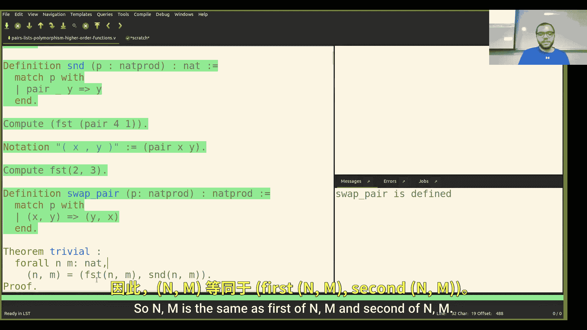

So the proof is super easy。I have to prove this， this is my goal， let me。This things out of the way。

So let's say I just apply Simpl。If I apply simplify what happens， well。

 it just simplifies first of Nm， but first of Nm is just n。And it also simpl second of N M。

 but that's just M。 So if I do simplify。I just get this， I get that for all N and M。

 Nm is equal to Nm， and at this point I can just do reflexivity。ok。But as I've told you before。

 reflexivity is actually quite good at its work so I can just write reflexivity and it already also does simplify and so so for the proof here。

 I could just say reflexivity。Okay。Now I want you to try to prove this second trivial theorem。

 which basically says that for all。Pairs of natural numbers P P is basically first of P， end of P。

 so every pair is a pair of its first element and its second element。

So it looks very much like the trivial theorem before， but I want you to prove it now。

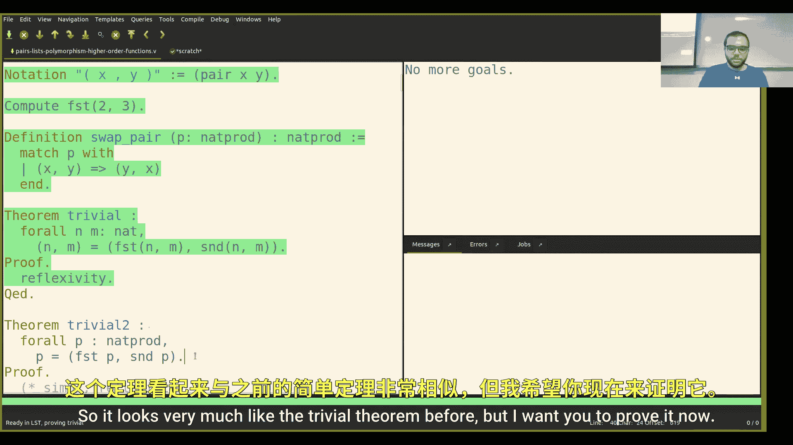

Let's see what happens here if I want to do the same proof as before。

So remember that before my proof was just to say simplify and use reflectxivity， okay？

So let's say I say simplifyimplified here。This is what simplified us。It basically does nothing。

Because it does not know how to simplify any of these expressions。ok。And also， if I say reflexivity。

 that's going to fail。几。Because Co is not smart enough to understand how it can apply reflexivity to the two sides of this equality because they don't really look like each other in terms of their structure right there's a syntactically very different so Co doesn't know how to do this so instead that's actually。

To approve。So。Our first step is always to do intros because we don't want to have quantifiers in our goals。

 so I do intros P P goes up， it's introduced now。So now I can say let's destruct P here。

Because P is a pair。And I know that it has this format basically， it's like of typenet Pro。

 so it's of the format pair and one and2 so I can de it。And if I distract it。

 I can also say distract it as Nm。I can just say destruct P。

 but I like to give names to the variables that I get after the destruction so I do this and now it writes。

P S N M。So this was P， I destructed it， it's now Nm。

 but it also happens on the right hand side here I had first of P and second of P。

 but now when I'm distracting it I had first of Nm and second of N。And at this point。

 you see that this is the previous trivial theorem， basically。I just needed to do a distract。

So I can just apply the previous theorem or I can just write the proof that I had for the previous theorem。

 which is simple and reflex。Okay。P and that's it， so we proved to really trivial theorems here。

But this is how we generally define pairs of items if I want to have a pair of two items。

 that's what I do。But now let's say that I want to define a list of items。

So how do you define a list， again， the only way that we have in this programming language is to define new types。

And we have this kind of inductive structural definitions。For new types。

So I'm going to define a new type called Nalist。Which is basically a list of natural numbers。

 so a list of elements and each element is a net。Now what is the list？

A list I can say is one of these two cases， it's either empty， which I show it by Nil。

So I'm defining nailil and in my mind， that corresponds to the empty list。Or it's basically。

Consisting of two parts， the first part I call it head， which is like the first element of the list。

Or actually， if you use indices starting from zero， it's the element at position zero。

And then I have a tail and my tail is the rest of the list。Okay。😊。

So my list is going to consist of a head which is a natural number and a tail。

Which is itself a list of natural numbers。But of course， I have to give a name to this constructor。

 so I just call it comess。Because I'm putting these things consecutively or whatever I can give it whatever name I like。

 I like cardss。Okay that's also the standard name that is given to this in the standard library so。

We do this， we defined this new type， which is called NaLs。And of course。

 I can now use this new type to basically have variables of this type and also save lists。

So if I want to have a list that has one， two， three in it。This is basically what I do。

I say this is my list。So remember cons basically glued one element at the beginning of a list。

So I'm gluing one at the beginning of a list which is obtained by Guing two at the beginning of a list。

 which is obtained by Guing three at the beginning of the empty list。

And so this is basically the list one to three。And now I can say print this example list。

And as you see。This is my list and it's off typeNe list now of course I hate to write things like this so i'm going to define some notation so that。

I can work with my list more easily， so the first notation I'm going to define is this。

Instead of writing Ks XL， I want to just be able to write X and two columns and then L。

So this just means。Glowing eggs at the beginning of it。Okay。

 so I define this notation and I say whenever I write this， whenever I write this part。

 what I actually mean is concepta。Now I'm having some extra information here。Again。

 this is not something that we would cover in this course。

 but basically whenever you're defining a notation like this。

 you have to also give some extra information。One information you have to give it is about the order of the operators。

Okay， so for example， if you're defining plus minus and let's say this glue operator。

 what is the ordering if someone writes an expression that has all of them in it？

And here I'm basically saying that this particular operation is going to be at level 60 of my ordering。

ok。And then the second thing is that what happens if someone writes something like this？

How should I put parenthesesis for this？Okay， so I can think of this as first gluing A to B and then gluing the result to C。

 or I can think of it as first gluing B to C。And then going A to the result。ok。😊。

So basically the question is， what kind of associivity do I have？

And here I'm saying you have right associivity。 So if someone writes ABC without the parenthsesis。

 this is the。Meaning of that expression。Okay， but again， this is just defining notation。

 it's not that important。I also want to define these empty brackets to mean the empty list。

 so I just say whenever I write this， what I actually mean is nil。Okay。

And I also define a notation like this。And this is a little bit more complicated。

 but it basically says if you have a sequence of items and you write them like this。

 what you actually mean is a list that is obtained by applying cons to every single one of them and at the end applying N。

So if I define this。Basically， these are the kinds of expressions that I can write so I can say my list L1 is 1。

2， three basically like this。But I can also write it like this， I can write it。As1，2，3， nil。

So L1 and L2 are basically the same thing now。But I can also write it like this。So again。

 all of this is just syntactic sugar。From the point of view of Co。

 when you are actually doing reasoning， the only things that you have are your constructors。

 you have Nil and you have Ks。It's just that we're defining some syntactic sugar so that we can write it in a nice survey。

Okay。So now if I say print L3， you see that it also uses the syntactic sugar when it's printing it。嗯。

Okay， and if I print L1， it's also the same thing， it's one，2， three。

 which is a list of natural numbers。Okay。Let's write some functions with this。

So the first function I want to write is a function that basically takes some natural number n and repeats it for a number of times。

So this is going to be called repeat， it takes two parameters， the first parameter is the number n。

 which is a natural number and the second one is how many times it has to repeat it it's called count and both of them are natural numbers and this function returns a list of natural numbers。

Right。And again， this is the most common thing that we do， we do pattern matching。

I say let's do a pattern matching on count if it's zero or actually you know that instead of zero。

 I can also write o for national numbers， so if it's zero。Just give me the empty list。And again。

 this empty list。This is the notation that I defined here。

 so actually what this means is give me Neil。Right， but anyway。

 zero is a notation for O and this is a notation for Nil。And I say that if count was the。

Successor of count prime， so count is count prime plus one。Then。

Take n and glue it at the beginning of a list that you get from repeating n count prime times。Okay。

 so count prime is count minus one， basically。So I create a list that has n count minus one times。

 and then I put n at the beginning of that list。Okay， so I can do something like this。

 I can do compute repeat of 15。Okay。And this is what I get。So it just repeats one， five times。Okay。

 now I want you to think about this next function a little bit on your own so let's say that I want to have a function that takes a list and returns the length of that list。

Okay。So the parameter that this function takes。Is some parameter L which is of typeNe list。

 but it has to just return one natural number， which is the length of that list。So write this bunch。

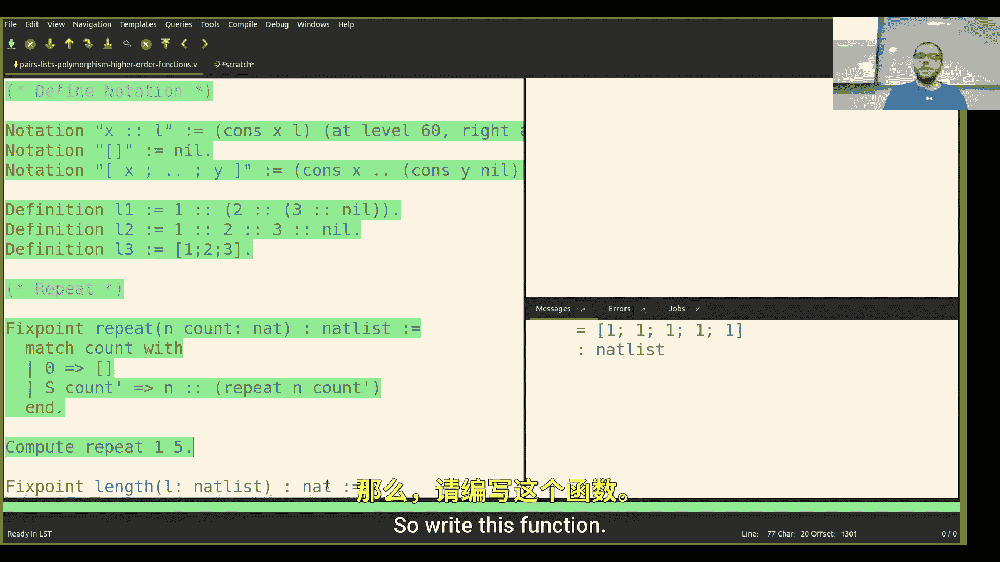

So what we can do as usual is that we can just do pattern matching and I have just one parameter here。

 which is the list L， so I do a pattern matching on L。Now。嗯。Is a net list。

 so I had two different constructors， I had Nil and I had comps。

And I have to cover both cases but I'm doing pattern matching on it。So I say if it's nil， again。

 remember that this was just syntactic sugar for Nil。I have the empty set， the empty list。

 so I just return zero。But if it was。The result of Ks of some elements。

 some head and some tail L prime， then I just take the length of L prime and I add one to it and the way I add one is that I can take the successor。

ok。So of course， instead of this， you could also write one plus length of L prime or length of L prime plus one。

But by now you've seen a lot of proofs and you know that it's easier if I just write s of lengths of L prime so that later on when I use this length in my proofs。

 simplify it can easily simplify it。Okay。So this is the definition of length of course I can use my notation here as well so I can say if it was a head glued to an L prime do this so I could write cons I could write it like this。

 I can put an underline here because I don't care about the value of H all of these things work。Okay。

So as an example， I can compute the length of repeat 34。And of course。

 since I repeated it four times， the length is going to be four。

I can also compute the length of something like this。

 so I just give it a list and ask what is the length it specified？Okay。Now， next one。

Write a function。That takes two lists and appends them together。

Gives me a list that is basically the first list followed by the second list。

So this function should take two parameters， L1 and L2。

 and both of them are lists of natural numbers。

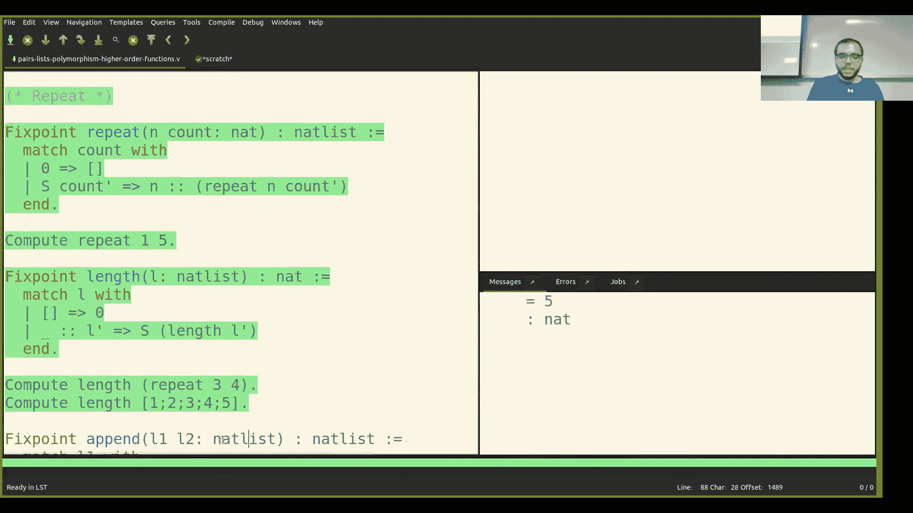

And it should return another list of natural numbers。

Okay， as before we know that we should actually do pattern matching。But。

Which one of these parameters do you want to do the pattern matching on。

 do you want to write match L2 with something or match L1 with something？嗯不。

Why do you prefer pattern matching on L1？你睇啲天啲货啊。Yeah，In some sense。

 if we go back and see how we defined our list of natural numbers。

Our intuition was that we have this cons constructor。

 which basically adds some number n to the beginning of a list。

RightSo in some sense it feels intuitively correct that it's easier to add something to the beginning of a list。

So here， if I want to append two lists， L1 and L2。Again， intuitively。

 I would start with L2 and I would keep adding elements of L1 to the beginning of the list because this is easier for me。

So。I do a pattern match on L1。And I say， well， there are two cases， either L1 is the Nil list。

 it's the empty list， in which case I should just return L2。Right。Or L1 is of this format。

 it's a head followed by a tail and remember that the head is just one number。

 but the tail is itself a list of numbers。ok。😊，And if it's a head followed by a tail， well。

 I first take that tail and I append it to L2。And then I put H at the beginning。Okay， and again。

 remember that these two colons， they are actually syntactic sugar for cons。

So what I'm writing here is the same as saying if L1 is cons of Ht。Then two counts of H and append。

T l two。But of course， with the syntactic sugar， it looks much nicer。

And it's much more intuitive for a human to understand this I first append T to L2 and then I add the head at the beginning。

Okay。So I can do some simple things。I can say append， repeat five twice and repeat one four times。

 so I get a list that has two， fives and four ones。

I can say append two lists and I can give the lists like that and it just appends them。

I can also write examples and remember that an example was basically the same as a TorM so every time you write an example you have to prove it。

 so I can say that the append of one，23 and four five is just one， two， three four5。

And the proof is very simple， I just say compute both sides and they're the same， so to reflexivity。

Now I actually like to define some notation for append itself。

Because I don't like to write a pen all the time， so I'm just going to define plus plus domain mean a pen。

So this is the notation that I define， I say whenever I write x plus plus y。

 I actually mean append X y， and again I say that it's associative from the right。

And I put it at level 60。Okay。So we've talked a lot about head and tail here， for example。

 when we were doing a pen。So it's good to actually have functions for those。

 so let's say I define a function called head。Which is supposed to give me the head of the list。

 so the element at index zero， if we think of our indices in our list starting from zero。

I want to get that element。But now there is a problem here。

And the problem is what happens if my list is empty？So if my list is empty。There is no first element。

Now， in a lot of programming languages， for example， let's say is C++。

If you have an empty list or let's say you have an empty vector in C++ and you try to access its head。

 you try to access the element at index zero， you will just get an error or your program will be killed or an exception will be thrown。

RightBut we can't have that here， every function that we define here should always return something。

I cannot have a case where my function just says， oh， I have an error， I don't return anything。

So instead， what I do here is that I say， well， whenever you call the head function。

You should also give me a default value。And I'm going to return this default value if there is no head。

So my head function is not just going to take a list， it's also going to take a natural number。

 which is the default value that it should return。If the list doesn't have a head。Okay。

 so the parameters are this default， which is a natural number and L which is a list of natural numbers and of course what it returns is of typeNe。

And now I can do a pattern matching on L on the list， I say if the list is empty， if it's nil。

 just return the default value。And if it's not nil， if it's of this form， a head followed by a tail。

 and again， remember， this is basically the same as con's HD。几。😊，Then in this case。

 just return the head and of course I don't even care about the so I can just put an underline there。

That's it。Now I can similarly define a function， okay。

 before that let's actually do some examples so I can say compute the head。Of one，2，3， four。

But I have to also give it a default value and I say the default value is zero。

 which means if there is no head， just give me zero。Okay， and in this case。

 you see that it gives me one because one is the head。

But if I say compute the head with the default value0 of the empty list， it just gives me zero。

Of course， I can change the default value to whatever I want。

And it just returns the default value whenever there is nothing to return。O。

We'll see a better way of doing this now let's define another function which returns the table。Now。

 in this case， I don't really need a default value。

So if I have a list of natural numbers and I want to return its tail。If my list is empty。

 I can say the tail is also empty。Because the tail basically says what is the remaining list if you remove the first item if the original list was empty it makes sense to return the empty list so I do this pattern matching and I say if my list L is empty。

 just return the empty list and if it's of this form just chop off the head and return the tail。

And again， here， since I don't need the head， I can just put an underline or underscore for head。

So that's it。So now I have two functions that give me head and tail。But very importantly。

My tail is not my last element。My tail is just all of the elements except the first one。

Write a function that actually gives me the last element。

 so complete this function I want to have a function called last element。Which takes。

A list L of natural numbers and returns a natural number which is the last element。

 and of course it should also take a default value for the case where there is no element。

 there is no last element。

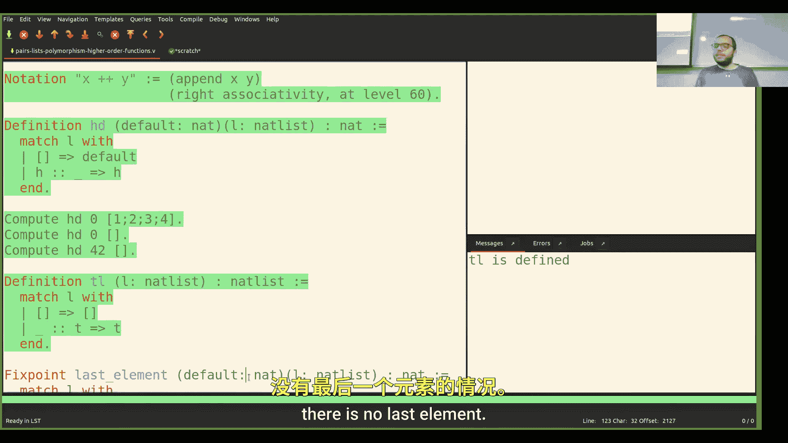

So here's what I'm going to do here。I'm going to do a pattern matching on L。And I'm going to say。

Either L is the empty list， in which case I just returned the default value because there is no as。

Or it's a list。😮，Of this format。It has some number n followed by the empty list， okay。

 cons of n and empty list， and I can also write it like this。Now， if I have this case。

 I basically have a list of just one element that's n。

 and of course I return that as the last element。Or if it's of this format。

 it's n followed by a tail。Right？And in this case， I just returned the last element of this tape。

But I have to be careful to pass the same default value to this function again。ok。😊。

But very importantly。When I'm doing pattern matching， I check the patterns from top to the bottom。

So in this case， the third pattern is checked only if the second pattern does not apply。

 so this pattern is actually saying that t is not empty。

That's why I can go and take the last element of tea。ok。😊。

So I can have things like computing the head or sorry， computing the last element。

Of let's say one two three and it gives me three。Okay。Now I can prove some theorems。

So the first theorem I want to prove。Is that。If I have a list， LSD。

And I just appends the empty list to the beginning， I'm going to get the same list LST back。Okay。

 so appending， the needle list will not change anything。And here's my proof， I just say reflexivity。

 it solves it。Because if you just look at the definition of aend。We can go up。

And append already says that if you have an empty list， you just return the second list。

So if I actually do this。Step by step， I can do this， I can say first two intros。

And now here I have the empty list appended by LSD， but if I do simplify。

 I already get LSD on the left and then these two are of course equal so I can just do reflexivity。

 but again， just writing reflexivity would also solve it。Okay。

This is the next theorem that I want you to prove。I want you to prove that。If I have a list LST。

The length of its tail。Is the predecessor of its length。

So basically all I'm saying is that if I have a list of n elements and I chop off the first elements。

 I will have a list of n minus one elements。Right？But okay， so we've defined lengths。

 we've defined tail。And pre was a function that we defined when we were talking about natural numbers。

 it basically gives the predecessor of a number Okay， try to prove this， but before you prove it。

There is something strange about this Theorra doesn't have a corner case。

 it doesn't say that it holds for all lists that are not empty， I'm saying it holds for every list。

includingncluding the empty list， why does that make sense intuitively。

 because if I have the empty list then the length of that list is zero。

But I defined the predecessor of0 to v0 because I was just working with natural numbers so I don't have minus one and also if I have an empty list I said that the tail of the empty list is the empty list itself so if LSD is the empty list both sides are actually zero。

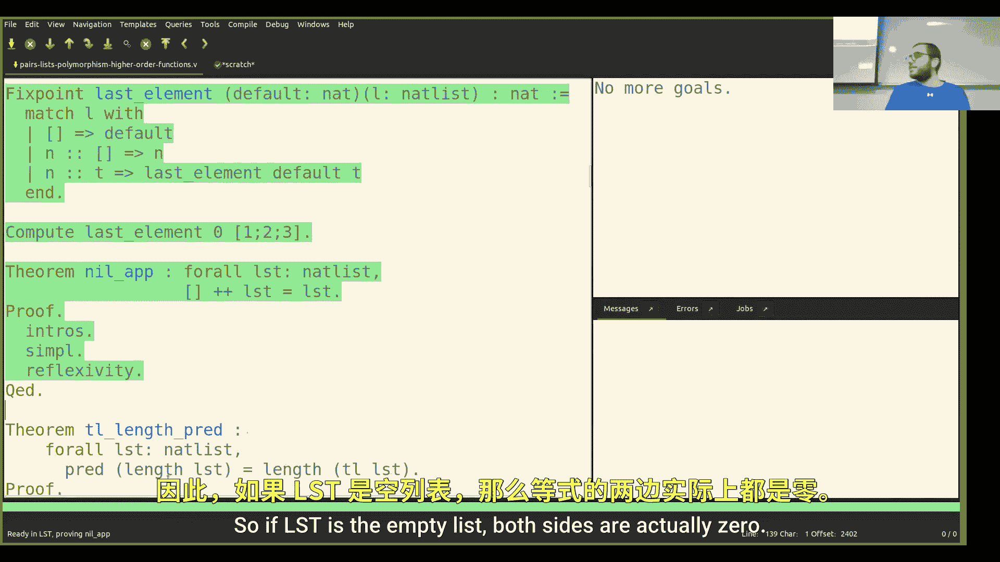

And I don't need to have a Cor case for that。

So this is our goal and as always， whenever I have quantification here。

 I want to get rid of it so I do intros。Now I basically want to do a casework on my list。

 I want to say my list is either empty it's the N list or it's non empty so it has the cons construct so I'm just going to say distractstruct my list。

And I'm going to give a name to my head and tail， so I'm going to call them H&T when I'm doing the destruct。

So now I have two goals。The first goal。Is the case where my list was empty。

 so I have to basically prove this。But I can prove this by just computing both sites。

RightSo the length of the empty set is zero and its predecessor is also zero。

 the tail of the empty set is the empty set and the length of the sorry list not set and the length of the empty list is also zero so I have zero on both sides。

 so if I just say compute I see I get zero equals zero and I say two reflexivity for that。Again。

 I didn't need to do compute first I can just do reflexivity， it's smart enough。Okay。

 how about this one？So let's look at our goal here。Here， I have。The length of the tail。

Of a list that looks like this， H followed by T。Okay。And on this side。

 I have the predecessor of the length of the entire list H followed 20。

 so let me try to simplify this and let's see what simplifyimpl gives me。

It gives length of T on both sides。But let's understand what Simplify is doing here。

 how do I get lengths of T on both sides？Well。On this site。I have the tail。Of this expression。

 but the tail of this expression is just t that's the definition of tail so if I go back to very defined tail I said anything followed by T I'll just return T。

So when I simplify， of course， on the right hand side， I'm going to just get lengths of tea。

Right let's see， yes， but I'm getting the same thing on the left hand side as well。

So what's happening there？There I'm first applying the definition of length。

 so simplify is just applying the definition of length。

 but let's go back and see the definition of length。Again， in the definition of length。

 it says that if you are in this case， if you have some element followed by another list。

Just give me the successor of the length of that list so this entire thing becomes the successor。

Of the length of T。So I have the predecessor of the successor of the length of d。

 but then it applies the definition of predecessor and it knows that the predecessor of successor of something is just that thing。

So that's what's happening in just one simpl， that's all the steps of simplification that gives me length of T on the left hand side。

So now finally I have length of T on both sides， I can just say reflexivity and that's it QD。Okay。

But these were basic proofs that we were doing on lists and we were not using induction let's actually do some inductive proofs on our lists now here's the first theorem that I want you to prove。

I want you to prove that append is an associative operation。So I want to say if I have three lists。

I can first append list one and list two and then append list three to it。

 or I can first append list two and list three and then put list one at the beginning。

And I want you to prove that these two are the same。

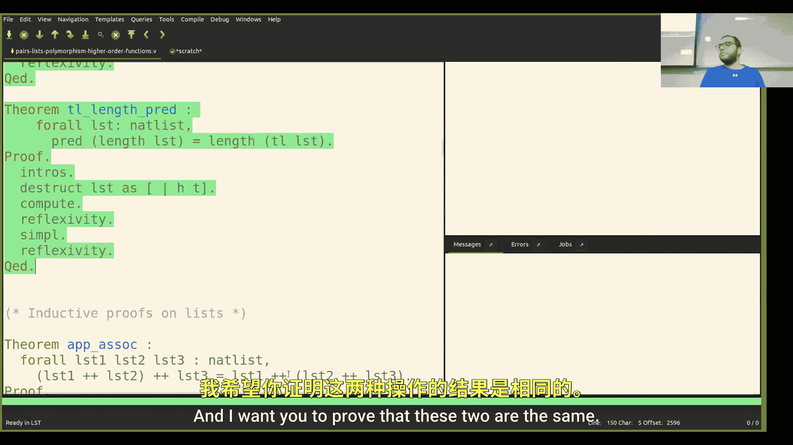

We want to， of course do induction， but which parameter do you want to induct？没意思。喂。嗯。

that firstYes so we had this intuition from before that whenever we want to do induction we want to apply our induction on the same parameter where we did our pattern matching in the definition of the operation that we're doing so in the definition of a pen。

Going up here， re。😔，I'm doing pattern matching on the first parameter。So ideally， I want to also do。

An induction on the first parameter here， which is LSD1。So let's do this。

I start my proof again I have quantifiers here， I do intros so that I get rid of my quantifiers there。

And then I say let's do induction on LSD1。Okay， and again， LST1。It's a list， so it has two possible。

Constructors， this is what we have here， you have nil or cons。

And what I'm saying here is that I'm saying well， Neil doesn't have any parameters， but for cons。

 give the names H1 and T1 to the parameters。So I'm saying do an induction on LST1 and use these names for the variables that you get there。

 okay？So when I do this induction， as you see， I have two goals now。

 so the first case is the base case of the induction where LSD1 was nil。

And the second case is like the inductive step where LST1 is not in， so if LST1 is nil。

 this is what I have。This is what I have to prove， I have to prove Neil append with LST2。

 append with LST3 is the same as this expression and by the way。

 you don't see any parenthesesis on the right hand side here and that's because when I defined the notation。

 I actually told Cork that this operation， this append operation is right associative。

So CoC doesn't put extra parentheses when they're not needed。

 but if I want to see all the parentheses， I can just write this。

 I can write set printing parentheses。And if I do this。

 it now puts down all the parenthees and you see that the right hand side is actually different。

Because of the parentheesis。Okay， but let me not do that， let's just。Work with this case。

 so now I can actually just do simplify again。Why can I easily do simplify because if I do simplify on this side。

I know that it's the empty list appended with LST2， but in the definition of append。

 this would just give me LST2。So if I do simplify， I expect this expression。Elessit to。

And then on this side。I basically had the parenthesesis over this expression。

 so I have the empty list appended to whatever this rest of it is。

 but then I will just have the rest of it so if I do simplify。

I get the same expression on both sides， LST2 plus LT2。And now I can use reflexivity， great。

 so my first goal was reached， I have one remaining goal。And this is the remaining goal。

It says that you have this induction hypothesis。Which is basically talking about the tail of the。

First list it's saying that T1 plus LSD2 plus LST3 is the same as T1 plus LSD2 plus LSD3 with different parentheses。

 of course， and then I have to。Prove the same thing except that I now have H1。So again。

 I can do simplification。And if I do simplification， it uses the definition of append。

Let's go back again to the definition of a pen。You see， it says that。If you are appending some L1。

 which is of this format， ahead followed by a tale。

Then you can just first append the tail and then put the head at the beginning。O。

So if I apply this simplification at this point。You see here I have a head and a tail and I'm appending it with something。

 so I will just get the head appended with the tail and that thing so I'll to simplify and as you see。

Again， it just feels like we changed parenthesesis。

 but this is a different expression now what do I have？😊，Here。I have T1 plus LSD 2 plus LST3。

And by plus I mean aend， and here I have the same thing except that it has a different parentitization。

But I already know that these two things are the same because of my induction hypothesis。

 so I just say rewrite using the induction hypothesis。

And now I finally have the same expression on both sides。And I can say this is reflexivity。Okay。

The next thing I want you to do is to write a function that takes a list and reverses it and just returns another list。

 which is the reverse of the original。

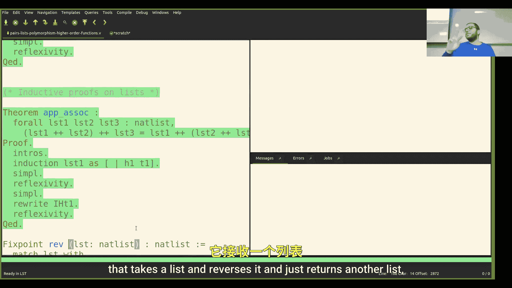

Okay， so as usual。The only operation that I can really do when I want to start writing my function is to do a pattern matching。

On the parameter。So I have this list LSD and I want to reverse it。I say let's do a pattern matching。

 there are two cases， either my list is empty in which case I have to just return the empty list and I'm happy about it。

Or my list is of this form。H。Followed by T and remember H is just one element t is itself a list and if this is the case。

 what I'm going to do is that I'm first going to reverse T。

And then I'm going to add H to the end of the。Right。But crucially。

 I didn't have an operation that would just add one element to the end of a list。

 the only operation that I have。If I go back to the definition of my list。Where is it。Here。

 the only operation I have is the operation that adds one element at the beginning of a list。

But I've already defined a pent。So I can just create a list that has only one element in it。

 that only has eight in it。And then I can append it to the end of this list。

 the list that was obtained by Reing。Right so this is the same as saying I'm adding H to the end of T。

 but since I didn't have that operation， I had to just use aend to do the same thing。So I do that。

 this is the definition of reverse and now I can do computation so I can say compute the reverse of  one。

 two，3， four。And of course， that's the reverse it's 432。And of course。

 you could expect that I want you to prove this theorem now。So with this definition of reverse。

 I want you to prove that for every list， the length of the reversed list is equal to the length of the original list。

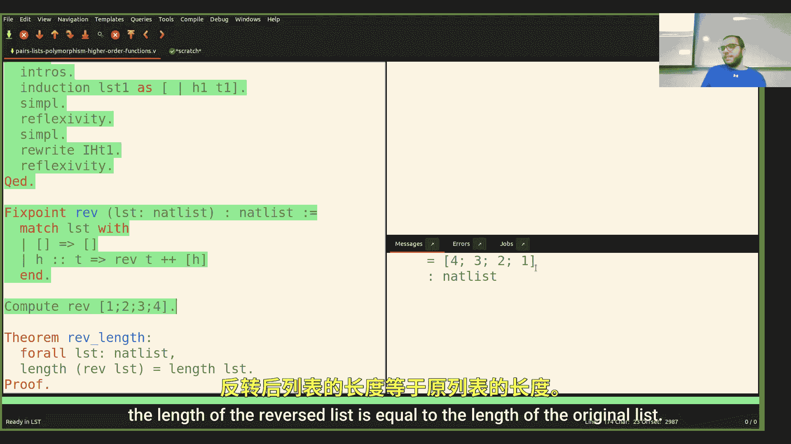

Here's the proof， this is our goal， again， as usual we start with intros。Now I want to prove this。

 I want to prove that the length of the reverse of this list LSD。

Is the same as the length of the list itself。Now， of course， I have to do induction here。

And I literally only have one variable so I can just do induction on LSD。

And remember that our induction is always a structural induction。So for a list， LSD。

 we had two cases， it was either the empty list nil。

Or it was one item added to the beginning of another list。

 so when I do induction on LSD it gives me these two cases。

 the first case is where LSD was empty and the second case is where LSD was basically something like this and followed by someone else。

Actually， let me say。In this case call it head and tail now for the first case I can just use compute。

Because this is the length of the empty set， I don't know why it keeps saying set。

 this is the list of the and length of the empty list。

And I just compute it and it's zero right and I can also compute the reverse of the empty list which is the empty list and then its length is zero。

 so I just say compute and I get zero equals zero， which is reflexivity rate。

Now I have the inductive step。So this is what I know。

 I know that the length of the reverse of T is equal to the length of T。

But now I have to prove that the same thing holds if I add one element at the beginning of T。

 so if I have H followed by T。Okay， so let's simplify。Now， again。

 what's happening when I'm simplifying here？Look。On the right hand side。

 I had lengths of H followed by T。And simplify goes and looks at the definition of length。

 so it says if I have something followed by T， I just have length of T plus1 s of length of T。Okay。

 and that's exactly what's happening here when I'm simplifying， I'm getting S of length of T。

On the left hand side， when I'm doing Simpl， it's applying the definition of reverse。

So what is reverse of H followed by T？According to the definition of reverse。

 this is the reverse of T appended with。The list that has just one element h okay so I do this and this is exactly what I get here now what do I know from my induction hypothesis。

I know that the length of the reverse of T is the same as length of T。Okay， so。

Here I have lengths of tea。Here I have length of reverse of T append with something， okay。

 so let's try to rewrite it using my induction hypothesis。And this is what I get。What I get is that。

The length。Of the reverse of T append with H should be1 more than the length of the reverse of T。

Okay。So I have some list reverse of T， and I'm basically adding one element to the end of this list。

And I want to say that the length is going to increase by one。

Now this seems to be a very simple thing， you might think that if I just write reflexivity。

It would work， but no it doesn't work。Why doesn't this work？Well。

The same way that I could say set printing parentheses， I can say set printing all。

And what this does is that basically instead of using the syntactic sugar。

 it prints everything in detail so that you can see what you have on each side。

Now you see from Coch's point of view。This is what I have so this one on the left hand side。

 it's the length of the append of the reverse of T and。The list that is just counts of H and Neil。

 so this is the list that only has H。Now， so if I want to do simplify or if I want to do reflexivity。

They both failed。Why do they both fade？Because Coke cannot really simplify this at all。

So I have the length of something apped with something else。

Right if I go back to the definition of length， you see I have two different operations and these are not the same operations。

 I have the append operation which basically takes two lists and glues them together and I have the cons operation which adds one element at the beginning of a list。

 these are not the same operation because of the differences in the types。

One of them is adding one element to a list， the other one is adding two lists together。

So my problem is that length is using this one in its definition。

 but what I need here is the length after a pent。So that's why I cannot move forward in this proof I get stuck here。

And from Cox's point of view， these are completely different of course。

 because Cock doesn't have the human intuition that we have。

 it just looks at all of these things as a bunch of functions and just follows the roots again if I print it you see that it sees it as the length of the append。

Of this and cons and for Co append and cons are different。

And also other than that another problem that I have is that i'm not really adding this to the beginning of my list。

 i'm adding it to the end of my list， so even if I didn't have a pen here I had something like cons I would still have the same problem because in the pattern when I was matching for length。

I had the case where I had something added at the beginning of my list。

 but this is now something added at the end of the list。So because of all these problems。

 this proof cannot go on and I just say aboard I give up。Okay， so instead。

 what I'm going to do is that I'm going to first prove another lemma。

And this is a very simple le that will hopefully help me solve this case， so remember this is。

What I needed so that I can prove my previous theorem。 I needed to prove that the length of some。

List， I don't care that that list was the reverse of T the length of some list appended with one element at the end is going to just increase by one that's what I want。

But I'm just going to prove a much more general theorem and what I'm going to prove is that if you have two lists。

And if you append them together， the length of the result is the sum of the length。So。

Let's try to prove this。Okay。So again， I have universal quantification here， so I do intros。

Now this is what I want to prove。As usual， I want to do induction。Now again。

 I do induction on LSD1 because LSD1 is on the left hand side and I again have this intuition that I want to make sure that my induction matches my pattern matching in the definitions。

So I do induction on LST1 and I say break it down into head and tail H1 and tail one。

So this is the first case where my LSD1 was basically the empty list and basically it says that the length of the empty list apped with LSD2 should be the length of the empty list plus the length of LSD2。

 but here I can use simplify and if I use simplify。

It uses the definition of lengths to see that this is zero。Okay。

 and it also uses the definition of append to see that this is LST2。So when I do simplify。

 I get length of LSD2 on both sides because this is length of LSD2。

 this is0 plus length of LSD2 and it also uses the definition of addition。

 it knows that zero plus something is just that thing。

RightSo simplifypl gives me lengths of LSD2 on both sides and then I can say reflexivity and that's my first goal。

Now I have one remaining goal。And this is the induction step。

So let's say that the length of T1 apped with LST2 is length of T1 plus length of LST2 now instead of app T1 I'm app H1 T1 to LST2。

Okay， again， let's see what happens if I do simplify。If I do simplify it。

It uses the definition of a pen and it sees that app pending H1 T1 to LST2 is the same as taking H1。

And taking the result of appending T1 and LST2， so this and then putting H1 at the beginning of it。

Right and then it uses the definition of lengths to see that that's one plus the length of the append of T1 and LST2。

So you see when I do the simplification。It basically gives me one plus the length of a pen of T1 and LSD2 and remember S was basically the successor that's what we。

And then。What happens on the right hand side？On the right hand side。

 it can't really do anything with this one。But it can simplify this one。It can say that well。

 the length of H1 followed by T1 is 1 plus the length of T1， so when I do simplify。That's what I get。

But then it also does one more step。And it's like it was S of length of T1 plus length of LST2。

 but it understands that applying the definition of addition。

 that's just the successor of the addition of both of them。

So it's whenever I'm doing simplifyimplify， I'm applying all of these definitions。

Everything that we've defined before in the previous sessions， for example。

 addition for natural numbers is also used here。Okay now this is what I have to prove。

 but this is quite easy right because here I know that length of t1 plus LSt2 is the same as length of t1 plus length of LSt2 and all I have here is that the successor of the first one should be equal to the successor of the next one so I can just do rewrite and by the way I can do the rewrite in any direction here it doesn't matter I can do this rewrite。

Or I can do this rewrite。And in both cases， I get the same thing on both sides so I can just say this is reflexivity。

And curity。Okay。Actually， I also need another lemo。

 but this is a Lemo that we've proven before and it just says that。If I have two natural numbers。

 a plus b is equal to b plus a so addition is commutative I've proven this to you before。

 so i'm just。Going to go over it like that when you're writing this you can just write admit it right so a plus b is b plus a we've proven that before finally we can come back to the theorem that we wanted to prove we wanted to prove。

That for every list， the length of its reverse is equal to the length of the list。

 so let's do the proof again and this time we will not get stuck so。

I first want to get rid of this quantification， so I do intros。

Then I do induction on my list and of course I break it down into a head and a tail now the base case is when my list is empty。

 I can just do compute here and it gives me zero equals zero which I can solve with reflexivity。

And now I have one gold remaining。And the goal that I have remaining is this。

 this is the inductive step， basically。So let's do simplify， this is the same as before。

 and this is where we got stuck last time。Right。But now。I have this theorem。

 which says that whenever you're appending two lists。

 the length of the result is just the sum of the names。So I can rewrite using that theorem。

And it will rewrite this part。RightSo let's do it。So now instead of lengths of this append。

 I just get the length of the tube。Okay。Now I can do simplify。Now， what happens if I do simplify？

You see， it just applies length。To this。But this is a list with only one element。

 so length just returns one already for this。So if I do simplify length of H will be replaced by one。

 so I do simplify。Now this is all I need to prove。That。😡，Length of the reverse of the plus one。

Is equal to the successor， which is also plus one of length of T。But what is my inductive hypothesis？

😊，It's that T and its reverse have the same length。Right so。

I just use my inductive hypothesis to rewrite my goal， instead of lengths of reverse of T。

 I will get length of T。So this is what I have， I have length of t plus one。

Is the successor of lengths of teeth？But remember， successor of length of T wasn't really length of t plus one。

 it was one plus length of t and these two things are different for us。

RightSo this is why I needed this other lemma， which basically said that I can change the order of addition。

So now I can rewrite using that and instead of length of t plus1 on the left hand side。

 I get one plus length of T。And finally here I can use reflexivity or actually I can use Sim first。

 so because Simplify uses the definition of addition and it sees that one plus length of T is the successor of length of T。

Right and then finally I have the same thing on both sides so I can say reflexivity and this ends the proof and it also ends this session。

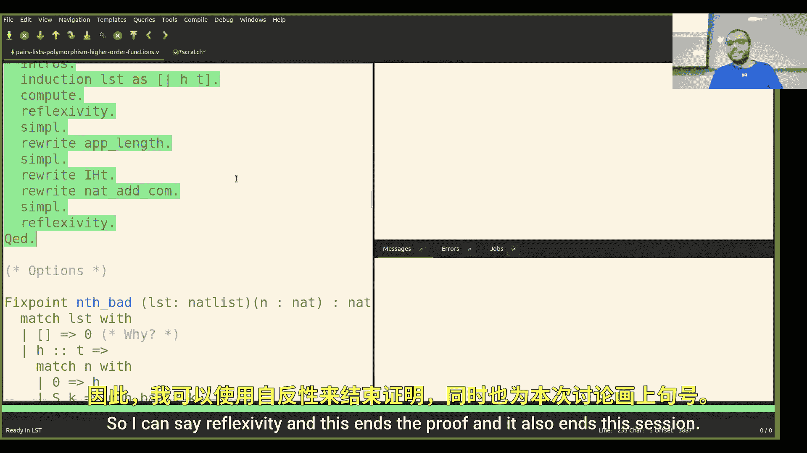

Okay， see you after lunch。

Make sure that you write everything that I write here。

Because at some point I will ask you to prove something and you already need to have the definitions。

So if you need time， just tell me and I will wait a little bit after each one of this。Okay。

So we've already talked about lists and we talked about these two functions that basically return the head of the list or the last element of a list。

Now， let's say I want to write a function that basically takes a number n and enlist LSD and returns the item at index。

 the ends item of the list。And I'm assuming that my list starts with index zero。Okay。

 so I'm going to call this one and spa because it's a bad function， we'll see why。

But basically this is what I'm going to do， so I have an LSD which is a list of natural numbers and I have an index n which is itself a natural number and of course my function should return a natural number as well。

So I said let's look at my list， let's do a pattern matching on LST and first of all。

 if my list is empty， I'll just return zero。O。And this is the part where returning zero is not a great idea。

Right because I cannot distinguish between the case where my list didn't have an end settlement。

And the case where the end element was actually zero。Now。

 of course I can do the same trick as before， I can say give me a default value and I'll return that default value。

But that's also not a great option。Anyway， for now， let's say that。

This is what I do if my list is empty， I just returned zero。Otherwise。

 my list has to be of this form， it has to have a head element followed by a tail list。

And now I'm going to say。Let's do a pattern match on the second parameter on n。If my n is 0。

And I have a head， of course I'm going to return the head because that's the one at index zero。

Otherwise， my n is let's say k plus1 n is s of k。So I basically have to。

And look at my tail and I have to return the case elements in the tail。So in this case。

 I just called the same function reccursively with parameters T and K。Okay， nice。So。Now， the problem。

 of course。Is that I have this case here and I'm returning zero and zero doesn't really mean anything I could have returned anything else。

But nothing would solve my problem， no matter what value I put here even if I put。

 let's say 42 or whatever 420， I always have this really bad situation where I cannot distinguish between the case where my ends element was actually this default value and the case where my array or my list actually had less than nNs。

Right。So let's say I want to somehow distinguish between that。

The way I can do that is to define a new type， and I'm going to call this type an option。

Now this is how this type looks like， so it's an option on natural numbers。

 so I'm going to call it Na option。It's a type and it has two constructors。

 the two constructors are none and some。And I mean， I can put the none first or I can put it second。

 who cares？That's actually put it first， maybe。That's a little bit more natural。

So I can have none or some。And basically， this is a new type。

NtAT option is a new type that has two different constructors。

So you can have none and we think of none as something that doesn't exist。

 so think of how you work with null pointers， for example， in C++ when I don't have something。

 I say it's none。Or if it's not none， then it's something so I'm going to call it sum and then sum is going to also carry with itself a natural number。

ok。Now， very importantly， this is a different type than the natural numbers。

 this is a completely new type that I'm defining。😊。

So now what I'm going to do is that I'm going to define the same function that took an array or sorry took a list。

 I don't know what the problem is with the word list， I always say set or array， it's a list。

 so whenever I say set or array just think about list。So I just have a bug in my mind。

This function is supposed to take a list LSD。And sum index n and return the elements at the end's position。

But you see， instead of actually returning a net， a natural number。

 I'm going to return a that option。Okay， so the ends element， if it doesn't exist。

 I'm going to return none。If it does exist， I'm going to return some and that element。ok。Now。

 why is this better than just allowing my functions to have errors or anything or why is this better than having。

 let's say， a null value， null pointers？I could just define my natural numbers to also have a null value。

Right this is better because now I have these two。Different constructors for the option。

Which means that whenever I'm working with a variable that is of typeyNe option。

And whenever I do pattern matching， I am forced to consider all the patterns。Remember。

 so one of the rules in pattern matching was that you have to cover all the possible cases。

So this actually stops me from writing code that forgets about none。

 whenever I write any piece of code that is working with a that option。

 I am forced to consider the case where it's none。So this effectively means I will never have things like no pointer errors。

 that's not going to happen to me because every time that I match I'll have to consider the case where it's not。

Okay， so this is just a better way of coding where you don't have these kinds of errors just by the way that the language forces you to code。

Okay， let's actually write this function and this is like the standard library name of this function。

 it's called end's error。And basically it takes a list， it takes some number n。

 and it returns the ends element of the list。And it returns an option。

 so if the ends element does not exist， it returns none， if it does exist。

 it returns sum and the elements， okay。So the function itself is actually very much like the previous one。

 except that we have to make some small changes to make sure we have the right types everywhere and instead of the default value now we have none。

Okay。So I'm going to start with a pattern match on my list。And I say， if my list is empty。

 just return none。Because there is no element in an empty list。

 there is no ends element in an empty list， otherwise my list is of this format。

It's a head element followed by a tail list。So in this case。

 I say let's do a pattern match on the natural number n on our index。If our index is zero。

 I just have to return H。Okay， but remember my return type is not net， it's net option。

 so I don't return H， I return sum of H sum H。Okay。😊，In the other case， if my n is k plus1。

 I just have to take the tail and I have to return the case element in the tail。

 so I just call the same function with parameters t and K。诶。😊，And that's it。By the way。

 one point that I'm not really talking about in this whole lecture。Is the runtime of these functions。

 we don't really care about that。We are focused on whether these functions are correct。Of course。

 you can have much more efficient implementations and this is not a very efficient one。Okay。

So let's actually do some examples of computations with this function ends。So， if I have。

This particular list。And I ask for the element at index zero。

 it should give me four and it does give me four。ok。Now let's say I have this one。

 which has only four elements。And I ask for the element of position 10。ok。It gives me none。But again。

 I want you to really focus on the types so here。It's not really returning the natural number four。

 it's returning a net option， which is sum four。And this one is actually returning in that option。

 which is not。Okay， and of course， if I want to get this value of four out of the net option。

 I can again do a pattern matching。But then I have to say do a match on this NA option and when I do a match on this NAt option I have to consider all the possible cases。

The language forces me to consider the case where I have a none。Okay。

Let's see how else we can write the same function， so here's another way of writing the same function。

 let's say I have this list which is a list of natural numbers and I have n and again I'm returning that option。

Instead of writing two matches like this， I can just write a single match which works on both parameters。

 match on LSTN。So the first case is that if the list is empty， I don't care what n is。

 I'm going to return now。If the list has a head。Again I don't care what the tail of the list is as long as n is zero。

 so if n is zero and the list has a head， I just return that head。

 but of course I have to convert it to the right type so I return some H， not just H。

If I just return each year。You see that I'll get an error。And basically。

 the error is that the term H has typeyNe， but it was supposed to have the typeyNe option。

Whereas if I do some H。This works。And finally， the last case is that if none of the previous cases happened。

 so my n is k plus one， it's the successor of K。And in this case。

 I don't care about the head of my list， I only care about the tail。

 I say give me the case element of the tail。And this is。A recursive function。

 and that's why we're using the word fixed point here。Okay。Have you all caught up。

 do you all have these functions now？If you don't， please let me know。

 I'm going to wait for just one minute for everyone to catch up and again remember this was the definition of our option。

Let's actually define。A partial map or what you would probably know just as a map。

So we already know how we can define functions。But the thing that we saw about functions is that we only have total functions。

 we cannot have partial functions in co。So your function should always return something。For example。

 here in this ends error， if I don't have one of the cases， if let's say I just remove this case。

I will get an error and it says that the pattern matching was not exhaustive。So my function。

 whenever I have， for example， a pattern matching， I have to have exhaustive pattern matching。

 which means I have to cover all the cases。And also in every case I have to return something。

 so my functions are always total functions， there is no case where I give some inputs parameters to a function and it doesn't return anything。

 I cannot have that。Okay。😊，Which also by the way， means that I cannot write programs that run forever in Cock。

Just by the way that I'm writing my programs， the fact that I have to be able to verify that the functions always return something。

That means that I cannot have an infinite loop。ok。😊，Great。

And even when I'm defining recursive functions like this， cock checks。

 and I cannot have some infinite loop here。Now let's do partial math。

Let's say I want to have a function。That maps elements of some type to elements of another type。

For now， let's say I want to map natural numbers to natural numbers。

 but let's say I want to have a partial function。So I want to have something again like map in C++ if you have a C++ map。

For some keys， you have values， but you don't have a value for every possible key。Right？

So I want to define a type that basically covers that kind of map， a partial map。

So here's what I say。I say my map， which is basically a new type and I'm going to call this partial map。

And very much like my list， it has two cases。Either it's empty。

Or I have a keyK that is mapped to a value V， and then I have the rest of my map。ok。

So this is a definition of map， which is basically using the list as its underlying data structure here。

RightSo the only difference with what I had for list was that in list。

 so I had the empty list and I had the list where I took another list and added one element。

But now here in this definition。I'm going to say that for a partial map， I have the empty map。

And I have a map that is obtained from another map by just adding one key and one value to the beginning。

 I can give whatever names I want to these constructors。

 but the really important point is that these names should be unique I cannot reuse the same names that I had for my list。

So that's why I use empty and I use binding here， which basically means I'm binding the keyK to the value V and I have another partial map which is the rest of my map。

Okay。Great。Yeah。So。Here's a very simple operation。Let's say that I want to update the value of a particular key。

 so I have a keyK which is a natural number， I have a value V， which is a natural number。

 I have a map M。And I want to return another map。In which everything remains the same。

 except that K is map to V。So this is actually super easy I can just use this second constructor。

 I can just say。Binding K， I just add K and V to the beginning of that。No， yeah。

 that's an important point。If I have the same key already there I'm not going to remove it。

 I'm just going to add this new key to the beginning。

 but then later on when I search I start searching from the beginning so I will only see the first instance。

Again our data structures， especially in this course they're not optimal at all。

 it's not about having the optimal data structure， it's just about being able to reason with these data structures。

Speaking of which。Complete this function， let's say I want to do a search。

 I want to find a particular key。So this is the find function， it gives you a key。

 it gives you a map。You have to return the value corresponding to this key， but of course。

 the key might not exist in the map。So instead of returning an actual number。

 you're going to return a net option。And you have to return none if it doesn't exist。

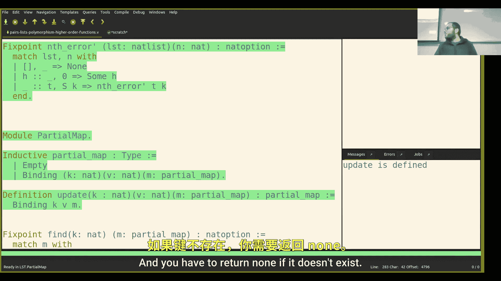

So intuitively， it's obvious what you have to do， you have to just read this partial map and write a recursive function and you have to look at the first elements。

 see if the first element has the right key， if not you look at the rest of the map。

And if there is no first element， if your map is already empty， you just return up。Okay。

 so let's do this。So I'm going to first do a pattern match on my map M and first of all I'm saying if it's empty return none and remember that empty was a constructor in my partial map type and none was a constructor in my net option type。

And it's actually really important to give them different names。Okay。Otherwise。My map。

Is something like this it's of this format， it has a binding， it's basically mapping some other key。

 let's call it K22 V， and then I have the remaining part of the map， which I call M prime here。

Now here's what I do， I say if k is equal to K2。If I have the right key。Then， return V。

But in order to return this V， I have to turn it to NA option， so I have to return some V。Okay。

 otherwise， if it's not the right key， just keep searching for k。In the rest of the map in Em。Okay。😊。

Again the types here are really important first of all。

 I told you about the difference between equals and equals question mark。

 so I need a boyan as my if condition。So that this works if I write it without a question mark。

It gives me an error because it says k equals to K2 has type prop。It's a proposition。

I cannot use that in an if， so I have to use。Equal question。ok。So that's the first thing。

 the second thing is a very common mistake。When people want to write this is that they focus too much on the pattern matching。

So here's one way that will not work， so let's say I write the same function find。It takes a key K。

 it takes a partial map M， and it's supposed to return a math option。Okay。😊。

And let's say I do the same match。On my partial map M。 So I say if M is empty， return not。Then。

I've seen this kind of quote before and it comes from a very common misunderstanding。

I can say if it's binding of Kv and some m prime， then return V。Otherwise。

 if it's binding of some other things。An M。Then return find of K in that empire。Okay and。

Why is this wrong， this doesn't work。Okay so that's the first problem， yes， I have to return some V。

 not just V。But I have another problem。Look at this area。 What does it say。

It says you don't need this pattern。Which means that all the cases covered by this pattern was already covered before。

But that sounds weird right because it sounds like I haven't covered some cases Yeah so basically here this is not the same as this。

This is the key that I'm using in my pattern matching。

So I'm saying if you can write M as a pattern that looks like this。Then return V。

It doesn't remember that this K should be that K， that's not something that happens here。

 I'm just defining a new K now。Okay， so I cannot write it like this and in this case actually。

Cook catches me because it says that all the cases were already covered by these two first cases of your matching。

 you don't need the third one。Okay， so again， very important， you cannot write like this。

 so this is wrong。I call it wrong point。But you can use if， of course。

 you can use if to check if K and K2 are the same and if they are the same， then return some V else。

 return， find K and prove this one， this theorem。So I'm saying for every map M。

And every two integers， K and V。If I search for k after I have updated the value of K to be v in M。

 then I will get V， I will get some V。Okay， so here I have the map M。I'm saying map K to V。

 I'm first doing that update， and then I'm saying find K in the updated map。

And I expect to get the value of V backAC。But I want you to prove this as a ti and as a lemma。

 you can add thislemma， which basically says that for every A and B that are natural numbers。

 a is equal to B， so if I use a equal question mark B。

 which would give me a boolean instead of a proposition， the boolean it gives me is true。

This is actually something that you can prove using the techniques that we've seen like in the very first coq session。

 but I don't want you to prove that I just want you to use this lab so basically thelemmad is saying that equality is reflexive on natural numbers Oh no no no what is this no no no。

 this is completely wrong。For every a that is a natural number a is equal to a。

 I don't know why I had a MB I was saying every natural number is equal to every other natural number that was about yeah yeah。

Yeah， try to prove this dear。

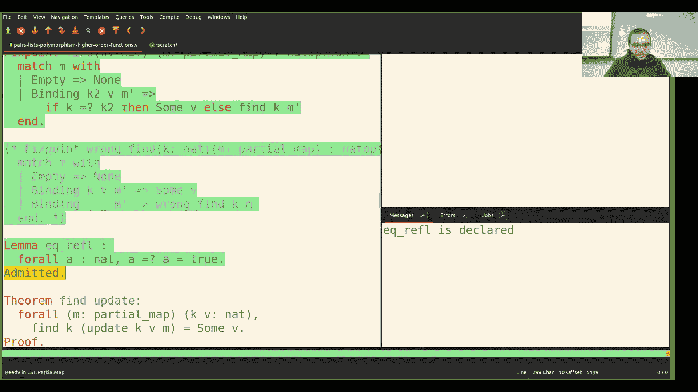

Let's see how we can prove this。😔，So this is my goal。

 I want to prove that for all Ms that are partial maps and KMV that are natural numbers。

I have this equality， so basically if I take the map M and I insert Kv into it and then I search for K。

 I should find V。Okay。So in our proof， we of course first do intros so that I put all of these variables up there instead of having them in the goal。

And let's just do simplify。Okay， so I do simplify。And this is what Simplified gives me， and again。

 this is just applying the definitions of find an update。And of course。

 the right hand side there's no way to simplify that that's as simple as it is， okay。

 so basically it says that if k is equal to k， then some V else find Kv。

But I know that k is equal to k because I have this lemma here。

 which says that everything is equal to itself。So I'm just going to rewrite based on this lemma。

 so and when I rewrite based on this lemma， you see that。

It just understands that k equal to k is true and because it's true， you will have the den parts。

 you will just have some V。So you get some V on both sides， and then this is reflexivity。Okay。

So before we end this part of the course， I just have to tell you one more thing。

If you define a lot of different theorems and lemmas and definitions and so on。

 it might be that you forget the name of a theorem。You actually have a function called search。

 well not a function and vernacular command called search that you can use to search for something that you have defined so for example I can search for RE。

And it tells me that， well， you actually have this theorem called Rele lengthth。

And this is what the Ethereorum says， so it basically finds all the Ethereorems and les that that have rev in them the word ref。

I can also search using a pattern， I can say。I remember that I had proven something that was of this form。

 something plus something is equal to something plus something。I ask it。

 give me all the theorems that have something matching this pattern in them。

And I do it and it tells me that well， you have this theorem called net atcom。

 which basically says that for all AM V A plus B is equal to B plus a so this。Sorry。

And it also says that there is this theorem or lemma， which is actually in their standard library。

Which has something similar。So let's see what this one says， it says for every x1， y1， x2 and2。

 is sorry if x1 is equal to y1 and x2 is equal to y2， then x1 plus x2 is equal to y1 plus y2。

So that's a theorem that you have in the standard library and you can just use it。Okay。

 let's finish what we had for partial maps and let's finish talking about lists。

I now want to talk about something called polymorphism。And。Again。

 I try to give you examples based on what you've seen in C++ because that's probably the language that most of you have seen before and you told me that most of you haven't seen any functional programming language before so。

Polymorphism， at least the way we're going to use it in this course。

 which is parametric polymorphism。Is very similar to how templates work in C++ so in C++ if you have a vector。

 you can define a vector of integers， you can define a vector of floats。

 you can define a vector of objects of any type。So let's say that I want to do something similar here。

I've already seen how to define。A list of natural numbers。

 but let's say I wanted a list of booles I don't want to have to just define a new type for list of booleans and then another new type for I don't know list of integers and so on I want to just define list and be able to have lists of elements of any type。

ok。And this is where polymorphism comes in and basically the idea of polymorphism is that you have a type or a function that can work on inputs or parameters of many different types。

Okay。So here's how I define a polymorphic list， for example。

Remember previously when I was defining a list， the list itself did not have any parameters。

So look at this。This was the definition of Na list。

 I just said that Na list is a type and it has two constructors。But here。

What I'm saying is different。 I'm saying that。This list is itself kind of like a function that takes the type and gives me another type。

 okay？Or another way of looking at this is that I have a parameter X and。😊，X is a parameter to list。

 but it's also a type itself。So for any given type I can create a list of that type。

 so instead of x I can put natural numbers， I can put juulans。

 whatever and I will just get a list of natural numbers and list of juulans and so on。ok。😊。

So I have a list。Of elements of type X now how can I define this again。

 I want to use the same definition as before， I want to say that either my list is empty。

Or it's obtained by adding a head element to another list。

 so I show the empty list with Nin and I show the other case with cons and here's the part where things get really interesting。

So KNs has two parameters。The first parameter I call little x。Is of type big X。Okay。

 so I'm using this parameter here as the type of this parameter here。

And then I also have the rest of my list， let's say my tail。Which I call L and what is the type of L。

 this is list X， right， because list itself。😊，Is defined of course reccursively but list needed a parameter。

 so I cannot say L is just a list I have to say L is a list of type X so this is how I can define a list of any type so now instead of writing Na list which was the type I had before I actually write it like this I say list nat。

So I'm giving Nat， which was itself a type as a parameter to list， let's look at Nil。

 what is the type of nil？Actuallyual。嗯。Sorry。Maybe I should have done check Neil first。😔。

So Neil was a constructor in my list。And if I check the type of nin。You see what type it has？Right。

 so basically Neil。Says that for every X that is a type。Nail gives me a list of type X。

 and what is that list of type X？It's just the empty list。Right。And okay， let's do this again。

 check list， so list is of this type， it takes a type and gives me another type。Nil is of this type。

 it takes X， which is a type and gives me a list X and it does it for any x that is a type。O。Now。

What happens if I look at Nil net？😡，So。Remember， I can give a type X to my lists so I can give the same type X to Nil。

So near that。😮，Is actually going to give me a list of ni numbers。Okay。Okay。Or here's another example。

And by the way， this is the empty list， of course， nil thatt。

Is the list of natural numbers that is empty。Now， if I want a list of natural numbers。

 that only has the number three in it。How do I write that well， I have to take nil Na。

Which was the empty list， and I have to use cons。But now Ks actually needs three parameters Ks needs this parameter here。

 which is the type。And then it needs this parameter。😊。

Wwhichch is the head of the list and it needs this parameter， which is the tail of the list。

 so I have to write Ksna3。So this is the name of the constructor， this is the type X here。

 which is natural numbers， this is the head small x， which is three。

 and this is the rest of the list。Wwhichch is the empty list， but again， even Nil has a parameter。

 which is this x， I have to give it that parameter， which is in this case， net。

So this is now how I write it。And basically， this is how I represent a list that only has the natural number three in it。

Okay， and again again。Check cons itself， this is also interesting。So what is the type？😮，Of con。

But his ks。It says that for every type X， for every type big X。Khans does this has this type。

It's a function that takes something of type X and something of type list X and returns something else of type list X。

O。Now， if you didn't understand any of those parts， if you didn't understand from here to here。

 basically， that's fine。As long as you understand how this one works。Okay。

 so basically I'm defining my list and I can define my list and use one of the types as a parameter。

 I can say I have a parameter x which is itself a type。

And then I can use x in the definition of my constructors。

That's the most important thing you should understand here。Okay。

Now I want you to write these functions。Which are basically the same functions that we solve for that list。

 so I want you to write a repeat function。Now， what does the repeat function do？

This is also a polymorphic function。So I want to okay。

 recall how repeat worked before it took one item and it took account and it just returned the list。

That had repetitions of that item。Right but it could only do that when the item was a natural number now I want to say instead of that。

 let's say I have a function repeat that takes a type X。And it takes a value， small x of that type。

 and it also takes a natural number count， and it returns a list of elements of type X。

 which would basically have this many copies of x。Okay， write this function。Again。

 the really interesting part here is that one of my parameters is itself a type。

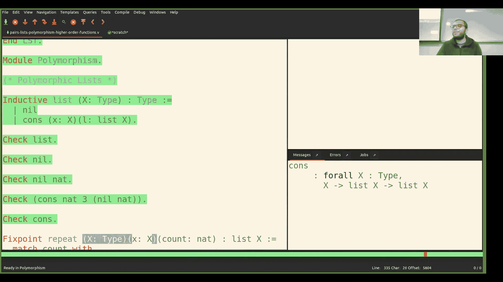

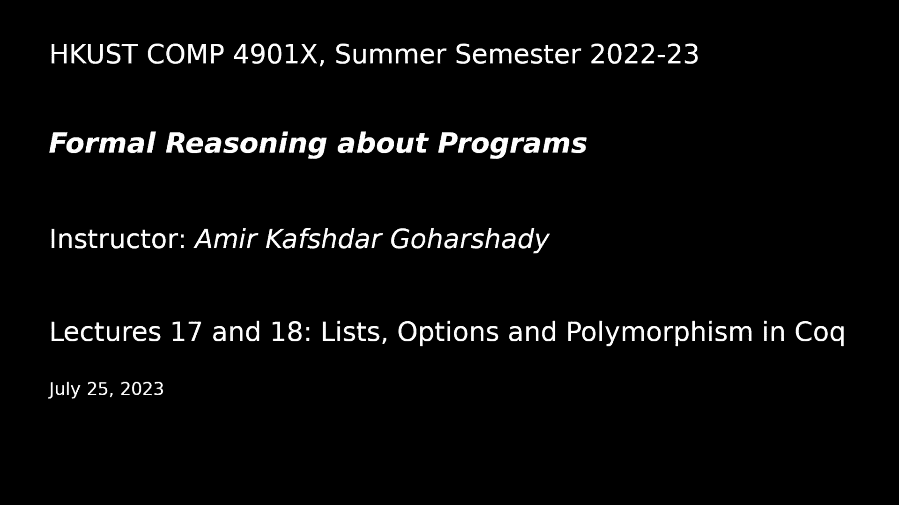

Okay， so let's do a pattern matching on our count on the number of times that we have to repeat this。

First of all， if count is zero， I want to return the empty list， so I want to return N。

But I still have to write Nil X， I cannot just write Neil。Okay， because。

My list always has a type associated with it。There is there is no such thing as a list。

 think about it like this， I either have a list of natural numbers or a list of booleans or so on。

 but I don't just have a list so I cannot just return Neil I have to return Neil X。

And the other case is that if my count was basically count prime plus one。

Then what I do here is that I first。Repeat x count prime times。

 but again my repeat function now takes three different parameters， it takes big x。

 small x and count prime， and then I have to do cons of small x with that。

 but again cons takes two parameters。It takes the type big x， and it takes the value， small x。

So I have to write it like this。Okay。🤧。Great， now that we have defined this。

 we can actually do some computations， so let's say。

I want to call the function repeat and I say that the type of the element that I want to put into my list is that natural number and the element itself is four and I want to put it there five types。

Okay， so I can say repeat Nat45 and I compute that and this is what I get。So。

The type of the output is a list of natural numbers， is list net。ok。And the output itself。

 you see that it's cons snap for Ks snap for so on。 So every cons。

Is not only taking the parameters that it took before， but it's also taking that as a parameter。Okay。

 and of course， at the end， we have the nil。Which is the empty list， but even that is not just Nil。

 it's Nil net。ok。Now what happens if I write， check repeat， what is the type of the function repeat？

This is the type of the function and repeat。So it says that for every x that is a type。

Repeat takes a value of type X， and it also takes a natural number and it returns a list x。Okay。

Great， but this is now too cumbersome because I mean of course it makes sense and of course we could define a list which could contain elements of any type and now we can also define maps that map elements of any type to elements of any other type。

But this is not great， especially this kind of notation， this is really hard to read for humans。

And also， I don't like to have to constantly write the type here。So I want to simplify my writing。

 let's see how I can simplify my syntax and write this function in a simpler way。So。

This is my function repeat。Look at the header of the function here and look at the header of this variant of this function。

 which I'm calling repeat prime。So when I was defining repeat， I said that I have these parameters。

 I have x， which is a type， small x， which is of type big x， I have count， which is a natural number。

And I return thes。Now here in the definition of repeat prime。

 as you see I'm removing all of the types。I'm just saying repeat prime takes big x。

 small x and count and returns a list x。Okay， why can I remove all of this？😡，Because Co is smart。

Cook can understand from the rest of this definition what the type of every one of these elements should be。

 so for example。I'm returning a list x， if I'm returning a list X， that means x should be a type。

So I don't need to tell Cork that x is a type， Cork knows that this X is a type。Right。Similarly。

I'm returning a list X。And for example， here， I'm doing cons Xx。So if I'm doing this。

 it means that small x is of type big x otherwise I couldn't even call constant that。

So Coke understands that small x is of type Px， I don't need to explicitly tell it。The other point。

 how does it understand that count is a natural number？Well。

 I'm doing a match on count and I'm saying if count is zero， well， only a natural number can be zero。

Or I'm saying if count is the successor of count prime against this S was something that was defined only for natural numbers。

So Co is smart enough to basically do type checking and figure out what the type of all of these variables are and I don't need to write the types of the parameters I can just write my function in this simplified form。

Okay， and again， if I check repeat and check repeat prime， they have the same type。

 so you see the cook could actually understand。What the types of all of these parameters in repeat prime are supposed to be。

Okay。But still not good enough。Let's try to simplify this a little bit more。

So another thing that I can do。Is that I can put an underline。And when I put an underline。

 what I mean by that is I'm telling Coke to figure it out。Okay， so I'm not going to write the type X。

 I'm just going to put an underline instead。And Coch understands that it has to figure this out。

 it has to figure out what type to put there。ok。So this is again， repeat double prime。

 this is the same function as repeat prime。Except that I'm saying when it's zero return nil and then I'm putting an underline here。

 what this means is that I know that I have to return nil of some type。But I'm too lazy to find it。

 so I'm just telling figure this out， figure out what type of niil you have to return。And again。

 Cork knows that this function is supposed to return a list X。

So this function can only return list of elements of type X， so if I want to return a N list。

 I have to return Ne X。And the same thing here， I can say that well figure out the types。

 so previously I was saying cons x of x and repeat x of so on， so instead of all these big x's。

 I can just put underscores and again Cook understands what to do with this。

So I don't know why it's not executing okay。So again， if I check repeat Prime。

 which was the previous function， this was the type。And if I check repeat double prime。

The type remains the same， so again Cook could figure out the details and fill it。Okay。

But this is still really awkward。Because right now。

 if I want to just create a list that has the elements one， two， three， this is what I have to write。

Right。So I have to say apply cons and I don't give it the type， I teleelcock to find the type itself。

But anyway， I have to apply accountss to one and then apply that like basically start let's start from the inside。

 I take the empty list。I add three to the beginning of it。

 then I add two to the beginning of that and then I add one to the beginning of that and every time I'm telling Coke to figure out the type on its own。

But anyway， this looks ugly， I have to put so many underlines and I have to write cons so many times I need so many parentheses。

 it's ridiculous。Right。But okay， if I check the type you see that Coke actually found the type correctly it's a list of natural numbers and if I say print it it prints it and it says it's a list of natural numbers and this is。

But the list。Okay。So here's the part where things get actually interesting。

I can have implicit arguments。And I can have implicit arguments。

When I'm defining a type in the constructors and also in functions， because to be honest。

 constructors are functions。ok。So here's the thing。I have Neil here。

Where is it in my construction here and this nil takes one parameter x。Okay。

 but what I can do is that I can write something like this。 I can say。Arguments。

 nil and then carefully braces X。So whenever I put something in clearly braces。

 I mean that it's implicit。I mean that I will never write it。

But I expect Coke to always figure out what it is。Okay。

 so basically it's like I'm always going to write this underline。

 but I'm saying I'm not even going to put the underline。

You have to figure out what X is and if you can't figure out you have to just give me an error and that's what Coke does so I'm saying whenever I write Nil instead of writing Nil X I'm just going to write Nil and you have to find X on your own。

And the same thing for Ks， I'm saying whenever I'm writing cons。Here I'm not going to give you X。

 I'm just going to give you small x and L， and you have to figure out big x on your own。

And I can do this even for this function， I say that in this function repeat。

 I'm never going to give you this parameter x。This is an implicit parameter and you have to figure it out on your own based on your type system。

ok。😊，So this is how I say all of these are implicit and again。

 we use care races for implicit parameters and we use normal parentheses for explicit parameters。

Okay， now if I do this。You see， when I wanted to create the。And list of natural numbers 1，2。

3 before I had to write cons and then I had to write the type or underscore every time。

 but now I don't have to write the underscore anymore I can just。Define something like this。

 I can say my list is just cons one cons2 cons3 need。Okay。And。

Here's the thing I can check the type and again you see the type is correct it's a list of natural numbers so Coch could actually resolve the implicit parameters on its own。

And I can print it， this is what it is。And of course， this is the same as the previous list。

 you can see that。Okay。Now， another way of doing this。

 another way of having these implicit parameters is to just。

Deefine them as implicit already when you're defining your function。

So here I'm writing yet another repeat function， and you see the difference is that implicit parameters are in curly braces。

 explicit parameters are in normal parentheses。Okay， so I'm saying this function repeat。

It's going to take an X， which is a type， but it's going to be implicit。

 which means that I will never provide it。And every time Cork has to find X on its own。

And then it's going to also take a small x， which is of type big x， it's going to take account。

 which is a natural number and it's going to return a list of type X。Now。

 how does the function work again， I look at my count if my count is zero。

I'm going to return the empty list， I'm going to return it。But see。

 I'm not putting any types here after Neil because I've already told Kock that the X in Nil is going to be implicit。

 so Kock knows from now on that whenever I write Nil it has to figure out Neil of which type。ok。😊。

And here it's again the same thing， it's much more simplified now。

 so I say that if count is count prime plus one， then you just repeat x count prime times。

And you see I'm calling the same function recurically。

 but I'm not giving it big x because big x is implicit and Coke has to figure that out on its own。

And then I'm putting small x at the beginning and again for cons I'm not giving it big x because big x is implicit in cons as well。

Okay， so now finally this looks like something that can be called kind of human readable。

If you're a human with a lot of experience with Cock， you can read this。

And I don't have to just keep repeating my big X everywhere。Okay。

I've shown you the solution already again， but write this function now write a function that basically does append。

So it takes two lists。And gives me another list which is basically the two original list glued together and again。

 I want to work on lists of objects of any type。So I will have an implicit type as a parameter here。

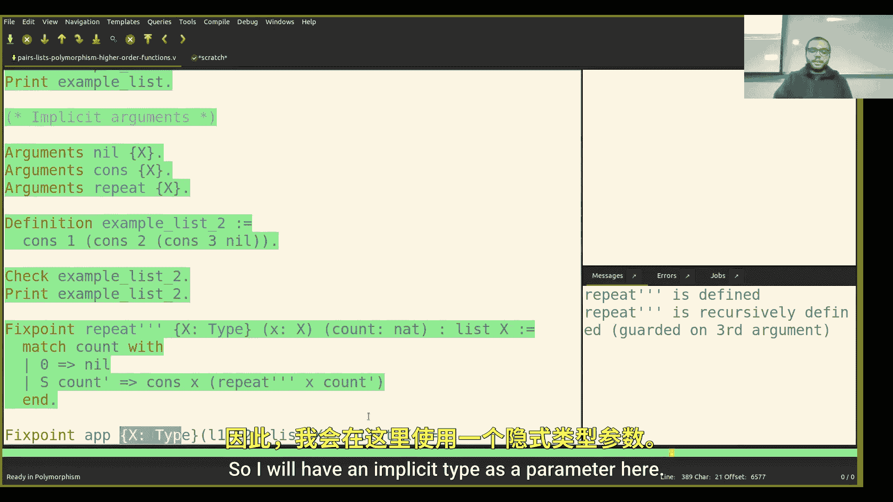

O。So we're going to do what we did for。lists of natural numbers except that now we're doing it for lists of any type。

 right？So I'm going to say。Do a pattern matching on the first list。

And if the first list was Nil and actually you know that this is Nil X。

But I'm not writing the X because that's implicit now。If it's n， then return the second list。

 otherwise if the first list is of this format and again。

 I'm not writing the x because x is implicit。If it comess HD。This is the heads， this is the ta list。

Just append the tail list to L2 and then put H at the beginning。Okay， great。

Now write reverse and length。

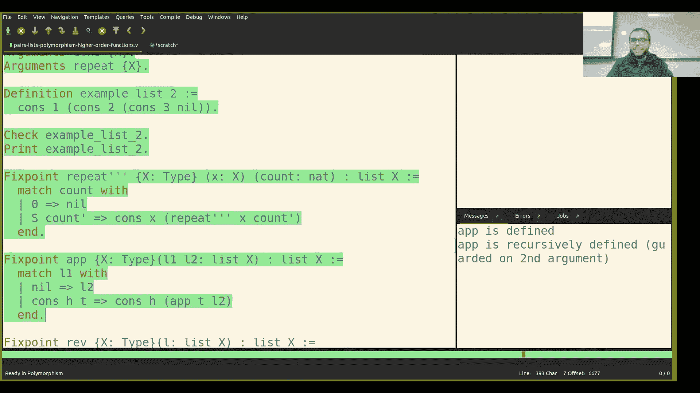

Okay， I'm going to go kind of fast here。So reverse is again exactly like before。

 I look at my list if it's the empty list and again this is Neil X。

 but I'm not writing the X anymore， then I return the empty list。Otherwise， if it's H and sum tail。

 I first reverse the tail。And then I call it a pen so I。This is just a list that only has H in it。

Right and this is the reverse of the tail， so I attend the list that only has H in it。

To the reverse of the tale。And for length， again， I have a very similar situation。

 I say if my list L is empty if it's nil。Return zero otherwise。

 if it's something followed by L prime， just take the length of L prime and add one to it。

Give me the successor of the length of a。ok。So。This kind of implicit parameters or implicit arguments they really help us write simpler code。

 but now we have some problems。So for example， if I write something like this。

If I say I want to define a variable x。And I want x to be need。This one will give me an error。Okay。

 and look at the error。It says the term contains unresolved implicit arguments， okay？More precisely。

 it says that。年。It was a constructor。For lists。Right， so Nil。It's supposed to be a list。

 but it has to be a list of some type X。But it doesn't know how to find x cannot infer the value of the parameter。

 the implicit parameter x。Right。And the reason for this is that there is no context here if I'm just saying x is nil。

I'm saying x is the empty list， but I have to say， is it an empty list of integers。

 is it an empty list of Booleions？So what is x， what is big x。

 and this is something that Coke cannot find on its own， so it gives me an error here。Now。

 one way around this， of course， I cannot write this because。That gave me an error。

I'm going to comment it out。But one way around this is to actually telecock more information。

 I'm going to say instead of just defining the variable x to be nil。

 I say I want to define a variable x， which is of type list nat。

And then I say this variable x is near。Now this one passes。

Because Koch understands that this implicit。Type that had to be passed to Nil is supposed to be Nil net。

Right because it's supposed to be that actually so I'm saying I have a list of natural numbers called X and it's nil so of course it has to take the empty list but it has to take the empty list of natural numbers because otherwise the type doesn't match so you see it's smart but you have to make sure you're giving it enough context。

Now。What if I don't want to do that？Well， what if I want to use the explicit version of name？Okay。

 so for example， if I say checking in。Okay， you see it's much more complicated。But I can write any。

Okay， I can say why is ane。And at Neil means the explicit version of Nil。Okay。

 so now if I check the type of y or if I check the type of add Nil。

 you see that I get the type that I used to get for Nil when it was explicit when it was not yet implicit。

Okay。So why is this useful？I cannot write。Nil Nat， okay， so if I write check Nil net。

That gives me an error。Why does it give me an error because？The parameter of nil。

 the type big x was supposed to be implicit if I give it explicitly。

Cook doesn't understand that Cork just thinks that it has to find the implicit parameter and this is another parameter。

RightBut I can write@ Nil net and then this means that I take the explicit version of Nil and use the parameter net for that and of course that's a list net。

ok。Anyway， this is not very useful， but it's just like if you made something implicit and then you wanted to make it explicit。

 you can do it with an ads。Okay， but let's define our syntactic sugar because of course we need this otherwise our code is going to go really ugly。

 so again I'm going to define this double column to mean cons and this is exactly the same as before I'm going to define this notation for the empty list I'm going to define this notation for just writing a list by its elements and I'm going to define this one as a pen。

So。Let's prove the same theorem as before， let's prove that append is associative。

But look at this theorem， what does this theorem say？This is actually now a polymorphic theorem。

 I'm saying for every x， for every type X， and for every three lists that are lists of elements of type X。

😊，I have this I have that list one append with list two append with list three is the same as first app list one and list list two and then app list three so another way of looking at it is the way that it's written here so it says for every X that is a type。

I just wrote for every x， but cork itself could understand that x is a type。

For every x that is a type and for every three lists that are lists of type X， I should prove this。

So my proof is very simple， it's basically the same proof that we had for list of natural numbers so I'm going to go very three advance。

 I do intros so all of these things go up there and then I do an induction on list one。

And I have the base case of my induction， which is the case where this one is empty and this one is just solved by simplifying and then doing reflexivity and then the other case I have is the inductive case。

 inductive step。And here again I can first do simplifyimplified。

 then I can rewrite using my inductive hypothesis and then the two sites are the same。

 I can do reflexivity。You can go back and revise this， but again， it's exactly the same proof。

That I had for lists of natural numbers， the only difference is that instead of having lists of natural numbers here。

 I have a type X which is always up here， and I have lists of type X。

 but I'm doing the same thing on it。Okay。Now， in the same way as before。😊。

I had options before I can now define polymorphic options。

And this is also something that exists in the standard Library of Cook。So I can see。

For every two types， x and y， I define a new type。Called the product of X and Y。

And the way it works is that every element of this product type。😊，Is a pair？

Where the first part is the first parameter is a。Small x of type big x。

 and the second parameter is small y of type big y。 So this is just Cartesian product。Okay。😊。

And then again， I say that in this definition of pair here。

 both x and y are going to be implicit arguments。So I'm never going to write these types， okay。

 and I also define some notation， I say， for example if。I write x comma y inside the parenthesesis。

 that's the same as writing pair Xy because I want to have a simpler notation。

 and I want to say that if I have two types x and y and I write x star y。

 that means the product type of x and y。Okay， and what this part means is that I'm saying if these are types。

Then use this product because I don't want to redefine the product of integers， for example。

 I want to keep the definition that I have for that。Okay。Now， but anyway。

 it says that you already have that also in the standard library so I'm just defining it again。

 you don't need to define it it's part of the standard library it works。

So now I can have the same functions first and second， which I had before。Remember first took a pair？

But now look at this， so first is's going to take two implicit parameters which are the types x and y。

 so it's a pair where the first element is of type X， the second element is of type y。

But x and y are implicit parameters and then I have this P， what is the type of P。

 it's the product of x and y。Remember， product of x and y is another type。Okay。

 and I show it like this and what is the type of the。Response what type does this function return。

 it returns an element of type X because the first element is of type X。And again。

 this is a very simple pattern matching， I say that if P is basically X y， just return X。

And for second， it's exactly the same thing except that my return type is y and if I have a pair Xy。

 I return y。Okay， nice。So here's another function which we normally use。嗯。And this is called。

The zip function and sometimes actually people will call it combined depending on which functional programming language they're used to。

So let's say that I have two different lists， I have Lx and LY。And let's say that Lx。

Is a list of objects of type X， and Ly is a list of objects of type y。

And I just want to zip these two lists together， which means that I want to return a list of pairs。

Where the first pair is the first element of the first list and the first element of the second list。

 the second pair is the second element of the first list and the second element of the second list and so on。

😊，Okay， so my return type is going to be also a list， but every element in this list is a pair。

Were the first coordinatedators of type X and the second codators of type5 and again。

 as before I have two implicit parameters x and y。And of course these implicit parameters their types。

 so I can write it like this， but I don't need to tell Coch that these are types。

 Coch understands that these are types。Okay， but how do I actually write my zip function？

I say look at these two lists that you have。First of all， if any of these two lists is empty。

You're going to just return the empty list so this one says that if the first list is empty。

 return empty， if the second list is empty， return empty now very importantly。

This one is different from this one， this is an empty list of type X。

 this is an empty list of type x times y。But again， Coke is smart enough to understand this。

And this is of course， an empty list stuff type。Okay。And finally， if none of my lists are empty。

 let's say that I break the first list into an element head and a remaining list tail。

And I do the same thing for the secondness， so I have a head X， tail X， head Y， and a tail Y。

So I say。Recursively zip the two tails together and then add this pair at the beginning。

 at the pair Hx HY at the beginning。Okay。So I do that。And now I can compute something like this。

 I can say compute the zip of one，2 and3，4。And if I do this， what will I get？

I will get a list of pairs of natural numbers。And the first pair is going to be1 v and the second pair is going to be24。

 so this is what I get。You see it's a list of nats times netts and every element of type times nats is a pair of natural numbers。

Now I don't have to necessarily have the same types to zip so I can say。

Take true files and let's say two， four， five and zip these two。喂。😊，Oops sorry。

 I had to use a semicolon， I don't know why I use the commer。Okay。Now， if I do this， I get。

A list of pairs and it's true to and false for and by the way it ignored the last element of this one because this second list was longer than the first list and in my definition of zip I said that whenever one of the lists runs out I just stop zipping。

听。😊，Great， so。Now the next thing that we're going to see at the beginning of next session is how to do polymorphic options and of course it's going to be very similar to what we've done until this spring。

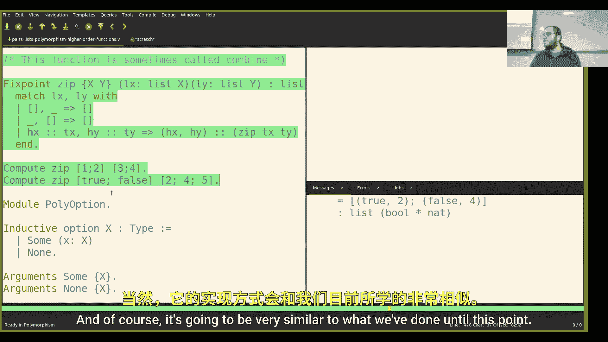

Okay， great to see you on Thursday。

