# 香港科技大学【中英⚡程序的形式化推理｜COMP4901X 2023 Formal Reasoning about Programs】 p11 p10 s 19 and 20 - Higher-order Functions and Further Tactics in Coq -BV1roXTYaEmJ_p11-

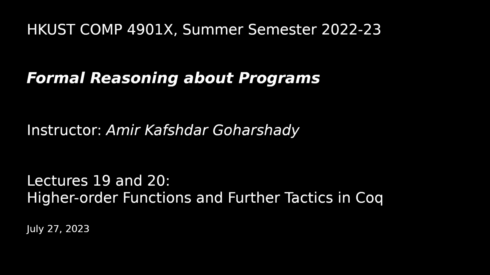

I'm going to show you some more examples of polymorphism today。And then after that。

 we're going to see some techniques for proving new stuff and we're going to see some new use cases of tactics that we've already seen as well as some new tactics。

Okay。So let's look at this thing here， this is a new type that we defined last time。

And basically it's the product type， it says that if I have two different types， x and y。

I can have just one constructor， which gives me a pair of an element x of type X。

And an element small value of type big y okay。So。系。

define this type and then I said that I want to make these parameters here implicit， so I write this。

 which basically says big x and big y are implicit arguments in pair。So when I'm writing pair。

 I only need to give small x and small y， I don't need to give big x and big y。

And then I can easily define some notation， we saw this last time as well。

 so I'm going to use the parentheses and common notation to show the pair and I'm going to show the product type by multiplication。

Okay。Now I can write my first function， which used to take。

A pair of a specific type and give me its first elements。

 but now I can write it in a polymorphic way so I can say my first function takes two types x and y。

And it also takes a pair。Which is in type X times y。

And it returns some element of type X and the way it works is exactly as before。

 so we just match our itemP our pair P。And we say that if it's xy。

 just return the first element to X。Okay， I can define my second function in exactly the same way so I have。

Implicit parameters， x and y， remember views carefully braces for。

And then I have a parameter P whose type is x times y and I this time have to return a return value of type y。

And again， I match P and I say that if p is X y just return y and of course I can put an underscore here and also here。

 so whenever I don't care about something I can put an。Okay。Now， one more point is that's。

I think I mentioned this in the last session as well， so x and y are of type type。Theyre types。

 basically。But you don't need to stay this year because Co is smart enough to figure that out。Okay。

So this is a very handy function that we always use。

 so this is called the zip function or the combined function and basically it takes two lists。

 a list of elements of type X and a list of elements of type y and it zips them together。

 it gives you a list of pairs of elements。We saw this in the last session as well。

So basically I'm going to say let's do a pattern match on both of my lists and if any of the two lists are empty。

 I'm just going to return the empty list。Otherwise， if my first list has a head Hx and a tail Tx。

And my second list has a head HY and a TTY， I just create a new list。

Where the two tails together and at the beginning I add the pair hx， HY。对。喂。😊，So for example。

 if I want to compute the zip of one，2 and34， I get this。

 I get a list of pairs and the first pair is one，3。

 the second pair is24 so the first element of both list and the second element of both。

Now I can also do it when the list don't have the same length in this case I will just ignore the extra elements in one of the lists and you can see this from this definition so as soon as one of the two lists becomes empty it's going to return empty。

So if I zip true false with two， four five， this is what I get my first pair is true two and my second pair is false4 and there is no third pair。

Okay。Okay， so we covered all of this in the previous session， let's actually get to new stuff now。

So we've already seen what options are and we've already seen an option on natural numbers。

So let's say that now I want to define a polymorphic option。

So the whole point of an option was that I can either have a value or my value can just be none。

 so I have none and some as the constructors of my option。

But now this time when I'm defining this option， it's also taking some x as a parameter and this x is of course a type。

 again I don't need to tell Cock that this is a type， I can be explicit and write it like this。

But I don't have to。Cook understands that x is a type。And of course。

 the inductive definition is also defining a type and the way we define it is that we say either we have some elements。

 small x of type X。Or we have none， we have nothing。And just as before。

 because I don't want to keep writing my type， I'm going to say that big x is going to be an implicit argument for both sum and none。

want to write non net or nonbu or so on， I just want to be able to write none。

And the same thing for some， so I define this。And yet。

 this is basically how you define polymorphic options。Now I'm going to end the module here。

And the reason for that is that these things are actually already defined in the standard library of Cock。

So I'm just going to use the standard ones。So here's a polymorphic version of our famous ends error function。

So remember the Ns error function set that you give me a list and you also give me some index n。

And I will return the ends element of the list to be more specific。

 the element at index and our indices start with zero。And if it doesn't exist。I have to return none。

 so if the elements of my list are of type X， then my return value is going to be of type option x。

Okay。So and again， I have this X itself as an implicit argument here。And I say just。

Do a pattern matching on the list if the list is empty。

 you should always return none and again remember this is actually none x。

But I don't have to write x because I've made x implicit here。Otherwise， if the list is of this form。

 it's some element A followed by another list L prime。Then I say， okay。

 let's do a match on the index n， if the index is zero。

 I have to just return this very first element a。But I have to be careful about the type a is of type X。

 but I need to return something of type option X， so I have to actually return sum a。And similarly。

 if n is the successor of n prime， which means that basically n prime is n minus1。

Then I just find the。Element at index N prime in the tail of my list in L prime。And that's it。

 this is how NRR works and again。Basically， this is the same as what we had for lists of natural numbers。

It's just that now I have this extra type X here as a parameter and now my answer is polymorphic。ok。

Now， another really important point that I want to mention is the idea of higher order functions。

Some of you have already figured this out in Cock and it makes sense to you。

 but I just want to explain it for everyone to make sure we're all on the same page。

So a higher order function is basically a function that can take another function as one of its parameters。

Or a function that can return a function。If I can do these kinds of things。

 if I can use another function as my parameter or return value。

 then I say that this is a high order function。ok。Now this might sound very unintuitive。

 but actually most of the functions we've seen until this point are higher order。

And that's how coke is them。So here's a very simple example。

Let's say that I define a function and I call it simple add and it takes two parameters， it takes a。

Natural numbers and it also returns a natural number and that natural number is just the sum a plus B。

Now， you might think that this is not a higher order function。

Because it seems like the parameters that it's taking are just natural numbers and the return value is a natural number。

 so there are no higher order function here。But actually it is so let's define it and let's do check simple add and remember check gives me the type let's go back to our higher order function so I was saying that's consider this simple function that takes two parameters and adds them together。

And let's check its type， let's check simple add。And you see that the type is this。

The type of this function is Na Arnats，arrowrowna。What does this mean so intuitively until this point we were always thinking of this as a function that takes two natural numbers and gives us another natural number。

But actually， what this says is that this is a function that takes a natural number。

And returns a function。And that other function， which it returns。

 also takes a natural number and returns a actual number。Okay。😊，So。In essence。

 Cook is thinking of functions with several parameters as being high order functions。To see this。

Let's say that I do simple add。But instead of giving it two parameters。

 I give it one so first let's do with two parameters， so if I say check simple add of2 entry。

It says that the type would be a natural number。But this is basically a natural number which is obtained by taking the function simple add two and applying it to the value three。

And now I can see that I can ask what is the type of simple add to？

The type of simple add2 is a function。From natural numbers to natural numbers。ok。😊。

Hopefully that makes sense for everyone。So I can actually。Do definitions like this。

 I can say I define increments。To mean add one。几。😊，So what is the type of increments？

It's a function from natural numbers to natural numbers and of course it's a function that does increment it adds one and now I can do compute increment of five and it gives me six so you see add one this entire expression is basically the same as this increment it's a function and I can do increment。

But these are not the interesting examples， the more interesting examples are functions that actually take functions as their parameters。

 even in our intuition， not just from Koch's point of view。😊，So here's a nice function。

I'm going to call this applied rise or three times， it has an implicit argument which is a type X。

 and it also takes as parameter a function F， which is itself of type Xarrow x。

 so F maps elements of type X to other elements of type X。And it also takes some。Value n。

 which is also of type X and the return type of the applied rise function is also x and what it does is basically it applies f3 times to。

So it returns F of F of F of n。ok。😊，Great， now I defined it。So。This is very interesting。😊。

Because now we have combined all of these different things that we can do in Cock。

So you see I have polymorphism here。I have this type X and of course I've also made it implicit。

And then I'm also taking some function F as the parameter， and I'm also taking n as a parameter。

 and then I'm applying f3 times n。So what is the type of this function applied rice？Well。

When I'm looking at the type， I actually want to see the type of the explicit version because I've made this x implicit here。

 so I put an ad at the beginning。If I check the type of applied rice， this is the type。

 so it says that。For any type X。Applied rice does this， it has this type。

So it takes a function from x to x。And a value in x and the return type is also in x。Okay。

And by the way， these parentheses here are really meaningful。

 it's not associated if you cannot just remove all the parent disease。Okay。

So let's see an example of using App rice。Let's say I define another function and I call this one decrement and it takes a natural number。

Ba and returns a minus1。Base。Now， i can see。Compute applied rice decrement1。So basically apply thr。

Takes two parameters。The first parameter is another function decrement。

And the second parameter is the number 10。And then it applies that function。

 which was its first parameter three times to the value， which was its second parameter。

So it applies decrement three times to 10， and it gives you seven。Now this was polymorphic。Remember。

 so App rice works with any type X。So I can use the same thing for Boolean。

 so we had this function Ne B， which basically gave us the negation of a Boolean value。

I can say apply rice neg B false， so it takes false and applies negation three times。

This will give me a true value。Okay。Now， going on with classical functions。

Another classical function I'd like to tell you about is filter。So the idea in filter。

Is that let's say I have a list of elements and I'm going to be polymorphic。

 I'm going to say I have a list of elements of type X and x is an implicit parameter here。

So let's say I have this list L of type X。And let's say that I want to just take some of the elements of this list。

 but I want to take the elements that satisfy a particular test。That satisfy some condition。

And the way I actually implement the condition or the test is that the test itself。Is a function。

That takes an element of type X and gives me a boolean which basically says whether the element passes the test or not。

So my filter function has an implicit parameter x， which is the type。

It takes another function test as its parameter and the type of test is Xarrow bull。

It also takes a list of elements of type X， and of course it also has to return a list of elements of type X。

Okay， how do we do this again we do pattern matching first of all I say that if my initial list is empty just return empty otherwise my initial list looks like this it has a head element followed by a tail list。

Okay， so I have to test the head elements， I say if。I test the head element and the result is true。

 if it passes， then what should I do， I should keep the head element and I should filter the rest of the array。

 so I have to filter the tape and then I have to put the head element at the beginning。Otherwise。

 if the head element does not pass my test， I should just apply filter to the rest of the array to the tail。

 so I just do filter of test。And that's it。So if you remember we have already defined a function called the event which takes some natural number and returns true if it's event and that function also exists in the standard library so I can do something like this。

 I can say compute filter even1，2，4，5。So again， this is a function filter。

It has an implicit parameter， which is the type。But for explicit parameters， it's taking even。

 which is itself a function。But it's a function that takes a natural number and returns a pool。

And it's also taking a list of nitro numbers and it's filtering it based on this test。

So if I do filter even one， two， four， five。I just get two far。Okay。

But now I can do more interesting things， so let's say I have a list of natural numbers。

 I want to count how many elements in this list are odd。

So I can just combine the different functions that I have on this point。

 so I say first do filter odd L， this gives me all the odd elements and then just take the length of that。

So length filter O L， that's how I define countO。And now if I do count odd here。

 it just counts how many of the numbers in the list were odd and the are four of that。Okay。

Another point is that I can also write what we call Lambda expressions again I don't know how any of you are familiar with this。

 but even those of you who haven't done functional programming have probably used Lambda expressions in Python and orC++。

So these are basically functions that。That are not given a name。

 I'm just using the function right here right now。So for example。

 I can have an expression like this and this is that this is a function that takes n and returns n times n。

ok。So now I can say compute applied thce of this function to two。So basically。

 I'm going to start from two and square it three times。几。And it's， of course， 256。Okay。

Another thing that is interesting to us is the map function， so let's say I have a function F。

And I have a list。So I have a list of many elements。

 I just want to apply this function to every element in this list。So what would it look like well。

 let's say I have a function F。And it maps elements of type X to elements of type Y。

And x and y are implicit parameters here， Of course， I have to have a list of elements。Of type X。

 so I should have a list which is of type list X， and then my return value would be of type list y。

Right and again， I do a pattern matching and it's very easy。

 I say if it's the empty list return the empty list。

 if I have a head followed by a tail first find the map of that tail。

Basically call yourself recursively on that tail and compute F of everything in that tail and then compute the F of head and put it at the beginning。

 so it's F of head followed by map of F of tail。Okay。So here's an example。

 let's say that my function F is just a simple function that takes x and adds three to it。

And I say compute map of this over this particular list，  one，2，3。So I get four， five， six。对。

Here's another example， let's say my function is the even function。

 which basically tested whether a natural number is even。And I say compute the map of even one， two。

 three， four， and as you see， it gives false through， false through。

And the type is also very important， this is now a list of Juliauls。ok。

Now I can have something similar for options as well。So， let's say。

I have a function F that maps from type X to type Y。And。Let's say I have some element of type X。

 but I don't exactly have an element of type X， I have an option of X。

 so it's possible that it's not。And I want to apply F。But I can also return an option why。

So basically I say take this value if the value was none， return none， if it was some x。

 then apply f to it and return some f of x this is also a very common thing that we do when we want to apply functions to an element。

 but it's already an option。Okay。The next really classical function is fault。

Before I give you the definition of fault， I want you to just see this。

So the idea here is that I want to say multiply all the elements。In this particular list。

And the way I do that， I have the mal function， which does multiplication of two elements。

But I want to say multiply everything in this list and give me the answer。

And I also have a starting value， which is one， so I want to say multiply everything in this list and multiply that by one and give them the answer。

 so that's how fold works。So based on this example。

 let's come back and actually see the definition of fault。

So it takes two implicit type parameters x and y。And。

This is the function that it takes as a parameter， it takes a function F。Of this type。

 we'll come back to this。But the idea is that I have a list。

And every element in this list is of type X。And I want to kind of fold this list into just one element of type V。

So I want to just return one element of type y。Okay， and the way my folding works。

Is that I know what the default value is， the default value is b。

 and that's the value that I'm going to assign today the empty list。And then。

If I know the value of some lists。And if I know that folding something leads to some value in buying and if I also know the value of the head。

 I can fold everything together and get another element in white。

The definition actually probably makes it even easier to understand。

 so if I have the empty list I'm just going to return the default value B。

If I have a list that looks like this， head followed by tail。

I'm going to first fold the tail recursively， and then I'm going to say fold the head in。

 but the way that I fold the head in is that I apply this function F， so I say f of H and fold of。

Detailed rehesive。Okay。😊，对。And again， if you look at this， so for example。

 if I ask what is the type of fault and B and B was the Boolean ant？So this is a function。

 the entire thing fold and B is a function。That takes a list of Booleions and a particular Boolean and returns to Boolean。

And if I check the。Type of fold mal， it takes a list of natural numbers and a natural number and returns the natural number。

So here's an example again， so let's say I want to do。Fold of malt malt was multiplication， 3，5。

2 and one。行。So what am I doing here， I'm saying my function F is multiplication。Okay。

 so think of F as multiplication here。So I'm saying if you have the empty list， return one。

If you have a head followed by a tail。First， find the multiplication of all the elements in the tail。

And then multiply that result by the head。Okay， so in this case。

 I'll just get the multiplication of everything in this list， so I get30。

 which is three times five times two。And I could change the initial value， I could。

Let's say put two as the initial value and I would get 60。Okay。

Let's just do a few more examples of these things。Here's another thing that we use very often。

 let's say I want to define a constant function。Okay。So。This function comes fun。

It takes an implicit type X and it also takes a particular value of。This time。

And it returns a function。And the function that it returns is the constant function from natural numbers to x。

 it's the constant function that always returns smallx。Okay。

So I define it like this and again this is a Lada expression。

So it's a function that takes any natural number k and just ignores K and returns。So for example。

 I can say take the constant function that always returns false。Okay。And I call that F false。

And then I can say compute f false of one， this is false， this is the constant function。

 I can say compute f false of 60 is's false。I can check the type and as you see。

 the type is a function from natural numbers to booleions。So。Kantstf returns a function。

It's a function that returns another function。And finally， the same thing that I said about。

This very first example， simple act。It also works for the。Addition in the standard library。

 which was called plus so again， if I check the type of plus。Actually， plus an add or the same thing。

 So the type is this。It's a function that takes a natural number。

And returns a function that takes a natural number and returns a function。ok。😊，So。This is the domain。

 this is the code domain。And again， I can define a new function。

 I can call it plus 10 and I can just define it as this plus of 10。

 so this is a function that just adds 10 to whatever you give it and then I can compute plus 10 of5 and that's 50 Let me also give you something to。

Pro later so。Let's take this fold and let's say that I have。A list of natural numbers。

 and I want to add all the elements。I want you to prove that we will get the same result if we add all the elements in a list of natural numbers or in its reversed list。

I'm going to call this revvol。😔，So I'm going to say for。Any less hell。Of natural numbers。

I have this fold mal L。😔，So called to add L0。Is equal to fold add。😔，Reverse of L，0。😔。

I'm going to write admit it。😔，I want you to prove this。

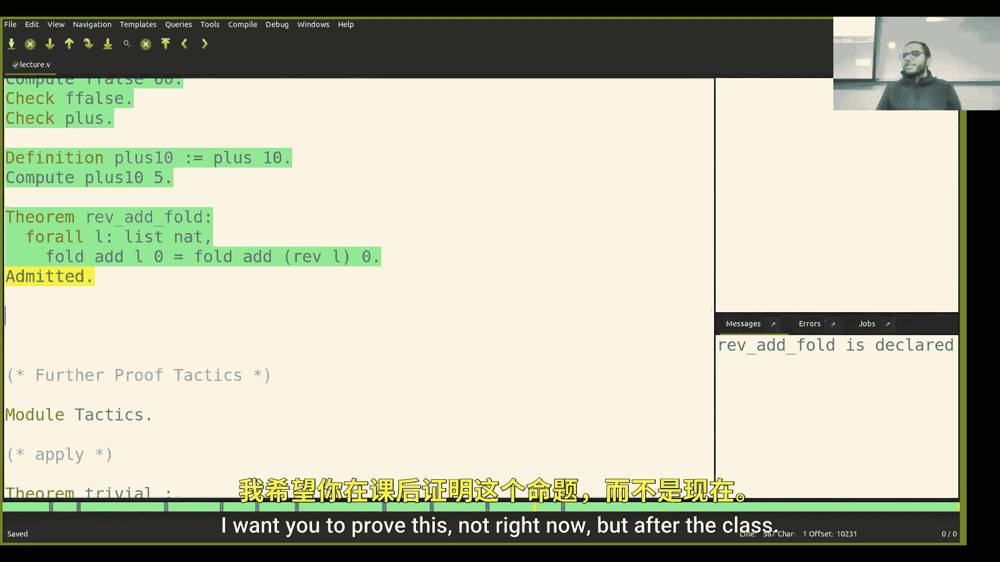

Not right now， but after the class。

So let's actually go to the next topic which is more proof tactics。

 so proof tactics are these small things that we write in our proofs basically we've seen a lot of them already we've seen intros we've seen rewrite reflexivity assumption。

 but let's start with a very trivial theorem so I'm literally calling it trivial because it is。And。嗯。

This is my theorem， I'm saying that for all natural numbers n and M， if n is equal to M。

 then n is equal to n。So it's the same thing on most。Now how would we normally prove this。

 well we would first say do intros so that n and M are added to this context here。

 and then our goal is to prove that n is equal to M so let's do a rewrite using H。

And then we have m equals to M， we have the same thing on both sides， we use reflectlexivity and。Now。

 instead of this rewrite， we could actually say apply H。So。Take the same theorem again。

I do intros and here I just see that well H has what I'm looking for。It's a hypothesis。

 so I just say apply this hypothesis age。And I apply H and again。It's just an easier way。

In comparison with writing， rewrite and reflexivity， I can just write apply。

But actually apply is more powerful than this。So。Here's another theorem。

 this is actually kind of longer。So let's say that I have four natural numbers and MOP。

And I want to prove this， I want to say if n is equal to M。

And if n equal to M implies that NO is equal to MP， then NO is equal to MP。Okay。And these are lists。

 of course。Now， this is again。Very simple， I'm going to start to prove， I'm going to do intros。

And now here's the thing， I want to say that NO is equal tomp。

But I have this on the right hand side of H0， so I have my goal on the right hand side of H0。

So I can just write apply H0。And if I do this。It will tell me okay。

 now you have to prove the left hand side of H0。So the goal changes， you see the goal was this。

 it was the right hand side of H0 and I say apply H0。And it says， okay， now prove the left hand side。

Now， of course， the left hand side in this case is just H， so I can say apply H and that's it。Okay。

Here's another kind of trivial theorem， it is longer。

 so I'm going to give you some time to just write it， what does this say？

It says that if NN as a pair is equal to MMm。And if I know that for all Q andR。

 that are natural numbers。Qq equal to R R implies that the list that only contains Q is equal to the list that only contains R。

 then the list that only contains n is equal to the list that only contains。

Be very careful with the parent is when you're writing this。Okay。

 so let's do our proof and again we have for all so we do intros。We bring everything in context。

This is what I want to prove， I want to prove that this list， it's a list with one element。

 it equal to this list。Okay。But how can I do this？Well。

 I don't have this on the right hand side of any of my assumptions。But this particular assumption。

 EQ2。It's actually quantified， it has universal quantification。

 so it says for every natural number Q and R this holdss。So specifically。

 it also holds for Q equal to n and r equal to n。Right so apply can also understand these kinds of things。

 so here I can just say apply equation to。And it just understands that it has to。

Do a matching and it has to match n to Q and M to R。And so if I do this。

 it will give me this left hand side， so you see I do apply EQ2。So Q was n and R was M。

 so now I have to prove that NN is equal to M。So apply is actually。Quite smart。

But now this one is just my equation one， so I can say apply EQ1， or as we've seen before。

 I can also say this is an assumption。Here's the theorem I want you to prove。

 So I want you to prove that for all P。If for all end。En being even。

meansan that the successor of N is not even。And if for all。

 n and being and not being even means that the successor of N is odd。And if P is even。

Then the next of P， the successor of P is O。

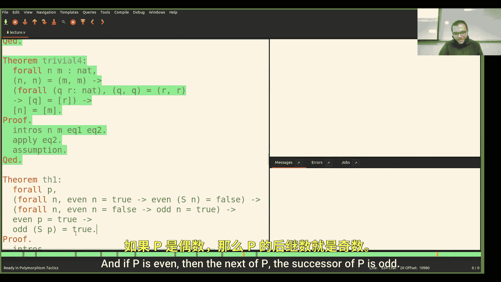

Our common sense is let's do intros。And now this is what I want to prove。 I want to say that odd。

Of the successor of P is true。对。So where do I have something that can match this kind of pattern？

I have it here。Right。So H0 says that for every natural number n。If this condition is satisfied。

 then out of N is true。So just looking at it syntactically。

 I can see that I should probably apply H0。对。So I apply H0。And now I have to prove this one。

 I have to prove that even of SFP is false。But now again， the question is。

 where do I have something that matches this on the right hand side of an assumption？

And I have it in age。Okay。So here。😔，I have even of S of n is false and this is quantified it's for all n so I can just substitute P for n。

And I can apply H， so I apply H。And it says， well， now you have to prove that even of P is true and that's H1 so I can just apply H1。

Now。One thing I want you to really notice in this proof is that when I was figuring out what to do。

I wasn't doing any kind of smart or semantic reasoning here。

 I was just saying what matches syntactically？What can I apply。

 let's just try to apply whatever I can。And for this particular theorem， that was enough。

But of course normally I would expect you to really reason about how I want to get to these things right so when I do this intros。

Here's the thing。My first assumption is saying that for every。And that is a natural number。

If n is even， then the next number n plus one is not even。

The second assumption says that if n is not even。Then it's odd。ok。And I'm saying that P is even。

And I want you to say that next of P is odd。Okay， so how would you normally do this normally you would do forward reasoning。

Right， you would think that okay。What do I know， I know that P even。So I can apply。This one。

 and I can say that p plus1 or S of P is not even， and then I can apply this one and I can say if it's not even then it's odd。

RightSo we're doing forward reasoning when we're reasoning like as humans。But actually here in Cock。

 we are doing backward re。So it's the same argument， but we're doing it in the opposite direction。

So I'm saying I want to prove this， how do I prove this， I take the same argument。

 but in the opposite direction， I say first let's apply H0。

It's like when you're reducing a problem to another problem。

Let's first apply H0 so that I just have to prove this one。

And I apply H0 now I say let's apply H so that instead of this thing on the right hand side。

 which I have to prove， I have to only prove the left hand side， of course， after substitutions。

And then I apply H1 so you see。Intuitively， I would say if I was doing reason as a human。

 I would first apply H1， then H10 H0， but here it's the opposite direction。Okay。是。So prove this one。

 this is another trivial thing。I have two natural numbers n and M， I want to say for all n and M。

 if n is equal to M， then M is also equal to。哦，是呵是。Yeah。You should be able to solve this using。

 let's say rewrite by the way， remember that we're doing all of this so that we can have formal reasoning of programs at the end。

So I'm just teaching you a lot of Coke and at some point our theorems will really change and instead of proving theorems about natural numbers。

 we will be proving theorems about programs。

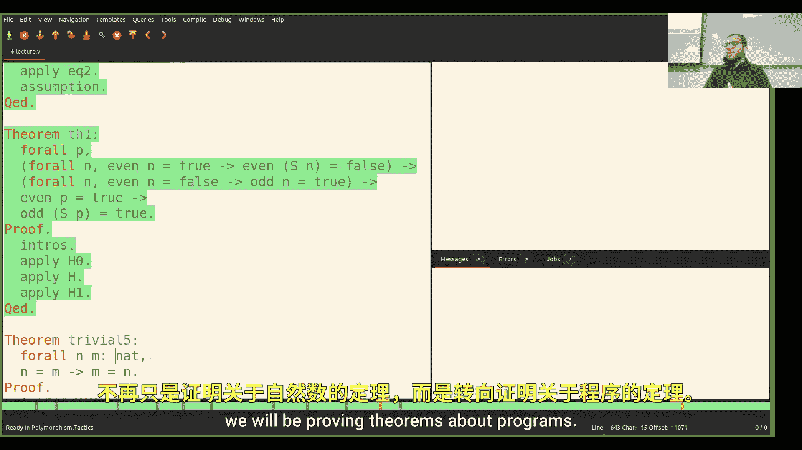

Okay， let's do this。So first， I do intros。And then we've seen this before I can do rewrite using H because I have H here and it says n is equal to M。

 so if I do rewrite using H， I just get m equals。And I can do this rewrite in any direction。

 I can do in this direction， or I can do in this direction。

 and both of them work because both of them give me the same thing on both sides and then I can say reflexivity。

But now I want to show you how we can do this with apply。So let's say I do intros。

Can I just say apply H？So my hypothesis is that n is equal to M and I want to prove the same thing except that I've changed I've swap the left and right hand side。

 no， if I say apply H。It is， well， they don't really match， I cannot apply H。

 but here's what's interesting。We have another tactic called symmetry。

And you can use symmetry and basically what symmetry does is that when you have any quality。

 it swaps the two sides in the world。So I do symmetry。Look at my goal， my goal here。

 so before doing symmetry， this is the goal m equals to n。I do symmetry and now the goal is n equal。

And now I can just apply H。对。😊，And then， well。I don't need these things。😔，Keep it。O。

Here's another theorem that I want you to prove later， but let's just see what the E theorem is。

 I want to first use it and then we'll come back to prove it。So I want to say that for any type X。

And for any list of elements of type X。If I take this list L and I reverse it twice。

 I will get the original list。Okay。Okay。For now， I'm just going to say this is admitted。Again。

 we will come back and actually prove this or I will give it to you as a homework。

But I want to use it right now because our focus is on how to use apply So let's say that I want to。

Prove this other theorem。And I want to use this theorem and the other theorem is this。

I want to say for any two lists that are lists of natural numbers。If L is the reverse of L prime。

 then L prime is also the reverse of L， so prove this and you can use the previous theorem。

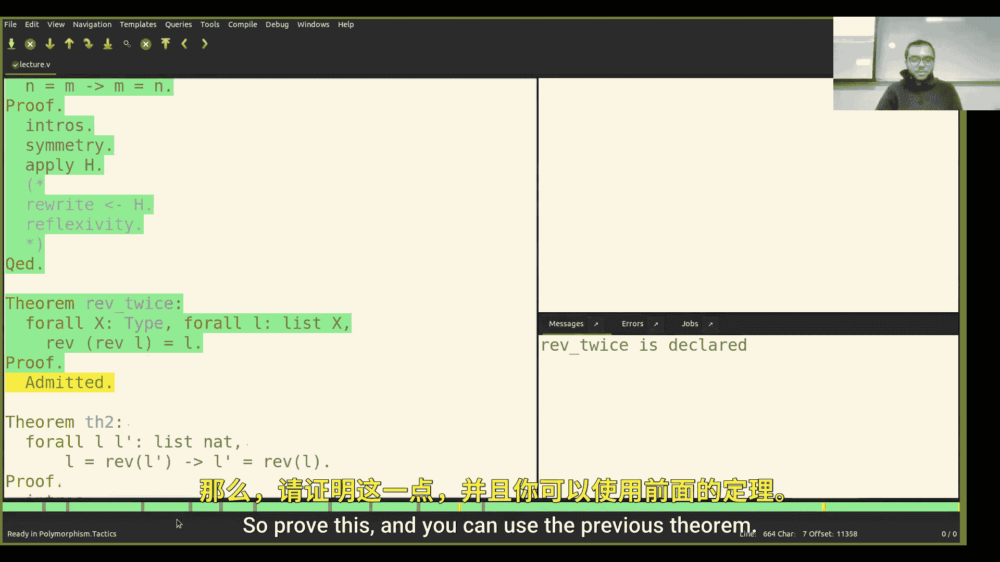

I want to prove that L prime is the reverse of L， and my assumption is that L is the reverse of L prime。

So I can first do a rewrite using my assumption。So that I get this。

 I get that L prime is the reverse of the reverse of L prime。

Because I'm replacing L with reverse of Lp。Okay。Now I want to just apply this previous theorem Re twice because it seems it's the same thing。

 so I just say apply Re twice。But this doesn't work again。And again， we have the same problem。

 the problem is that here I have the two reverses on the left hand side。

And the list on the right hand side， but here the list is on the left and the two reverses are on the right。

So I actually need to first apply symmetry。It do symmetry and now it says gr this and now I can say apply the previous theem apply reference。

그个。Okay。Try this one， so this one says that if the list AB is equal to C and CD is equal to EF。

 then AB is equal to EF。

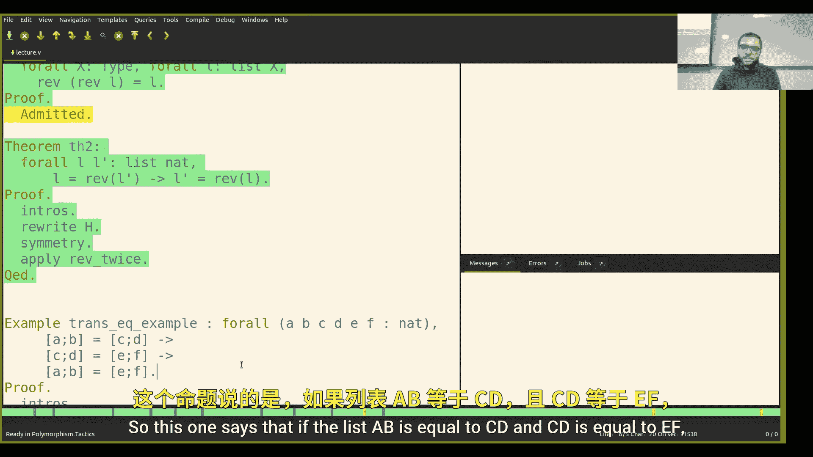

Okay， so let's do intros first。And then let's just try rewriting， right， so AB is equal to EF。In H。

 I know that AB is equal to Cd， so let's do a rewrite using H and I get Cd equals E。

And now I can just say assumption or I can say apply H0， or I can actually do it with rewrite。

 I can say rewrite h0 and then reflexivity。But I don't like this proof。

I would actually prefer it if I can write a more general case and then just。

Apply that general case here。So what do I have here。

 I'm saying that if some list is equal to a second list and that second list is equal to a third list。

 then the first list is also equal to the third list。So I'm saying that equality is transitive。

But this doesn't only hold for lists， it holds for everything。

So let's just prove a general theorem that says that equality is transitive。And after proving that。

We can come back and then apply it on this particular example。So try to prove this theorem。

 it says that equality is transitive。So it says for any type X and any three elements。

 N M and O of type X， if n is equal to M and m is equal to O。

 then n is equal to actually to be more specific， I'm not using and here， I'm just using implication。

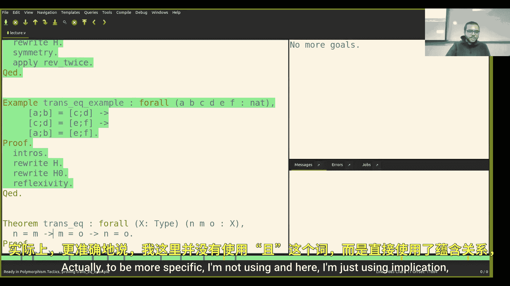

But it's the same theory。

We have universal quantifications， so we intros and I want to give some names to the equations that I get in my intro so I do it like this。

And then I can just do rewrites right so I want to do a rewrite。

 this is basically the same proof that I gave here。It's just that rewrite using equation one。

So n is equal to O， I'm doing rewrite using equation1， so I put M instead of n。

And then this is already equation two， and so I can do rewrite using equation two and reflexivity。

 or I can just say。This is an assumption。请。So now。We can go back。And look at our example again。

 so this was our example。You said that for any six natural numbers A to F。

If AB is equal to Cd and Cd is equal to EF， then AB is equal to EF okay？So in my proof。

This time I first do intros again， just to get rid of the quantification。

And now I say this is a special case of this general theorem that I proved here。

 I proved that basically if something is equal to some other thing and that second thing is equal to a third thing。

 then the first thing is equal to the third thing。It's just that my things here are actually lists of natural numbers。

So if I want to do this， can I just say apply？Trans EQ， apply what I have here。And as you see。

 this one fails， now， why does it fail？So let's say that I want to apply this theorem。

So Cock tries to again do a matching of the variables and figure out what has to replace what。

So in this case， we want to prove that AB is equal to EF， so Coch understands that instead of n。

 it should plug in AB and instead of O it should plug in EF。Okay， so Co understands those things。

And because N and O have type net list， Cork also understands the type of X。

That understands that X is also net list。So Coke can figure out what x is， what n is。

 and what always。Then it wants to apply transCQ。But it cannot figure out what it has to plug in for M。

That's not something that you can just understand based on the goal。

So I have to explicitly say what to plug in for M。So I can't just say apply trans EQ。

I have to say apply trans EQ and I have to say what to replace MviID and in this case I want to use the list CD as my value for M。

So I say apply trans equalq with M equals to Cd。Okay。😊，And I do this。Great。

 now it says you have to prove two things， you have to prove Ab is equal to Cd。

But that's an assumption that's equation one， so I just say apply equation1 and then it says you have to prove Cd is equal to EF。

 I apply equation2， that's it。Yeah。So you see we can have this kind of thing， we can have an apply。

 and then we can say apply it to width and then we can say what parameters should be。Replace by。Okay。

Here's another example， let's say that。I define a function called minus2。

And this is just a function that takes n and returns n minus2。Okay。Now I want you to prove this。

So I want you to prove that if m is the minus2 of o， so if m is0 minus2， basically。

And n plus p is equal to M。Then n plus p is also minus two of。Now。

 the point of this example is to make sure you don't really use minus2 at all。

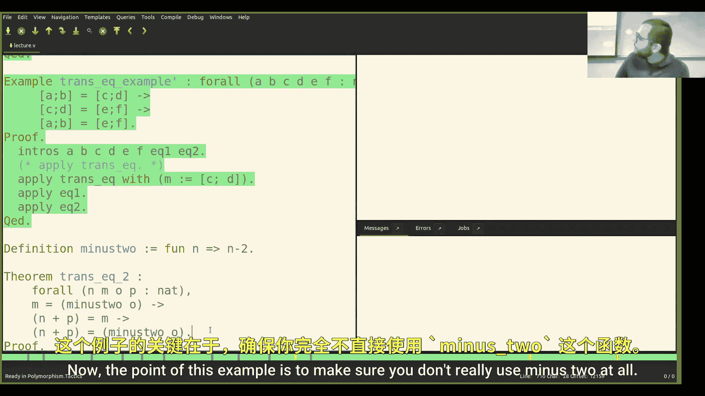

So again， we have three things that are supposed to be equal。Right， so I know that M。Is-2 of0。

And M is also n plus P。And I want to deduce that n plus p is equal to minus 2 or4。

I expect you to apply the transitivity of equality。Tranicq。So。Here's how we can do this。

We start our proof， we， of course， do intros。And then now I have to apply trans EQ， but again。

 as before， if I just write apply trans EQ， it says I don't know what to put for M。

 so in trans EQ it can figure out what to put for O and N。So for O。

 it has to basically put minus2 of O and for n， it has to put n plus P。But it says。

 what should I put for M？And actually for M， it should put M， but these are two different Ms。right。

So I have an M here。Which is basically the variable in my context。And then I have an M here。

Which is a variable intrinsic transitQ， these are not the same。

So what I have to say actually is something that looks really weird。

 I have to say apply trans EQ with M equal to M。And what this means is that this is the M intrinsicq。

 this is the M in my context here， says put this M for that M and then it， yeah， it works。

And then now I say I want to show that n plus p is equal to m that's h0。

 I want to show that m is minus2 of o， that's just H， and that's a Qity。Okay。

We have one theorem that we didn't really prove because we were focused on saying how to do apply and now you know how to do apply and how to do apply V。

But let's go back here and prove this dear。So prove this ref twice。

So it says for any list of elements of type X， if I take the list and I reverse it twice。

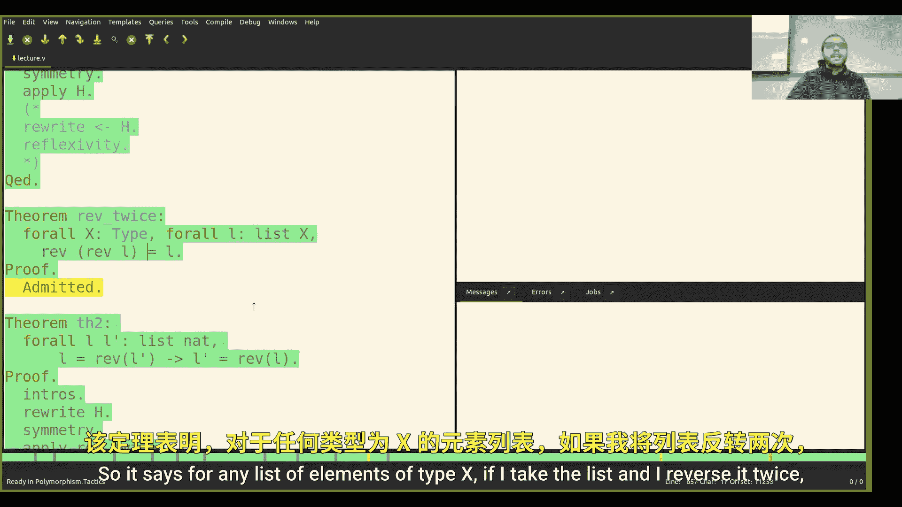

I will get the same list。

You want to already do induction here？Can we do simplify or anything else？No。

 it doesn't do anything right so let's do induction induction on what on L， of course。

 because L is the only thing that is inductive here。And。Let's say I'm going to call it L prime or。

Well， I'm going to have this situation because remember that my list was either the empty list or it had a head and a tape。

So， I'm going to say。Use H and T。As the head an。Okay。

 the base case is to just say that the reverse of the reverse of the empty set is the empty set。Okay。

 I can easily say reflexivity and it already solves it。Or I can just say compute both sides first。

 both sides are the same sort of reflexivity。Okay。Now I have this， my induction hypothesis is that。

If I take my tail， the reverse of the reverse of the tail is the tail itself。Okay。

 but now I want to say that instead of just having a tail， I have a head followed by a tail。

 and I want to say that the reverse of the reverse of the head followed by the tail is the head followed by the tail。

Okay， what can I do here， let's do simplify and let's see what we get。So this is what we get。

This reverse inside simplifies， it says it's the reverse of the tail。Appendate with H。

What should I do now？So I now need a lemma that tells me how I can get rid of this append when I have a reverse。

Right， so。This is the kind of thing that I have。I want to。Have a lemma。That basically says。For all。

X呃。That is any type and for all。Yeah， actually， let's write it like this for every。😔，X。

 that is a type。 and for every。H of type X and for every T of type。😔，listist X。

If I take reverse of T and add H。And if I reverse that。😔，That's going to be H。Followed by。Well。

 I don't need to say reverse， okay， if I have this。

 the reverse would be H followed by the reverse of T。Right。So thelemma， let's say admitted for now。

Let's come back here。So I want to apply thislemma， so I say apply Lm1。Doesn't work。What should I say。

 How can I apply thislemma here。sir no。Yes， so I first do an assert， let's call the assertion a。

 what is the assertion I want to say reverse of reverse of T followed by H。Is equal too。

H followed by of reverse of T， right？😔，Okay， I assert this。

And now I can say apply demo1 and it knows how to apply it， great。Now I have this A。

 so I can say do a rewrite using A。Okay， so now what do I have。

 I have H followed by the reverse of the reverse of T is the same as H followed by T。

 but my induction hypothesis already says that reverse of reverse of T and T are the same so I can do a rewrite using my induction hypothesis。

And now I have the same thing on both sides。So I can say reflexivity。UVD。

But now I have this lemon to prove。And。Unfortunately， we ran out of time。

 so you should be able to prove this lama though。

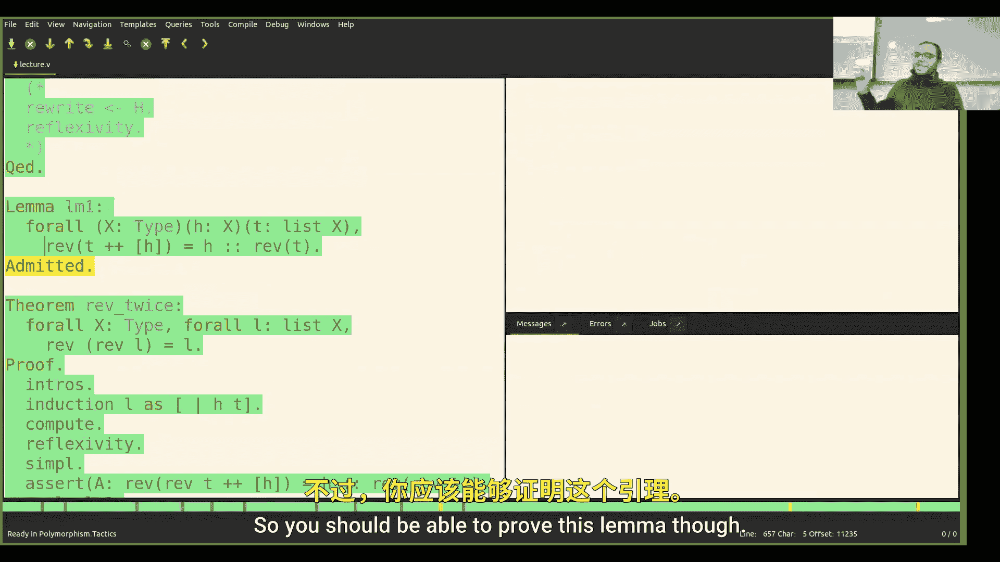

This is not a hard level。

I'm going to start with recalling some of the things that we have already seen and I'm creating a module here because I'm defining things that already exist in the CoX Standard Library and I don't want to create any conflicts here。

So let's say I just created a new module， so remember how we define natural numbers。

So we said a natural number is a type that is defined inductively。And it's either all。

 which was a constructor that basically showed zero。Or it's the successor of another natural number。

 okay？Now the thing that is very important to understand here is that whenever you define something inductively。

These constructors that you have O and S and on， they are first of all disjoint。

 so O is not really the same as any one of the values that you can get with S so I have no case where s of something is equal to O。

Okay， and that's by definition， this is already inside this definition。

And the other point is that each one of these constructors are actually injective or one to one on their own。

So if I have two numbers that are different， so if I have A and D and they're not the same。

 then S of a and S of B are also not going to be the same。

Or another way of looking at this is that if s of a is equal to S of B， then a is equal to B。

And this is also by definition， so whenever I'm defining an inductive type and giving it several different constructors。

I'm assuming that every constructor is one to one injective。

 and also I'm assuming that the values taken by that are created by different constructors are never the same。

Okay。The other thing that I want to recall is this definition of predecessor。

Which basically said that if I have a natural number n and if I want its predecessor。

 I can find it like this， I can say do a pattern matching on n。

And the predecessor of O is0 or predecessor of zero is zero。And if n is the successor of M。

 then M is the predecessor of M。ok。😊，So this is all I wanted to。Recall for you。

But let's actually give a proof。 So let's say I just said that this S is an injective function。

 this S is。A constructor here， but if I check the type of s， so if I say check S。

 you see that it's a function basically that takes a natural number and gives me a natural number。

 of course the natural number that it gives me is the next natural number。

So I want to prove that this。Function S or constructor S is injective。So prove this theorem。

 s is injective， which means that for every N and M that are natural numbers。

If S of n is equal to S of M， then n is equal to。

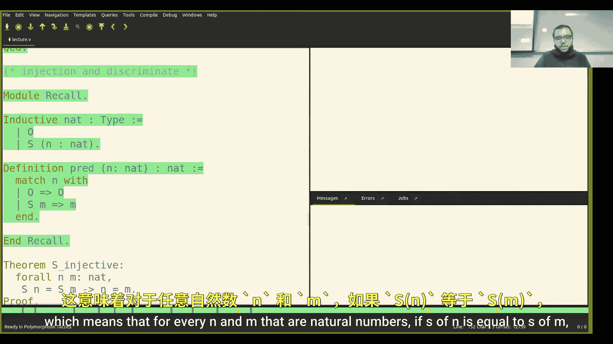

Okay， so let's see this。So first I do intros because I don't want to have forral in my goal。嗯。

Here's the thing my assumption is that S of n is equal to S of M。

And I want to prove that n is equal to a。So I just use an assertion and this is the assertion that I use。

 I say that n is the predecessor of its own successor。ok。So I want to prove this。

 I can just prove this by reflexivity because if I simplify it， both sides simplify to n。

And so I can do this， I can say simplify and you see both sides are n and then do reflexivity or I can just directly say reflexivity Now that I have this extra assumption here。

 I know that n is the predecessor of its own successor。I can do a rewrite。I can rewrite using H2。

 so I want to say that n is equal to M。I do rewrite using H2 and I get that predecessor of successor of n is equal to。

But I know that the successor of n was the successor of M。That was my very first assumption。

 so I rewrite using that assumption and I replaced this successor of n with successor of n。

So now I have that predecessor of successor of M is equal to M， but if I simplify it。

 both sides well simplify to M。And then I have reflexivity。O。So this proves that， of course。

 S is injective。But the really important point on the point that I said at the beginning of this session is that all constructors are injective and the values created by different constructors are disrupt。

ok。😊，So to prove the injectivity of all constructors。

 I can actually extend the same idea of proof to all of them， so the same kind of assertion。

What's the role of the predecessor function here？Basically。

 the role of predecessor is that it undoes whatever is， it removes1 s。Right。

So if I have any other type， let's say I have this type， I'm just calling in my type。

 and it has two constructors， the first constructor takes only one natural number and the second one takes two natural numbers。

Okay。Here's what I want you to do， I want you to prove that the first constructor is injective。

So that means that for all a and a prime that are natural numbers。

 cons1 of a equals cons 1 of a prime implies that a itself is equal to a prime。

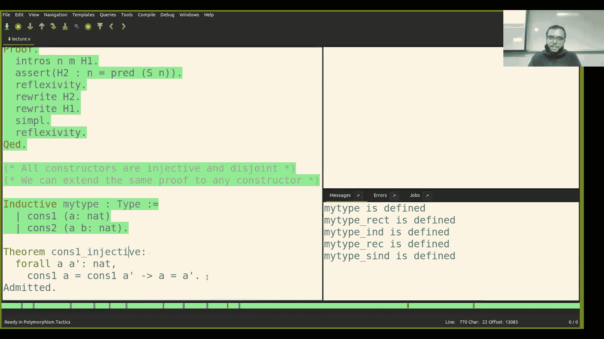

You should be able to basically use something very similar to the previous book。

So what do I need in order to give a proof like this。

 I need something that looks like the pre function。

I need to write some equivalent function to what predecessor did in the previous proof。

I have to write a function that basically removes Kants1。Its like an undo function。Okay。

So here's what I do， I call it Ks one onroll or you can call it whatever you like。

It takes some value x of my type and it returns the natural noun。

And it does it with a pattern matching。But remember， I had two constructors。

 so when I do a pattern matching， I have to actually make sure I have cases for both of these constructors。

Now honestly， I don't care about the second one， I only care about what I do with the first one。

So I say if it was cons one of a， return a。If it con2 of AB。

 I can return whatever I don't really care。I'm returning A here， but let's say I return 100。

 who cares？ok。The important point here is that if x is created with the first constructor。

 if x is cons 1 of a。This function returns a。I don't care about the other things。

Now I can use this to prove my theorem， which says that the constructor cons1 is injective。Okay。

So again， our assumption is that cons 1 of a is equal to cons1 of a prime and we want to prove as the goal that a is equal to a prime。

 of course we will have this only after we do intro so let's do intro。Okay。

Now I'm going to assert something that is basically the same as what I asserted with pre and successor likeP and S。

I'm going to assert。That a is equal to the undoing the Ks1 on role of cons1 of a。Okay， I insert this。

And again， this is just following the definition， I can do Sim or I can do compute and it just computes both sides as a。

And then I can say reflexivity。So now that I asserted this。

 I have it in my assumptions and I can use it as an assumption， I have H2。Okay。

So now I rewrite my goal using H2。So it means that I replace this a with this entire thing。Okay。

 rewrite is engaged。But now I have cons one of a here。

And my first hypothesis here says that cons 1 of a is equal to cons 1 of a prime。

 so instead of this I can put Ks1 of a prime so I rewrite using H1 and you see it becomes cons 1 of a prime。

And now again， both sides are just a prime， if I simplify or compute。

 I will get a prime on both sides and then I can say reflexivity。

 I can also directly say reflexivity， but I want to show you that simplifyimpl actually gives a primeing calls to a prime and then I do reflexivity。

me。Now I want you to prove the same property， the injective property for cons2。

For the second construct。The difference here is that Ks2 actually took two parameters。

AME which were natural numbers so of course you can do this with any number of parameters。

 but I just want you to do an example with two parameters so that you see how this works so prove this theorem。

The theorem says that if I have a B， a prime and B prime and cons2 of AB is equal to cons2 of a prime and B prime。

 then a is equal to a prime and B is equal to B prime。Again， you should try to apply the same idea。

 so try to write a function that un does con to。

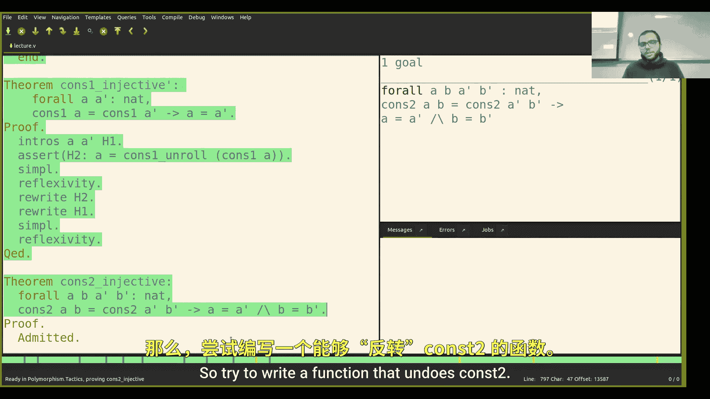

Okay so in this case I'm actually going to do two different functions。

 I'm going to use two functions because cons2 had two parameters。

 so I'm going to have one function that returns the first parameter and one function that returns the second one so I'm going to define it like this I'm going to say I have cons2 onroll a。

Which， basically。Take。X and it matches it， and if it cons1， again， I don't care what it returns。

 let's say it returns something。And if it's con to of a and anything， again， I don't care about B。

 it just returns a。And then I have a different function。Which is again the same thing。

 so I don't care about cons 1。😔，Yeah here I don't care about cons 1 and here I don't care about a if it's cons 2 of anything and B。

 I just returned the。Okay。Now this is my Ethereem， I want to show that cons2 is injective again。

 I first do intros。So。My assumptions are that constu of Ab is equal to constu of a prime v prime。

 and that all of these variables are natural numbers。So first of all， I have a conjunction here。

So we've seen this in the very first session on Co， we can actually use split。And if I do split。

 I'm basically saying that I will prove the first part first and then I'll go to the second part。

So I do split。Okay， now I want to prove that a is equal to a prior。

Now I use the same assertion as before， I say if I take a。If I take count two of AB。

And I do the unroll a function on it， so I will get a， so I assert this。

And this is true because I can simplify and just follow the definition so I can just write reflectlexivity now I have it as an assumption。

Now I want to prove that a is equal to a prime， but I know that a is cons2 onroll a of cons2 of AB。

 so this is H0， so I use H0 to replace this a with this entire expression， so I say rewrite using H0。

Now I have this。But I know that cons2 of AB was equal to cons2 of a prime B prime。

 that was my very first assumption， so I just do a replacement where I replaced this part。

And this is rewrite H。And finally， if I now simplify both sides。

 I'll get a prime on both sides and then I can say reflex it。

Now I have to do the exact same thing for B。Except that I'm going to use the second unroll function。

 so I'm going to assert that B is equal to cons 2 onroll B of cons 2 of AB。Okay。Again。

 the proof is simple I simplify and I use reflexivity now I have this assumption I know that B is equal to this thing so I can replace P with that thing using rewrite。

And now I have cons2 of AB， I know that it's equal to constu of a prime B prime。

 I can use the rewrite。Using age。And finally， I just simplify I get B prime on both sides and it's reflectlexivity。

确。Okay。Now。As you saw， these proofs were kind of hard。

And of course it gets even harder if you have more parameters， if I have 10 parameters。

 I have to write 10 of these functions and 10 assertions and all of these groupss。And actually。

 Cork has a tactic， which is called injection。And you can just use that。

So here's a simpler proof of the very first theorem that we proved this in this session。

 which is like。M are national numbers and successor of n is equal to successor of M。

 then n itself is equal to n。So we start our proof， we do intros as usual。

And then here's the new tactic， I say injection H as H0。So I'm saying take H。

 H is one of my assumptions。And I'm saying apply injection on this and basically what that means is that if s of n is equal to S of M。

 I can instead say that n is equal to n。So I can just write actually injection H without as or anything。

 if I just write injection H， you see that it found that n is equal to M and then it added it at the beginning of my goal。

So instead of proving my goal， now I have to prove this simpler version。

 but if I write injection H as H0， let's say， then it really just。Changes the name， so H becomes H0。

And also， it removes the S。So。And now I can say apply H0 and I don't have any。ok。Solve this one now。

 so let's say that n M and O are natural numbers and the list Nm is equal to the list O0 prove that n is equal to and of course I want you to give a proof using injection don't just。

Redo the entire proof like。

Use injections。

Here's our proof。As usual， we do intros， we're doing intros at the beginning of every group at this point。

Okay。So。Here's the thing H。Is actually a list and we saw the definition of list in the previous sessions。

 so if I say something like this， if I say set printing。嗯。😮，Oops print all。😔，嗯。W did I write this？😔。

Okay， yeah。Set printing all。If I write this， it expands everything and doesn't use any of the notation and syntactic sugar。

So H says that。This list is equal to this list， but if I do set printing all。

It actually writes the entirety of these lists and you see the constructors of the list and so on。

So you have Ks SNt N， Ks SNt M， this is the list N M and then followed by Neil。

And the other list is Connet， O， constantsnet， O and then Ne。Right。

So I can use injection here and I'm actually using the injection of cons。

And if I use an injection of cons。That basically tells me that， well。

 if the first one is equal to the second one， then this sequence should be equal to that one and so on。

 so I should。It's something like this， so I do injection on age。And actually， let me do it like this。

 I say injection on H as H0。So you see I had that Nm should be equal to 00， but when I do this。

 I get that n should be equal to 0 and M should be equal to0。

So injection is also applied exhaustively just。Applies injection as many times as it can。

 and it finds all the possible equalities that you can get by injection。

So let's say I just do injection H so that I add this here to the left hand side of an implication in the goal。

And then I do intros so that they come up here。ok。Now， what do I know。

 I know that m is equal to O n is equal to O， I want to say n is equal to1。

I can just rewrite using H0。And then I can apply it。Or actually。

 I could also use one of the theors that I proved before that equality is transitive。ok。So。

Proof this one now， so this is another example of how you can use injectivity。

We want to say for any type X。And any three elements ABC that are of type X， and any two lists。

 L and J， which are lists of type X。I want to say that if ABL is equal to CJ。

And J itself is equal to C， then a is equal to B。Okay。😊，So intuitively， what am I saying。

 A B and C are elements here， but L and J are lists。So I'm saying that AVL is equal to Cj。

 but J itself is C， so AVL is equal to CL。RightAnd from the fact that ABL is equal to CclL。

 I want to get that a is equal to B。

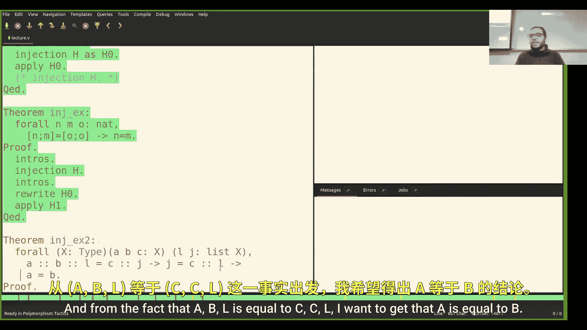

So here you have to actually rely on the injectivity of the constructors for a list。

So let's do the proof。😔，So I just assert the thing that I said is my intuition here。So as a human。

 when you look at this， you say that okay， ABL is equal to CJ， but J itself is C， so ABL should we C。

J right， or sorry， yeah， ABL should be CN。Right， so。Okay， let's do this again。

 as a human you look at this and you see that ABL is equal to CJ， but J itself is CL。

 so ABL is equal to CCL。😊，That's what I want to assert， I want to assert。

 and I give it the name big A that ABL is equal to CCL。Okay。Now， how can I prove this？Well。

 I have this assumption H here， which says that ABL is equal to Cj and remember that A and C。

Are both basically letters， they're one element， whereas L is a list。

So ABL is the list that is obtained by taking BL and adding A at the beginning。

CJ is the list that is obtained by taking J and adding C at the beginning。

 so both of them are created with the same constructor cons。So if I apply injection on H。

You see that I get several things here first I get that bL is equal to J， but more importantly。

 I also get that a is equal to C。And now again， I do intros to bring this into the context instead of the call。

ok。So now I have to prove that AVL is equal to CL。But I also know that a is equal to C。Okay。

So I'm going to do a rewrite using H1。What does H1 say？It says that BL is basically the same as J。

 so instead of this BL here I can put J。So I get Aj is equal to CA。But now I know that。

A is the same as C。So I can do another rewrite using H2 and replace this A with a C。

So now I have that CJ is equal to CCL。That's what I have to。Okay。

But what does H0 tell me H0 tells me that j is CL， so I can replace this C here with J so I do rewrite H0 and now I have the same thing on both sides。

 I have CCL equals CCL， so I do reflexivity。And all of this was to just prove my assertion。Okay。

 so now I have my assertion in my context and I can use it here as an assumption。

 so I know that ABL is equal to CCL。And I want to prove that a is equal to B。😡，How do I prove this。

 how do I prove that a is equal to B？Well。Again， I can take this and this and I can look at their constructors。

 so I don't care about the tail。This is a list that is obtained by adding a at the beginning of some other tail。

 this is a list that is obtained by adding C at the beginning of some other tail。

So if I apply injection， I will get a equal to C。Of course。

 I will also get that this sta is equal to this sta， which means that BL is equal to C。Okay。

 so I do injection。And actually， injection is。Exhausive again， so it applies it again。

 so bL is equal to C means that b is equal to C and L is equal to L。

 but L equal to L is trivial so it doesn't add that one。

It just adds that B is equal to C and a is equal to C。

 and now I do intros to bring this into my assumptions。And again， at this point。

I know that A and B are both equal to C and I just want to show that they're equal。

 so we are back to transitivity of equality， but I can also do it with a rewrite so I rewrite it and then I say this is the assumption or I apply the other one and that's security。

Okay。Okay。So this was a bunch of theorems that we could actually prove using injectivity。

 but the other point that I said was that。If I have two different constructors。

The values that are created by different constructors are always going to be destroyed。

 so I will never have the same value created by two different constructors。ok。😊。

I can actually use that when I want to prove something。Full example。

Let's say that I want to say for every n and M that are natural numbers， if false is equal to true。

 then n is equal to n。Okay。So logically speaking， this holds vacuously because like the left hand side of the implication never holds。

 so the entire implication is always true。But。Here's the thing， what are true and false？

It goes back to the definition of the Tpoolean， remember when I defined the Tippoan I said that we have two different constructors true and false and none of them really took any parameters。

So here's my proof， of course I'm doing intros first and now I'm saying look at H H says that false is equal to true。

These are two different constructors， they cannot be equal to each other。

Now how can I tell Cock about this， well， I can use the tactic discrimininate。

So I can tell Kock that well， do discriminate on H。

 which means that the left hand side of H is created using a different constructor than the right hand side。

And that means that H is a contradiction， which means that， well。

 my goal is proven because if you have a contradiction in your assumptions。

You can get anything from a contradiction， so I say discriminate H and it suddenly says no more goals。

Now， instead of saying discriminate age I could also just say discriminate and it will just try to apply discriminate to all of the assumptions in the context and even if one of them works。

 it says okay， you're fine， so I don't have to necessarily specify where I want to do the discrimination。

You already saw the proof for this one， but anyway proof this one。

 so I want you to prove that for all natural numbers N。If the successor of n is zero。

 then  two plus 2 is equal to five。Right， so that's again， because the successor of n cannot be zero。

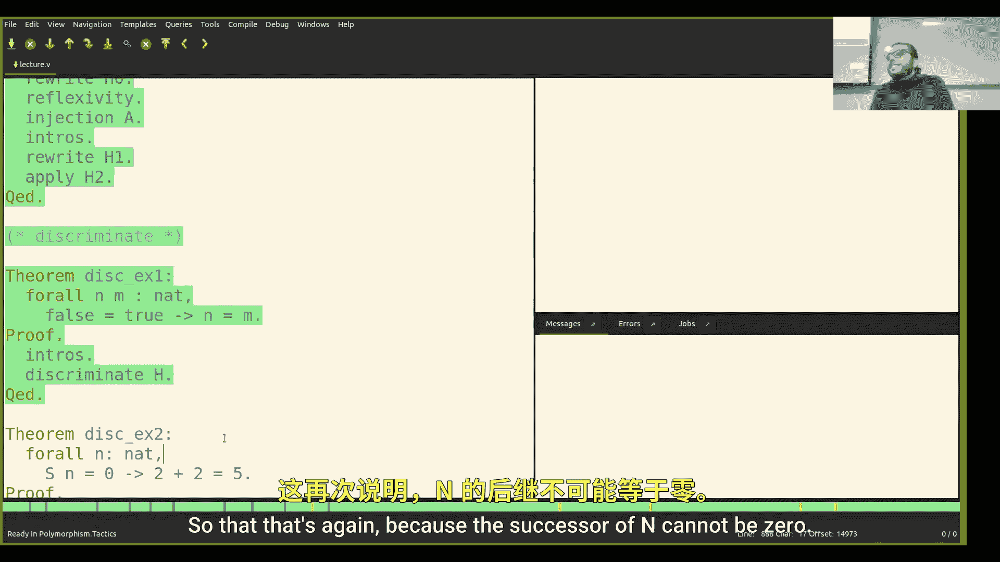

Okay， so let's see the proof Yes， so we do intros and。Again。

 I can immediately say discriminate each year。Because remember the definition of the type na when I was defining natural numbers。

 zero is just a nice way of writing O， so I had two different constructors I had O and I had S so on one hand I have on the one hand I have S and of course it has some parameters and on the other hand I just have O so S of something can never be equal to O because the constructors have to be destroyedjoin。

So I can just say discriminate H， and that's it。Here's another one which is very similar。

 but this one is actually a little bit harder to understand， but the proof is basically the same。

So it says that for all types x and for all elements。

 x Y z of type X and all lists L and J that are lists of x。If X Y L is equal to the empty list。

 then x is equal to z。So again， here what we have is that on the left hand side。

 I'm sure that this list is not empty because at the very least it has x and y。

So it has at least two elements。So again， intuitively， this makes a lot of sense。

Because if my left hand side is a contradiction， I don't care what my right hand side is going to be。

 so I'm going to do intros again。And now here's the thing。This age。On its left hand side。

 it has x 0 y0 L on its right hand side， it has the empty list。 Now。

 if I again write set printing all。The left hand side is actually this one。

It's like cons of x0 and y0 and so on。Whereas the right hand side is just N。And remember。

 Kan and Neil were two different constructors for the type list。So the fact that。

The two sides are using different constructors。Means that they cannot be equal。

 so I can easily say discriminate H and its see the constructor on this side is Ks。

 the constructor on this side is named。And that sits normal costs。Now， prove this one。

So remember the difference between equals and equals question mark。The difference was in the type。

So if you use equals， you get a proposition， if you use equals question mark， you get a Boolean。Okay。

 now I want you to prove this， I want you to prove that for all N。If0 equals n。As a Boolean。

 this thing is equal to true。Then n is equal to0。And you can also check what equals question mark does。

😔，So it says it's a function that takes two natural numbers and returns a Boolean。

 and this is how it works。So it takes two natural numbers and an M。

And it does a pattern matching on N。It says that if n is zero。

And then do a pattern matching on M if M is also zero， return true， Otherwise。

 if M is the successor of something return false。The other case is that n itself is the successor of n prime。

 then again it says that if m is zero return false， if m is the successor of n prime。

Called the same function on N prime M。So equals question mark is just syntactic sugar or notation for EQB。

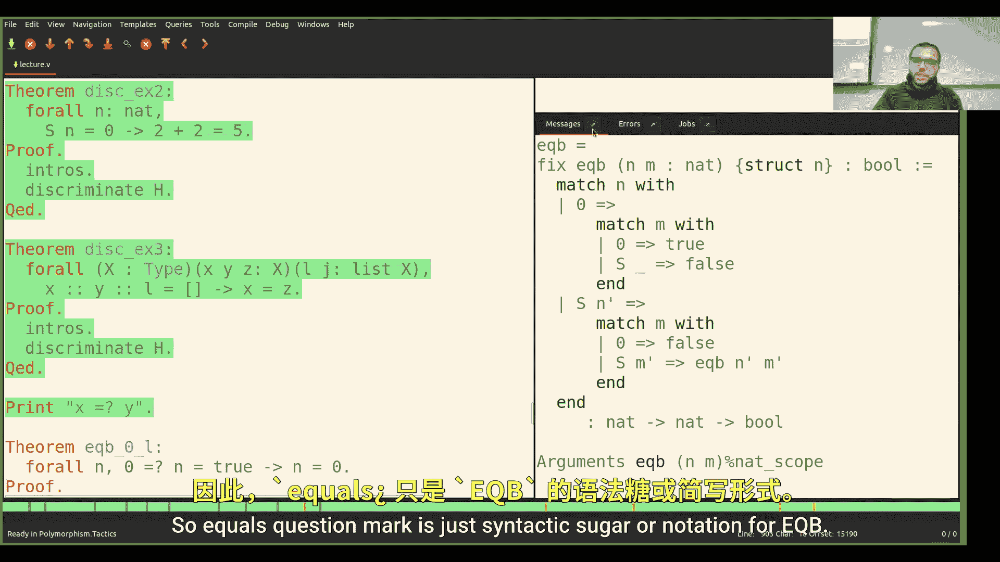

Okay， let's actually see the proof。So we do intros first。Now here's the thing。

 I have this natural number n。And basically， I want to do a casework on end。

RightBecause here I'm checking whether n is zero or not， so let's do a casework。

And we do casework by destruct of course， so I say destruct n and I call the parameter to S as n prime and I keep the equation。

I disruptstruct it， I get two cases， the first case is when n is zero and the second case is when n is not zero。

So the first case， if n is0。I can， well， let's do an intros first。

And you see that I have to just prove that zero is equal to zero and this is easy。

 this is reflectlexivity。Okay。Now the second case is that n is not zero。

 which means that n is the successor of some other number， let's say n is the successor of n prime。

And so here also， instead of n， I now have successor of N prime。ok。

So now if I do simplify what would happen？So if I do simplify， all of this will simplify to false。

 why will it simplify to false？Because this one it's basically O。

 remember and this one was s of n prime， and then in the definition of equals question mark。

 we had that if the first number is all and the second number is s of something， it's false。

So if I simplify here。I get false。And of course， this true remains true。

 so now this is what I have to prove， I have to prove that if false is equal to true。

Then s of n prime is zero， but now I can do intros， I get false equals to true up here。

And now I can say discriminate on age because false is never the same as true。

 false and true are two different constructors for boot。And that's communityity。Now， but。

A very weird thing that I did here， and this is the first time that I'm doing something like this。

Is that I didn't do intros first。Right。So up until this point。

 whenever we've had any kind of entailments like this， we would just do intros。Okay， so here。

 if I first do intros， what happens？Distings。Up here into the context。

 but then my problem is that I can simplify it anymore because simplify simplifies the code。哦。Right。

 so I don't want to do intros first。I want to first do simplifyim because I want this part to first get simplified and then I want to do intros so that the simplified version goes out there。

And then I do discriminate and that's opposite。Okay。Now let's move to another tactic。

 but before actually using the tactic。Proof this theorem， this theorem is called F equal。

And basically， what it says is that。If x and y are the same and I apply the same function to both of them。

I get the same value。So in other words。If x is equal to y， then F of x is also equal to f of y。

 and this holds for。Any type A and B， any function F that maps from a to B and any elements x and y in type A。

 so in some sense we are proving a polymorphic TrM now。

Because I'm saying this holds for every types A and B。

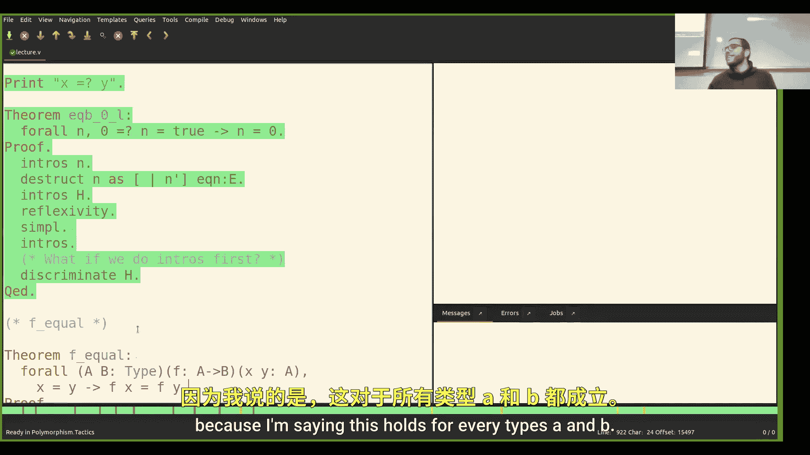

So the proof is actually very easy， it's just a simple rewrite。So I do intros。This is what I have。

 oh， and by the way， it changed the names to x0 and y0 because apparently I have x and y somewhere else。

 so it decided to change the names。But anyway， my assumption is that x0 is equal to y 0。

 I want to prove that f of x0 is equal to f of y0， but I can rewrite using my assumption so I can say rewrite H。

 I can change the x0 here to y0 by rewrite。Okay， I could also do the rewrite in the other direction I could change the y0 to x0。

 it doesn't really matter。And then I have the same thing on both sides so I can say reflexivity。O。

So as an example of this。😊，Again， I told you that constructors are also functions。Right。

So I can say that for any two natural numbers， n and M， if n is equal to m。

 then the successor of n is equal to the successor of n because S is also a function。Okay。And。

The proof can be that I can just repeat the same thing。

Or I can say I do intros and then I just apply that theorem， just apply f equal。

So if I say apply if equal。It understands and look at this， so when I say apply f equal。

In f equal on the right hand side I have f of x equals f of y， and here I have S of n equals S of n。

 so Coch understands that it should replace f with S n sorry x with n and y with n。Okay。😊，Now。

 when it does this， I have to also prove x equals y because that's how apply works。

So I have to basically prove that n is equal to M。But I have that as my assumption。

 so I just say assumption。Okay。So here's the thing instead of actually writing this theorgram and always using it since this is a very common theorem。

And。We need it all the time。I don't have to actually say apply F equal。

 there is a tactic which is literally called F equal。And I can just use that。

So if I want to show that S of n is equal to S of M。It's enough if I show that n is equal to M。

So if I use the F equal tactic， it just tells me， okay， now prove that n is equal。

And of course this is sufficient so and I have it in the assumptions。

This is basically what I already wrote。Here's another example。Try this one。For all natural numbers。

 ABCD， if a is equal to C and B is equal to D， then the list AB is equal to the list C。

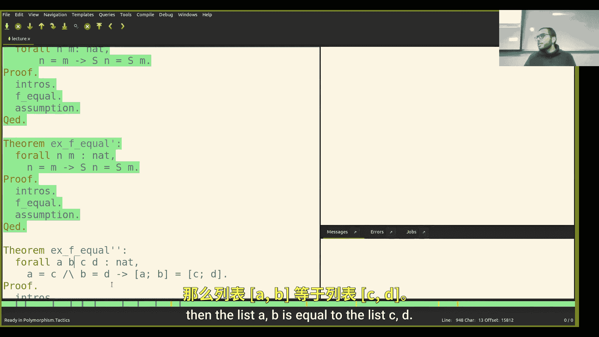

O。So let's say I do intros。嗯。Well， I don't like it that my hypothesis looks like that。

So I can first destruct the hypothesis。So I can say destruct H so that I have a equals to C and B equals to D separately。

But now what happens if I just apply f equal？Right because these are lists right so again I have to constantly do this sets print all printing all I always forget what to write Yeah。

 so these lists they're basically created by the。Kans constructor。

Right so if I and I told you that constructors are basically functions。So if I do F equal。

I will already get that I have to prove these two things now why does it look like this？

So on the left hand side， I have cons of a and the list that only contains B because remember。

 cons always added one element。Head。To the beginning of a list， which was the tail。

 so that's why you get that the head here， which is a should be equal to the head here， which is C。

And also the here， which is not just B， it's a list that contains only B。😊。

Should be equal to the here， which is the list that contains the， so that's why when I do F equal。

 it says prove these two things。Okay。😊，Now the first one， this is an assumption， so that's good。

Here I can do F equal again。Because again， this is cons of the element B with the empty list nil。

And this is Khans of Dil。Okay， let me again do this。 thats printing all。Yeah。

 the first one is con of venial， the second one is con of deyl。Okay。

So I do f equal again and it says， well， it understands that Nil is equal to Nil。

 so it doesn't want me to prove that。But it askeds me to prove that b is equal to D。

 and I have that as an assumption， and thats committee。Okay。

But one thing that we saw here was that actually sometimes I don't want to just apply a tactic。

To my goal， I want to apply it to one of the assumptions or one of the hypotheses in my context。

 so for example， I did this here right so。I had this。

 I had H which said a equals to C and B equals to D， and I wrote destruct H。

So this de was not applying to the goal it was applied to the context。

So let's see more examples of this。Let's say that。 I want to。Prove this theorem。

 which is basically the same thing that we've proven so many times。Oh no， actually。

 it has a combination of equals question mark and equals。

But it basically says that S is injective again。So I want to say that for every N and M。

 which are natural numbers and every Boolean B。If SN equals question mark SM equals question mark always returns a Boolean。

 if this is equal to B， then n equals question mark m is also equal to B so in other words if next of n if the successor of n is equal to the successor of M。

 then n is also equal to n and if it's not equal then this one is also not equal。Okay。

 because B can be post true or false。Okay， so I want to prove this， I first do intros。

And what you see here is that。I have this hypothesis H and it's too complicated so I want to simplify H。

 I don't want to simplify my goal， if I just write simple I will simplify my goal。

 but I can say simple in H and it will try to simplify H。

So and simplification just uses the definition of equals question mark and the definition of S。

We've seen how simplification works before， so I say simple in age。And you see that。

It just gives me n equals question mark。Because the definition of equals question mark was that if I have s of n and S of n。

 they're equal if and only if n is equal to n， so I do this and then at this point I just have my assumption so I say assumption acuity。

As you see， the proof was much simpler than you would expect。Okay， prove this one。

Prove that for all N。If0 equals question mark n is true， then n is0， so basically。

This one is a proposition。But this one is a Boolean。

But we're saying that they kind of correspond if the Boolean is true， then the proposition holds。

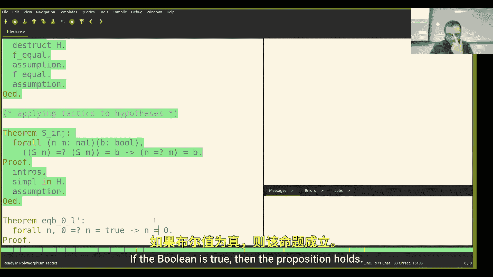

喂。😊，So let's do intros first。Now again， I have a case where I'm comparing n and0。

 so I would like to do a casework on N。So I say destruct n。And again， as usual。

 n prime is just going to stand for n minus1。So the first case is the case where n is zero。

And in this case， I say let's do intros again， I have to prove that zero is equal to zero reflexivity。

My second case is when n is not zero， n is the successor of n prime。ok。😊，And again， I do。Intros。

And remember last time that we were trying to prove this， this is where we got stuck。

And then we had to go back and figure out that， oh， I cannot do intros here。

 I had to first do simplify and then do intros。But I'm going to do intros already here。

And then I'm going to say simplify in H。ok。😊，And now in H。

 I have falses equals true and I can say discriminate age， and that's it。In the same sense。

 I can also use symmetry and apply and things like that in my context in my hypothesis instead of applying them on the goal。

 so here's another theorem。It says that for all NmpP and Q that are natural numbers。

If n equals M implies that p equalsq。Then M equals n implies that  Q is equal to P。Okay， again。

 it's a very trivial thing。😊，So let's do proof， we do intros。So these are all the things that I have。

I want to show that p is equal to Q now ideally。I want to start from H zero。

 remember before we used to do this backward reasoning。

 but now let's say that I want to really do forward reasoning。

So remember I told you that as humans we think forwards usually we start from the assumptions and we try to get to the goal。

 whereas the normal way of thinking， the standard way of thinking in coch is to do the opposite start from the goal and try to get back until you get the assumptions but let's say I want to prove this as a human I want to say m is equal to n therefore P is equal to Q okay so I want to start with H zero。

And then I want to apply H and so well， my first problem is that I have m equals to n here。

 but I have n equals to n here， the order is swap。So I say do symmetry in H0。So。

Remember what symmetry did when we had anequ just to have the two parts， but it did that in the call。

 I'm now saying do it in H0。ok。Now the next step。And this is actually forward reasoning。

 whereas we used to apply for backwards reasoning before。Is that I say？Now， apply H in H0。😡。

What does that mean， That means that well，80 is the left hand side of H so。

If I have this implication H and I have H0， I should also have the right hand side。

 I should have p equals Q。But this is how I write it。

 I say apply h in h0 and of course I can also give it a name。

 so I'm going to call it h1 I'm going to say。Apply H in H0 and call the result H1。

 so H1 is going to be P equals cube。And as you see， I just got H1 which says p equals。

Now I can do symmetry， which turns my goal into p equalsq and then I can say this is H1。

 or I could do symmetry in H1。And then say that this is just an assumption。

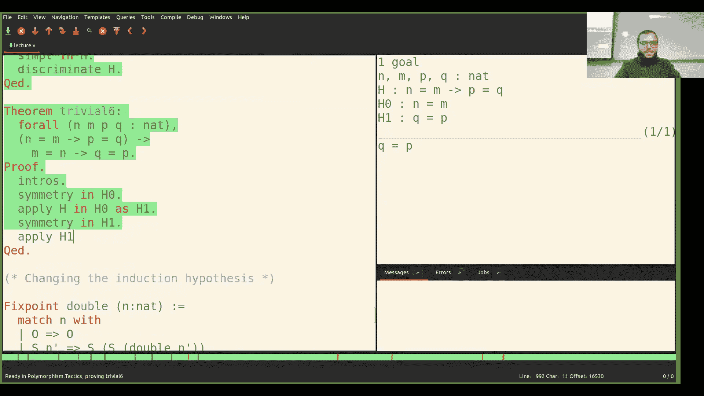

