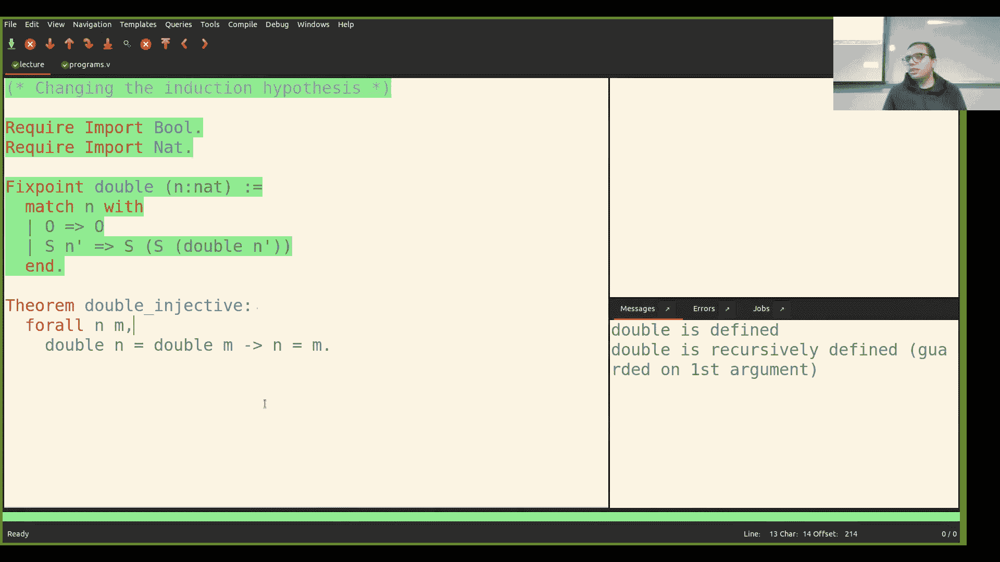
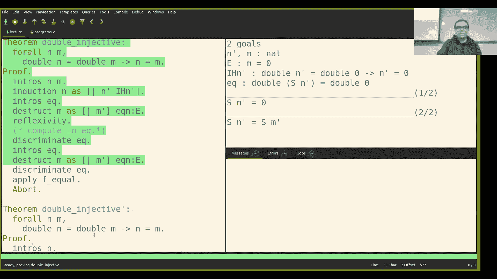
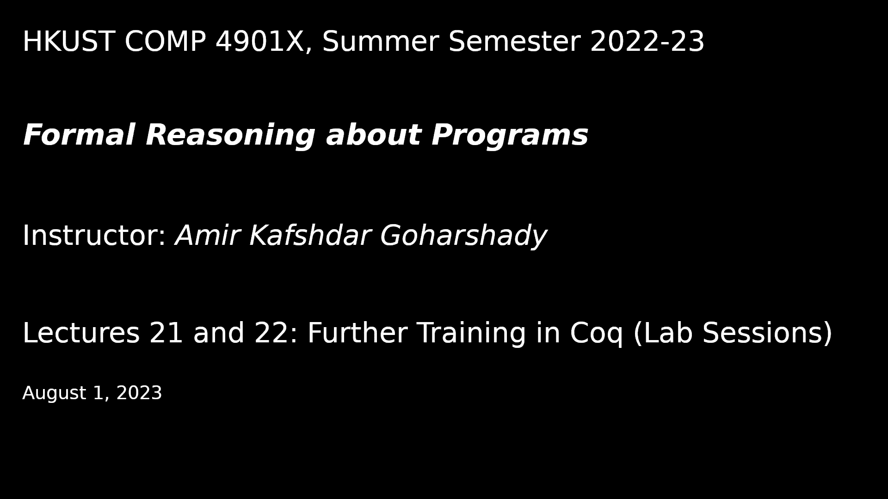
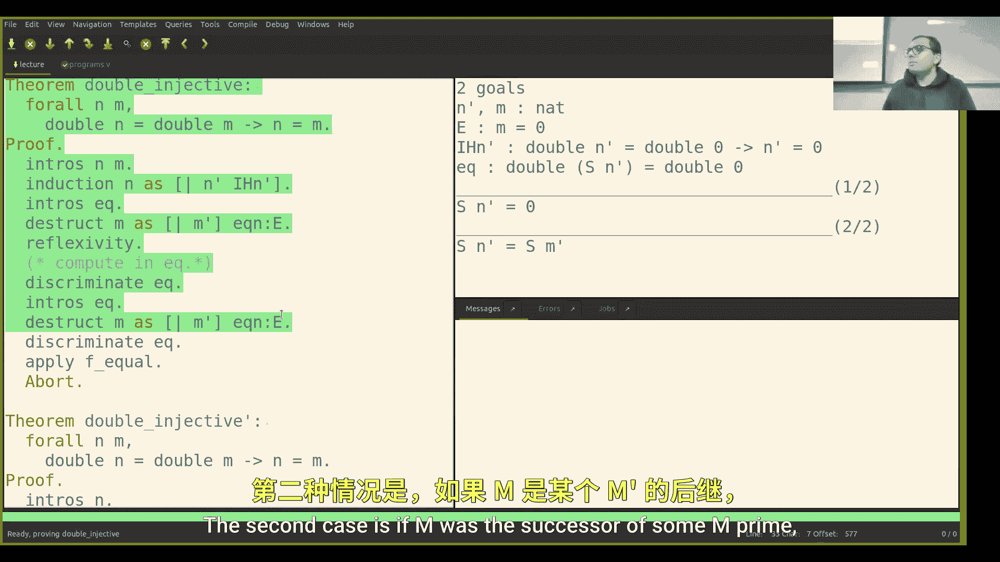
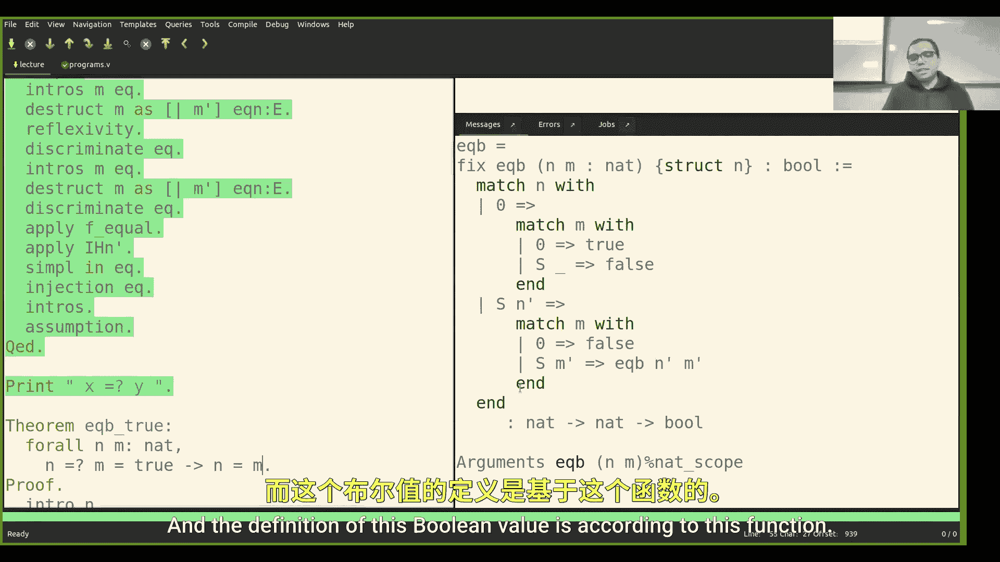
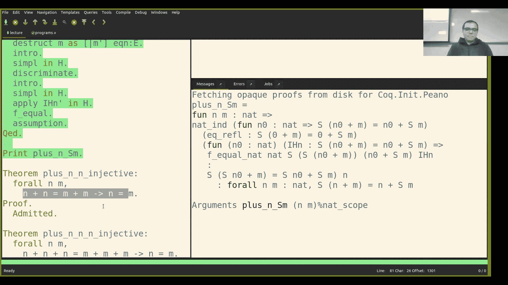
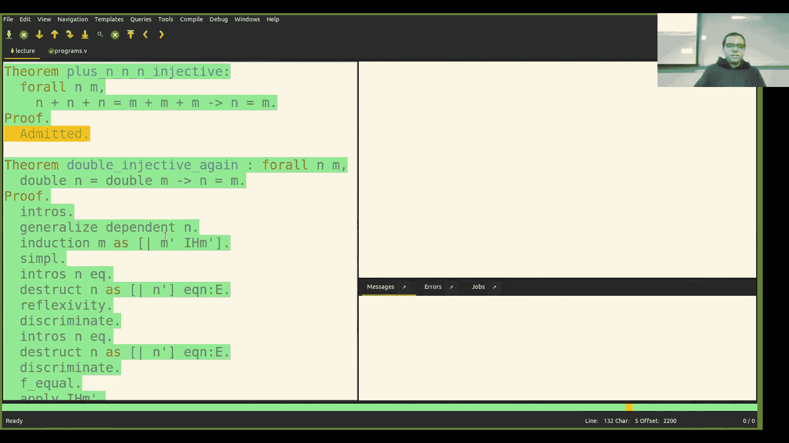

# 香港科技大学【中英⚡程序的形式化推理｜COMP4901X 2023 Formal Reasoning about Programs】 p12 p11 s 21 and 22 - Further Training in Coq -BV1roXTYaEmJ_p12-

The rest of decisions in this course are all going to be focused on Coke。

And actually they're going to be much more hands on so I'm going to come to the other side and check your proofs and talk to you。

 let's start with where we left off last time and the next thing we're going to see is that basically this idea that whenever you have some sort of universal quantification you should do intros that doesn't always pay off。

So there are cases where you have to actually。Use different techniques and especially if you're doing an inductive argument you can't just put everything into the context so please just write at the same time as me just follow along。

So first of all， we're going to import pool and that so that we have all the。

And library functions for booleans and natural numbers。And let's actually。Define a function。

 a recursive function called double。Which takes a national number n and doubles it。Okay。

So this is quite easy to define。We say just let's do a pattern matching on n if n is0 then。

2 n is also zero and if n is the successor of n prime。

 then I first take the double of n prime and then I apply the successor twice so this is the first theorem that I want you to prove。

Prove that this function double is actually injective。

So I want you to prove that for all natural numbers， N and M。If double of n is equal to double of M。

 then n itself is equal to n。Okay， and of course you have to prove this by induction。

So try to do induction to grve this。

Let's do the thing that we always do when we have universal quantification。

 we always say let's do intros。So I do intros， I bring n and M into the context and well。

 of course I want to prove this now， I want to prove that if double of n is equal to double of M。

 then n is equal to M， I want to prove that if double of n is equal to double of M。

Then n is equal to。And let's say that at this point， I say let's do an induction on it。Okay。

So I do an induction on N。And here's what I get。I get the base case and of course I get the induction hypothesis the base case is when n is zero。

Right if n is zero， basically I'm saying that if double of0 is equal to double of m。

 then zero is equal to。So I can do intros again。And now I can do a casework on M。

 I can say that M is either zero or it's the successor of something， so I say destructor。

Okay now my first case is quite trivial this is just0 equals zero so i'm happy about that reflexivity so let's see this is the case where I'm still in the base case of the induction so n is zero but m is the successor of some number it's the successor of m prime so I know that the goal is impossible。

So actually， my goal is to show that I have a contradiction now。

So I have to say there is a contradiction in my assumptions。Okay。

What are the assumptions that I have， I know that M is the successor of sum M prime。

And I also note that double of zero is double of the successor of some empire。But this part。

 this is not going to happen because。What's double of zero， Do of zero is0。

But double of successor of M prime is going to have successor in it。

So they have different constructors so I can actually this。In eq。So。Before doing that。

 let me do compute in EQ so that you just see what EQ is。So if I do compute in EQ， on one hand。

 I have zero， and the other hand I have some expression that starts with S。

I don't care what the rest of it is as long as it's not zero， it's not going to be equal to zero。So。

I actually didn't need to run the compute so let's undo this one。And let's discriminate you。Okay。

 but this is the part where things actually get bad。So let's say I want to do my induction step。

And this is my induction hypothesis that if the double of n prime is equal to the double of M。

 then n prime is equal to n。But now I'm saying that my n is n prime plus1， my n is S of n prime。

And I want to prove that if double of n， double of s of n prime is equal to double of M。

 then S of n prime is equal to M。 You already see the problem here。

The problem is that I have just1 m。Right and in my assumptions。

 I'm already saying that M is equal to n prime in some sense。

I'm saying that if m the double of m is equal to double of n prime， then n prime is equal to M。So。

That's what I have in my assumptions but then here I'm using the same M and I'm saying that if double of M is equal to double of s of n prime and v。

 I cannot have both this one and this one。So。It's not a contradiction。

 but I'm going to have problems now， and you'll see。So let's say I do an intros。

So now my assumptions are like this。I have one assumption that says that double of s of n prime is equal to double of n。

I have another assumption that says that if the double of n prime itself。

 not the s of n prime is equal to double of M， then something。

So I can really combine these two assumptions in any way。Well。

 I can try but it will not work So let's say I do a casework again on M I do a destruct on M I take the case where M is0。

 this case is actually easy。 It's another discriminate right so let me see what can we discriminate here Okay here I have double of0 here I have double of s of something so I can discriminate but then this is what I。

Get stuck with。So yeah， I could solve the case where m was zero。But if neither n nor M are0。

I'm now in this really awful case where I have one extra S here， basically。It's like。

If double of s of n prime is equal to double of s of n prime， that's good。

 that's the assumption that I have。But then here。I need the same assumption without this S。

 I need double of n prime to be double of s of n prime。

 so I either need to have an S here or I need to get rid of this S here。Right？

And none of them work and actually， I mean， I can apply f equals so that instead of this goal。

 I have n prime equals n prime， which is simpler。But in any case， I cannot prove this。

 I have to over。Now， what's going wrong here？The thing that's going wrong is that I'm bringing my variable M into the context too soon。

So at the very beginning。😊，I'm saying intros and M。What does that mean， so let's go back。

This is my goal， this is my initial goal， I want to prove that for all national numbers N and M。

If the double of n is equal to the double of M， then n is equal to M。

 so I want to prove this for all natural numbers NMm。Now， what does intros do， it says。

Take some specific but arbitrary values for NNM。And then try to prove everything else so as soon as I do intros n and M。

 I don't have a quantifier anymore， but I have the assumption that N and M are natural numbers。

But these are now specific natural numbers。Okay， so for example。

 think of this as saying that M is 10。Okay， so if m is just 10 and I do an induction on n。

 of course I'm not going to get anything。Right， I have to make sure that。

M basically remains quantified when I'm doing my induction。

So this is an example of showing you that you shouldn't just prematurely do intros all the time there are cases where。

It makes sense to wait。And not apply intros immediately。So。

Based on this really a hand wy observation that we have until this point。

Let's try to give a different proof of this theorem。And in this proof。

 instead of doing intros and bringing everything into the context。

Just bring N into the context and let M be quantified。

And try to give me an inductive proof without bringing M into the context at the beginning。

 so this is the first line of the proof。

Let's see what we can do。So we're going to first do intros on N。And as I said before。

 I'm going to keep M quantified。And I'm going to do induction on n while m is still quantified。

 so I do an induction on N。And I use n prime as n minus1 basically。Okay。

So this is the induction hypothesis， this is the case where n was zero。

 so you see that n is replaced with zero everywhere here。So we simplify this。And at this point。

 I can actually do intros。So I do intros。And here's what I have。

I have that the assumption that0 is double of m and I want to prove that0 is equal to so I say let's do a casework on M。

Okay， so I de M。The first case is if m is zero， then I have to just prove that zero is zero。

 but I have that by reflexivity。The second case is if M was the successor of some M prime。

But I cannot have zero equals to the successor of Empire。

So this was our first induction， which didn't work。This is our second induction。

We first introduce N to the context。But instead of doing intros on M。

 I'm just going to do an induction on M while M is still quantified。So I do induction on that。

And then I simplify。Okay。Now， this is the base case of the induction where n was0。

So you see that n is replaced with zero here。Now。At this point， I do control M。

And now I say let's do a casework on M to see if m is0 or not， so the first case is if m is0。

 then I have to prove0 is equal to0， that's reflexivity。

The second case is if M is actually the successor of some M prime。

So I have to prove that zero is the successor of M。Now， very importantly。

 I cannot apply discriminate to my goal because this is what I want to prove。

If I just prove that it's false， it doesn't actually prove what I wanted right so in cases like this where your goal is clearly false。

 you actually want to show that there is some sort of a contradiction in your assumptions。

Right because only false can imply false， so here actually if you look at this equation in the assumption。

On this hand， I have zero。And on the right hand， I have the double of something that starts with us。

But according to the definition of double， if my number starts with S， my double also starts with S。

 it actually starts with two ss， but I don't care about that all I care about is that this entire thing。

Is a natural number that starts with S that's created using the S constructor whereas this one is created using the O constructor。

 so they're not the same。So I can say to discriminate an EQ。Okay， everything until this point。

Was just the base case of my induction on it。Now this is my induction hypothesis and I want to do the induction step。

Okay， so at this point again， I say let's introduce M。Okay。Now， what is my induction hypothesis。

 it says that for any M that is a natural number。If double of n prime and remember n prime is basically n minus1。

 if double of n prime is equal to double of m， then n prime is equal to n。But my n prime。

 which intuitively I know is n minus1 is actually in context， so I cannot change it。

 it's a specific n prime。But here I have a quantification over M。So what is the intuition。

 the intuition is that I want to basically put m minus1 instead of this M that is quantified here because this is for all M。

Okay， so I'm going to again destruct M and take two cases。The first case is the case where m is0。

But again， you see that I have an impossible goal here。

 so I have to find the contradiction and actually my contradiction is again here。

That this is the double of something that starts with S， so this entire thing starts with S。

 but this one is just all。So I can say discriminate on EQ。Okay。Now this is the remaining case。

So I have。These assumptions。First of all， I have n prime， which was n minus-1 intuitively。

 I also have m prime which is M minus-1 because M is the successor of m prime。

 and I also know that the double of n， the double of next of n prime is equal to the double of M。

 the double of next of m prime and also here I know that for all M that is natural。

 so this M is not the same as this M because this M is quantified here。

 So I know that for all natural numbers M。If double of m is equal to double of n prime。

 then m is equal to n prime Now again， what I want to do ideally here is that I want to put m prime instead of this m in this for all。

 but before that my goal is S of n prime equals S of m prime so I just do f equal so that I simplify my goal and I just have to prove n prime is equal to n prime。

Now， at this point， I can just say apply the induction hypothesis because if I say this。

 if I just say apply this。Crk matches these things and it knows that well n prime of course matches with n prime。

 so m prime should match with M， so it does the replacement of m with m prime automatically。

 so I do apply。Great， and now it says prove the left hand side of it。

So I need to prove that the double of n prime。Is equal to the double of M。 But what do I know。

 I know that the double of the successor of N is equal to the double of the successor of M。

 but I can do simplification in this EQ。 So I just say do simplification in E Q。

 Here's what I get again。 previously， I had double in the out and S in the inside now。

The out and the double in the inside， but now since S is a constructor。

 I can use injection on S right so I couldn't use injection on double。

Because double was not a constructor， double was just a function， actually。

 I want to prove that double is injective， right？But constructors are injective。

 so I can say do injection on EQ and when I do injection on EQ， you see that my goal changes。

And basically， it becomes trivial。Because the injection on EQ tells me that double of n prime is equal to double of n prime and that was also my goal。

 so my goal is to now prove that if double of n prime is equal to double of m prime。

 then the same thing， so I do intros so that I get it up there and then I say this is an massage。

Now I want you to prove another theorem， which is kind of similar。So again。

 the idea in this theorem is that you shouldn't bring everything into context immediately。

 you have to wait， so remember that equals question mark actually returned a Boolean。

 so if I print x equals question mark y，It's actually the function EQB。

 it's a notation for the function EQB， and this is how this function。Is defined。

 so it returns the Boolean value， that's my point here。

And we've already talked about the difference between Boolean values and propositions。

 so here's what I have。I want to prove that for all natural numbers， N and M。

If n equals question mark m is equal to true， because remember this entire thing is a boolean value。

 if this boolean value is equal to true， then n is equal to。

And the definition of this Polean value is according to this function。

So we're going to prove this and again I have two variables here。

 so I'm first going to do intro and n。And then I'm going to keep M quantified and just do an induction。

Now this is the base case where n is zero， so I just want to do a casework。

 I want to say either m is zero or not， so I do a casework on M。

Now the first case is actually quite trivial， I do intros and I get zero equals to zero。

 which means I can do reflexivity。And the second case is also kind of trivial， I do intros。

 and let's say I simplify this hypothesis here。And I already get false equals to true。

In my assumptions， so I can just say discriminate and that's it。 So this is now my inductive step。

 so my inductive hypothesis is done。So my yeah。Pace case of induction is done。

 I need to just do my inductive step。Okay。So at this point， I introduce them again。

And I do the same thing I say let's destruct M and let's actually consider two cases。

 either M is0 or m is not zero。 So in the first case I have an entailment here I do intro。

Exactly like before I do simplification in H， I get false equals to true， I discriminate。Okay。

In a second case， I do intro， again， I simplify in H。Now here's where things get interesting。

So my inductive hypothesis is that。For all natural numbers m。

 if n prime equals question mark m is true， then n prime is equal to n。And remember n prime is again。

 in our intuition， it's n minus1。Right。But。What other hypothesis do I have。

I have this hypothesis that says that。N prime。Equals question mark M prime is actually true。

So intuitively， n minus1 is equal to n minus1。Okay。

 so all I have to do is that I have to plug this M prime here instead of M because I have for all。

Okay and again is this can be done automatically using apply。

 so I just say apply the inductive hypothesis in H。

And then apply notes that it has to find something。That matches this pattern。But okay。

 so true matches true N prime， this is a specific natural number that is in context。

 it matches itself。But I have M prime here， which is a specific natural number， and I have M here。

 which is actually bound to this for all。So apply understands that it has to replace this m with M prime。

 so I just do apply induction hypothesis in H。And I get n prime equals n prime。

But I mean at this point it's completely trivial， you can do rewrites， you can do F equal， whatever。

 you know that n prime is equal to n prime and you want to show that the successor of n prime is equal to the successor of N prime。

I just do f equal an assumption。嗯，见。Let me give you another example， so there is this function。

 which is actually。Defined。In the standard library， so it's actually defined in quoterk that in it。

 that piano。And this is called plus NSM。Okay。And you can see what it does。

 it basically gives you a rule for how you can find， sorry， this is not a function E theorem。

It tells you that。For all natural numbers， n and M。

 the successor of n plus m is n plus the successor of M。

So it's just the theorem that you can use and this is。

Defining what happens when you add the successor of M to some number。Okay。

So I want you to potentially use this and prove this fine。

Prove that if I have a function which basically adds some number to itself that function is injective so this is very similar to the definition of double like in our intuition we understand that this is just doubleubling but for Co of course this is different so i'm saying for all natural numbers n and M。

If n plus n is equal to m plus M， then n is equal to M。

proofフです。

So I'm going to start and。First I'm going to introduce N to the context。

 but just as before I'm keeping M quantified。Okay， and then I'm doing an induction on N。

Let's say I do a simplifypl here， I use bullet points and this is a very common thing in Co to actually focus on different goals so if you have two goals you can put a bullet point like this。

And then it will only show you the first goal so that you can focus on the first goal and improve that so this is my first goal。

I do intro M。And basically， it says that if m plus m is equal to0， proof that m is0。

 I can just do a casework on M， either M is 0 in which case it holds trivially or M is not zero where I will get。

Some sort of contradiction。 So I do destruct M。 and again， I use another bullet point to。

Zoom into my first goal。 So this is my first goal。 I just do compute， This is pretty trivial。

 I can do intros and assumptions。Now I go to my next goal。So。Here I can do intros。

 so0 is S of M plus S of M。And I want to say that zero is equal to S of n。But here's the thing。

This expression， when I simplify it， when I apply the definition of add。

It's an expression that will start with an S right so let me actually do this if I say simplify in age you'll see this。

So I have O on the left hand side， but something that was constructed by S on the right hand side so I can say discriminate。

But actually， I could say that without even saying simplifyimpl。

 I could immediately just say discriminate。And discrimminators。Smart enough to do simplifypl first。

Okay。To the next part of our induction， our induction step。So this is my induction hypothesis now。

I need to prove this， I do intros as usual。Okay。So here's the part where it actually makes sense to remember this theorem that we had here。

 So the theorem that we had here so that。Basically， if you have something of the form n plus S of M。

 that's just the S of n plus n。Right and here you see that I have s of n prime plus S of n prime。

So I can apply that theorem， but I have to apply it in the right direction。

 so I say rewrite this age using that theorem。And again， you have to get the direction correct。

 otherwise you will not get the same result or actually it will fail if I do it like this。

 it will fail。Because it says that I cannot find anything in age that looks like this as of something plus something。

But if I do it in the other direction， so I get this so。Before I had this。

 now both of the ss are at the beginning here。So now I can do simplify in age。

Because by definition of。Add， I can take this S out。Okay， nice， so here in H。

 basically my intuition now is that on the left I have。N prime plus n prime， and then I'm adding two。

Right。On the right， I have M plus。But what do I know。

I know that n prime is a specific natural number whereas m is actually quantified in my induction hypothesis。

 and I know that for every m if n prime plus n prime is equal to m plus m then n prime is equal to m so again I want to do the same technique as before I want to put m minus1 in place of this M I want to replace this m with this m minus1。

But the way I can do that is that I can just do a casework on M， whether it's0 or 1。

 actually I can do it like this， can say as m prime so that I have it as m prime m prime is now m minus1。

The first case is of course the case where m is0， but in this case I have s here and I have zero here so I can just do discriminate age。

Now this is my remaining case。But look what I have here。

I have next of M prime or successor of M prime plus successor of M prime。

 but I had something similar before with N prime on the left hand side。

 so I know how to rewrite this。 I can just apply the same。

Function as before the same theorem as before plus nsm to rewrite the right hand side and then I can simplify。

Okay。Now this is good。Because in age。I have this equality。😊，And S。

 remember S is a constructor so I can apply injection whenever I have S and it doesn't matter that I have two applications of S here。

 that's fine， I can just apply injection on S and you see that injection on S actually gives me that n prime plus n prime is equal to m prime plus m prime。

I do intro to have it up here， but this is exactly what I wanted right so I just wanted to get n prime plus n prime equals n prime plus n prime so that I can replace this m with this m prime。

Remember M prime is m minus1。So I just say apply the induction hypothesis in H0。

And I get n prime equals n prime now at this point you can do rewrite， you can do F equal。

 you can do whatever you want， I do F equal， and then I say this is an assumption。Now。

 another thing that I would leave as a homework， I don't want you to do this right now is that。

If you have three of these， it also works。So for all natural numbers， n and M。

 if n plus n plus n is equal to m plus m plus m， then n is equal to。

So this is actually very similar to the previous one， it's just that。

You have to also use the associivity of addition and you have to basically make sure that you take all of these essays and you bring them to the left as much as possible。

Okay。But let's look at another proof。For。This theorem that basically said。For all natural numbers。

 N and M， double of n equals double of M implies that n itself is equal to n。 and remember we had。

This definition of double。嗯。Okay， so if we're not using the add function anymore。

 we're using the recursive definition of double again。And we've already proven this。

 I just want to give you another proof so that you see how your life can get easier。Yeah。

So let's say that for some reason I want to do my induction on M。

 I don't want to do my induction on N。Okay， but the problem here is that if I do intros。

Then both of them come into context。If I just do。Intro。On its own， then it brings ending to context。

If I do intro M。Actually， it also brings N into context， it just changes the name to N。😊。

So there is no way for me to access this M。Unless I also bring the N into context。

Another way of looking at this is that I have for all n for all M。

 I want to swap the order of my quantifiers。Okay， how can I do something like that？

Here's what I can do。I can first do intros。And basically what intros means is that。

 as I told you before， so I'm saying that I have to prove this for all NNM。

 I say take any arbitrary but specific N and any arbitrary but specific M and prove it。

So that's what I'm doing here。So I'm just saying that all I know is that N and M are natural numbers。

Here's another tactic that is very interesting。It's called generalized dependence。

So if I have N and M like this。And I don't have any other assumptions。

 I just know that NNM are natural numbers。そ。Bring any one of them as a quantified variable into my goal。

And that's what generalized dependent does。So you see， I said generalized dependent N。

And now it says for all ends that are natural number。Basically。

 for all ends that are national number， if this other hypothesis holds， then the goal should hold。

Does that make sense？Okay， so that's what general is dependent of。

inductionuction on M because where I wanted to always have one of my variables quantified and do induction on the other one now this is very much similar to the previous case。

 I do simplify I introduced a new variable， I break my new variable n into two cases from one case is easy。

 the other case is also easy， this is the induction hypothesis。And。Basically。

 it's the same proof as before。I just wanted to show you how you can swap the order of the variables。

Okay， so generalized dependent does that for you。

