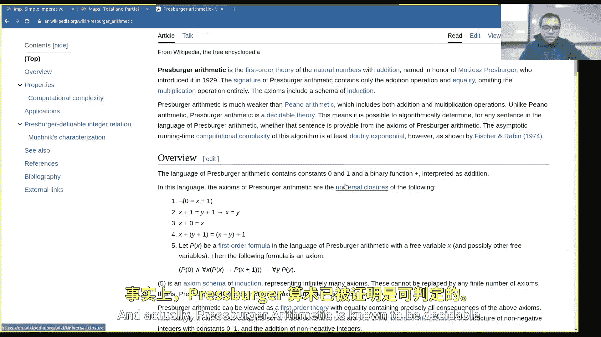
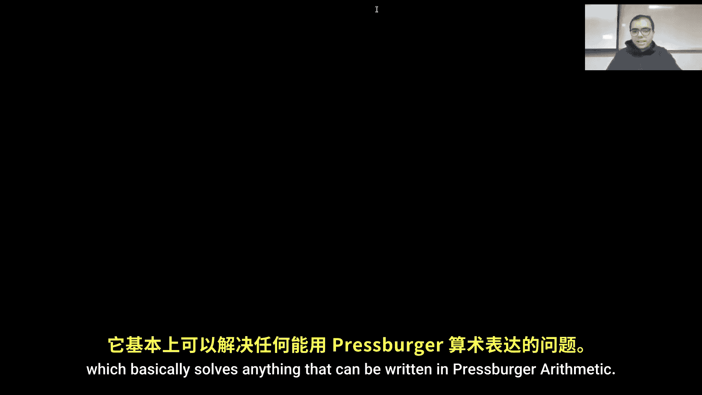
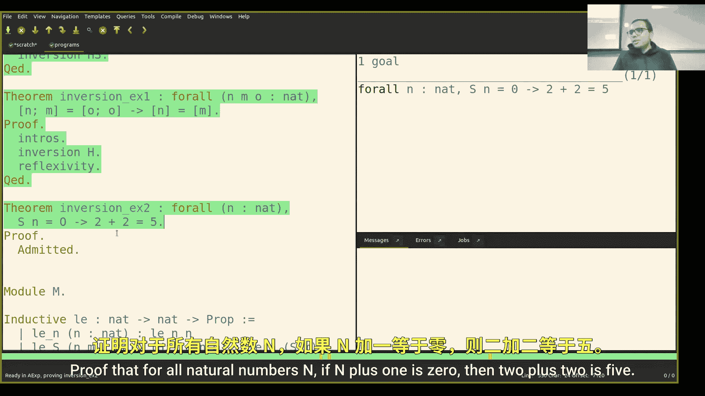
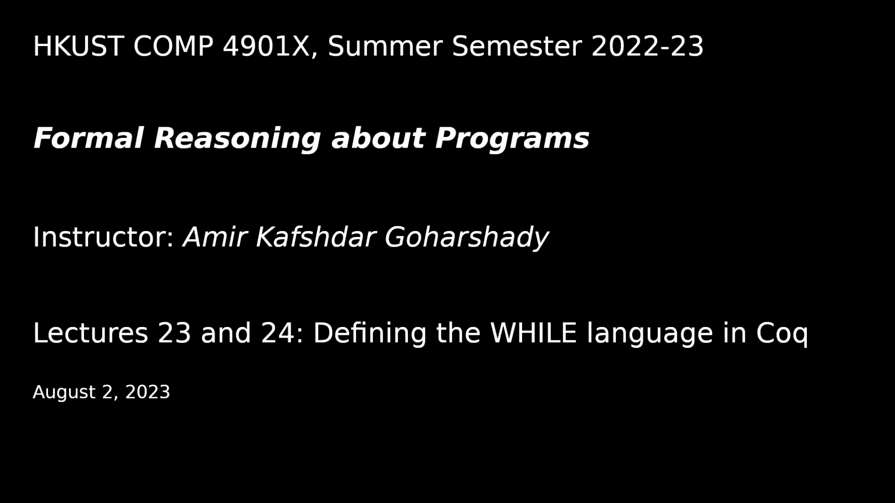
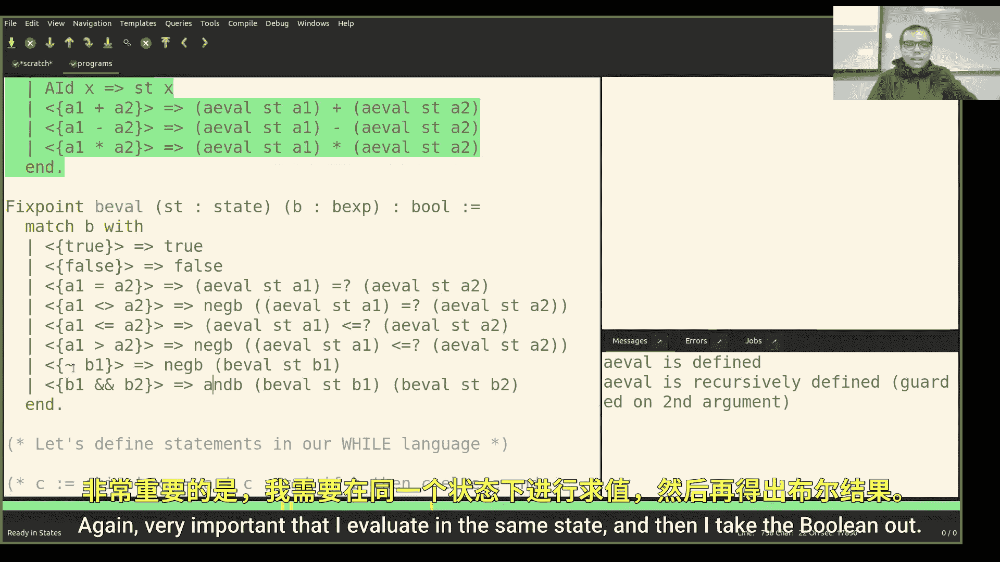
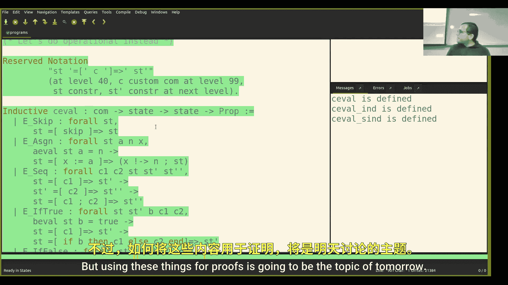
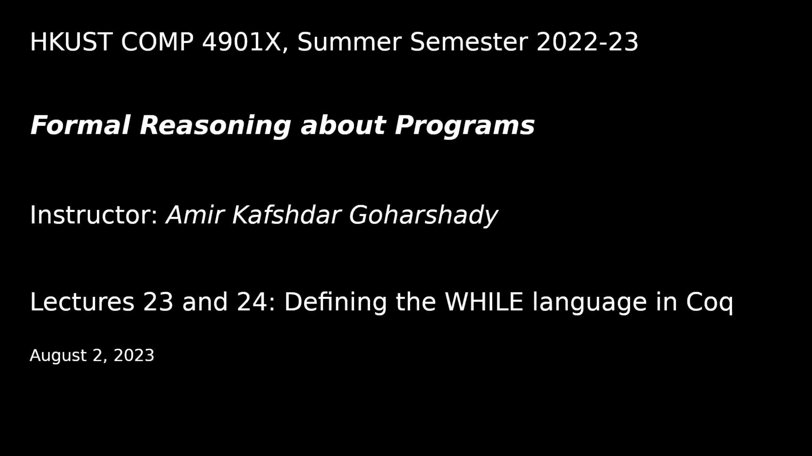

# 香港科技大学【中英⚡程序的形式化推理｜COMP4901X 2023 Formal Reasoning about Programs】 p13 p12 s 23 and 24 - Defining the WHILE language in Coq -BV1roXTYaEmJ_p13-

Please download the latest programs that we file from Canvas because you have to just continue with me as I go along here。

So the last thing we saw in the last session was how to optimize。Basically， syntactically。

 how to make simple syntactic optimizations where。And we took。

An arithmetic expression and whenever we had zero plus something in it， we just removed the zero。

Okay。Today we're going to go a little bit deeper。And first。

 I'm going to start with a very simple thing that you can do in Co and that's defining new tactics。

So let's say that I want to prove this theorem。I want to prove this theorem。

Now it's a very simple theorem， it says that if the list AB is equal to AC， then B is equal to C。

Now I can prove it in the normal way， I can say do intros and then do injection on age and do intros again and then suddenly you have it as an assumption。

Now here's how you can actually define your own tactics， you use the word Lt。

 so you write Lt and then you give the name of your tactic I'm going to call it my tactic。

And then you say what parameters it takes， it takes H here。

And I'm just going to say whenever I write my tactic H。

 what that means is try injection H intro assumption。

And then I can use this tactic when I'm proving lemmas， so for example。

 I'm proving this lemma and I just say intros and then I say my tactic age。Okay。O。

So this is again useful if you want to use the same idea， the same proof idea over and over again。

 you can just define it as a tactic and just apply it to whenever。嗯。Now， another thing that's。

It's quite useful is a tactic called Leah， and this one basically does Pressburgger arithmetic。

So let me show you the Wikipedia page for this， so this is the press forga arithmetic。And basically。

 it's an arithmetic that has natural numbers， it has all the。Logical operators that you expect。

 it has0，1 on successor of one and so on。And it also has addition and checking for equality。

 it also has like other types of comparisons less than or equal and so on。

But the really important point here is that we don't have multiplication。So we only have addition。

And actually， Press forge arithmetic is known to be deccitable。

And because of that， Cook has。This tactic called Leah。

 which basically solves anything that can be written in press bulga ariiththmetic。

So here's an example。Let's say I have four variables， M andOP。

 and this is what I want to prove I want to prove that n plus n is less than recall call to n plus O and O plus3 is equal to p plus 3。

Implies that M is less than or equal to P。So the really important point here is that。

I don't really have multiplication。I can have multiplication by a constant。

 that's fine because multiplication by a constant is just a series of additions。

But I don't have multiplication of two variables。And whenever you have terms that look like this。

 you can just do intros and then apply LiA。And Coke can solve those things automatically。是。Yes。

 you can also have comparisons， you have equality not equality less than equal greater than equalYes。

Basically with negation， you can create everything。So here's another example。

 I want to say that addition is commutative。A very simple proof that I can give is that I can just say apply Le。

This one says that addition is associated and the proof is again， just Leah。Now。

 the next thing I want to show you is that we can actually define propositions inductively。嗯。

If you think about induction。Generally speaking， we want to show that a particular proposition holds for。

 let's say， all natural numbers。RightAnd then we show that it holds for zero and if it holds for a national number n。

 it will hold for n plus one。But we can use this kind of inductive thinking to do the definition itself。

So I can， for example， define something called NAts， sorry， something called EV。

Which takes a natural number and returns the proposition。And basically。

 EV is supposed to say whether the natural number was even。Okay。😊。

So now the way I do this is that I just write the。Rules for a natural number to be even。

 so you should think of this as a rule based definition。

So the first rule is called Ev0 and what it says is EV0，00。Okay。

 so this is a proposition that says zero is0。嗯。And the second rule， I call it EVSS。

 it takes a natural number n and it says that if n is even。Then n plus 2 is also even。

 so S of S of n is even。Okay。So this is now an inductive proposition and just look at the way that we define this。

 we say that it maps natural numbers to propositions because for every natural number。

 I have a particular proposition EVI。And then this part here is telling me what are the rules to make sure that a particular proposition holds？

So I can always assume that EV0 holds。And if EVN holds， I can say Ev of S of S of N holdss。

So now I can use this to prove a theorem， so let's say I want to prove that4 is even。

I say I have a theorem， EV4。And by the way， this is very different from the previous event function that we had because previously we had a function that took a natural number and returned the Boolean。

But this is not a bully and this is a proposition。Okay。So I want to prove that four is even。

 what can I do I start my proof I first assert that zero is even。Now I have to prove this， I say。

 okay， just apply the rule EV0， so these are rules now。

And I just apply the rule EV zero and I get that zero is even。Now I assert that if zero is even。

 then two is even。And how do I prove this， I say apply EVSS with n equal to0。Okay。

Now I know that zero is even and if zero is even then2 is even。

 so I want to get that two is even so I just say apply h0 in h now I get that2 is even。

Now I just continue this for another。Step， so I just say。Let's just assert that。

Evenness of two implies evenness of four。And then again。

 it's the exact same thing as before I apply the EVSS rule。

And then I do a rewrite and now I have EV of4 in my assumption， and that's what I want to。So great。

Okay。Here's another way of doing exactly the same thing。So this is my proof。

I just say repeatedly apply EVSS。Until you can apply EV0， so apply EvSs。

And then for every sub goal apply EVC run you see that this one immediately solves this。

 we've talked about semicolon in the past session， it's exactly the same。ok。

Here's another way of writing the same inductive proposition EV。So previously。

 let's look at this definition， I said that my first rule。Is that。EV0 holds。

 but my second rule was that if EVn holds， then Ev of S of S of n also holds。

But if you think about this， if you think about it in terms of rules。This is also an assumption。

Right。So I have the assumption that n is a natural number。And then。I have the assumption that's EVN。

 and then my rule gives me EV S of SF N。So I can write the assumptions as parameters basically here。

As if they are parameters， so I can write it like this。

 I can say that my first rule I'm calling this one Ev prime is that Ev prime of zero holds。

And my second rule。Wwhich is called EV prime SS， says that if n is a natural number and if I have this assumption H。

 which says n is even。Then I have Ev prime of S of S of n， so n plus2 is also。Great。And also。

 you can check the type of EV prime and you see that the type is actually this proposition。几清啊。

I just wanted to give it the name I'm using H because it's a hypothesis。

 but you can give it whatever an email wants。Okay， and then again I can apply that I can prove that with this new definition of EV prime Ev prime of four holds as well。

 and again same thing as before。But again， the very important point about these inductive definitions is that basically what I'm saying here is that I'm giving you some rules。

For when EV holds。And I'm saying that Ev of some number I holds if and only if you can deduce it from these rules。

ok。😊，So it's an if and only these are the only rules that you have。Okay。Now let's do something else。

 let's say that I want to somehow model co this conjecture。And we'll see what we're going to do。

 so let's say I define a function called D2 which basically divides by2。

It's a very simple function if it's 0， returns zero， if it's 1， again， returns zero。And if n is。

Basically， in this format， S of S of N， it just。Maybe it's better if I call it n prime。

 so if n is n prime plus 2， it first divides n prime by  two and then adds1。Okay。

So here's a function that should be kind of familiar to you。

I define the function F on a natural number n， and I say if n is even， then divide it by 2。Otherwise。

 compute 3 times n plus1。Okay， so I call this F。Now， if I do this。

I can now basically write Cols formula， which said that you start with any given number。

If it's even you divide by two， if it's odd， you multiply it by three and add one。

 and then you just repeat the same process。Now， Col's conjecture is that you will eventually reach the number one。

喂。So I can write something like this， I can write a function which basically counts how many steps it takes to reach one if I start from n。

Okay， so I say if n is already1， then it takes zero steps。Otherwise。

 the number of steps is 1 plus the number of steps that it would take starting from F ofF。Okay。

 so I'm defining a rehesive function。Yes great point we don't know if this terminates or not and actually if you can prove that it terminates you have proven the conjecture。

Right。But the thing is in a lot of programming languages， you can actually write this function。

 so you can write this function， let's say in C++。And the compiler would accept it and it would actually run it not here。

So every function in coke。Should always terminate and every function in cork should always return something you cannot have partial functions。

Okay， now here's what happens。Okay this it says the recursive definition of this function is informed。

And。Yeah， so basically when you're doing fixed points。

 you're kind of doing an inductive definition and again all inductions in Co are structural inductions。

So when you take N。And you have a recursive function that works on N。

 You can recursively call it on something that is smaller than n。

 which means that you look at the constructor of n and you take the things that are in there。

But you cannot call it on something that is bigger than N like F ofn。

So in this case it just says you can't do it， I add a keyword fail to just say forget about this。

But here's the thing， I cannot define it as a function。I can define it as an inductive proposition。

Right so I can define a proposition reaches one， which basically says for every natural number。

 does it reach one or not？ok。😊，And here's the inductive definition that I have for it， my first rule。

 which I call term done。Says that if you start at one， you reach one， so reaches one of one holds。

Yeah。My next term sorry， my next rule， which is called term more。Says that if n is a natural number。

And if from f of n， we can reach1， then from n， we can also reach one。And now this definition works。

Why does this definition work and not the previous one。

 because the previous one was supposed to be a function？

A Cork was supposed to be able to compute with it， so if you give it some number。

 it was going to try to compute the value of the function at that number。

RightSo in those cases it has to terminate and you couldn't really show cock that that function terminated so coch didn't accept it。

 but here you're just defining proof rules。You're saying this is how I can prove that reaches one holds for a particular number。

So this is the difference between inductive propositions and functions， recursive functions。

And now actually I can even use。My inductive proposition inside a theorem or conjecture or so on。

 and actually when you write conjecture， Co doesn't ask you to prove it。

 it's just like you're noting it for yourself giving it a name。

If I had written it as a theorem instead of a conjecture。

Then you see that I have a goal that I have to prove。But anyway。

 I can just have a theorem like cos conjecture， which says that for all natural numbers n reaches1 and。

I'm going to keep it as a conjecture。😔，Okay。I'm defining a module here because I want to define something that is already in the standard library and I don't want to create clashes。

So one of the things that we are very used to when we are working with natural numbers is to compare them。

 so to have a less than or equal comparison。And actually， this is how you can define that。Now。

 an inductive proposition that is defining a relation， the less than or equal relation。

And what this says， you know how to read this now， it says that you take two natural numbers and give a proposition。

Okay。So two rules， the first rule， which is called LEA on line N， says that if n is a natural number。

 then n is less than or equal to itself， so LE of NN holds the second rule says that if n and M are natural numbers and I have LE of Nm。

 then I also have LE of N and M plus1。So that's how we define less than we can even。

Go forward with this and we can define our inductive propositions in a way that is both higher order and polymorphic。

You can combine all of these different abilities of the language。So let's say that。

I want to define the transitive closure of a particular relation R， so let's say I have a relation R。

And。I also have an implicit type X。And R is a relation between elements of type X。

 so it's of this format， it takes two elements of type X and gives a proposition。Okay。

 and now let's say that I want to have the transitive closure of R。

So if you think of R as edges in a graph， I want to put an edge from U to V if there is a pass from U2 V enough。

ok。😊，So again I have two rules， the first rule is called the step rule， I say that for any x and y。

 if r of xy already holds， then transitive closure R of x and y also。

OkayThe second rule says that for every X， Y and z， if I have R of X， Y and R of yz。Then sorry。

 if I have transitive closure of xy， so if I have， let's say in the graph representation a pass from x to y。

And if I have a transitive closure of y to z， then I also have in the transitive closure of R x to C。

喂。Great。Now let's prove it here， Em。This is what I want to prove。

 I want to prove that for all natural numbers n， if n is even。Then either n is0。

Or there exists some n prime such that n is basically n prime plus2 and n prime is even。ok。No。

I'm not going to give you time to prove this， let's do intros。

Here's the part where things get really interesting。Look at this hypothesis each year。

It just saysN is even。But I can actually destruct H。

Why can I do that because the definition of even said that you can prove something is even using these two rules and only using these two rules？

So if I have the assumption that n is even。One of these two should have helped。

 otherwise the and would not be even。So I can say destructed， I can say do a casework。

And that's exactly what I do， so I destruct。The first case。

Is when the first rule holds and remember the first rule was that n zero。And in this case。

 as you see， this on the left hand side， I have to prove0 is equal to zero so I can just do left and then reflexivity。

The second case。Says that I have some number M。And this M is even I have this assumption。Okay。

And what do I want to prove， I want to prove that either m plus 2 is0， which is impossible。

 so I'm going to prove the right side here， not the left side。And I'm going to in the right side。

 I'm going to prove that there is some n prime。Such that S of S of M is equal to S of S of n prime and n prime is equal。

Okay， so I just have to put M for N prime itself。It's very obvious so I just do the right hand side and then for resolving the existential。

 I say exists M and then the rest of it is just basic things。Here's another thing we can prove。

Let's say I have a actual number n， I want to prove that if n plus 2 is even， then n is also。

So I do intros。Now I can apply this previous theorem， this previous theorem。

 which I actually called the inversiongenent theorem for Ev said that if Ev of n holds。

Then either any is zero or there is an n prime， so I just apply it to H because here I say that EV of something holds so I just replace this for n in EV inversion and so I say apply EV inversion。

And this is what I get。I get that either s of S of n is0 or exists an n prime with this conditions so I can distract it。

Now in this first one， I can just say discriminate because it's impossible to have something like this。

Now here I want to say that there exists some natural number n prime such that n plus 2 is equal to n prime plus 2。

And N prime is even。Okay， so I de it。I get these things。I again， I have an ant here。

 I destruct again。Now here's the part where things get interesting。

I can actually do injection on H and remove the S， and I do that and you see that I get n equals to x。

I do this， so I know that n is equal to x， I know that x is even， I need to show that n is even。

 it's just a simple rewrite and then I have it， that's my assumption。Okay。

But everything that we did right now is also a tactic， so there is a tactic called inversion。Now。

 how does inversion work？Let's look at this example。

Let's say that I want to prove that for all natural numbers， A and B。

 if a plus 1 is equal to b plus 1， then a is equal to B。I do intros first。

And now I have this assumption H。Now。So H is in my context， I know that H holds。

So if there is anything else that is a necessary condition for H。

 then I can assume that that thing also holds。Okay。And this is what inversion does。😊，So。

What is a necessary condition for S of a to B equal to S of b by definition of S。

 it's that a is equal to B， so if I do inversion on H， I immediately get a equals B。

And then I can do reflexivity。没。Okay。Let's look at this theorem again。

We want to prove that for every natural number n， if n plus 2 is even， then n is even。Okay。

 so I do intros。Now I have this E here。Which basically says S of S of n is even。Now。

 I say do inversion on E。So find the。And necessary conditions for E。

What is the necessary condition for E in order to have Ev S of S of n by definition of EV。

 the only rule that can possibly apply is the rule that assumed that I had EV of n。

So if I just write in version E， I get Ev of n here as well。

And then I just say it's assumption and that's it。Okay， here's another proof。

Let's say that I want to prove that one is not even， so Ev of one does not hold。

Because until now we were just proving that something does hold。

 now I want to say that it doesn't hold。So I start， I do intros。ok。And look what happens。

Why is this going on So what am I doing here What I want to prove is the negation。

Of some proposition， I want to prove the negation of EV1。So what does it mean to do intros on this？

Look at it。It basically says that I assume EV1 and now you have to get a contradiction。

 you have to prove false， so this is proof by contradiction now。Okay。

 so I wanted to have negation of Ev1 I do introse H so I add Ev1 to my context。

 but then my goal is false so I'm doing proof by contradict let's say that I apply this inversion that I had to H this is what I get I say okay distract it。

The first case is that one is equal to zero， of course it's not， so I can do discriminator。Now。

 the second case， it says my assumption is that there is some n prime。

Such that one is n prime plus2 again， that's also impossible。

 so we have to get it to a contradiction here， so I say destructed。And I say destruct one more time。

 and then I say discriminate on H because。Discriminator actually understands that this one starts with only1 S。

 but this one starts with two ss。And that's this。So this is how you do proof by contradiction here's another way that I can prove that one is not even this is even easier。

 I do my proof by contradiction。And I just say in version H， now， why did this just end the proof？

Because I'm telling it to find the rules that can be applied to prove that one is even。

And it immediately figured out that none of the rules can be applied no matter what the assumptions are。

So as soon as I do inversion of age， this is already done。Okay， here's another trivial theorem。

If5 is even， then2 plus2 is equal to one。Okay， so I do intros and then I do inversion on H。Now。

 if I do in version on H， you see that I get a bunch of assumptions that I have to prove on one of them is that three is even because it figured out that the only rule。

That can be applied to prove that5 is even requires3 to be even。

 but I do the same thing again this time on H1， so I say do inversion of H1。

Now it says you should prove that one is even basically so sorry。

 you have the assumption that one is even。So okay， sorry， why did this work？

My initial assumption was that five is even， I'm doing inversion H and it says you can additionally assume that three is even because the only way that five can be even according to your rules。

Is if three is also even， so you get this assumption for free。

And then I do the same thing with H1 and I get the assumption that one is。

But I know that one is not even， I've already proven that in the previous theorem。

And I just do the same proof here and that's it。Okay。Here's another way we can use inversion。

 we can also use inversion with our definition of list， let's say。So。😊，Here's what I want to prove。

I want to prove that if the list N M is equal to the list O0， then n is equal to M。

 the list n is equal to the list M， so I just do inversion on H。And this is what I hit。

 I get that n is equal to O and m is also equal to O and it also rewrites this part in the goal。

 so my goal is not just to prove that O is equal to O and I say this is reflexivity。Okay。

Try this one。It's actually quite easy。Prove that for all natural numbers n， if n plus 1 is0。

 then 2 plus2 is5。

Let's do this， let's start with intros。😔，And you already see that you can just do discriminate H。

RightBut instead of that， you can also do inversion H and this works as well。

This is another way of just defining the less than equal I already talked about this that basically you can put your assumptions here instead of。

Saying that you have an implication， you can just put the hypothesis here。And by the way， this is。

 of course， how you define notation。We don't spend too much time on how to define notation in this course。

 you can just look up the Coke manual for that。It's just too much detail that we don'tate。

And you can then define less than， so you can define that n is less than m then n plus 1 is less than or equal to n。

Okay， and then you can define these notations。Okay。So。Let's do。Something fun。

 let's define regular expressions， so what is a regular expression？A regular expression。

 you know that you should first have an alphabet。And then you can define the regular expression on top of that alphabet and the operations that you have is that you can have the empty set。

 you can have the empty string， you can concatenate， you can take the union， all these nice things。

 you can take the cly star and so on。So I show my characters with a type T。

 so I say that my regular expression is on a particular type T。And just think of T as my alphabet。ok。

😊，Now， what does the regular expression have？Again， I can have these constructors。

 I can have the empty set。which is of course the empty set， I can have the empty string。

 which is the set that has only one string in it and that's the empty string。

I can have any given character， so I call that care and then I take a character from my alphabet。

I can have a pen。😊，Which says that if I have two regular expressions R1 and R2。

 I can append them together。I have union。Or plus like I can have R1 plus r2。

 and then I have the cleaningy star， which is like their repetition。

I can have star of R if R is a regular expression and of course in all of these I want the type T or my alphabet to just be implicit so I'm going to show you a new way of defining notation again I'm not going to talk too much about notation。

But here's the thing。Normally you first define a function or some okay。

 normally you define a function or relation。And then you define a notation and you say that when I write this notation。

 I'm in this function。But what happens if your function has， let's say， a very long name？

And the function itself is recursive。😊，Maybe I want to use the notation in the definition of the function so that it's more human readable。

So this is what we're going to do here and the way it works is that you have to first reserve your notation。

😊，You say that there's going to be a notation that looks like this。And then you define it。Okay。

So here's how it works， I say I have a reserve notation。😊。

S equals ted R and what I mean by this is that let's say s is a string。

 so let's say s is a list of type T and I want to say whether this string is in the language defined by this particular regular expression。

Okay， but at this point I haven't defined a function for that yet。

 I'm going to define that function later， this is called X match。It's actually not a function。

 it's a recursive proposition， sorry an inductive proposition。But here's what I do。

 I say I reserve this notation。And then I write the inductive definition and inside the inductive definition。

 I can use this notation。Okay， but then at the end of it， I say where this notation means this。

Means basically recurs so that's how I do notation definition Okay。

 but forgetting about notation how do you actually check so I have this match function which basically takes a list or okay let let's not think of it as a function let's actually think of it as an inductive proposition so it's an inductive proposition that takes a list of type T which means it takes a string。

And it also takes a regular expression over the same alphabet T。

And it tells me whether that string satisfies the regular expression。Okay。So now again。

 I just have a bunch of rules， so if you remember our very first theoretical sessions。

 we had this concept of rules， this is exactly the same thing。I have a bunch of rules。

That tells me when a particular string satisfies a particular regular expression。Okay。

 so the first rule。Is that。The empty string satisfies the regular expression empty still of。Okay。

The second rule and by the way， every rule has a name。These are the names of the rules， Okay。

 it can also have a bunch of parameters and then this is like。The result of the。

The second rule says that the string that has just one character x。Satisfies。

This regular expression carries。Okay。Now， this one is a little bit more complicated。It says。

 if I have。Two strings， S1 and S2 and two regular expressions are E1 and R E2。

 And I have these two assumptions that S1。Satifies R1 and s2 satisfies R2 then I can say S1 concatenated with S2 satisfies app of R1 and R2 so this is again just a rule and then for union we have actually two rules so we call them the left union rule and the right union rule so the left union rule says that。

If the string S1 satisfies R1， then S1 also satisfies the union of R1 and R2。

 so it also satisfies R1 union R2。The union right rule says that if S2 satisfies R2。

 it satisfies R1 union R2 for star， we also have two rules。

 the first rule just says that the empty string satisfies。Anything that has a star？

So it satisfies star of any regular expression RE。And the second rule says that if I have。

S1 that satisfies R and S2 that satisfies star of R。

 then S1 concatenated with S2 satisfies star of R if this is hard for you by any chance just read the Wikipedia article about regular expressions these are just the rules that define regular expressions so you can think of this as some sort of operational semantics or rule-based semantics for regular expressions this is what were doing we were defining semantics in Cock remember that in the last session we actually started creating a programming language we wanted to create our vile programming language in Cock。

And we already defined two things， we defined arithmetic expressions and Boolean expressions。

And we defined a function that would evaluate that。Now。Previously。

 I said that the evaluation is a function。So I had a function that took an arithmetic expression and gave me a number。

Intuitively， that's the same as what we used to call denotational semantics in our theoretical lectures。

But we can also have rule based or operational semantics。

So how can I define rule based semantics for my arithmetic expressions？Again。

 this is basically the same rules that we've seen in the very first lecture of this course。

 here's what I'm going to do I'm going to define an inductive proposition。That takes two things。

 it takes an arithmetic expression and a natural number and basically tells me if that arithmetic expression evaluates to that natural。

Okay， so this is no longer just a function that maps every arithmetic expression to a natural number。

 it's actually a relation that says， is this arithmetic expression in the evaluation relation with this particular natural？

And again， I'm going to have rules for this and every rule is going to have a name。

Now the first rule is that if my arithmetic expression is of this format and I hope you remember the definition of our arithmetic expressions。

 this was just a number so it evaluates to the same number。

 the second rule says that if E1 evaluates to n1 and E2 evaluates to n2。

 then this arithmetic expression which was like plus of E1 and E2 evaluates to n1 plus remember when I was writing these rules and I was actually using this semantics notation where I was putting cur braces。

 well not cur braces， double braces to show the semantics。This is basically the same thing。

So this is just saying that the semantics of e1 plus E2 is the semantics of e1 plus the semantics of E2 it's just that we're giving it a name I'm saying if the semantics of E1 is n1 and the semantics of E2 is n2。

 but anyway from Koch's point of view，This is just an inductive proposition。

 it says that if E1 is in this relation with N1。And E2 is in this relation with N2。

 then this expression is in the same relation with n1 plus n2。

And I can do the same things basically for minus and for multiplication it's exactly the same I'm not going to repeat it now here's another way of writing it and again this is the difference between the two styles that I told you。

So for example， for a+。I can write my conditions like this， I can say if this。

 then like this implies that and that implies that， but I can also add my hypothesistheses like this。

So I can have a rule that says if e1 evaluates to N1 and e2 evaluates to N2。

 then a plus of e1 e2 evaluates to n1%。That's。Okay， now of course。

 I would also like to define some notation， I define this notation for evaluation。

So I use this long arrow to say that some expression E evaluates to some number。对。Nice。

But now I want to actually show you how to define this。With then with reserving the notation first。

So I did this inside a module so that I can now do it again outside of the module。

So here's the way I'm going to do it， I'm just going to say let's reserve this notation。

And then I'm going to define。An inductive relation which says when a particular expression evaluates to a particular natural number。

 and again I have rules here， this is rule based。But you see。

 I can now use that notation so it looks much nicer。So I can say that this expression evaluates to n。

 then my other rule is that if e1 evaluates to n1 and E2 evaluates to n2。

 then this expression evaluates to n1 plus n2 and so on。

 so the rules are the same it's just that I'm writing them in a much nice survey。Okay。

But we can also prove that our two definitions are basically the same。

 so I have two types of semantics is。The same as the proof that I gave you that the notational and operational semantics are the same。

Right so now it's just for arithmetic expressions for arithmetic expressions。

 I have two different things I have。This relation which says whether a evaluates to n。

 and I also have this function a e which takes a and gives me the value n。

 so I want to prove that they do the same thing I want to prove that for all A and N A evaluates to n if and only if so the another way of reading this is that the relationship evaluation says that A and N are in a relationship。

If and only if the function semantics says that the evaluation of a is M， okay。

 so I'm just showing that the two semantic are。Okay， the proof is boring。'm just。

Going to go over it its casework。😔，It's just casework and induction at this point。

 you can do this easily。The point was not to actually show the proof。

 the point was to show you that these two are the same。So we now have two equivalent sematics。Okay。

 and there is actually a shorter way of doing it as well。

 this is a shorter proof again go over this on your own。

 but now the next thing that I want to ask is what happens。If I add division。Oh。Okay， yes。So。

I'm now creating again a new module and I'm giving an extended definition for my arithmetic expressions and I'm saying you can have a number。

 you can have plus minus， but you can also have both multiplication and division and you can just assume that this is division of natural numbers。

Now， a problem that I have， if I want to define the notational semantics。

 if I want to just define a function。That evaluates an expression。

Is that what happens if the expression has division y zero？If it has division by zero。

 then I don't have a value but we've seen that the functions should always return something。Right。

So actually， I have to now say that the evaluation of an arithmetic expression is no longer a natural number。

It's an option on natural numbers， so it can be none。ok。

And I just want to show you how painful this is。So first of all。

Let's say that I want to define division with remainder。So I take A and B， I want to divide a by B。

 and so I have to return the quotient and the remainder。

So the return type is going to be nat times nats， it's a pair of natural numbers。

 the quotient and the remainder， but the problem is that B might be zero。

So I have to take an option on that time thatt as my return time。

And you're already feeling that this is going to be painful。

So first I do a pattern match on b and I say if b is zero， I cannot divide by zero。

 so I'm going to return none， otherwise if b is not zero。Then I do a pattern match on a。

And I say if a is 0， then returns 00， so the quotient and the remainder are both zero。

 but I have to return an option， so I have to return sum00。And if a is a plus a prime plus1。Then。

Apply the same function reccursively on any prime and B。This is very inefficient。

 but I don't care about efficiency， I just care that the function works。And if it returns none。

 I mean at this point it's impossible， but in your pattern might you have to be exhaustive。

 so if it returns none I also return none。Otherwise， a prime over B returns Cd。

 so this means that a prime was C times B plus D。So now I have to do a casework。

 I have to say if this D was b minus1。Then I have to return c plus 1 and0。

 so if the remainder of dividing a minus 1 by B。wa b minus1。

 then the remainder of dividing a by b is going to be0 and the quotient is going to be one larger than what it was for a minus1。

Otherwise， the quotient remains the same。屎。😊，And the remainder increases。Yeah， well。

 of course it's inefficient， but we only care about definitions here。

 we don't really care about computing with this。Yeah。But now I have this division with remainder。

 if I want to just do natural division without remainder that's also easy。

 so here I have to return an option that and all I do is that I just call the previous function and if it returns none I return none if it returns some quotient and some remainder I just discard the remainder and return the quotient。

Okay。But now I have a bigger problem。And my problem is that。

I want to write a function that takes an arithmetic expression and evaluates it。

But it might be that there is no evaluation， it might be that this function has to return none。嗯。

So I have to actually define a bunch of operations on options。

 I have to define addition and multiplication and all of those things on options because they're not defined。

So I have to define something like optt at， which says that if A and B are two options on natural numbers。

And if any of them is none， you return none， if both of them are something。

 you just take some of these two somethings。Right。And then the same thing for subtraction。

 the same thing for multiplication and the same thing for division。

 and in case of division I need that function that I wrote before Na。😊，Okay， and finally。

 based on this， I can define a recursive function that evaluates an expression。

So I can say given some expression， arithmetic expression A， this function returns an option on that。

And this is again casework， so if it's this， you just return some in。If it's a plus of a1 and a2。

 you add if it's a minus you subtract， but these are all the opt add opt sub and so on that we defined here。

 So as you saw， if we add division， this type of semantics becomes much harder。

How about the second type， how about the relation type of semantics or the rule based semantics？

That's actually quite easy。I will change it only a little bit so again。

 I reserve notation and everything this is the。Inductive relationship that I had before。Okay。

And forget about all the other parts， this is the only part that is new。

So I had rules for numbers plus minus and multiplication， I'm going to keep all of those rules。

I just need to add a new rule for division。Now， what is the rule for division？

Very easy If a1 evaluates to n1 and a2 evaluates to n2 and N2 is greater than0， you see in my rule。

 I can just add the hypothesis that n2 is greater than 0。

 so I'm just adding this requirement to my rule。And if basically n2 times n3 plus n4 is equal to n1 and N4 is less than n2。

 so n4 is the remainder。Then ad of A1A2 evaluates to entry3。So you see it's a very simple rule。

 of course it's more complicated than the previous rules。

But doing this is much easier than working with options。ok。Let's do something else。

 let's say that I want to have non deterterminism in my expressions。So。Let's say。

I want to have this kind of arithmetic expression。Where I can also have something called any。

And any is just。Some non deterministic expression that can evaluate to any natural number。Okay。

 and you can think of it， I mean later on if I want to use something like this in my programming language。

 it might be that I have a value that is read from the user。

 so there is some input going on and I don't know what the user will give as that value so the only thing that I can assume about it is that it's just anything。

So I have a new constructor any。Okay。And now。The problem here is that any can evaluate to anything。

So if I want to use a function to evaluate my arithmetic expressions。This doesn't work anymore。

RightIt's because there is no longer just one evaluation of any。

 I have infinitely many evaluations of any。But again， if I use the rule based semantics。

I can define this inductive proposition and I just need one new rule。And all this says is that。

If n is a natural number， so for any natural number n。Any evaluate store。That's it。

And everything else remainss。嗯。So you see this ruleway semantics is also easier when it comes to nondeterminism。

 and of course this was something that we saw when we were talking about semantics without Coke as well。

It's actually quite funny how the last sessions of this course are very similar to its first sessions。

Okay。😊，But let's actually。Get into our programming language and let's actually define something。So。

Until now， all of our arithmetic Camboian expressions were without variables。

RightSo if you look at my definition of arithmetic expression。I mean， I added some nonminism here。

 but in general， it's either a natural number or you just。Do the basic arithmetic operations。

But of course， in a programming language， we are interested in expressions that have variables in them。

And again， if you remember the beginning of this course， we had this definition of a state。Or a。

 which was like a function that mapped every variable to a value。So let's define something like that。

 I'm going to start a new module here and I'm just going to import everything that I need so I need some arithmetic boolean strings。

 lists and so on。ok。Yeah。Now， the first thing I'm going to do。

Is that I'm going to define a mapping because I want to say that my state is a mapping from variables to values。

 and I'm going to assume that all of my variables take natural numbers as their values。ok。

So here's what I do。I say that whenever I write total map of a and a is a type。

 what I mean is just a function that takes strings and gives me something of that type。

And the idea is that this string is going to be my variable name and then the value of type A is going to be the value of the variable okay。

 so total map。Whenever you see total map， okay， this definition just says that whenever you see total map。

 this is what it means。ok。Now I'm going to define an empty map。So。

Given an implicit type A and some default value。An empty map。Is just a total map。

That is defined by this Lada expression and this Lada expression says that no matter what you get。

 you just return the default file。Okay。So I'm using functions to define my map and this is a function that maps everything to the default value。

I see this as the empty state。Okay， so actually I'm going to use variables that have natural values and initially I'm going to assume that all variables have a value of zero。

 so my default value is going to be zero。Laterter， okay。

Now I also define another function called T update。Which takes a map。

And it also takes a string and a value。And just updates it so that the string is mapped to that value。

So I'm adding one entry into my map。But this is a higher order function because。

Remember this total map a， so if I write it like this， it's the same as saying string to a。Okay。

 so this M here， this is a function that maps strings。Two elements of type A。

And of course I'm writing its just as total map a， but actually it's a function。

 so my T update is a higher order function that is taking the function as its parameter。Okay。

 now what should I do， I should also return a function because I have to return the updated map。Okay。

 so what is the function that I have to return and this is the definition of the function that I'm going to return。

 I write it with a lambda expression I say that，It's a function that maps x prime to this if x prime is equal to x EqB is a checks equality and gives you Boolean。

If x prime is equal to x， then return V， otherwise return whatever the original map returned for x prime。

ok。😊，So this is now a new kind of map because the maps that we saw before were actually using lists。

But now I'm using functions as my maps。几。Great， now I can also define some notation。

I defined this notation to mean that in the map M。I'm now mapping x to V。

 and I say that if I don't give you the M， it means that you start with the empty map。

With the default value0 and then you do the same thing， so this is just the definition of notation。

Okay。Finally， I can define what a state of my program is。

 a state of my program is just total map nets。Right， so every state。

Is just a map that maps strings to natural numbers。That's what I'm saying。喂你 sir。

I'm just assuming that all of my variables take natural values you can have many different types。

It's just easier to use national we do somewhere between the states。

's why we need national and defined。Look， because we want to have variables。

RightSo I'm saying yes a state is a function that maps variables to natural numbers。

 I'm just assuming that all of my variables are of type maths。

All the values that my variables can take。Okay， so it's kind of evaluation。

Like we have some way this。So we can define part of a value space in this one way， yes。

So I'm just assuming that my small programming language。

 my vile programming language that I want to eventually define。

 I'm assuming that it only has net variables basically。Okay。Great。

 now I can define my arithmetic expressions and this is again the same as before I just added this。😊。

I say that an arithmetic expression can also be a variable X。

 and I use strings for my variables because every variable has a name and I can just use the name of the variable。

 which is a string。Okay。So this is now the definition of my arithmetic expressions。

 they can either just be a natural number or one of my variables。

Or obtained by doing plus minus or multiplication and two other arithtometic expressions。Okay。

Now I can also define my Boolean expressions。This is the same as before。

 it's just that it's using the new definition of arithmetic expression。

So I can have variables in my Boolean expressions as well。Okay。Now。

 this is the part where I'm going to define some notation。And again， look at the。

Coke manual for how notation works。But basically what I'm doing here is that I'm saying。

If ever I give you a string。And。I'm giving you a string。

 but you expect to have an arithmetic expression， what that means is that you have to apply this constructor。

 you have to automatically convert this string to this constructor。Okay。

 and whenever I just give you a natural number， you have to apply this constructor。

 so that's what coercion means。Okay。And then I'm going to define a new scope， basically。

And I'm going to call it comecope。ComM stands for commands because I want to write my Vle programming language commands in a new scope so that if I write。

 for example， plus I know whether it's the plus in my Vle programming language or the plus in Qq。

For let's say natural numbers， okay？So I define a new scope， I call it commm scopepe。

 and what I say is that everything that looks like this is in comm scopepe。

So whenever I want to write。Programs in my vile programming language。

 I'm going to use this angle and then open curly bracket and then I'm going to end it with closed curly bracket and closed angle。

Okay， this is what this line says。And then the rest of it。😊。

It's just notation for everything that I have。In my programming language until this point。

 so what do I have？I have， for example， arithmetic expressions。

 I don't like to write a plus a minus a multit， I just want to write plus minus and like star。

And here I have Boolean expressions， I don't like to constantly write it like this。

 be true be false BEQ so on。So I define notation for all of that。Yeah。Okay。

And this is why I said you should just use the file that I have there because I don't want to go over all of these and this is。

 you've seen this before， it's just defining notation so that I can write stuff more easy。

And also because I don't like to constantly write my strings like this。

I'm going to define four variables， W， X， Y， and Z。

 and each one of them is just this string corresponding to it so that I can use it。😊，Okay。

 now with all of these definitions and notations out of the way。😊。

I can actually write my arithmetic expressions like this now。So I can say， for example。

 three plus x times two。So x is a variable， it's actually this string x， right？😊。

And this whole thing。Is going to be。An arithmetic expression and Cork knows that this is an arithmetic expression because I put it in between these open and closed signs。

So I'm telling it that this is in this new scope that I define。 So this is。Part of my vial program。

 let's say。And I do this， and as you see it can also understand the type it says that。

This is of type arithmetic expression。Okay。Now using this notation。

 if I want to write my evaluation function， it looks so much better。

But the thing is that my evaluation function used to just take an arithmetic expression。

Now it's different it's going to take。A state which basically tells me what the value is for each one of the variables and an arithmetic expression。

 and then it's going to evaluate it because。Unless I have the values of my variables。

 I cannot evaluate。Right？Okay， so here's how the evaluation works。I just do pattern matching。

I say that if it's just a number， return that number， if it's just a variable。

 see what is the value of that variable in the current state。Remember。

 my state is a function that maps variables to values。And if my expression is a1 plus a2。

 evaluate a1 in the current state and evaluate a2 in the current state and just take the sum。

And the same thing for minus and multiplication。Okay。What Re presentation and from device。

Yeah so reserve notation， the idea was that I haven't yet defined what I want to use for it。

 so yeah this is what I'm doing I'm saying。I haven't given you the definition of this yet。

 but just reserve this as a notation and know that the definition is going to come。Okay。

 and then when I actually give the definition。I can use this recursively in itself。

 so it makes it easier to write recursive definitions for something that is also a notation。Okay。

And then I can also write a function for evaluating Bos Boolean expressions。

So if I evaluate an arithmetic expression， I have to return a natural number。

 if I evaluate a boolean expression， I have to return a boolean and by the way。

 I no longer have division so I don't have to care about division by zero。Okay。So these are the。

This is the way that function B e is defined for evaluating Boolean expressions。

 so again it takes a state of my program and it takes a Boolean expression B now it says if the Boolean expression is true then return true。

Very important， these two things are not the same。This one is a boolean expression that they have different types。

 this one is just a bull。So this is BxPR， this is of Tpo。And then similarly。

 I say that if the Boolean expression is false， return the Boolean value falls。

If the Boolean expression is a1 equals to a2。And A1 and A2 are of course arithmetic expressions。

 just evaluate a1 and evaluate a2 and then use equals question mark， which was。

The function that checked if the two are equal and returnable。Now this one is for not equal。

 I just use the negation， this is Booleyan negation to do that this is less than equal。

 this is greater than。This is not so for if it's not of B1。

 B1 is itself a Boolean expression so I first evaluate B1 in the current state and then I ne the evaluation and also for B1 and B2 I evaluate each one of them again very important that I evaluate in the same state。

And then I take the boion。

We defined a map or a total map to just basically be a function that maps strings to objects of type A。

And we said that we use the strings， the names of the variables to basically represent the variables in our wider programming language。

And this was the definition of the empty map， we have some default value and this is just a function that maps everything to that default value。

And then we define the update。Which takes。A map， so this map is itself another function。

 so T update is actually a higher order function。Takes this map。

 it also takes a string x and some value V and basically gives us the map that is obtained by mapping x to V in M。

And this is how we obtain the function， we say that it's a function that takes any x prime and if x prime is equal to x。

 then it returns V， otherwise it returns whatever M returns for x prime。

We also define these small concepts of notation。And then we said that is state。

Is just going to be a total map of net， so it's a map that maps strings variables to natural values。

And we defined our arithmetic expressions， the only difference here was that we now can have variables in there。

We also defined our Boolean expressions， this definition was the same as before。

 it's just that it's using the new definition of arithmetic expression inside it。

And then we define some notation， I'm going to go over this。

Really fast and we defined some variables， X， Y， Z and W。

And we said that we basically write our programs in the wide language inside these kinds of containers。

So we saw the function for evaluating arithtotic expressions。And I can use my syntactic sugar here。

 so this was quite easy， we also saw the function for evaluating Boolean expressions。Now。

At the end of the previous session， I finally talked about getting into the V programming language and actually defining the commands or the statements in this language。

So again， if you remember from the very beginning of this course。

I want to have a programming language where a command C can be one of these forms。

 It can either be just a skip which doesn't do anything or an assignment。

Or the sequential composition of two other commands。Or a branching which says if B then do this。

 otherwise do this one。Or a while。Okay。So this is how I'm going to define my command type。

I'm going to say I define a new type called come for command。

And it's either skip and I'm putting capital C here so that I make sure I don't have any clashes with constructors for any other type。

So it's either a skip or it's an assignment and if it's an assignment， it needs two parameters。

 it needs a left hand side which is going to be a variable x and we said that we show our variables by strings and it's going to have a right hand side。

 which is an arithmetic expression a。The other case is that it's a sequential composition of two commands。

 C1 and C2。Or it's an if and if it's an if， then you need a guard for the if。

 the Boolean expression that's the if checks， and then you need two commands。

 one for the then part and one for the L parts， so C1 is the then part， C2 is the L parts。

And we also have a constructor for vial， again vial has a condition which is a boolean expression。

 and then it has a body and the body of the vial is just going to be a come。

So this is how we define it。And again， now that we have defined our commands。

 we can go back and define notation。So I can say that if I write skip， I mean C S， if I write this。

 I actually mean CSs sign， if I write this I mean C sequence and so on。So again。

 this is not really interesting， I'm going to go over it really fast。But now with this。

 I can actually finally write programs in the V language。

So here's a simple program in the V language and you know it's in the V language because it starts with angle bracket and ends with bracket angle。

And。This program is basically a program that computes the factorial of a number。

So I start with y being1 and z being equal to x。And I say as long as z is not zero。

 multiply y by z and reduce z by one。Okay。So it computes the factorial of x。

And I can just define it like that and with my notation and everything。

It works and then I can print it。And you can see here that。

Cook also does the type checking and says that the type is come and come。

Now talking about this type checking， Coke is actually very smart。

 so based on the operators that we're using it can find the type of any expression that you write。

So for example， let's say I define this expression。It's just one plus two。

 what is the type of this expression if I print it， it's an arithmetic expression， so it's AX。

Whereas if I have something like this， true and not。Or equal to four， this is a Boolean expression。

 so if I print it， it says that the type is B X bx。And finally， this one， this is， as you see。

 actually an assignment， so it's the command。So if I print it， it says that the type is a command。

 it's a comm。Okay。Okay。And the nicest thing here is that I can actually mix and match my program so I can do something like this。

I write one program called Subtract Sly。Okay， or actually now， I'm calling it subtract slowly body。

And what it does is it takes two variables Z and x and decreases both of them。Okay。😊。

And then I can define something else called Subtract S。

And I can use the previous program inside this so I can say while x is not zero， do the body。

 so decrease x and decrease z every time。And this is perfectly valued， it works。

 there's nothing wrong with it。And then I can actually apply it to some initial value。

 so if I want to subtract three from five slowly。I can do this， I can say x equals three。

 so this is an assignment。This is the sequential operator， this is another assignment。

 sequential operator， and then I say just do subject loading。ok。

Here's an example of an infinite loop。So it's just while through do skip。I can， of course， define it。

We've seen before that we cannot have non terminating functions in Cock， but this is not in Co。

 this is in our programming language， in our vile programming language。Okay。

But one thing that this shows for sure is that I cannot have a function that just runs programs that I write in the Vle programming language because every function in cork has to terminate and here I can write a nonterinating program in my V language。

So I can have just a function in cork， which evaluates my entire program。

And this actually takes us to semantics。So let's say that I want to define semantics here。Again。

Let's start with thenotational semantics and remember the whole idea of the notational semantics was that you have a function。

Right so I have a function and it takes the initial state of the program。

 it takes the program itself， which is C， and it returns the final state of the program。Okay。

Now let's just go over every case。So we just do a match on C and we check what kind of command C is。

If C is a skip， I just return my initial state because Sip doesn't do anything and my final state would be just my initial state。

If。The command is an assignment of this form。I have to actually do an update， right。

 so I have to take my state ST。And I have to update the value of x to whatever the value of a is going to be at this state。

 So I first evaluate a at this state at my current state， and then I say。Update。

The state so that x is mapped to the result of that evaluation。Okay。

The next case is sequential composition， so if my program is of the form C1。

 sequentially composed with C2， c1 semicolon and C2。Here's what I can do。Actually。

 I haven't used let statements before。But that's actually。Quite easy。

 so I'm basically defining some variable， I'm saying let's ST prime。

Be the result of evaluating ST on C1。Sorry， evaluating C1 on ST so I'm starting with the state ST and I'm running the first half of my program C1 and I say let's say that that takes the state ST prime。

Now just run the second half C2 from this state ST prime。And return that， okay。The other case。

It's actually quite easy because the syntax is a little bit hard to read this is because our wild syntax and the coke syntax are quite similar。

😊，So。This part is what's in the V programming language。

 I'm saying that if my program is of this form， if B then C1 LC C2。Okay， what should you do。

 you should evaluate B at the current state， and then you do literally an if you check does B hold at the current state and this is Cox if。

And if it does， then you evaluate C1 at the current state。Otherwise。

 you evaluate C2 at the current state。Yeah， now we have a problem with the vi。😔，Yeah。

 so I don't know what to do for while。So when we were defining our denotational semantics。

 we said that the semantics of a vi。Can be defined by a fixed point of a particular function。

But can I define it here？Now， can I somehow use maybe a fixed point function in cork to define this？

And the answer is no， there is no way I can define it。And the reason goes back to this example。

So there are cases where I have programs in my vile programming language that never terminate。

But any function that I write in cork should terminate and it should return something。

So there is no way I can write something for vial here。

 so I just say I mean it's already in the name of the function。

 it only works when you don't have a vi if if you do have a vi， I just return the same state。

And okay。But anyway， for programs that don't have a while， this is kind of useful。So。Here's。

A very simple evaluation。So let's say I want to set my initial state with two variables where z is 4 and x is2 again remember this was our notation for adding stuff to maps。

Okay。So if I print my initial state， it says z is4 and x2。Okay。

Now I consider a particular program I'm going to call it add subtract and this is what it does。

 it sets z to be z minus x。And then it increases x by one。And it doesn't have a void loop， of course。

 okay。So what can I do with this， I can apply this program to that initial state， and if I do that。

 then z should become 2 and x should become3。Okay， so I say let's result。

Be basically the result of calling that function， this evaluation function。

On the initial state and the program add Sub。Okay， I do this。Now， what is resolved？

What's the type of result itself a state？So I can okay and again remember that a state is a function that maps variables to values。

 so I can use result as a function， I can say what is result of z so what is the value of z when this program terminated and of course it gives me two and that's a natural。

What is the result of x that's 3？I sense。ok。So this is。A little bit of the notational semantic。Yeah。

 as we saw， we can't really have just a function in Cork。That has the。嗯。The role of， let's say。

 universal touring machine， because when were when you've seen touring machines。

 you've seen that there are touring machines that can take the。

Specation of another touring machine and simulate it。I cannot have that here。

 I cannot have a function in cookrk which takes a program in my Vle programming language and simulates it because there are programs in my Vle language that don't terminate。

Okay。Now let's do a little bit of operational semantics。

So operational semantics is doable if you think about it。

The idea in operational semantics was that we take one step at a time。

So I can have a co function that just does one step of the execution that's doable。Right。

 because one step always terminates。But let's actually。See how I can do operational semantics。

So I'm going to again define notation and this is my notation if I write ST and then I write a piece of code in between and then I write another state ST prime。

 what that means is that if I start at the state ST and run this code。

 I will reach the state ST prime。Okay， it。So I'm basically defining big step operational semantics here。

 not just small step， you can define small step with functions。

 but I want to define big step operational semantics。And okay。

So we can't do it with functions for the same reason as before because I have programs in my Y language that don't terminate。

But I can define inductive propositions。So these are again， exactly the same as our proof rules。

If you go back and watch my lecture on YouTube and see what I was telling you when I was teaching big step operational on semantics。

 you see that these are exactly the same rules。Okay。So what kind of inductive proposition is this。

 what are the parameters？It takes a command and it takes two states。And basically， the idea is。

 can this command take me from this state to that state？Okay。Rule one， this is the rule for skip。

I serve for all statements， for all states ST。From ST， I can go to SD by running Sip and by the way。

 all of this is notation， this and this。This is just the notation that I defined here。

But you see that it's now so much easier to read so if I start at SD run skip， I end up at SD。

If I have an assignment。So I'm going to say for every state ST， for every arithmetic expression A。

And for everynN x。N is a natural number and x is actually a variable string。ok。

I'm going to say that if in the current state。The arithmetic expression A evaluates to the value n。

Then from the current state， I can run this program， the program that assigns a to x。

 and ver I end up， I will end up at the same state except that the value of x is now n and again all of this is notation。

 just see how many pieces of syntactic sugar we're using here。Okay。Sequential composition。

The rule for sequential composition was also very easy。

 it was like if you start at ST and take C1 and get to ST prime and if from this second state。

 ST prime， you take C2 and you get to ST double prime， you can start at the initial state。

 take C1 sequentially composed with C2 and get to the end state。Okay。😊。

So again these are just our proof rules we're writing them in Co syntax， that's the only difference。

 we're not doing anything new here。Okay。What about the rules for if？So if you remember again。

 in our operational semantics， we had two rules for F。

We had a rule for the case where it was true and a rule for the case where it was Phs。

 the guard of Dave。So。This is exactly what I'm doing here， I have a rule called if troop。

And it says that if the guard of my if be。When I evaluate it at the current state， gives me true。

And if from the current state， I run C1 and I get to ST prime， then from the current state。

 if I run this entire program， if B then C1 LC2 end， I will get to ST prime。

Now I have another rule which is for the false case and this is basically the same it just says that my program is the same。

 but if the be the guard of the if。Evaluates two false at the current state。

Then I basically do whatever the L part does， if C2 takes me from ST to ST prime。

 then this entire program is also going to take me from ST to ST prime。嗯。And finally for vi。

 I also have two rules， so one case is the case where vi is false。That's easy if wireless false。

 I basically don't do anything， I don't have any iterations。So。

I want to have a rule that says from ST running this， I end up at ST。

 when does that happen when B does not hold when the the result of evaluation of B at the current state is false。

Okay。Yeah。The hardest case is the vi rule when the condition is actually satisfied。Okay。

So let's see what it says， it says suppose the condition B is satisfied in the current state。

And suppose。That if I run one iteration of the loop， if I just run the loop body onces。

 I go from the current state to this next state ST prime。And suppose that if from ST prime。

 I run the entire vial again。I will end up at ST double prime then from ST if I run the entire vi I will also end up at prime so this is loop on rollinging it's like unrolling just one iteration of the loop。

And that's it。Yeah， and I see you tomorrow， I told you this is going to be a very short lecture because we covered everything in the previous lecture。

😊，Okay， at this point， we already know how to define our programs from the V language。In Cor。

We have a way of evaluating expressions。We basically have rules for our execution。

 we have rules for our operational semantics。So we can use these rules， improve centorums。

So I can have a theorem that says a particular program terminates。

And then I can use these rules to prove it。But using these things for proofs is going to be the topic of tomorrow and we're also going to see how to add more logic。

