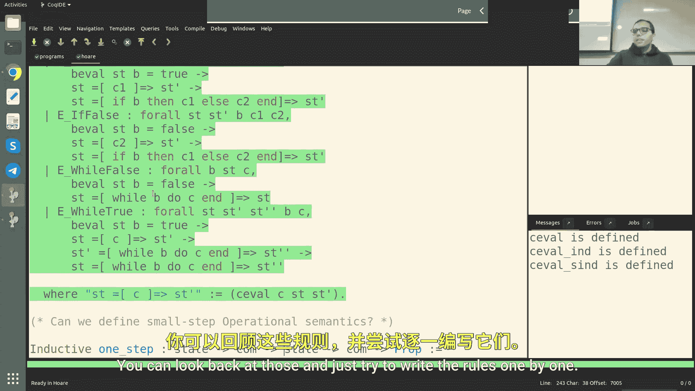
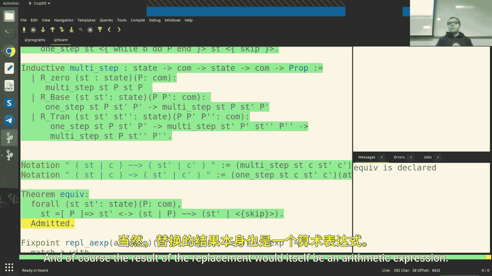
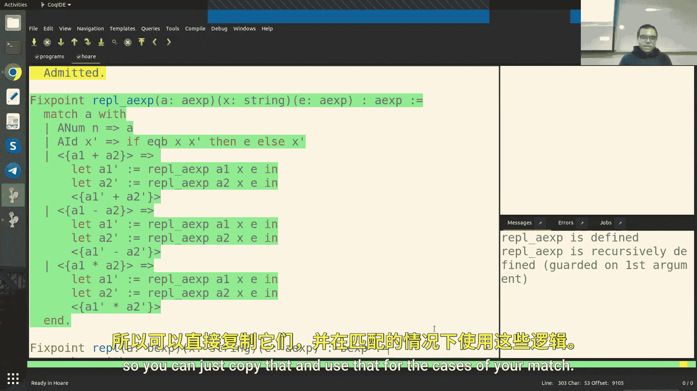
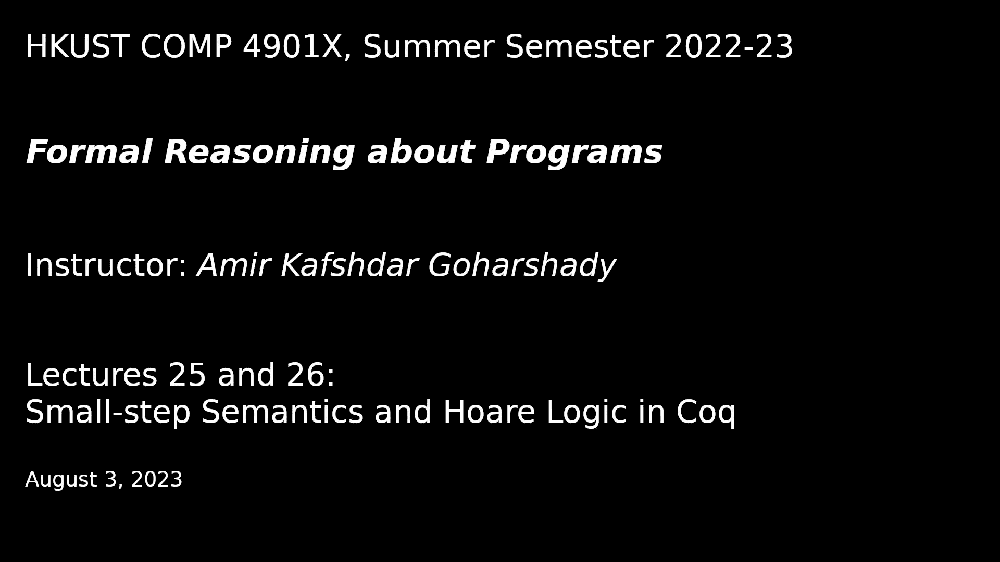
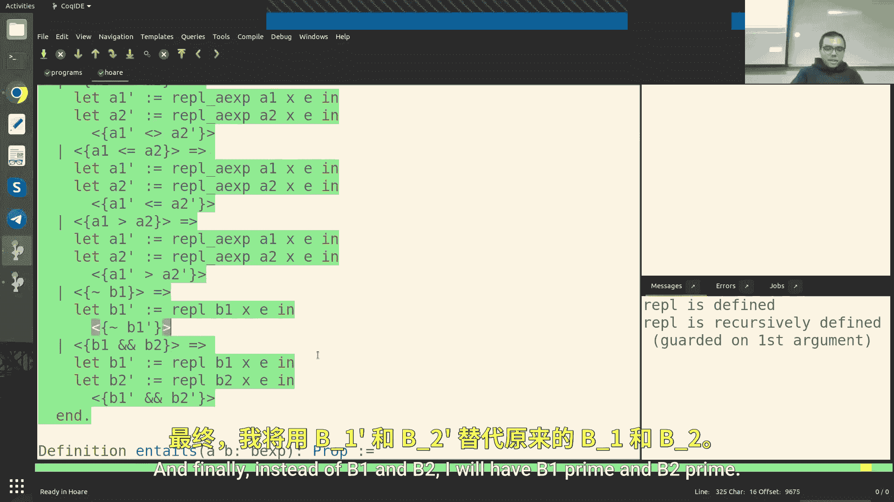
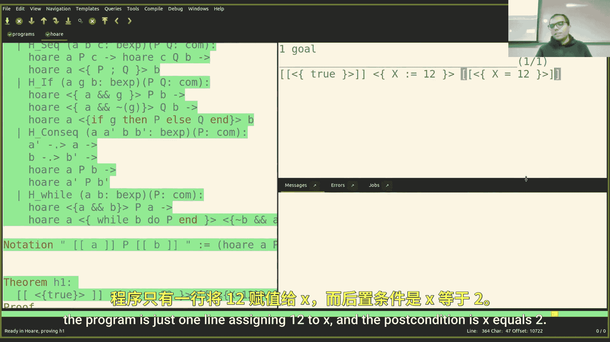
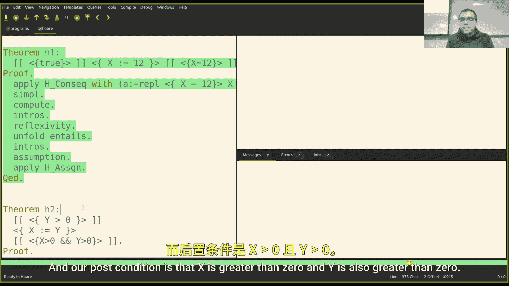
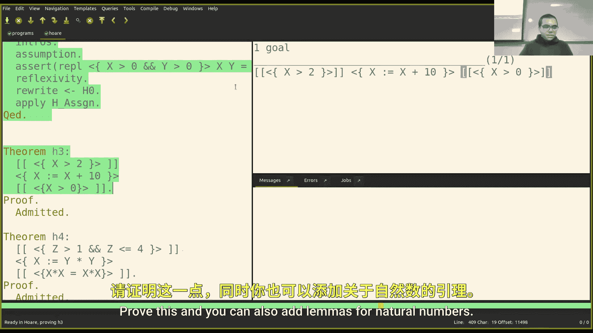
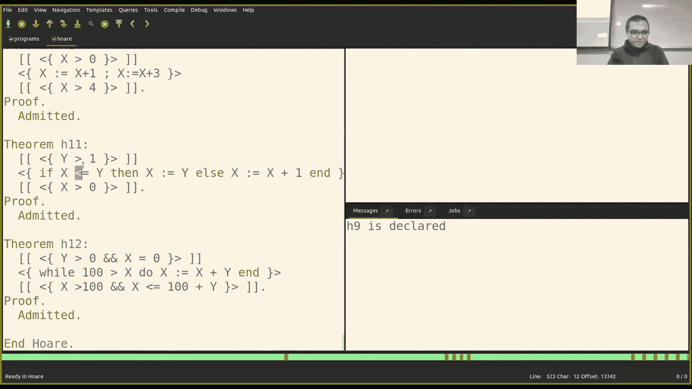

# 香港科技大学【中英⚡程序的形式化推理｜COMP4901X 2023 Formal Reasoning about Programs】 p14 p13 s 25 and 26 - Small-step Semantics and Hoare Logic in Coq -BV1roXTYaEmJ_p14-

Today， we're going to mostly focus on semantics and whole logic。

 I'm just importing a bunch of libraries。 You can also see these imports in the Phlon canvas。

So the first thing I did was that I wanted to define。

The concept of a state in a program or the concept of evaluation， let's say。

So I wanted to have a function that maps my variables to values and this is what I mean when I say total map。

 so total map a。Is a type and it's the type of functions that map strings to values of type A。

 so I'm just assuming that all of my variables are strings。

And then I define the empty function or the empty map。

 which basically maps everything to a default value。And then I define the notion of update。

I that I have some map M， but I want to update so that it maps the value of x to a and remember m is a function。

 so I'm just going to create a new function and this is a Lada expression。

 it's a new function that takes x prime and if x is equal to x prime then it returns V otherwise it just returns m of x prime。

So just updating the valuation。And of course。In our program。

 we want to say that our states are a total map of nets。

 so I'm assuming that all of my variables are going to take natural numbers。

And so every state is just a mapping that takes the name of a variable and gives me the value of that value。

Okay， I defined some basic notation。Again， I'm not going to talk much about notation。

 just look at the CoC manual for that。But basically I use this notation to say that this is the map M except that now X is being mapped to V and I use this one to just say the map that consists only of X being mapped to V and then we saw that we can define our arithmetic expressions in our vile programming language so all I'm doing here is trying to define my mini programming language vi from the theoretical sessions in cork first I'm going to say that I'm defining my arithmetic expressions and an arithmetic expression by definition。

InTo the grammar that we've seen before can be either a number。Or a variable。

Or the sum of two arithmetic expressions or sum arithmetic expression a1 minus a2 or a1 times a2。

And I have a constructor for each of those cases， so this is an inductive type definition which defines all possible arithmetic expressions and then based on that I also defined Boolean expressions。

So I have true false equality， negation of equality， not and all of these good things。Okay。

And then I actually defined a ton of notation so that I don't have to write all of these names of constructors all the time。

So。All I need you to remember at this point is that。Whenever I do this kind of notation。

 so whenever I open an angle and bracket and then close the bracket and angle。

 anything that I write inside there is in the vile programming language now。

So I'm using this notation to distinguish between my Co code and the code that is in the V programming language and I'm actually analyzingnaly。

I also defined four variables， W， X， Y， and Z。And we got to this point where I showed you that you can actually check the type of these expressions so I can have something like this and again I'm setting the scope to be the scope of my vile programming language and then。

Coke can easily check that this is， for example， an arithmetic expression。And then I defined。

Thenotational semantics for my arithmetic gabolian expressions。

 so I defined functions that take the current state of the program and a particular arithmetic expression A。

 and then they evaluate a in the current state。And this was again very simple。

 I just said that if it's a number n， it's just that number， if it's a variable x。

 you just take the value of the variable。And for the other cases， you just do the operation。

 so if you have an expression a1 plus a2， you first evaluate a1， then evaluate a2。

 then take this sum。Okay。And the same thing for Boolean expressions。

 basically I have another function called D Eval which evaluates a Boolean expression at a particular state and of course if I evaluate an arithmetic expression I have to return a natural number。

 if I evaluate a boolean expression at a state， I have to return a boolean。Okay。Pretty nice。So。

Now that we have our expressions， we can actually define the statements or the commands。

Or the programs in our V language。And remember that when I was teaching you about the V language。

 this was the syntax that we wanted to have， so I want to have skip， I want to have assignment。

 sequential composition， if and y。So now again， I define。A command or a program as an inductive type。

 and I say it's either a skip or it's an assignment。

 but if it's an assignment it should take a variable x and an arithmetic expression a。

 so it's assigning a to x。Or it's just a sequential composition of two other commands， or it's an if。

 but if it's an if it should have a guard which is a Boolean expression and then a then part and an else part and these are C1 and C2 which are themselves programs or commands and or it's a vi and for while we should again have a guard which is the condition of the vi。

And some body see， which is what's being run in every direction。Okay。

 and then I again defined a lot of notation。So that I don't have to write the names of these constructors。

 I can just write skip， I can write assignments like this。

 I can write sequential composition like this and of course I have event violence。Yeah。Okay。

So one example we saw was that if I want to write a program in my vi language that just computes。

The factorial of a number x。This is a program that does that。

 so it says set z to x and then start with y equal to1， and as long as z is not zero。

 multiply y by z and decrease z。But very importantly。

 this notation means that this is a program in my V language and not part of my Co code， okay？

And if I print it， it actually tells you that the type of this whole program is command or come。对。

And yeah， so here's an arithmetic expression， its type is arithmetic expression。

 here's the Boolean expression。The type is correct， here' is a command and the type is correct。

And we saw some more examples。Of programs。Okay。Now。

 the program that we saw S towards the end of the previous session was this one。

So this is an infinite loop。In my vile programming language I can write programs that do not terminate。

 so in this case I have vi through do skip， it's an infinite look。

So this tells me that I cannot really define my denotational semantics as just a function in cork that runs my。

Coke functions have to always terminate and return something。

But I can have programs that don't terminate。So if I want to have something that looks like our denotational semantics and just。

Let's say takes some state and some command， so runs this command on this initial state and returns the state after the command finishes。

I can do this for all cases， except for the case where I have a while。

And we did this in the last session， so we said that。Not change if the command is an assignment。

 the state changes but we can just update the map and the way we update the map is that we were assigning a to x。

 so we first evaluate a at the current state and then we update this state by setting the value of x to be the result of that evaluation。

And then we had these things for sequential composition if and not for while。

 we don't know what to do for while here， that's impossible。Okay。And then we saw an example。

 so for example， if I have this initial state where z is 4 and x is2。And I have this program。

 which first subtracts x from z and then increases x by1。Then I can say call the evaluation function。

And this initial state。With this program and it does and it gives me a result and the result is also a state。

And a state was just a function that maps variables to their values。

 so I can ask what is result of z and it says it's2 and you can see that of course if I run this program on this initial state z should be2。

And I can also ask for the result of X。Okay。So we saw that we cannot do much operational with the notational semantics or with function based semantics。

So instead we said let's do operational semantics and actually in the last session we saw big step operational semantics in this session we're going to see small step operational semantics。

So I defined this notation STC ST prime， which basically means a big step operational semantic。

 so if I start my program at ST and my program is C it will terminate at ST prime。

 that's what this means。ok。😊，So in operational semantics， we always write proofs。And actually。

 let me find the slides for big step operational semantics so that I can show you that these are basically the sames These are the slides from our lecture on big step operational semantics。

And。These were the rules that we had。Okay， so these are first the rules for evaluation。

 I don't care about those， I care about the rules for big step semantics。So for big step semantics。

 we said that if our program is just skip， it just terminateates。If our program is of this form。

 it's doing an assignment。We have this rule。So it's doing the assignment x equals to a。

And it's assigning the value of C and。Sorry， and yeah， the value of a at the current state is C。So。

We have this。And then we have these rules。We basically had rules for while， for if， for L。

 all of those nice cases。So let's go back to Co and let's see how we are writing the same rules basically again。

So this is an inductive proposition called CL， so it just defines some sort of relation mathematically thinking about it。

So what kind of relation is it， it's like a turn relation， you have a command。

 an initial state and a final state， and it's in this relation if from this command。

 from this initial state using this command， you can get to this final state。Okay。

So I have several rules， I have a rule for skip and coming back here。

This is basically the rule for skip。😔，That we had here for。This one。Okay。What does my SP rule say。

 it says for all states ST。From SD， if I run Sip， I will end up at SD itself。Very simple。

So this is just the same thing as we've seen in our theoretical lectures。

 except that we're writing it in a different notation in code。So the rule for assignment。

Is that if I have an assignment which says。Assign a to x。

 and if I start at this at some particular state ST。I will get to the state。

 which is obtained by updating the value of x to n。

In ST and what is NN is the result of evaluating this expression in the current state。Okay。

And then we had the rule for sequential composition。

Wwhich basically said that if starting at one state with C1。

 I get to this second state and starting at that second state with C2， I get to this third state。

 then starting at the first state and doing C1 followed by C2 I get to the third state。

And the rest of these are basically the same， I have a big step rule for if in the case where the condition is true。

 I have another one in the case where the guard condition is false and also for while。

So maybe the only really interesting case is the rule for while when the condition is true。

 so I'm saying that。If the condition V is true at the current point of the program at the current state。

Okay， and if running C from the current state would get us to this other state ST prime。

Then if from the current state， I。While B do see， sorry， any from that。State ST Prime。

 I run the while I get to a third state ST double prime。Then from the current state ST。

 if I run the vi， I will also get to that third state ST double prime。So this is like。

Unwinding or unrolling the loop for one iteration。Okay。Great， but let's do something new actually。

 let's do something that we haven't done before。Let's define small step operational semantics。ok。😊。

So to do a small step operational semantics， I'm going to。Go back to the slides that we had。

For a small step。ok。Again， we had a bunch of rules。Okay。

 so one rule was that if I start with skip and some value， Ill just end at that value。

This was the rule for assignments。Okay。So if my program is simply just assigning a to x。

 it will immediately terminate and it will terminate in the state where I've just updated the value of x。

We had rules for sequential composition well in our programming language that we just defined in Co。

 we don't really have halt so you can ignore the part of what halt， but we have these rules。

And of course we had two rules for if for the cases where it was true and false， so if it were true。

 I would just run the then part， so I would transition from having this program at the current state to having only the then part at the same state。

And if the condition was false， I would only have the L part， so you see this is small step this is。

One step of execution at a time。And then we had these rules for vial。

 which basically said that if my condition is false， I just don't do anything。

 my vial doesn't run at all because the condition of the vi the guard B is false。

But if the guard b is true at the current state， then I have to first run one iteration of my vi loop。

 I have to run P， and then I have to run my vi loop again。O。So。Let's see if we can define this here。

I want you to actually write this on your own， so I'm going to give you some time to write this。

 let's say I want to define an inductive relation which basically just does one step of the execution。

And what does it take， it takes the initial state and the initial program。

And it also takes the final state and the final program。

And it should tell me whether it's possible to go from that initial state and program to the final state and program。

And again， remember， this is an inductive proposition。

 so you have to give me proof rules just like the previous case。

So just try to translate all of these rules that we had for。

Small step semantics to cook and again all of the rules for small step semantics are actually available on canvas you can look back at those。

And just try to write the rules one by one。

Okay， let's do this， this is actually the answer or at least one possible answer。可是。

It looks complicated， but it's not really complicated， okay。So what do I have？

I have an inductive proposition called One step。And what is my intuition。

 my intuition is that I should be able to get one step。Of， let's say， state。Program。

 state crime program prime。If and only if。Running one step of the program P under state ST。

Leads to P prime and ST prime。This is my intuition。So I have to now give proof rules。

Where the conclusion or the result of the proof rule is of this format tells me when I have the one step of STP。

 ST prime p prime。Okay。😊，So let's actually just。Take all the proof routes that we had for one step execution。

Again， we'll go here to small step operational semantics。

And let's just look at the simplest rule that we had， so our simplest rule。

Was that if my program is skip。And I'm running it on some states now。

In the slides I'm calling it Val， but actually in Co， I'm calling it ST。

So v and ST are basically the same if I have skip and I run it on ST I will end up at the same state。

But you see that's problematic for me because of the type checking again。

 because I want to define this relation or this inductive proposition in a way that I always have this format。

Two states and two programs。Right？So I just don't distinguish between Sip and the empty program because I don't have a concept of the empty program here。

Okay， so instead the rule that I write for skip and I call it our S。It's going to be like this。

I'm going to say that for every state ST and every program P。

 remember that Kong was command or programd。For every state SD and every program P。

If I have a program that looks like this， skip followed by P。And remember。

 whenever I want to write programs in my vi language， I have to change the scope。Otherwise。

 Koke might think that this is Cope， but this is in my vile language。

So I say if I start at this stage and the program I have to run is skip followed by some other program P。

Then I can just remove thescape and I can say start just in once。You stay at the same stage。

 but now you have to run the program fee。O。And actually here I don't need a I can just write it like that。

Ok。So this is my first rule， but let's just go over how this rule should be read。

 so I'm saying I have a rule called our skip。What does this rule say。

 it says that for every state ST and for every。咦。😊，Dist thing holds one step of S T， skippy， steepy。

And this thing just says that again， our intuition is that it means that running one step of this program。

And ST keeps us at ST， but now we have to run this program。Okay。

 so this is what my first rule says and my skip rule is different from the skip rule in the theoretical lectures because I don't have a concept of an empty program here and I'm just showing the empty program with SP itself。

So instead， the rule that I have for skip is that if you have skip followed by something。

 you can remove this skip。Okay。Let's look at the rule for assignment。

What was the rule for assignments， it said that if I'm at some state。And I'm doing an assignment。

I will terminate。At the same state， except that the value of the variable that got assigned has to change to the actual value that that expression had in the current state。

Okay。So again， I write a new rule， I call this RSI。

So forget about these parts and just focus on the part that I'm writing here。

 I'm saying suppose that when I take the arithmetic expression egg。

And I evaluate it at the current state， it evaluates to the value N。Okay。

 then I can say that in one step。This step and my program is to just assign x to a。

Which state do I go to， I go to the same state， except that the value of x is now n because remember a evaluated to n in the current state。

Okay， and what happens to my program now this is the part where again， things get a little bit weird。

I don't have an empty program， so I have to put something for the empty program and just put skip。

Okay。😊，Now。PM和PM不。Yes， but that's not the rule that we had here。

 so the rule that we had here was if my program is just this assignment， what happens？

So here I said what happens is that I will have the empty program at this date。

 but here I'm just using skip instead of the empty。Yeah， but the rule you say is also correct。

 it's just not the single。我 yeah。Okay， what is the rule that I have for sequential composition saying that if I start at program P and valuation well and in one step I go to p prime v prime。

Then if I do from Pq with valuation well， I will go to p prime Q and valuation well。Okay。

 so basically it's the idea that if you have a sequential composition of P and Q and you want to run one step。

 you have to just run one step of P。So what does this rule say？It says that for all states。

 ST and ST prime and all programs， PP Prime and Q。If running one step of P at this state gets me to P prime at this state。

 S prime。Then running one step of P followed by Q at the same initial state。

Gets me to the same state ST prime except that now I have to prime followed by Q from that point onwards okay。

 so it's literally this rule except that we don't have halt in our programming language right now so I don't have this part of。

O。Nice。Next rule。So what happens if I have an if and the if condition holds？So the rule for if。

You see if the if condition actually holds。In one step， I don't change my。

But I just say instead of running the whole if， I just have to run what was in the den part。

So I want to write this rule in Cock。And I call the rule R if true。

 so this is the name of the rule again。And again， this is universal quantification。

 so it says for every state ST， for every B that is a Boolean expression and for every P andQ that our programs。

 we have this。Okay， so this is now the actual core of my rule。What is the core of my rule。

 It says that。It， if I evaluate B at the state S T and it evaluates to true。Then。

I know that running one step。Of this program and look I'm changing the context here and I'm going into my vi language So everything in here is in the vi language。

 So running one step of the program if B then PLq。From the state ST。

Is going to take me to the same state ST， but now I have to run the program P。Okay。

 and this is because B at ST evaluated to true。Okay。

Now I need another rule for the case where I'm doing if and the condition is actually false。

So this rule is exactly the same， except that instead of running P at the end。

 I have to run Q at the end。So it's literally the same rule as the one above， except that it says。If。

B evaluates to fall at the current state ST。Then running one step of this program。From ST。

Keeps me at the same state ST， except that now I have to run Q， I have to run the den part。ok。

By the way， I just put this file the or that we also on canvasva so you can just download it you don't have to write this。

Okay。Now we get to the rules for white。Again， this is the most complicated part。

 but it's not that complicated at this point because you already know how to translate from the notation of rules to the notation of rules in Co so I have a rule for the carries where my viguard is actually true。

So I say that if B at the current state evaluates to true， then in one step。

What happens if I run one step of the vi？I basically stay at the same valuation ST。

 but now I have to first run P， I have to run the body of the vi loop。Followed by the vi loop again。

😡，Okay。Great。And the next case and the last case is actually quite easy if I have a vi and the condition of the file。

 so I have this program vi B2P。But when I evaluate B at the current state， it evaluates two false。

Okay， so in this case， in one step， my program just terminateinated so I。

Andd at the current state and I have no program to run。

 but we said I don't have a concept of empty program so I just put skip instead。Okay。😊。

Is this clear to everyone？Do you all understand what I'm doing here？Okay。Great。

So now I finally have the concept of small step semantics， but if you remember。

 we also talked about the。Transive closure of our small steps semantics。Right， so basically。

What I'm defining here is that if I start at this state and program in one step。

 I can go to this other state and this other program。

But what if I want to define multi step execution， I can just define another function。

Or actually to be more specific， I can define another inductive proposition。

And I call this one multi step。Now， what does this one mean？Intuitively。

 I want to say that given a state。And a program and another state and another program。

Multi stepholds。So multi step of ST， C， ST prime， C prime holes。If。

Starting from the state ST and running several steps of the program C。

 I can eventually reach the state ST prime。And the remaining program be C。Okay。😊，So anyway。

 this is just the transitive closure of the previous relation and in the past session we've seen how we can define transitive closures in general。

 but I'm just going to define the transitive closure here， so I have two rules， I have a base rule。

Yeah， which says that。If in one step， I can go from P to P prime。Im sorry， if in one step。

 I can go from STP to ST prime P prime， so I need both my state of variables and the remaining program that I have to run。

If I can do that， then I can also do it in multistep。

So that's the first rule and the second rule is that if in one step I can go from STP to ST prime P prime and then with multiple steps I can go from ST prime P prime to ST double prime P double prime。

 then in multiple states I in multiple steps I can go from the original state and program to the final state and program。

O。So this is the definition of multi step。Tell me the problem with this definition。

 what's wrong here？Yes， it doesn't consider the case where you reach in zero steps。嗯。

So it's only considering the cases where you reach in one or more steps。

If you want to have the case with zero steps， you have to either change your R base rule or you can just add another rule。

You can call this R0。And what this says is that for every state ST and every program P。

I have multi step reachability。😔，From STP to itself to STP。Okay， if I add this now it's correct。

And actually， if I add this， then I don't need the next rule。

Because it's actually easy to get the next rule by a combination。

 the second rule by a combination of the first and third rules。Okay。Okay。Again。

 I define some notation because I don't like to write multi step and one step。

So I define it like this， I say if I write something like this， STC。

And then I put this kind of arrow， so two tilts and an arrowhead。

Then this means multi step if I put only one tilt， I mean one step。Okay， so this is just my notation。

Now I have a theorem。And this is a theorem that is actually very easy to prove。

But at the same time very time consuming， so I'm not going to prove it。

 but I'm going to put it in your homework too。And this is the theor。

 it says that basically our two types of operational semantics are equivalent。

Remember so when I was talking about big step and small step。I said that。

You will have the big step if and only if you can repeat the small steps and get to the same place。

So this is the theorem that I want you to prove in your homework too。It says for any two states。

 ST and ST prime and any program P。If my big step semantic says that running the program P from ST terminates in ST prime。

 then my small step semantic says that from STP， I can go to ST Prime S。Because remember。

 I showed the empty program with SP。And vice versa。And also。

 if I can go from STP to ST primescape using my small step semantics。

 then using my big step semantics， I also terminate in the same place。Is the theorem clear to you？嗯。

Yes， the main idea is actually very much similar to the proof that we gave in the previous session that。

Well， actually I didn't give it， I just went over it。

That thenotational and operational semantics are equivalent so it's a casework。

 but now you know how to use tacticals so you should be able to avoid most of the casework very easily by just。

Putting together some semicolonons and trieses。O。Nice。Now we want to go to ho logic later on。

But before I can do that， I need to define replacement， oh， actually one more point that I forgot。

Look at this thing here。In this rule， I'm saying。This thing and this thing together imply this third thing so instead of the end here I can also put an implication。

Okay， and this is a logical idea， the idea is that basically in propositional logic。

 A and B implies C is the same thing as A implies B implies C。Okay。

And since these two are equivalent。In Cork， we usually prefer this kind of notation。

So I write it like that。Even though for humans， it's more intuitive to write it like this。Now。

 why do I write it like this in Cork because well？Imagine that I want to use this Rran in proof。

So this is a proof rule， this is kind of like an axiion that I can use in any proof。Okay。😊。

So if I have this Rran， I would prefer to be able to just do intros and get everything up into the context。

Okay， so and this ensures that whereas if I have and I have to do split or destruct。

 I don't want to do that。Okay。This is the theorem you should。Prove。Okay。

Now this is a function that I want you to complete。So this is a replacement function， what do I mean？

I mean that I give you some arithmetic expression A， and I give you a variable x。

 and I also give you another arithmetic expression E。

Now what I want you to do is to go through the first arithmetic expression and whenever you see x。

 replace it with E。Okay， so it's replacement of a variable with an expression inside another expression。

And of course， the result of the replacement would itself be an arithmetic expression。😊。

So I want you to write this function。

We're going to go back and look at the definition of arithmetic expressions。

So at the very beginning somewhere here， yes， so he said that an arithmetic expression is either a number or a variable or it's constructed using plus minus or multiply。

Okay。So let's just do the replacement in each of these cases。

 so I just do a pattern match on my original arithmetic expression a。

And I say if it's just a number will return age。There is nothing to replace。

 I just want to replace the variable x with E。If it's a number， there is no x， right？

If it's a variable x prime。You have to actually check。

 you have to check if this variable is the same as x。So if x and x prime are the same。

 then I should return E。Because I want to replace the variable x with T。

 otherwise I just return x prime itself。ok。The other case is that my main expression is of the form A1 plus A2。

 so it has two sub expressions， A1 and A2。Well， here it's again very easy。

 I would first replace all instances of x with E in a1 and let's call that a1 prime。

 so let a1 prime be the result of replacing all instances of x with E in a1。

I'm recursively calling the same function。And let a2 prime be the same thing just for a2。

So I'm first doing the replacements in a1， then I'm doing the replacements in A2。

 and then I'm saying create this expression， create the expression a1 prime plus a2 prime。Okay。

And it's the same for minus and times， so if it's a1 minus a2， again。

 I first do the replacement in a1。Then I do the replacement in A2。

 and then I create this expression which uses the minus of the replaced versions。

And here it's the same if it's a1 times a2， I first replace an A1， then I replace NA2。

 then I take the times of the。The thing that really makes this kind of hard to write is that you have to be very careful what's in which scope。

 so you have to be careful where to open this kind of braces and when to close that。Okay， nice。

 so now I want you to write the same thing， the exact same function replacement。

Except that instead of replacing a variable in an arithmetic expression。

 I want to replace it in a Boolean expression， so I have a Boolean expression A， I have a variable X。

 and I have an arithmetic expression E。And I want to get another Booleyan expression。

Which is equal to the result of replacing all instances of x in a with E。

So please complete this function。有问题。It should be very similar to the previous one。 Yeah。

 and for the cases， you can just copy from the constructor of。From the definition of B， E X B， right。

 you have all the constructors there， so you can just copy that and。

Use that for the cases of your match。

Okay， let's see this again， the idea is exactly as before。😔，Yeah， we have many cases now。

 it's just that I have an arithmetic sorry， I have a Boolean expression a。

A variable x and an arithmetic expression E， and I want to replace all instances of x with E。

 so I just do a match on a。And I say， well， if my original expression is true。

 the replacement is not going to change anything， I'm going to get through if my original statement is false。

 I'm going to get false。If my original expression is of the form a1 equals a2。

I have to replace all instances of x in a1 with E， so that's what I do here。

And I call the result A1 prime。I have to also replace all instances of x in A2 VTE and I do that and I call that A2 prime and then instead of a1 equals a2 I will have a1 prime equals a2 prime。

And it's exactly the same thing for not equal， for less than equal greater。

 so these cases are exactly the same as before。This is actually a little bit interesting。So。

If my original Boolean expression is of the form not beva。Okay， so I have to replace x with E in B1。

But this is a replacement in a Boolean expression， so I'm recursively calling the same function。

 whereas in the previous cases， I was calling the previous function that I had for arithmetic expressions。

Okay。But yeah， other than that， other than the fact that I'm recursively calling the same function。

 the idea is exactly the same， so I'm doing the replacement in V1。

And then I'm saying take the negation of the replacement。

Because the original expression was the negation of P1。

And the same thing for nt so if I have B1 and B2， I first replace x with E in B1 called that B1 prime。

 then replace x with E in B2 called that B2 prime and both of these were again recursive calls to the same function。

And finally， instead of B1 and B2， I will have B1 prime and B2 prime。

Okay， welcome to the last session of this course。Some of you are happy because you no longer have to do CO。

 but you have to do the second homework still。So don't be too happy about the coursec。嗯O。

We are finally at a point where we can define ho logic and the proof rules of H。But before that。

 I just want you to remember that。In horn logic， we had this。This particular type of item。

Which is a ho ripple。So we had ors of the form AP PB， and the idea was that A is the precondition。

 P is the program and B is the post condition。But one other thing that we needed。

 especially for the last rule for the for the rule of。Consequence， there is the consequence rule。

Okay， here。So we need to also define when a particular Uan expression。Another Boolean expression。

Because we need that in order to define our consequence rules。So first。

 let's define that and then we'll come back and define our mores。

This is actually the simplest definition yet， so let's say I have two Boolean expressions A and B。

 then can I say that A entail is B？Okay， then is B a consequence of a。Well。

 if for every possible valuation to the variables。If A evaluates to true。

 then B also evaluates to true。Right。So the idea is that a entails B if a entails B on every possible valuation or on every possible state。

So I just define this， so I define entailments。And then I also give it a notation again another type of arrow again。

 you have to now make sure you understand the difference between all of our arrows。

 so this is an arrow with the dots in between and I'm using this for the entailment between Boolean expressions between A and B of type B X。

Okay， now I'm ready to define my horn triples。Okay。So again。

 a Hdrile consists of two assertions and these assertions are going to be Boolean expressions for us。

And a program in between and program is the type come in our current setting。

We've seen some examples， we will come back to these examples。But very importantly。

 I just had a bunch of axioms， so if I want to define horn logic， I just have to define these axioms。

Okay。So here's what I'm going to do， I'm going to define an inductive proposition called ho。嗯。

The idea is that who of APB holds。If。I have this。 If I have a。PB。Okay。😊，That's what I want to do。

Okay。So now I have to again give proof rules， I have to say how you can prove who of AAPB。

And if you look here， horror is again an inductive proposition， it takes a Boolean expression。

 this is my A， it takes a command or program， this is my P。

 and it also takes another Boolean expression and this is my B。Okay。So first。

Let's look at the rule for S， the axom for skip。The axiom was just this we didn't need any assumptions a skip a always holds so if I want to write it here。

I have to say for every aid that is a Boolean expression。I can have four of a skip H。Okay， easy。

Now let's look at assignments。So。This was the thing that was a little bit non trivialvi at the beginning when I was teaching you about ho logic。

So if my program assigns。The expression E to the variable x。

And if I want to have a in the post condition。I should have。A in the precondition。

 except that every instance of x should be replaced by the value of E。

And we did examples of this and the example was that if I have， for example。

 x equals x plus 2 and at the end I want to have x less than n at the beginning I should have x plus  two less than n so I just take my post conditiondition and I replace x with x plus  two and that's what I can put in the precondition。

Okay， but anyway， this is my rule or my axom schema， I'm going to write it here as a rule H assign。

So I'm going to say for every Boolean expression a， variable x and arithmetic expression E。

I have this。If I have this H riple and in my H Triruple。

 the program is just a program that assigns E to x， and let's say that my post condition is a。

 then my precondition should be a except that every instance of x is replaced with E and that's why I wanted you to write the replace function because I needed it here。

Okay， and then this whole tree pull holds， this is the entire hoship。Okay。

Let's go to sequential composition， this was actually the easiest kind of axiom that we had。

So it says that if APC and CQB holds， then AP PQB holds as well。

 so I run a I run P starting from precondition A and I ensure post condition C。From there。

 I run Q and that ensures post condition B， so of course if from A I run P followed by Q。

 I will reach B。几。😊，So。I'I'm not going to spend too much time explaining ho logic。

Focus on how to do it think of。Okay， so this is the rule for sequential composition。

 I say for every A PncC that are Boolean expressions and every PNQ that are programs or commands。

If I have the H triple APC and if I also have the H triple CQB， then I have the Hrup A。

 the program is now P followed by Q and then the post conditions。ok。😊，Now let's go to if。

This was the rule that we had for if。So I need two assumptions here， so B is the。

Guard of the if here， and I have to say that if A and B holds an I run P， then big B will hold。

And if A and not B holds and I run Q the L parts， then again big B holds。

 and from this I can say I get this sortable。Now I'm going to write it here H if。

I'm going to use B for B and for small B， I'm going to just use G as the card of the if。So。Again。

 I'm saying suppose that I have。AGMB， which are Boolean expressionions and PNQ。

 which are commands or programs。And let's say that this is the whole triple that I want to achieve。

 I want to find。I want to somehow prove the hard Trial。That says。My program is this if B 10 PQ。

My precondition is a and my post condition is B so what do I need for that。

 I need to say that if a and G holds。Okay，ops I have to put G here yes。😔，If A and G holds an I run P。

 then I should get B so I need this H tripleal。And I also need this for tripleal if A and not G。

And then I rank Q， then I will get B。ok。And again， instead of putting an end here。

 I'm just putting implication because I told you that these are the same in these cases。

So this is the case for if。Nice。Now let's write the rules of consequence。Actually。

 I'm going to just write one rule of consequence and this is the most general case so this last one。

So we've seen that if a prime。Entails A and B prime entails B， and I have the Hordrupal A PB。

 then I also have the Horrupal A prime P B prime。Okay。

 so this is strengthening the precondition and weakening the post condition。

So now if I want to write it here， I give it a name， I say this is H consequence。

And here's what I say， I say if a prime。Entails a exactly this and B prime entails B。

And I have the horile APB， so you see this is exactly this rule。

Then I have the H triple A prime Pb prime。Okay。😊，Finally， the rule for vile。Remember that for while。

 we actually had to also add an invariant a。Okay。😊。

So the idea was that if a is a loop invariant and then I have。

This I have this horuple that says if I have a and B and I just run the body of the loop once。

 then I'm guaranteed to have a at the end of it so a remains there a。

Then I also have this or tripleal， which says a while B do P。

 and then at the end as the post condition， I have not to be because of course I should have not to be because that's the only way that the vi ends。

And I also have a because a is preserved in every iteration。

So let's write this rule again exactly the same as before， I say my program is viL B2p。

And I say if I have。This for triable。Which is A and B， P， H。Then I also have this word tripleal。

 which is a vi B do P。And on this slide， I have as post condition not to be。Okay， that's it。

 that's the definition that gives us all of H rules， basically。Nice， now we have whole logic。

First of all， let me just define some notation， I actually write my H trickles like this。

I don't want to use carelib braces here because we have too many carelib braces in our notation already and anyway our notation is already really hard to read。

 but anyway。This is how I'm going to show a hard trip so I defined this notation。嗯。

Here's the first theorem that I want you to prove。So this is a Hruple and the Hruple says that precondition is true。

 the program is just a very simple program that assigns 12 to x。

And I want you to prove the post condition x equals 12。Yeah， it's。It looks trivial。

 but it's not trivial at all。I don't know how to start with。Yeah。

 so try writing a proof using pen and paper and then try to translate every step of your proof for Cock。

So this is what we want to prove and this is a ho trickle。

 it's a ho trickle where the precondition is true， the program is just one line assigning 12 to x。

 and the post condition is x equals to 12。

is the soft I a to tell the X to tell。Yes， it looks very trivial， but yeah， exactly。😊。

So which rule do you want to apply？Yes， normally I would want to apply the rule for assignment because of course。

 my program is just a simple assignment。Now what is the rule for assignment， let's look at it。

 it's H assigned。And it looks like this， it says you have the horyole。Which looks like this。

 so the precondition should be replaced in Ax with E。The program should just be some assignment to X。

And the post condition should be a。Now， what happens if I just say apply ageS sign？对。Yeah。

So there is a problem here， what's the problem？Let's look at HS sign。

So if I want to apply it to this goal。Coke can understand。That's well， a。Is the third part。

 so it's this one。Right。And it can also understand that the program。Should we this x equals 12？

So here it understands these parts， it understands that the expression E should be 12。

In order for these two things to match。But then it has to also match the left hand side。

With this expression， it replace AXE， but the left hand side of this particular hodruple is just true。

So it says， I don't know how to match true with that。

 I don't know how to unify true with that expression。Okay。

So this shows us that we have to actually make sure that instead of having true here。

We have exactly this expression have。Replace of A A is this post condition and x and E。

 I have to create all of that before I can apply HSI。Okay， so how can I do that well。

 I can apply each consequence。Right。So。Let's say that I want to apply each consequence。

What do I have in my H consequence this is what I have in H consequence， I have a prime A B B prime。

 blah， blah， and at the end I get a who of a prime P B prime。So let's say I want to apply it。

 I say apply H。Consequence。Now， here's what it says。😊，It says that well。

 H consequence gives the Hd triplele a prime， P B prime。And I have that。Here as my goal， so Cox says。

 I know what what I should put for a prime P and B prime because I have it in my goal。

But I don't know what I should put for A and B。Because there is no context that tells Koke what to put for AMB。

ok。So in this case I actually don't want to change my post condition at all。

 so I say apply h consequence width and then my B is just going to be the same post condition x equals 12。

 but what do I want as my precondition I want something that lets me easily apply HSI。

And that thing is this replacement。In this expression of x with 12。RightDoes that make sense？

Are you all happy with this so I apply this H consequence with this particular values of A and B and you see this is generally always the hardest part of automating whole logic so you can automate almost everything in ho logic but when it comes to the consequence rule there are infinitely many ways of applying it you can have many different things for A and B。

And there is no way that a machine can just figure out what to put there and the same thing happens when you're applying the vi looppe。

 you don't know what the invariant should be， you need a human who actually reasons about it and gives the invariant。

Okay。I said， apply this age consequence。It says， okay， so you have to prove two implications。

 you have to prove two entailments because in H consequence。

 you have to prove that a prime entails A and B entails B prime。So these are now my two goals。Okay。

My first goal is to prove that true。Entails this。Okay。And what is this。

 this is just x equals to 12 but you're putting 12 in place of x so this is basically 12 equals 12 so I say simplify and it gives me exactly that it says。

True implies 12 equals 12。Okay， now I just say compute。ok。So it computes both sides。

And now I do intros and now I just have to prove true is equal to true reflexivity' the next one is also kind of obvious it says that you have to prove that x equals 12 implies x equals 12 yeah this is basically our post condition we didn't change the post condition。

 but anyway we have to prove that it's。It entails itself right so here I just say let's unfold the definition of this arrow and remember that the name of this arrow was actually entails so the arrow is just notation for entails so I say unfold entails。

So this is actually what I have to prove， I do intros， and now as you see。

 I have the assumption and the goal that are basically the same。So I just say assumption。Okay。

Now based on this after applying the H consequence rule。I have to prove this ho。

But this hodrupal looks much better。 This is exactly what I can give to HSN。

Because look at this horiable。So this is my program。And my program is assigning 12 to X。

Right and on the right hand side， I just have some post condition in this case x equals 12 on the left hand side。

 I'm saying the same post condition except that you replace x with 12 minutes。

So this is exactly the case where I can just apply the rule for assignment and I can say apply HSI。

Yeah。So you see your intuition was correct， we have to apply HSN。

 but in order to apply it we have to make sure that whatever we have syntactically matches HSN and in order to do that。

 we have to work with H consequence。Okay， next theorem， prove this one。Prove this hoable。

So our precondition y is greater than zero。Our program is quite easy， it just assigns y to x。

And our post condition is that x is greater than0 and y is also greater than0。

Okay， let's see this and then I'm going to give you。Another thing to prove。Okay。

 this is the thing that we want to prove， this is the whole triple so our precondition is that y is greater than zero。

 our program just assigns y to x and our post condition is that both x and y are greater than zero Again。

 ideally I want to apply hs sign。But before I apply Hsi on my left hand side。

 I should have the replacement of right hand side where I've put y instead of x。

But what is that replacement， it's basically y greater than0 and y greater than zero。

 so I want to put y greater than0 and y greater than zero here。So in other words。

 I want to prove that my current。Precondition， which is just y greater than zero。Entails。

This precondition vi greatertor than zero and vi greatertor than zero so it's just repeating it right but I have to prove that this entailment actually works so I assert this and now I want to prove it so I say first let's unfold the definition of the entailment。

I do it so this is what I have to prove， I do intros， okay。Let's see what assumption I have。

 the assumption that I have is that y greater than zero at the current state evaluated to true。

And I want to say that y greater than0 and y greater than0 also evaluates the true。Okay。

 so it seems obvious that， well， if I evaluate zero， I should get zero。Do you agree with that？

So let me just prove this super fast because I want to use it。

 so I say that the evaluation of zero at the current state is zero and that's just compute it and do reflexivity that's it now I have it in my instructions。

Okay， now I say let's do an unfold on B E。So let's see what my goal actually means if I unfold the definition of be Eval and I do it and this is what my goal means。

 I'm going to unfold this B Eval。So now this is what I have to prove。Okay， what is this。

 this is the evaluation of y， this is the evaluation of zero。

 but I already said that the evaluation of0 is 0。But before that。

 I'm going to do the same unfolding here in my assumption as well。

 so I'm going to unfold Bval in H as well。ok。What does this show you？

It says that this entire thing is true。Right， but what do I have down here。

 I have that thing and it with itself。So I can just do a rewrite using H and I get through and true。

嗯白。Yeah。Oh， actually， I didn't even need my assertion at this point， but okay。

So now true and true is of course true， I can do compute and reflexivity or I could just do reflexivity。

 so that part is time。Okay， so I'm back where I was except that now I have。嗯。A new nice。

Hypoth that says that this one entails this。Again， this is very trivial for us as humans。

 it's not trivial for Co。Okay， this is the whole triple that I want to prove。Now。

 what do I want to do， I want to apply the consequence rule。

And I want to basically replace the precondition with this larger precondition， which is like。

Just repeating the precondition twice。So as usual， if I just say。Apply H consequence。

 it gives me an error because it says I don't know how to change the precondition and post condition so a is the precondition B is the post condition。

Right so I have to tell it， I want to say that apply h consequence and change the precondition to this y is greater than0 and y is greater than0。

So just repeat it twice。How about my post condition？My post condition remains the same。

 so I just have to say use the same post condition that I have for B。Okay。I apply this。Nice。Okay。

 so now I have to prove the prerequisites of age consequence。

 the first one is that I have to show that。で。The old precondition implies the new precondition。

 but I had already asserted and proved that， so I just say it's an assumption at this point。

Right now I have to also prove this， but this is again a very trivial entailment it's for my post conditions but I didn't change my post condition。

So it's just that the post condition entails itself。

 so I just unfold the definition of entails do intros and now my assumption and my goal are the same so I just say assumption。

哦，O。All of this was so that I can just instead of having y greater than zero I can just have it twice here yes。

 so what's my goal my goal is to apply H assignN。The rule for assignments。

 but in order to apply the rule for assignments。对。In my precondition。I should have this。

 where is the rule for assignment I should have a replace of the post condition X E。

 so I take the post condition replace x which in this case y。Okay。

 so I have to again do another assertion saying that if in my post condition I replace x with y I get my precondition yeah。

 we can directly apply that。So I assert this， I assert that if in my post condition。

 I replace x with y， so the replacement of post condition Xy is equal to the precondition that I have here。

Okay。Now this part is easy because you just have to use the definition of replace。

 just do the replacement so you can just compute it and then the two sides would be the same or in this case I'm just going to say reflexivity。

Okay， now that I have this assumption， I can rewrite my goal using this assumption so I can say rewrite using H0。

Finally， now my goal looks like the format that I wanted， now I can apply the rule for HSN。

Because now。I have an assignment x equals y in my program， I have a post condition。

 x is greater than0 and y is greater than zero and my precondition is just a result of replacing the left hand side with the right hand side in the post condition。

 so now I can say apply HSI。And this is its duty。Okay。I want you to prove another theorem。

This is the next theorem that I want you to prove oh I have two dots there。Okay。

 I want you to prove again， this very simple or tripleal。

 which is very clear to humans but not to cook， so my program just increases x by 10。My precondition。

 my assumption at the beginning of the program， is that x was greater than2。

And at the end of the program， I want to just know that x is greater than zero。

 so my post condition is x is greater than zero。So prove this and by the way。

 if you need some les about natural numbers， feel free to add lemons about natural numbers and just say admit it without actually proving the les of natural numbers。

O。But prove this， prove this， and you can also add levels for natural numbers。

Okay， so let me show you the proof because I want to。

Then focus on another one that is a bit more interesting。😔。

I'm going to need a bunch of lemons first and I said you can just define whatever lemons you want about natural numbers。

 we already know how to prove these things。And actually。

 most of them are in Pressburg arithmetic anyway， so Leah would solve them。All right。

Okay so I define a bunch of trivial lemmas， I don't give proofs for them。

 but in your homework you have to give proofs for everything， okay？

So the first one is that if n is a natural number， it's either less than or equal to one or greater than one。

The second one is that if n and M were natural numbers。诶。

N less than equal question mark M is true if and only if n is less than a equal to M again。

 this is a proposition， this is a boolean， so it's just。doing that， yes。

The other one is that if I have three natural numbers and MM and if n is greater than M。

Then n plus P。Cannot be less than or equal to m plus v。So this whole thing as a boolean is false。

Okay。Leml4 with n is a natural number。😔，And if n is not less than or equal to 11。

 then n is not less than or equal to 0。Again， trivial， you can prove it later。

 but these are all the lemons that I needed。Let's get to our theorem。

So I want to prove this whole triple， so if in the precondition I have x greater than one。

And my program just increases x by 10 in the post condition， I will have x greater than zero。

So what do I want to do here？Of course， ideally， I want to just massage this so that I can in the end apply the rule for assignment。

 but in order to apply the rule with for assignment。

 I have to actually make sure that whatever I have on my left hand side。

Is the result of my first condition in which x is replaced by x plus1。

So I would ideally like to turn my post condition into this into x greater than 11 instead of just greater than zero。

Right and then I want to rewrite my precondition instead of x greater than 1。

 I want to write it as x plus 10 is greater than 1。Okay。

 why do I want to do this because if I have this， then my precondition would be the result of replacing x with x plus 10 in the post condition？

So all of this is so that I can apply the rule for assignment in the end。Okay。

 so I apply this H consequence， I apply the H consequence rule and I say I want to rewrite my precondition like this and I want to rewrite my post conditiondition like this。

 okay。So。It says you have to prove a bunch of things。I'm going to do a casework here。

 so this one is about the precondition。So my precondition was x is greater than1。

 I want to change it to x plus 10 is greater than 11。

 so it wants me to prove that x greater than one implies that x plus 10 is greater than 11。Okay。

 how do I prove this well I first unfold the definition of entailment。I do intros。

So here's a technique that would actually help you write some of the things easier sometimes you want to give a name to a particular expression。

Right so here what do I know， I know that I have a state and I know that the variable x has some value in this state and that's basically STx。

Right， and I want to do a casework， I want to say that， well。

 this value is either less than or equal to one or it's greater than one。

But in order to do that I need to have it as a variable so I just say remember this expression as n so this is basically saying I'm defining n to be equal to ST of x I could do all of this without doing this without even defining n。

 but my life would be harder so I prefer to do it。Okay， now I just do an assertion。

 I say n is either less than equal to one or it's greater than one and this is the lema that I had already put after there not really proven。

 but you can prove it easily。Okay， so now I say let's do a case for。

 either n is less than or equal to one or n is greater than one， so I say destruct H0。

 let's do a casefor。Okay， first case， n is less than or equal to one， okay？

I want to actually apply my second lemma。To H0 now you see why I do this。

 so let's see what happens when I do it。You see， this was just a proposition I wanted to Boolean for。

Because I need the Boolean for the rest of this and that's the role of La12 it just writes it like this。

 so instead of having n less than or equal to1， I get that n less than equal question mark1 is true。

Okay。Now let's unfold some of our definitions， let's unfold the definition of coulan evaluation in this assumption age。

And I get this， I say let's unfold the definition of arithmetic evaluation as well。

And this is what I get， So you see I am now。Completely done with arithmetic Cammbboian evaluations。

 and this is just the value of x in my current state。Okay， yes， but I already gave it the name n。

 so I do this， I replace it with n， so now you can see the contradiction。

 the contradiction is that I have something that is true。And its negation is also true。

And that cannot be so I just do a rewrite， I rewrite H0 in H and I get that the negation of true is true。

 but that's impossible so I just do discriminate in age and that's it all of this。

Was in my precondition and for the case that n is zero。

Now I'm still in my precondition and I have to consider the case where n is greater than one。

 sorry for the case that n was less than equal to1 now I have to do n greater than one so I do the same things as before I unfold these definitions of P Eval and then A Eval。

😊，Okay， yes， I can rewrite using this， so instead of having SD of X I can just have n。

 this is simpler， nice。Now here's an assertion that I want to make， which is quite funny。😊，嗯。嗯。

I want to assert so I know that n is greater than1。

 I want to assert that n plus 10 cannot be less than or equal to1 plus 10。Okay。

 so I assert this this is。My third lemma from here that if n is greater than m。

 you add P to both of them， the order cannot change。Yeah。

 so I apply that le and now I get n greater than one on both sides， so this is assumption。Okay。Great。

 now this is what I want to prove。😊，I want to prove that the Boolean negation of n plus 10 less than or equal to 11 is true。

 but I know that it's distinct thing。Is actually the same as this thing and I have the assumption that that's false I have to do some simplify。

 so I do simplify in H1 so that I get 11 instead of  one plus 10。

And then I do rewrite using H1 so that I get that negation of false is true and of course at that point it reflexivity Okay。

 everything I did until this point。Was to just show that I can replace the precondition。

Right now I have to show that I can do the replacement that I claim on the post condition。Okay。

 this is what I have to do， I have to show that x greater than 11 entails x greater than0。

 because remember my post condition was x greater than0。

 I wanted to replace it with x greater than 11。Okay。Same thing I unfold， I do intros。

 I unfold the definition of V well both in the assumptions and in the goal， I do some simplification。

And here's the thing， look at what I have at this point。So in my assumptions。

It says it is not the case that ST of x is less than or equal to 11。And so。What does that mean。

 that's like the value of x at the current state is more than 11。

So of course it's also more than zero which is what the other ones says so again I had a lemma for this because this is again with natural numbers it's just saying that a number that is greater than 11 is also greater than zero I applied that lemma and this is an assumption okay。

Finally， we have now rewritten。Our horror triple and now our ho tripleal looks like this。

This is much better， right？Hopefully you agree that this is better because yeah。

 it seems like I can just apply the assignment rules， but again。

 I cannot because in order to apply the assignment rule。

Here I should have the replace of post condition in which this variable is replaced with this expression。

 so I just assert that。I assert that if I take my post condition。And I replace x with x plus 10。

In the post condition， this is the post condition， I want to replace x with x plus 10。

 I get the precondition， I assert this。Okay， now asserting this I proving it is quite easy because again。

 just compute it and you see that they're the same on both sides， so reflexivity。Great， yeah。

 now that I have this， I can rewrite。And now I finally have something that looks like the pattern that the rule for assignment actually accepts。

RightSo I have a post condition and I have a precondition which is the result of replacing x with x plus 10 in this post condition。

So now I can apply HSI。And that's acute So as you see when you're doing these kinds of proofs in Coch。

It's basically like doing it on pen and paper， the only really hard part。

Is when you have to work with the rule of consequence。

And you have to prove that like both sides of the consequence are correct。

I've put some other examples here， we don't have time of course to go through this。

 but let's just talk a little bit about why they work。And how we can prove them。

 so I'm not going to give you the complete proof look at this ho tripleal。

It says that my precondition is that z is greater than1 and less than or equal to4。

 and then I don't touch z at all， I just say x is y times y。And then in my post condition。

 I have something trivial， I have x times x equals x times x。Okay。

 how would you prove something like this replace true Yeah。

 so if we want to replace this one with true， what do we want to do with this one？不错。会屙。

Oh we want to replace this one with true as well。So basically。

 we want to replace both of them with true and apply the rule of consequence。

RightBut then we have to show two consequences and again， it's a proof like the previous cases。

How about this one？So I want to say my precondition is that x times x is greater than 0。

And then I set sorry， the x times x is less than zero， so my precondition is impossible。

And then my program just sets x to1 and my post condition is that x is 100。好发过。Yeah。

So how would you prove this？对。First， replace the0 weight then something with false。Okay。Okay。

Yeah first replace this one with false but then no but we can get it from the other rules。

 so first you can replace this one with false and you can prove that the entailment is correct and you can actually do that then you want to apply the rule for。

Assignments。So you have to actually replace that false。With the result。

Of your post condition where x is replaced with one， so instead of false。

 you have to write one equals 100 in the precondition。That's how you do this。

 so you have to change your precondition to1 equals 100。

 which is basically the same as false and you keep your post condition as it is and then you apply the rule for assignment。

Let's come seriously the post tocon。Yeah， this is again the same idea。

 well here actually you have to change the precondition to true。trueYeah， because false in true。W。

Look at this one。This is also interesting， so my program is just while through do skip。

 so it's a program that never ends。And both my precondition and post conditionition are true。

 how would you prove this？你 meeting时的 for个 number end。

No well from Koch's point of view you just have a bunch of rules and you have to prove it using one of those rules。

 of course our intuition is that since this never ends， this program never ends。

 it doesn't matter what you have in the post condition。But what rule do you want to apply？

You have to apply the vile rule， but if you look at the vile rule。

 this is how the vile rule looked like。So you get not be here。😡，And B was the condition of the vile。

 and here the condition of the vi is true so you get the fer。

You see that's the idea you have to somehow apply the vi rule so that you get false in your post condition。

 but you will not just get false， you will also get whatever invariant you had。

 but you can use true as your invariant so that you have true here and then you have false and true here and then again you have to use the rule of consequence to make sure everything matches up。

Okay， this one is basically very similar to the previous one except that the post condition is true again you do the same thing you get false and true here。

 this is again another case of the precondition being false so you just make sure your precondition is exactly in the format where you can apply the rule for assignment and then you say。

 okay， if I can do it with this precondition I can also do it with false。And。Yeah。

 we have a bunch of other examples as well。

