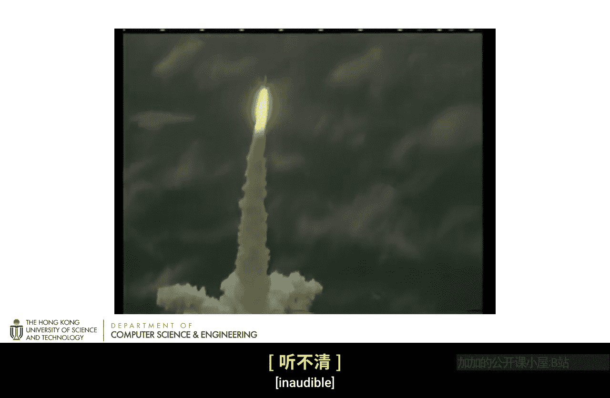
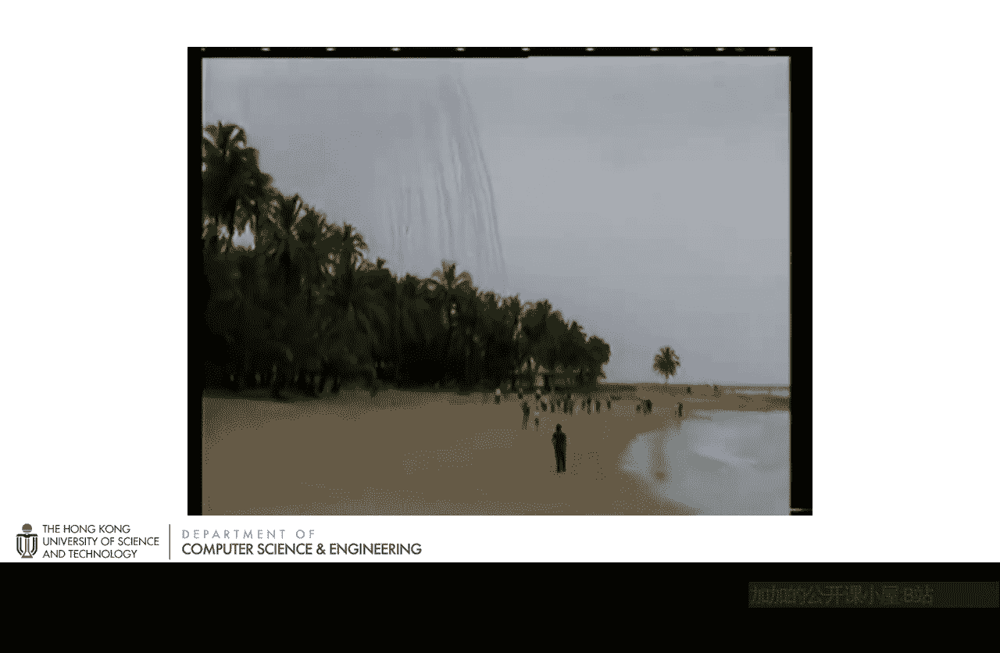
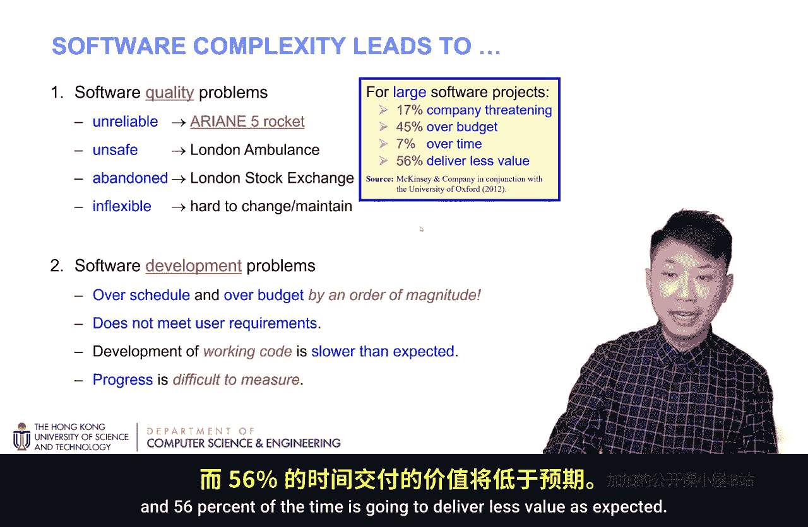

# 001：软件开发是复杂的 🚀

在本节课中，我们将学习软件工程的基本概念，理解为什么开发大型软件系统是一个复杂的过程，并初步了解应对这种复杂性的技术。

## 概述

软件开发之所以复杂，是因为大型软件系统通常包含数百万行代码，例如波音787飞机拥有1400万行代码，而Windows 10则拥有1.5亿行代码。面对如此庞大的系统，我们无法采用自底向上的方式逐行、逐功能地实现，而必须在开始编码之前进行大量的规划。

## 软件复杂性的来源

上一节我们提到了代码量的庞大，本节中我们来看看软件复杂性的具体来源。

### 应用领域的复杂性

软件复杂性可能源于应用领域本身。待解决的问题可能非常复杂，而开发者通常并非该领域的专家。例如，如果你被要求为医院开发一个跟踪病人信息的系统，你虽然是编程专家，但并非医疗领域的专家。因此，在开发系统之前，你可能需要先学习相关的应用领域知识。

### 利益相关者沟通的复杂性

复杂性也可能来自利益相关者之间的沟通。不同的利益相关者可能使用不同的词汇进行交流。例如，你的客户可能要求你构建一个“存储数字”的系统。这时，你就需要与客户澄清，他们是想存储整数、实数还是电话号码。此外，利益相关者可能拥有不同的背景知识，而人类语言本身也存在固有的模糊性，这些都增加了沟通的复杂性。

### 项目管理与开发的复杂性

大型软件开发项目的管理本身就很复杂。因此，我们必须将项目分解成多个部分，然后再重新组装。这需要协调许多不同的部分和人员。同时，编码本身以及创建有用的软件也是一个复杂的过程。

## 复杂性导致的问题

理解了复杂性的来源后，我们来看看它可能引发哪些具体问题。

### 软件质量问题

软件复杂性可能导致软件质量问题。例如，你可能使软件系统变得不可靠。接下来，我们将通过一个关于Ariane 5火箭的视频来了解一个小错误如何导致整个火箭爆炸。我们将在后续讨论测试时详细分析这个错误。

> （视频内容描述：Ariane 5火箭发射37秒后，机载计算机判定其偏离航线90度，并自动调整了轨迹，而此时火箭正以音速飞行，最终导致爆炸。）

你也可能使系统变得不安全。例如，伦敦救护车系统在1992年两次瘫痪，并因未能提供救护服务而导致人员死亡。

复杂性还可能导致项目被废弃。例如，伦敦证券交易所花费五年时间开发的系统，最终因不可靠而不得不被放弃。

此外，你可能使系统变得不灵活，难以更改和维护。

### 软件开发问题

软件复杂性也可能导致软件开发本身的问题。例如，你的项目可能**超时**、**超预算**，或者无法满足用户需求。实际开发出可用代码的速度可能低于预期，这意味着项目进度落后。对于大型软件系统，有数据显示：

以下是大型软件项目常见问题的统计数据：
*   17% 的项目会面临公司声誉威胁（例如，在互联网上出现负面评价）。
*   45% 的项目会超出预算。
*   7% 的项目会超出预定时间。
*   56% 的项目交付的价值低于预期。

## 总结

本节课中，我们一起学习了软件工程的重要性。我们认识到开发大型软件系统是一个极其复杂的过程，这种复杂性来源于应用领域知识、利益相关者沟通、项目管理与编码本身。这种复杂性可能导致严重的软件质量问题（如不可靠、不安全、被废弃）和开发问题（如超时、超预算、交付价值低）。理解这些复杂性及其后果，是学习如何应用软件工程方法和技术来有效管理开发过程的第一步。