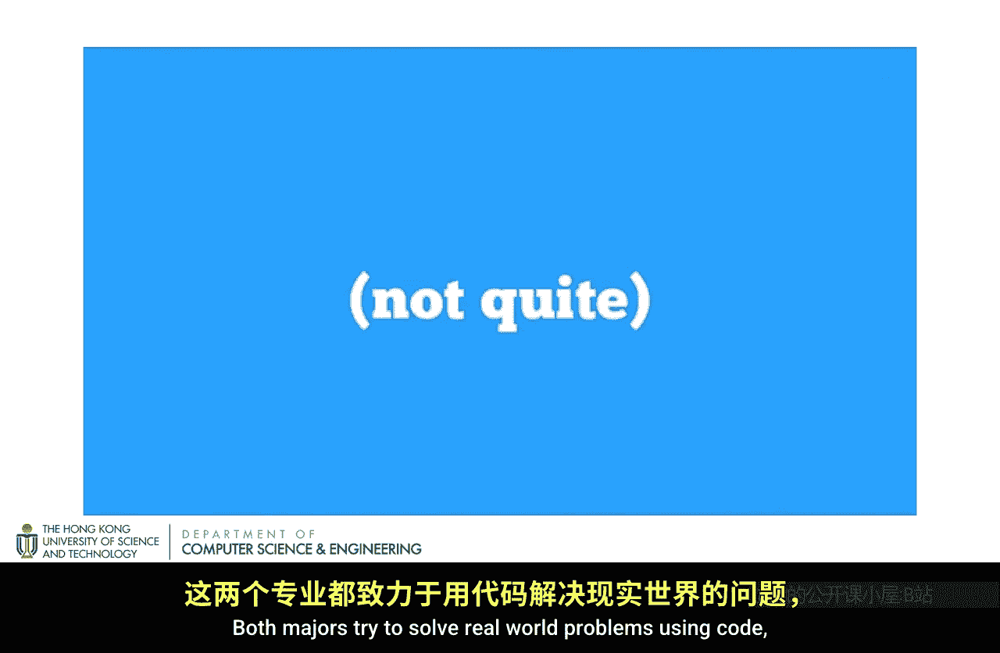
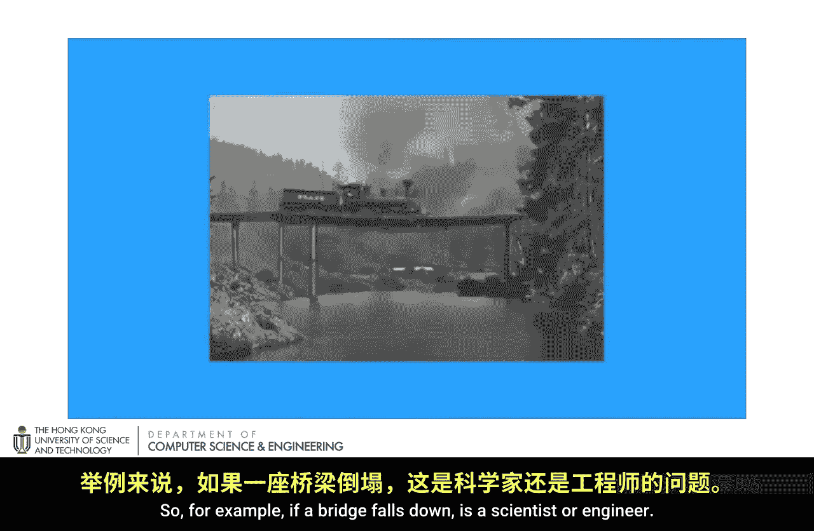
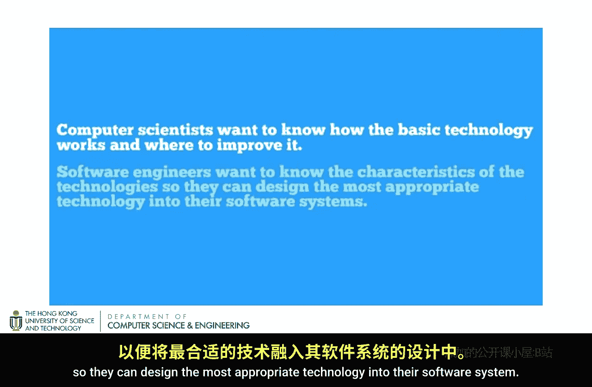
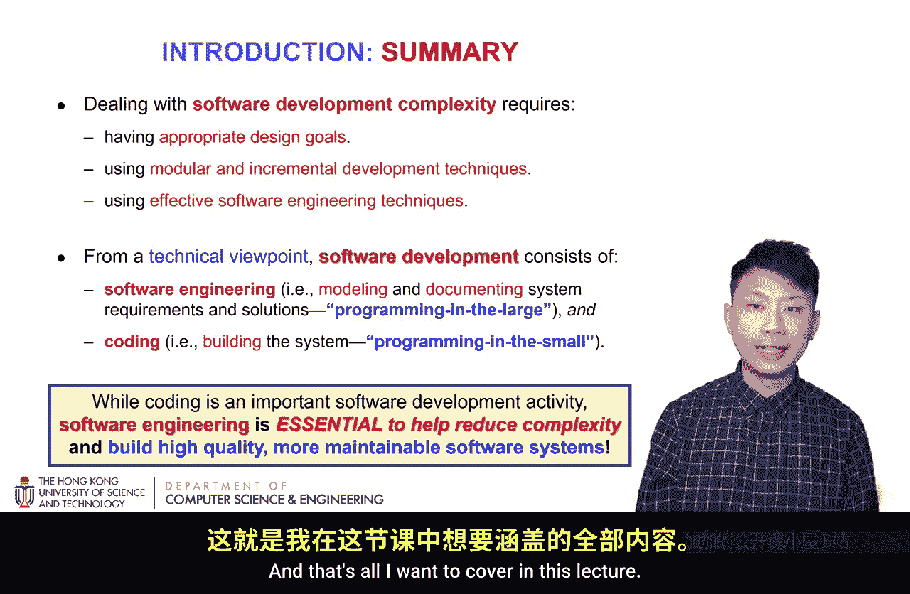

# 003：什么是软件工程 🧑‍💻

在本节课中，我们将探讨软件工程的核心定义，理解它与单纯编程的区别，并了解构建大型软件系统所涉及的复杂性和系统性活动。

---

## 概述

软件工程远不止是编写代码。它是一门涉及**系统性、有纪律的开发过程**的学科，旨在构建高质量、可维护的软件系统，以解决现实世界中的问题。我们将通过分析大型软件项目的规模、团队协作的重要性以及软件工程与计算机科学的区别，来深入理解其内涵。

---

## 软件工程的规模与复杂性

上一节我们介绍了软件工程的基本概念，本节中我们来看看大型软件系统的实际规模。

一架波音747飞机包含的代码行数比其物理零件（包括螺母和螺栓）还要多。具体来说，一架波音747拥有**400万行代码**。而如今大多数游戏的代码量约为**600万行**。这些都是极其庞大的软件系统，无法一次只考虑一行代码或一个类。

为了理解其工作量，我们可以做一个简单的计算：
*   假设一名软件工程师平均每分钟能写一行源代码。
*   每小时60分钟，每周工作40小时，则每周可写 `1 * 60 * 40 = 2400` 行代码。
*   每年按50个工作周计算，则每位工程师每年可产出 `2400 * 50 = 120,000` 行代码。

因此，如果一个项目估计有200万行代码，那么至少需要 `2,000,000 / 120,000 ≈ 17` 名软件工程师才能完成。这让我们感受到，这类项目需要大量规划，并且必须在团队中协作完成。

此外，请相信，在软件行业，平均每分钟写一行代码实际上已经是相当高的效率了。这主要是因为，软件工程师的工作远不止编码。

---

## 软件工程的影响与沟通

理解了软件项目的庞大规模后，我们来看看软件工程决策可能带来的实际影响。

以亚马逊网站的一次小型软件升级为例。这次升级并不顺利，导致了**90分钟的网站宕机**。据估计，这给亚马逊造成了**280万美元的收入损失**。这些损失是永久性的，因为客户在当时的需求未能被满足。

这个案例说明，系统可能并非安全关键，但却是**财务关键**的。该团队需要更好地理解开发关键系统的流程，以及如何在不导致系统瘫痪的情况下进行升级。亚马逊本可以从一个定义更清晰的软件开发流程中受益。

作为一名软件工程师，你需要回答很多问题。核心问题之一是“需要写多少代码？”，但还有很多其他问题：
*   如何帮助客户？
*   解决客户问题需要什么？
*   用户将如何与系统交互？
*   将使用什么操作系统、语言和硬件？
*   整体软件系统结构是怎样的？不同组件如何交互？
*   如何组织团队以提高效率？
*   我们能否按时完成项目（例如赶上假日购物季）？

贯穿这些问题的共同趋势是，你需要与**很多人沟通**才能实现目标。你需要与提出系统需求的客户、系统的最终用户、领域专家（如银行家、安全专家、医学科学家）、其他工程学科的工程师，以及项目中的其他工程师密切互动。

另一个重要的潜在主题是**沟通**。软件工程是一项高度社交化的活动。你不是坐在角落里独自写代码，而是始终在与他人合作。这是一个非常以人为本的领域。

但这并不意味着软件工程师不亲自动手使用最新技术和方法编写程序。我们同样以此为生。同样重要的是，软件工程不仅仅是项目管理和沟通，但也**不仅仅是编码**。

---

## 软件工程 vs. 计算机科学

现在，你可能会发现软件工程并不完全等同于计算机科学。虽然两者都试图用代码解决现实世界的问题，但它们的处理方式截然不同。

我们可以用一个比喻来理解：如果一座桥梁倒塌，是科学家的错还是工程师的错？答案更偏向于工程师。

以下是两者的核心区别：
*   **科学家**建造事物以学习新知识；**工程师**学习知识以设计和建造高质量的产品。
*   **科学家**希望取得科学突破；**工程师**希望避免工程失败。
*   **计算机科学家**希望理解算法和计算理论的基础；**软件工程师**希望学习和设计构建高质量软件系统的最佳实践原则。
*   **计算机科学家**想知道基本技术如何工作以及如何改进它；**软件工程师**想知道技术的特性，以便将最合适的技术设计到他们的软件系统中。

---

## 软件工程的定义与核心活动

那么，究竟什么是软件工程？查阅维基百科或在线资料，你会得到不同的定义。综合来看，软件工程包含以下关键特征：

1.  **有纪律的开发伦理**：这意味着我们试图以有纪律的方式进行开发，而不是像编程作业那样随意打开源代码文件就开始输入。
2.  **追求质量**：我们努力在最终产品中实现一定的质量。
3.  **解决现实用户问题**：旨在某个应用领域解决真实的用户问题。
4.  **团队协作**：因为必须在团队中工作。
5.  **多版本演进**：软件项目不是一次性的。因此我们需要软件配置管理来跟踪我们开发的不同软件版本。

基于这些特征，软件工程涉及以下几项核心活动：

*   **建模活动**：我们必须捕获所有用户需求，然后构建模型。需要构建两种模型：
    *   **需求模型**：用于捕获来自用户或客户的所有需求。
    *   **解决方案模型**：用于实际实现的模型。
    然后，我们需要将需求模型与解决方案模型进行匹配。
*   **问题解决活动**：我们试图在存在变化的情况下寻找最合适的解决方案。因此它不是简单的算法过程，而是系统性的。
*   **知识获取活动**：请注意，知识获取不是线性过程。你在开发项目时学习，有时可能因为学到了错误的东西而需要“忘记”，在最坏的情况下，甚至可能需要因为完全错误而重新开始。
*   ** rationale（决策依据）管理活动**：我们的假设和解决方案可能因缺陷或技术变化而时常改变，我们可能需要不时重新审视之前的决策。因此，记录项目中的所有内容非常重要，以便记住我们为何做出某些决定或选择。项目文档帮助我们记住所有在项目中做出的决策和选择。

---

## 应对复杂性的工程方法

为了应对软件开发的复杂性，我们需要采取以下工程方法：

首先，我们必须选择最合适的设计目标，通常在项目开始时确定两到三个核心目标。

其次，我们需要利用**模块化**和**增量开发**技术。这意味着我们将大型软件系统分解成许多较小的部分，并尝试一次处理一小部分。

最后，我们必须使用有效的软件工程技术。

从技术角度来看，在一个软件工程项目中，我们必须做两件事：
1.  **软件工程（宏观编程）**：这意味着我们必须构建模型、记录系统，并跟踪项目中产生的所有需求和解决方案。
2.  **编码（微观编程）**：当然，我们也必须编写代码、构建系统。

请注意，虽然编码是重要的软件开发活动，但软件工程同样至关重要，因为它有助于降低项目的复杂性，并最终帮助实现更高质量和更可维护的软件系统。

---

## 总结

本节课中，我们一起学习了软件工程的核心内涵。我们了解到，软件工程是一门**系统性的、有纪律的学科**，专注于通过团队协作、有效沟通和严谨流程来构建高质量、可维护的大型软件系统。它不仅仅是编写代码（微观编程），更包括需求分析、系统建模、决策管理和文档化等宏观编程活动。理解软件工程与计算机科学的区别，以及掌握应对复杂性的模块化与增量开发方法，是成为一名合格软件工程师的重要基础。