# 005：UML类图

在本节课中，我们将学习如何使用UML类图来为软件系统建模。我们将重点介绍类、关联、关联类以及泛化等核心概念，并以一个银行系统为例进行说明。

---

## 软件工程：P5.1：类的概念与表示

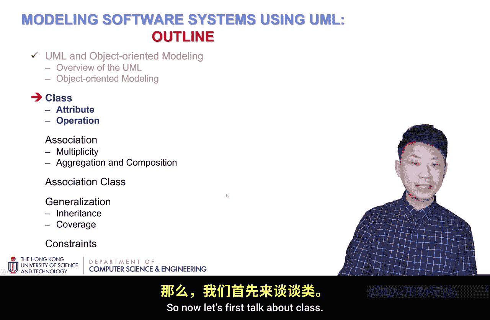

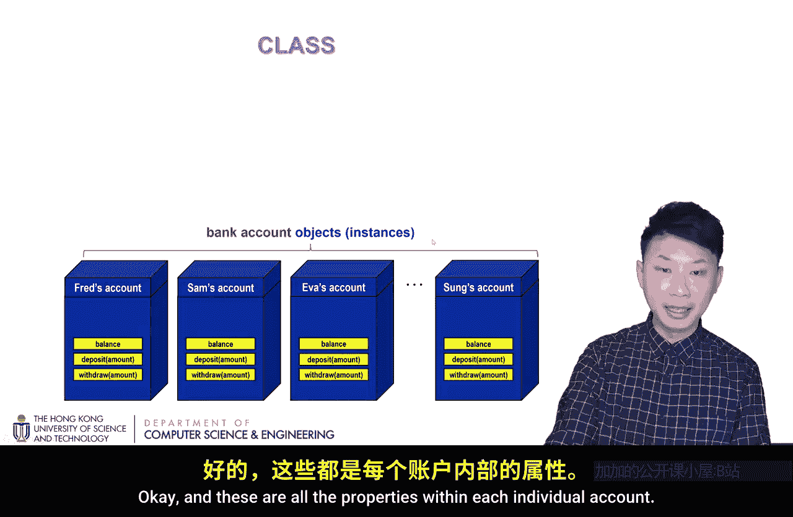

上一节我们介绍了UML类图的基本作用。本节中，我们来看看UML类图中最核心的元素——类。

假设我们要为一个银行构建软件系统。我们知道，银行内部有多个不同的银行账户。例如，有F的账户、Sam的账户、EVS的账户等。每个账户都有一些共同的属性，比如账号、余额。同时，每个账户也支持一些共同的操作，例如查询余额、存款、取款或支付利息。

为了避免在应用领域中反复指代这些具体的账户，我们将进行**分类**。我们将所有这些账户实例归为一组，形成一个名为“Account”的类。在模型中，我们只需说系统中有“Account”类即可。

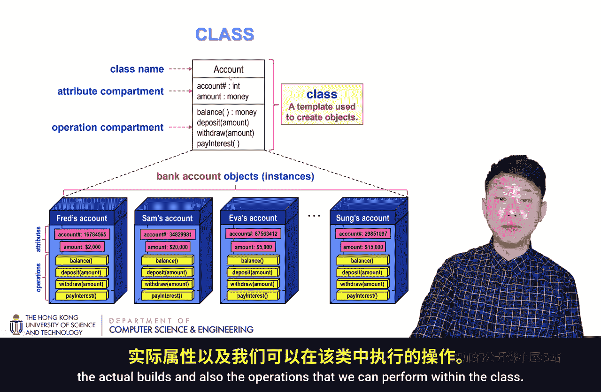

所以，**类**描述了一组具有共同语义、属性、操作和关系的对象的集合。例如，所有账户都有相同的属性和操作，因此它们被归类为同一个“Account”类。

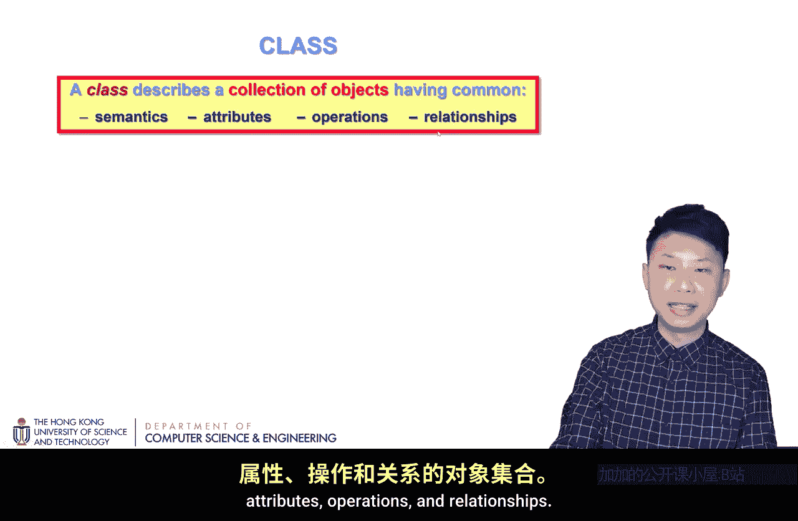

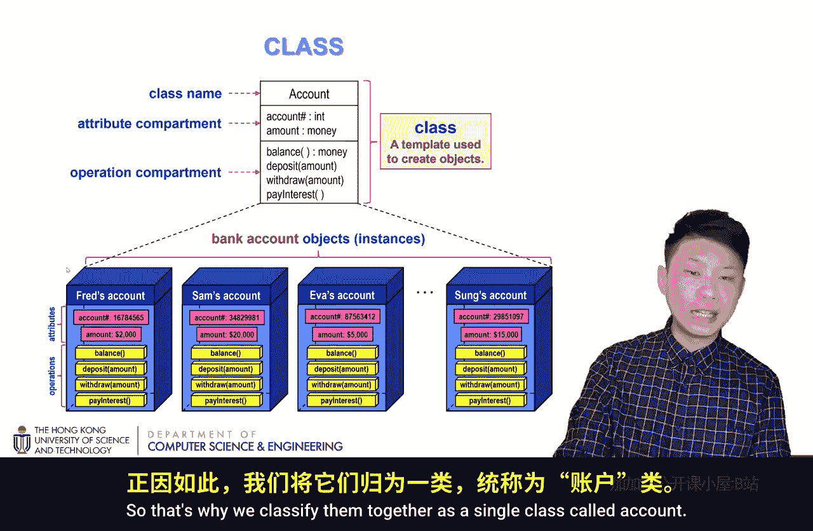

类是一个**分类器**，而具体的对象是它的**实例**。类就像一个创建对象的工厂，我们可以用它来创建银行应用领域中的不同账户。

一个好的类应该只捕获应用领域中的一个重要抽象，不应将多个不同的事物混杂在一个过于通用的类中。类的命名应使用应用领域的恰当词汇，使其含义明确、可追溯，并且易于阅读。

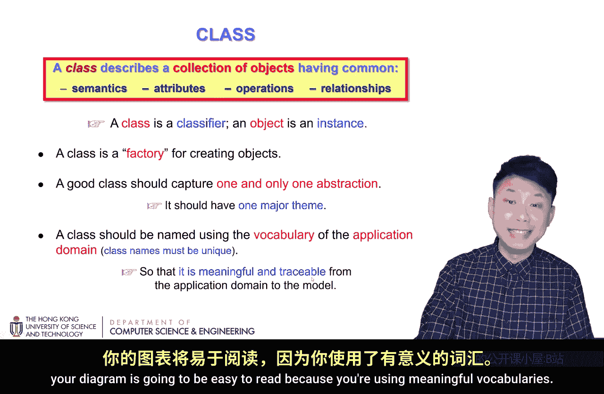

---

## 软件工程：P5.2：类的属性与操作

在了解了类的基本概念后，现在我们来详细看看如何定义类的内部结构，即属性和操作。

在类中，我们必须定义该类的所有**属性**。定义属性时需要提供名称和类型，这是UML建模的强制要求。此外，还可以指定可见性、初始值、多重性和可变性等，但这些在UML模型中是可选的。

例如，在“Account”类中，属性“accountNumber”的类型是整数（Integer），属性“balance”的类型是金额（Money）。

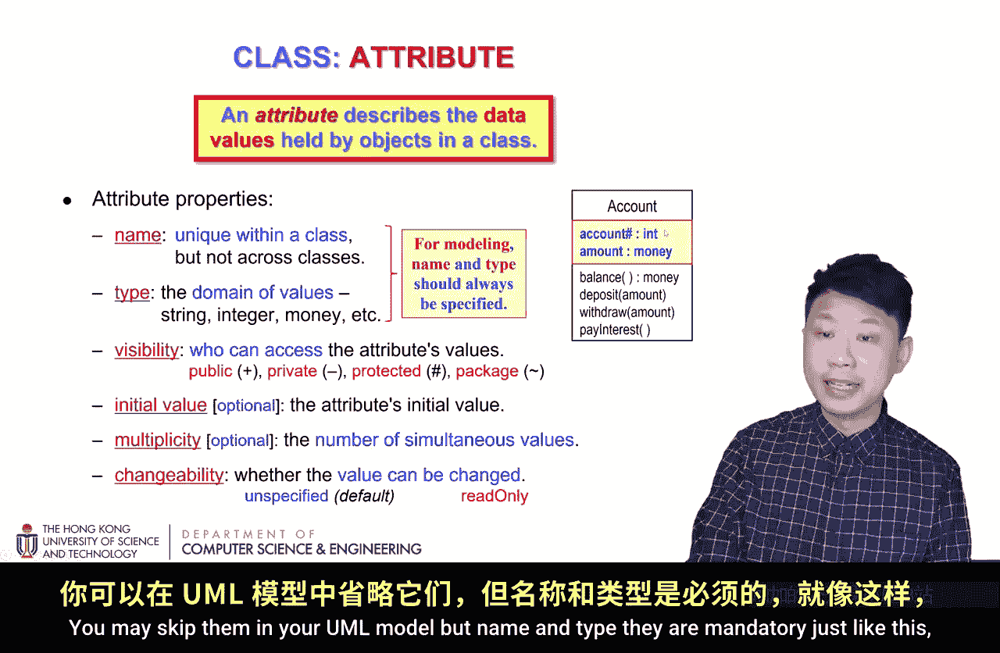

类中另一个需要指定的部分是**操作**。操作描述了可以应用于该类对象的函数或转换。例如，“存款”就是一个操作。

对于每个操作，我们需要指定其**签名**，包括：
*   名称（如 `deposit`）
*   参数（如 `amount: Money`）
*   返回类型

同时，还需要指定操作的**可见性**：
*   **public (+)**：对所有其他对象可用。
*   **private (-)**：仅对该对象本身可用。
*   **protected (#)**：对该对象本身及其所有子类可用（涉及继承时）。
*   **package (~)**：在同一个包内可用。

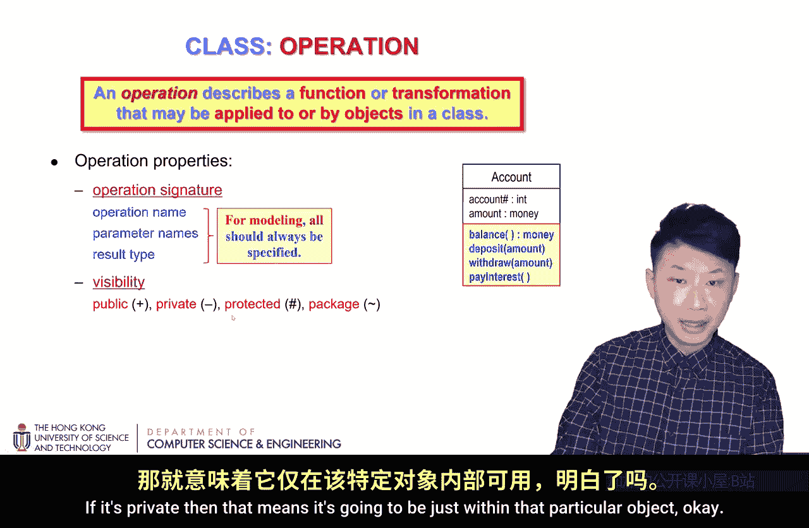
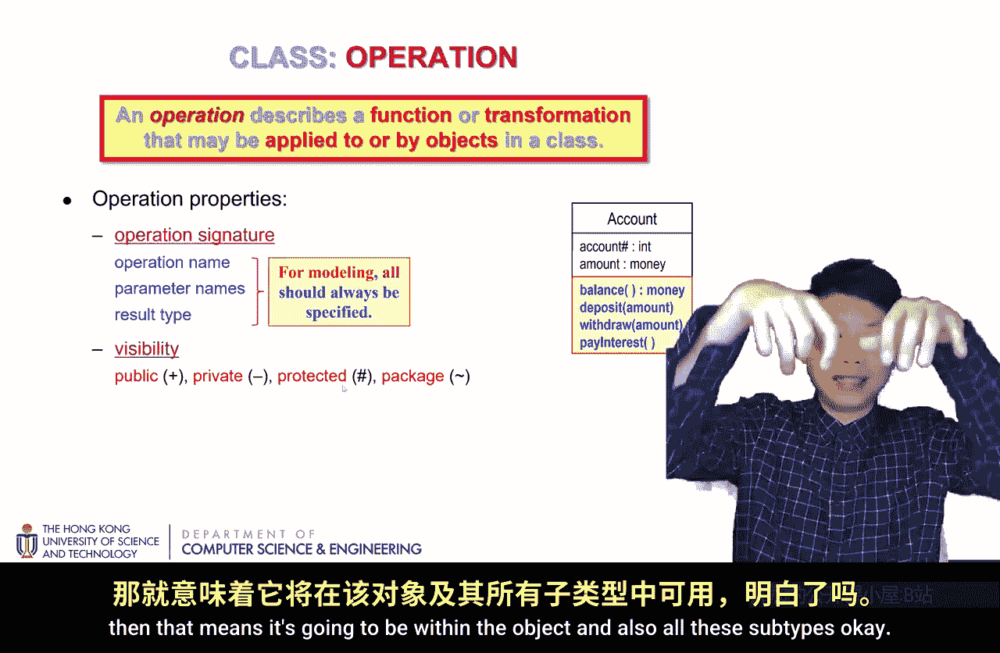
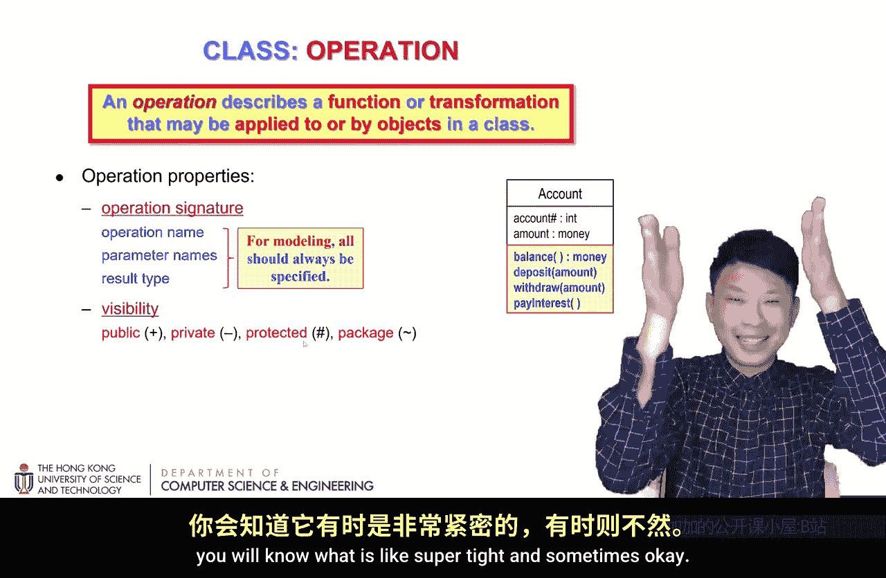

一个操作的具体实现被称为**方法**。同一个操作可能有多种不同的实现方式，因此一个操作可以对应多个方法。

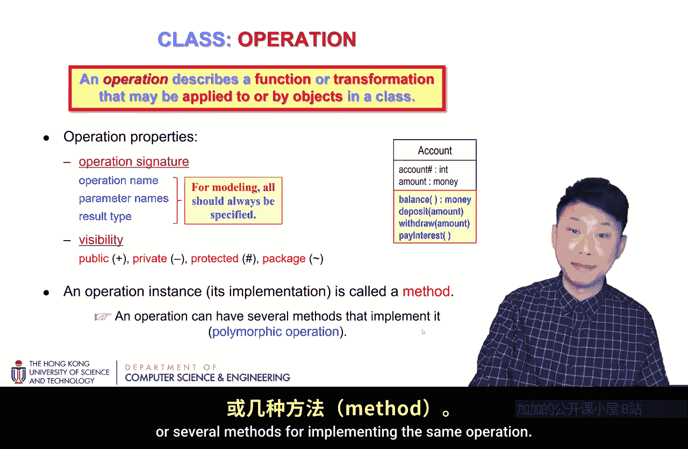

---

## 软件工程：P5.3：使用类建模的意义

我们已经学习了如何定义类及其属性和操作。那么，为什么我们要使用类来为系统建模呢？

首先，使用类和对象来表示系统非常自然，尤其对于面向对象系统。通过将系统表示为一组对象，并将其抽象为一组类，有助于我们理解系统中哪些是重要的事物，并以此为基础来规定系统。

其次，选择合适的类是一个重要的设计决策，它能促进开发过程中的**模块化**。模块化意味着我们将一个大型软件系统分解成小块，然后可以逐个处理这些小模块。

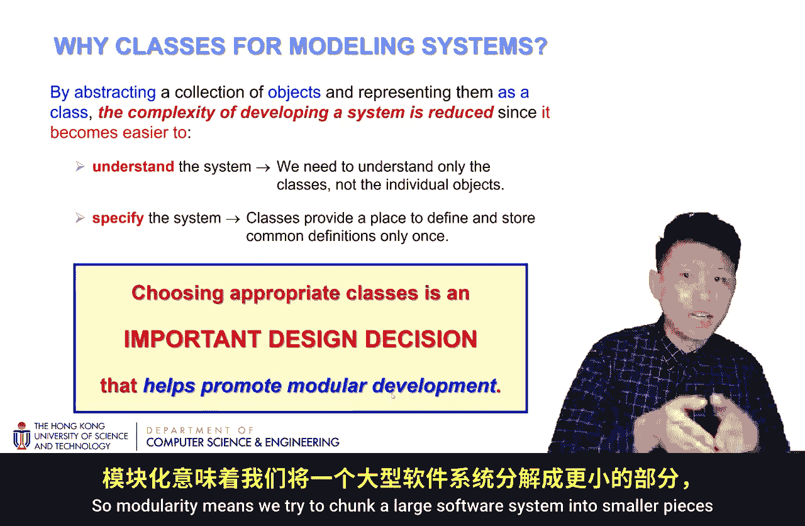

如果某个模块过于通用或庞大，我们在构建系统时就会失去模块化的优势。因此，设计良好、职责单一的类是构建模块化、可维护软件系统的关键。

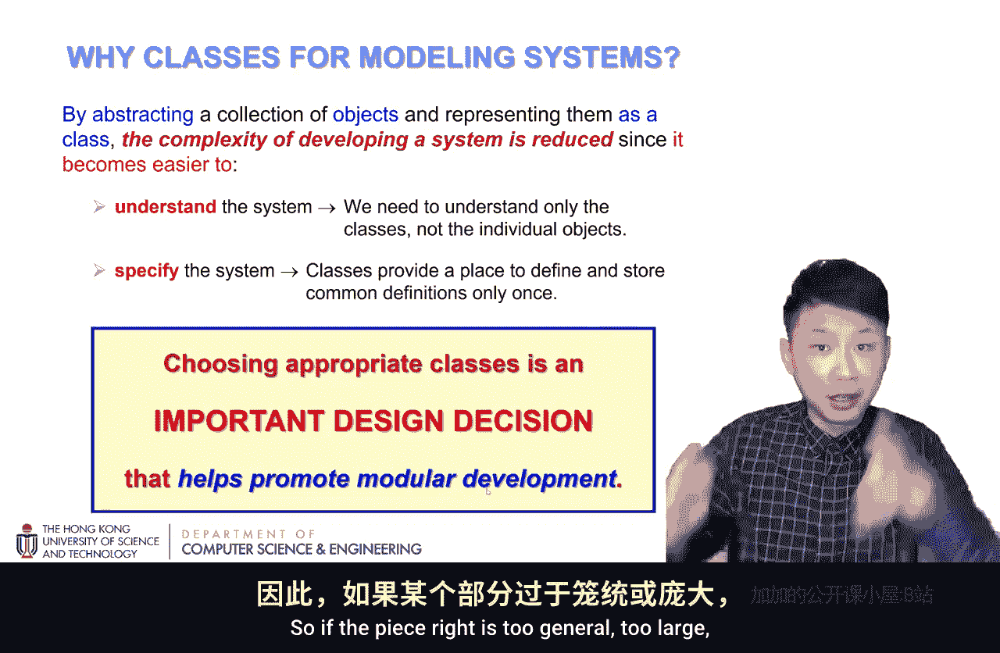

---

## 总结

本节课中，我们一起学习了UML类图的核心——类。我们了解了类是对具有共同特征对象的抽象，是创建实例的工厂。我们详细探讨了如何定义类的属性（名称、类型等）和操作（签名、可见性等），并区分了操作与方法的概念。最后，我们理解了使用类进行建模如何帮助理解系统、促进模块化设计，并强调了设计良好、职责单一的类的重要性。