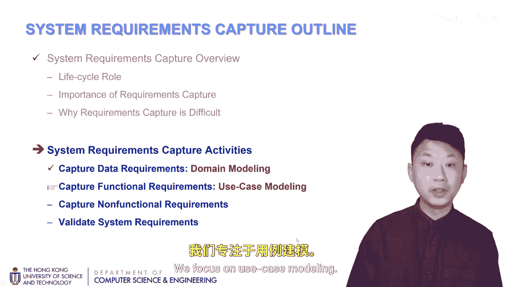
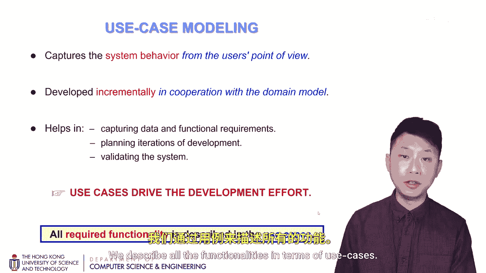
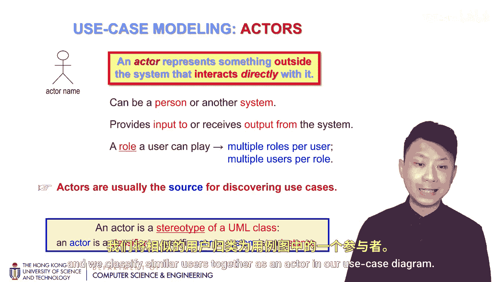
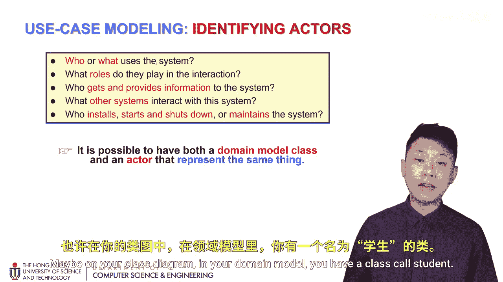
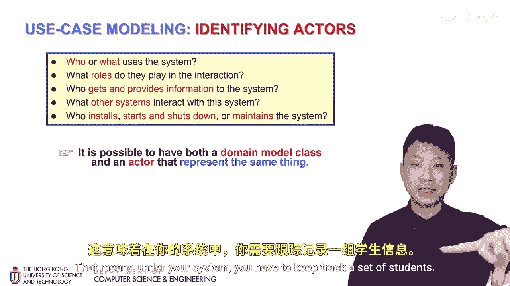
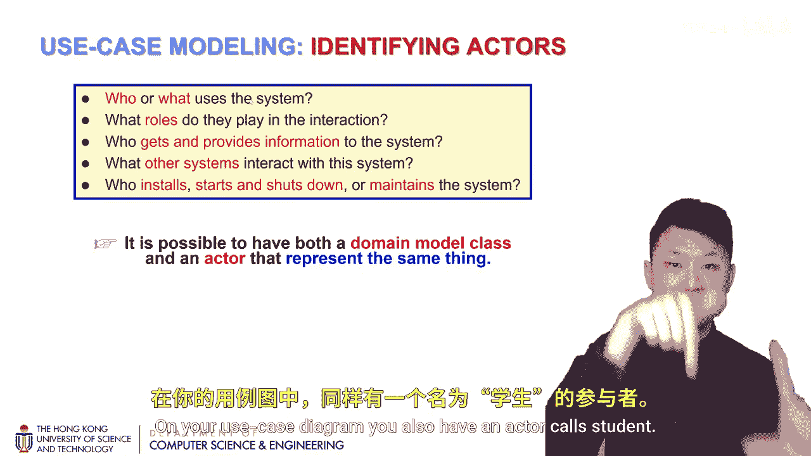
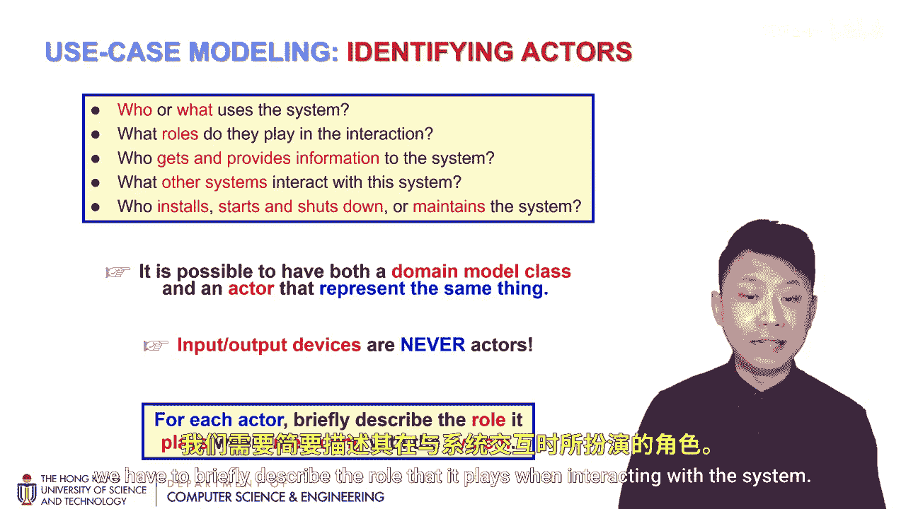
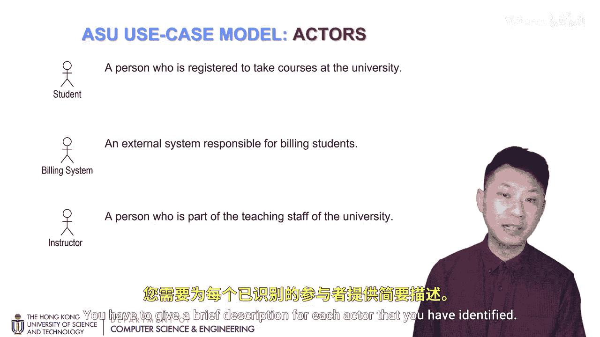
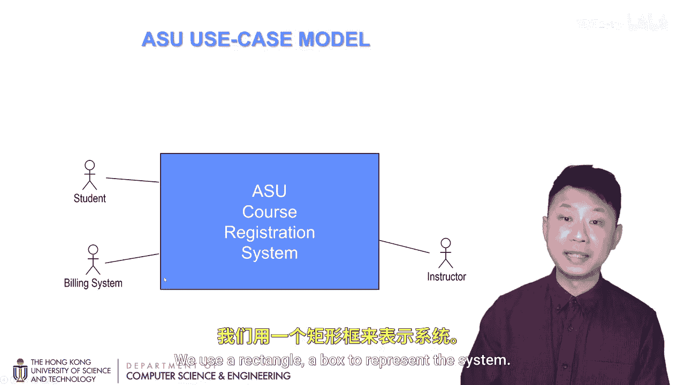

# 013：用例建模 - 参与者 👤

在本节课中，我们将学习如何构建用例模型，以捕获软件系统的所有功能需求。我们将重点介绍用例建模中的第一个核心概念——参与者。



用例建模旨在从用户的角度捕获系统行为，并与领域模型协同进行增量式开发。这有助于捕获数据和功能需求，规划开发迭代，并最终验证系统。请注意，用例驱动着开发工作，我们基于用例模型中捕获的所有功能来开发软件系统。

## 什么是参与者？🎭

上一节我们介绍了用例模型的目的，本节中我们来看看构成用例图的首要元素——参与者。



一个**参与者**代表了与系统直接交互的外部事物。在用例图中，我们使用以下符号来表示一个参与者：

```
[小人图标] 或 <<actor>> 类名
```

参与者可以是一个人，也可以是另一个系统。它为系统提供输入或从系统接收输出，并指定了用户在系统中扮演的角色。需要注意的是，一个用户可能扮演多个角色（多个参与者），而多个用户也可能扮演同一个角色。

参与者通常是发现系统用例（功能）的来源。在UML中，参与者是一种特定类型的类（stereotype of a UML class）。一个软件系统中可能有许多用户，我们将相似的用户归类为用例图中的一个参与者。

## 如何识别参与者？🔍

识别参与者是构建用例模型的第一步。以下是识别参与者时可以问自己的一些问题：



*   **谁或什么将使用这个系统？**
*   他们在交互中扮演什么**角色**？
*   **谁**从系统获取信息，或**谁**向系统提供信息？
*   有哪些**其他系统**会与本系统交互？
*   **谁**负责安装、启动、关闭或维护系统？

请注意，同一个实体（例如“学生”）可能同时作为领域模型中的一个**类**和用例模型中的一个**参与者**。在领域模型中，“学生”类表示系统内部需要管理的数据；而在用例模型中，“学生”参与者则表示使用系统功能的外部用户。

**重要提示**：输入/输出设备（如键盘、鼠标、打印机）**永远不是**参与者。它们是系统实现交互的媒介，而非扮演角色的用户或外部系统。





## 为参与者编写描述 📝



对于识别出的每个参与者，我们需要简要描述其在与系统交互时所扮演的角色。这有助于明确参与者的边界和职责。

## 实践示例：大学课程注册系统 🏫

让我们通过一个例子来实践。假设我们要为“ASU大学”构建一个课程注册系统。我们得到了以下问题描述：



> “ASU大学需要一个系统，允许学生在线注册课程。教师可以提交他们计划教授的课程。系统需要与大学的计费系统交互，以在学生注册课程后更新其账单信息。”

根据这个描述，我们可以识别出以下参与者：

1.  **学生**：在大学注册课程的人。
2.  **教师**：大学教学人员的一部分，负责提交课程信息。
3.  **计费系统**：负责为学生计费的外部系统。

以下是这些参与者的简要描述：
*   **学生**：在ASU大学注册或退选课程的个人用户。
*   **教师**：负责提交和更新其教学课程信息的大学教职员工。
*   **计费系统**：一个外部软件系统，当学生注册课程后，本系统需与之通信以更新学生的财务账单。

在用例图中，我们用一个大方框（系统边界）来代表“ASU课程注册系统”，并将识别出的参与者画在方框外部。系统内部的功能（用例）我们将在后续课程中学习。




---



本节课中，我们一起学习了用例建模的基础——**参与者**。我们了解了参与者是代表与系统交互的外部用户或系统的角色，学习了通过提问来识别参与者的方法，并掌握了为参与者编写简要描述的技巧。我们还通过一个大学课程注册系统的例子进行了实践。记住，参与者是发现系统功能的起点，清晰地定义参与者是构建准确用例模型的关键第一步。在下一节中，我们将深入探讨如何定义系统内部的**用例**。