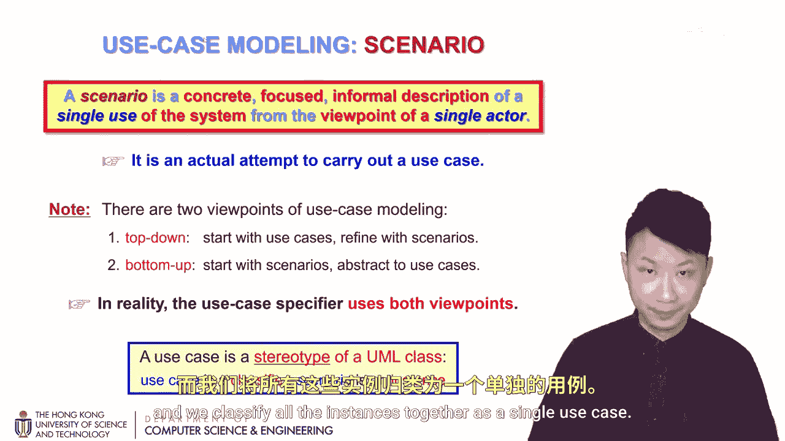
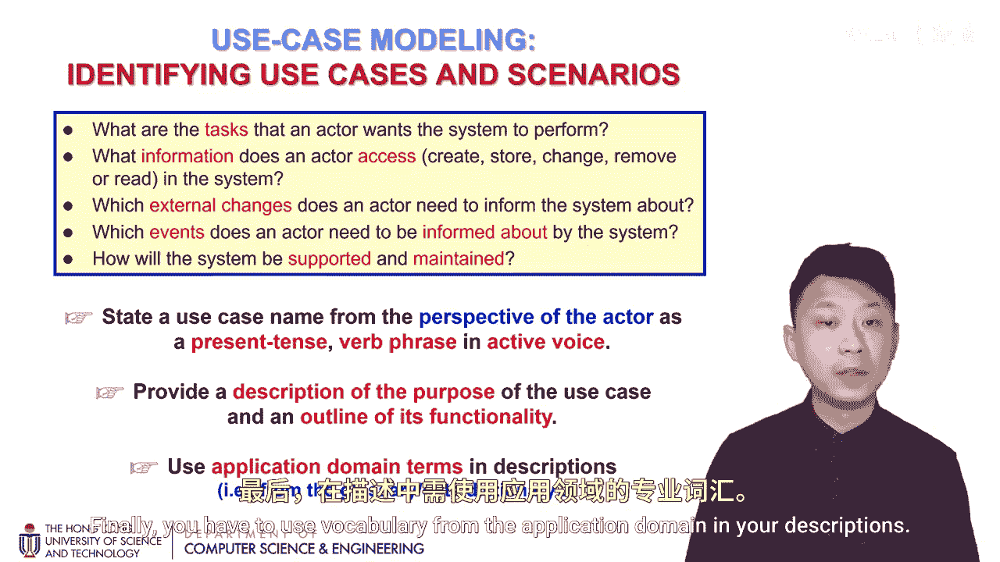

# 014：用例图与用例详解

在本节课中，我们将学习统一建模语言中用例图的核心组成部分——用例。我们将了解用例的定义、表示方法、与场景的关系，以及如何识别和描述用例。

## 用例的定义与表示

上一节我们介绍了用例图中的参与者，本节中我们来看看用例本身。

用例是系统功能的特定使用方式，它代表了系统提供的一个具体功能。在UML中，我们使用椭圆形来表示一个用例。

用例描述了参与者与系统之间发生的交互，以及从参与者视角来看系统必须完成的任务。我们将其描述为一个完整的事件和动作序列。用例总是由参与者发起。在绘制用例图时，我们通常只考虑正常的事件序列，而忽略替代或异常情况。这些异常和替代事件可以包含在用例规约中，但不出现在用例图中。

## 用例与场景

在用例建模中，场景是从单个参与者的视角，对系统单次使用的具体、聚焦且非正式的描述。它是一次执行用例的实际尝试。例如，一个名为“Kenne”的参与者使用系统来完成某项任务。

请注意，用例建模有两种视角：
*   **自上而下**：从更通用的用例开始，然后为每个单独的用户细化为更精确的场景。
*   **自下而上**：从个体用户如何与系统交互的具体案例开始，然后将它们抽象为更通用的用例。

在实际操作中，我们通常会结合使用这两种视角来找出所有用例。从UML类的角度看，用例是一个**构造型**，而场景是它的一个**实例**。来自单个用户的更详细故事就是一个实例，我们将所有实例归类为一个单一的用例。

## 如何识别用例与场景

为了识别软件系统的用例和场景，你需要思考以下问题：

以下是识别用例和场景时需要考虑的关键问题：
*   参与者希望利用系统执行哪些任务？
*   参与者需要访问系统中的哪些信息？
*   参与者需要将哪些外部变化通知给系统？
*   系统需要将哪些事件通知给参与者？
*   系统将如何得到支持和维护？

## 如何描述用例

对于每个识别出的用例，你需要进行清晰的描述。

以下是描述用例时必须包含的要素：
*   **用例名称**：从参与者的视角出发，使用主动语态的现在时动词短语，以便于阅读。
*   **目的描述**：说明用例的目的和功能概要。
*   **领域词汇**：在描述中使用问题领域的专业词汇。

---

本节课中我们一起学习了用例图的核心元素——用例。我们明确了用例是系统提供的功能，用椭圆形表示，并由参与者发起。我们区分了用例（通用功能类）与场景（具体执行实例）的关系，并介绍了识别用例的方法以及描述用例的基本要素。掌握这些是进行有效需求分析和系统设计的基础。