**软件工程：P15：用例建模示例 🎯**

在本节课中，我们将通过一个具体的示例，学习如何从需求描述中识别功能，并将这些功能整合成完整、可读的用例图。我们将遵循从原始语句分析到最终模型构建的完整流程。

---

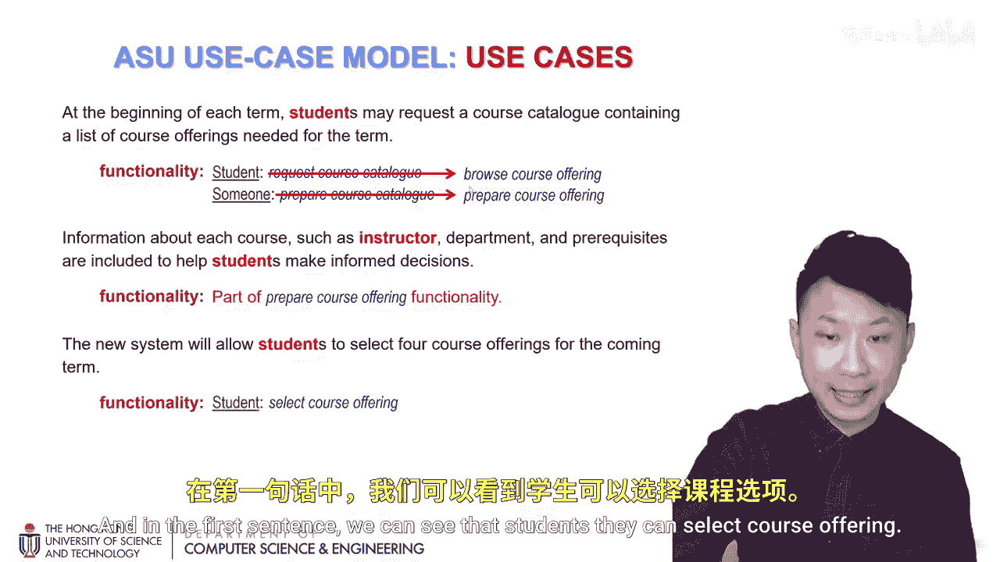

现在，让我们回到ASU的用例模型。我们将通过逐句研究需求描述，尝试从中识别出所有功能。

从第一句话中，我们得到的第一个功能是：学生将请求课程目录。请注意，课程目录只是课程注册系统上可用课程列表。因此，我们将此功能细化为：学生将在系统上**浏览课程**。

同时，有人需要为学生准备课程目录。因此，我们得到另一个功能：有人将在课程注册系统上**准备课程**。

从第二句话中，我们得到的功能是：有人将在系统上准备课程。这与我们从第一句话中获得的功能相同。

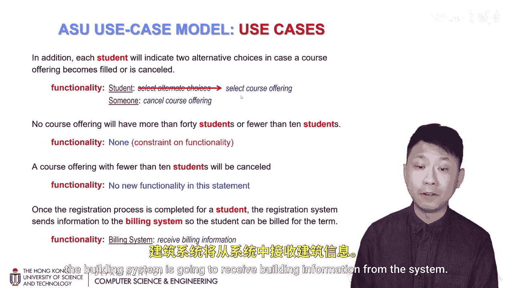

在第一句话中，我们可以看到学生可以**选择课程**。

从第四句话中，我们可以看到学生可以在系统上**指明两个备选选择**。因此，我们可以说学生**选择备选课程**。但请注意，这些备选选择仍然是课程。因此，我们将其细化为：学生将在系统上**选择两个备选课程**。

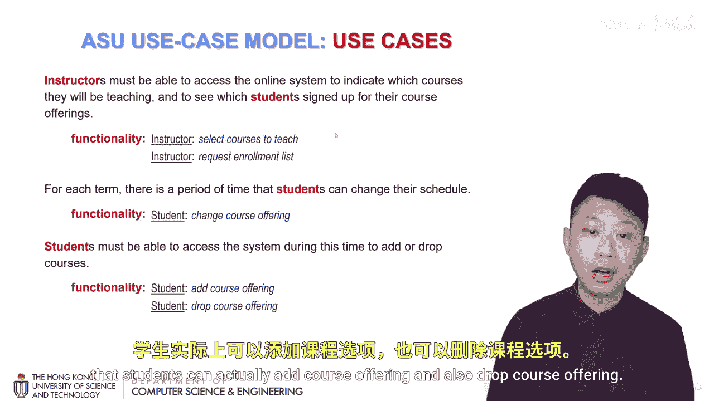

接着，有人将**取消课程**。在下一句话中，我们没有获得新功能。再下一句话中，我们看到有人将取消课程，这与之前捕获的功能相同，因此此语句没有新功能。

在这句话中，我们得到一个功能：楼宇系统将从系统**接收楼宇信息**。

从这句话中，我们可以得到的另一个功能是：教师将**选择要教授的课程**，并且教师将**请求注册名单**。

在下一句话中，我们将看到学生将**更改他们的日程**。最终，日程只是一组课程。因此，我们将其细化为：学生将**更改课程**。

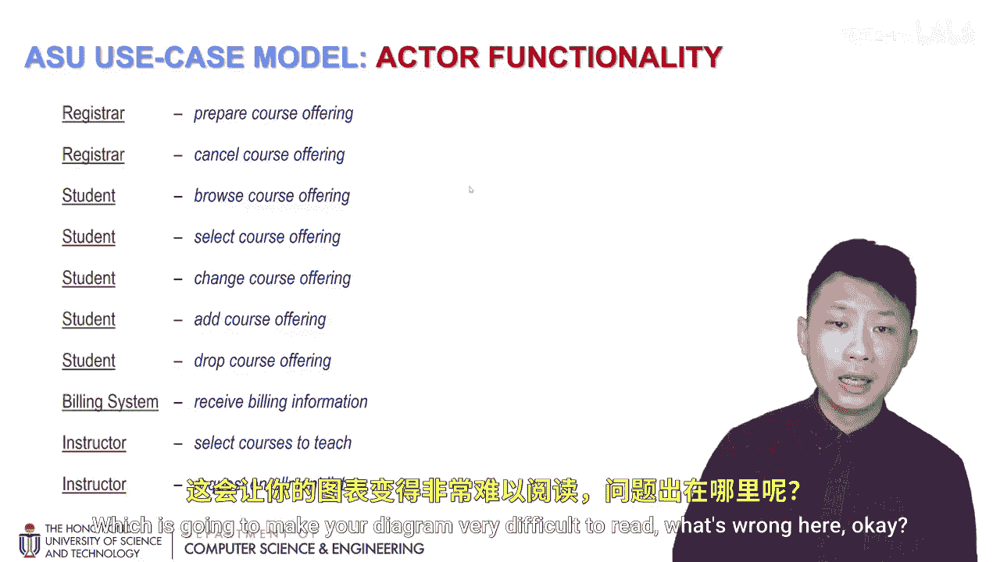

在这句话中，我们将得到学生可以**添加课程**以及**退选课程**的功能。

现在，从需求描述中我们可以看到，有人将在系统上准备课程，也有人将取消课程。因此，您可能需要与领域专家沟通，专家会告诉您，**管理员**或**注册员**将在系统上维护所有课程信息。这样，我们就为这个特定的应用领域发现了另一个参与者：**注册员**。以上是我们从需求描述中捕获的所有功能。

现在，我们完成了吗？我们是否只需简单地绘制一个包含所有这些功能的用例图？我会说“不”。因为如果用例图中包含太多功能，最终会导致图中出现很多椭圆，使图表难以阅读。问题出在哪里？

请注意，当我们尝试构建一个用例时，一个好的用例通常代表一个**完整的主要功能**，即一个从开始到结束的完整故事。因此，它必须是一个从头到尾的完整故事。请这样思考：浏览课程、选择课程、添加课程、退选课程、更改课程，这些是好的用例吗？不，它们不是好的用例，因为它们只是故事的一部分，不是一个完整的故事。我们必须使其更完整。

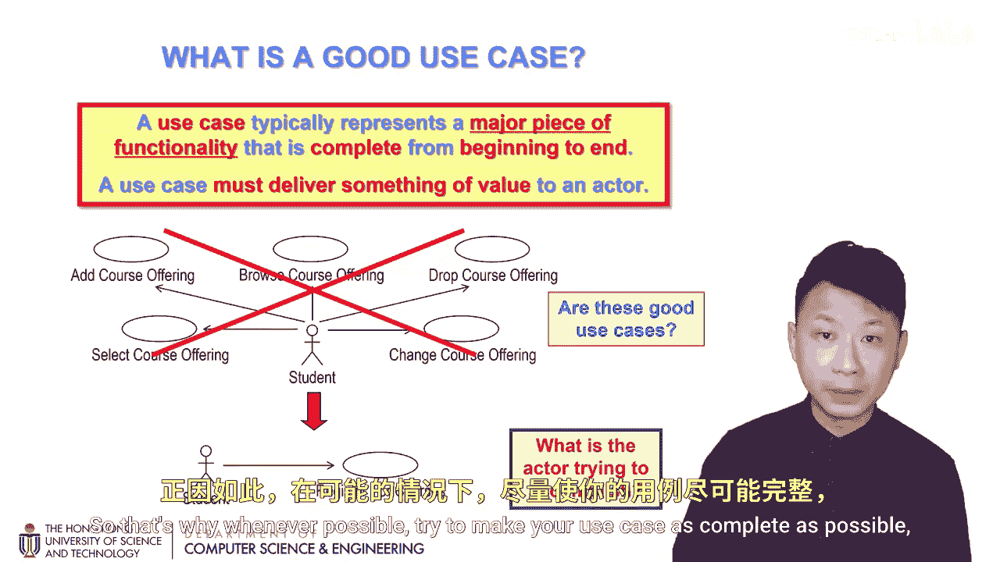

学生选择课程、添加课程、浏览课程、退选课程、更改课程，他们是在做什么？他们是在尝试**注册课程**。因此，我们必须将所有这些功能分组，使其更完整。我们将简化为一个单一的用例：学生将在系统上**注册课程**。通过使用一个完整的故事，而不是五个部分故事，您的用例图将更具可读性、更简洁、也更容易理解。

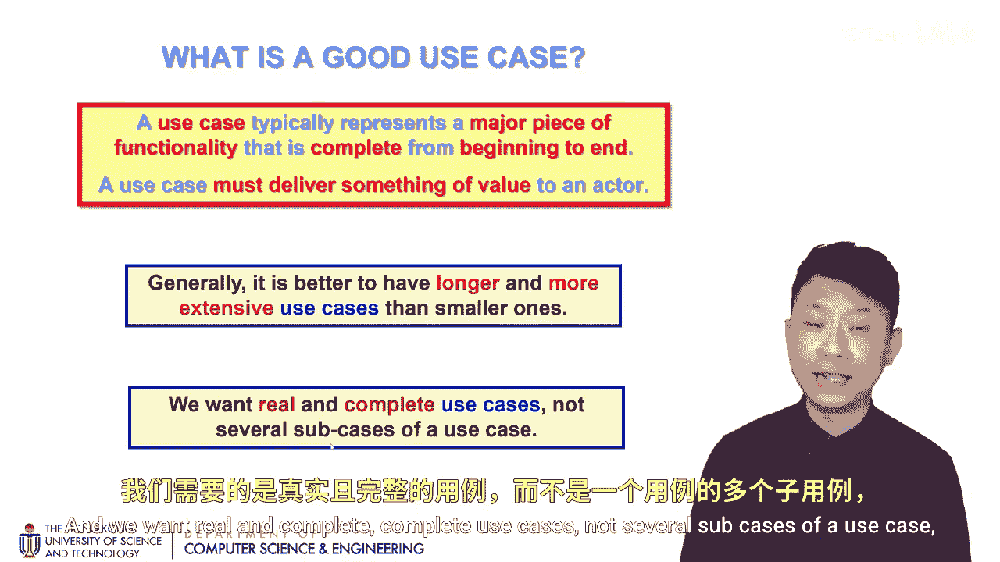

因此，只要可能，尽量使您的用例尽可能完整。这就是为什么我们必须遵循这个规则：**拥有更长、更广泛的用例，优于拥有更小或部分的用例**。我们需要真实且完整的用例，而不是一个用例的几个子用例，不是拼图故事，我们需要一个更完整的故事。

现在，让我们尝试将功能分组，使它们更完整。

以下是我们可以分组的功能：
*   **准备课程**和**取消课程**可以归为一组，因为注册员准备课程和取消课程，他们实际上是在系统上**维护课程信息**。
*   学生**注册课程**。请注意，选择课程和更改课程的功能已经被添加课程和退选课程的功能所覆盖。因此，我们甚至可以删除它们，因为它们已被涵盖。
*   教师将**选择要教授的课程**，并且教师将**请求注册名单**。这些都是系统提供的功能。

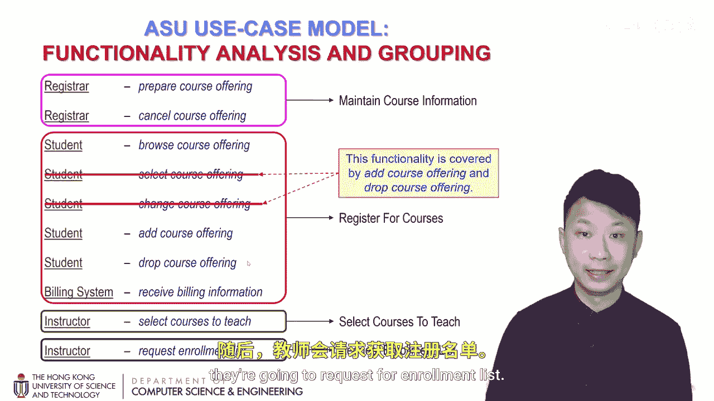

最终，这是我们为ASU应用领域绘制的用例图：注册员将**维护课程信息**；教师将**选择要教授的课程**和**请求注册名单**；学生将**注册课程**。

现在，我们这里有一条连线，而不是箭头。箭头意味着学生将**启动**这个用例，这个用例是由学生发起的。但我们有一条介于“注册课程”用例和“楼宇系统”之间的**连线**，因为在“注册课程”用例中，最终您将接收楼宇信息。

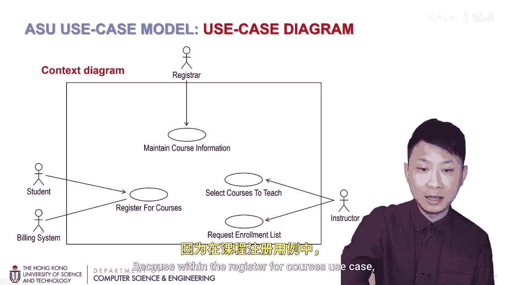

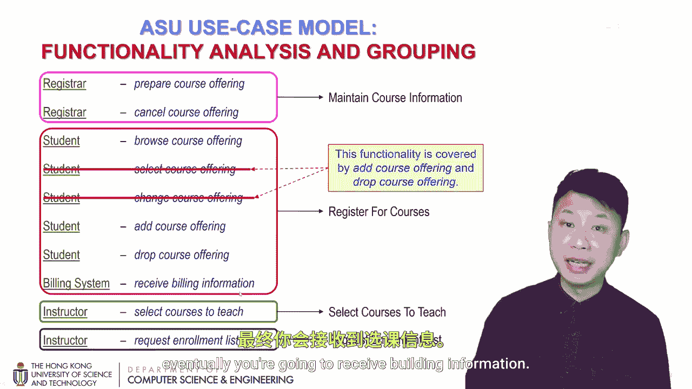

因此，我们这里有一条连线，意味着该用例将向楼宇系统传递一些信息。这个用例不是由楼宇系统启动的。它是由学生启动的，因为我们有一个从学生指向用例的箭头。我们有一条介于楼宇系统和注册课程用例之间的连线，因为楼宇系统将从这个用例接收一些信息。这条连线表示楼宇系统和该用例之间将存在一些通信。请注意，我们没有箭头，这意味着该用例不是由楼宇系统启动的，实际上是由学生启动的。

对于您提出的每个用例，您都必须制定一个**用例规约**。我们将在下一讲中详细讨论如何编写用例规约。

请注意，在用例建模中，您也可以使用**泛化**。您可以在参与者上执行泛化，也可以在用例上执行泛化。例如，员工可以泛化为两种类型：职员或经理。或者我们也可以泛化用例，例如，“用户验证”可以泛化为两种类型：“检查密码”和“扫描指纹”。

但是，在您的项目中，请**尽量不要使用用例泛化**。没有必要这样做，因为即使不使用用例泛化，您仍然可以得到正确答案，而且它经常被误用。因此，我建议大家在项目中尽量避免对用例使用泛化。当然，您仍然可以在参与者上使用泛化。

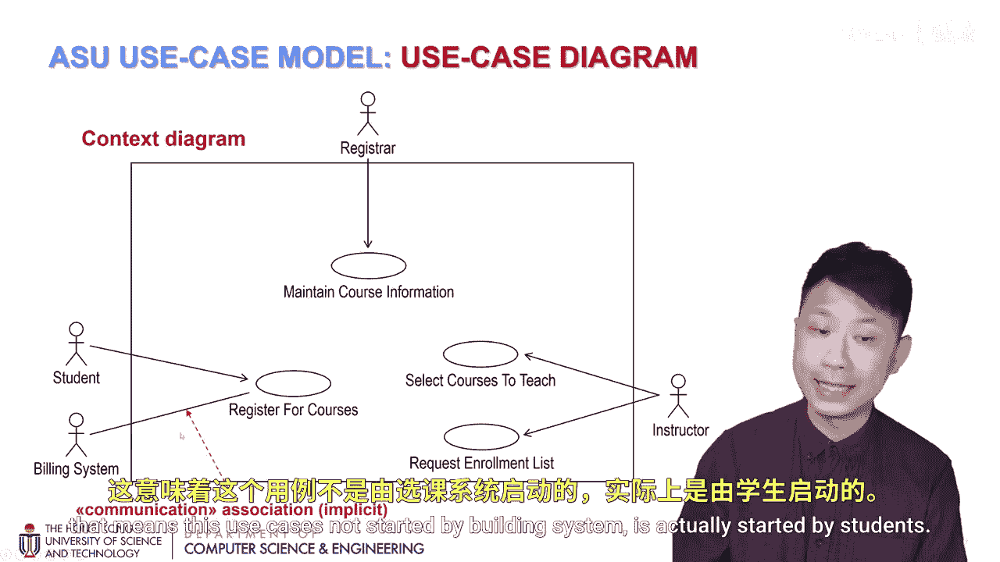

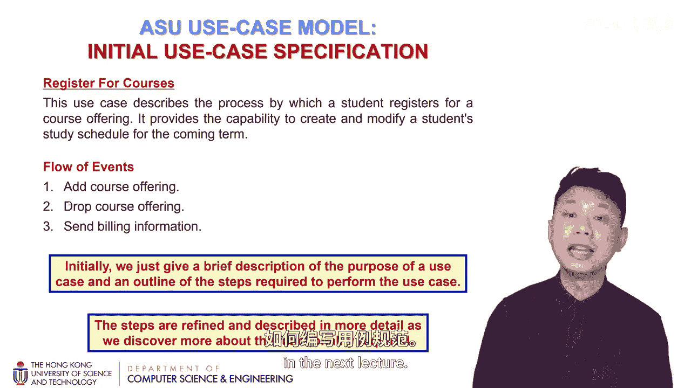

这就是本节课我想涵盖的所有内容。

---

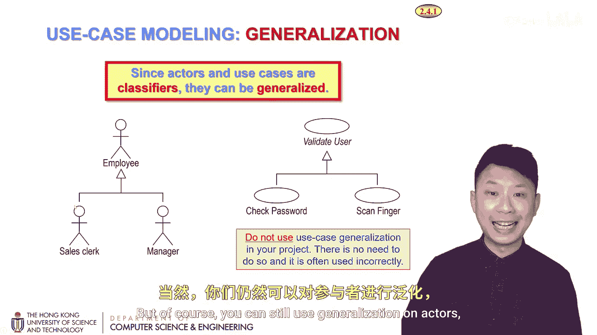

**总结**
本节课中，我们一起学习了用例建模的具体实践。我们从逐句分析需求开始，识别出离散的功能点，然后通过**功能分组**和**故事完整性**的原则，将这些点整合成代表完整业务流程的用例。我们明确了好的用例应是完整的用户目标，并最终构建了包含参与者、用例及它们之间关系的用例图。记住，保持用例的完整性和图表的简洁性是创建有效用例模型的关键。