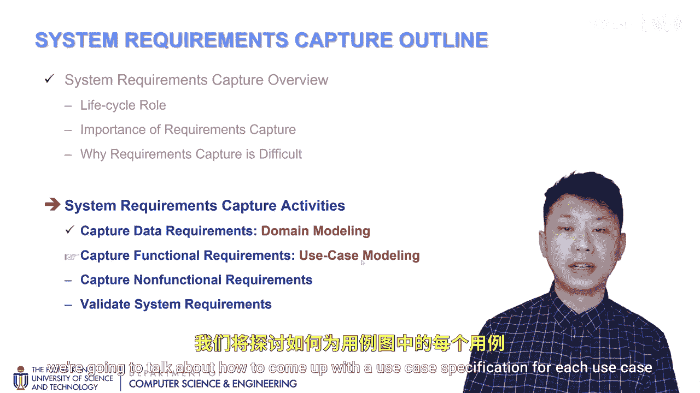
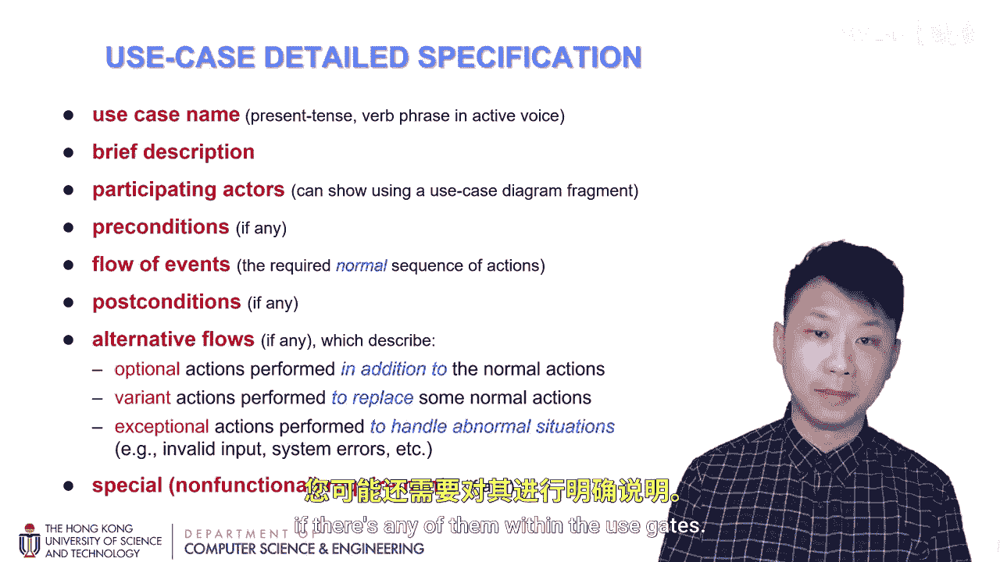
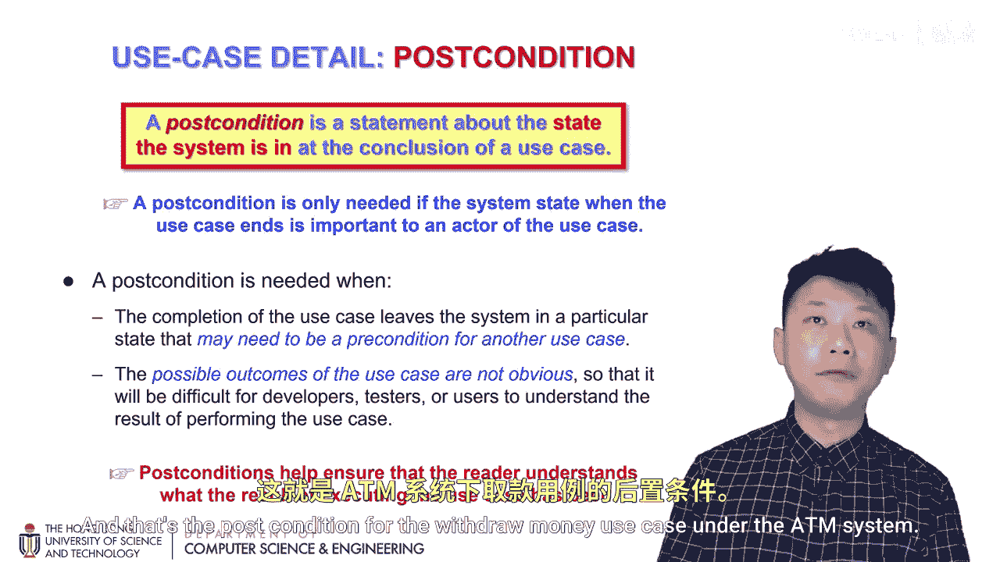
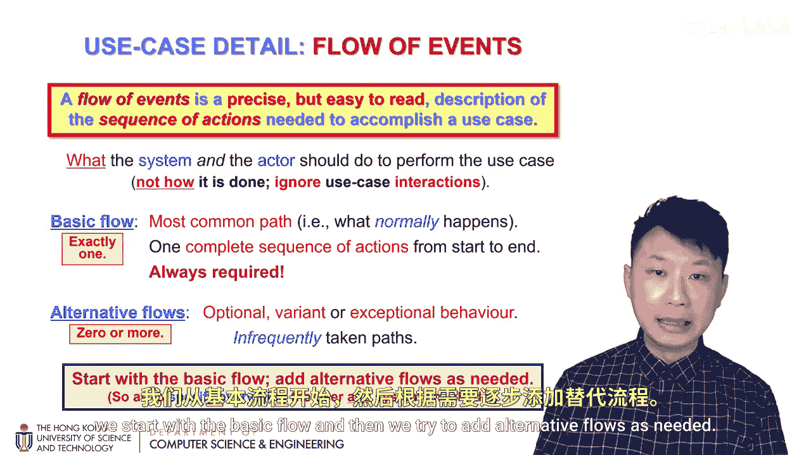
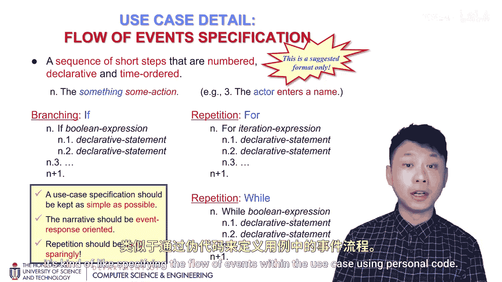
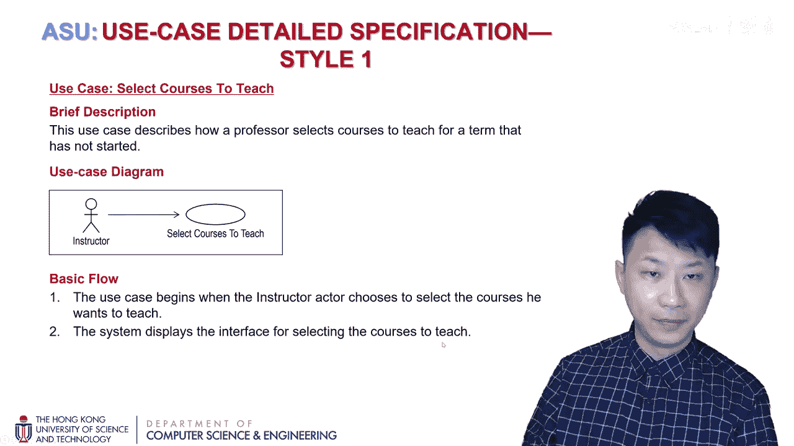
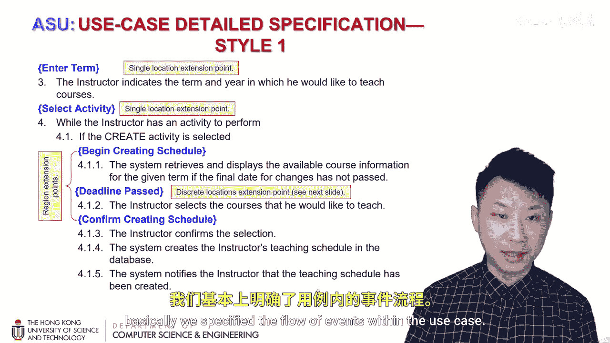

# 016：用例规范 📝

在本节课中，我们将学习如何编写用例规范，以详细描述一个用例内部的事件流程。用例规范是需求分析阶段的关键文档，它帮助我们清晰地定义系统与用户之间的交互。

## 概述

上一节我们介绍了用例图，它从宏观上描述了系统的功能范围。本节中，我们来看看如何为用例图中的每一个用例编写详细的规范。一个完整的用例规范包含多个部分，以下是其主要组成部分。

## 用例规范的组成部分

一个用例规范必须包含以下核心要素：

1.  **用例名称**：清晰标识该用例。
2.  **简要描述**：用一两句话概括用例的目的。
3.  **参与者**：列出与该用例交互的所有角色。
4.  **前置条件**：执行该用例前，系统和参与者必须满足的状态。
5.  **事件流**：描述执行用例时，参与者和系统之间交互的详细步骤。
6.  **后置条件**：用例成功结束后，系统所处的状态。
7.  **可选/异常流**：描述正常流程之外的变体或错误处理流程。
8.  **非功能性需求**：与该用例相关的性能、安全等要求（如有）。

## 前置条件与后置条件详解

### 前置条件

前置条件是一个关于**状态**的声明，它说明了在执行用例之前，系统和/或参与者必须处于何种状态。它只在该用例的执行依赖于某些特定条件时才需要写明。

*   **目的**：使各个用例的描述尽可能相互独立。
*   **写法**：只声明“什么必须为真”，而不描述“如何使其为真”。
*   **性质**：前置条件是执行用例的**必要条件**，但非**充分条件**。用例的启动总是需要参与者首先在系统中执行某个动作。

**示例**：在一个银行ATM系统的“取款”用例中，一个可能的前置条件是：`用户账户余额 >= 100元`。这意味着在执行取款操作前，必须满足此条件。

### 后置条件

后置条件是一个关于**状态**的声明，它说明了在用例结束时，系统处于何种状态。它只在用例结束时的系统状态对参与者或其他用例重要时才需要写明。

*   **目的**：确保读者和利益相关者清楚了解执行用例后的结果。该结果状态可能成为其他用例的前置条件。
*   **写法**：清晰定义用例成功完成后的系统状态。

**示例**：继续使用ATM“取款”的例子，一个可能的后续条件是：`取款后，用户账户余额 >= 0元`。这定义了用例成功执行后的结果状态。

## 事件流：基本流与可选流

事件流是对完成用例所需的一系列动作的精确且易于理解的描述。它规定了在用例执行过程中，系统和参与者应该做什么。

在用例规范中，我们首先描述**基本流**（即正常情况下会发生的流程），然后根据需要添加**可选流**（即变体或异常行为）。

描述基本流时，可以使用类似伪代码的结构，例如：

*   **条件语句**：`if (条件) then (执行动作)`
*   **循环语句**：`for (条件) repeat (执行动作)` 或 `while (条件) do (执行动作)`

## 用例规范示例

以下是一个“选课授课”用例的规范示例，该系统是ASECU课程注册系统的一部分。

**用例名称**： 选课授课

**简要描述**： 本用例描述教授如何为一个尚未开始的学期选择要教授的课程。

**参与者**： 教师

**前置条件**：
1.  教师已成功登录系统。
2.  目标学期尚未开始。

**基本事件流**：
1.  用例开始于教师参与者选择在系统中选课授课。
2.  系统显示选课授课界面。
3.  教师指明他希望授课的学期和年份。
4.  当教师选择创建授课活动时，系统将检索并显示给定学期的可用课程信息（前提是修改截止日期尚未过等）。
5.  ...（后续步骤）

**后置条件**：
1.  教师成功为指定学期选择了要教授的课程。
2.  课程选择信息已保存在系统中。

**可选流**：
*   **A. 无可用课程**：如果在步骤4中，系统发现没有可用课程，则通知教师并结束用例。
*   **B. 截止日期已过**：如果修改截止日期已过，系统阻止选择并显示错误信息。

（注：示例中省略了部分细节以保持简洁，实际文档应更完整。）

## 总结

本节课中，我们一起学习了如何编写用例规范。我们了解到，一个规范的用例描述需要包含名称、描述、参与者、前置后置条件以及详细的事件流（包括基本流和可选流）。通过编写用例规范，我们可以将用例图中抽象的功能点转化为具体、可验证的系统行为描述，为后续的系统设计和开发奠定坚实的基础。